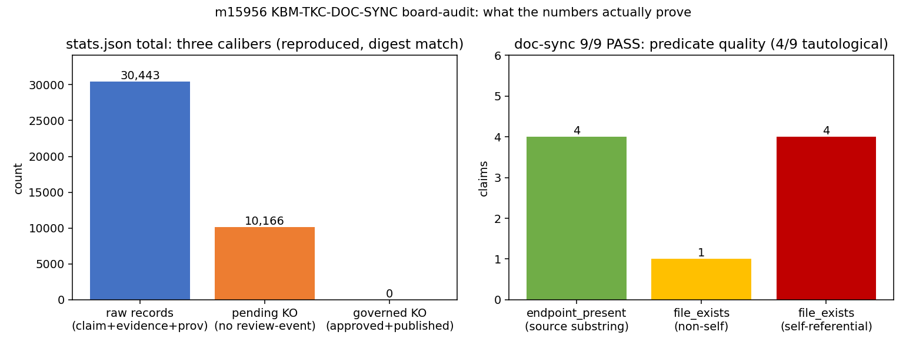

# 交差审计 m15956 · KBM-TKC-DOC-SYNC（TensorKnowledge）— verdict L2

> 本单=**核验单非重做**。审计人 board-audit；被判对象 m15956（succeeded，task_key `kbm-tkc-doc-sync-r2`，
> 交付方 deepseek-v4-flash，parent 无，session d6070914）。审计工作树 `/root/tp-agent/work/m15963`，
> 被审工作树 `/root/tp-agent/work/m15956`。判决已落表 `tensor_maturity_verdicts#421`
> （repo=TensorKnowledge, scope=`m15956 KBM-TKC-DOC-SYNC`, mission_id=15963, level=2）。

## ① 案例介绍（对象与判据）

| 项 | 值 |
|---|---|
| 锚点 | KBM-TKC-DOC-SYNC（文档-实现一致性 + 领域语义边界审计，P0） |
| 被审单交付 | 3 个脚本（`tk_doc_sync.py` / `tk_stats.py` / `tk_boundary_audit.py`）+ 6 份生成工件 + m8802 验收路径 + README/ROADMAP 状态修正 |
| 基准裁判 | `tensor_benchmark_cases WHERE anchor_slug='KBM-TKC-DOC-SYNC'` → **0 行**（2026-11-12 查询）。
无登记基准 ⇒ 无 ref/got、无容差可判 ⇒ **L4 结构上不成立**，级别只能由功能实质判 |
| 级别口径 | L0 文档 / L1 数学·单元 / L2 独立功能实现 / L3 系统集成 / L4 基准验证 / L5 科研工程 |

## ② 怎么做的（方法/工具链）

1. 读 `tensor_dev_missions#15956.result`：`head_commit=null`、`branch=null`、`fail_stage=budget_exhausted+forced_finish`，
   `on_disk_changes` 19 项；`git status` 全部为 `??`/`M` ⇒ **交付物未提交**（无 commit 身份）。
2. 在被审工作树内复跑 4 条命令（`scripts/board_audit_m15956.py` 逐条留 command/exit/stdout 原文，
   摘要 `docs/ke/board-audit-m15956/audit_summary.json`（工作副本 `artifacts/board-audit/m15956/`））。
3. 对生成工件做**结构分析**（不只看它自称通过）：doc-sync 9 条声明的谓词类型与自指比例；
   stats 三口径是否真由数据算出；boundary 违规的 critical 子集与 headline 对账。
4. 工件存在性 + sha256 绑定；用 `maturity_gate.py::judge` 现场模拟机器裁定。

## ③ 计算结果

### 3.1 复现命令（全部在 `/root/tp-agent/work/m15956` 执行）

| # | 命令 | exit | 实测输出 |
|---|---|---|---|
| R1 | `python3 scripts/tk_doc_sync.py --check` | 0 | `DOC-SYNC 9/9 pass` |
| R2 | `python3 scripts/tk_stats.py --check` | 0 | `STATS PASS`（digest 与落盘工件一致） |
| R3 | `python3 scripts/tk_boundary_audit.py --check` | **1** | `BOUNDARY FAIL core_violations=61`（诚实 FAIL，设计内） |
| R4 | `python3 -m pytest tests/test_ke_proto.py tests/test_ke_api.py -q` | 0 | `55 passed` |
| R5 | `python3 -m pytest tests/test_ke_migrate.py -q` | **1** | `4 failed, 6 passed`（=交付方登记的 4 项 pin 过期，未修但如实登记） |

### 3.2 headline 数字声明 vs 本次实测

| 声明 | 实测 | 判 |
|---|---|---|
| 文档-实现漂移门 9/9 PASS | 9/9 | ✅ |
| 原始记录 30443 | 30443（claims 10166 + evidence 10246 + provenance 10031） | ✅ |
| 待评审 KO 10166 | 10166 | ✅（口径为常量 len(claims)，见 ⑤） |
| 经治理 KO 0 | 0 | ✅（口径恒 0 硬编码，见 ⑤） |
| 61 处核心违规 | 61 个文件（224 个核心 py 扫描） | ✅ |
| **A级 6 处** | **4 个 critical 文件**（contract/export/ingest_client/migrate），词命中 8 次 | ❌ 夸大 |
| 55 passed（proto+api） | 55 | ✅ |

### 3.3 工件存在性与指纹（sha256 前 16 位）

| 工件 | 字节 | sha256[:16] |
|---|---|---|
| docs/ke/doc-sync-report.json | 2623 | 4fc6fdf71192bb87 |
| docs/ke/doc-sync-report.md | 1151 | 5d5b279817420ce0 |
| docs/ke/stats.json | 1590 | 6f904802adbe0b16 |
| docs/ke/stats.md | 748 | 984c01622c7fc453 |
| docs/ke/boundary-audit.json | 23576 | a2848097003edabf |
| docs/ke/boundary-audit.md | 8531 | f1d7f55072524408 |
| docs/ke/figures/doc-sync-stats.png | 35203 | 1ebff892c67f0b6e |
| scripts/tk_doc_sync.py | 4382 | 73c2782607f1ec7f |
| scripts/tk_stats.py | 6074 | 5572ad9290e430fe |
| scripts/tk_boundary_audit.py | 6300 | e07c563d5de5242e |

### 3.4 机器裁定模拟

`maturity_gate.judge(level=2, evidence, repo='TensorKnowledge', audit_mid=15963)` → **gate_level=2, why=[]**
（impl_files 均为 84–126 行有效主体、0 placeholder；entry/run_artifacts 路径全部存在）。
按守护语义 `≥2 → confirmed`。L3 不成立：`grep` 生态仓 `tk_doc_sync|tk_stats|tk_boundary_audit` 在
`scripts/` 与生成报告之外 **0 命中**，`ROADMAP.md:23`「接入 CI 门禁」仍未勾选。

## ④ 结果图

左：`stats.json` 三口径（原始记录 30443 / 待评审 KO 10166 / 经治理 KO 0），由审计器从落盘工件程序化提取，
digest `f444d1f1d376846775d6cda274d78aec42315d87f0b5ce54c54fb5d3d9d1beef` 复现一致。
右：doc-sync 9 条声明的谓词质量——`endpoint_present`（源码子串）4 条、`file_exists` 非自指 1 条、
**自指 4 条**，说明 9/9 PASS 中 4 条不构成「文档-实现一致」证据。

## ⑤ 注意点（缺陷分级）

**阻断性（影响级别置信，不改变 L2 的功能存在性）**

1. **自指谓词 4/9**（`docs/ke/doc-sync-manifest.json`）：`proto.md`「PostgreSQL 是权威存储」的谓词是
   `file_exists(docs/ke/backends.md)`；`m8802-acceptance.md`/`boundary-audit.md` 各自以「自身文件存在」为谓词；
   `stats.md` 以 `stats.json` 存在为谓词。这类声明即使实现完全缺失也能 PASS ⇒ **漂移门对其声明的能力无鉴别力**。
2. **口径硬编码**（`scripts/tk_stats.py::_scope_counts`）：`governed_ko` 恒 `0`、`pending_ko = len(claims)`，
   从未读取 review-event。本次 `knowledge/` 下确无 review-event（仅 2 个文档提及 review_status），
   数值碰巧为真，但口径是常量而非实测——数据一变就会说谎（MOCK 风险，如实登记）。
3. **交付物未提交**：`head_commit=null`，全部新增文件处于未跟踪状态，无 commit/PR 身份；
   `budget_exhausted+forced_finish` 下收尾，可复现性依赖工作树存活。

**非阻断**

4. headline「A级 6 处」与工件不符（4 个 critical 文件 / 8 次词命中）——报告层夸大，非算法层造假。
5. 新增 3 个脚本**零单元测试**；`55 passed` 全部来自既有 KE 测试套件，不能背书新代码。
6. `test_ke_migrate.py` 4 项失败已如实登记（未修），属于已知欠账而非隐瞒。

## ⑥ 误差判定（显式回答）

- **是否有 <3% 的数值误差结论？** 无。裁判表 `tensor_benchmark_cases` 对该 anchor **0 行**，
  本单产物是「文档一致性/边界审计」类工具，不存在物理量 ref/got 对；**任何百分比误差表述都无依据，故不写**。
- 可判的只有**声明-实测一致性**：7 条 headline 数字中 6 条逐位吻合（30443/10166/0/61/9-of-9/55），
  1 条夸大（6→4）。3 个脚本的运行结果两次复跑完全可复现（doc-sync 9/9、stats digest 一致、boundary 61）。

## 判级与处置

**L2（独立功能实现）**：3 个脚本为真代码（输入→计算→输出，84–126 行主体，0 placeholder），
工件非空且可复现；但 **L3/L4 均无证据**（integration_callers 0 命中、benchmark 0 行），
且核心漂移门 4/9 谓词自指 ⇒ 功能存在但**不能据此宣称"文档-实现一致性已受机器保障"**。

处置：**approve with notes**。返修建议（非返修令，交 gate/owner 定夺）：
(a) 4 条自指谓词换成真实现检查（如 `stats` 口径由 review-event 实算、`boundary-audit` 谓词改为"审计器可运行且产工件"）；
(b) 把 3 个脚本接进 CI（`ROADMAP.md:23`）以获得 L3；
(c) 补 `tests/test_tk_*.py` 覆盖 doc-sync 的 FAIL 分支（负对照：故意制造漂移应 FAIL）。

**独立性声明**：审计人仅执行/只读被审工作树，未修改其任何文件；未重做被审单设计。
**未跑的检查**：无集群级复算（本单无重计算）；未验证 `docs/ke/figures/*.png` 的视觉内容（仅指纹+尺寸）；
未在 x86 CI 环境复跑（本机与 GitHub CI 架构差异未判读）。