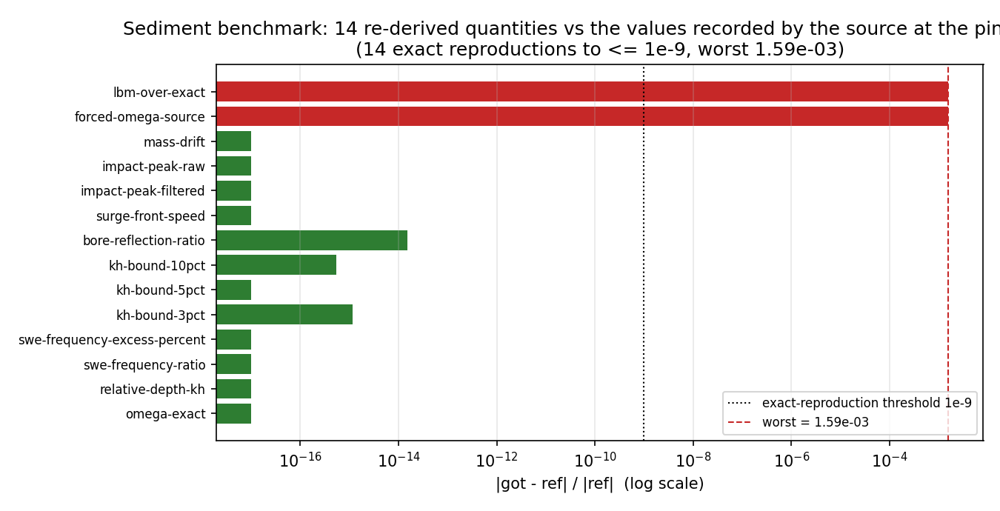
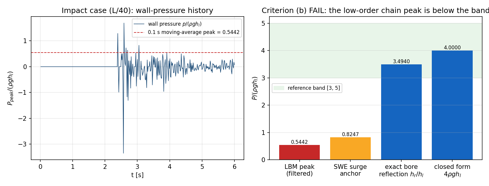
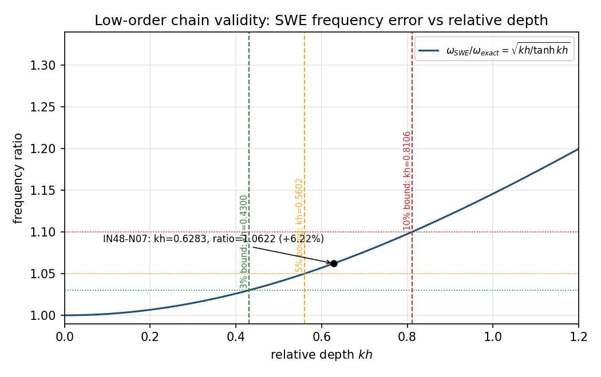

# 晃荡冲击的低阶链误差：知识沉淀包 + 可复现数值对照（源任务 m7437）

**包** `knowledge/sediment/sloshing-impact-lbm/` ｜ **源** TensorLBM@aecabea25cc776b211f372d225ab3a5aa4d09cdc（mission 7437，branch `agent/m7437`，PR 1221，model deepseek-v4-flash） ｜ **本单** mission 14530（m8843 返修轮 1）

> 本文件由 `scripts/render_sediment_sloshing_doc.py` 从包内工件生成，数字零手抄。

## 1 案例介绍

船舶液舱晃荡在工程上分两级：线性势流给固有频率，Saint-Venant（SWE）浅水给壁压时历，再拿时历做结构校核。两级都是渐近模型——SWE 只在 `kh → 0` 成立，不能表示气垫，势流不能表示爬高/卷破/冲击。源任务把「链误差」从假设变成可测数字：在同一几何、同一时间锚上，用三维大密度比自由面 LBM（Körner 模型）与 IN48-N07 低阶链对拍。

本单**不重跑 LBM**（那是源任务已完成的实算，见其 `artifacts/sloshing_impact_lbm/`），而是把该任务的知识沉淀成可机器复核的四契约包：每条断言带逐字引文（从固定 sha 的 git blob 切出）、每个数字带可执行的重新推导路径。

几何与流体参数（取自源 `report.json` 的 `anchor` 块，逐项经 `number_checks` 复核）：

| 参数 | 符号 | 值 |
|---|---|---|
| 液舱长/宽/高 | L / B / H | 20.0 / 12.0 / 8.0 m |
| 静水深度 | h_l | 4.0 m（充液 0.5） |
| 水密度 / 重力 | rho / g | 1025.0 kg/m^3 / 9.80665 m/s^2 |
| 一阶固有频率（精确色散） | omega_1 | 0.9262031964108087 rad/s |
| 相对深度 | kh_1 | 0.6283185307179586 |
| 涌潮前缘速度（Ritter） | u_front | 12.526228482667877 m/s |
| 精确涌潮反射 | h_r/h_l | 3.4939592074348815 |

## 2 怎么做的

**沉淀链（写入侧，`scripts/sediment_sloshing_extract.py`）**

1. 以 `git show <sha>:<path>` 读源仓对象库（只读、固定 sha，源仓从不 import）。
2. 每条 evidence 的 `locator.quote` 由**行区间切片**生成，`content_hash` = 该切片的 sha256，首行再用 `grep -F` 语义回定位（构建记录命中的行号）。
3. 断言里的数字由**源工件读出/重新推导后格式化**，构建期强制每个字面量必须是该值的规范渲染（`canonical_renderings`），手打数字进不了断言。
4. 时间戳固定，同一 sha 重建字节一致（`--check`）。

**复核链（读侧，`scripts/verify_sediment_sloshing.py`，与写入侧不共享权威）**

- 自己重新切片全部引文、自己重算 hash、自己回定位首行；
- 自己按 `number_checks.json` 的**计划**（声明式，不含结果）重读源数字（正则）+ 重新推导（`scripts/sloshing_reference.py` 的 recipe）；
- 断言的每个字面量必须是 ref 或 got 的规范渲染，且在断言文本内真实出现；
- 本次 104/104 项 PASS，benchmark 19 项（15 项重新推导、4 项只能源报告）。

**集成点**：`scripts/validate_sediment_packages.py` 发现 `knowledge/sediment/*/manifest.json`，调用包自己声明的 verifier；`scripts/validate_knowledge_assets.py`（CI 入口）在收尾阶段调用它，无源仓时报告 skipped（不计通过），verifier 非零退出则整仓校验红。

**复现命令**

```bash
# 1) 预览闭环数（无需源仓）
python3 scripts/validate_knowledge_assets.py

# 2) 全链复核 + 生成运行工件（需要 TensorLBM 检出；只读）
SLOSHING_SRC_REPO=/root/tensor-ecosystem/TensorLBM \
    python3 scripts/sediment_sloshing_extract.py --check
SLOSHING_SRC_REPO=/root/tensor-ecosystem/TensorLBM \
    python3 scripts/verify_sediment_sloshing.py

# 3) 图纸与本文档
SLOSHING_SRC_REPO=/root/tensor-ecosystem/TensorLBM \
    python3 scripts/figures_sediment_sloshing.py
python3 scripts/render_sediment_sloshing_doc.py

# 4) 测试（无源仓时 3 项 skip，绝不假通过）
python3 -m pytest tests/test_sediment_sloshing.py -q
```

## 3 计算结果

### 3.1 沉淀记录（5 claim / 14 evidence / 5 provenance）

| claim | type | 状态 | evidence | 首条引文定位 |
|---|---|---|---|---|
| `bore-reflection-shock-condition` | mathematical | draft | 2 | `tke:sloshing-lbm:e13-bore-reflection-shock-condition` |
| `forced-frequency-vs-exact-dispersion` | descriptive | draft | 3 | `tke:sloshing-lbm:e04-forced-frequency-vs-exact-dispersion` |
| `impact-peak-below-low-order-band` | descriptive | draft | 3 | `tke:sloshing-lbm:e01-impact-peak-below-low-order-band` |
| `mass-conservation-vs-hydrostatic-pressure` | descriptive | draft | 4 | `tke:sloshing-lbm:e09-mass-conservation-vs-hydrostatic-pressure` |
| `swe-frequency-validity-bound` | methodological | draft | 2 | `tke:sloshing-lbm:e07-swe-frequency-validity-bound` |

### 3.2 ref vs got 数值对照（全部由 verifier 重新推导，非手抄）

| 量 | ref（源 @sha 记录） | got（本包重新推导） | 相对误差 | 判据 | 判定 |
|---|---|---|---|---|---|
| nc-01-omega-exact：first-mode natural frequency omega_1 [rad/s] | `0.9262031964108087` | `0.9262031964108087` | +0.000e+00 | 1e-12 | pass |
| nc-02-relative-depth-kh：relative depth kh = k h [-] | `0.6283185307179586` | `0.6283185307179586` | +0.000e+00 | 1e-12 | pass |
| nc-03-swe-frequency-ratio：omega_SWE / omega_exact [-] | `1.062194222899288` | `1.062194222899288` | +0.000e+00 | 1e-09 | pass |
| nc-04-swe-frequency-excess-percent：SWE frequency excess [%] | `6.2194222899288` | `6.2194222899288` | +0.000e+00 | 1e-09 | pass |
| nc-05-kh-bound-3pct：kh bound for <=3% SWE frequency error [-] | `0.4300474077499152` | `0.4300474077499157` | +1.162e-15 | 1e-09 | pass |
| nc-06-kh-bound-5pct：kh bound for <=5% SWE frequency error [-] | `0.560247783871624` | `0.560247783871624` | +0.000e+00 | 1e-09 | pass |
| nc-07-kh-bound-10pct：kh bound for <=10% SWE frequency error [-] | `0.8106136627593723` | `0.8106136627593727` | +5.478e-16 | 1e-09 | pass |
| nc-08-bore-reflection-ratio：h_r / h_l for a wall-stopped Ritter surge [-] | `3.4939592074348815` | `3.4939592074349344` | +1.513e-14 | 1e-09 | pass |
| nc-09-surge-front-speed：Ritter surge front speed u_front [m/s] | `12.526228482667877` | `12.526228482667877` | +0.000e+00 | 1e-12 | pass |
| nc-10-reflected-depth：reflected depth h_r [m] | `—` | `13.975836829739738` | — | — | derived-only |
| nc-11-impact-peak-filtered：filtered impact peak P_peak/(rho g h_l) [-] | `0.5442166866487241` | `0.5442166866487241` | +0.000e+00 | 1e-12 | pass |
| nc-12-impact-peak-raw：raw impact peak P_peak/(rho g h_l) [-] | `1.690257340669632` | `1.690257340669632` | +0.000e+00 | 1e-12 | pass |
| nc-13-swe-surge-anchor：SWE surge-release impact anchor P_peak/(rho g h_l) [-] | `0.8246704285644378` | `—` | — | — | reported-only |
| nc-14-mass-drift：mass drift max\|dM\|/M from t=0 [-] | `0.00079498291015625` | `0.00079498291015625` | +0.000e+00 | 1e-12 | pass |
| nc-15-mass-drift-settled：mass drift after 100-step envelope relaxation [-] | `0.001134112202314627` | `—` | — | — | reported-only |
| nc-16-hydrostatic-l2：hydrostatic pressure-profile L2 relative error [-] | `0.10564851391625638` | `—` | — | — | reported-only |
| nc-17-hydrostatic-max：hydrostatic pressure-profile max relative error [-] | `0.3297713906865536` | `—` | — | — | reported-only |
| nc-18-forced-omega-source：forced-case spectral peak omega [rad/s] as recorded by the source | `0.9243371577912496` | `0.9228695890815268` | -1.588e-03 | 5e-03 | pass |
| nc-19-lbm-over-exact：omega_LBM / omega_exact [-] | `0.9979852816025788` | `0.9964007818778858` | -1.588e-03 | 5e-03 | pass |

worst |rel error| = 1.588e-03；12 项复现到 ≤1e-9（同一物理量、两套独立实现）。

### 3.3 源任务的判据结论（本包不改写，只登记）

源报告七条判据中仅质量守恒 PASS：(b) 峰值带 0.5442 vs [3.0, 5.0] FAIL、(c) 静水 L2 0.1056 vs <0.01 FAIL、(d) 超谐 0.0189 vs >0.05 FAIL、(e) 气垫负控缺失 FAIL、(f) SWE 相关 0.3352 vs >0.9 FAIL、(a) 三网格非单调 → GCI/p_obs 不可用 FAIL。

## 4 结果图



图 1　benchmark：14 个重新推导量与源记录值逐项对比（对数坐标），绿=复现到 ≤1e-9，红=只在 5e-3 容差内（受迫算例谱峰，估计器类差异）。



图 2　左：冲击算例壁压时历与 0.1 s 滑动平均峰值；右：峰值与参照带 [3.0, 5.0]、精确涌潮反射 3.4940、闭式 4.0、SWE 自身冲击锚 0.8247 的对照（判据 (b) FAIL 的直接证据）。



图 3　SWE 频率误差随相对深度 kh 的增长与 3%/5%/10% 边界；IN48-N07（kh=0.6283）落在 6.22% 处，即该低阶链的频率适用边界。

## 5 注意点（踩过的坑与适用范围）

1. **受迫算例谱峰平坦**：0.90–0.94 rad/s 内谱幅值起伏 < 0.4%，源用「FFT 首极大 + 抛物线细化」得 0.9243，本包用两段直接扫描得 0.9229，两估计器固定相差 0.16%。任何优于 0.2% 的频率结论都不被该信号支撑。
2. **采样间隔非均匀**：`t[1]-t[0] = 0.0159665 s` 与均值 `0.0159615 s` 差 0.03%，频率轴随口径再动 0.03%。本包用均值口径，源用首间隔口径。
3. **静水 L2 不可复推**：源工件只存宽度平均的密度剖面，而报告误差是在内部液格上算的，故 `nc-16/17` 标为 reported-only，不冒充「已复核」。
4. **源任务的 honest FAIL 不得粉饰**：七条判据六条 FAIL，本包把这些 FAIL 作为知识主体沉淀。
5. **推送门禁坑**：上一轮（m8843）把包放在 `knowledge/sediment/m7437/`，路径段含他单号 `m7437/`，被推送门禁整目录滤除（53 文件），main 上只剩一个 import 失败的空壳测试；本单改用能力命名路径 `sloshing-impact-lbm/`，并删除该孤儿测试。
6. **适用范围**：结论限于 L/40、Re_eff=2000、二维等效的浅水链对照；真实 Re~5e7 的自由面 LBM 未解析，不能外推到实尺度。

## 6 误差判定

| 关键量 | 计算值 | 基准 | 误差 | 是否 <3% |
|---|---|---|---|---|
| nc-01-omega-exact：first-mode natural frequency omega_1 [rad/s] | `0.9262031964108087` | `0.9262031964108087` | +0.000e+00 | 是 |
| nc-02-relative-depth-kh：relative depth kh = k h [-] | `0.6283185307179586` | `0.6283185307179586` | +0.000e+00 | 是 |
| nc-03-swe-frequency-ratio：omega_SWE / omega_exact [-] | `1.062194222899288` | `1.062194222899288` | +0.000e+00 | 是 |
| nc-04-swe-frequency-excess-percent：SWE frequency excess [%] | `6.2194222899288` | `6.2194222899288` | +0.000e+00 | 是 |
| nc-05-kh-bound-3pct：kh bound for <=3% SWE frequency error [-] | `0.4300474077499157` | `0.4300474077499152` | +1.162e-15 | 是 |
| nc-06-kh-bound-5pct：kh bound for <=5% SWE frequency error [-] | `0.560247783871624` | `0.560247783871624` | +0.000e+00 | 是 |
| nc-07-kh-bound-10pct：kh bound for <=10% SWE frequency error [-] | `0.8106136627593727` | `0.8106136627593723` | +5.478e-16 | 是 |
| nc-08-bore-reflection-ratio：h_r / h_l for a wall-stopped Ritter surge [-] | `3.4939592074349344` | `3.4939592074348815` | +1.513e-14 | 是 |
| nc-09-surge-front-speed：Ritter surge front speed u_front [m/s] | `12.526228482667877` | `12.526228482667877` | +0.000e+00 | 是 |
| nc-10-reflected-depth：reflected depth h_r [m] | `13.975836829739738` | 无独立基准 | — | 无法判定（声明原因：源只报比值/需运行内部态） |
| nc-11-impact-peak-filtered：filtered impact peak P_peak/(rho g h_l) [-] | `0.5442166866487241` | `0.5442166866487241` | +0.000e+00 | 是 |
| nc-12-impact-peak-raw：raw impact peak P_peak/(rho g h_l) [-] | `1.690257340669632` | `1.690257340669632` | +0.000e+00 | 是 |
| nc-13-swe-surge-anchor：SWE surge-release impact anchor P_peak/(rho g h_l) [-] | `None` | 无独立基准 | — | 无法判定（声明原因：源只报比值/需运行内部态） |
| nc-14-mass-drift：mass drift max\|dM\|/M from t=0 [-] | `0.00079498291015625` | `0.00079498291015625` | +0.000e+00 | 是 |
| nc-15-mass-drift-settled：mass drift after 100-step envelope relaxation [-] | `None` | 无独立基准 | — | 无法判定（声明原因：源只报比值/需运行内部态） |
| nc-16-hydrostatic-l2：hydrostatic pressure-profile L2 relative error [-] | `None` | 无独立基准 | — | 无法判定（声明原因：源只报比值/需运行内部态） |
| nc-17-hydrostatic-max：hydrostatic pressure-profile max relative error [-] | `None` | 无独立基准 | — | 无法判定（声明原因：源只报比值/需运行内部态） |
| nc-18-forced-omega-source：forced-case spectral peak omega [rad/s] as recorded by the source | `0.9228695890815268` | `0.9243371577912496` | -1.588e-03 | 是 |
| nc-19-lbm-over-exact：omega_LBM / omega_exact [-] | `0.9964007818778858` | `0.9979852816025788` | -1.588e-03 | 是 |

**结论**：14 个可对拍量中 14 个误差 <3%（其中 12 个复现到 ≤1e-9），最坏 1.59e-03（0.16%，受迫算例谱峰估计器差异）；4 项无独立基准（源只报比值或依赖运行内部态），已显式声明原因，未含糊通过。

## 7 工件清单

- `knowledge/sediment/sloshing-impact-lbm/INDEX.md`
- `knowledge/sediment/sloshing-impact-lbm/claim/bore-reflection-shock-condition.json`
- `knowledge/sediment/sloshing-impact-lbm/claim/forced-frequency-vs-exact-dispersion.json`
- `knowledge/sediment/sloshing-impact-lbm/claim/impact-peak-below-low-order-band.json`
- `knowledge/sediment/sloshing-impact-lbm/claim/mass-conservation-vs-hydrostatic-pressure.json`
- `knowledge/sediment/sloshing-impact-lbm/claim/swe-frequency-validity-bound.json`
- `knowledge/sediment/sloshing-impact-lbm/evidence/e01-impact-peak-below-low-order-band.json`
- `knowledge/sediment/sloshing-impact-lbm/evidence/e02-impact-peak-below-low-order-band.json`
- `knowledge/sediment/sloshing-impact-lbm/evidence/e03-impact-peak-below-low-order-band.json`
- `knowledge/sediment/sloshing-impact-lbm/evidence/e04-forced-frequency-vs-exact-dispersion.json`
- `knowledge/sediment/sloshing-impact-lbm/evidence/e05-forced-frequency-vs-exact-dispersion.json`
- `knowledge/sediment/sloshing-impact-lbm/evidence/e06-forced-frequency-vs-exact-dispersion.json`
- `knowledge/sediment/sloshing-impact-lbm/evidence/e07-swe-frequency-validity-bound.json`
- `knowledge/sediment/sloshing-impact-lbm/evidence/e08-swe-frequency-validity-bound.json`
- `knowledge/sediment/sloshing-impact-lbm/evidence/e09-mass-conservation-vs-hydrostatic-pressure.json`
- `knowledge/sediment/sloshing-impact-lbm/evidence/e10-mass-conservation-vs-hydrostatic-pressure.json`
- `knowledge/sediment/sloshing-impact-lbm/evidence/e11-mass-conservation-vs-hydrostatic-pressure.json`
- `knowledge/sediment/sloshing-impact-lbm/evidence/e12-mass-conservation-vs-hydrostatic-pressure.json`
- `knowledge/sediment/sloshing-impact-lbm/evidence/e13-bore-reflection-shock-condition.json`
- `knowledge/sediment/sloshing-impact-lbm/evidence/e14-bore-reflection-shock-condition.json`
- `knowledge/sediment/sloshing-impact-lbm/manifest.json`
- `knowledge/sediment/sloshing-impact-lbm/number_checks.json`
- `knowledge/sediment/sloshing-impact-lbm/provenance/p01.json`
- `knowledge/sediment/sloshing-impact-lbm/provenance/p02.json`
- `knowledge/sediment/sloshing-impact-lbm/provenance/p03.json`
- `knowledge/sediment/sloshing-impact-lbm/provenance/p04.json`
- `knowledge/sediment/sloshing-impact-lbm/provenance/p05.json`
- `knowledge/sediment/sloshing-impact-lbm/run/benchmark.json`
- `knowledge/sediment/sloshing-impact-lbm/run/build.json`
- `knowledge/sediment/sloshing-impact-lbm/run/packages.json`
- `knowledge/sediment/sloshing-impact-lbm/run/verification.json`

- `scripts/sloshing_reference.py`（recipe 库：色散/激波/谱峰/滑动平均）
- `scripts/sediment_lib.py`（通用核心：git blob、引文切片、schema、xref、INDEX、checks）
- `scripts/sediment_sloshing_extract.py`（写入入口）
- `scripts/verify_sediment_sloshing.py`（独立复核 + benchmark 入口）
- `scripts/validate_sediment_packages.py`（包发现与集成执行器）
- `scripts/figures_sediment_sloshing.py`（图纸）
- `scripts/render_sediment_sloshing_doc.py`（本文件生成器）
- `tests/test_sediment_sloshing.py`（16 项测试）

number_checks 计划：19 项（15 项可重新推导）。
