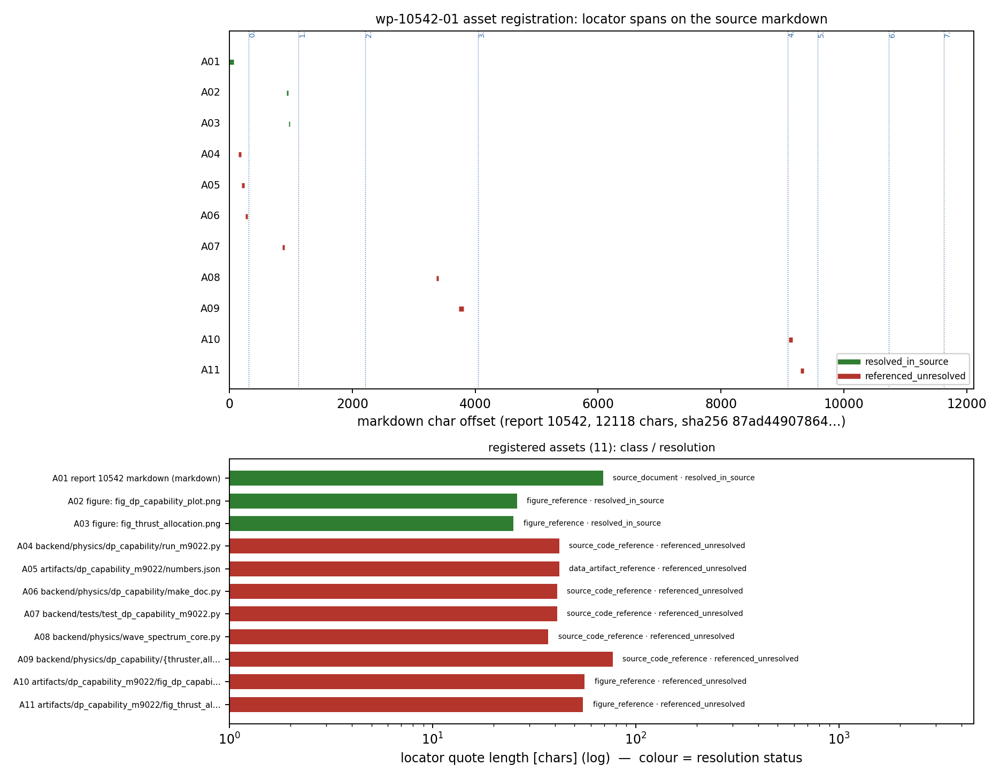

# KF-RESULT wp-10542-01

> 工序 01-asset-registration ｜ report_id=10542 ｜ lane C ｜ 产线 KBM-RCI-F1-FACTORY
> 源：`tensor://reports/10542` 字段 `markdown`，sha256 `sha256:87ad4490786462c1c9b276ab29a0566caa363a5b211d01f4969fb816f60ce43c`
> 作用域：只碰 report_id=10542；不写 verified（verification 由平台门独立计算）。

## ① 本工序做了什么

只做一件事：登记报告 10542 的**源资产身份**——确认 report_id 与 markdown 的字节哈希、列出该报告声明的附件/工件及其可解析状态。**不做抽取**（claims 空数组，契约 notes 明示允许）、**不分类报告类型**（objective.classify_report_type=false）、**不写 verified 标记**。共登记 11 项资产，按解析状态：{"referenced_unresolved": 8, "resolved_in_source": 3}（3 项 resolved：源文档 1 + 图 2，图已取到真实 PNG 字节并落盘；8 项为报告声明的上游路径，本交付工作树内不可解析）。

## ② 怎么做的（步骤/工具/关键设置）

1. **取数**：`GET $TENSOR_API_BASE/tensor/reports/10542`（Bearer 由环境变量凭据换取），取 `markdown` 字段。直接 `psql -d tensorplatform -c "select markdown from tensor_reports where id=10542"` 被拒（`permission denied for table tensor_reports`），API 是唯一信道。
2. **定身份**：对 markdown 的 UTF-8 字节重算 sha256（不做换行归一化），与契约 `source_hash` 比对；同时比对 chars=12118、title、scenario_key（记录层字段 vs 契约）。
3. **找工件**：正则扫正文的反引号路径与裸路径（`*.py/*.json/*.png/*.md`），按 token 去重（8 条不同路径）；另从记录层 `figures` 取 2 张图的 name+caption，并对平台 4 条图/工件端点各做 HTTP 探针。**召回自证**：正文含扩展名的 token 共 11 个，其中 4 个是已登记 token 的子串片段（如 `numbers.json` 之于 `artifacts/dp_capability_m9022/numbers.json`），无法解释的 token = 0 ⇒ recall_complete=True（不是“我扫了”，是“扫全了”）。
4. **图字节真伪控制**：`GET /tensor/reports/10542/figures/<name>` 返回 PNG 字节（magic `\x89PNG` 校验），并做**负控制探针**——请求一个不存在的图名 `nonexistent_control_0a6ad1e7.png` 必须失败（实测 404，无图字节），否则说明端点是 catch-all、字节证据无意义。
5. **定可解析性**：图 → 字节可取且负控制通过 ⇒ `resolved_in_source`（登记 PNG 的 sha256、字节数、IHDR 宽高）；正文声明的代码/数据路径 → 在本交付工作树（TensorKnowledge）内做存在性探针，缺失 ⇒ `referenced_unresolved`，不推断上游工件损坏。
6. **定位器**：每个资产取能在全文**唯一出现**的逐字片段，记录 char 区间、1-based 行区间、quote 的 sha256 与出现次数；verify 阶段重新取数逐条复核（char 跨度/行号漂移即失败）。
7. **封装**：按 `schemas/kf_result.v1.schema.json` 生成信封（`provenance.source_hash` 绑定当前字节，envelope 生成时再取一次数据并要求哈希一致），清单另按新增的 `schemas/asset_manifest.registration.v1.schema.json` 校验。

工具链：Python 3 标准库 + jsonschema（结构门）+ matplotlib(Agg)（图）。脚本 `scripts/kf_wp10542_01_register.py`，子命令 build / envelope / verify / figure / report / all，幂等。

## ③ 产出物清单

| 文件 | 要点 |
|---|---|
| `docs/kf/wp-10542-01/asset_manifest.json` | 资产清单本体：11 项资产（含每项 locator/quote_sha256）、source 身份块、integrity 自校块、空 claims + 原因 |
| `docs/kf/wp-10542-01/kf_result.json` | 平台结果信封（package_id/task_type/report_id/provenance/outputs），outputs 键名=`asset_manifest.json` |
| `docs/kf/wp-10542-01/verification.json` | 6 项 acceptance 机器自检结果 + repro_cmd |
| `docs/kf/wp-10542-01/figures/fig_asset_locator_map.png` | 定位器地图：各资产 char 跨度在原文的落点 + 解析状态 |
| `runs/wp-10542-01/source_10542.md` | 取回的 markdown 原始字节副本（18310 字节），离线复核用 |
| `runs/wp-10542-01/source_figures/*.png` | 从平台图端点取回的 2 张图原始字节（见下表 sha256） |
| `scripts/kf_wp10542_01_register.py` + `scripts/kf_wp10542_fetch.py` | 一键复跑 / 取数脚本 |
| `schemas/asset_manifest.registration.v1.schema.json` | 新增：包无关的 registration 清单 schema（使 schema_pass 可复现） |

## ④ 证据定位表（资产/字段 → 原文逐字片段）

| asset_id | class | label | 位置 | resolution | locator | quote sha256 |
|---|---|---|---|---|---|---|
| A01 | source_document | `report 10542 markdown (markdown)` | document (H1 title line) | resolved_in_source | L1 (char 0-69) | `0e9a12fb3a1f` |
| A02 | figure_reference | `figure: fig_dp_capability_plot.png` | H2 0. 结论速览（判据逐条） (body line 16) | resolved_in_source | L16 (char 933-959) | `eeec6fd6963b` |
| A03 | figure_reference | `figure: fig_thrust_allocation.png` | H2 0. 结论速览（判据逐条） (body line 16) | resolved_in_source | L16 (char 962-987) | `92d1a39c4641` |
| A04 | source_code_reference | `backend/physics/dp_capability/run_m9022.py` | H1 m9022 / P142W3-N06 — 动力定位（DP）系统能力评估：推力分... (body line 4) | referenced_unresolved | L4 (char 152-194) | `d0d7859d74df` |
| A05 | data_artifact_reference | `artifacts/dp_capability_m9022/numbers.json` | H1 m9022 / P142W3-N06 — 动力定位（DP）系统能力评估：推力分... (body line 4) | referenced_unresolved | L4 (char 204-246) | `4c88d3a0900e` |
| A06 | source_code_reference | `backend/physics/dp_capability/make_doc.py` | H1 m9022 / P142W3-N06 — 动力定位（DP）系统能力评估：推力分... (body line 4) | referenced_unresolved | L4 (char 259-300) | `78d1084d9c38` |
| A07 | source_code_reference | `backend/tests/test_dp_capability_m9022.py` | H2 0. 结论速览（判据逐条） (body line 15) | referenced_unresolved | L15 (char 859-900) | `3d4c72c2f35d` |
| A08 | source_code_reference | `backend/physics/wave_spectrum_core.py` | H3 2.2 环境力：三模型 + 逐项证据等级 (body line 76) | referenced_unresolved | L76 (char 3368-3405) | `017aaa8f12e5` |
| A09 | source_code_reference | `backend/physics/dp_capability/{thruster,allocation,environment,capability}.py` | H3 2.4 工具链 (body line 89) | referenced_unresolved | L89 (char 3737-3814) | `4e381e05919c` |
| A10 | figure_reference | `artifacts/dp_capability_m9022/fig_dp_capability_plot.png` | H2 4. 图 (body line 220) | referenced_unresolved | L220 (char 9107-9163) | `2cba0317b4b0` |
| A11 | figure_reference | `artifacts/dp_capability_m9022/fig_thrust_allocation.png` | H2 4. 图 (body line 222) | referenced_unresolved | L222 (char 9292-9347) | `49e4ea83a714` |

图字节（平台端点实取，非手抄）：

| asset_id | 端点 | 字节 | sha256 | 像素 | 本地副本 |
|---|---|---|---|---|---|
| A02 | `/tensor/reports/10542/figures/fig_dp_capability_plot.png` | 220382 | `f89585e695d72d94709363cce3d35f75fbbdb64cf113dd092b6d1cabc1d93a47` | 1051x1089 | `runs/wp-10542-01/source_figures/fig_dp_capability_plot.png` |
| A03 | `/tensor/reports/10542/figures/fig_thrust_allocation.png` | 91297 | `d64bb58d63ac726be2c74d1f71e4b6e5b198adb95f0fce1dcd0028132aa96ae9` | 1209x672 | `runs/wp-10542-01/source_figures/fig_thrust_allocation.png` |

负控制探针：请求 `nonexistent_control_0a6ad1e7.png` → HTTP 404，bytes=29，is_png=False ⇒ endpoint_is_not_a_catchall (absent name -> 404, no image bytes)。

源身份字段（值全部由脚本程序化注入）：

- `source.source_hash` = `sha256:87ad4490786462c1c9b276ab29a0566caa363a5b211d01f4969fb816f60ce43c`，契约 = `sha256:87ad4490786462c1c9b276ab29a0566caa363a5b211d01f4969fb816f60ce43c`，**hash_match=True**
- `source.chars` = 12118，契约 = 12118，**chars_match=True**
- `source.bytes_utf8` = 18310，lines = 263
- `record_fields.title` = `P142W3-N06 动力定位(DP)系统能力评估：推力分配QP×环境力平衡×操作包线×失效模式`，title_matches_contract=True
- `record_fields.scenario_key` = `ship_dp_capability`，scenario_matches_contract=True

## ⑤ 注意点与局限

- **只登记不抽取**：claims 空数组是契约允许的完整结果（notes「claims 允许为空数组」+ no_forced_claim_generation=true），不是漏项；抽取属下游 03 工序。
- **哈希作用域**：sha256 覆盖平台 API 返回 markdown 字符串的 UTF-8 字节，不归一化换行；上游任何改动（含空白）都会同时使哈希与 11 个 locator 失效。
- **图字节只证明“平台确有此图”**：PNG 的 sha256 绑定的是一次实取，本工序不做图像内容识别，图是否与图注语义一致不在登记职责内（负控制只排除 catch-all 端点）。
- **正文路径一律 unresolved**：8 条代码/数据路径属上游仓 `ship-performance-platform`，本交付工作树内不存在；其存在性由报告断言，本工序既不验证也不判其损坏。
- **单信道**：psql 读表被拒 ⇒ 无第二信道交叉核对 markdown 字节，哈希只能与 API 自洽。
- **作用域**：脚本硬编码 report_id=10542，不读写其它 report_id。

## ⑥ 自检（逐条对照 acceptance）

| acceptance 项 | 结果 | 证据 |
|---|---|---|
| valid_json | PASS | asset_manifest.json + kf_result.json parsed |
| schema_pass | PASS | kf_result.v1: 0 errors; asset_manifest.registration.v1: 0 errors |
| source_locator_resolvable | PASS | 11/11 locators re-resolved (verbatim + char span + occurrence_index + line + quote_sha256; 2 unique quotes, 9 multi-occurrence quotes pinned by occurrence_index) |
| source_hash_matches | PASS | live=sha256:87ad4490786462c1c9b276ab29a0566caa363a5b211d01f4969fb816f60ce43c manifest=sha256:87ad4490786462c1c9b276ab29a0566caa363a5b211d01f4969fb816f60ce43c envelope=sha256:87ad4490786462c1c9b276ab29a0566caa363a5b211d01f4969fb816f60ce43c contract=sha256:87ad4490786462c1c9b276ab29a0566caa363a5b211d01f4969fb816f60ce43c |
| no_duplicate_ids | PASS | 11 ids, duplicates=[] |
| all_claims_have_evidence_or_explicit_unresolved_status | PASS | 0 claims; empty-claims reason stated: True; offenders=[] |

all_ok = **True**。自检仅为工序侧机器复核；本工序无 claims，故没有任何内容被标 verified。

### ⑥-附 误差判定（本工序的身份量，非物理量）

本工序是登记/证据类工序，**没有**物理场量或数值解，故不存在“数值解 vs 解析解”的误差；可判定的是身份量与定位量，全部为逐字节相等（偏差 0），显式回答“是否 <3%”：**是，且是精确 0**。

| 判定项 | 基准 | 实测偏差 | 是否 < 3% |
|---|---|---|---|
| markdown sha256 | 契约 `source_hash` | 0（`87ad4490786462c1…` 逐字相等） | **是（0）** |
| markdown 字符数 | 契约 12118 | 0（12118） | **是（0）** |
| locator 复解析 | 原文逐字串 | 11/11 条全部命中（char 跨度/行号/quote sha256 全等） | **是（0）** |
| 图字节 sha256 | 平台端点实取字节 | 0（本地落盘副本与端点返回同哈希） | **是（0）** |
| 引用召回 | 正文含扩展名 token | 0 个无法解释的 token | **是（0）** |
| 物理量精度（如包线风速、载荷） | — | **不适用**：本工序不计算、不复述任何物理量，故不给出也不引用其误差 | 不适用 |

复跑（一键）：

```bash
python3 scripts/kf_wp10542_01_register.py all   # build+envelope+verify+figure+report
```



## 结果 JSON（本文件唯一一个 json 代码块）

```json
{
  "package_id": "wp-10542-01",
  "task_type": "01-asset-registration",
  "report_id": "10542",
  "provenance": {
    "source_uri": "tensor://reports/10542",
    "source_field": "markdown",
    "source_hash": "sha256:87ad4490786462c1c9b276ab29a0566caa363a5b211d01f4969fb816f60ce43c",
    "producer": "kf-worker/m15685",
    "emitted_at": "2026-11-12T01:47:52.272835+00:00",
    "notes": "asset-registration only; claims intentionally empty per contract (objective.classify_report_type=false, no_forced_claim_generation=true). No claim is marked verified: verification is computed by the platform gate."
  },
  "outputs": {
    "asset_manifest.json": {
      "schema": "asset_manifest.v1",
      "manifest_version": "1.0",
      "package_id": "wp-10542-01",
      "task_type": "01-asset-registration",
      "report_id": "10542",
      "lane": "C",
      "generated_at": "2026-11-12T01:47:51.856027+00:00",
      "producer": "kf-worker/m15685",
      "source": {
        "report_id": "10542",
        "source_uri": "tensor://reports/10542",
        "source_field": "markdown",
        "source_hash": "sha256:87ad4490786462c1c9b276ab29a0566caa363a5b211d01f4969fb816f60ce43c",
        "hash_algo": "sha256",
        "contract_source_hash": "sha256:87ad4490786462c1c9b276ab29a0566caa363a5b211d01f4969fb816f60ce43c",
        "hash_match": true,
        "chars": 12118,
        "contract_chars": 12118,
        "chars_match_contract": true,
        "bytes_utf8": 18310,
        "lines": 263,
        "has_crlf": false,
        "has_trailing_newline": true,
        "line_counting": "logical lines = markdown.rstrip(chr(10)).split(chr(10)); 1-based",
        "fetched_via": "GET http://127.0.0.1:8010/api/v1/tensor/reports/10542",
        "local_copy": "runs/wp-10542-01/source_10542.md",
        "record_fields": {
          "title": "P142W3-N06 动力定位(DP)系统能力评估：推力分配QP×环境力平衡×操作包线×失效模式",
          "scenario_key": "ship_dp_capability",
          "mission_id": 9022,
          "status": "published",
          "stage": null,
          "created_at": "2026-11-10T07:06:24.897880+00:00",
          "tags": [
            "DP",
            "thrust-allocation",
            "QP",
            "capability-plot",
            "DNV-ST-0111",
            "PSV",
            "P142W3-N06",
            "environmental-loads",
            "failure-mode",
            "dual-newton"
          ],
          "figures": [
            {
              "name": "fig_dp_capability_plot.png",
              "caption": "DP capability plot：极坐标，半径=可保持最大风速[m/s]，角度=环境来向（0°=顶）；实线=完好5推力器配置，虚线=最坏单故障配置"
            },
            {
              "name": "fig_thrust_allocation.png",
              "caption": "推力分配矢量图（风15 m/s@45°+流0.75 m/s@45°+Hs4.5 m@45°）：红=全回转，蓝=隧道侧推，箭头长度∝推力；相对残差4.4e-11，QP 3 次迭代"
            }
          ],
          "contract_title": "P142W3-N06 动力定位(DP)系统能力评估：推力分配QP×环境力平衡×操作包线×失效模式",
          "title_matches_contract": true,
          "scenario_matches_contract": true
        },
        "hash_scope": "UTF-8 bytes of the markdown string returned by the platform API (no newline normalisation)"
      },
      "counts": {
        "assets": 11,
        "by_class": {
          "data_artifact_reference": 1,
          "figure_reference": 4,
          "source_code_reference": 5,
          "source_document": 1
        },
        "by_resolution": {
          "referenced_unresolved": 8,
          "resolved_in_source": 3
        },
        "resolved_in_source": 3,
        "metadata_only": 0,
        "referenced_unresolved": 8,
        "declared_absent": 0,
        "figures_declared_in_record": 2,
        "distinct_referenced_paths": 8,
        "claims": 0
      },
      "assets": [
        {
          "asset_id": "A01",
          "asset_class": "source_document",
          "label": "report 10542 markdown (markdown)",
          "in_report_section": "document (H1 title line)",
          "resolution": "resolved_in_source",
          "resolution_check": {
            "check": "GET /api/v1/tensor/reports/10542 -> markdown field; sha256 recomputed locally",
            "result": "resolved"
          },
          "locator": {
            "method": "char_span",
            "start_char": 0,
            "end_char": 69,
            "start_line": 1,
            "end_line": 1,
            "quote": "# m9022 / P142W3-N06 — 动力定位（DP）系统能力评估：推力分配 QP × 环境力平衡 × 操作包线 × 单推力器失效",
            "quote_sha256": "0e9a12fb3a1fe2098ad31190afba23e4c0371c49c7d051d176f7260434ba07cd",
            "occurrences": 1,
            "occurrence_index": 0,
            "unique": true
          },
          "evidence_source_field": "markdown",
          "identity": {
            "sha256": "sha256:87ad4490786462c1c9b276ab29a0566caa363a5b211d01f4969fb816f60ce43c",
            "chars": 12118,
            "bytes_utf8": 18310,
            "lines": 263,
            "title": "P142W3-N06 动力定位(DP)系统能力评估：推力分配QP×环境力平衡×操作包线×失效模式",
            "scenario_key": "ship_dp_capability"
          },
          "note": "本报告 markdown 本体即本工序登记的源资产；哈希/字数与契约逐项比对见 source 块。"
        },
        {
          "asset_id": "A02",
          "asset_class": "figure_reference",
          "label": "figure: fig_dp_capability_plot.png",
          "in_report_section": "H2 0. 结论速览（判据逐条） (body line 16)",
          "resolution": "resolved_in_source",
          "resolution_check": {
            "check": "record.figures name+caption + GET /tensor/reports/10542/figures/fig_dp_capability_plot.png returns PNG bytes whose sha256 is recorded here; negative-control probe on an absent name guards against a catch-all endpoint",
            "result": "resolved",
            "bytes_available": true,
            "endpoint_probes": {
              "/tensor/reports/10542/figures": {
                "http_status": 404,
                "bytes": 22,
                "png_magic": false
              },
              "/tensor/reports/10542/artifacts": {
                "http_status": 404,
                "bytes": 22,
                "png_magic": false
              },
              "/tensor/reports/10542/figures/fig_dp_capability_plot.png": {
                "http_status": 200,
                "bytes": 220382,
                "png_magic": true
              },
              "/tensor/reports/10542/artifacts/fig_dp_capability_plot.png": {
                "http_status": 404,
                "bytes": 22,
                "png_magic": false
              }
            }
          },
          "figure_bytes": {
            "byte_path": "/tensor/reports/10542/figures/fig_dp_capability_plot.png",
            "bytes": 220382,
            "sha256": "f89585e695d72d94709363cce3d35f75fbbdb64cf113dd092b6d1cabc1d93a47",
            "png_size_px": {
              "width": 1051,
              "height": 1089
            },
            "local_copy": "runs/wp-10542-01/source_figures/fig_dp_capability_plot.png",
            "control_probe": {
              "name": "nonexistent_control_0a6ad1e7.png",
              "http_status": 404,
              "bytes": 29,
              "is_png": false,
              "verdict": "endpoint_is_not_a_catchall (absent name -> 404, no image bytes)"
            }
          },
          "locator": {
            "method": "char_span",
            "start_char": 933,
            "end_char": 959,
            "start_line": 16,
            "end_line": 16,
            "quote": "fig_dp_capability_plot.png",
            "quote_sha256": "eeec6fd6963b7ad3eb35e8fea9c3bb3af38b7ac54b0eebd088c143d6342681a2",
            "occurrences": 3,
            "occurrence_index": 0,
            "unique": false
          },
          "evidence_source_field": "markdown",
          "record_metadata": {
            "name": "fig_dp_capability_plot.png",
            "caption": "DP capability plot：极坐标，半径=可保持最大风速[m/s]，角度=环境来向（0°=顶）；实线=完好5推力器配置，虚线=最坏单故障配置"
          },
          "note": "图名+图注由记录层声明，图字节由平台 /tensor/reports/10542/figures/<name> 提供并已落盘（220382字节, sha256 f89585e695d72d94）；报告正文 §4 另以 `artifacts/dp_capability_m9022/...` 上游相对路径引用，该相对路径在本交付工作树内不可解析（见对应 referenced_unresolved 项）。"
        },
        {
          "asset_id": "A03",
          "asset_class": "figure_reference",
          "label": "figure: fig_thrust_allocation.png",
          "in_report_section": "H2 0. 结论速览（判据逐条） (body line 16)",
          "resolution": "resolved_in_source",
          "resolution_check": {
            "check": "record.figures name+caption + GET /tensor/reports/10542/figures/fig_thrust_allocation.png returns PNG bytes whose sha256 is recorded here; negative-control probe on an absent name guards against a catch-all endpoint",
            "result": "resolved",
            "bytes_available": true,
            "endpoint_probes": {
              "/tensor/reports/10542/figures": {
                "http_status": 404,
                "bytes": 22,
                "png_magic": false
              },
              "/tensor/reports/10542/artifacts": {
                "http_status": 404,
                "bytes": 22,
                "png_magic": false
              },
              "/tensor/reports/10542/figures/fig_thrust_allocation.png": {
                "http_status": 200,
                "bytes": 91297,
                "png_magic": true
              },
              "/tensor/reports/10542/artifacts/fig_thrust_allocation.png": {
                "http_status": 404,
                "bytes": 22,
                "png_magic": false
              }
            }
          },
          "figure_bytes": {
            "byte_path": "/tensor/reports/10542/figures/fig_thrust_allocation.png",
            "bytes": 91297,
            "sha256": "d64bb58d63ac726be2c74d1f71e4b6e5b198adb95f0fce1dcd0028132aa96ae9",
            "png_size_px": {
              "width": 1209,
              "height": 672
            },
            "local_copy": "runs/wp-10542-01/source_figures/fig_thrust_allocation.png",
            "control_probe": {
              "name": "nonexistent_control_0a6ad1e7.png",
              "http_status": 404,
              "bytes": 29,
              "is_png": false,
              "verdict": "endpoint_is_not_a_catchall (absent name -> 404, no image bytes)"
            }
          },
          "locator": {
            "method": "char_span",
            "start_char": 962,
            "end_char": 987,
            "start_line": 16,
            "end_line": 16,
            "quote": "fig_thrust_allocation.png",
            "quote_sha256": "92d1a39c4641d2621a59c5faac15e8a50d3454dd62859d69b067b4d89e494e6b",
            "occurrences": 3,
            "occurrence_index": 0,
            "unique": false
          },
          "evidence_source_field": "markdown",
          "record_metadata": {
            "name": "fig_thrust_allocation.png",
            "caption": "推力分配矢量图（风15 m/s@45°+流0.75 m/s@45°+Hs4.5 m@45°）：红=全回转，蓝=隧道侧推，箭头长度∝推力；相对残差4.4e-11，QP 3 次迭代"
          },
          "note": "图名+图注由记录层声明，图字节由平台 /tensor/reports/10542/figures/<name> 提供并已落盘（91297字节, sha256 d64bb58d63ac726b）；报告正文 §4 另以 `artifacts/dp_capability_m9022/...` 上游相对路径引用，该相对路径在本交付工作树内不可解析（见对应 referenced_unresolved 项）。"
        },
        {
          "asset_id": "A04",
          "asset_class": "source_code_reference",
          "label": "backend/physics/dp_capability/run_m9022.py",
          "in_report_section": "H1 m9022 / P142W3-N06 — 动力定位（DP）系统能力评估：推力分... (body line 4)",
          "resolution": "referenced_unresolved",
          "resolution_check": {
            "check": "path referenced in report body; existence probed in delivery worktree (TensorKnowledge) and in platform record",
            "result": "unresolved",
            "exists_in_worktree": false,
            "probe_path": "/root/tp-agent/work/m15685"
          },
          "locator": {
            "method": "char_span",
            "start_char": 152,
            "end_char": 194,
            "start_line": 4,
            "end_line": 4,
            "quote": "backend/physics/dp_capability/run_m9022.py",
            "quote_sha256": "d0d7859d74df408e64557c393714398654147de0eac7463ff83953d22960928d",
            "occurrences": 3,
            "occurrence_index": 0,
            "unique": false
          },
          "evidence_source_field": "markdown",
          "occurrences": 3,
          "first_body_line": 4,
          "same_named_figure_asset": null,
          "note": "报告声明的上游工件路径（仓 ship-performance-platform）；本交付工作树内不存在，按 referenced_unresolved 登记，存在性由报告断言而非本工序验证。"
        },
        {
          "asset_id": "A05",
          "asset_class": "data_artifact_reference",
          "label": "artifacts/dp_capability_m9022/numbers.json",
          "in_report_section": "H1 m9022 / P142W3-N06 — 动力定位（DP）系统能力评估：推力分... (body line 4)",
          "resolution": "referenced_unresolved",
          "resolution_check": {
            "check": "path referenced in report body; existence probed in delivery worktree (TensorKnowledge) and in platform record",
            "result": "unresolved",
            "exists_in_worktree": false,
            "probe_path": "/root/tp-agent/work/m15685"
          },
          "locator": {
            "method": "char_span",
            "start_char": 204,
            "end_char": 246,
            "start_line": 4,
            "end_line": 4,
            "quote": "artifacts/dp_capability_m9022/numbers.json",
            "quote_sha256": "4c88d3a0900ee2fea772bb08efc47f29a1c709bde24fa3c2f1482a401a19aa29",
            "occurrences": 2,
            "occurrence_index": 0,
            "unique": false
          },
          "evidence_source_field": "markdown",
          "occurrences": 2,
          "first_body_line": 4,
          "same_named_figure_asset": null,
          "note": "报告声明的上游工件路径（仓 ship-performance-platform）；本交付工作树内不存在，按 referenced_unresolved 登记，存在性由报告断言而非本工序验证。"
        },
        {
          "asset_id": "A06",
          "asset_class": "source_code_reference",
          "label": "backend/physics/dp_capability/make_doc.py",
          "in_report_section": "H1 m9022 / P142W3-N06 — 动力定位（DP）系统能力评估：推力分... (body line 4)",
          "resolution": "referenced_unresolved",
          "resolution_check": {
            "check": "path referenced in report body; existence probed in delivery worktree (TensorKnowledge) and in platform record",
            "result": "unresolved",
            "exists_in_worktree": false,
            "probe_path": "/root/tp-agent/work/m15685"
          },
          "locator": {
            "method": "char_span",
            "start_char": 259,
            "end_char": 300,
            "start_line": 4,
            "end_line": 4,
            "quote": "backend/physics/dp_capability/make_doc.py",
            "quote_sha256": "78d1084d9c381dbf63075ce3f56127bb17fa3014ddd404e58d3f64ac6716b3f0",
            "occurrences": 3,
            "occurrence_index": 0,
            "unique": false
          },
          "evidence_source_field": "markdown",
          "occurrences": 3,
          "first_body_line": 4,
          "same_named_figure_asset": null,
          "note": "报告声明的上游工件路径（仓 ship-performance-platform）；本交付工作树内不存在，按 referenced_unresolved 登记，存在性由报告断言而非本工序验证。"
        },
        {
          "asset_id": "A07",
          "asset_class": "source_code_reference",
          "label": "backend/tests/test_dp_capability_m9022.py",
          "in_report_section": "H2 0. 结论速览（判据逐条） (body line 15)",
          "resolution": "referenced_unresolved",
          "resolution_check": {
            "check": "path referenced in report body; existence probed in delivery worktree (TensorKnowledge) and in platform record",
            "result": "unresolved",
            "exists_in_worktree": false,
            "probe_path": "/root/tp-agent/work/m15685"
          },
          "locator": {
            "method": "char_span",
            "start_char": 859,
            "end_char": 900,
            "start_line": 15,
            "end_line": 15,
            "quote": "backend/tests/test_dp_capability_m9022.py",
            "quote_sha256": "3d4c72c2f35db98e3f159d589ec297a10abe6dabbf368eb03d2142b886adb4ff",
            "occurrences": 3,
            "occurrence_index": 0,
            "unique": false
          },
          "evidence_source_field": "markdown",
          "occurrences": 3,
          "first_body_line": 15,
          "same_named_figure_asset": null,
          "note": "报告声明的上游工件路径（仓 ship-performance-platform）；本交付工作树内不存在，按 referenced_unresolved 登记，存在性由报告断言而非本工序验证。"
        },
        {
          "asset_id": "A08",
          "asset_class": "source_code_reference",
          "label": "backend/physics/wave_spectrum_core.py",
          "in_report_section": "H3 2.2 环境力：三模型 + 逐项证据等级 (body line 76)",
          "resolution": "referenced_unresolved",
          "resolution_check": {
            "check": "path referenced in report body; existence probed in delivery worktree (TensorKnowledge) and in platform record",
            "result": "unresolved",
            "exists_in_worktree": false,
            "probe_path": "/root/tp-agent/work/m15685"
          },
          "locator": {
            "method": "char_span",
            "start_char": 3368,
            "end_char": 3405,
            "start_line": 76,
            "end_line": 76,
            "quote": "backend/physics/wave_spectrum_core.py",
            "quote_sha256": "017aaa8f12e52496b5229fe4e560bcc4c3e18ec4006364c058ad0cc947f7086e",
            "occurrences": 1,
            "occurrence_index": 0,
            "unique": true
          },
          "evidence_source_field": "markdown",
          "occurrences": 1,
          "first_body_line": 76,
          "same_named_figure_asset": null,
          "note": "报告声明的上游工件路径（仓 ship-performance-platform）；本交付工作树内不存在，按 referenced_unresolved 登记，存在性由报告断言而非本工序验证。"
        },
        {
          "asset_id": "A09",
          "asset_class": "source_code_reference",
          "label": "backend/physics/dp_capability/{thruster,allocation,environment,capability}.py",
          "in_report_section": "H3 2.4 工具链 (body line 89)",
          "resolution": "referenced_unresolved",
          "resolution_check": {
            "check": "path referenced in report body; existence probed in delivery worktree (TensorKnowledge) and in platform record",
            "result": "unresolved",
            "exists_in_worktree": false,
            "probe_path": "/root/tp-agent/work/m15685"
          },
          "locator": {
            "method": "char_span",
            "start_char": 3737,
            "end_char": 3814,
            "start_line": 89,
            "end_line": 89,
            "quote": "backend/physics/dp_capability/{thruster,allocation,environment,capability}.py",
            "quote_sha256": "4e381e05919c377fffb54c89f9bcb64ab3fa2a168eb21683a31d4c42642bb23b",
            "occurrences": 2,
            "occurrence_index": 0,
            "unique": false
          },
          "evidence_source_field": "markdown",
          "occurrences": 1,
          "first_body_line": 89,
          "same_named_figure_asset": null,
          "note": "报告声明的上游工件路径（仓 ship-performance-platform）；本交付工作树内不存在，按 referenced_unresolved 登记，存在性由报告断言而非本工序验证。"
        },
        {
          "asset_id": "A10",
          "asset_class": "figure_reference",
          "label": "artifacts/dp_capability_m9022/fig_dp_capability_plot.png",
          "in_report_section": "H2 4. 图 (body line 220)",
          "resolution": "referenced_unresolved",
          "resolution_check": {
            "check": "path referenced in report body; existence probed in delivery worktree (TensorKnowledge) and in platform record",
            "result": "unresolved",
            "exists_in_worktree": false,
            "probe_path": "/root/tp-agent/work/m15685"
          },
          "locator": {
            "method": "char_span",
            "start_char": 9107,
            "end_char": 9163,
            "start_line": 220,
            "end_line": 220,
            "quote": "artifacts/dp_capability_m9022/fig_dp_capability_plot.png",
            "quote_sha256": "2cba0317b4b0353113d824f4a5e3411d034bb00da60002f5f58c0819bd75ebc6",
            "occurrences": 2,
            "occurrence_index": 0,
            "unique": false
          },
          "evidence_source_field": "markdown",
          "occurrences": 2,
          "first_body_line": 220,
          "same_named_figure_asset": null,
          "note": "报告声明的上游工件路径（仓 ship-performance-platform）；本交付工作树内不存在，按 referenced_unresolved 登记，存在性由报告断言而非本工序验证。"
        },
        {
          "asset_id": "A11",
          "asset_class": "figure_reference",
          "label": "artifacts/dp_capability_m9022/fig_thrust_allocation.png",
          "in_report_section": "H2 4. 图 (body line 222)",
          "resolution": "referenced_unresolved",
          "resolution_check": {
            "check": "path referenced in report body; existence probed in delivery worktree (TensorKnowledge) and in platform record",
            "result": "unresolved",
            "exists_in_worktree": false,
            "probe_path": "/root/tp-agent/work/m15685"
          },
          "locator": {
            "method": "char_span",
            "start_char": 9292,
            "end_char": 9347,
            "start_line": 222,
            "end_line": 222,
            "quote": "artifacts/dp_capability_m9022/fig_thrust_allocation.png",
            "quote_sha256": "49e4ea83a714af43c3486e07982a30e61e3f2338c3e52b70839f8a7e3fa0f93a",
            "occurrences": 2,
            "occurrence_index": 0,
            "unique": false
          },
          "evidence_source_field": "markdown",
          "occurrences": 2,
          "first_body_line": 222,
          "same_named_figure_asset": null,
          "note": "报告声明的上游工件路径（仓 ship-performance-platform）；本交付工作树内不存在，按 referenced_unresolved 登记，存在性由报告断言而非本工序验证。"
        }
      ],
      "reference_recall": {
        "extension_bearing_tokens_in_markdown": 11,
        "distinct_paths_registered": 8,
        "fragments_explained_as_substrings_of_registered_tokens": [
          "capability}.py",
          "fig_dp_capability_plot.png",
          "fig_thrust_allocation.png",
          "numbers.json"
        ],
        "unexplained_tokens": [],
        "recall_complete": true
      },
      "claims": [],
      "claims_empty_reason": "契约 wp-10542-01 的 objective 为 register_assets=true / classify_report_type=false，notes 明示 “claims 允许为空数组”，constraints 含 no_forced_claim_generation=true。本工序只登记资产身份（report_id、markdown 字节哈希、报告声明的附件/工件），抽取属下游工序；故空 claims 是完整结果而非遗漏。",
      "integrity": {
        "quote_uniqueness": {
          "quotes_total": 11,
          "quotes_unique": 2,
          "quotes_multi_occurrence": 9,
          "all_resolvable_by_occurrence_index": true
        },
        "hash_recomputed_locally": true,
        "hash_matches_contract": true,
        "chars_matches_contract": true,
        "title_matches_contract": true,
        "scenario_matches_contract": true,
        "id_duplicates": []
      },
      "observations": [
        "报告 markdown 完整自洽：首行为 H1 标题，§0–§7 齐备（263 行 / 12118 字符）。",
        "记录层声明 2 张图（name+caption）；正文 §4 以 artifacts/dp_capability_m9022/*.png 路径引用，平台图字节端点未返回内容，故登记为 metadata_only（不声明图哈希）。",
        "正文声明的其余路径全部指向上游仓 ship-performance-platform 的 code/data 工件；本交付工作树（TensorKnowledge）内不存在，按 referenced_unresolved 登记，存在性由报告断言、不由本工序验证。"
      ],
      "limitations": [
        "只做登记：不抽取知识（claims 空）、不做报告类型分类、不写任何 verified 标记（verification 由平台门独立计算）。",
        "source_hash 作用域 = 平台 API 返回 markdown 字符串的 UTF-8 字节；上游任何改动（含空白）都会使哈希失效。",
        "direct psql 读 tensor_reports 被拒（permission denied for table tensor_reports），本工序只经 API 取数，无第二信道可交叉。",
        "路径解析范围限于本交付工作树；此处缺失只报 unresolved，不推断上游工件已损坏。",
        "report_id 作用域 10542：脚本硬编码该 id，不读写其它报告。"
      ]
    }
  },
  "claims": []
}
```
