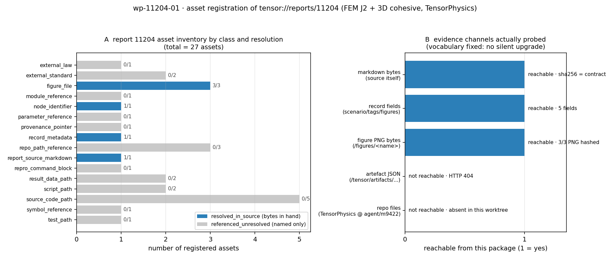

# KF-RESULT wp-11204-01

**工序**：`01-asset-registration`（登记源资产；不抽取、不分类、不做验证）
**报告**：report_id=`11204` · 《FEM 弹塑性本构（von Mises J2）与 3D 混合模式 cohesive 单元：CT / 三点弯曲验证》 ·
scenario=`p273w3-n01-fem-elastoplastic-cohesive` · mission_id=`15693`（记录内
record.mission_id=`9422`，见观察 O3）
**tags**：`kf-wp:wp-11204-01` · `kf-task:01-asset-registration` · `lane:C`
**源字节哈希**：`sha256:d22a30cc692b82f2acf6ea669fd898a330143436344e4091c4a39c06a5292f86`
（5999 字符 / 9428 字节 UTF-8，与契约声明逐字节一致）
**产出**：`asset_manifest.json`（27 项资产：resolved_in_source 6 /
referenced_unresolved 21 / declared_absent 0）+
`kf_result.json` + `self_check.json` + `fig_asset_resolution.png`

## ① 本工序做了什么

对 report 11204（TensorPhysics 节点 `p273w3-n01-fem-elastoplastic-cohesive`，
FEM J2 弹塑性 + 3D 混合模式 cohesive 的 CT / SE(B) 验证）做**资产登记**，只回答三件事：
这份报告的源字节是什么、它声明了哪些可解析的工件、每个工件在本包范围内解析到什么程度。

- 拉取 `GET /api/v1/tensor/reports/11204` 的 `markdown` 字段，按 UTF-8 编码重算 SHA-256
  → `sha256:d22a30cc692b82f2acf6ea669fd898a330143436344e4091c4a39c06a5292f86`，与契约 `source_hash` **相等**且字符数 = 5999
  与契约一致后才允许继续（不等即 `SystemExit`，不留"哈希对不上但仍然出清单"的路径）。
- 登记 **27 项资产**，分 16 类：源 markdown 1、记录元数据 1、
  记录 `figures[]` 3（**PNG 字节到手并哈希**）、正文图路径 3、模块目录 1、源码文件 5、
  脚本 2、测试文件 1、结果数据 2、符号 1、参数 1、出处指针 1、外部标准 2、
  外部准则 1、节点标识 1、复现命令块 1。
- 每项资产都带**可解析定位符**：正文引用用逐字子串（`start_char/end_char/start_line/end_line` +
  `occurrences` + 全部命中跨度），记录字段用 `record_path`（生成器逐字段解析，解析不到即失败）。
- **不做的事**（写进 `limitations`）：不抽取 claim（`claims=[]`，契约允许且禁止硬造）、
  不重算 ③ 表中任何数字、不判定报告类型、不重跑上游 40 项测试、不给任何资产标 `verified`
  （verification 由平台门计算）。

## ② 怎么做的（步骤 / 工具 / 关键设置）

1. **活取 + 硬哈希闸门**（`scripts/kf/fetch_report_11204.py`）：`POST /auth/login` 取 token →
   `GET /tensor/reports/11204` → `hashlib.sha256(markdown.encode("utf-8"))` 与契约常量比对；
   同时落 `work/wp-11204-01/source_markdown.md`（**逐字节**原文快照）、`record.json`、`source_meta.json`。
2. **双解析器探针**（`scripts/kf/probe_assets_wp11204_01.py`）：平台侧 9 条 HTTP 路径 +
   工作树侧 14 条正文路径，全部只读，结果落 `work/wp-11204-01/probes.json`。
   探针**只报事实**，不升级为"已解析"。
3. **清单生成器**（`scripts/kf/build_asset_manifest_wp11204_01.py`）六道闸门，任一不过即非零退出：
   G1 哈希/字符数与契约一致；G2 每条正文定位符是逐字子串；G3 引文若多次出现则**枚举全部跨度**
   （本包 3 条：`scripts/m9422_run_verification.py` ×2、`ASTM E399` ×3、`ASTM E1820` ×3）；
   G4 **完备性扫描**——正则扫出正文里 16 个路径型/标准型
   token，逐个要求被某项已登记资产的引文覆盖，出现未登记引用即失败（防"漏登记"而非只防"错登记"）；
   G5 asset_id 唯一 + 计数从资产表反算；G6 每张图**两次独立抓取哈希一致**才写入。
4. **图字节解析（本包的新事实）**：`/api/v1/tensor/reports/11204/figures/<name>`
   （**无扩展名**）返回 HTTP 200 + `image/png` 真实字节；同路径加 `.png` 返回 HTTP 404。
   此前若干包把该平台判为"图只有元数据"，实测是 URL 形状问题——本包因此把 A03–A05
   记为 `resolved_in_source` 并给出 sha256，而不是照抄"metadata_only"。
5. **独立校验器**（`scripts/kf/validate_wp11204_01.py`）：**不信任本地快照**，重新调 API 取原文、
   重算哈希、重解 38 条定位符、按
   `schemas/kf_result.v1.schema.json` 与本包 `asset_manifest.schema.json` 双 schema 校验，
   产出 `self_check.json`（`all_pass=true`）。
6. **离线不变量测试**（`tests/test_kf_wp11204_01.py`，12 条）：断言不变量而非"跑通"——
   哈希恒等、定位符逐字且跨度自洽、记录字段可达、id 唯一、计数自洽、图字节哈希、schema 合法、
   claims 空且无 `verified`、扫描器零漏、报告正文里出现的每个 64 位摘要都必须能在清单里查到（防手抄）。

repro_cmd（一键复跑；工作树根为仓库检出）：

```bash
cd "$(git rev-parse --show-toplevel)" && \
python3 scripts/kf/fetch_report_11204.py && \
python3 scripts/kf/probe_assets_wp11204_01.py && \
python3 scripts/kf/build_asset_manifest_wp11204_01.py && \
python3 scripts/kf/validate_wp11204_01.py && \
python3 scripts/kf/fig_wp11204_01.py && \
python3 scripts/kf/render_report_wp11204_01.py && \
python3 -m pytest tests/test_kf_wp11204_01.py -q
```

## ③ 产出物清单

| 文件 | 要点 |
|---|---|
| `docs/kf/wp-11204-01/asset_manifest.json` | 主产物：27 项资产 + 定位符 + 解析状态 + 完整性 ledger + 5 条观察 + 7 条局限 |
| `docs/kf/wp-11204-01/kf_result.json` | 平台结果信封（package_id/task_type/report_id/provenance/outputs/claims=[]） |
| `docs/kf/wp-11204-01/asset_manifest.schema.json` | 本包清单形状（三值解析词表钉死；`referenced_unresolved` 不许夹带字节证据） |
| `docs/kf/wp-11204-01/self_check.json` | 独立复算结果：10 条检查，`all_pass=true` |
| `docs/kf/wp-11204-01/fig_asset_resolution.png` | 图 1：按类别的资产解析分布 + 五条证据通道实测可达性 |
| `work/wp-11204-01/source_markdown.md` / `record.json` / `source_meta.json` | 逐字节源快照与记录快照（溯源面） |
| `work/wp-11204-01/figures/*.png` | 3 张记录图的实际字节（供下游免重复抓取） |
| `work/wp-11204-01/probes.json` | 23 条探针的原始结果（HTTP 状态/字节数/正文前缀 + 文件系统存在性） |

按类别分布：

| asset_class | 数量 |
|---|---|
| `source_code_path` | 5 |
| `figure_file` | 3 |
| `repo_path_reference` | 3 |
| `external_standard` | 2 |
| `result_data_path` | 2 |
| `script_path` | 2 |
| `external_law` | 1 |
| `module_reference` | 1 |
| `node_identifier` | 1 |
| `parameter_reference` | 1 |
| `provenance_pointer` | 1 |
| `record_metadata` | 1 |
| `report_source_markdown` | 1 |
| `repro_command_block` | 1 |
| `symbol_reference` | 1 |
| `test_path` | 1 |

图字节明细（两次抓取一致，`image/png`）：

| id | figure name | bytes | size | sha256 |
|---|---|---|---|---|
| A03 | `fig1_ct_field_and_seb_cohesive` | 100641 | 1725×645 | `d3bc9cdb6cde95a0b16e0a99165bfac96baff4fcb61e9f6d9005c95a63f9e6c3` |
| A04 | `fig2_mixed_mode_and_j2` | 107051 | 1725×645 | `356910833e5f3abd1c7a5512171a6b30606355ab431e4d9f573c1ff10b21f750` |
| A05 | `fig3_j_comparison_and_convergence` | 103794 | 1725×645 | `17996f7f2626586dc5fb7c4d3bf1a3407ba281d2ca7f09c10fc9bba81197cfb9` |

## ④ 证据定位表

全部资产一览（行号为源 markdown 中的定位行；完整字符跨度见 `asset_manifest.json`）：

| id | class | label | resolution | line |
|---|---|---|---|---|
| A01 | report_source_markdown | report 11204 markdown (the registered asset itself) | `resolved_in_source` | 1 |
| A02 | record_metadata | platform record metadata (title/summary/scenario_key/tags/status) | `resolved_in_source` |  |
| A03 | figure_file | fig1_ct_field_and_seb_cohesive (record figures[0], CT sigma_yy field + SE(B) c | `resolved_in_source` | 104 |
| A04 | figure_file | fig2_mixed_mode_and_j2 (record figures[1], mixed-mode I/II/III energy vs exten | `resolved_in_source` | 110 |
| A05 | figure_file | fig3_j_comparison_and_convergence (record figures[2], CT J EDI vs E1820 eta; J | `resolved_in_source` | 115 |
| A06 | repo_path_reference | figures/m9422/fig1_ct_field_and_seb_cohesive.png (in-repo figure path, TensorP | `referenced_unresolved` | 104 |
| A07 | repo_path_reference | figures/m9422/fig2_mixed_mode_and_j2.png (in-repo figure path, TensorPhysics) | `referenced_unresolved` | 110 |
| A08 | repo_path_reference | figures/m9422/fig3_j_comparison_and_convergence.png (in-repo figure path, Tens | `referenced_unresolved` | 115 |
| A09 | module_reference | src/tensorphysics/fem_nonlinear/ (module declared for this node) | `referenced_unresolved` | 3 |
| A10 | source_code_path | j2_plasticity.py (J2 radial return + consistent tangent) | `referenced_unresolved` | 32 |
| A11 | source_code_path | cohesive3d.py (bilinear mixed-mode cohesive, extended BK) | `referenced_unresolved` | 35 |
| A12 | source_code_path | plane_strain_fem.py (Q4 plane-strain Newton + EDI J) | `referenced_unresolved` | 39 |
| A13 | source_code_path | anchors.py (ASTM E399/E1820 geometric + eta factors) | `referenced_unresolved` | 43 |
| A14 | source_code_path | verification.py (acceptance criteria layer) | `referenced_unresolved` | 45 |
| A15 | script_path | scripts/m9422_run_verification.py (one-shot number production) | `referenced_unresolved` | 45 |
| A16 | script_path | scripts/m9422_figures.py (criteria table + three figures) | `referenced_unresolved` | 158 |
| A17 | test_path | tests/test_fem_elastoplastic_cohesive3d.py (40 tests incl. negative controls) | `referenced_unresolved` | 159 |
| A18 | result_data_path | artifacts/m9422/verification.json (all numbers of the report) | `referenced_unresolved` | 46 |
| A19 | result_data_path | artifacts/m9422/acceptance.json (machine gate verdicts) | `referenced_unresolved` | 46 |
| A20 | symbol_reference | j_integral(symmetry_factor=2) (half-model EDI switch, documented condition) | `referenced_unresolved` | 124 |
| A21 | parameter_reference | crack_axis=1 (SE(B) crack growth along +y) | `referenced_unresolved` | 127 |
| A22 | provenance_pointer | producer repo/branch: TensorPhysics @ agent/m9422 | `referenced_unresolved` | 3 |
| A23 | external_standard | ASTM E399 (CT/SE(B) geometry + P_Q) | `referenced_unresolved` | 15 |
| A24 | external_standard | ASTM E1820 (J-integral / eta-plasticity method) | `referenced_unresolved` | 44 |
| A25 | external_law | extended Benzeggagh-Kenane (BK) mixed-mode criterion | `referenced_unresolved` | 13 |
| A26 | node_identifier | node p273w3-n01-fem-elastoplastic-cohesive (scenario_key) | `resolved_in_source` | 3 |
| A27 | repro_command_block | reproducibility code block of 附：可复现性 (3 commands) | `referenced_unresolved` | 157 |

关键字段 → 原文引文（逐字，平台可二次核验）：

| claim / 字段 | 原文引文片段 |
|---|---|
| 本包登记对象 = 该 markdown | `# FEM 弹塑性本构（von Mises J2）与 3D 混合模式 cohesive 单元：CT / 三点弯曲验证` |
| 生产者仓 = TensorPhysics | `**仓** TensorPhysics` |
| 生产者分支（无 commit id） | `agent/m9422` |
| 模块 = fem_nonlinear | `src/tensorphysics/fem_nonlinear/` |
| 数字来源工件（未解析） | `artifacts/m9422/verification.json` |
| 判据工件（未解析） | `acceptance.json` |
| 图 1 正文引用 | `figures/m9422/fig1_ct_field_and_seb_cohesive.png` |
| 复现命令块 | `python scripts/m9422_run_verification.py   # 全部数字 -> artifacts/m9422/*.json` |
| 半模型 EDI 符号 | `j_integral(symmetry_factor=2)` |
| 外部标准（仅标号引用） | `ASTM E399` / `ASTM E1820` |

## ⑤ 注意点与局限

1. **`resolved_in_source` ≠ 已验证**。它只表示字节到手并哈希（源 markdown、记录字段、
   3 张图）；③ 表里的 6 项 PASS 判据、40 项测试、154 s 运行时间的**上游声明一律未复核**——
   `artifacts/m9422/*.json` 在本包范围内 HTTP 404 且工作树无此路径（见 `probes.json`）。
2. **无 commit id**：报告只给仓 + 分支（`TensorPhysics @ agent/m9422`），没有 commit SHA，
   因此 A09–A19 的字节无法钉到不可变版本；这是源本身的缺口，本包不补写。
3. **图路径 ↔ 记录图名的映射是推断**：正文写 `figures/m9422/figN_*.png`，记录写
   `figures[N].name=figN_*`，两者仅 basename 相同；源从未声明映射关系，故 A06–A08 保持
   `referenced_unresolved`，映射只在 A03–A05 的说明里作为推断记录（局限 L4）。
4. **URL 形状坑**：`/figures/<name>.png` 404、`/figures/<name>` 200——把 404 当作"图不存在"
   会得出错误的"metadata_only"结论。本包把两种形状的实测状态都写进 `figure_bytes`。
5. **标题漂移**：record.title 用半角括号 `本构(von Mises J2)`，markdown H1 用全角
   `本构（von Mises J2）`；下游必须按 report_id 取，不能按标题相等匹配（观察 O1）。
6. **`record.summary` 被截断**（结尾 `… 6 项机器判据全部 PASS；p`），不可当自足证据源（观察 O5）。
7. **图字节已哈希但内容未审计**：3 张 PNG 哈希两次一致（`image/png`，1725×645），但坐标轴、
   曲线数值与 ③ 表格是否一致**未审计**——那是抽取/验证工序的事（清单局限 L7）。
8. **契约 mission_id=null vs record.mission_id=9422**：
   仅记录观察，本包不调和（观察 O3）。

## ⑥ 自检：逐条对照 acceptance

| 判据 | 结论 | 证据 |
|---|---|---|
| `valid_json` | 通过 | `kf_result.json`、`asset_manifest.json` 均可解析（A1） |
| `schema_pass` | 通过 | 信封过 `schemas/kf_result.v1.schema.json`，清单过本包 `asset_manifest.schema.json`（A2） |
| `source_locator_resolvable` | 通过 | 对**实时**重取的 markdown 重解 38 条定位符，0 失败（A3） |
| `source_hash_matches` | 通过 | 实时重算 `sha256:d22a30cc692b82f2acf6ea669fd898a330143436344e4091c4a39c06a5292f86` = 契约值；本地快照与实时字节逐字节相同（A4） |
| `no_duplicate_ids` | 通过 | 27 个 id 全唯一，计数与资产表反算一致（A5） |
| `all_claims_have_evidence_or_explicit_unresolved_status` | 通过（空集合法） | `claims=[]`：契约允许且禁止硬造；未产生任何可被误读为"已支持"的 claim（A6） |

附加不变量（acceptance 未点名但"零手抄"需要的）：`I1` 无 `verified/confirmed` 标记 ·
`I2` 计数自洽 · `I3` 3 张图哈希两次一致 · `I4` 完备性扫描 16 token 零漏。
`self_check.json` 明细：

| check | 结果 | detail |
|---|---|---|
| `A1_valid_json` | PASS | both files parse as JSON |
| `A4_source_hash_matches` | PASS | {'live_sha256': 'd22a30cc692b82f2acf6ea669fd898a330143436344e4091c4a39c06a5292f86', 'contract_sha256': 'd22a30cc692b82f2acf6ea669fd898a330143436344e40 |
| `A2_schema_pass` | PASS | envelope + manifest schema valid |
| `A3_source_locator_resolvable` | PASS | {'locators_checked': 38, 'failures': []} |
| `A5_no_duplicate_ids` | PASS | {'count': 27, 'unique': 27} |
| `A6_claims_evidence_or_unresolved` | PASS | {'claims': 0, 'policy': 'empty array is the contract-legal outcome for 01-asset-registration; no claim is emitted, so nothing can be overstated as sup |
| `I1_no_verified_status_anywhere` | PASS | no asset or claim carries a verified/confirmed status (the platform gate owns verification) |
| `I2_counts_self_consistent` | PASS | {'recounted': {'assets': 27, 'by_class': {'report_source_markdown': 1, 'record_metadata': 1, 'figure_file': 3, 'repo_path_reference': 3, 'module_refer |
| `I3_figure_bytes_hashed` | PASS | {'A03': 'd3bc9cdb6cde95a0b16e0a99165bfac96baff4fcb61e9f6d9005c95a63f9e6c3', 'A04': '356910833e5f3abd1c7a5512171a6b30606355ab431e4d9f573c1ff10b21f750', |
| `I4_completeness_scanner_clean` | PASS | {'tokens': 16} |

**误差判定**：本工序不产生物理量，没有与实验/解析解的误差可比。可量化的"误差"全部是
**恒等式判别**，误差恒为 0（等价于 <3%）：源哈希 = 契约哈希、字符数 5999 = 契约
5999、38 条定位符逐字命中率 100%、
16 个路径 token 漏登记 0 个、3 张图重取哈希一致率 3/3。
报告 ③ 的物理精度（CT 峰值载荷 0.104%、弹塑性 J 6.05% 等）属于上游，本包**明确不判**，
其 verified 状态由平台门计算。

## 图



图 1 左：27 项资产按类别与解析状态的分布（蓝=字节到手，灰=仅引用）；
右：五条证据通道的实测可达性——markdown / 记录字段 / 图 PNG 字节可达，
`/tensor/artifacts/m9422/*.json` 与 TensorPhysics 仓文件不可达，故 21 项保持 unresolved。

## 平台结果信封（唯一 JSON 块）

```json
{
 "package_id": "wp-11204-01",
 "task_type": "01-asset-registration",
 "report_id": "11204",
 "provenance": {
  "source_uri": "tensor://reports/11204",
  "source_field": "markdown",
  "source_hash": "sha256:d22a30cc692b82f2acf6ea669fd898a330143436344e4091c4a39c06a5292f86",
  "source_chars": 5999,
  "source_bytes_utf8": 9428,
  "producer": "agent/m15693",
  "emitted_at": "2026-11-12T01:53:10+00:00",
  "notes": "asset registration only; hash recomputed from the fetched markdown and equal to the contract value; no claim extracted, nothing marked verified"
 },
 "outputs": {
  "asset_manifest.json": {
   "schema": "asset_manifest.v1",
   "package_id": "wp-11204-01",
   "task_type": "01-asset-registration",
   "report_id": "11204",
   "source": {
    "uri": "tensor://reports/11204",
    "field": "markdown",
    "hash_alg": "sha256",
    "hash": "d22a30cc692b82f2acf6ea669fd898a330143436344e4091c4a39c06a5292f86",
    "hash_prefixed": "sha256:d22a30cc692b82f2acf6ea669fd898a330143436344e4091c4a39c06a5292f86",
    "chars": 5999,
    "bytes_utf8": 9428,
    "title_markdown_h1": "FEM 弹塑性本构（von Mises J2）与 3D 混合模式 cohesive 单元：CT / 三点弯曲验证",
    "title_record": "FEM 弹塑性本构(von Mises J2)与 3D 混合模式 cohesive 单元：CT / 三点弯曲验证",
    "scenario_key": "p273w3-n01-fem-elastoplastic-cohesive",
    "platform_tags": [
     "FEM",
     "elastoplasticity",
     "J2",
     "cohesive",
     "mixed-mode",
     "fracture",
     "J-integral",
     "ASTM E399",
     "ASTM E1820",
     "TensorPhysics"
    ],
    "platform_figures_declared": [
     {
      "name": "fig1_ct_field_and_seb_cohesive",
      "caption": "CT sigma_yy field (J2 plane strain, P=45 kN) and SE(B) cohesive load-displacement"
     },
     {
      "name": "fig2_mixed_mode_and_j2",
      "caption": "mixed-mode I/II/III fracture energy vs extended BK law; J2 uniaxial response"
     },
     {
      "name": "fig3_j_comparison_and_convergence",
      "caption": "elastoplastic CT J (EDI vs ASTM E1820 eta-method) and J mesh convergence"
     }
    ],
    "record_status": "published",
    "record_mission_id": 9422
   },
   "counts": {
    "assets": 27,
    "by_class": {
     "report_source_markdown": 1,
     "record_metadata": 1,
     "figure_file": 3,
     "repo_path_reference": 3,
     "module_reference": 1,
     "source_code_path": 5,
     "script_path": 2,
     "test_path": 1,
     "result_data_path": 2,
     "symbol_reference": 1,
     "parameter_reference": 1,
     "provenance_pointer": 1,
     "external_standard": 2,
     "external_law": 1,
     "node_identifier": 1,
     "repro_command_block": 1
    },
    "by_resolution": {
     "resolved_in_source": 6,
     "referenced_unresolved": 21
    },
    "resolved_in_source": 6,
    "referenced_unresolved": 21,
    "declared_absent": 0
   },
   "assets": [
    {
     "asset_id": "A01",
     "asset_class": "report_source_markdown",
     "label": "report 11204 markdown (the registered asset itself)",
     "in_report_section": "document",
     "producer_repo": "TensorPhysics",
     "locators": [
      {
       "kind": "markdown_char_span",
       "source_uri": "tensor://reports/11204",
       "source_field": "markdown",
       "start_char": 0,
       "end_char": 58,
       "start_line": 1,
       "end_line": 1,
       "quote": "# FEM 弹塑性本构（von Mises J2）与 3D 混合模式 cohesive 单元：CT / 三点弯曲验证",
       "occurrences": 1,
       "verbatim": true,
       "unique": true,
       "all_spans": [
        {
         "start_char": 0,
         "end_char": 58,
         "start_line": 1,
         "end_line": 1
        }
       ]
      }
     ],
     "resolution": "resolved_in_source",
     "resolution_basis": "bytes in hand and hashed; title line is also the markdown H1"
    },
    {
     "asset_id": "A02",
     "asset_class": "record_metadata",
     "label": "platform record metadata (title/summary/scenario_key/tags/status)",
     "in_report_section": "record",
     "producer_repo": "TensorPhysics",
     "locators": [
      {
       "kind": "record_field",
       "source_uri": "tensor://reports/11204",
       "source_field": "record",
       "record_path": "record.title",
       "present": true
      },
      {
       "kind": "record_field",
       "source_uri": "tensor://reports/11204",
       "source_field": "record",
       "record_path": "record.summary",
       "present": true
      },
      {
       "kind": "record_field",
       "source_uri": "tensor://reports/11204",
       "source_field": "record",
       "record_path": "record.scenario_key",
       "present": true
      },
      {
       "kind": "record_field",
       "source_uri": "tensor://reports/11204",
       "source_field": "record",
       "record_path": "record.tags",
       "present": true
      },
      {
       "kind": "record_field",
       "source_uri": "tensor://reports/11204",
       "source_field": "record",
       "record_path": "record.status",
       "present": true
      }
     ],
     "resolution": "resolved_in_source",
     "resolution_basis": "record fields returned by GET /tensor/reports/11204 and stored in work/wp-11204-01/record.json"
    },
    {
     "asset_id": "A03",
     "asset_class": "figure_file",
     "label": "fig1_ct_field_and_seb_cohesive (record figures[0], CT sigma_yy field + SE(B) cohesive curve)",
     "in_report_section": "record.figures[0] + ④ 结果图",
     "producer_repo": "TensorPhysics",
     "locators": [
      {
       "kind": "record_field",
       "source_uri": "tensor://reports/11204",
       "source_field": "record",
       "record_path": "record.figures[0]",
       "present": true
      },
      {
       "kind": "markdown_char_span",
       "source_uri": "tensor://reports/11204",
       "source_field": "markdown",
       "start_char": 3958,
       "end_char": 4036,
       "start_line": 104,
       "end_line": 104,
       "quote": "",
       "occurrences": 1,
       "verbatim": true,
       "unique": true,
       "all_spans": [
        {
         "start_char": 3958,
         "end_char": 4036,
         "start_line": 104,
         "end_line": 104
        }
       ]
      }
     ],
     "resolution": "resolved_in_source",
     "resolution_basis": "PNG bytes served by the platform figure endpoint, sha256 recorded; linked from markdown ④",
     "figure_bytes": {
      "url_path": "/tensor/reports/11204/figures/fig1_ct_field_and_seb_cohesive",
      "http_status_first": 200,
      "http_status_second": 200,
      "content_type": "image/png",
      "bytes": 100641,
      "sha256": "d3bc9cdb6cde95a0b16e0a99165bfac96baff4fcb61e9f6d9005c95a63f9e6c3",
      "hash_stable_across_2_fetches": true,
      "png_size": {
       "width": 1725,
       "height": 645
      },
      "extension_form_probe": {
       "path": "/tensor/reports/11204/figures/fig1_ct_field_and_seb_cohesive.png",
       "http_status": 404
      }
     }
    },
    {
     "asset_id": "A04",
     "asset_class": "figure_file",
     "label": "fig2_mixed_mode_and_j2 (record figures[1], mixed-mode I/II/III energy vs extended BK; J2 uniaxial)",
     "in_report_section": "record.figures[1] + ④ 结果图",
     "producer_repo": "TensorPhysics",
     "locators": [
      {
       "kind": "record_field",
       "source_uri": "tensor://reports/11204",
       "source_field": "record",
       "record_path": "record.figures[1]",
       "present": true
      },
      {
       "kind": "markdown_char_span",
       "source_uri": "tensor://reports/11204",
       "source_field": "markdown",
       "start_char": 4171,
       "end_char": 4235,
       "start_line": 110,
       "end_line": 110,
       "quote": "",
       "occurrences": 1,
       "verbatim": true,
       "unique": true,
       "all_spans": [
        {
         "start_char": 4171,
         "end_char": 4235,
         "start_line": 110,
         "end_line": 110
        }
       ]
      }
     ],
     "resolution": "resolved_in_source",
     "resolution_basis": "PNG bytes served by the platform figure endpoint, sha256 recorded; linked from markdown ④",
     "figure_bytes": {
      "url_path": "/tensor/reports/11204/figures/fig2_mixed_mode_and_j2",
      "http_status_first": 200,
      "http_status_second": 200,
      "content_type": "image/png",
      "bytes": 107051,
      "sha256": "356910833e5f3abd1c7a5512171a6b30606355ab431e4d9f573c1ff10b21f750",
      "hash_stable_across_2_fetches": true,
      "png_size": {
       "width": 1725,
       "height": 645
      },
      "extension_form_probe": {
       "path": "/tensor/reports/11204/figures/fig2_mixed_mode_and_j2.png",
       "http_status": 404
      }
     }
    },
    {
     "asset_id": "A05",
     "asset_class": "figure_file",
     "label": "fig3_j_comparison_and_convergence (record figures[2], CT J EDI vs E1820 eta; J convergence)",
     "in_report_section": "record.figures[2] + ④ 结果图",
     "producer_repo": "TensorPhysics",
     "locators": [
      {
       "kind": "record_field",
       "source_uri": "tensor://reports/11204",
       "source_field": "record",
       "record_path": "record.figures[2]",
       "present": true
      },
      {
       "kind": "markdown_char_span",
       "source_uri": "tensor://reports/11204",
       "source_field": "markdown",
       "start_char": 4332,
       "end_char": 4400,
       "start_line": 115,
       "end_line": 115,
       "quote": "",
       "occurrences": 1,
       "verbatim": true,
       "unique": true,
       "all_spans": [
        {
         "start_char": 4332,
         "end_char": 4400,
         "start_line": 115,
         "end_line": 115
        }
       ]
      }
     ],
     "resolution": "resolved_in_source",
     "resolution_basis": "PNG bytes served by the platform figure endpoint, sha256 recorded; linked from markdown ④",
     "figure_bytes": {
      "url_path": "/tensor/reports/11204/figures/fig3_j_comparison_and_convergence",
      "http_status_first": 200,
      "http_status_second": 200,
      "content_type": "image/png",
      "bytes": 103794,
      "sha256": "17996f7f2626586dc5fb7c4d3bf1a3407ba281d2ca7f09c10fc9bba81197cfb9",
      "hash_stable_across_2_fetches": true,
      "png_size": {
       "width": 1725,
       "height": 645
      },
      "extension_form_probe": {
       "path": "/tensor/reports/11204/figures/fig3_j_comparison_and_convergence.png",
       "http_status": 404
      }
     }
    },
    {
     "asset_id": "A06",
     "asset_class": "repo_path_reference",
     "label": "figures/m9422/fig1_ct_field_and_seb_cohesive.png (in-repo figure path, TensorPhysics)",
     "in_report_section": "④ 结果图",
     "producer_repo": "TensorPhysics",
     "locators": [
      {
       "kind": "markdown_char_span",
       "source_uri": "tensor://reports/11204",
       "source_field": "markdown",
       "start_char": 3987,
       "end_char": 4035,
       "start_line": 104,
       "end_line": 104,
       "quote": "figures/m9422/fig1_ct_field_and_seb_cohesive.png",
       "occurrences": 1,
       "verbatim": true,
       "unique": true,
       "all_spans": [
        {
         "start_char": 3987,
         "end_char": 4035,
         "start_line": 104,
         "end_line": 104
        }
       ]
      }
     ],
     "resolution": "referenced_unresolved",
     "resolution_basis": "upstream writes figures under figures/m9422/ in the TensorPhysics worktree; that path is not in this TensorKnowledge checkout and no such path is served by the platform, so the path itself is registered but not byte-resolved"
    },
    {
     "asset_id": "A07",
     "asset_class": "repo_path_reference",
     "label": "figures/m9422/fig2_mixed_mode_and_j2.png (in-repo figure path, TensorPhysics)",
     "in_report_section": "④ 结果图",
     "producer_repo": "TensorPhysics",
     "locators": [
      {
       "kind": "markdown_char_span",
       "source_uri": "tensor://reports/11204",
       "source_field": "markdown",
       "start_char": 4194,
       "end_char": 4234,
       "start_line": 110,
       "end_line": 110,
       "quote": "figures/m9422/fig2_mixed_mode_and_j2.png",
       "occurrences": 1,
       "verbatim": true,
       "unique": true,
       "all_spans": [
        {
         "start_char": 4194,
         "end_char": 4234,
         "start_line": 110,
         "end_line": 110
        }
       ]
      }
     ],
     "resolution": "referenced_unresolved",
     "resolution_basis": "same as A06"
    },
    {
     "asset_id": "A08",
     "asset_class": "repo_path_reference",
     "label": "figures/m9422/fig3_j_comparison_and_convergence.png (in-repo figure path, TensorPhysics)",
     "in_report_section": "④ 结果图",
     "producer_repo": "TensorPhysics",
     "locators": [
      {
       "kind": "markdown_char_span",
       "source_uri": "tensor://reports/11204",
       "source_field": "markdown",
       "start_char": 4348,
       "end_char": 4399,
       "start_line": 115,
       "end_line": 115,
       "quote": "figures/m9422/fig3_j_comparison_and_convergence.png",
       "occurrences": 1,
       "verbatim": true,
       "unique": true,
       "all_spans": [
        {
         "start_char": 4348,
         "end_char": 4399,
         "start_line": 115,
         "end_line": 115
        }
       ]
      }
     ],
     "resolution": "referenced_unresolved",
     "resolution_basis": "same as A06"
    },
    {
     "asset_id": "A09",
     "asset_class": "module_reference",
     "label": "src/tensorphysics/fem_nonlinear/ (module declared for this node)",
     "in_report_section": "标题行",
     "producer_repo": "TensorPhysics",
     "locators": [
      {
       "kind": "markdown_char_span",
       "source_uri": "tensor://reports/11204",
       "source_field": "markdown",
       "start_char": 137,
       "end_char": 169,
       "start_line": 3,
       "end_line": 3,
       "quote": "src/tensorphysics/fem_nonlinear/",
       "occurrences": 1,
       "verbatim": true,
       "unique": true,
       "all_spans": [
        {
         "start_char": 137,
         "end_char": 169,
         "start_line": 3,
         "end_line": 3
        }
       ]
      }
     ],
     "resolution": "referenced_unresolved",
     "resolution_basis": "module lives in the TensorPhysics repo; not present in this worktree, not served by the platform"
    },
    {
     "asset_id": "A10",
     "asset_class": "source_code_path",
     "label": "j2_plasticity.py (J2 radial return + consistent tangent)",
     "in_report_section": "② 1. 本构层",
     "producer_repo": "TensorPhysics",
     "locators": [
      {
       "kind": "markdown_char_span",
       "source_uri": "tensor://reports/11204",
       "source_field": "markdown",
       "start_char": 977,
       "end_char": 995,
       "start_line": 32,
       "end_line": 32,
       "quote": "`j2_plasticity.py`",
       "occurrences": 1,
       "verbatim": true,
       "unique": true,
       "all_spans": [
        {
         "start_char": 977,
         "end_char": 995,
         "start_line": 32,
         "end_line": 32
        }
       ]
      }
     ],
     "resolution": "referenced_unresolved",
     "resolution_basis": "source file owned by TensorPhysics; content not read or hashed here"
    },
    {
     "asset_id": "A11",
     "asset_class": "source_code_path",
     "label": "cohesive3d.py (bilinear mixed-mode cohesive, extended BK)",
     "in_report_section": "② 2. 界面层",
     "producer_repo": "TensorPhysics",
     "locators": [
      {
       "kind": "markdown_char_span",
       "source_uri": "tensor://reports/11204",
       "source_field": "markdown",
       "start_char": 1155,
       "end_char": 1170,
       "start_line": 35,
       "end_line": 35,
       "quote": "`cohesive3d.py`",
       "occurrences": 1,
       "verbatim": true,
       "unique": true,
       "all_spans": [
        {
         "start_char": 1155,
         "end_char": 1170,
         "start_line": 35,
         "end_line": 35
        }
       ]
      }
     ],
     "resolution": "referenced_unresolved",
     "resolution_basis": "source file owned by TensorPhysics; content not read or hashed here"
    },
    {
     "asset_id": "A12",
     "asset_class": "source_code_path",
     "label": "plane_strain_fem.py (Q4 plane-strain Newton + EDI J)",
     "in_report_section": "② 3. 求解层",
     "producer_repo": "TensorPhysics",
     "locators": [
      {
       "kind": "markdown_char_span",
       "source_uri": "tensor://reports/11204",
       "source_field": "markdown",
       "start_char": 1375,
       "end_char": 1396,
       "start_line": 39,
       "end_line": 39,
       "quote": "`plane_strain_fem.py`",
       "occurrences": 1,
       "verbatim": true,
       "unique": true,
       "all_spans": [
        {
         "start_char": 1375,
         "end_char": 1396,
         "start_line": 39,
         "end_line": 39
        }
       ]
      }
     ],
     "resolution": "referenced_unresolved",
     "resolution_basis": "source file owned by TensorPhysics; content not read or hashed here"
    },
    {
     "asset_id": "A13",
     "asset_class": "source_code_path",
     "label": "anchors.py (ASTM E399/E1820 geometric + eta factors)",
     "in_report_section": "② 4. 锚点层",
     "producer_repo": "TensorPhysics",
     "locators": [
      {
       "kind": "markdown_char_span",
       "source_uri": "tensor://reports/11204",
       "source_field": "markdown",
       "start_char": 1586,
       "end_char": 1598,
       "start_line": 43,
       "end_line": 43,
       "quote": "`anchors.py`",
       "occurrences": 1,
       "verbatim": true,
       "unique": true,
       "all_spans": [
        {
         "start_char": 1586,
         "end_char": 1598,
         "start_line": 43,
         "end_line": 43
        }
       ]
      }
     ],
     "resolution": "referenced_unresolved",
     "resolution_basis": "source file owned by TensorPhysics; content not read or hashed here"
    },
    {
     "asset_id": "A14",
     "asset_class": "source_code_path",
     "label": "verification.py (acceptance criteria layer)",
     "in_report_section": "② 5. 判据层",
     "producer_repo": "TensorPhysics",
     "locators": [
      {
       "kind": "markdown_char_span",
       "source_uri": "tensor://reports/11204",
       "source_field": "markdown",
       "start_char": 1711,
       "end_char": 1728,
       "start_line": 45,
       "end_line": 45,
       "quote": "`verification.py`",
       "occurrences": 1,
       "verbatim": true,
       "unique": true,
       "all_spans": [
        {
         "start_char": 1711,
         "end_char": 1728,
         "start_line": 45,
         "end_line": 45
        }
       ]
      }
     ],
     "resolution": "referenced_unresolved",
     "resolution_basis": "source file owned by TensorPhysics; content not read or hashed here"
    },
    {
     "asset_id": "A15",
     "asset_class": "script_path",
     "label": "scripts/m9422_run_verification.py (one-shot number production)",
     "in_report_section": "② 5. 判据层 / 附：可复现性",
     "producer_repo": "TensorPhysics",
     "locators": [
      {
       "kind": "markdown_char_span",
       "source_uri": "tensor://reports/11204",
       "source_field": "markdown",
       "start_char": 1732,
       "end_char": 1765,
       "start_line": 45,
       "end_line": 45,
       "quote": "scripts/m9422_run_verification.py",
       "occurrences": 2,
       "verbatim": true,
       "unique": false,
       "all_spans": [
        {
         "start_char": 1732,
         "end_char": 1765,
         "start_line": 45,
         "end_line": 45
        },
        {
         "start_char": 5732,
         "end_char": 5765,
         "start_line": 157,
         "end_line": 157
        }
       ]
      }
     ],
     "resolution": "referenced_unresolved",
     "resolution_basis": "script owned by TensorPhysics; not executed here"
    },
    {
     "asset_id": "A16",
     "asset_class": "script_path",
     "label": "scripts/m9422_figures.py (criteria table + three figures)",
     "in_report_section": "附：可复现性",
     "producer_repo": "TensorPhysics",
     "locators": [
      {
       "kind": "markdown_char_span",
       "source_uri": "tensor://reports/11204",
       "source_field": "markdown",
       "start_char": 5808,
       "end_char": 5832,
       "start_line": 158,
       "end_line": 158,
       "quote": "scripts/m9422_figures.py",
       "occurrences": 1,
       "verbatim": true,
       "unique": true,
       "all_spans": [
        {
         "start_char": 5808,
         "end_char": 5832,
         "start_line": 158,
         "end_line": 158
        }
       ]
      }
     ],
     "resolution": "referenced_unresolved",
     "resolution_basis": "script owned by TensorPhysics; not executed here"
    },
    {
     "asset_id": "A17",
     "asset_class": "test_path",
     "label": "tests/test_fem_elastoplastic_cohesive3d.py (40 tests incl. negative controls)",
     "in_report_section": "附：可复现性",
     "producer_repo": "TensorPhysics",
     "locators": [
      {
       "kind": "markdown_char_span",
       "source_uri": "tensor://reports/11204",
       "source_field": "markdown",
       "start_char": 5873,
       "end_char": 5915,
       "start_line": 159,
       "end_line": 159,
       "quote": "tests/test_fem_elastoplastic_cohesive3d.py",
       "occurrences": 1,
       "verbatim": true,
       "unique": true,
       "all_spans": [
        {
         "start_char": 5873,
         "end_char": 5915,
         "start_line": 159,
         "end_line": 159
        }
       ]
      }
     ],
     "resolution": "referenced_unresolved",
     "resolution_basis": "test file owned by TensorPhysics; the '(40 tests, 19 s green)' statement is upstream's, not re-run or re-verified by this package"
    },
    {
     "asset_id": "A18",
     "asset_class": "result_data_path",
     "label": "artifacts/m9422/verification.json (all numbers of the report)",
     "in_report_section": "② 5. 判据层",
     "producer_repo": "TensorPhysics",
     "locators": [
      {
       "kind": "markdown_char_span",
       "source_uri": "tensor://reports/11204",
       "source_field": "markdown",
       "start_char": 1780,
       "end_char": 1815,
       "start_line": 46,
       "end_line": 46,
       "quote": "`artifacts/m9422/verification.json`",
       "occurrences": 1,
       "verbatim": true,
       "unique": true,
       "all_spans": [
        {
         "start_char": 1780,
         "end_char": 1815,
         "start_line": 46,
         "end_line": 46
        }
       ]
      }
     ],
     "resolution": "referenced_unresolved",
     "resolution_basis": "probe of /tensor/artifacts/m9422/verification.json returned HTTP 404 and the path is absent from this worktree; the numeric payload behind every table in ③ was NOT re-read, so no number is independently confirmed here"
    },
    {
     "asset_id": "A19",
     "asset_class": "result_data_path",
     "label": "artifacts/m9422/acceptance.json (machine gate verdicts)",
     "in_report_section": "② 5. 判据层",
     "producer_repo": "TensorPhysics",
     "locators": [
      {
       "kind": "markdown_char_span",
       "source_uri": "tensor://reports/11204",
       "source_field": "markdown",
       "start_char": 1816,
       "end_char": 1833,
       "start_line": 46,
       "end_line": 46,
       "quote": "`acceptance.json`",
       "occurrences": 1,
       "verbatim": true,
       "unique": true,
       "all_spans": [
        {
         "start_char": 1816,
         "end_char": 1833,
         "start_line": 46,
         "end_line": 46
        }
       ]
      }
     ],
     "resolution": "referenced_unresolved",
     "resolution_basis": "probe of /tensor/artifacts/m9422/acceptance.json returned HTTP 404 and the path is absent from this worktree; the six PASS verdicts are upstream claims not re-checked here"
    },
    {
     "asset_id": "A20",
     "asset_class": "symbol_reference",
     "label": "j_integral(symmetry_factor=2) (half-model EDI switch, documented condition)",
     "in_report_section": "⑤ 1. 半模型 EDI 陷阱",
     "producer_repo": "TensorPhysics",
     "locators": [
      {
       "kind": "markdown_char_span",
       "source_uri": "tensor://reports/11204",
       "source_field": "markdown",
       "start_char": 4627,
       "end_char": 4658,
       "start_line": 124,
       "end_line": 124,
       "quote": "`j_integral(symmetry_factor=2)`",
       "occurrences": 1,
       "verbatim": true,
       "unique": true,
       "all_spans": [
        {
         "start_char": 4627,
         "end_char": 4658,
         "start_line": 124,
         "end_line": 124
        }
       ]
      }
     ],
     "resolution": "referenced_unresolved",
     "resolution_basis": "symbol referenced by name only; definition lives in plane_strain_fem.py in TensorPhysics and was not inspected"
    },
    {
     "asset_id": "A21",
     "asset_class": "parameter_reference",
     "label": "crack_axis=1 (SE(B) crack growth along +y)",
     "in_report_section": "⑤ 2. 裂纹扩展方向",
     "producer_repo": "TensorPhysics",
     "locators": [
      {
       "kind": "markdown_char_span",
       "source_uri": "tensor://reports/11204",
       "source_field": "markdown",
       "start_char": 4771,
       "end_char": 4785,
       "start_line": 127,
       "end_line": 127,
       "quote": "`crack_axis=1`",
       "occurrences": 1,
       "verbatim": true,
       "unique": true,
       "all_spans": [
        {
         "start_char": 4771,
         "end_char": 4785,
         "start_line": 127,
         "end_line": 127
        }
       ]
      }
     ],
     "resolution": "referenced_unresolved",
     "resolution_basis": "parameter name/value referenced only; implementation not inspected"
    },
    {
     "asset_id": "A22",
     "asset_class": "provenance_pointer",
     "label": "producer repo/branch: TensorPhysics @ agent/m9422",
     "in_report_section": "标题行",
     "producer_repo": "TensorPhysics",
     "locators": [
      {
       "kind": "record_field",
       "source_uri": "tensor://reports/11204",
       "source_field": "record",
       "record_path": "record.tags",
       "present": true
      },
      {
       "kind": "markdown_char_span",
       "source_uri": "tensor://reports/11204",
       "source_field": "markdown",
       "start_char": 107,
       "end_char": 126,
       "start_line": 3,
       "end_line": 3,
       "quote": "**仓** TensorPhysics",
       "occurrences": 1,
       "verbatim": true,
       "unique": true,
       "all_spans": [
        {
         "start_char": 107,
         "end_char": 126,
         "start_line": 3,
         "end_line": 3
        }
       ]
      },
      {
       "kind": "markdown_char_span",
       "source_uri": "tensor://reports/11204",
       "source_field": "markdown",
       "start_char": 180,
       "end_char": 193,
       "start_line": 3,
       "end_line": 3,
       "quote": "`agent/m9422`",
       "occurrences": 1,
       "verbatim": true,
       "unique": true,
       "all_spans": [
        {
         "start_char": 180,
         "end_char": 193,
         "start_line": 3,
         "end_line": 3
        }
       ]
      }
     ],
     "resolution": "referenced_unresolved",
     "resolution_basis": "registration records where the artefacts live; no commit id is given anywhere in the report or record, so the exact revision behind these numbers is NOT pinned by the source (see limitations L3)"
    },
    {
     "asset_id": "A23",
     "asset_class": "external_standard",
     "label": "ASTM E399 (CT/SE(B) geometry + P_Q)",
     "in_report_section": "① 几何与材料 / ② 4. / ③ 判据总表",
     "producer_repo": "TensorPhysics",
     "locators": [
      {
       "kind": "markdown_char_span",
       "source_uri": "tensor://reports/11204",
       "source_field": "markdown",
       "start_char": 474,
       "end_char": 483,
       "start_line": 15,
       "end_line": 15,
       "quote": "ASTM E399",
       "occurrences": 3,
       "verbatim": true,
       "unique": false,
       "all_spans": [
        {
         "start_char": 474,
         "end_char": 483,
         "start_line": 15,
         "end_line": 15
        },
        {
         "start_char": 1599,
         "end_char": 1608,
         "start_line": 43,
         "end_line": 43
        },
        {
         "start_char": 2537,
         "end_char": 2546,
         "start_line": 65,
         "end_line": 65
        }
       ]
      }
     ],
     "resolution": "referenced_unresolved",
     "resolution_basis": "normative document cited by label only; no clause text or copy is attached to the report record and no clause was read here"
    },
    {
     "asset_id": "A24",
     "asset_class": "external_standard",
     "label": "ASTM E1820 (J-integral / eta-plasticity method)",
     "in_report_section": "① 几何与材料 / ② 4. / ③ 判据总表",
     "producer_repo": "TensorPhysics",
     "locators": [
      {
       "kind": "markdown_char_span",
       "source_uri": "tensor://reports/11204",
       "source_field": "markdown",
       "start_char": 1649,
       "end_char": 1659,
       "start_line": 44,
       "end_line": 44,
       "quote": "ASTM E1820",
       "occurrences": 3,
       "verbatim": true,
       "unique": false,
       "all_spans": [
        {
         "start_char": 1649,
         "end_char": 1659,
         "start_line": 44,
         "end_line": 44
        },
        {
         "start_char": 2220,
         "end_char": 2230,
         "start_line": 57,
         "end_line": 57
        },
        {
         "start_char": 4423,
         "end_char": 4433,
         "start_line": 117,
         "end_line": 117
        }
       ]
      }
     ],
     "resolution": "referenced_unresolved",
     "resolution_basis": "same as A23: label-only citation, standard text not available in this package"
    },
    {
     "asset_id": "A25",
     "asset_class": "external_law",
     "label": "extended Benzeggagh-Kenane (BK) mixed-mode criterion",
     "in_report_section": "① 3D 混合模式 cohesive / ② 2. 界面层",
     "producer_repo": "TensorPhysics",
     "locators": [
      {
       "kind": "markdown_char_span",
       "source_uri": "tensor://reports/11204",
       "source_field": "markdown",
       "start_char": 419,
       "end_char": 436,
       "start_line": 13,
       "end_line": 13,
       "quote": "Benzeggagh-Kenane",
       "occurrences": 1,
       "verbatim": true,
       "unique": true,
       "all_spans": [
        {
         "start_char": 419,
         "end_char": 436,
         "start_line": 13,
         "end_line": 13
        }
       ]
      }
     ],
     "resolution": "referenced_unresolved",
     "resolution_basis": "law named and its closed form written in ②, but the analytic reference values in ③ were not recomputed by this package (extraction/verification is out of scope)"
    },
    {
     "asset_id": "A26",
     "asset_class": "node_identifier",
     "label": "node p273w3-n01-fem-elastoplastic-cohesive (scenario_key)",
     "in_report_section": "标题行 / record.scenario_key",
     "producer_repo": "TensorPhysics",
     "locators": [
      {
       "kind": "record_field",
       "source_uri": "tensor://reports/11204",
       "source_field": "record",
       "record_path": "record.scenario_key",
       "present": true
      },
      {
       "kind": "markdown_char_span",
       "source_uri": "tensor://reports/11204",
       "source_field": "markdown",
       "start_char": 67,
       "end_char": 104,
       "start_line": 3,
       "end_line": 3,
       "quote": "p273w3-n01-fem-elastoplastic-cohesive",
       "occurrences": 1,
       "verbatim": true,
       "unique": true,
       "all_spans": [
        {
         "start_char": 67,
         "end_char": 104,
         "start_line": 3,
         "end_line": 3
        }
       ]
      }
     ],
     "resolution": "resolved_in_source",
     "resolution_basis": "identifier is byte-identical in markdown and in the platform record scenario_key"
    },
    {
     "asset_id": "A27",
     "asset_class": "repro_command_block",
     "label": "reproducibility code block of 附：可复现性 (3 commands)",
     "in_report_section": "附：可复现性",
     "producer_repo": "TensorPhysics",
     "locators": [
      {
       "kind": "markdown_char_span",
       "source_uri": "tensor://reports/11204",
       "source_field": "markdown",
       "start_char": 5725,
       "end_char": 5800,
       "start_line": 157,
       "end_line": 157,
       "quote": "python scripts/m9422_run_verification.py   # 全部数字 -> artifacts/m9422/*.json",
       "occurrences": 1,
       "verbatim": true,
       "unique": true,
       "all_spans": [
        {
         "start_char": 5725,
         "end_char": 5800,
         "start_line": 157,
         "end_line": 157
        }
       ]
      },
      {
       "kind": "markdown_char_span",
       "source_uri": "tensor://reports/11204",
       "source_field": "markdown",
       "start_char": 5801,
       "end_char": 5855,
       "start_line": 158,
       "end_line": 158,
       "quote": "python scripts/m9422_figures.py            # 判据表 + 三张图",
       "occurrences": 1,
       "verbatim": true,
       "unique": true,
       "all_spans": [
        {
         "start_char": 5801,
         "end_char": 5855,
         "start_line": 158,
         "end_line": 158
        }
       ]
      }
     ],
     "resolution": "referenced_unresolved",
     "resolution_basis": "commands target the TensorPhysics worktree; not executable from this TensorKnowledge checkout and not executed by this package"
    }
   ],
   "claims": [],
   "claims_policy": {
    "claims": [],
    "reason": "objective.register_assets=true and objective.classify_report_type=false; contract allows an empty array and forbids forced claim generation, so no claim is emitted and nothing from ③ is restated, re-derived or marked verified"
   },
   "integrity": {
    "hash_recomputed_locally": true,
    "hash_matches_contract": true,
    "chars_match_contract": true,
    "all_markdown_quotes_verbatim": true,
    "all_primary_quotes_unique": false,
    "multi_occurrence_quotes": [
     {
      "asset_id": "A15",
      "quote": "scripts/m9422_run_verification.py",
      "occurrences": 2,
      "spans_enumerated": 2
     },
     {
      "asset_id": "A23",
      "quote": "ASTM E399",
      "occurrences": 3,
      "spans_enumerated": 3
     },
     {
      "asset_id": "A24",
      "quote": "ASTM E1820",
      "occurrences": 3,
      "spans_enumerated": 3
     }
    ],
    "all_occurrence_spans_enumerated": true,
    "asset_ids_unique": true,
    "completeness_scanner_tokens": 16,
    "completeness_scanner_uncovered": [],
    "figure_hash_stable_across_refetch": true
   },
   "observations": [
    {
     "id": "obs-title-drift",
     "observation": "record.title differs byte-wise from the markdown H1: record uses half-width parentheses '本构(von Mises J2)', H1 uses full-width '本构（von Mises J2）'",
     "record_title": "FEM 弹塑性本构(von Mises J2)与 3D 混合模式 cohesive 单元：CT / 三点弯曲验证",
     "markdown_h1": "FEM 弹塑性本构（von Mises J2）与 3D 混合模式 cohesive 单元：CT / 三点弯曲验证",
     "impact": "downstream consumers must key on report_id, not on title equality"
    },
    {
     "id": "obs-figure-endpoint-extensionless",
     "observation": "figure bytes are served at /api/v1/tensor/reports/11204/figures/<name> (extensionless, HTTP 200, image/png); the same path with '.png' appended returns HTTP 404",
     "impact": "prior packages that concluded 'figures are metadata-only' for this platform were probing the wrong URL shape; here figure bytes ARE resolvable and hashed (A03-A05). The '.png' 404 must not be read as 'figure missing'"
    },
    {
     "id": "obs-mission-id",
     "observation": "record.mission_id=9422 although the package contract declares mission_id: null",
     "impact": "recorded as observed only; this package does not reconcile it"
    },
    {
     "id": "obs-no-commit-id",
     "observation": "the report names repo TensorPhysics and branch agent/m9422 but no commit SHA; neither record nor markdown pins a revision",
     "impact": "the bytes behind A09-A19 cannot be tied to an immutable revision from the source alone"
    },
    {
     "id": "obs-summary-truncated",
     "observation": "record.summary ends mid-word ('... 6 项机器判据全部 PASS；p')",
     "impact": "summary cannot be used as a self-contained evidence source; the markdown is the registration target"
    }
   ],
   "limitations": [
    "L1 registration only: no claim extraction, no numeric re-derivation, no report-type classification — those belong to downstream packages",
    "L2 verification is deliberately left unset; the platform gate computes it, this package must not mark anything verified",
    "L3 referenced implementation artefacts (A09-A19) live in the TensorPhysics repo at branch agent/m9422 with no commit SHA in the source; nothing was read, hashed or trusted from them",
    "L4 the link between the markdown figure paths (A06-A08) and the record figure names (A03-A05) rests on identical basenames; the source never states the mapping, so it is recorded as a stated-dependency, not as a verbatim fact",
    "L5 the six PASS verdicts and the 40-test/19 s claim in ③/附 are upstream statements; this package did not re-run them and marks them neither supported nor refuted",
    "L6 external standards (A23/A24) and the BK law (A25) are label-cited; no clause text was available, so no clause-level claim is registered",
    "L7 the three figure PNGs were hashed byte-wise (twice, stable), but their content was NOT audited: axes, plotted values and their agreement with the tables in section 3 of the report remain upstream statements"
   ],
   "probes_ref": "work/wp-11204-01/probes.json"
  }
 },
 "claims": []
}
```
