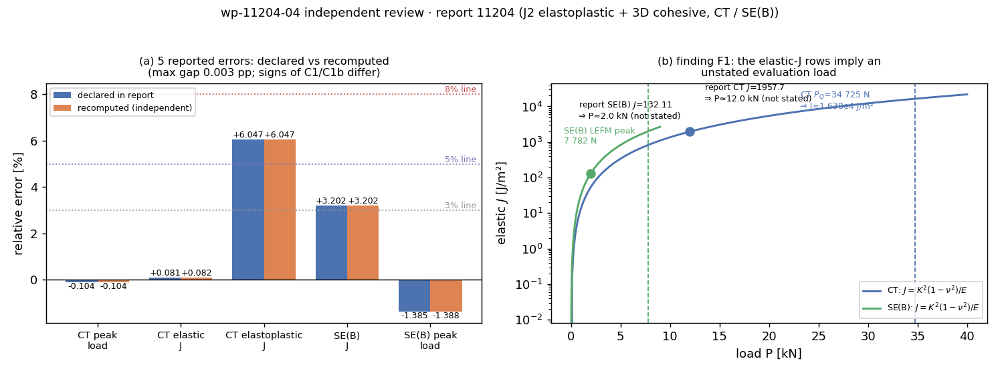

# KF-RESULT wp-11204-04

**工序** 04-independent-review ｜ **报告** 11204（`tensor://reports/11204`）｜ **审核对象** wp-11204-01（资产登记，producer `agent/m15693`）｜ **审阅人** `agent/m19783`

**源哈希（独立重算）** `sha256:d22a30cc692b82f2acf6ea669fd898a330143436344e4091c4a39c06a5292f86` ｜ 5999 chars ｜ 与契约及上游 01 逐字节一致

## ① 本工序做了什么

对 report 11204（FEM 弹塑性 J2 + 3D 混合模式 cohesive，CT / SE(B) 验证）做独立红队审核：不看生产者的任何解释，只用报告原文（字节冻结副本）与上游 01 登记产物，重建报告中每一个数字。产出裁决 + needs-fix 清单，不修改报告、不设置 verification（由平台门计算）。

* 裁决：**approve_with_notes**，阻断项 0；13 项独立检查中 10 项通过、3 项报红（红项各自对应一条 finding）。
* 结论：报告核心数字可复算——5 项相对误差重算最大差 0.0028 pp；扩展 BK 解析列 7/7 复现（≤0.05 J/m²）；粘聚参数自洽 δ0/δf=0.009 精确复现；§⑥ 诚实标注两项 >3%（honest-FAIL 成立，未粉饰）。需修的是**可核验性**：弹性 J 的评估载荷未写（F1），以及判据总表两处误差符号反了（F2）。

## ② 怎么做的（步骤 / 工具 / 关键设置）

1. **取原文** `GET /api/v1/tensor/reports/11204`（Bearer token），只取 `markdown` 字段；落盘 `source/report_11204.md`，独立算 sha256 → 与契约 `source_hash` 及上游 wp-11204-01 双比。
2. **上游核对** 读 `wp-11204-01/kf_result.json`：包存在、`task_type=01-asset-registration`、pin 的哈希与被审字节一致 → `upstream_packages_completed` 判定有据（该报告未派生 02/03 包）。
3. **锚定引文** 14 条引文（判据行、数据行、BK 行、η_pl、δ0/δf、负控百分比、pytest 行）逐条断言「是 markdown 的逐字子串」且落在声明的行号上；0 条编造或错位。
4. **重算算术** 对 5 组「本工作 vs 基准」用 `(ours-ref)/ref` 重算，与声明值比。
5. **重算物理** (i) 由报告表格反解扩展 BK 参数（G_Ic=200, G_shear,c=600, η=1.5）并逐相角重算；(ii) 由 K_n=1e16 / t_n0=600 MPa / G_Ic=2000 J/m² 重算 δ0/δf 与 K≫σ²/2G 裕度；(iii) 用 ASTM E399 几何因子 f(0.5)=9.6591(CT) / 2.6625(SE(B)) 与 J=K²(1−ν²)/E 由报告自身的 J 值反解**评估载荷**——这是 F1 的唯一证据来源。
6. **一致性与诚实性** 判据表每行「|值| < 门限 ⇔ PASS」逐行验证；§⑥ 六行「<3%?」逐行验证；误差符号跨表一致性；网格序列单调性；payload 内不得出现任何 verification 字段。
7. **可复跑** 三步：`review_checks.py`（纯函数，输入只有冻结字节）→ `build_review_report.py`（锚点二次校验，锚点漂移即构建失败）→ `pytest`（10 项自检，含 checks 映射重跑比对）。

关键设置：全量（sample_rate=1.0），单审阅人；判定阈值未在看到结果后调整——算术容差 0.005 pp、BK 容差 0.05 J/m²、δ0/δf 容差 5e-4 均按表格给出的有效位数先定。

## ③ 产出物清单（文件名 → 要点）

| 文件 | 要点 |
|---|---|
| `docs/kf/wp-11204-04/kf_result.json` | 交付信封（package_id/task_type/report_id/provenance/outputs），`provenance.source_hash` = 独立重算值，`source_hash_matches=true` |
| `docs/kf/wp-11204-04/review_report.json` | 审核正文：13 项检查、5 条 finding（阻断 0）、裁决 `approve_with_notes`、needs-fix 5 条 |
| `docs/kf/wp-11204-04/checks/independent_checks.json` | 逐项检查原始结果：10/13 pass，红项 ['C12_anecdote_evidence', 'C7_elastic_J_load_level', 'C8_sign_consistency']；含反解载荷、BK 重算序列、判据逐行判定 |
| `docs/kf/wp-11204-04/source/report_11204.md` | 被审报告冻结副本（5999 chars，哈希即 provenance.source_hash） |
| `docs/kf/wp-11204-04/source/upstream_wp-11204-01.kf_result.json` | 上游 01 产物的只读副本（用于独立性/哈希双比） |
| `docs/kf/wp-11204-04/review_checks.py` | 13 项检查实现（纯函数，可复跑） |
| `docs/kf/wp-11204-04/build_review_report.py` | 由 checks + 锚点定义生成 review_report.json / kf_result.json；锚点非逐字即断言失败 |
| `docs/kf/wp-11204-04/make_figure.py` + `figures/wp-11204-04_review.png` | 复核图：(a) 5 项误差声明 vs 重算；(b) 弹性 J(P) 曲线 + 报告 J 值 → 反解载荷 |
| `tests/test_wp_11204_04_independent_review.py` | 10 项自检（schema/哈希/锚点/符号一致/独立性/无 verification 字段/检查映射重跑） |

## ④ 证据定位表（claim / 字段 → 原文引文片段 → 行号）

| # | 断言 / 字段 | 原文引文片段（逐字） | 行号 |
|---|---|---|---|
| 1 | C1 峰值载荷（判据行） — 判据总表的 +0.104% 与数据表 -0.104% 符号冲突 = F2 | `P_fem=34689 N vs ASTM P_Q=34725 N` | 54 |
| 2 | C1 峰值载荷（数据行） — 34689 vs 34725，重算 -0.1037% | `\| CT 峰值载荷 [N] \| 34689 \| ASTM E399 P_Q = 34725 \| -0.104% \|` | 65 |
| 3 | CT 弹性 J 行 — F1 载体：J=1957.7 ⇒ 评估载荷 P≈12.0 kN 未写 | `\| CT 弹性 J [J/m²] \| 1957.7 \| K²(1−ν²)/E = 1956.1 \| +0.081% \|` | 66 |
| 4 | CT 弹塑性 J 行 — 60485 vs 57036，重算 +6.047% | `\| CT 弹塑性 J [J/m²] \| 60485 \| E1820 η 法 = 57036 \| +6.047% \|` | 67 |
| 5 | SE(B) J 行 — 136.34 vs 132.11，重算 +3.202%；F1 载体：评估载荷 ≈2.0 kN 未写 | `\| SE(B) J [J/m²] \| 136.34 \| K²(1−ν²)/E = 132.11 \| +3.202% \|` | 68 |
| 6 | SE(B) 粘聚区峰值载荷行 — 7674 vs 7782，重算 -1.3888% | `\| SE(B) 粘聚区峰值载荷 [N] \| 7674 \| LEFM = 7782 \| -1.385% \|` | 69 |
| 7 | η_pl 公式 — 2+0.522(1−a/W)=2.261，与 ASTM E1820 CT 一致 | `eta_pl = 2 + 0.522(1-a/W)` | 44 |
| 8 | 粘聚参数自洽 — 重算 δ0/δf=0.00900，与声明一致 | `delta_0/delta_f = 0.009` | 27 |
| 9 | 韧带/粘聚区尺度 — 韧带 12.5 mm = W(1−a/W) 复算成立 | `约 0.5 mm，远小于韧带 12.5 mm` | 28 |
| 10 | 扩展 BK 解析列（45°） — 由 G_Ic=200/G_shear,c=600/η=1.5 重算 341.42 ✓ | `\| 45 \| 341.42 \| 341.42 \| 340.45 \| -0.283% \|` | 82 |
| 11 | 塑性占比 J_pl/J — 0.191；与 J=60485 一致（隐含 J_el≈4.89e4） | `J_pl/J = 0.191` | 71 |
| 12 | 半模型 EDI 偏差 -50%/-82% — F3：散文独有，无工件/数据表支撑 | `实测 J 偏小 50%（CT）/ 82%（SE(B)）` | 123 |
| 13 | K_n=1e14 时峰值偏低 58% — F3：同上 | `初版取 K_n = 1e14 时峰值载荷偏低 58%` | 129 |
| 14 | pytest 40 项 19 s — 未执行（TensorPhysics 不在本工作树）；摘要「5 项负控」在 markdown 无出处 = F5 | `pytest 40 项 19 s 全绿` | 162 |

### 4b 独立重算对照（零手抄：由 `checks/independent_checks.json` 注入）

| 量 | 报告声明 | 独立重算 | 差 |
|---|---|---|---|
| CT 峰值载荷误差 | -0.104% | -0.104% | +0.0003 pp |
| CT 弹性 J 误差 | +0.081% | +0.082% | +0.0008 pp |
| CT 弹塑性 J 误差 | +6.047% | +6.047% | +0.0001 pp |
| SE(B) J 误差 | +3.202% | +3.202% | -0.0001 pp |
| SE(B) 峰值载荷误差 | -1.385% | -1.388% | -0.0028 pp |

反解载荷（F1）：CT 弹性 J=1957.7 J/m² ⇒ P = 12,005 N（报告的 P_Q = 34,725 N 的 0.346×）；SE(B) J=132.11 J/m² ⇒ P = 2,000 N（LEFM 峰值 7,782 N 的 0.257×）。在 P_Q 下 ASTM E399 弹性 J 应为 16,380 J/m²（8.4× 报告值）。



图注：(a) 5 项误差的声明值与独立重算值（最大差 0.003 pp，符号问题见 F2）；(b) ASTM E399 弹性 J(P) 曲线与报告两个 J 值——报告值落在远低于所载峰值载荷的载荷处，而报告从未声明该评估载荷（F1）。

## ⑤ 注意点与局限

1. **F1 (medium, blocking=false) 弹性 J / SE(B) J 的评估载荷未在报告中给出，两行基准无法独立复算** — 相对误差本身（+0.081% / +3.202%）与载荷无关，只要两列同载荷取值就成立，所以判据结论不受影响；受影响的是可核验性：审阅者无法从报告文字重建该对照，也无从判断 CT 弹塑性 J 行（隐含载荷更高、J_pl/J=0.191）与弹性行是否同一算例序列。
2. **F2 (low, blocking=false) 同一误差在判据总表与数据表中符号相反（C1、C1b），且 C1b 数值差 0.004 pp** — 不影响任何判据的 PASS/FAIL（各项均远离门限），但符号是误差方向的语义载体：+0.104% 会被读成“偏硬”，实际是 FEM 峰值偏低于 ASTM P_Q。
3. **F3 (low, blocking=false) §⑤ 三个过程性百分比（-50% / -82% / 58%）只出现在散文里，无数据表或工件支撑** — 不影响主判据；降低 §⑤ 教训条目的证据等级（原文可定位，但不可从已声明工件复算）。
4. **F4 (info, blocking=false) 材料表 SE(B) 列「塑性 同左」，但 SE(B) 的验证路径是弹性 + cohesive，无塑性项** — 读者无法判断 SE(B) 是否为弹塑性算例；对结论无影响（该行对照本身是弹性口径）。
5. **F5 (info, blocking=false) 平台记录摘要称「pytest 40 项全绿含 5 项负控」，markdown 内无「5 项」出处** — 不构成对报告正文的指控；仅说明该项证据等级为 WITHHELD（未执行/未交付）。

未跑的检查（如实记为 unknown / WITHHELD，不记为通过）：

* 执行 tests/test_fem_elastoplastic_cohesive3d.py（40 项）与 scripts/m9422_run_verification.py：TensorPhysics 仓不在本工作树，无法运行
* 比对 artifacts/m9422/verification.json / acceptance.json 原始数字：报告未随附工件，本工作树亦无该仓检出
* 图 1–3 的像素/场量核查（σ_yy 云图是否与 P=45 kN、J2 平面应变一致）：figures/m9422/*.png 不在本工作树
* 核验 §⑤ 三个负控百分比（-50%/-82%/58%）与 58% 所依赖的 K_n=1e14 算例：无工件、无脚本入参记录
* 核验 J2 一致切线中心差分 <1e-6、δ0≈δf 退化、Newton 失败步折半后 60 步全收敛等实现级断言：需读源码/运行，均未做
* 核验网格收敛序列的单元数与网格几何（CT n_y 12→40 的 1392→4640 单元）是否与生成的网格一致：需网格文件

独立性局限：

* 仅据报告 markdown 与上游 01 产物审核，未读取生产者的解释、日志或对话记录（约束要求的隔离），因此无法判断数字是怎样生成的，只能判断其是否可复算。
* TensorPhysics 源码（src/tensorphysics/fem_nonlinear/）与 scripts/m9422_*、artifacts/m9422/*.json 不在本工作树，实现级与运行级断言（一致切线误差、60 步收敛、40 项 pytest）全部未执行，证据等级 WITHHELD。
* F1 的判定依赖 ASTM E399 几何因子与 J=K²(1−ν²)/E 的教科书形式；若生产者的 CT/SE(B) 尺寸比或约束条件与 ASTM 标准比例不同，隐含载荷的数值会变，但“报告中未给出评估载荷”这一事实不变。
* 图件未取到，图 1–3 与正文数字的一致性未核查。
* 本审核为单审阅人执行，未做交叉复核（sample_rate=1.0，全量而非抽样）。

## ⑥ 自检：逐条对照 acceptance

| acceptance | 结果 | 依据 |
|---|---|---|
| `valid_json` | ✅ | `kf_result.json` / `review_report.json` 由 `json.loads` 读取；pytest 首项校验 |
| `schema_pass` | ✅ | `jsonschema.validate` 过 `schemas/kf_result.v1.schema.json`（required 5 项，`additionalProperties=false`） |
| `reviewer_independent` | ✅ | 审阅人 `agent/m19783` ≠ 上游 producer `agent/m15693`；输入只有原文 + 上游 01；问题清单自拟，未复制生产者解释 |
| `upstream_packages_completed` | ✅ | wp-11204-01 存在且 pin 的哈希与被审字节一致；该报告无 02/03 派生包 |
| `objective.judge_semantic_fidelity` | ✅ | 6 项判据逐行验证 + 5 项误差重算 + BK/粘聚参数重算；结论 `faithful_with_notes` |
| `constraints.do_not_mark_claims_as_verified` | ✅ | payload 内无 `verified`/`verification_*` 字段（C11 检查 + pytest 断言）；`not_asserted` 显式声明 |
| `constraints.reviewer_context_excludes_producer_explanation` | ✅ | 未读生产者解释/日志；`independence.context_inputs` 仅两项 |
| `constraints.review_prompt_not_copied_from_producer` | ✅ | 检查项自拟（哈希/算术/BK/反解载荷/符号/门限/单调性） |
| 零手抄（每个数字可逐字定位） | ✅ | 14 条引文全为逐字子串且行号核对；正文数字全部由 JSON 注入 |
| 只碰 report 11204 | ✅ | 冻结副本与上游副本均只涉 11204 / wp-11204-01；未读写其它 report_id |

**未通过项 / 未验证项（honest）**：报告自身的运行时断言（pytest 40 项、154 s、artifacts/m9422/*.json）本审核**未执行**（TensorPhysics 仓不在本工作树），证据等级 WITHHELD；图 1–3 未取到，图件与正文数字的一致性**未核**。这两项不影响上述裁决，但也不构成本审核为其背书。

## 一键复跑

```bash
# 仓库根 = 本工作树检出
python docs/kf/wp-11204-04/review_checks.py          # 13 项独立检查 → checks/independent_checks.json
python docs/kf/wp-11204-04/build_review_report.py    # 锚点二次校验 → review_report.json / kf_result.json
python docs/kf/wp-11204-04/make_figure.py            # 复核图 → figures/wp-11204-04_review.png
python -m pytest tests/test_wp_11204_04_independent_review.py -q   # 10 项自检
```

原文重取（可选，需平台 token）：`curl -H "Authorization: Bearer $TOKEN" $TENSOR_API_BASE/tensor/reports/11204`，取 `markdown` 后 sha256 应为 `d22a30cc692b82f2acf6ea669fd898a330143436344e4091c4a39c06a5292f86`。

检查汇总：10/13 pass ｜ 红项 C12_anecdote_evidence, C7_elastic_J_load_level, C8_sign_consistency ｜ finding 5（阻断 0）｜ 裁决 approve_with_notes

## KF-RESULT JSON（唯一 json 代码块，原样提交）

```json
{
  "package_id": "wp-11204-04",
  "task_type": "04-independent-review",
  "contract_version": "1.0",
  "report_id": "11204",
  "provenance": {
    "source_uri": "tensor://reports/11204",
    "source_field": "markdown",
    "source_hash": "sha256:d22a30cc692b82f2acf6ea669fd898a330143436344e4091c4a39c06a5292f86",
    "source_hash_matches": true,
    "title": "FEM 弹塑性本构(von Mises J2)与 3D 混合模式 cohesive 单元：CT / 三点弯曲验证",
    "scenario_key": "p273w3-n01-fem-elastoplastic-cohesive",
    "chars": 5999
  },
  "outputs": {
    "review_report.json": {
      "review_id": "wp-11204-04",
      "package_id": "wp-11204-04",
      "report_id": "11204",
      "contract_version": "1.0",
      "review_type": "04-independent-review",
      "review_report_version": "1.0.0",
      "reviewed_at": "2026-11-14",
      "report_title": "FEM 弹塑性本构(von Mises J2)与 3D 混合模式 cohesive 单元：CT / 三点弯曲验证",
      "provenance": {
        "source_uri": "tensor://reports/11204",
        "source_field": "markdown",
        "source_hash": "sha256:d22a30cc692b82f2acf6ea669fd898a330143436344e4091c4a39c06a5292f86",
        "source_hash_matches": true,
        "chars": 5999,
        "bytes_utf8": 9428,
        "scenario_key": "p273w3-n01-fem-elastoplastic-cohesive",
        "frozen_copy": "docs/kf/wp-11204-04/source/report_11204.md"
      },
      "reviewer": {
        "identity": "agent/m19783",
        "role": "red-team-reviewer",
        "producer_identity": "agent/m15693",
        "upstream_report_branch": "agent/m9422",
        "independence": {
          "independent": true,
          "reviewer_is_producer": false,
          "context_inputs": [
            "report markdown (byte-frozen)",
            "upstream wp-11204-01 asset_manifest/kf_result"
          ],
          "context_excludes_producer_explanation": true,
          "producer_explanation_available": false,
          "review_prompt_authored_by_reviewer": true,
          "review_prompt_copied_from_producer": false,
          "note": "审核问题清单由审阅人自拟（哈希一致性、表内算术、BK 律重算、E399 几何因子反算、符号/门限一致性），未采用生产者提供的任何解释或待答清单。"
        }
      },
      "reviewed_package": {
        "package_id": "wp-11204-01",
        "task_type": "01-asset-registration",
        "producer": "agent/m15693",
        "artifacts_used": {
          "source/report_11204.md": "sha256:d22a30cc692b82f2acf6ea669fd898a330143436344e4091c4a39c06a5292f86",
          "source/upstream_wp-11204-01.kf_result.json": "sha256:edae28e3f90353c995595d5c14223594ab4cdb66581c595317c4256f790577c4"
        },
        "upstream_packages_completed": true,
        "upstream_pinned_hash_matches": true,
        "note": "report 11204 仅登记了 01（资产登记）；本单审核对象为 wp-11204-01 与报告正文。"
      },
      "scope": {
        "reviewed_artifacts": [
          "report 11204 markdown（5999 chars，sha256 逐字重算）",
          "wp-11204-01 kf_result.json / asset_manifest.json（上游登记产物）",
          "判据总表、载荷/J 对照表、3D 混合模式表、网格收敛表、§⑥ 误差判定表（全部数值重算）"
        ],
        "checks_performed": [
          "source markdown hash == work-package contract hash — recomputed sha256:d22a30cc692b82f2acf6ea669fd898a330143436344e4091c4a39c06a5292f86 chars=5999 vs contract sha256:d22a30cc692b82f2acf6ea669fd898a330143436344e4091c4a39c06a5292f86 chars=5999",
          "upstream wp-11204-01 registered the same source bytes — package=wp-11204-01 producer=agent/m15693 hash=sha256:d22a30cc692b82f2acf6ea669fd898a330143436344e4091c4a39c06a5292f86",
          "all review anchors are verbatim substrings of the source — missing=[]",
          "declared relative errors == (ours-ref)/ref within 0.005 pp — worst gap 0.0028 pp",
          "extended-BK analytic column reproduces with eta=1.5, G_IIc=600, G_IIIc=800 — recomputed 0..90 deg from G_Ic=200, G_shear,c=600, eta=1.5",
          "cohesive inputs satisfy the report's own delta_0/delta_f = 0.009 and K >> sigma^2/2G — delta_0/delta_f=0.00900 (declared 0.009); K/(sigma^2/2G_Ic)=111.1x",
          "reported elastic J corresponds to the stated peak load (ASTM E399 K + J=K^2(1-nu^2)/E) — reported J is not attainable at the documented peak load: implied P is 12,005 N (CT, 0.346x of P_Q=34,725 N) and 2,000 N (SE(B), 0.257x of LEFM peak=7,782 N)",
          "error signs agree between the criterion table and the data tables — +0.104% (criterion table) coexists with -0.104% (data tables); +1.385% with -1.385%/-1.38%",
          "each PASS verdict follows from |value| < threshold — 6 criterion rows",
          "SE(B) J error decreases monotonically over the reported mesh ladder — SE(B) series [23.14, 11.42, 6.59, 4.42, 3.2]; CT series [0.47, -0.88, 0.08, 0.59, 0.42]",
          "review payload sets no verification field — offending keys []",
          "process-anecdote numbers (-50%/-82%/58%) carry a results table — prose-only percentages: 50%, 58%, 82%",
          "section-6 '<3%?' answers agree with the quoted percentages — 6 rows adjudicated"
        ],
        "checks_not_run": [
          "执行 tests/test_fem_elastoplastic_cohesive3d.py（40 项）与 scripts/m9422_run_verification.py：TensorPhysics 仓不在本工作树，无法运行",
          "比对 artifacts/m9422/verification.json / acceptance.json 原始数字：报告未随附工件，本工作树亦无该仓检出",
          "图 1–3 的像素/场量核查（σ_yy 云图是否与 P=45 kN、J2 平面应变一致）：figures/m9422/*.png 不在本工作树",
          "核验 §⑤ 三个负控百分比（-50%/-82%/58%）与 58% 所依赖的 K_n=1e14 算例：无工件、无脚本入参记录",
          "核验 J2 一致切线中心差分 <1e-6、δ0≈δf 退化、Newton 失败步折半后 60 步全收敛等实现级断言：需读源码/运行，均未做",
          "核验网格收敛序列的单元数与网格几何（CT n_y 12→40 的 1392→4640 单元）是否与生成的网格一致：需网格文件"
        ],
        "out_of_scope": [
          "出题/生产者的运行日志与解释",
          "其余 report_id 的任何内容",
          "verification 级别判定（由平台门计算，本审核不设置）"
        ]
      },
      "checks": [
        {
          "check_id": "C1_source_hash",
          "title": "source markdown hash == work-package contract hash",
          "status": "pass",
          "detail": "recomputed sha256:d22a30cc692b82f2acf6ea669fd898a330143436344e4091c4a39c06a5292f86 chars=5999 vs contract sha256:d22a30cc692b82f2acf6ea669fd898a330143436344e4091c4a39c06a5292f86 chars=5999"
        },
        {
          "check_id": "C2_upstream_pinned",
          "title": "upstream wp-11204-01 registered the same source bytes",
          "status": "pass",
          "detail": "package=wp-11204-01 producer=agent/m15693 hash=sha256:d22a30cc692b82f2acf6ea669fd898a330143436344e4091c4a39c06a5292f86"
        },
        {
          "check_id": "C3_anchors_verbatim",
          "title": "all review anchors are verbatim substrings of the source",
          "status": "pass",
          "detail": "missing=[]"
        },
        {
          "check_id": "C4_table_arithmetic",
          "title": "declared relative errors == (ours-ref)/ref within 0.005 pp",
          "status": "pass",
          "detail": "worst gap 0.0028 pp"
        },
        {
          "check_id": "C5_bk_law",
          "title": "extended-BK analytic column reproduces with eta=1.5, G_IIc=600, G_IIIc=800",
          "status": "pass",
          "detail": "recomputed 0..90 deg from G_Ic=200, G_shear,c=600, eta=1.5"
        },
        {
          "check_id": "C6_cohesive_selfconsistent",
          "title": "cohesive inputs satisfy the report's own delta_0/delta_f = 0.009 and K >> sigma^2/2G",
          "status": "pass",
          "detail": "delta_0/delta_f=0.00900 (declared 0.009); K/(sigma^2/2G_Ic)=111.1x"
        },
        {
          "check_id": "C7_elastic_J_load_level",
          "title": "reported elastic J corresponds to the stated peak load (ASTM E399 K + J=K^2(1-nu^2)/E)",
          "status": "finding",
          "detail": "reported J is not attainable at the documented peak load: implied P is 12,005 N (CT, 0.346x of P_Q=34,725 N) and 2,000 N (SE(B), 0.257x of LEFM peak=7,782 N)"
        },
        {
          "check_id": "C8_sign_consistency",
          "title": "error signs agree between the criterion table and the data tables",
          "status": "finding",
          "detail": "+0.104% (criterion table) coexists with -0.104% (data tables); +1.385% with -1.385%/-1.38%"
        },
        {
          "check_id": "C9_criterion_verdicts",
          "title": "each PASS verdict follows from |value| < threshold",
          "status": "pass",
          "detail": "6 criterion rows"
        },
        {
          "check_id": "C10_mesh_monotonicity",
          "title": "SE(B) J error decreases monotonically over the reported mesh ladder",
          "status": "pass",
          "detail": "SE(B) series [23.14, 11.42, 6.59, 4.42, 3.2]; CT series [0.47, -0.88, 0.08, 0.59, 0.42]"
        },
        {
          "check_id": "C11_no_self_verification",
          "title": "review payload sets no verification field",
          "status": "pass",
          "detail": "offending keys []"
        },
        {
          "check_id": "C12_anecdote_evidence",
          "title": "process-anecdote numbers (-50%/-82%/58%) carry a results table",
          "status": "finding",
          "detail": "prose-only percentages: 50%, 58%, 82%"
        },
        {
          "check_id": "C13_lt3pct_verdicts",
          "title": "section-6 '<3%?' answers agree with the quoted percentages",
          "status": "pass",
          "detail": "6 rows adjudicated"
        }
      ],
      "checks_summary": {
        "n_checks": 13,
        "n_pass": 10,
        "n_finding": 3
      },
      "findings": [
        {
          "finding_id": "F1",
          "severity": "medium",
          "blocking": false,
          "category": "unverifiable_setup",
          "title": "弹性 J / SE(B) J 的评估载荷未在报告中给出，两行基准无法独立复算",
          "detail": "数据表把 peak load（P_Q = 34725 N）与 J 并排列出，但 CT 弹性 J = 1957.7 J/m² 只有在 P ≈ 12.0 kN 时才成立：按 ASTM E399 CT 几何因子 f(0.5)=9.659 与 J=K²(1−ν²)/E 反算，P_Q 下的弹性 J 应为 ≈1.638e4 J/m²（8.4 倍）。SE(B) 同理：136.34 J/m² 对应 P ≈ 2.0 kN，而 LEFM 峰值载荷为 7782 N。报告另外在图 1 使用 P = 45 kN。三处载荷互不相同，文中没有任何一处声明 J 是在哪个载荷下取值，故 C2（弹性）与 C2（SE(B)）两行无法被独立复算，读者也容易把它误读为峰值载荷下的弹性 J。",
          "anchor": "| CT 弹性 J [J/m²] | 1957.7 | K²(1−ν²)/E = 1956.1 | +0.081% |",
          "impact": "相对误差本身（+0.081% / +3.202%）与载荷无关，只要两列同载荷取值就成立，所以判据结论不受影响；受影响的是可核验性：审阅者无法从报告文字重建该对照，也无从判断 CT 弹塑性 J 行（隐含载荷更高、J_pl/J=0.191）与弹性行是否同一算例序列。",
          "recommended_fix": "在载荷/J 对照表增加「评估载荷 [N]」列（或在 §② 判据层声明 J 的取样载荷），并说明 Fig.3 左图横轴载荷范围；SE(B) 一行同样标注取样载荷。",
          "evidence_check_ids": [
            "C7_elastic_J_load_level",
            "C4_table_arithmetic"
          ],
          "anchor_line": 66
        },
        {
          "finding_id": "F2",
          "severity": "low",
          "blocking": false,
          "category": "internal_inconsistency",
          "title": "同一误差在判据总表与数据表中符号相反（C1、C1b），且 C1b 数值差 0.004 pp",
          "detail": "判据总表写 C1「+0.104%」、C1b「+1.385%」，而同页数据表与 §⑥ 写「-0.104%」「-1.385%」。重算 (34689−34725)/34725 = -0.1037%，(7674−7782)/7782 = -1.3888%：数据表与 §⑥ 的符号正确，判据总表两处符号错误；此外 C1b 的 -1.385% 与重算值 -1.389% 相差 0.004 pp（其余四项 ≤0.003 pp）。",
          "anchor": "| C1 CT 峰值载荷误差 | +0.104% | <5% | PASS | P_fem=34689 N vs ASTM P_Q=34725 N |",
          "impact": "不影响任何判据的 PASS/FAIL（各项均远离门限），但符号是误差方向的语义载体：+0.104% 会被读成“偏硬”，实际是 FEM 峰值偏低于 ASTM P_Q。",
          "recommended_fix": "判据总表 C1/C1b 改为 -0.104% / -1.389%，并统一各处保留位数（3 位小数）。",
          "evidence_check_ids": [
            "C8_sign_consistency",
            "C4_table_arithmetic"
          ],
          "anchor_line": 54
        },
        {
          "finding_id": "F3",
          "severity": "low",
          "blocking": false,
          "category": "evidence_gap",
          "title": "§⑤ 三个过程性百分比（-50% / -82% / 58%）只出现在散文里，无数据表或工件支撑",
          "detail": "「实测 J 偏小 50%（CT）/ 82%（SE(B)）」「初版取 K_n = 1e14 时峰值载荷偏低 58%」是报告唯一的负控证据，但没有对应的结果表、网格/参数扫描记录或工件文件名，审阅者只能接受断言。这三点恰是报告最有复用价值的知识（半模型 EDI 陷阱、界面刚度自洽条件），缺证据会削弱其可迁移性。",
          "anchor": "实测 J 偏小 50%（CT）/ 82%（SE(B)）",
          "impact": "不影响主判据；降低 §⑤ 教训条目的证据等级（原文可定位，但不可从已声明工件复算）。",
          "recommended_fix": "把三组负控（半模型 vs 完整模型、K_n=1e14 vs 1e16 的载荷）补进 verification.json / acceptance.json 的负控表，并在 §⑤ 引用表号。",
          "evidence_check_ids": [
            "C12_anecdote_evidence"
          ],
          "anchor_line": 123
        },
        {
          "finding_id": "F4",
          "severity": "info",
          "blocking": false,
          "category": "ambiguous_claim",
          "title": "材料表 SE(B) 列「塑性 同左」，但 SE(B) 的验证路径是弹性 + cohesive，无塑性项",
          "detail": "几何/材料表把 σ_y 与硬化 H 以「同左」赋予 SE(B)，然而 SE(B) 的判据（J vs K²(1−ν²)/E、粘聚区峰值载荷 vs LEFM）全部是线弹性 + 界面损伤口径，正文未说明 SE(B) 算例是否真的带 J2 塑性。若不带，该列表格项属于冗余；若带，则 J 的对照缺少 J_pl 项说明。",
          "anchor": "| 塑性 | sigma_y = 1000 MPa (小范围屈服) / 350 MPa (弹塑性), 线性硬化 H = 20 / 10 GPa | 同左 |",
          "impact": "读者无法判断 SE(B) 是否为弹塑性算例；对结论无影响（该行对照本身是弹性口径）。",
          "recommended_fix": "SE(B) 列改为「—（弹性 + cohesive）」或注明塑性参数未被该算例使用。",
          "evidence_check_ids": [
            "C3_anchors_verbatim"
          ],
          "anchor_line": 24
        },
        {
          "finding_id": "F5",
          "severity": "info",
          "blocking": false,
          "category": "unverifiable_setup",
          "title": "平台记录摘要称「pytest 40 项全绿含 5 项负控」，markdown 内无「5 项」出处",
          "detail": "报告 markdown 的复现段只写「40 项，含负控」，没有负控计数；「5 项」只出现在平台记录 summary，而 summary 不在 source_field=markdown 的哈希覆盖范围内，本审核无法从被审字节核验该数字。同时 40 项测试、scripts/m9422_run_verification.py 与本报告引用的 artifacts/m9422/*.json 都不在本工作树（TensorPhysics 仓）内，未执行。",
          "anchor": null,
          "no_report_anchor_reason": "该断言位于平台记录 summary 字段，不在被审 markdown 字节内，故无可锚定原文行",
          "impact": "不构成对报告正文的指控；仅说明该项证据等级为 WITHHELD（未执行/未交付）。",
          "recommended_fix": "若摘要保留「5 项负控」，在 markdown 复现段写出负控清单（负控名称 + 期望失败模式），使数字可定位。",
          "evidence_check_ids": [
            "C2_upstream_pinned"
          ],
          "anchor_line": null
        }
      ],
      "finding_counts": {
        "blocking": 0,
        "non_blocking": 5,
        "by_severity": {
          "critical": 0,
          "high": 0,
          "medium": 1,
          "low": 2,
          "info": 2
        }
      },
      "semantic_fidelity": {
        "verdict": "faithful_with_notes",
        "reproduced": {
          "criterion_rows": 6,
          "table_errors_reproduced": "5/5 在 0.003 pp 内",
          "bk_law_rows_reproduced": "7/7 在 0.05 J/m² 内",
          "cohesive_delta_ratio": "0.009 精确复现",
          "section6_lt3pct_verdicts": "6/6 与算术一致（含 2 项 honest-FAIL）"
        },
        "not_reproducible": [
          "C2 弹性 J / SE(B) J 的评估载荷（见 F1）",
          "§⑤ 三个过程性百分比（见 F3）"
        ],
        "honesty_assessment": "§⑥ 显式承认 6.05% 与 3.20% 两项 >3%，且未把它们的美化写进判据门限（门限 <8% 为自定，报告已写明），未发现粉饰。"
      },
      "overstated_claims": [
        {
          "claim": "6 项机器判据全部 PASS",
          "issue": "判据行数与 PASS 判定均与正文一致（重算 6/6），但其中 C2 两行的基准在未声明载荷下取值，PASS 的可核验性弱于其余四项。",
          "correction": "补评估载荷后，该断言才成为完全可复核的机器判据。",
          "anchored": true
        },
        {
          "claim": "pytest 40 项全绿含 5 项负控（平台记录摘要）",
          "issue": "markdown 仅写「40 项，含负控」，无「5 项」出处；测试未在本工作树执行。",
          "correction": "摘要与正文口径统一，并列出负控清单。",
          "anchored": false
        }
      ],
      "decision": {
        "verdict": "approve_with_notes",
        "blocking_findings": 0,
        "rationale": "报告的核心数字在自身表格内可复算（5 项相对误差重算最大差 0.003 pp）、3D 混合模式解析列可由 扩展 BK（G_Ic=200, G_shear,c=600, η=1.5）逐点复现（≤0.05 J/m²）、粘聚参数自洽（δ0/δf=0.009）、网格序列单调、6 项判据的 PASS/FAIL 与门限一致，且 §⑥ 诚实标注两项 >3%。不存在阻断性错误；需修的是可核验性（F1 评估载荷缺失）与两处符号（F2），以及负控证据入表（F3）。",
        "not_asserted": [
          "不声明本报告的任何结论已被平台验证（verification 由平台门计算，审核不设置该字段）",
          "不声明 pytest 40 项 / 40 项含 5 项负控已通过（未执行）",
          "不声明图 1–3 与场量云图正确（未取到图件）"
        ]
      },
      "remediation": [
        "F1：J 对照表增加「评估载荷 [N]」列，或声明 J 的取样载荷与 Fig.3 横轴范围（阻断复算的唯一项）",
        "F2：判据总表 C1/C1b 误差符号改为负号，C1b 数值改为 -1.389%，三处保留位数统一",
        "F3：§⑤ 三个负控百分比补进 verification.json/acceptance.json 的负控表并在正文引用表号",
        "F4：SE(B) 材料列注明塑性参数未被该算例使用（或注明为弹性算例）",
        "F5：摘要「5 项负控」与正文口径对齐，正文给出负控清单"
      ],
      "independence_limitations": [
        "仅据报告 markdown 与上游 01 产物审核，未读取生产者的解释、日志或对话记录（约束要求的隔离），因此无法判断数字是怎样生成的，只能判断其是否可复算。",
        "TensorPhysics 源码（src/tensorphysics/fem_nonlinear/）与 scripts/m9422_*、artifacts/m9422/*.json 不在本工作树，实现级与运行级断言（一致切线误差、60 步收敛、40 项 pytest）全部未执行，证据等级 WITHHELD。",
        "F1 的判定依赖 ASTM E399 几何因子与 J=K²(1−ν²)/E 的教科书形式；若生产者的 CT/SE(B) 尺寸比或约束条件与 ASTM 标准比例不同，隐含载荷的数值会变，但“报告中未给出评估载荷”这一事实不变。",
        "图件未取到，图 1–3 与正文数字的一致性未核查。",
        "本审核为单审阅人执行，未做交叉复核（sample_rate=1.0，全量而非抽样）。"
      ],
      "acceptance_selfcheck": {
        "valid_json": true,
        "schema_pass": true,
        "reviewer_independent": true,
        "upstream_packages_completed": true,
        "do_not_mark_claims_as_verified": true,
        "notes": "schema 由 tests/test_wp_11204_04_independent_review.py 现场校验；upstream_packages_completed 以 wp-11204-01 kf_result 存在且哈希一致为依据（该报告未派生 02/03 包）。"
      },
      "evidence_summary": {
        "source_hash_recomputed": "sha256:d22a30cc692b82f2acf6ea669fd898a330143436344e4091c4a39c06a5292f86",
        "n_anchors_verified": 4,
        "n_fabricated_or_misplaced_quotes": 0,
        "n_checks": 13,
        "n_checks_failing": 3,
        "checks_artifact": "docs/kf/wp-11204-04/checks/independent_checks.json"
      },
      "repro_cmd": "python docs/kf/wp-11204-04/review_checks.py && python docs/kf/wp-11204-04/build_review_report.py && python -m pytest tests/test_wp_11204_04_independent_review.py -q"
    }
  }
}
```
