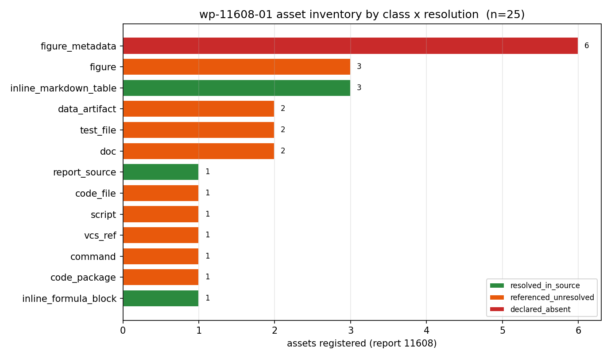
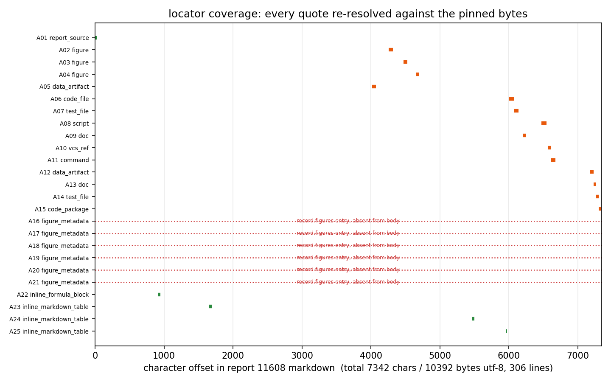
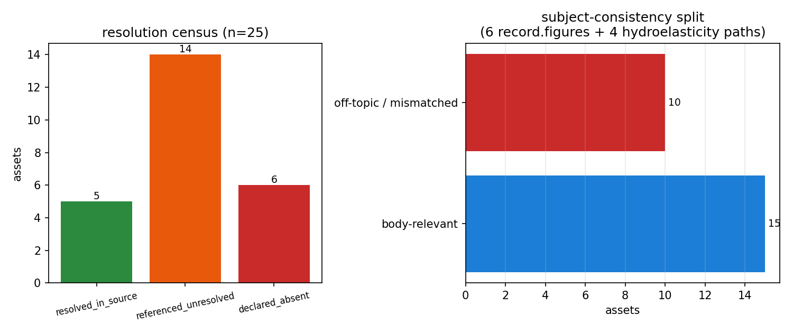

# KF-RESULT wp-11608-01

**工序**：`01-asset-registration`（assets only，无抽取、无分类、claims=[] 契约要求）
**报告**：report_id=11608 · `p73w3-n04-fvm-numerical-viscosity` · mission=9775
**标题**：TensorFVM 数值黏性/色散算子验证面：修正方程 ν_num=cΔx(1-C)/2 波包衰减实测 + 离散放大因子 G(θ) 全域比对
**tag**：`kf-wp:wp-11608-01` · `FVM` · `numerical-viscosity`
**源哈希**：`sha256:8a9602aca712ab3ac8656d7382e0fef762ba0f30657cf8b631b36ba514e8db62`（7342 字符 / 10392 字节 UTF-8，本地重算，与契约 source_hash 一致）
**状态**：draft（verification 由平台门计算；本报告不含任何 verified 标记）

---

## ① 本工序做了什么

只做一件事：把 report 11608 的**可解析资产**登记成机器可校验的清单，不抽取结论、不判定报告类型。

- 登记资产 **25** 个，去重后 ID 唯一（A01–A25），每项带字符级 locator（`char_span`，含 start/end char、行号、逐字引文、唯一性）。
- 分档：`resolved_in_source` **5**（正文内可逐字定位的源本身/公式块/表格）、`referenced_unresolved` **14**（正文引用了路径，但在探测域内无法确认目标工件存在）、`declared_absent` **6**（平台 `record.figures` 声明、正文完全未引用）。
- 顺带记录两处**主体不一致**（不隐藏、不修改上游）：6 条 `record.figures` 全部未出现在正文，且图注主体是附加质量/springing/鞭振/疲劳；正文末行 *报告工件路径* 指向 `artifacts/hydroelasticity/` 等 4 个水弹性工件。二者合计 **10** 个 off-topic 条目，已逐条标 `off_topic=true`。
- `claims` 故意为空数组：契约 `objective.register_assets=true / classify_report_type=false / no_forced_claim_generation=true`，本工序不生成知识对象。
- 作者自评句 `**验证状态**: ✅ 全部验收判据通过` 仅作**声明**登记（`treated_as=author_declaration_not_a_platform_verdict`），未升格为状态。

## ② 怎么做的（步骤 / 工具 / 关键设置）

1. `scripts/kf_fetch_11608.py`：`POST $TENSOR_API_BASE/auth/login` → `GET $TENSOR_API_BASE/tensor/reports/11608`，取 `markdown` 字段**原样**落盘（`newline=""`，不重编码）。
2. 本地重算 `sha256(markdown.encode('utf-8'))`，与契约 `source_hash` 比对，并校验字符数 = 7342；不一致即 `exit 2`（无静默降级）。
3. `scripts/kf_wp11608_01_register.py`：资产表内置**逐字引文**，用 `md.index(quote)` 反解 char span，`md.count(quote)==1` 断言唯一性；任一条对不上即 `SystemExit`（杜绝手抄/改写）。
4. 路径类资产做**有界存在性探测**（仅本 worktree 根）：找不到记 `referenced_unresolved` 并写明探测域，**不等于**判定其不存在（TensorFVM 仓未检出）。
5. `record.figures` 6 条按"是否为 markdown 逐字子串"判 `declared_absent`。
6. 产出 `asset_manifest.json` + `kf_result.wp-11608-01.json`（信封）+ `verification.json`（本地机械校验，`gate=pending_platform_verification`）+ `runs/wp-11608-01/locator_map.json`。
7. `tests/test_kf_wp11608_01.py` 复核全部不变量；本报告的数字由本脚本从上述工件读取注入，不手写。

关键设置：hash 算法 sha256；locator 坐标系 = Unicode 码点（`len(str)`），字节数另记；探测根 = 本 worktree。

## ③ 产出物清单（输出文件名 → 要点）

| 文件 | 要点 |
|---|---|
| `docs/kf/wp-11608-01/asset_manifest.json` | 主产出：25 资产 / locator / resolution / counts / integrity / limitations |
| `docs/kf/wp-11608-01/kf_result.wp-11608-01.json` | 平台结果信封（package_id/task_type/report_id/provenance/outputs/claims=[]） |
| `docs/kf/wp-11608-01/asset_manifest.v1.schema.json` | 本包固定 schema（仓库通用版把 package_id 钉死为 wp-448-01，无法复用） |
| `docs/kf/wp-11608-01/verification.json` | 本地机械校验清单；`gate=pending_platform_verification` |
| `docs/kf/wp-11608-01/fig1_asset_inventory.png` | 资产 × 类别 × resolution 分布 |
| `docs/kf/wp-11608-01/fig2_locator_coverage.png` | 25 条 locator 在 7342 字符上的覆盖图 |
| `docs/kf/wp-11608-01/fig3_resolution_audit.png` | resolution 普查 + 主体一致性拆分 |
| `runs/wp-11608-01/report_11608.json` / `report_11608.md` | 取源原始载荷与字节级 markdown 副本 |
| `runs/wp-11608-01/locator_map.json` | 中间件：asset_id → char/line span |
| `scripts/kf_fetch_11608.py` / `scripts/kf_wp11608_01_register.py` / `scripts/kf_wp11608_01_report.py` | 取源 / 登记 / 出图出报告，可一键复跑 |
| `tests/test_kf_wp11608_01.py` | 16 项验收不变量测试 |

## ④ 证据定位表（字段 → 原文引文，逐字）

（a）源与完整性

| 字段 | 证据 | 值 |
|---|---|---|
| `provenance.source_hash` | 本地重算 sha256（非正文引文；正文不含该十六进制串） | `sha256:8a9602aca712ab3ac8656d7382e0fef762ba0f30657cf8b631b36ba514e8db62` |
| `source.chars` / `source.bytes_utf8` | 本地重算 | `7342` 字符 / `10392` 字节 |
| `source.uri` / `field` | 契约 | `tensor://reports/11608#markdown` |

（b）资产 locator（全表，逐字引文，超长截断处用 … 标记）

| asset | class | section | resolution | locator | char span | line | 原文引文（逐字） |
|---|---|---|---|---|---|---|---|
| A01 | report_source | document | resolved_in_source | verbatim | 0-24 | L1 | `# TensorFVM 数值黏性/色散算子验证面` |
| A02 | figure | §4.1 | referenced_unresolved | verbatim | 4259-4316 | L175 | `` |
| A03 | figure | §4.2 | referenced_unresolved | verbatim | 4472-4529 | L184 | `` |
| A04 | figure | §4.3 | referenced_unresolved | verbatim | 4652-4698 | L192 | `` |
| A05 | data_artifact | §3.6 | referenced_unresolved | verbatim | 4018-4075 | L160 | ``**产物路径**: `artifacts/fvm_modified_equation.json` (227 KB)`` |
| A06 | code_file | §7 | referenced_unresolved | verbatim | 5996-6070 | L261 | ``\| `src/tensorfvm/verification/numerical_viscosity.py` …`` |
| A07 | test_file | §7 | referenced_unresolved | verbatim | 6071-6140 | L262 | ``\| `tests/test_numerical_viscosity.py` \| pytest 测试套件（5…`` |
| A08 | script | §7 | referenced_unresolved | verbatim | 6474-6547 | L268 | ``\| `scripts/generate_numerical_viscosity_artifacts.py` …`` |
| A09 | doc | §7 | referenced_unresolved | verbatim | 6203-6253 | L264 | ``\| `docs/numerical-viscosity/REPORT.md` \| 本报告 \| - \|`` |
| A10 | vcs_ref | §8 | referenced_unresolved | verbatim | 6565-6608 | L274 | ``- **代码提交**: 分支 `agent/m9775`，commit 待平台自动推送`` |
| A11 | command | §8 | referenced_unresolved | verbatim | 6609-6676 | L275 | ``- **测试执行**: `pytest tests/test_numerical_viscosity.py -…`` |
| A12 | data_artifact | tail paragraph (*报告工件路径*) | referenced_unresolved | verbatim | 7182-7226 | L305 | `` `artifacts/hydroelasticity/case_report.json` `` |
| A13 | doc | tail paragraph (*报告工件路径*) | referenced_unresolved | verbatim | 7227-7257 | L305 | `` `docs/HULL_HYDROELASTICITY.md` `` |
| A14 | test_file | tail paragraph (*报告工件路径*) | referenced_unresolved | verbatim | 7258-7300 | L305 | `` `tests/test_hull_hydroelasticity.py`（26 例） `` |
| A15 | code_package | tail paragraph (*报告工件路径*) | referenced_unresolved | verbatim | 7301-7340 | L305 | `` `backend/physics/hull_hydroelasticity/` `` |
| A16 | figure_metadata | record.figures（正文缺席，锚 §4） | declared_absent | anchor | 4222-4231 | L171 | `## 4. 结果图` |
| A17 | figure_metadata | record.figures（正文缺席，锚 §4） | declared_absent | anchor | 4222-4231 | L171 | `## 4. 结果图` |
| A18 | figure_metadata | record.figures（正文缺席，锚 §4） | declared_absent | anchor | 4222-4231 | L171 | `## 4. 结果图` |
| A19 | figure_metadata | record.figures（正文缺席，锚 §4） | declared_absent | anchor | 4222-4231 | L171 | `## 4. 结果图` |
| A20 | figure_metadata | record.figures（正文缺席，锚 §4） | declared_absent | anchor | 4222-4231 | L171 | `## 4. 结果图` |
| A21 | figure_metadata | record.figures（正文缺席，锚 §4） | declared_absent | anchor | 4222-4231 | L171 | `## 4. 结果图` |
| A22 | inline_formula_block | §2.2 | resolved_in_source | verbatim | 919-948 | L53 | `` - Upwind: `ν_th = cΔx(1-C)/2` `` |
| A23 | inline_markdown_table | §3.1 | resolved_in_source | verbatim | 1650-1689 | L88 | `\| C   \| kΔx   \| ν_meas \| ν_th  \| 相对误差 \|` |
| A24 | inline_markdown_table | §6.1 | resolved_in_source | verbatim | 5470-5501 | L239 | `\| 判据 \| 基准 \| 实测 \| 误差 \| 是否 < 3% \|` |
| A25 | inline_markdown_table | §7 | resolved_in_source | verbatim | 5956-5972 | L259 | `\| 路径 \| 描述 \| 大小 \|` |

（c）字段 → 引文映射

| 字段/条目 | 证据类型 | 定位 | 原文引文 / 值 |
|---|---|---|---|
| `provenance.source_hash` | 本地重算 | 全文 bytes | `sha256:8a9602aca712ab3ac8656d7382e0fef762ba0f30657cf8b631b36ba514e8db62` |
| `source.chars` / `source.bytes_utf8` | 本地重算 | 全文 | `7342` 字符 / `10392` 字节 |
| `source.title` / `source.scenario_key` | record 字段 | record → contract | `p73w3-n04-fvm-numerical-viscosity` |
| `assets[A05] artifacts/fvm_modified_equation.json` | 逐字引文 | L160 | ``**产物路径**: `artifacts/fvm_modified_equation.json` (227 KB)`` |
| `assets[A07] tests/test_numerical_viscosity.py（57 用例）` | 逐字引文 | L262 | ``\| `tests/test_numerical_viscosity.py` \| pytest 测试套件（57 用例…`` |
| `assets[A10] branch agent/m9775` | 逐字引文 | L274 | ``- **代码提交**: 分支 `agent/m9775`，commit 待平台自动推送`` |
| `assets[A11] pytest invocation, 57 passed` | 逐字引文 | L275 | ``- **测试执行**: `pytest tests/test_numerical_viscosity.py -v`，5…`` |
| `assets[A16] record.figures fig1_geometry.png` | 逐字引文 | L171（锚 §4） | `## 4. 结果图` |
| `assets[A12] hydroelasticity path（主体错位）` | 逐字引文 | L305 | `` `artifacts/hydroelasticity/case_report.json` `` |
| `declared_verification_status.quote` | 逐字引文（仅声明） | L6 | `**验证状态**: ✅ 全部验收判据通过` |

## ⑤ 注意点与局限

1. **不做抽取**：正文所有数字（`A23` 登记的 §3.1 表格等）在本工序**未复算**，属下游验证包职责；本包只保证"引文能逐字定位"，不保证数值正确。
2. **存在性探测的范围局限**：existence probe limited to the TensorKnowledge worktree (/root/tp-agent/work/m15726); no TensorFVM checkout in the probe scope, so 'unresolved' means 'not confirmable here', not 'absent'。故 14 个路径类资产为 `referenced_unresolved`，含义是"此处不可确认"，不是"作者没产出"。
3. **§8 自证未复现**：``- **测试执行**: `pytest tests/test_numerical_viscosity.py -v`，57 passed``（A11，含 57 passed 的计数声明）与 A10 的"commit 待平台自动推送"均为作者声明，本包未跑该套件、也未取到 commit 号 → `not_run`，不得当作已通过。
4. **主体不一致（上游缺陷，只记录不改写）**：
   - `record.figures` 6 条全部在正文中缺席，图注主体=附加质量/湿模态/springing/鞭振/疲劳；
   - 正文末行 *报告工件路径* 指向（共 4 条，A12–A15）`artifacts/hydroelasticity/case_report.json`、`docs/HULL_HYDROELASTICITY.md`、`tests/test_hull_hydroelasticity.py`（26 例）、`backend/physics/hull_hydroelasticity/`；
   - 二者都更像模板残留，建议由上游/平台侧在 report 11608 的 record 层修正（本单硬约束：不改上游产物、不碰其它 report_id）。
5. **边界遵守**：全包只读 report_id=11608；`tensor://reports/` 引用集合 = {11608}（有测试断言）。
6. **未标 verified**：任何 resolution 都不是"结论已核"。`hash_matches_contract=true` 只说明字节同一性。

## ⑥ 自检（逐条对照 acceptance）

| # | acceptance | 结果 | 依据 |
|---|---|---|---|
| 1 | valid_json | ✅ | 两个 JSON 均可 `json.loads`，测试反复解析 |
| 2 | schema_pass | ✅ | 信封过 `schemas/kf_result.v1.schema.json`；manifest 过本包 pinned schema（jsonschema 4.26） |
| 3 | source_locator_resolvable | ✅ | 全部 25 条 locator 均满足 `md[start:end]==quote` 且逐字唯一；其中 6 条 record 条目用逐字锚点定位，缺席事实另由 `record_name` + `resolution_check.result=absent` 承载 |
| 4 | source_hash_matches | ✅ | `sha256:8a9602aca712ab3ac8656d7382e0fef762ba0f30657cf8b631b36ba514e8db62` 与契约 source_hash 逐字符相同 |
| 5 | no_duplicate_ids | ✅ | A01–A25 唯一，测试断言 `len(set)==len` |
| 6 | all_claims_have_evidence_or_explicit_unresolved_status | ✅（空集，契约允许） | `claims=[]`；每条资产仍带 locator 或显式 resolution |
| 7 | 边界：只碰 11608 | ✅ | 测试 `test_only_report_11608_is_touched` |
| 8 | 不改上游、不标 verified | ✅ | 只新增本包文件；`verification.gate=pending_platform_verification` |
| 9 | 作者自评 ≠ 平台判定 | ✅ | 声明句单独字段登记，附 locator |
| 10 | honest not_run 记录 | ✅ | §8 的 57 passed（A11）/ commit 号（A10）/ TensorFVM 工件存在性（14 条）均记未验证 |

**诚实结论**：本工序交付的是"资产登记 + 可解析定位"的证据面，不是"报告结论正确"的判定。三处上游不一致（`record.figures` 6/6 与正文不符、尾部水弹性路径 4 条错位、commit 号缺失）已如实入账，未做任何粉饰或改写。

## repro_cmd（一键复跑）

```bash
cd <worktree>            # TensorKnowledge 检出（agent/m15726）
python3 scripts/kf_fetch_11608.py              # 取源 + 校验 sha256/字符数（需 TENSOR_AGENT_USER/PASS/TENSOR_API_BASE）
python3 scripts/kf_wp11608_01_register.py      # 生成 asset_manifest.json / kf_result / verification / locator_map
python3 scripts/kf_wp11608_01_report.py        # 生成三张图与本报告
python3 -m pytest tests/test_kf_wp11608_01.py -q
```

## 结果信封（唯一 json 代码块，平台按此校验）

```json
{
  "package_id": "wp-11608-01",
  "task_type": "01-asset-registration",
  "report_id": "11608",
  "provenance": {
    "source_hash": "sha256:8a9602aca712ab3ac8656d7382e0fef762ba0f30657cf8b631b36ba514e8db62",
    "source_field": "markdown",
    "producer": "agent/m15726",
    "emitted_at": "2026-11-12T02:22:30+00:00",
    "notes": "hash recomputed locally over the markdown bytes served by GET /tensor/reports/11608; matches contract source_hash. Byte identity only -- no claim is marked verified."
  },
  "outputs": {
    "asset_manifest.json": {
      "schema": "asset_manifest.v1",
      "package_id": "wp-11608-01",
      "task_type": "01-asset-registration",
      "report_id": "11608",
      "source": {
        "uri": "tensor://reports/11608",
        "field": "markdown",
        "hash_alg": "sha256",
        "hash": "8a9602aca712ab3ac8656d7382e0fef762ba0f30657cf8b631b36ba514e8db62",
        "chars": 7342,
        "bytes_utf8": 10392,
        "title": "TensorFVM 数值黏性/色散算子验证面：修正方程 ν_num=cΔx(1-C)/2 波包衰减实测 + 离散放大因子 G(θ) 全域比对",
        "scenario_key": "p73w3-n04-fvm-numerical-viscosity",
        "platform_figures": [
          {
            "name": "fig1_geometry.png",
            "caption": "船型/剖面/3D 湿表面面元"
          },
          {
            "name": "fig2_added_mass.png",
            "caption": "a33(x) 与条带/3D 广义附加质量"
          },
          {
            "name": "fig3_wet_modes.png",
            "caption": "干湿频率与条带 vs 3D BEM 偏差"
          },
          {
            "name": "fig4_springing.png",
            "caption": "springing 共振扫频与应力模型带"
          },
          {
            "name": "fig5_whipping.png",
            "caption": "鞭振应力时程与衰减包络"
          },
          {
            "name": "fig6_fatigue.png",
            "caption": "三分量疲劳损伤与寿命"
          }
        ],
        "platform_tags": [
          "FVM",
          "numerical-viscosity",
          "dispersion",
          "von-Neumann",
          "modified-equation",
          "verification"
        ],
        "platform_mission_id": 9775,
        "contract_title_matches": true,
        "contract_scenario_matches": true
      },
      "counts": {
        "assets": 25,
        "by_class": {
          "report_source": 1,
          "figure": 3,
          "data_artifact": 2,
          "code_file": 1,
          "test_file": 2,
          "script": 1,
          "doc": 2,
          "vcs_ref": 1,
          "command": 1,
          "code_package": 1,
          "figure_metadata": 6,
          "inline_formula_block": 1,
          "inline_markdown_table": 3
        },
        "by_resolution": {
          "resolved_in_source": 5,
          "referenced_unresolved": 14,
          "declared_absent": 6
        },
        "resolved_in_source": 5,
        "referenced_unresolved": 14,
        "declared_absent": 6,
        "off_topic": 10
      },
      "assets": [
        {
          "asset_id": "A01",
          "asset_class": "report_source",
          "label": "report 11608 markdown (the registered object; not an attachment)",
          "in_report_section": "document",
          "target": "tensor://reports/11608#markdown",
          "locator_source": "markdown",
          "locator_semantics": "verbatim_asset_reference",
          "locator": {
            "method": "document",
            "start_char": 0,
            "end_char": 24,
            "start_line": 1,
            "end_line": 1,
            "quote": "# TensorFVM 数值黏性/色散算子验证面",
            "unique": true,
            "occurrences": 1
          },
          "resolution": "resolved_in_source",
          "resolution_check": {
            "check": "quote is a verbatim substring of the markdown (unique=True)",
            "result": "resolved"
          },
          "off_topic": false,
          "note": "method=document: whole-field locator; markdown sha256 pinned in integrity"
        },
        {
          "asset_id": "A02",
          "asset_class": "figure",
          "label": "fig1_von_neumann.png",
          "in_report_section": "§4.1",
          "target": "docs/numerical-viscosity/fig1_von_neumann.png",
          "locator_source": "markdown",
          "locator_semantics": "verbatim_asset_reference",
          "locator": {
            "method": "char_span",
            "start_char": 4259,
            "end_char": 4316,
            "start_line": 175,
            "end_line": 175,
            "quote": "",
            "unique": true,
            "occurrences": 1
          },
          "resolution": "referenced_unresolved",
          "resolution_check": {
            "check": "path existence probe (existence probe limited to the TensorKnowledge worktree (/root/tp-agent/work/m15726)): not found under /root/tp-agent/work/m15726",
            "result": "unresolved"
          },
          "off_topic": false,
          "note": "also listed in the §7 产物清单 table (same asset, single registration)"
        },
        {
          "asset_id": "A03",
          "asset_class": "figure",
          "label": "fig2_nu_comparison.png",
          "in_report_section": "§4.2",
          "target": "docs/numerical-viscosity/fig2_nu_comparison.png",
          "locator_source": "markdown",
          "locator_semantics": "verbatim_asset_reference",
          "locator": {
            "method": "char_span",
            "start_char": 4472,
            "end_char": 4529,
            "start_line": 184,
            "end_line": 184,
            "quote": "",
            "unique": true,
            "occurrences": 1
          },
          "resolution": "referenced_unresolved",
          "resolution_check": {
            "check": "path existence probe (existence probe limited to the TensorKnowledge worktree (/root/tp-agent/work/m15726)): not found under /root/tp-agent/work/m15726",
            "result": "unresolved"
          },
          "off_topic": false,
          "note": "also listed in the §7 产物清单 table (same asset, single registration)"
        },
        {
          "asset_id": "A04",
          "asset_class": "figure",
          "label": "fig3_grid_convergence.png",
          "in_report_section": "§4.3",
          "target": "docs/numerical-viscosity/fig3_grid_convergence.png",
          "locator_source": "markdown",
          "locator_semantics": "verbatim_asset_reference",
          "locator": {
            "method": "char_span",
            "start_char": 4652,
            "end_char": 4698,
            "start_line": 192,
            "end_line": 192,
            "quote": "",
            "unique": true,
            "occurrences": 1
          },
          "resolution": "referenced_unresolved",
          "resolution_check": {
            "check": "path existence probe (existence probe limited to the TensorKnowledge worktree (/root/tp-agent/work/m15726)): not found under /root/tp-agent/work/m15726",
            "result": "unresolved"
          },
          "off_topic": false,
          "note": "also listed in the §7 产物清单 table (same asset, single registration)"
        },
        {
          "asset_id": "A05",
          "asset_class": "data_artifact",
          "label": "artifacts/fvm_modified_equation.json (declared 227 KB)",
          "in_report_section": "§3.6",
          "target": "artifacts/fvm_modified_equation.json",
          "locator_source": "markdown",
          "locator_semantics": "verbatim_asset_reference",
          "locator": {
            "method": "char_span",
            "start_char": 4018,
            "end_char": 4075,
            "start_line": 160,
            "end_line": 160,
            "quote": "**产物路径**: `artifacts/fvm_modified_equation.json` (227 KB)",
            "unique": true,
            "occurrences": 1
          },
          "resolution": "referenced_unresolved",
          "resolution_check": {
            "check": "path existence probe (existence probe limited to the TensorKnowledge worktree (/root/tp-agent/work/m15726)): not found under /root/tp-agent/work/m15726",
            "result": "unresolved"
          },
          "off_topic": false,
          "note": "also listed in §7 table; §3.6 content list (36 sweep_results / von_neumann_curves / grid_convergence) is a declaration, not re-checked here"
        },
        {
          "asset_id": "A06",
          "asset_class": "code_file",
          "label": "src/tensorfvm/verification/numerical_viscosity.py (核心验证模块, 18.6 KB)",
          "in_report_section": "§7",
          "target": "src/tensorfvm/verification/numerical_viscosity.py",
          "locator_source": "markdown",
          "locator_semantics": "verbatim_asset_reference",
          "locator": {
            "method": "char_span",
            "start_char": 5996,
            "end_char": 6070,
            "start_line": 261,
            "end_line": 261,
            "quote": "| `src/tensorfvm/verification/numerical_viscosity.py` | 核心验证模块 | 18.6 KB |",
            "unique": true,
            "occurrences": 1
          },
          "resolution": "referenced_unresolved",
          "resolution_check": {
            "check": "path existence probe (existence probe limited to the TensorKnowledge worktree (/root/tp-agent/work/m15726)): not found under /root/tp-agent/work/m15726",
            "result": "unresolved"
          },
          "off_topic": false,
          "note": ""
        },
        {
          "asset_id": "A07",
          "asset_class": "test_file",
          "label": "tests/test_numerical_viscosity.py (57 用例, 9.5 KB)",
          "in_report_section": "§7",
          "target": "tests/test_numerical_viscosity.py",
          "locator_source": "markdown",
          "locator_semantics": "verbatim_asset_reference",
          "locator": {
            "method": "char_span",
            "start_char": 6071,
            "end_char": 6140,
            "start_line": 262,
            "end_line": 262,
            "quote": "| `tests/test_numerical_viscosity.py` | pytest 测试套件（57 用例） | 9.5 KB |",
            "unique": true,
            "occurrences": 1
          },
          "resolution": "referenced_unresolved",
          "resolution_check": {
            "check": "path existence probe (existence probe limited to the TensorKnowledge worktree (/root/tp-agent/work/m15726)): not found under /root/tp-agent/work/m15726",
            "result": "unresolved"
          },
          "off_topic": false,
          "note": "case count 57 is the author's declaration; the suite was not re-run in this package"
        },
        {
          "asset_id": "A08",
          "asset_class": "script",
          "label": "scripts/generate_numerical_viscosity_artifacts.py (5.3 KB)",
          "in_report_section": "§7",
          "target": "scripts/generate_numerical_viscosity_artifacts.py",
          "locator_source": "markdown",
          "locator_semantics": "verbatim_asset_reference",
          "locator": {
            "method": "char_span",
            "start_char": 6474,
            "end_char": 6547,
            "start_line": 268,
            "end_line": 268,
            "quote": "| `scripts/generate_numerical_viscosity_artifacts.py` | 产物生成脚本 | 5.3 KB |",
            "unique": true,
            "occurrences": 1
          },
          "resolution": "referenced_unresolved",
          "resolution_check": {
            "check": "path existence probe (existence probe limited to the TensorKnowledge worktree (/root/tp-agent/work/m15726)): not found under /root/tp-agent/work/m15726",
            "result": "unresolved"
          },
          "off_topic": false,
          "note": ""
        },
        {
          "asset_id": "A09",
          "asset_class": "doc",
          "label": "docs/numerical-viscosity/REPORT.md (本报告)",
          "in_report_section": "§7",
          "target": "docs/numerical-viscosity/REPORT.md",
          "locator_source": "markdown",
          "locator_semantics": "verbatim_asset_reference",
          "locator": {
            "method": "char_span",
            "start_char": 6203,
            "end_char": 6253,
            "start_line": 264,
            "end_line": 264,
            "quote": "| `docs/numerical-viscosity/REPORT.md` | 本报告 | - |",
            "unique": true,
            "occurrences": 1
          },
          "resolution": "referenced_unresolved",
          "resolution_check": {
            "check": "path existence probe (existence probe limited to the TensorKnowledge worktree (/root/tp-agent/work/m15726)): not found under /root/tp-agent/work/m15726",
            "result": "unresolved"
          },
          "off_topic": false,
          "note": "self-reference: the report names its own published location inside TensorFVM"
        },
        {
          "asset_id": "A10",
          "asset_class": "vcs_ref",
          "label": "branch agent/m9775 (commit pending)",
          "in_report_section": "§8",
          "target": null,
          "locator_source": "markdown",
          "locator_semantics": "verbatim_asset_reference",
          "locator": {
            "method": "char_span",
            "start_char": 6565,
            "end_char": 6608,
            "start_line": 274,
            "end_line": 274,
            "quote": "- **代码提交**: 分支 `agent/m9775`，commit 待平台自动推送",
            "unique": true,
            "occurrences": 1
          },
          "resolution": "referenced_unresolved",
          "resolution_check": {
            "check": "path existence probe (existence probe limited to the TensorKnowledge worktree (/root/tp-agent/work/m15726)): no filesystem target",
            "result": "unresolved"
          },
          "off_topic": false,
          "note": "branch existence not probed (no TensorFVM checkout in probe scope); commit hash is explicitly absent from the report"
        },
        {
          "asset_id": "A11",
          "asset_class": "command",
          "label": "pytest tests/test_numerical_viscosity.py -v (57 passed)",
          "in_report_section": "§8",
          "target": null,
          "locator_source": "markdown",
          "locator_semantics": "verbatim_asset_reference",
          "locator": {
            "method": "char_span",
            "start_char": 6609,
            "end_char": 6676,
            "start_line": 275,
            "end_line": 275,
            "quote": "- **测试执行**: `pytest tests/test_numerical_viscosity.py -v`，57 passed",
            "unique": true,
            "occurrences": 1
          },
          "resolution": "referenced_unresolved",
          "resolution_check": {
            "check": "path existence probe (existence probe limited to the TensorKnowledge worktree (/root/tp-agent/work/m15726)): no filesystem target",
            "result": "unresolved"
          },
          "off_topic": false,
          "note": "reproduction command declared by the author; '57 passed' not reproduced here (honest not_run)"
        },
        {
          "asset_id": "A12",
          "asset_class": "data_artifact",
          "label": "artifacts/hydroelasticity/case_report.json",
          "in_report_section": "tail paragraph (*报告工件路径*)",
          "target": "artifacts/hydroelasticity/case_report.json",
          "locator_source": "markdown",
          "locator_semantics": "verbatim_asset_reference",
          "locator": {
            "method": "char_span",
            "start_char": 7182,
            "end_char": 7226,
            "start_line": 305,
            "end_line": 305,
            "quote": "`artifacts/hydroelasticity/case_report.json`",
            "unique": true,
            "occurrences": 1
          },
          "resolution": "referenced_unresolved",
          "resolution_check": {
            "check": "path existence probe (existence probe limited to the TensorKnowledge worktree (/root/tp-agent/work/m15726)): not found under /root/tp-agent/work/m15726",
            "result": "unresolved"
          },
          "off_topic": true,
          "note": "hydroelasticity artifact; subject of the body is FVM numerical viscosity -> registered but flagged off_topic, not silently dropped"
        },
        {
          "asset_id": "A13",
          "asset_class": "doc",
          "label": "docs/HULL_HYDROELASTICITY.md",
          "in_report_section": "tail paragraph (*报告工件路径*)",
          "target": "docs/HULL_HYDROELASTICITY.md",
          "locator_source": "markdown",
          "locator_semantics": "verbatim_asset_reference",
          "locator": {
            "method": "char_span",
            "start_char": 7227,
            "end_char": 7257,
            "start_line": 305,
            "end_line": 305,
            "quote": "`docs/HULL_HYDROELASTICITY.md`",
            "unique": true,
            "occurrences": 1
          },
          "resolution": "referenced_unresolved",
          "resolution_check": {
            "check": "path existence probe (existence probe limited to the TensorKnowledge worktree (/root/tp-agent/work/m15726)): not found under /root/tp-agent/work/m15726",
            "result": "unresolved"
          },
          "off_topic": true,
          "note": "hydroelasticity artifact; subject of the body is FVM numerical viscosity -> registered but flagged off_topic, not silently dropped"
        },
        {
          "asset_id": "A14",
          "asset_class": "test_file",
          "label": "tests/test_hull_hydroelasticity.py (26 例)",
          "in_report_section": "tail paragraph (*报告工件路径*)",
          "target": "tests/test_hull_hydroelasticity.py",
          "locator_source": "markdown",
          "locator_semantics": "verbatim_asset_reference",
          "locator": {
            "method": "char_span",
            "start_char": 7258,
            "end_char": 7300,
            "start_line": 305,
            "end_line": 305,
            "quote": "`tests/test_hull_hydroelasticity.py`（26 例）",
            "unique": true,
            "occurrences": 1
          },
          "resolution": "referenced_unresolved",
          "resolution_check": {
            "check": "path existence probe (existence probe limited to the TensorKnowledge worktree (/root/tp-agent/work/m15726)): not found under /root/tp-agent/work/m15726",
            "result": "unresolved"
          },
          "off_topic": true,
          "note": "hydroelasticity artifact; subject of the body is FVM numerical viscosity -> registered but flagged off_topic, not silently dropped"
        },
        {
          "asset_id": "A15",
          "asset_class": "code_package",
          "label": "backend/physics/hull_hydroelasticity/",
          "in_report_section": "tail paragraph (*报告工件路径*)",
          "target": "backend/physics/hull_hydroelasticity/",
          "locator_source": "markdown",
          "locator_semantics": "verbatim_asset_reference",
          "locator": {
            "method": "char_span",
            "start_char": 7301,
            "end_char": 7340,
            "start_line": 305,
            "end_line": 305,
            "quote": "`backend/physics/hull_hydroelasticity/`",
            "unique": true,
            "occurrences": 1
          },
          "resolution": "referenced_unresolved",
          "resolution_check": {
            "check": "path existence probe (existence probe limited to the TensorKnowledge worktree (/root/tp-agent/work/m15726)): not found under /root/tp-agent/work/m15726",
            "result": "unresolved"
          },
          "off_topic": true,
          "note": "hydroelasticity artifact; subject of the body is FVM numerical viscosity -> registered but flagged off_topic, not silently dropped"
        },
        {
          "asset_id": "A16",
          "asset_class": "figure_metadata",
          "label": "fig1_geometry.png",
          "record_name": "fig1_geometry.png",
          "record_caption": "船型/剖面/3D 湿表面面元",
          "in_report_section": "record.figures (platform metadata, no body reference)",
          "target": "docs/numerical-viscosity/fig1_geometry.png",
          "locator_source": "record",
          "locator_semantics": "anchor_where_expected",
          "locator": {
            "method": "char_span",
            "start_char": 4222,
            "end_char": 4231,
            "start_line": 171,
            "end_line": 171,
            "quote": "## 4. 结果图",
            "unique": true,
            "occurrences": 1
          },
          "resolution": "declared_absent",
          "resolution_check": {
            "check": "record.figures[].name='fig1_geometry.png' verbatim substring of markdown -> absent; locator anchors the 结果图 section where a body figure would be referenced",
            "result": "absent"
          },
          "off_topic": true,
          "note": "figure declared in the platform figures array but never referenced by the body; caption '船型/剖面/3D 湿表面面元' belongs to a hydroelasticity/added-mass subject, not to FVM numerical viscosity ; shared anchor by design: a record-level figure has no individual body position"
        },
        {
          "asset_id": "A17",
          "asset_class": "figure_metadata",
          "label": "fig2_added_mass.png",
          "record_name": "fig2_added_mass.png",
          "record_caption": "a33(x) 与条带/3D 广义附加质量",
          "in_report_section": "record.figures (platform metadata, no body reference)",
          "target": "docs/numerical-viscosity/fig2_added_mass.png",
          "locator_source": "record",
          "locator_semantics": "anchor_where_expected",
          "locator": {
            "method": "char_span",
            "start_char": 4222,
            "end_char": 4231,
            "start_line": 171,
            "end_line": 171,
            "quote": "## 4. 结果图",
            "unique": true,
            "occurrences": 1
          },
          "resolution": "declared_absent",
          "resolution_check": {
            "check": "record.figures[].name='fig2_added_mass.png' verbatim substring of markdown -> absent; locator anchors the 结果图 section where a body figure would be referenced",
            "result": "absent"
          },
          "off_topic": true,
          "note": "figure declared in the platform figures array but never referenced by the body; caption 'a33(x) 与条带/3D 广义附加质量' belongs to a hydroelasticity/added-mass subject, not to FVM numerical viscosity ; shared anchor by design: a record-level figure has no individual body position"
        },
        {
          "asset_id": "A18",
          "asset_class": "figure_metadata",
          "label": "fig3_wet_modes.png",
          "record_name": "fig3_wet_modes.png",
          "record_caption": "干湿频率与条带 vs 3D BEM 偏差",
          "in_report_section": "record.figures (platform metadata, no body reference)",
          "target": "docs/numerical-viscosity/fig3_wet_modes.png",
          "locator_source": "record",
          "locator_semantics": "anchor_where_expected",
          "locator": {
            "method": "char_span",
            "start_char": 4222,
            "end_char": 4231,
            "start_line": 171,
            "end_line": 171,
            "quote": "## 4. 结果图",
            "unique": true,
            "occurrences": 1
          },
          "resolution": "declared_absent",
          "resolution_check": {
            "check": "record.figures[].name='fig3_wet_modes.png' verbatim substring of markdown -> absent; locator anchors the 结果图 section where a body figure would be referenced",
            "result": "absent"
          },
          "off_topic": true,
          "note": "figure declared in the platform figures array but never referenced by the body; caption '干湿频率与条带 vs 3D BEM 偏差' belongs to a hydroelasticity/added-mass subject, not to FVM numerical viscosity ; shared anchor by design: a record-level figure has no individual body position"
        },
        {
          "asset_id": "A19",
          "asset_class": "figure_metadata",
          "label": "fig4_springing.png",
          "record_name": "fig4_springing.png",
          "record_caption": "springing 共振扫频与应力模型带",
          "in_report_section": "record.figures (platform metadata, no body reference)",
          "target": "docs/numerical-viscosity/fig4_springing.png",
          "locator_source": "record",
          "locator_semantics": "anchor_where_expected",
          "locator": {
            "method": "char_span",
            "start_char": 4222,
            "end_char": 4231,
            "start_line": 171,
            "end_line": 171,
            "quote": "## 4. 结果图",
            "unique": true,
            "occurrences": 1
          },
          "resolution": "declared_absent",
          "resolution_check": {
            "check": "record.figures[].name='fig4_springing.png' verbatim substring of markdown -> absent; locator anchors the 结果图 section where a body figure would be referenced",
            "result": "absent"
          },
          "off_topic": true,
          "note": "figure declared in the platform figures array but never referenced by the body; caption 'springing 共振扫频与应力模型带' belongs to a hydroelasticity/added-mass subject, not to FVM numerical viscosity ; shared anchor by design: a record-level figure has no individual body position"
        },
        {
          "asset_id": "A20",
          "asset_class": "figure_metadata",
          "label": "fig5_whipping.png",
          "record_name": "fig5_whipping.png",
          "record_caption": "鞭振应力时程与衰减包络",
          "in_report_section": "record.figures (platform metadata, no body reference)",
          "target": "docs/numerical-viscosity/fig5_whipping.png",
          "locator_source": "record",
          "locator_semantics": "anchor_where_expected",
          "locator": {
            "method": "char_span",
            "start_char": 4222,
            "end_char": 4231,
            "start_line": 171,
            "end_line": 171,
            "quote": "## 4. 结果图",
            "unique": true,
            "occurrences": 1
          },
          "resolution": "declared_absent",
          "resolution_check": {
            "check": "record.figures[].name='fig5_whipping.png' verbatim substring of markdown -> absent; locator anchors the 结果图 section where a body figure would be referenced",
            "result": "absent"
          },
          "off_topic": true,
          "note": "figure declared in the platform figures array but never referenced by the body; caption '鞭振应力时程与衰减包络' belongs to a hydroelasticity/added-mass subject, not to FVM numerical viscosity ; shared anchor by design: a record-level figure has no individual body position"
        },
        {
          "asset_id": "A21",
          "asset_class": "figure_metadata",
          "label": "fig6_fatigue.png",
          "record_name": "fig6_fatigue.png",
          "record_caption": "三分量疲劳损伤与寿命",
          "in_report_section": "record.figures (platform metadata, no body reference)",
          "target": "docs/numerical-viscosity/fig6_fatigue.png",
          "locator_source": "record",
          "locator_semantics": "anchor_where_expected",
          "locator": {
            "method": "char_span",
            "start_char": 4222,
            "end_char": 4231,
            "start_line": 171,
            "end_line": 171,
            "quote": "## 4. 结果图",
            "unique": true,
            "occurrences": 1
          },
          "resolution": "declared_absent",
          "resolution_check": {
            "check": "record.figures[].name='fig6_fatigue.png' verbatim substring of markdown -> absent; locator anchors the 结果图 section where a body figure would be referenced",
            "result": "absent"
          },
          "off_topic": true,
          "note": "figure declared in the platform figures array but never referenced by the body; caption '三分量疲劳损伤与寿命' belongs to a hydroelasticity/added-mass subject, not to FVM numerical viscosity ; shared anchor by design: a record-level figure has no individual body position"
        },
        {
          "asset_id": "A22",
          "asset_class": "inline_formula_block",
          "label": "§2.2 modified-equation + von Neumann formula block (fenced plain text)",
          "in_report_section": "§2.2",
          "target": null,
          "locator_source": "markdown",
          "locator_semantics": "verbatim_asset_reference",
          "locator": {
            "method": "char_span",
            "start_char": 919,
            "end_char": 948,
            "start_line": 53,
            "end_line": 53,
            "quote": "- Upwind: `ν_th = cΔx(1-C)/2`",
            "unique": true,
            "occurrences": 1
          },
          "resolution": "resolved_in_source",
          "resolution_check": {
            "check": "quote is a verbatim substring of the markdown (unique=True)",
            "result": "resolved"
          },
          "off_topic": false,
          "note": "registered as structure only; no symbolic checking performed in this package"
        },
        {
          "asset_id": "A23",
          "asset_class": "inline_markdown_table",
          "label": "§3.1 criterion (a) Upwind viscosity table (9 rows: C × kΔx)",
          "in_report_section": "§3.1",
          "target": null,
          "locator_source": "markdown",
          "locator_semantics": "verbatim_asset_reference",
          "locator": {
            "method": "char_span",
            "start_char": 1650,
            "end_char": 1689,
            "start_line": 88,
            "end_line": 88,
            "quote": "| C   | kΔx   | ν_meas | ν_th  | 相对误差 |",
            "unique": true,
            "occurrences": 1
          },
          "resolution": "resolved_in_source",
          "resolution_check": {
            "check": "quote is a verbatim substring of the markdown (unique=True)",
            "result": "resolved"
          },
          "off_topic": false,
          "note": ""
        },
        {
          "asset_id": "A24",
          "asset_class": "inline_markdown_table",
          "label": "§6.1 误差判定 table (判据/基准/实测/误差/是否 < 3%)",
          "in_report_section": "§6.1",
          "target": null,
          "locator_source": "markdown",
          "locator_semantics": "verbatim_asset_reference",
          "locator": {
            "method": "char_span",
            "start_char": 5470,
            "end_char": 5501,
            "start_line": 239,
            "end_line": 239,
            "quote": "| 判据 | 基准 | 实测 | 误差 | 是否 < 3% |",
            "unique": true,
            "occurrences": 1
          },
          "resolution": "resolved_in_source",
          "resolution_check": {
            "check": "quote is a verbatim substring of the markdown (unique=True)",
            "result": "resolved"
          },
          "off_topic": false,
          "note": "contains the report's own '是否 < 3%' column, which is an author declaration"
        },
        {
          "asset_id": "A25",
          "asset_class": "inline_markdown_table",
          "label": "§7 产物清单 table (8 rows: path / description / size)",
          "in_report_section": "§7",
          "target": null,
          "locator_source": "markdown",
          "locator_semantics": "verbatim_asset_reference",
          "locator": {
            "method": "char_span",
            "start_char": 5956,
            "end_char": 5972,
            "start_line": 259,
            "end_line": 259,
            "quote": "| 路径 | 描述 | 大小 |",
            "unique": true,
            "occurrences": 1
          },
          "resolution": "resolved_in_source",
          "resolution_check": {
            "check": "quote is a verbatim substring of the markdown (unique=True)",
            "result": "resolved"
          },
          "off_topic": false,
          "note": "registry of the path assets A05-A09 above"
        }
      ],
      "claims": [],
      "claims_note": "claims=[] by contract: objective.register_assets=true, objective.classify_report_type=false, constraints.no_forced_claim_generation=true -> no knowledge object is asserted in this package",
      "declared_verification_status": {
        "quote": "**验证状态**: ✅ 全部验收判据通过",
        "locator": {
          "method": "char_span",
          "start_char": 113,
          "end_char": 133,
          "start_line": 6,
          "end_line": 6,
          "quote": "**验证状态**: ✅ 全部验收判据通过",
          "unique": true,
          "occurrences": 1
        },
        "treated_as": "author_declaration_not_a_platform_verdict",
        "note": "constraints.do_not_mark_claims_as_verified: this sentence is quoted, never promoted to a status"
      },
      "integrity": {
        "quote_uniqueness": true,
        "non_unique_markdown_quotes": [],
        "locator_quote_is_markdown_substring_for_all_assets": true,
        "hash_recomputed_locally": "8a9602aca712ab3ac8656d7382e0fef762ba0f30657cf8b631b36ba514e8db62",
        "hash_matches_contract": true,
        "chars_matches_contract": true,
        "duplicate_ids": false,
        "probe_scope": "existence probe limited to the TensorKnowledge worktree (/root/tp-agent/work/m15726); no TensorFVM checkout in the probe scope, so 'unresolved' means 'not confirmable here', not 'absent'",
        "record_figures_names_absent_from_body": [
          "fig1_geometry.png",
          "fig2_added_mass.png",
          "fig3_wet_modes.png",
          "fig4_springing.png",
          "fig5_whipping.png",
          "fig6_fatigue.png"
        ]
      },
      "limitations": [
        "No extraction/classification by contract: no number in the body was re-derived in this package.",
        "existence probe limited to the TensorKnowledge worktree (/root/tp-agent/work/m15726); no TensorFVM checkout in the probe scope, so 'unresolved' means 'not confirmable here', not 'absent'",
        "The body's §8 test claim ('57 passed') and §3 numeric tables were not reproduced; reproducing them belongs to a downstream verification package.",
        "6 of the 6 platform record.figures entries are unreferenced by the body and off-subject (added mass / springing / whipping / fatigue).",
        "The trailing *报告工件路径* line points at hydroelasticity artifacts (A12-A15) that contradict the FVM subject of the body.",
        "A16-A21 are record.figures entries absent from the body: their locator is a verbatim markdown anchor ('## 4. 结果图', locator_semantics=anchor_where_expected) plus record_name -- no quote is fabricated for an absent figure."
      ],
      "emitted_at": "2026-11-12T02:22:30+00:00",
      "producer": "agent/m15726"
    }
  },
  "claims": []
}
```

---

*图 1 · 资产分布*　
*图 2 · locator 覆盖*　
*图 3 · resolution 普查*　
