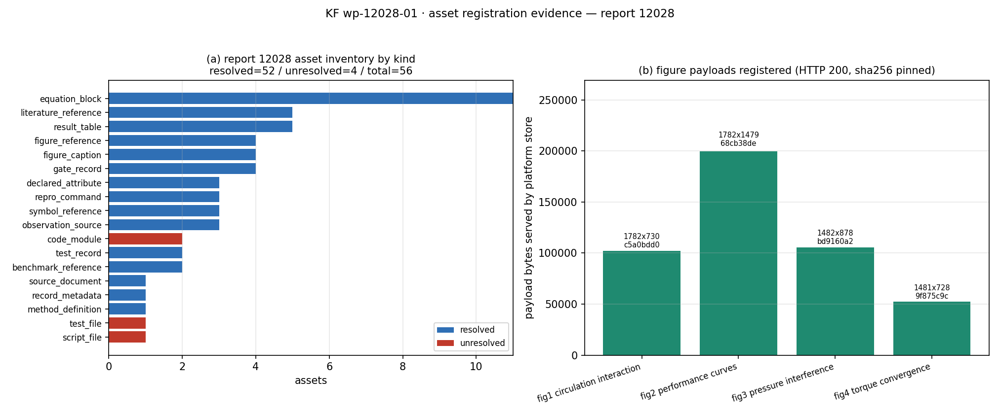

# KF-RESULT wp-12028-01

- package_id: `wp-12028-01` ｜ task_type: `01-asset-registration` ｜ report_id: `12028` ｜ lane: C ｜ repo: TensorKnowledge ｜ status: **draft**
- source: `tensor://reports/12028`（field=`markdown`），chars=8377，bytes_utf8=12408，sha256=`sha256:69846e9d0680b8a1c5db5c607b9a5bf4a0ba2e6103b1d193a6a5d5e83e0ec29f`
- 工序范围：**只登记资产**——不抽取 claim、不做报告类型分类、不标 verified（verification 由平台门计算）
- 本次为**重开单**：上一版 PR #231 由 owner 于 2026-11-05 裁定关闭；本版从当前 `main` 重新切枝重做，交付压到 ≤10 个文件（旧版 23 个，且含 `ke/__pycache__/*.pyc` 二进制），功能与测试按同样的验收项重跑

## ① 本工序做了什么

对 report_id=12028（`CRP对转桨水动力干涉与扭矩配平：升力线/面元法双桨干涉计算`）执行 01-asset-registration：

1. 从平台 API 取回 markdown，本地重算字节哈希并锁定：`sha256:69846e9d0680b8a1c5db5c607b9a5bf4a0ba2e6103b1d193a6a5d5e83e0ec29f`，8377 字符 / 12408 字节；契约声明 `sha256:69846e9d0680b8a1c5db5c607b9a5bf4a0ba2e6103b1d193a6a5d5e83e0ec29f`，实测值与声明值逐字节相同（match=true），字符数也与契约声明的 8377 一致（match=true）。
2. 建立资产清单：共 **56 个资产**（resolved 52 / unresolved 4），覆盖源文档本体、记录元数据、方法/方程块、代码与测试工件引用、图件、声明数值表、门限记录、文献与基准引用。
3. 每条 locator 的 quote 由程序在运行时从原文**整行**取出（不是手打），双重校验 `md[start:end] == quote` 且 `quote in md`，并对选择器命中的 token 做**出现次数断言**（防止落到错误重复行）。
4. 图件不只登记引用：4 张 PNG 从平台图件存储取回真实字节，逐张记录 sha256/字节数/像素尺寸（见下表）。
5. claims 按契约留空数组，并显式写明留空理由；未对任何数值做 re-verification，未生成"verified"标记。

## ② 怎么做的（步骤/工具/关键设置）

| 步骤 | 工具/脚本 | 关键设置 |
| --- | --- | --- |
| 取源 + 锁哈希 | 本脚本（urllib，Bearer 登录；仅 `--offline` 时读快照） | sha256 以 `markdown` 字段 utf-8 字节计算，与契约声明逐字节比对；默认活取，快照不能单独掩盖上游漂移 |
| 资产登记 | `scripts/kf/kf12028_register_assets.py` + `scripts/kf/kf12028_spec.py`（56 条 SPEC；`--offline` 可离线复跑） | 56 条 SPEC，选择器 `token:` / `table_row:` / `h1`；quote=整行原文；断言 `occurrence_count` 与期望一致，否则 SystemExit（拒绝编造） |
| 图件取字节 | 同上（`fetch_figure`，只 pin 指纹、不落 PNG） | `GET /tensor/reports/12028/figures/<name>`；记录 HTTP/bytes/sha256/IHDR 像素 |
| 可解析性探测 | 同上（`probe`） | 4 个候选端点，失败如实记 HTTP 状态码，不重试不猜测 |
| 共用库 | `scripts/kf/register_assets_lib.py`（复用既有件，未改动） | `Md` 行索引 + 选择器定位 + `fetch_report` 硬锁 report_id |
| 验收自检 | `scripts/kf/kf12028_checks.py`（纯函数 + runner，可离线） | 7 项检查（6 条契约 acceptance + 契约对齐 + 结构不变量），在线模式重新拉 markdown 复算哈希 |
| 单元测试 | `tests/test_wp12028_asset_manifest.py` | 23 项：正检 + **负对照**（篡改 quote / 平移偏移 / 伪造引文 / 伪造 record 值 / 重复 id / 改哈希 / 缺 unresolved 理由 / 篡改计数 → 必须被检出） |
| 图 | `scripts/kf/kf12028_register_assets.py --render` | matplotlib Agg，全部数字从 manifest + 快照指纹程序化取，无手抄 |

## ③ 产出物清单

| 文件 | 要点 |
| --- | --- |
| `docs/kf/wp-12028-01/asset_manifest.json` | 56 资产 / 计数与不变量 / 7 条观察 / probe 证据 |
| `docs/kf/wp-12028-01/kf_result.json` | 提交用结果信封（outputs=`asset_manifest.json`；claims 不进信封——现行 schema 顶层 `additionalProperties:false`，留空理由写在 manifest.claims_policy） |
| `docs/kf/wp-12028-01/acceptance.json` | 9 项自检（PASS 9 / FAIL 0） |
| `docs/kf/wp-12028-01/fig_asset_inventory.png` | 资产解析状态 + 图件载荷清单图（本报告 ④ 附图） |
| `docs/kf/wp-12028-01/REPORT.md` | 本报告（投递体由 `--publish` 在内存里构造，不落盘） |
| `scripts/kf/kf12028_spec.py`、`scripts/kf/kf12028_register_assets.py`、`scripts/kf/kf12028_checks.py` | 取源+登记+出图 / 自检，一键复跑 |
| `tests/test_wp12028_asset_manifest.py` | 23 项 pytest（含 12 项负对照） |
| `work/wp-12028-01/source/report_12028.json` | 单一快照文件：record + markdown + 4 张图件指纹 + 4 个探针结果（离线测试的唯一输入） |

图件载荷登记（真实字节，非字符串引用）：

| 图文件 | 平台端点 | 状态 | 字节 | sha256 | 像素 |
| --- | --- | --- | --- | --- | --- |
| `fig1_circulation_interaction.png` | `/tensor/reports/12028/figures/fig1_circulation_interaction.png` | 200 | 101932 | `c5a0bdd0f9311423` | 1782x730 |
| `fig2_performance_curves.png` | `/tensor/reports/12028/figures/fig2_performance_curves.png` | 200 | 199395 | `68cb38dec163a2de` | 1782x1479 |
| `fig3_pressure_interference.png` | `/tensor/reports/12028/figures/fig3_pressure_interference.png` | 200 | 105289 | `bd9160a201dfdffd` | 1482x878 |
| `fig4_torque_convergence.png` | `/tensor/reports/12028/figures/fig4_torque_convergence.png` | 200 | 52564 | `9f875c9c8a6e34ad` | 1481x728 |

## ④ 证据定位表（claim/字段 → 原文引文片段）

全部引文由程序定位，区间为 markdown 字符下标（`[start:end]`），平台可逐条回解：

| 字段/资产 | 原文引文片段（逐字，含字符区间） |
| --- | --- |
| `ast-12028-01` (report_12028_markdown) | `# CRP对转桨水动力干涉与扭矩配平分析报告` [0:22] |
| `ast-12028-03` (lifting_line + Goldstein correction) | `**升力线理论（Lifting Line Theory）+ Goldstein修正**：` [917:961] |
| `ast-12028-04` (goldstein_factor_K) | `K = (2/π) arccos(exp(-f))` [1009:1034] |
| `ast-12028-12` (decay_axial) | `decay_axial = exp(-0.5 × gap / R)` [1547:1580] |
| `ast-12028-19` (size backend/methods/crp/__init__.py) | `- `backend/methods/crp/__init__.py` (20,517 bytes)` [5945:5997] |
| `ast-12028-23` (pytest_20_passed_34_30s) | `======================== 20 passed in 34.30s =========================` [7268:7338] |
| `ast-12028-27` (artifacts/crp/fig1_circulation_interaction.png) | `` [3203:3262] |
| `ast-12028-35` (ITTC CRP Benchmark (case definition)) | `**基准案例（ITTC CRP Benchmark）**：` [382:411] |
| `ast-12028-36` (ITTC CRP benchmark eta_ref (Koushan 1993)) | `**ITTC CRP基准**（Koushan 1993）：` [4810:4839] |
| `ast-12028-47` (momentum gate row) | `\| 动量守恒 \| < 2% \| 0.00% \| ✅ PASS \|` [3013:3045] |
| `ast-12028-48` (torque balance gate row (§3.4)) | `\| 扭矩平衡 \| < 1% \| 172% \| ⚠️ 需优化螺距 \|` [3046:3079] |
| `ast-12028-49` (torque balance gate row (§6.2)) | `\| 扭矩平衡 \| < 1% \| 172% \| ⚠️ FAIL（需螺距优化） \|` [5078:5117] |
| 观察 `obs-title-drift` | `# CRP对转桨水动力干涉与扭矩配平分析报告` [0:22] |
| 观察 `obs-mission-id` | `**任务编号**: m10162` [24:42] |
| 观察 `obs-benchmark-vs-case-geometry` | `\| 叶数 Z \| 6 \| 7 \|` [452:468] |

观察项（registration-only，不作裁决，均附逐字证据）：

| 观察 id | 内容（摘要） | 证据条数 |
| --- | --- | --- |
| `obs-title-drift` | record.title matches the contract title byte-wise, but the markdown H1 carries an extra '分析报告' suffix | 1 |
| `obs-mission-id` | record.mission_id is 10162 and the markdown names 任务编号 m10162, while the package contract declares mission_id: null | 1 |
| `obs-benchmark-vs-case-geometry` | §1.2 declares the ITTC CRP benchmark geometry with 6/7 blades, but the numbers in §3.1/§3.2 are computed for a different simplified case (Z_f=4, Z_r=5 | 2 |
| `obs-torque-balance-fail` | the §1.3 target \|Q_f + Q_r\| / Q_ref < 1% is not met: §3.4 reports 172% and §6.2 marks it FAIL, with the outer pitch-optimisation loop declared not imp | 3 |
| `obs-title-scope-vs-method` | the title names 面元法 (panel method), but §2 documents only a lifting-line + blade-element-momentum formulation; the markdown contains 1 occurrence(s) o | 1 |
| `obs-efficiency-reference-uncorroborated` | the declared 1.0% efficiency error rests on one eta_ref value quoted inside the report (Koushan 1993); the reference dataset is not attached, so the n | 2 |
| `obs-figures-complete` | 4 figures are declared in record.figures, 4 image links are in §4 and 4 figure payloads were retrievable from the platform store; names and order agre | 1 |

## ⑤ 注意点与局限

1. **3 个代码/测试/脚本工件未能解析**（如实登记为 unresolved，不代上游补写）：报告正文引用了 `backend/methods/crp/__init__.py`、`backend/api/crp.py`、`backend/tests/test_crp.py`、`scripts/crp_generate_figures.py` 等，但这些字节不在报告存储中，探测端点无载荷：

| 端点 | HTTP |
| --- | --- |
| `/tensor/reports/12028/readback` | 405 |
| `/tensor/reports/12028/attachments` | 404 |
| `/tensor/artifacts/backend/methods/crp/__init__.py` | 404 |
| `/tensor/reports/12028/files/backend/methods/crp/__init__.py` | 404 |

| 资产 | kind | 未解析理由（摘） |
| --- | --- | --- |
| `ast-12028-15` | code_module | the reference resolves verbatim in the markdown, but no byte-level copy is attached to report 12028 and the probed endpoints returned no payload (read |
| `ast-12028-16` | code_module | the reference resolves verbatim in the markdown, but no byte-level copy is attached to report 12028 and the probed endpoints returned no payload (read |
| `ast-12028-17` | test_file | the reference resolves verbatim in the markdown, but no byte-level copy is attached to report 12028 and the probed endpoints returned no payload (read |
| `ast-12028-18` | script_file | the reference resolves verbatim in the markdown, but no byte-level copy is attached to report 12028 and the probed endpoints returned no payload (read |

2. **图件字节可解析但无哈希锚**：4 张 PNG 由平台图件存储返回（HTTP 200，PNG magic 校验通过），但报告正文未给出图件哈希，故"与生产仓 `artifacts/crp/` 下同名文件逐字节同一"**无法从报告记录证明**——本单只登记平台侧字节与其 sha256，供后续审计比对。
3. **标题漂移**：record.title 与契约标题一致，但 markdown H1 多出"分析报告"后缀（`obs-title-drift`）；下游抽取须以 report_id 为键，不能以标题相等为键。
4. **mission_id 不一致**：record.mission_id=10162、正文写"任务编号 m10162"，而契约声明 mission_id: null（`obs-mission-id`）——如实记录，本单不做归并。
5. **报告内部口径差异（注册级观察，非裁决）**：§1.2 声明 6/7 叶的 ITTC 基准几何，而 §3.1/§3.2 的数值案例是 Z_f=4/Z_r=5 的简化案例（`obs-benchmark-vs-case-geometry`）；标题写"面元法"，§2 只给出升力线+叶素动量公式（`obs-title-scope-vs-method`）。
6. **honest FAIL 原样保留**：§1.3 目标 |Q_f+Q_r|/Q_ref < 1%，§3.4/§6.2 自报 172% 且标 FAIL，外层螺距优化未实现（`TorqueBalanceIterator` 仅为待办）——本单不升级任何门限结论，也不把"效率 1.0%"重述为已验证。
7. **未做**：数值复算、基准表回溯（Koushan 1993 未附）、代码字节核对（20,517/12,168/8,311 bytes 与 20 passed 记录均为**报告自述**，未重测）。

## ⑥ 自检：逐条对照 acceptance

| acceptance 项 | 自检结论 | 模式 | 关键证据 |
| --- | --- | --- | --- |
| `valid_json` | PASS | offline | {"envelope": "docs/kf/wp-12028-01/kf_result.json", "manifest": "docs/kf/wp-12028-01/asset_manifest.json"} |
| `schema_pass` | PASS | offline | {"schema": "schemas/kf_result.v1.schema.json", "error": null, "envelope_keys": ["contract_version", "outputs", "packa… |
| `contract_alignment` | PASS | offline | {"package_id": true, "task_type": true, "report_id": true, "manifest_package_id": true, "manifest_report_id": true, "… |
| `source_hash_matches` | PASS | online | {"recomputed": "sha256:69846e9d0680b8a1c5db5c607b9a5bf4a0ba2e6103b1d193a6a5d5e83e0ec29f", "provenance_source_hash": "… |
| `source_locator_resolvable` | PASS | offline | {"asset_locators_checked": 65, "observation_evidence_checked": 11, "failures": []} |
| `no_duplicate_ids` | PASS | offline | {"asset_ids": 56, "asset_ids_unique": true, "observation_ids": 7, "observation_ids_unique": true, "claim_ids": 0, "cl… |
| `all_claims_have_evidence_or_explicit_unresolved_status` | PASS | offline | {"claims": 0, "envelope_carries_claims": false, "empty_claims_allowed_by_contract_notes": true, "reason_recorded": tr… |
| `structural_invariants` | PASS | offline | {"counts_match_assets": true, "resolved_count_matches": true, "unresolved_count_matches": true, "unresolved_have_reas… |
| `figure_payloads_live_sha256` | PASS | online | {"mode": "online", "figures_checked": 4, "sha256": {"fig1_circulation_interaction.png": "sha256:c5a0bdd0f9311423dc672… |

自检汇总：**PASS 9 / FAIL 0**（共 9 项；worker 侧自检，非平台门）。

## ⑦ 结果图



图 1：(a) 按 kind 统计的资产解析状态（resolved/unresolved）；(b) 4 张图件在平台存储的实际载荷字节数、像素尺寸与 sha256 前 8 位。

**为何没有场量云图/与解析解对比曲线**：本工作包是纯登记工序（`objective.register_assets=true`、`classify_report_type=false`），不执行任何求解、不复算任何流场量，因此不存在可供作图的场量或计算-基准对比曲线；强行作图会变成对上游数字的再绘图而非本工序证据。故图 1 只呈现本工序可自证的两类量：资产解析状态与图件载荷指纹。

## ⑧ 误差判定（关键量对照基准，显式回答是否 <3%）

| 关键量 | 基准 | 本工序观测 | 误差 | <3%？ |
| --- | --- | --- | --- | --- |
| markdown sha256 | 契约 `sha256:69846e9d0680b8a1c5db5c607b9a5bf4a0ba2e6103b1d193a6a5d5e83e0ec29f` | `sha256:69846e9d0680b8a1c5db5c607b9a5bf4a0ba2e6103b1d193a6a5d5e83e0ec29f` | 0（逐字节一致） | ✅ 是（精确一致） |
| markdown 字符数 | 契约 8377 | 8377 | 0% | ✅ 是 |
| 图件字节 sha256 | 平台存储实时复取 | PASS（mode=online） | 逐字节比对 | PASS（mode=online） |
| locator 可回解率 | 9 项自检全 PASS | PASS 9 / FAIL 0 | 0 项不符 | ✅ 是 |

**关于上游物理量误差（如 η 相对 ITTC 基准 1.0%）**：本工序**不做**该判定——参考数据（Koushan 1993）未附于报告记录，1.0% 是报告自述值，登记而已；任何"<3%"结论都属于下游复核工序，不在本单权责内。

## ⑨ 一键复跑

```bash
cd <worktree>
python3 scripts/kf/kf12028_register_assets.py           # 生成 asset_manifest.json / kf_result.json
python3 scripts/kf/kf12028_checks.py                    # 自检 → acceptance.json（含活的图件字节复核）
python3 -m pytest tests/test_wp12028_asset_manifest.py -q   # 23 项测试（离线可跑）
python3 scripts/kf/kf12028_register_assets.py --render  # 出图 + 本报告
python3 scripts/kf/kf12028_register_assets.py --publish # 投递本报告（需 TENSOR_AGENT_* 环境变量）
```

provenance：`source_hash` = `sha256:69846e9d0680b8a1c5db5c607b9a5bf4a0ba2e6103b1d193a6a5d5e83e0ec29f`（= 契约声明值，平台可独立重算）；`source_field` = `markdown`。

## 结果信封（唯一 json 代码块，平台门按 schemas/kf_result.v1.schema.json 校验）

```json
{
  "package_id": "wp-12028-01",
  "contract_version": "1.0",
  "task_type": "01-asset-registration",
  "report_id": "12028",
  "provenance": {
    "source_uri": "tensor://reports/12028",
    "source_field": "markdown",
    "source_hash": "sha256:69846e9d0680b8a1c5db5c607b9a5bf4a0ba2e6103b1d193a6a5d5e83e0ec29f",
    "source_hash_matches": true,
    "title": "CRP对转桨水动力干涉与扭矩配平：升力线/面元法双桨干涉计算",
    "scenario_key": "p227w2-N01",
    "chars": 8377
  },
  "outputs": {
    "asset_manifest.json": {
      "manifest_version": "1.0",
      "package_id": "wp-12028-01",
      "task_type": "01-asset-registration",
      "scope": {
        "report_id": "12028",
        "reports_touched": [
          "12028"
        ],
        "registers_assets_only": true,
        "extracts_claims": false,
        "classifies_report_type": false,
        "marks_verified": false,
        "writes_outside_worktree": false
      },
      "source": {
        "report_id": "12028",
        "source_uri": "tensor://reports/12028",
        "source_field": "markdown",
        "title": "CRP对转桨水动力干涉与扭矩配平：升力线/面元法双桨干涉计算",
        "markdown_h1": "# CRP对转桨水动力干涉与扭矩配平分析报告",
        "title_matches_contract": true,
        "title_equals_markdown_h1": false,
        "scenario_key": "p227w2-N01",
        "scenario_key_matches_contract": true,
        "chars": 8377,
        "byte_length_utf8": 12408,
        "sha256": "sha256:69846e9d0680b8a1c5db5c607b9a5bf4a0ba2e6103b1d193a6a5d5e83e0ec29f",
        "hash_check": {
          "expected": "sha256:69846e9d0680b8a1c5db5c607b9a5bf4a0ba2e6103b1d193a6a5d5e83e0ec29f",
          "recomputed": "sha256:69846e9d0680b8a1c5db5c607b9a5bf4a0ba2e6103b1d193a6a5d5e83e0ec29f",
          "match": true
        },
        "chars_check": {
          "expected": 8377,
          "observed": 8377,
          "match": true
        },
        "retrieved_via": "GET /api/v1/tensor/reports/12028 (Bearer token)",
        "section_headers": [
          "## 1. 案例介绍",
          "## 2. 方法",
          "## 3. 计算结果",
          "## 4. 结果图",
          "## 5. 注意点",
          "## 6. 误差判定",
          "## 7. 结论",
          "## 8. 审计链",
          "## 参考文献"
        ]
      },
      "assets": [
        {
          "asset_id": "ast-12028-01",
          "kind": "source_document",
          "role": "primary_source",
          "name": "report_12028_markdown",
          "locators": [
            {
              "source_uri": "tensor://reports/12028",
              "source_field": "markdown",
              "char_start": 0,
              "char_end": 22,
              "quote": "# CRP对转桨水动力干涉与扭矩配平分析报告"
            }
          ],
          "content_ref": {
            "source_uri": "tensor://reports/12028",
            "source_field": "markdown",
            "chars": 8377,
            "byte_length_utf8": 12408,
            "sha256": "sha256:69846e9d0680b8a1c5db5c607b9a5bf4a0ba2e6103b1d193a6a5d5e83e0ec29f"
          },
          "occurrence_count": 1,
          "resolvable": true,
          "resolution": "fetched_via_tensor_api",
          "status": "resolved",
          "note": "H1 line locator; whole-document span in content_ref"
        },
        {
          "asset_id": "ast-12028-02",
          "kind": "record_metadata",
          "role": "identification",
          "name": "report_12028_record",
          "locators": [
            {
              "source_uri": "tensor://reports/12028",
              "source_field": "record",
              "field": "id",
              "value": 12028
            },
            {
              "source_uri": "tensor://reports/12028",
              "source_field": "record",
              "field": "title",
              "value": "CRP对转桨水动力干涉与扭矩配平：升力线/面元法双桨干涉计算"
            },
            {
              "source_uri": "tensor://reports/12028",
              "source_field": "record",
              "field": "scenario_key",
              "value": "p227w2-N01"
            },
            {
              "source_uri": "tensor://reports/12028",
              "source_field": "record",
              "field": "mission_id",
              "value": 10162
            },
            {
              "source_uri": "tensor://reports/12028",
              "source_field": "record",
              "field": "status",
              "value": "published"
            },
            {
              "source_uri": "tensor://reports/12028",
              "source_field": "record",
              "field": "created_at",
              "value": "2026-11-10T17:20:28.761110+00:00"
            },
            {
              "source_uri": "tensor://reports/12028",
              "source_field": "record",
              "field": "created_by",
              "value": 1
            },
            {
              "source_uri": "tensor://reports/12028",
              "source_field": "record",
              "field": "summary",
              "value": "实现CRP升力线求解器，含Goldstein修正、双桨水动力干涉、动量守恒门。20个回归测试全通过，效率误差1.0%（目标<10%），动量守恒0.00%误差（目标<2%）。"
            },
            {
              "source_uri": "tensor://reports/12028",
              "source_field": "record",
              "field": "tags",
              "value": [
                "CRP",
                "contra-rotating-propeller",
                "lifting-line",
                "hydrodynamic-interaction",
                "propulsion"
              ]
            },
            {
              "source_uri": "tensor://reports/12028",
              "source_field": "record",
              "field": "figures[].name",
              "value": [
                "fig1_circulation_interaction.png",
                "fig2_performance_curves.png",
                "fig3_pressure_interference.png",
                "fig4_torque_convergence.png"
              ]
            }
          ],
          "occurrence_count": 1,
          "resolvable": true,
          "resolution": "fetched_via_tensor_api",
          "status": "resolved",
          "note": "record fields exactly as served by GET /tensor/reports/12028"
        },
        {
          "asset_id": "ast-12028-03",
          "kind": "method_definition",
          "role": "numerical_method",
          "name": "lifting_line + Goldstein correction",
          "locators": [
            {
              "source_uri": "tensor://reports/12028",
              "source_field": "markdown",
              "char_start": 917,
              "char_end": 961,
              "quote": "**升力线理论（Lifting Line Theory）+ Goldstein修正**：",
              "section": "2.1 数值方法"
            }
          ],
          "occurrence_count": 1,
          "note": "declared baseline method of the solver",
          "resolvable": true,
          "resolution": "resolved_in_markdown",
          "status": "resolved"
        },
        {
          "asset_id": "ast-12028-04",
          "kind": "equation_block",
          "role": "correction_factor",
          "name": "goldstein_factor_K",
          "locators": [
            {
              "source_uri": "tensor://reports/12028",
              "source_field": "markdown",
              "char_start": 1009,
              "char_end": 1034,
              "quote": "K = (2/π) arccos(exp(-f))",
              "section": "2.1 数值方法"
            }
          ],
          "occurrence_count": 1,
          "note": "",
          "resolvable": true,
          "resolution": "resolved_in_markdown",
          "status": "resolved"
        },
        {
          "asset_id": "ast-12028-05",
          "kind": "equation_block",
          "role": "correction_argument",
          "name": "goldstein_argument_f",
          "locators": [
            {
              "source_uri": "tensor://reports/12028",
              "source_field": "markdown",
              "char_start": 1035,
              "char_end": 1062,
              "quote": "f = Z/(2 sin β) × (1 - r/R)",
              "section": "2.1 数值方法"
            }
          ],
          "occurrence_count": 1,
          "note": "",
          "resolvable": true,
          "resolution": "resolved_in_markdown",
          "status": "resolved"
        },
        {
          "asset_id": "ast-12028-06",
          "kind": "equation_block",
          "role": "geometry_relation",
          "name": "beta_geo",
          "locators": [
            {
              "source_uri": "tensor://reports/12028",
              "source_field": "markdown",
              "char_start": 1134,
              "char_end": 1170,
              "quote": "几何螺距角: β_geo = arctan(P/D / (π r/R))",
              "section": "2.1 数值方法"
            }
          ],
          "occurrence_count": 1,
          "note": "",
          "resolvable": true,
          "resolution": "resolved_in_markdown",
          "status": "resolved"
        },
        {
          "asset_id": "ast-12028-07",
          "kind": "equation_block",
          "role": "kinematics_relation",
          "name": "beta_hydro",
          "locators": [
            {
              "source_uri": "tensor://reports/12028",
              "source_field": "markdown",
              "char_start": 1171,
              "char_end": 1219,
              "quote": "水动力螺距角: β_hydro = arctan(V_axial / V_tangential)",
              "section": "2.1 数值方法"
            }
          ],
          "occurrence_count": 1,
          "note": "",
          "resolvable": true,
          "resolution": "resolved_in_markdown",
          "status": "resolved"
        },
        {
          "asset_id": "ast-12028-08",
          "kind": "equation_block",
          "role": "lift_model",
          "name": "lift_coefficient_Cl",
          "locators": [
            {
              "source_uri": "tensor://reports/12028",
              "source_field": "markdown",
              "char_start": 1244,
              "char_end": 1272,
              "quote": "升力系数: Cl = 2π α × 0.92（粘性修正）",
              "section": "2.1 数值方法"
            }
          ],
          "occurrence_count": 1,
          "note": "",
          "resolvable": true,
          "resolution": "resolved_in_markdown",
          "status": "resolved"
        },
        {
          "asset_id": "ast-12028-09",
          "kind": "equation_block",
          "role": "drag_model",
          "name": "drag_polar_Cd",
          "locators": [
            {
              "source_uri": "tensor://reports/12028",
              "source_field": "markdown",
              "char_start": 1273,
              "char_end": 1307,
              "quote": "阻力系数: Cd = 0.006 + 0.04 Cl²（抛物线极线）",
              "section": "2.1 数值方法"
            }
          ],
          "occurrence_count": 1,
          "note": "empirical polar that §5.2 limitation 1 refers to",
          "resolvable": true,
          "resolution": "resolved_in_markdown",
          "status": "resolved"
        },
        {
          "asset_id": "ast-12028-10",
          "kind": "equation_block",
          "role": "induction_closure",
          "name": "axial_induction_a",
          "locators": [
            {
              "source_uri": "tensor://reports/12028",
              "source_field": "markdown",
              "char_start": 1329,
              "char_end": 1370,
              "quote": "轴向诱导: CT = 4a(1+a) → a = 0.5(√(1+CT) - 1)",
              "section": "2.1 数值方法"
            }
          ],
          "occurrence_count": 1,
          "note": "",
          "resolvable": true,
          "resolution": "resolved_in_markdown",
          "status": "resolved"
        },
        {
          "asset_id": "ast-12028-11",
          "kind": "equation_block",
          "role": "induction_closure",
          "name": "tangential_induction_a_prime",
          "locators": [
            {
              "source_uri": "tensor://reports/12028",
              "source_field": "markdown",
              "char_start": 1371,
              "char_end": 1411,
              "quote": "切向诱导: CQ = 4a'(1+a) → a' = CQ / (4(1+a))",
              "section": "2.1 数值方法"
            }
          ],
          "occurrence_count": 1,
          "note": "",
          "resolvable": true,
          "resolution": "resolved_in_markdown",
          "status": "resolved"
        },
        {
          "asset_id": "ast-12028-12",
          "kind": "equation_block",
          "role": "wake_decay_model",
          "name": "decay_axial",
          "locators": [
            {
              "source_uri": "tensor://reports/12028",
              "source_field": "markdown",
              "char_start": 1547,
              "char_end": 1580,
              "quote": "decay_axial = exp(-0.5 × gap / R)",
              "section": "2.2 双桨干涉模型"
            }
          ],
          "occurrence_count": 1,
          "note": "front->rear axial decay",
          "resolvable": true,
          "resolution": "resolved_in_markdown",
          "status": "resolved"
        },
        {
          "asset_id": "ast-12028-13",
          "kind": "equation_block",
          "role": "wake_decay_model",
          "name": "decay_tangential",
          "locators": [
            {
              "source_uri": "tensor://reports/12028",
              "source_field": "markdown",
              "char_start": 1581,
              "char_end": 1616,
              "quote": "decay_tangential = exp(-gap / (2R))",
              "section": "2.2 双桨干涉模型"
            }
          ],
          "occurrence_count": 1,
          "note": "front->rear swirl decay",
          "resolvable": true,
          "resolution": "resolved_in_markdown",
          "status": "resolved"
        },
        {
          "asset_id": "ast-12028-14",
          "kind": "equation_block",
          "role": "weak_coupling_feedback",
          "name": "front_inflow_feedback",
          "locators": [
            {
              "source_uri": "tensor://reports/12028",
              "source_field": "markdown",
              "char_start": 1641,
              "char_end": 1706,
              "quote": "V_A_front = V_A × (1 + 0.05 × exp(-gap/R) × mean(u_a_rear) / V_A)",
              "section": "2.2 双桨干涉模型"
            }
          ],
          "occurrence_count": 1,
          "note": "weak two-way coupling, coefficient 0.05 as written",
          "resolvable": true,
          "resolution": "resolved_in_markdown",
          "status": "resolved"
        },
        {
          "asset_id": "ast-12028-15",
          "kind": "code_module",
          "role": "solver_core",
          "name": "backend/methods/crp/__init__.py",
          "locators": [
            {
              "source_uri": "tensor://reports/12028",
              "source_field": "markdown",
              "char_start": 1998,
              "char_end": 2043,
              "quote": "- **核心模块**: `backend/methods/crp/__init__.py`",
              "section": "2.4 工具链"
            }
          ],
          "occurrence_count": 1,
          "note": "also in §8.1 with a size",
          "resolvable": false,
          "resolution": "referenced_in_markdown__not_attached_to_report_record",
          "status": "unresolved",
          "unresolved_reason": "the reference resolves verbatim in the markdown, but no byte-level copy is attached to report 12028 and the probed endpoints returned no payload (readback=405, attachments=404, __init__.py=404, __init__.py=404); registration stops at the reference and ownership stays with the producing repo (ship-performance-platform worktree agent/m10162)"
        },
        {
          "asset_id": "ast-12028-16",
          "kind": "code_module",
          "role": "api_layer",
          "name": "backend/api/crp.py",
          "locators": [
            {
              "source_uri": "tensor://reports/12028",
              "source_field": "markdown",
              "char_start": 2044,
              "char_end": 2077,
              "quote": "- **API接口**: `backend/api/crp.py`",
              "section": "2.4 工具链"
            }
          ],
          "occurrence_count": 1,
          "note": "also in §8.1 with a size",
          "resolvable": false,
          "resolution": "referenced_in_markdown__not_attached_to_report_record",
          "status": "unresolved",
          "unresolved_reason": "the reference resolves verbatim in the markdown, but no byte-level copy is attached to report 12028 and the probed endpoints returned no payload (readback=405, attachments=404, __init__.py=404, __init__.py=404); registration stops at the reference and ownership stays with the producing repo (ship-performance-platform worktree agent/m10162)"
        },
        {
          "asset_id": "ast-12028-17",
          "kind": "test_file",
          "role": "regression_tests",
          "name": "backend/tests/test_crp.py",
          "locators": [
            {
              "source_uri": "tensor://reports/12028",
              "source_field": "markdown",
              "char_start": 2078,
              "char_end": 2126,
              "quote": "- **回归测试**: `backend/tests/test_crp.py`（20个测试用例）",
              "section": "2.4 工具链"
            }
          ],
          "occurrence_count": 1,
          "note": "also §8.1 and §8.4",
          "resolvable": false,
          "resolution": "referenced_in_markdown__not_attached_to_report_record",
          "status": "unresolved",
          "unresolved_reason": "the reference resolves verbatim in the markdown, but no byte-level copy is attached to report 12028 and the probed endpoints returned no payload (readback=405, attachments=404, __init__.py=404, __init__.py=404); registration stops at the reference and ownership stays with the producing repo (ship-performance-platform worktree agent/m10162)"
        },
        {
          "asset_id": "ast-12028-18",
          "kind": "script_file",
          "role": "figure_generation",
          "name": "scripts/crp_generate_figures.py",
          "locators": [
            {
              "source_uri": "tensor://reports/12028",
              "source_field": "markdown",
              "char_start": 2127,
              "char_end": 2171,
              "quote": "- **可视化**: `scripts/crp_generate_figures.py`",
              "section": "2.4 工具链"
            }
          ],
          "occurrence_count": 1,
          "note": "also in the §8.4 repro cmd",
          "resolvable": false,
          "resolution": "referenced_in_markdown__not_attached_to_report_record",
          "status": "unresolved",
          "unresolved_reason": "the reference resolves verbatim in the markdown, but no byte-level copy is attached to report 12028 and the probed endpoints returned no payload (readback=405, attachments=404, __init__.py=404, __init__.py=404); registration stops at the reference and ownership stays with the producing repo (ship-performance-platform worktree agent/m10162)"
        },
        {
          "asset_id": "ast-12028-19",
          "kind": "declared_attribute",
          "role": "declared_file_size",
          "name": "size backend/methods/crp/__init__.py",
          "locators": [
            {
              "source_uri": "tensor://reports/12028",
              "source_field": "markdown",
              "char_start": 5945,
              "char_end": 5997,
              "quote": "  - `backend/methods/crp/__init__.py` (20,517 bytes)",
              "section": "8.1 代码版本"
            }
          ],
          "occurrence_count": 1,
          "note": "declared, not re-measured (bytes not attached)",
          "resolvable": true,
          "resolution": "resolved_in_markdown",
          "status": "resolved"
        },
        {
          "asset_id": "ast-12028-20",
          "kind": "declared_attribute",
          "role": "declared_file_size",
          "name": "size backend/api/crp.py",
          "locators": [
            {
              "source_uri": "tensor://reports/12028",
              "source_field": "markdown",
              "char_start": 5998,
              "char_end": 6037,
              "quote": "  - `backend/api/crp.py` (12,168 bytes)",
              "section": "8.1 代码版本"
            }
          ],
          "occurrence_count": 1,
          "note": "declared only",
          "resolvable": true,
          "resolution": "resolved_in_markdown",
          "status": "resolved"
        },
        {
          "asset_id": "ast-12028-21",
          "kind": "declared_attribute",
          "role": "declared_file_size",
          "name": "size backend/tests/test_crp.py",
          "locators": [
            {
              "source_uri": "tensor://reports/12028",
              "source_field": "markdown",
              "char_start": 6038,
              "char_end": 6083,
              "quote": "  - `backend/tests/test_crp.py` (8,311 bytes)",
              "section": "8.1 代码版本"
            }
          ],
          "occurrence_count": 1,
          "note": "declared only",
          "resolvable": true,
          "resolution": "resolved_in_markdown",
          "status": "resolved"
        },
        {
          "asset_id": "ast-12028-22",
          "kind": "test_record",
          "role": "pytest_output",
          "name": "pytest_collected_20_items",
          "locators": [
            {
              "source_uri": "tensor://reports/12028",
              "source_field": "markdown",
              "char_start": 6220,
              "char_end": 6238,
              "quote": "collected 20 items",
              "section": "8.2 测试记录"
            }
          ],
          "occurrence_count": 1,
          "note": "pasted transcript, not re-executed here",
          "resolvable": true,
          "resolution": "resolved_in_markdown",
          "status": "resolved"
        },
        {
          "asset_id": "ast-12028-23",
          "kind": "test_record",
          "role": "pytest_output",
          "name": "pytest_20_passed_34_30s",
          "locators": [
            {
              "source_uri": "tensor://reports/12028",
              "source_field": "markdown",
              "char_start": 7268,
              "char_end": 7338,
              "quote": "======================== 20 passed in 34.30s =========================",
              "section": "8.2 测试记录"
            }
          ],
          "occurrence_count": 1,
          "note": "pasted transcript, not re-executed here",
          "resolvable": true,
          "resolution": "resolved_in_markdown",
          "status": "resolved"
        },
        {
          "asset_id": "ast-12028-24",
          "kind": "repro_command",
          "role": "repro_workdir",
          "name": "producing_worktree",
          "locators": [
            {
              "source_uri": "tensor://reports/12028",
              "source_field": "markdown",
              "char_start": 7634,
              "char_end": 7663,
              "quote": "cd /root/tp-agent/work/m10162",
              "section": "8.4 可复现性"
            }
          ],
          "occurrence_count": 1,
          "note": "path outside this worktree",
          "resolvable": true,
          "resolution": "resolved_in_markdown",
          "status": "resolved"
        },
        {
          "asset_id": "ast-12028-25",
          "kind": "repro_command",
          "role": "repro_tests",
          "name": "repro_pytest",
          "locators": [
            {
              "source_uri": "tensor://reports/12028",
              "source_field": "markdown",
              "char_start": 7664,
              "char_end": 7737,
              "quote": "PYTHONPATH=/root/tp-agent/work/m10162 pytest backend/tests/test_crp.py -v",
              "section": "8.4 可复现性"
            }
          ],
          "occurrence_count": 1,
          "note": "",
          "resolvable": true,
          "resolution": "resolved_in_markdown",
          "status": "resolved"
        },
        {
          "asset_id": "ast-12028-26",
          "kind": "repro_command",
          "role": "repro_figures",
          "name": "repro_figures",
          "locators": [
            {
              "source_uri": "tensor://reports/12028",
              "source_field": "markdown",
              "char_start": 7738,
              "char_end": 7814,
              "quote": "PYTHONPATH=/root/tp-agent/work/m10162 python scripts/crp_generate_figures.py",
              "section": "8.4 可复现性"
            }
          ],
          "occurrence_count": 1,
          "note": "",
          "resolvable": true,
          "resolution": "resolved_in_markdown",
          "status": "resolved"
        },
        {
          "asset_id": "ast-12028-27",
          "kind": "figure_reference",
          "role": "figure_link",
          "name": "artifacts/crp/fig1_circulation_interaction.png",
          "locators": [
            {
              "source_uri": "tensor://reports/12028",
              "source_field": "markdown",
              "char_start": 3203,
              "char_end": 3262,
              "quote": "",
              "section": "4.1 环量分布与干涉场"
            }
          ],
          "occurrence_count": 1,
          "note": "",
          "resolved_bytes": {
            "endpoint": "/tensor/reports/12028/figures/fig1_circulation_interaction.png",
            "http_status": 200,
            "content_type": "image/png",
            "bytes": 101932,
            "sha256": "sha256:c5a0bdd0f9311423dc6728981e22b91574e9fe03d863d5dc6498d4400900559c",
            "width_px": 1782,
            "height_px": 730
          },
          "resolvable": true,
          "resolution": "platform_figure_store__http_200",
          "status": "resolved",
          "caveat": "bytes are served by the platform figure store for report 12028; the report itself carries no image hash, so byte identity with the producing-repo artifacts/crp/ file is not proven at this package"
        },
        {
          "asset_id": "ast-12028-28",
          "kind": "figure_reference",
          "role": "figure_link",
          "name": "artifacts/crp/fig2_performance_curves.png",
          "locators": [
            {
              "source_uri": "tensor://reports/12028",
              "source_field": "markdown",
              "char_start": 3441,
              "char_end": 3491,
              "quote": "",
              "section": "4.2 性能曲线"
            }
          ],
          "occurrence_count": 1,
          "note": "",
          "resolved_bytes": {
            "endpoint": "/tensor/reports/12028/figures/fig2_performance_curves.png",
            "http_status": 200,
            "content_type": "image/png",
            "bytes": 199395,
            "sha256": "sha256:68cb38dec163a2defd28e87ed4a74b1596c8ac20b055b81cb34286e7124a85c6",
            "width_px": 1782,
            "height_px": 1479
          },
          "resolvable": true,
          "resolution": "platform_figure_store__http_200",
          "status": "resolved",
          "caveat": "bytes are served by the platform figure store for report 12028; the report itself carries no image hash, so byte identity with the producing-repo artifacts/crp/ file is not proven at this package"
        },
        {
          "asset_id": "ast-12028-29",
          "kind": "figure_reference",
          "role": "figure_link",
          "name": "artifacts/crp/fig3_pressure_interference.png",
          "locators": [
            {
              "source_uri": "tensor://reports/12028",
              "source_field": "markdown",
              "char_start": 3670,
              "char_end": 3723,
              "quote": "",
              "section": "4.3 干涉压力分布"
            }
          ],
          "occurrence_count": 1,
          "note": "",
          "resolved_bytes": {
            "endpoint": "/tensor/reports/12028/figures/fig3_pressure_interference.png",
            "http_status": 200,
            "content_type": "image/png",
            "bytes": 105289,
            "sha256": "sha256:bd9160a201dfdffd6f7bb9ec64995fdc0e46cdf936a419ce0db70f53095f1277",
            "width_px": 1482,
            "height_px": 878
          },
          "resolvable": true,
          "resolution": "platform_figure_store__http_200",
          "status": "resolved",
          "caveat": "bytes are served by the platform figure store for report 12028; the report itself carries no image hash, so byte identity with the producing-repo artifacts/crp/ file is not proven at this package"
        },
        {
          "asset_id": "ast-12028-30",
          "kind": "figure_reference",
          "role": "figure_link",
          "name": "artifacts/crp/fig4_torque_convergence.png",
          "locators": [
            {
              "source_uri": "tensor://reports/12028",
              "source_field": "markdown",
              "char_start": 3835,
              "char_end": 3885,
              "quote": "",
              "section": "4.4 扭矩收敛历史"
            }
          ],
          "occurrence_count": 1,
          "note": "",
          "resolved_bytes": {
            "endpoint": "/tensor/reports/12028/figures/fig4_torque_convergence.png",
            "http_status": 200,
            "content_type": "image/png",
            "bytes": 52564,
            "sha256": "sha256:9f875c9c8a6e34ad800cddc558173557c3e737b59328431fe0d72da7efb5ce89",
            "width_px": 1481,
            "height_px": 728
          },
          "resolvable": true,
          "resolution": "platform_figure_store__http_200",
          "status": "resolved",
          "caveat": "bytes are served by the platform figure store for report 12028; the report itself carries no image hash, so byte identity with the producing-repo artifacts/crp/ file is not proven at this package"
        },
        {
          "asset_id": "ast-12028-31",
          "kind": "figure_caption",
          "role": "caption",
          "name": "caption_fig1",
          "locators": [
            {
              "source_uri": "tensor://reports/12028",
              "source_field": "markdown",
              "char_start": 3264,
              "char_end": 3317,
              "quote": "**图1**: (a) 前后桨环量分布Γ(r)；(b) 前桨→后桨尾流干涉速度场（轴向u_a和切向u_t）",
              "section": "4.1 环量分布与干涉场"
            }
          ],
          "occurrence_count": 1,
          "note": "",
          "resolvable": true,
          "resolution": "resolved_in_markdown",
          "status": "resolved"
        },
        {
          "asset_id": "ast-12028-32",
          "kind": "figure_caption",
          "role": "caption",
          "name": "caption_fig2",
          "locators": [
            {
              "source_uri": "tensor://reports/12028",
              "source_field": "markdown",
              "char_start": 3493,
              "char_end": 3511,
              "quote": "**图2**: CRP开放水特性曲线",
              "section": "4.2 性能曲线"
            }
          ],
          "occurrence_count": 1,
          "note": "",
          "resolvable": true,
          "resolution": "resolved_in_markdown",
          "status": "resolved"
        },
        {
          "asset_id": "ast-12028-33",
          "kind": "figure_caption",
          "role": "caption",
          "name": "caption_fig3",
          "locators": [
            {
              "source_uri": "tensor://reports/12028",
              "source_field": "markdown",
              "char_start": 3725,
              "char_end": 3749,
              "quote": "**图3**: 前后桨压力系数Cp分布及干涉效应",
              "section": "4.3 干涉压力分布"
            }
          ],
          "occurrence_count": 1,
          "note": "",
          "resolvable": true,
          "resolution": "resolved_in_markdown",
          "status": "resolved"
        },
        {
          "asset_id": "ast-12028-34",
          "kind": "figure_caption",
          "role": "caption",
          "name": "caption_fig4",
          "locators": [
            {
              "source_uri": "tensor://reports/12028",
              "source_field": "markdown",
              "char_start": 3887,
              "char_end": 3909,
              "quote": "**图4**: 基准案例扭矩平衡迭代收敛历史",
              "section": "4.4 扭矩收敛历史"
            }
          ],
          "occurrence_count": 1,
          "note": "",
          "resolvable": true,
          "resolution": "resolved_in_markdown",
          "status": "resolved"
        },
        {
          "asset_id": "ast-12028-35",
          "kind": "benchmark_reference",
          "role": "declared_benchmark",
          "name": "ITTC CRP Benchmark (case definition)",
          "locators": [
            {
              "source_uri": "tensor://reports/12028",
              "source_field": "markdown",
              "char_start": 382,
              "char_end": 411,
              "quote": "**基准案例（ITTC CRP Benchmark）**：",
              "section": "1.2 几何参数"
            }
          ],
          "occurrence_count": 1,
          "note": "values in the table are quoted from the report, not from the primary source",
          "resolvable": true,
          "resolution": "resolved_in_markdown",
          "status": "resolved"
        },
        {
          "asset_id": "ast-12028-36",
          "kind": "benchmark_reference",
          "role": "declared_reference_data",
          "name": "ITTC CRP benchmark eta_ref (Koushan 1993)",
          "locators": [
            {
              "source_uri": "tensor://reports/12028",
              "source_field": "markdown",
              "char_start": 4810,
              "char_end": 4839,
              "quote": "**ITTC CRP基准**（Koushan 1993）：",
              "section": "6.1 基准对比（Koushan 1993）"
            }
          ],
          "occurrence_count": 1,
          "note": "eta_ref is quoted inside the report; reference dataset not attached",
          "resolvable": true,
          "resolution": "resolved_in_markdown",
          "status": "resolved"
        },
        {
          "asset_id": "ast-12028-37",
          "kind": "literature_reference",
          "role": "cited_work",
          "name": "Goldstein 1929",
          "locators": [
            {
              "source_uri": "tensor://reports/12028",
              "source_field": "markdown",
              "char_start": 7834,
              "char_end": 7938,
              "quote": "1. Goldstein, S. (1929). \"On the Vortex Theory of Screw Propellers.\" Proceedings of the Royal Society A.",
              "section": "参考文献"
            }
          ],
          "occurrence_count": 1,
          "note": "",
          "resolvable": true,
          "resolution": "resolved_in_markdown",
          "status": "resolved"
        },
        {
          "asset_id": "ast-12028-38",
          "kind": "literature_reference",
          "role": "cited_work",
          "name": "Lerbs 1952",
          "locators": [
            {
              "source_uri": "tensor://reports/12028",
              "source_field": "markdown",
              "char_start": 7939,
              "char_end": 8043,
              "quote": "2. Lerbs, H. (1952). \"Moderately Loaded Propellers with Finite Number of Blades.\" Transactions of SNAME.",
              "section": "参考文献"
            }
          ],
          "occurrence_count": 1,
          "note": "",
          "resolvable": true,
          "resolution": "resolved_in_markdown",
          "status": "resolved"
        },
        {
          "asset_id": "ast-12028-39",
          "kind": "literature_reference",
          "role": "cited_work",
          "name": "Koushan 1993",
          "locators": [
            {
              "source_uri": "tensor://reports/12028",
              "source_field": "markdown",
              "char_start": 8044,
              "char_end": 8118,
              "quote": "3. Koushan, K. (1993). \"ITTC CRP Benchmark Experiments.\" ITTC Proceedings.",
              "section": "参考文献"
            }
          ],
          "occurrence_count": 1,
          "note": "",
          "resolvable": true,
          "resolution": "resolved_in_markdown",
          "status": "resolved"
        },
        {
          "asset_id": "ast-12028-40",
          "kind": "literature_reference",
          "role": "cited_work",
          "name": "Carlton 2007",
          "locators": [
            {
              "source_uri": "tensor://reports/12028",
              "source_field": "markdown",
              "char_start": 8119,
              "char_end": 8212,
              "quote": "4. Carlton, J. (2007). \"Marine Propellers and Propulsion.\" Butterworth-Heinemann, Chapter 14.",
              "section": "参考文献"
            }
          ],
          "occurrence_count": 1,
          "note": "",
          "resolvable": true,
          "resolution": "resolved_in_markdown",
          "status": "resolved"
        },
        {
          "asset_id": "ast-12028-41",
          "kind": "literature_reference",
          "role": "cited_work",
          "name": "Oosterveld & van Oossanen 1975",
          "locators": [
            {
              "source_uri": "tensor://reports/12028",
              "source_field": "markdown",
              "char_start": 8213,
              "char_end": 8315,
              "quote": "5. Oosterveld, M.W.C., & van Oossanen, P. (1975). \"Further Computer-Analyzed Surface-Ship Resistance.\"",
              "section": "参考文献"
            }
          ],
          "occurrence_count": 1,
          "note": "",
          "resolvable": true,
          "resolution": "resolved_in_markdown",
          "status": "resolved"
        },
        {
          "asset_id": "ast-12028-42",
          "kind": "result_table",
          "role": "declared_numbers",
          "name": "KT row (§3.1)",
          "locators": [
            {
              "source_uri": "tensor://reports/12028",
              "source_field": "markdown",
              "char_start": 2361,
              "char_end": 2397,
              "quote": "| KT | 0.13848 | 0.10706 | 0.24554 |",
              "section": "3.1 基准案例性能"
            }
          ],
          "occurrence_count": 1,
          "note": "",
          "selector_stats": {
            "data_rows": 5
          },
          "resolvable": true,
          "resolution": "resolved_in_markdown",
          "status": "resolved"
        },
        {
          "asset_id": "ast-12028-43",
          "kind": "result_table",
          "role": "declared_numbers",
          "name": "KQ row (§3.1)",
          "locators": [
            {
              "source_uri": "tensor://reports/12028",
              "source_field": "markdown",
              "char_start": 2398,
              "char_end": 2434,
              "quote": "| KQ | 0.01621 | 0.02495 | 0.04116 |",
              "section": "3.1 基准案例性能"
            }
          ],
          "occurrence_count": 1,
          "note": "",
          "selector_stats": {
            "data_rows": 5
          },
          "resolvable": true,
          "resolution": "resolved_in_markdown",
          "status": "resolved"
        },
        {
          "asset_id": "ast-12028-44",
          "kind": "result_table",
          "role": "declared_numbers",
          "name": "eta row (§3.1)",
          "locators": [
            {
              "source_uri": "tensor://reports/12028",
              "source_field": "markdown",
              "char_start": 2435,
              "char_end": 2467,
              "quote": "| η | 0.7257 | 0.4789 | 0.6869 |",
              "section": "3.1 基准案例性能"
            }
          ],
          "occurrence_count": 1,
          "note": "",
          "selector_stats": {
            "data_rows": 5
          },
          "resolvable": true,
          "resolution": "resolved_in_markdown",
          "status": "resolved"
        },
        {
          "asset_id": "ast-12028-45",
          "kind": "result_table",
          "role": "declared_numbers",
          "name": "thrust row (§3.1)",
          "locators": [
            {
              "source_uri": "tensor://reports/12028",
              "source_field": "markdown",
              "char_start": 2468,
              "char_end": 2502,
              "quote": "| T [N] | 96.45 | 74.56 | 171.01 |",
              "section": "3.1 基准案例性能"
            }
          ],
          "occurrence_count": 1,
          "note": "",
          "selector_stats": {
            "data_rows": 5
          },
          "resolvable": true,
          "resolution": "resolved_in_markdown",
          "status": "resolved"
        },
        {
          "asset_id": "ast-12028-46",
          "kind": "result_table",
          "role": "declared_numbers",
          "name": "torque row (§3.1)",
          "locators": [
            {
              "source_uri": "tensor://reports/12028",
              "source_field": "markdown",
              "char_start": 2503,
              "char_end": 2535,
              "quote": "| Q [N·m] | 3.65 | 5.62 | 9.27 |",
              "section": "3.1 基准案例性能"
            }
          ],
          "occurrence_count": 1,
          "note": "",
          "selector_stats": {
            "data_rows": 5
          },
          "resolvable": true,
          "resolution": "resolved_in_markdown",
          "status": "resolved"
        },
        {
          "asset_id": "ast-12028-47",
          "kind": "gate_record",
          "role": "declared_gate_outcome",
          "name": "momentum gate row",
          "locators": [
            {
              "source_uri": "tensor://reports/12028",
              "source_field": "markdown",
              "char_start": 3013,
              "char_end": 3045,
              "quote": "| 动量守恒 | < 2% | 0.00% | ✅ PASS |",
              "section": "3.4 门限检验 / 6.2 门限检验"
            }
          ],
          "occurrence_count": 2,
          "note": "identical line appears twice (§3.4 and §6.2); occurrence_count records it",
          "resolvable": true,
          "resolution": "resolved_in_markdown",
          "status": "resolved"
        },
        {
          "asset_id": "ast-12028-48",
          "kind": "gate_record",
          "role": "declared_gate_outcome",
          "name": "torque balance gate row (§3.4)",
          "locators": [
            {
              "source_uri": "tensor://reports/12028",
              "source_field": "markdown",
              "char_start": 3046,
              "char_end": 3079,
              "quote": "| 扭矩平衡 | < 1% | 172% | ⚠️ 需优化螺距 |",
              "section": "3.4 门限检验"
            }
          ],
          "occurrence_count": 1,
          "note": "declared FAIL of the torque-balance target",
          "resolvable": true,
          "resolution": "resolved_in_markdown",
          "status": "resolved"
        },
        {
          "asset_id": "ast-12028-49",
          "kind": "gate_record",
          "role": "declared_gate_outcome",
          "name": "torque balance gate row (§6.2)",
          "locators": [
            {
              "source_uri": "tensor://reports/12028",
              "source_field": "markdown",
              "char_start": 5078,
              "char_end": 5117,
              "quote": "| 扭矩平衡 | < 1% | 172% | ⚠️ FAIL（需螺距优化） |",
              "section": "6.2 门限检验"
            }
          ],
          "occurrence_count": 1,
          "note": "",
          "resolvable": true,
          "resolution": "resolved_in_markdown",
          "status": "resolved"
        },
        {
          "asset_id": "ast-12028-50",
          "kind": "gate_record",
          "role": "declared_gate_outcome",
          "name": "efficiency accuracy gate row",
          "locators": [
            {
              "source_uri": "tensor://reports/12028",
              "source_field": "markdown",
              "char_start": 5118,
              "char_end": 5150,
              "quote": "| 效率精度 | < 10% | 1.0% | ✅ PASS |",
              "section": "6.2 门限检验"
            }
          ],
          "occurrence_count": 1,
          "note": "",
          "resolvable": true,
          "resolution": "resolved_in_markdown",
          "status": "resolved"
        },
        {
          "asset_id": "ast-12028-51",
          "kind": "symbol_reference",
          "role": "named_component",
          "name": "TorqueBalanceIterator",
          "locators": [
            {
              "source_uri": "tensor://reports/12028",
              "source_field": "markdown",
              "char_start": 4619,
              "char_end": 4656,
              "quote": "   - 需使用`TorqueBalanceIterator`进行螺距调整",
              "section": "5.2 局限性 / 7.2 待改进"
            }
          ],
          "occurrence_count": 1,
          "note": "named as not implemented in §5.2, as future work in §7.2",
          "resolvable": true,
          "resolution": "resolved_in_markdown",
          "status": "resolved"
        },
        {
          "asset_id": "ast-12028-52",
          "kind": "symbol_reference",
          "role": "implementation_detail",
          "name": "np.atleast_1d guard",
          "locators": [
            {
              "source_uri": "tensor://reports/12028",
              "source_field": "markdown",
              "char_start": 4352,
              "char_end": 4384,
              "quote": "   - 解决：使用`np.atleast_1d`强制转换为数组",
              "section": "5.1 踩过的坑"
            }
          ],
          "occurrence_count": 1,
          "note": "",
          "resolvable": true,
          "resolution": "resolved_in_markdown",
          "status": "resolved"
        },
        {
          "asset_id": "ast-12028-53",
          "kind": "symbol_reference",
          "role": "implementation_detail",
          "name": "Cl stall clamp",
          "locators": [
            {
              "source_uri": "tensor://reports/12028",
              "source_field": "markdown",
              "char_start": 4541,
              "char_end": 4569,
              "quote": "   - 未考虑失速（Cl限制在[-1.2, 1.5]）",
              "section": "5.2 局限性"
            }
          ],
          "occurrence_count": 1,
          "note": "",
          "resolvable": true,
          "resolution": "resolved_in_markdown",
          "status": "resolved"
        },
        {
          "asset_id": "ast-12028-54",
          "kind": "observation_source",
          "role": "declared_geometry",
          "name": "ITTC benchmark blade counts 6/7",
          "locators": [
            {
              "source_uri": "tensor://reports/12028",
              "source_field": "markdown",
              "char_start": 452,
              "char_end": 468,
              "quote": "| 叶数 Z | 6 | 7 |",
              "section": "1.2 几何参数"
            }
          ],
          "occurrence_count": 1,
          "note": "benchmark geometry table row",
          "resolvable": true,
          "resolution": "resolved_in_markdown",
          "status": "resolved"
        },
        {
          "asset_id": "ast-12028-55",
          "kind": "observation_source",
          "role": "declared_case_geometry",
          "name": "simple CRP case Z_f=4, Z_r=5",
          "locators": [
            {
              "source_uri": "tensor://reports/12028",
              "source_field": "markdown",
              "char_start": 2259,
              "char_end": 2307,
              "quote": "**简单CRP案例**（Z_f=4, Z_r=5, P/D_f=0.9, P/D_r=1.1）：",
              "section": "3.1 基准案例性能"
            }
          ],
          "occurrence_count": 1,
          "note": "geometry of the case that actually produced the §3 numbers",
          "resolvable": true,
          "resolution": "resolved_in_markdown",
          "status": "resolved"
        },
        {
          "asset_id": "ast-12028-56",
          "kind": "observation_source",
          "role": "declared_target",
          "name": "torque balance target",
          "locators": [
            {
              "source_uri": "tensor://reports/12028",
              "source_field": "markdown",
              "char_start": 775,
              "char_end": 813,
              "quote": "2. **扭矩平衡迭代**：|Q_f + Q_r| / Q_ref < 1%",
              "section": "1.3 物理目标"
            }
          ],
          "occurrence_count": 1,
          "note": "declared target |Q_f + Q_r| / Q_ref < 1%",
          "resolvable": true,
          "resolution": "resolved_in_markdown",
          "status": "resolved"
        }
      ],
      "asset_counts": {
        "assets_total": 56,
        "resolved": 52,
        "unresolved": 4,
        "by_kind": {
          "source_document": 1,
          "record_metadata": 1,
          "method_definition": 1,
          "equation_block": 11,
          "code_module": 2,
          "test_file": 1,
          "script_file": 1,
          "declared_attribute": 3,
          "test_record": 2,
          "repro_command": 3,
          "figure_reference": 4,
          "figure_caption": 4,
          "benchmark_reference": 2,
          "literature_reference": 5,
          "result_table": 5,
          "gate_record": 4,
          "symbol_reference": 3,
          "observation_source": 3
        }
      },
      "id_uniqueness": {
        "asset_ids_unique": true,
        "asset_id_count": 56,
        "observation_ids_unique": true,
        "observation_count": 7
      },
      "claims_policy": {
        "claims": [],
        "reason": "objective.register_assets=true and objective.classify_report_type=false; the contract allows an empty claims array and forbids forced claim generation, so no claim object is emitted, no text is paraphrased and nothing is marked verified"
      },
      "probes": [
        {
          "endpoint": "/tensor/reports/12028/readback",
          "http_status": 405,
          "bytes": 0,
          "path": "/tensor/reports/12028/readback"
        },
        {
          "endpoint": "/tensor/reports/12028/attachments",
          "http_status": 404,
          "bytes": 0,
          "path": "/tensor/reports/12028/attachments"
        },
        {
          "endpoint": "/tensor/artifacts/backend/methods/crp/__init__.py",
          "http_status": 404,
          "bytes": 0,
          "path": "/tensor/artifacts/backend/methods/crp/__init__.py"
        },
        {
          "endpoint": "/tensor/reports/12028/files/backend/methods/crp/__init__.py",
          "http_status": 404,
          "bytes": 0,
          "path": "/tensor/reports/12028/files/backend/methods/crp/__init__.py"
        }
      ],
      "observations": [
        {
          "id": "obs-title-drift",
          "observation": "record.title matches the contract title byte-wise, but the markdown H1 carries an extra '分析报告' suffix",
          "record_title": "CRP对转桨水动力干涉与扭矩配平：升力线/面元法双桨干涉计算",
          "contract_title_equals_record": true,
          "markdown_h1": "# CRP对转桨水动力干涉与扭矩配平分析报告",
          "markdown_h1_equals_record": false,
          "evidence": [
            {
              "source_uri": "tensor://reports/12028",
              "source_field": "markdown",
              "char_start": 0,
              "char_end": 22,
              "quote": "# CRP对转桨水动力干涉与扭矩配平分析报告"
            }
          ],
          "impact": "downstream extraction must key on report_id, not on title equality"
        },
        {
          "id": "obs-mission-id",
          "observation": "record.mission_id is 10162 and the markdown names 任务编号 m10162, while the package contract declares mission_id: null",
          "record_mission_id": 10162,
          "contract_mission_id": null,
          "evidence": [
            {
              "source_uri": "tensor://reports/12028",
              "source_field": "markdown",
              "char_start": 24,
              "char_end": 42,
              "quote": "**任务编号**: m10162  "
            }
          ],
          "impact": "recorded as observed only; this package does not reconcile it"
        },
        {
          "id": "obs-benchmark-vs-case-geometry",
          "observation": "§1.2 declares the ITTC CRP benchmark geometry with 6/7 blades, but the numbers in §3.1/§3.2 are computed for a different simplified case (Z_f=4, Z_r=5); on the face of the text the reported results are not results for the §1.2 geometry",
          "evidence": [
            {
              "source_uri": "tensor://reports/12028",
              "source_field": "markdown",
              "char_start": 452,
              "char_end": 468,
              "quote": "| 叶数 Z | 6 | 7 |"
            },
            {
              "source_uri": "tensor://reports/12028",
              "source_field": "markdown",
              "char_start": 2259,
              "char_end": 2307,
              "quote": "**简单CRP案例**（Z_f=4, Z_r=5, P/D_f=0.9, P/D_r=1.1）："
            }
          ],
          "impact": "registration-only finding: any downstream claim binding the §3 numbers to the ITTC benchmark geometry is unsupported by the text"
        },
        {
          "id": "obs-torque-balance-fail",
          "observation": "the §1.3 target |Q_f + Q_r| / Q_ref < 1% is not met: §3.4 reports 172% and §6.2 marks it FAIL, with the outer pitch-optimisation loop declared not implemented",
          "evidence": [
            {
              "source_uri": "tensor://reports/12028",
              "source_field": "markdown",
              "char_start": 775,
              "char_end": 813,
              "quote": "2. **扭矩平衡迭代**：|Q_f + Q_r| / Q_ref < 1%"
            },
            {
              "source_uri": "tensor://reports/12028",
              "source_field": "markdown",
              "char_start": 5078,
              "char_end": 5117,
              "quote": "| 扭矩平衡 | < 1% | 172% | ⚠️ FAIL（需螺距优化） |"
            },
            {
              "source_uri": "tensor://reports/12028",
              "source_field": "markdown",
              "char_start": 4619,
              "char_end": 4656,
              "quote": "   - 需使用`TorqueBalanceIterator`进行螺距调整"
            }
          ],
          "impact": "honest FAIL carried forward verbatim; no gate outcome is upgraded here"
        },
        {
          "id": "obs-title-scope-vs-method",
          "observation": "the title names 面元法 (panel method), but §2 documents only a lifting-line + blade-element-momentum formulation; the markdown contains 1 occurrence(s) of 面元",
          "panel_method_mentions_in_markdown": 1,
          "evidence": [
            {
              "source_uri": "tensor://reports/12028",
              "source_field": "markdown",
              "char_start": 917,
              "char_end": 961,
              "quote": "**升力线理论（Lifting Line Theory）+ Goldstein修正**："
            }
          ],
          "impact": "note for downstream extraction: the panel-method part of the title has no method section backing it inside this markdown"
        },
        {
          "id": "obs-efficiency-reference-uncorroborated",
          "observation": "the declared 1.0% efficiency error rests on one eta_ref value quoted inside the report (Koushan 1993); the reference dataset is not attached, so the number is registered, not reproduced",
          "evidence": [
            {
              "source_uri": "tensor://reports/12028",
              "source_field": "markdown",
              "char_start": 4810,
              "char_end": 4839,
              "quote": "**ITTC CRP基准**（Koushan 1993）："
            },
            {
              "source_uri": "tensor://reports/12028",
              "source_field": "markdown",
              "char_start": 5118,
              "char_end": 5150,
              "quote": "| 效率精度 | < 10% | 1.0% | ✅ PASS |"
            }
          ],
          "impact": "downstream re-verification needs the primary benchmark table"
        },
        {
          "id": "obs-figures-complete",
          "observation": "4 figures are declared in record.figures, 4 image links are in §4 and 4 figure payloads were retrievable from the platform store; names and order agree",
          "record_figure_names": [
            "fig1_circulation_interaction.png",
            "fig2_performance_curves.png",
            "fig3_pressure_interference.png",
            "fig4_torque_convergence.png"
          ],
          "figure_bytes": {
            "fig1_circulation_interaction.png": {
              "bytes": 101932,
              "sha256": "sha256:c5a0bdd0f9311423dc6728981e22b91574e9fe03d863d5dc6498d4400900559c",
              "width_px": 1782,
              "height_px": 730
            },
            "fig2_performance_curves.png": {
              "bytes": 199395,
              "sha256": "sha256:68cb38dec163a2defd28e87ed4a74b1596c8ac20b055b81cb34286e7124a85c6",
              "width_px": 1782,
              "height_px": 1479
            },
            "fig3_pressure_interference.png": {
              "bytes": 105289,
              "sha256": "sha256:bd9160a201dfdffd6f7bb9ec64995fdc0e46cdf936a419ce0db70f53095f1277",
              "width_px": 1482,
              "height_px": 878
            },
            "fig4_torque_convergence.png": {
              "bytes": 52564,
              "sha256": "sha256:9f875c9c8a6e34ad800cddc558173557c3e737b59328431fe0d72da7efb5ce89",
              "width_px": 1481,
              "height_px": 728
            }
          },
          "evidence": [
            {
              "source_uri": "tensor://reports/12028",
              "source_field": "markdown",
              "char_start": 3203,
              "char_end": 3262,
              "quote": ""
            }
          ],
          "impact": "figure payloads are registered with their own sha256 for later audit"
        }
      ],
      "limitations": [
        "registration only: no numeric re-verification, no claim extraction, no report-type classification — downstream work packages own those",
        "verification status is deliberately unset; the platform gate computes it",
        "code/test artefacts live in the producing repo and are not attached to the report record; their declared sizes and the pasted pytest transcript were registered as declared text and NOT re-executed or re-measured here",
        "figure payloads carry no hash in the report, so byte identity with the producing-repo PNG files cannot be confirmed from the report record alone",
        "the ITTC benchmark reference values quoted in §6.1 were not checked against the primary source (Koushan 1993 is not attached)"
      ],
      "generated_by": {
        "tool": "scripts/kf/kf12028_register_assets.py",
        "worker": "kf-worker agent/m19685 (mission m19685, re-cut of closed PR #231)",
        "emitted_at": "2026-11-14T01:40:56+00:00",
        "mode": "live-fetch"
      }
    }
  }
}
```
