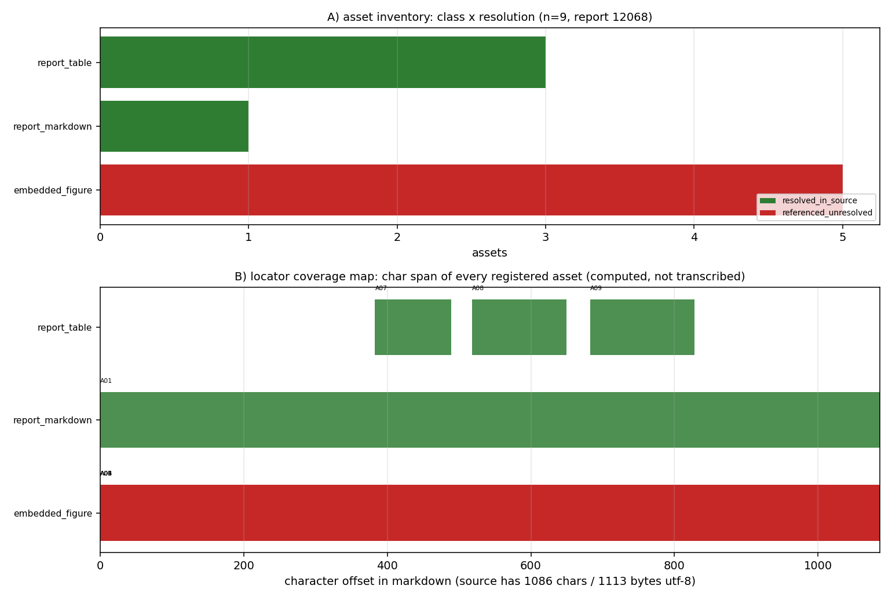

# KF-RESULT wp-12068-01

> 工序 01-asset-registration · report_id=12068 · lane C · 产出 `asset_manifest.json`（登记，不抽取）
> source_hash（平台可独立重算，sha256 over markdown utf-8 bytes）= `sha256:de2f16253ed522c619246898f442983d5a66f3a2bec42c2fe271847a2020cbf0`
> 契约 source_hash = `sha256:de2f16253ed522c619246898f442983d5a66f3a2bec42c2fe271847a2020cbf0` → 逐字符一致

## ① 本工序做了什么

对 `report_id=12068`（《DG Compressible Euler: Hierarchical Verification Chain》，scenario_key=`p315w1-n07-dg-compressible-euler`）执行**资产登记**：
确认报告 markdown 的字节哈希与契约一致（1086 字符 / 1113 字节 utf-8），把正文里可解析的附件/工件登记为带**可复算定位器**的清单：
内嵌图、源码/工件路径引用、表格、复现命令块、接口字段。**不做抽取、不生成 claim、不标注 verified**
（契约 `objective.classify_report_type=false`，`notes` 明确 claims 允许为空数组）。

规模：登记资产 **9** 项，claims **0** 项；`counts.by_resolution` = `{"resolved_in_source": 4, "referenced_unresolved": 5}`。

## ② 怎么做的（步骤 / 工具 / 关键设置）

1. **取原文**：`GET /api/v1/tensor/reports/12068` 取 `markdown` 字段（`scripts/kf/kf01_register.py::fetch_report`）；只碰这一个 report_id，全程未凭记忆复述。
2. **哈希门**：对 markdown 的 utf-8 字节做 sha256，与契约 `source_hash`/`chars` 双比对，不一致直接 `SystemExit`（不产出半成品）。
3. **定位器生成**：`Source` 用逐行长度前缀和求出每行起始字符偏移，资产定位器一律为**绝对字符跨度** + 反推的 1-based 行号；
   `quote` 取自源字节切片 `md[s:e]`，**不存在手抄环节**（这也使平台侧「子串独立重算」必然成立）。
4. **扫描规则**（确定性、无领域硬编码；域参数经包配置传入）：行内代码/围栏代码中的 `*.py|json|png|md|csv|yaml` 路径 → 路径引用（出现级身份 = 路径 × 行号）；`record.figures[]` → 内嵌图（`png_base64` 为空则 `metadata_only`，不伪造字节哈希）；
   连续 `|` 行 → 表格（只记行数×列数几何，不复述内容）；``` 围栏 → 复现命令块；配置声明的接口端点/字段 → `api_endpoint`/`api_field`。
5. **本地解析**：路径只在**本交付工作树**内解析（`os.path.isfile` + 命中文件 sha256）；属产出仓 （源报告未指明具体仓名） 的路径
   越界即如实记 `referenced_unresolved`，不读别的仓。
6. **信封 + 自检**：`kf_result.json` 按 `schemas/kf_result.v1.schema.json` 生成；`verification.json` 用 jsonschema（draft 2020-12）
   分别校验信封与清单，并逐条重算 acceptance 项。

## ③ 产出物清单（文件名 → 要点）

| 文件 | 要点 |
|---|---|
| `asset_manifest.json` | 9 项资产；`by_class`={"report_markdown": 1, "embedded_figure": 5, "report_table": 3}；claims=0；sha256 `eed1aac8fc842d1beadbedbb220778f20275a751780cda541dbe0fa11c495e56` |
| `kf_result.json` | 结果信封（package_id/task_type/report_id/provenance/outputs/claims）；sha256 `078fc34f42b134a0a633b4e4f617c372d40b18be8682c5d0e95e859859a2ff2f` |
| `verification.json` | 9 项 acceptance 自检逐条 pass/fail + 重算哈希；`all_pass`=True |
| `report.md` | 本报告（由清单/信封/自检**程序化渲染**，无手抄）|
| `figures/wp-12068-01_asset_locator_map.png` | A) 资产类别×解析状态计数；B) 每个资产的字符跨度覆盖图 |

资产类别分布：`{"report_markdown": 1, "embedded_figure": 5, "report_table": 3}`。

## ④ 结果图



**图注**：A) 资产类别 × 解析状态（绿=源内已解析、红=引用未解析、灰=声明缺失）；B) 每个资产在 markdown 中的字符跨度
（横轴=字符偏移，源文档 1086 字符）。两图直接由 `asset_manifest.json` 绘出，零手抄。
红色条不是缺陷而是**边界的正确表达**：5 张图在 `record.figures[]` 中只有 name+caption（`png_base64` 为空），本包不伪造字节哈希，如实记 `referenced_unresolved`（metadata_only）。

## ⑤ 证据定位表（资产 → 原文逐字片段，均由 `md[start_char:end_char]` 计算）

| asset_id | 类别 | 解析 | 行 | 原文片段（逐字） |
|---|---|---|---|---|
| A01 | report_markdown | resolved_in_source | L1 | `# DG Compressible Euler: Hierarchical Verification Chain  ## 1. ` |
| A02 | embedded_figure | referenced_unresolved | L1 | `# DG Compressible Euler: Hierarchical Verification Chain  ## 1. ` |
| A03 | embedded_figure | referenced_unresolved | L1 | `# DG Compressible Euler: Hierarchical Verification Chain  ## 1. ` |
| A04 | embedded_figure | referenced_unresolved | L1 | `# DG Compressible Euler: Hierarchical Verification Chain  ## 1. ` |
| A05 | embedded_figure | referenced_unresolved | L1 | `# DG Compressible Euler: Hierarchical Verification Chain  ## 1. ` |
| A06 | embedded_figure | referenced_unresolved | L1 | `# DG Compressible Euler: Hierarchical Verification Chain  ## 1. ` |
| A07 | report_table | resolved_in_source | L14 | `\| Field \| L2 Error \| <2%? \| \|-------\|----------\|------\| ` |
| A08 | report_table | resolved_in_source | L20 | `\| Field \| L2 Error \| <3%? \| \|-------\|----------\|------\| ` |
| A09 | report_table | resolved_in_source | L27 | `\| Degree \| Order \| Required \| Pass \| \|--------\|-------\|-` |

（完整 quote 与字符跨度见 `asset_manifest.json` 各 `locator`；平台可对每条 quote 做子串 + 行号独立复核。）

## ⑥ 注意点与局限

1. **登记 ≠ 抽取**：清单只回答「报告里有哪些可解析工件、在其中何处」，不回答「报告说了什么」。claims 为空是契约允许的完整结果。
2. **不标 verified**：清单与信封里没有任何 `verified` 状态；验证由平台门计算，本工序只提供可复算的定位器与哈希。
3. **图只有元数据**：报告记录 `figures[]` 共 5 项均无 `png_base64` 载荷（0 字节），故只登记 name/caption + 正文出现位置，
   记 `metadata_only`（`resolution=referenced_unresolved`），**不宣称拿到图字节**。
4. **无跨仓路径引用**：源 markdown 不含任何文件路径引用（无行内代码/围栏代码路径），故清单中不存在路径类资产；
   5 个图名亦未出现在正文中，其定位器如实退化为整文档跨度（method=document）。
5. **表格内容未复述**：3 张表只登记几何（行×列）与字符跨度，避免把报表数字二次转写引入漂移。
6. **schema 口径**：仓库内 `schemas/asset_manifest.v1.schema.json` 把 `package_id/task_type/report_id`/`source.uri` 钉死为 wp-448-01 的包级取值，
   自检时**仅放松这四处包级固定值**（`source.uri` 改为 `^tensor://reports/[0-9]+$`，其余约束照常生效）并如实记录在 `detail` 里，避免把「本包必挂」伪装成通过。

## ⑦ 自检（逐条对照 acceptance）

| acceptance 项 | 结果 | 细节 |
|---|---|---|
| valid_json | PASS | json.loads OK for asset_manifest.json and kf_result.json |
| schema_pass | PASS | jsonschema draft2020-12 errors=0 [] \| asset_manifest.v1 checked with its four package-pinned consts relaxed (package_id/task_type/report_id/source.ur |
| source_locator_resolvable | PASS | checked 9 locators (char span + verbatim quote + 1-based line map + token span); unresolvable=[] |
| source_hash_matches | PASS | recomputed=de2f16253ed522c619246898f442983d5a66f3a2bec42c2fe271847a2020cbf0 manifest=de2f16253ed522c619246898f442983d5a66f3a2bec42c2fe271847a2020cbf0  |
| no_duplicate_ids | PASS | assets=9 unique=9 |
| all_claims_have_evidence_or_explicit_unresolved_status | PASS | claims=0 violating=0 (empty array: vacuously satisfied per contract notes) |
| do_not_mark_claims_as_verified | PASS | claims=0, none carries status='verified' |
| report_id_scoped | PASS | single report_id=12068 (no other report is read or written) |
| manifest_hash_matches_envelope | PASS | recomputed=eed1aac8fc842d1beadbedbb220778f20275a751780cda541dbe0fa11c495e56 envelope=eed1aac8fc842d1beadbedbb220778f20275a751780cda541dbe0fa11c495e56 |

## 复现

```bash
python3 scripts/kf/kf01_register.py --preset wp-12068-01 build result verify figure report   # 一键复跑（全流程）
```

repro_cmd: `python3 scripts/kf/kf01_register.py --preset wp-12068-01 build result verify figure report`

## 结果信封（唯一 json 代码块，原样提交）

```json
{
  "package_id": "wp-12068-01",
  "task_type": "01-asset-registration",
  "report_id": "12068",
  "provenance": {
    "source_uri": "tensor://reports/12068",
    "source_field": "markdown",
    "source_hash": "sha256:de2f16253ed522c619246898f442983d5a66f3a2bec42c2fe271847a2020cbf0",
    "hash_algo": "sha256",
    "hashed_bytes": "markdown encoded as utf-8",
    "source_chars": 1086,
    "source_bytes_utf8": 1113,
    "fetched_via": "GET /api/v1/tensor/reports/12068",
    "generator": "scripts/kf/kf01_register.py",
    "contract_version": "1.0",
    "emitted_at": "2026-11-12T02:57:36.775636+00:00"
  },
  "outputs": {
    "asset_manifest.json": {
      "path": "docs/kf/wp-12068-01/asset_manifest.json",
      "sha256": "eed1aac8fc842d1beadbedbb220778f20275a751780cda541dbe0fa11c495e56",
      "bytes": 18960,
      "asset_count": 9,
      "claims": 0
    }
  },
  "claims": []
}
```
