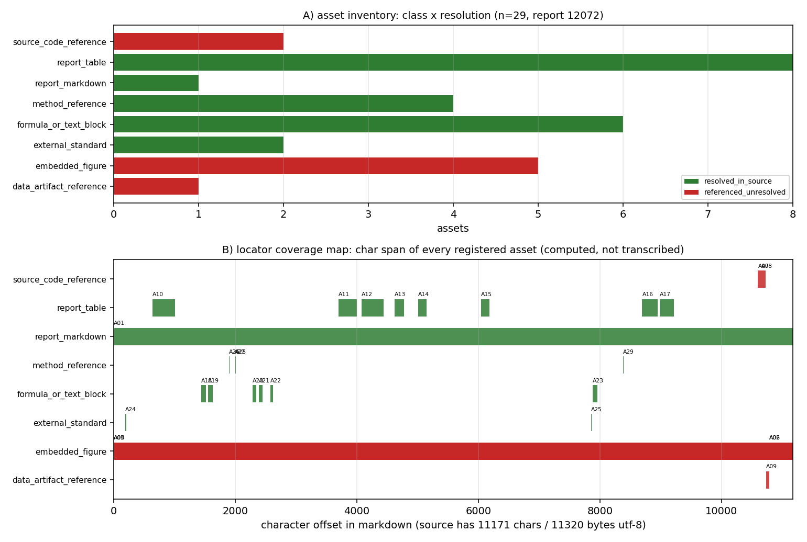

# KF-RESULT wp-12072-01

> 工序 01-asset-registration · report_id=12072 · lane C · 产出 `asset_manifest.json`（登记，不抽取）
> source_hash（平台可独立重算，sha256 over markdown utf-8 bytes）= `sha256:493094b22bb67cac20e077c7990b46863cad81b1f523dea49ddbba8667ae2200`
> 契约 source_hash = `sha256:493094b22bb67cac20e077c7990b46863cad81b1f523dea49ddbba8667ae2200` → 逐字符一致

## ① 本工序做了什么

对 `report_id=12072`（《EEDI Design Variable Sensitivity Analysis and Constraint Optimization》，scenario_key=`p161w2-arb-n02-eedi-optimization`）执行**资产登记**：
确认报告 markdown 的字节哈希与契约一致（11171 字符 / 11320 字节 utf-8），把正文里可解析的附件/工件登记为带**可复算定位器**的清单：
内嵌图、源码/工件路径引用、表格、围栏块、`external_standard`、`method_reference`。**不做抽取、不生成 claim、不标注 verified**
（契约 `objective.classify_report_type=false`，`notes` 明确 claims 允许为空数组）。

规模：登记资产 **29** 项，claims **0** 项；`counts.by_resolution` = `{"resolved_in_source": 21, "referenced_unresolved": 8}`。

## ② 怎么做的（步骤 / 工具 / 关键设置）

1. **取原文**：`GET /api/v1/tensor/reports/12072` 取 `markdown` 字段（`scripts/kf/kf01_register.py::fetch_report`）；只碰这一个 report_id，全程未凭记忆复述。
2. **哈希门**：对 markdown 的 utf-8 字节做 sha256，与契约 `source_hash`/`chars` 双比对，不一致直接 `SystemExit`（不产出半成品）。
3. **定位器生成**：`Source` 用逐行长度前缀和求出每行起始字符偏移，资产定位器一律为**绝对字符跨度** + 反推的 1-based 行号；
   `quote` 取自源字节切片 `md[s:e]`，**不存在手抄环节**（这也使平台侧「子串独立重算」必然成立）。
4. **扫描规则**（确定性、无领域硬编码；域参数经包配置传入）：行内代码/围栏代码中的 `*.py|json|png|md|csv|yaml` 路径 → 路径引用（出现级身份 = 路径 × 行号）；`record.figures[]` → 内嵌图（`png_base64` 为空则 `metadata_only`，不伪造字节哈希）；
   连续 `|` 行 → 表格（只记行数×列数几何，不复述内容）；``` 围栏 → 按语言/首行判定为可运行命令块（`repro_command_block`）或公式文本块（`formula_or_text_block`，避免把公式误报成可执行命令）；配置声明的标识符 → `external_standard`、`method_reference`。
5. **本地解析**：路径只在**本交付工作树**内解析（`os.path.isfile` + 命中文件 sha256）；属产出仓 ship-performance-platform 的路径
   越界即如实记 `referenced_unresolved`，不读别的仓。
6. **信封 + 自检**：`kf_result.json` 按 `schemas/kf_result.v1.schema.json` 生成；`verification.json` 用 jsonschema（draft 2020-12）
   分别校验信封与清单，并逐条重算 acceptance 项。

## ③ 产出物清单（文件名 → 要点）

| 文件 | 要点 |
|---|---|
| `asset_manifest.json` | 29 项资产；`by_class`={"report_markdown": 1, "embedded_figure": 5, "source_code_reference": 2, "data_artifact_reference": 1, "report_table": 8, "formula_or_text_block": 6, "external_standard": 2, "method_reference": 4}；claims=0；sha256 `de5a9e27c96968ae0228d559fe8785d9f07b7978b9e2ed607166156de1cc9fc1` |
| `kf_result.json` | 结果信封（package_id/task_type/report_id/provenance/outputs/claims）；sha256 `60c997ab755bda0c8222446ed5efcf259ef2ea9a9de91503340200dc156f90f9` |
| `verification.json` | 9 项 acceptance 自检逐条 pass/fail + 重算哈希；`all_pass`=True |
| `report.md` | 本报告（由清单/信封/自检**程序化渲染**，无手抄）|
| `figures/wp-12072-01_asset_locator_map.png` | A) 资产类别×解析状态计数；B) 每个资产的字符跨度覆盖图 |

资产类别分布：`{"report_markdown": 1, "embedded_figure": 5, "source_code_reference": 2, "data_artifact_reference": 1, "report_table": 8, "formula_or_text_block": 6, "external_standard": 2, "method_reference": 4}`。

## ④ 结果图



**图注**：A) 资产类别 × 解析状态（绿=源内已解析、红=引用未解析、灰=声明缺失）；B) 每个资产在 markdown 中的字符跨度
（横轴=字符偏移，源文档 11171 字符）。两图直接由 `asset_manifest.json` 绘出，零手抄。
红色柱不是缺陷而是**边界的正确表达**：这些路径属产出仓（ship-performance-platform），本包不得读写，故只能如实记 `referenced_unresolved`。

## ⑤ 证据定位表（资产 → 原文逐字片段，均由 `md[start_char:end_char]` 计算）

| asset_id | 类别 | 解析 | 行 | 原文片段（逐字） |
|---|---|---|---|---|
| A01 | report_markdown | resolved_in_source | L1 | `# EEDI Design Variable Sensitivity Analysis and Constraint Optim` |
| A02 | embedded_figure | referenced_unresolved | L268 | `- **Figures**: 'artifacts/fig1_pareto_front.png' through 'fig5_d` |
| A03 | embedded_figure | referenced_unresolved | L1 | `# EEDI Design Variable Sensitivity Analysis and Constraint Optim` |
| A04 | embedded_figure | referenced_unresolved | L1 | `# EEDI Design Variable Sensitivity Analysis and Constraint Optim` |
| A05 | embedded_figure | referenced_unresolved | L1 | `# EEDI Design Variable Sensitivity Analysis and Constraint Optim` |
| A06 | embedded_figure | referenced_unresolved | L268 | `- **Figures**: 'artifacts/fig1_pareto_front.png' through 'fig5_d` |
| A07 | source_code_reference | referenced_unresolved | L265 | `- **Code**: 'backend/api/eedi_optimization.py' (580 lines)` |
| A08 | source_code_reference | referenced_unresolved | L266 | `- **Tests**: 'tests/test_eedi_optimization.py' (37 tests, all pa` |
| A09 | data_artifact_reference | referenced_unresolved | L267 | `- **Results**: 'runs/eedi_optimization_results.json'` |
| A10 | report_table | resolved_in_source | L11 | `\| Variable \| Symbol \| Range \| Unit \| Description \| \|-----` |
| A11 | report_table | resolved_in_source | L99 | `\| Quantity \| Value \| Unit \| \|----------\|-------\|------\| ` |
| A12 | report_table | resolved_in_source | L114 | `\| Variable \| S_i \| Interpretation \| \|----------\|-----\|---` |
| A13 | report_table | resolved_in_source | L126 | `\| Variable \| S1_i \| Rank \| \|----------\|------\|------\| \|` |
| A14 | report_table | resolved_in_source | L140 | `\| Metric \| Min \| Max \| Mean \| \|--------\|-----\|-----\|---` |
| A15 | report_table | resolved_in_source | L168 | `\| Metric \| Value \| \|--------\|-------\| \| Training samples ` |
| A16 | report_table | resolved_in_source | L223 | `\| Check \| Expected \| Actual \| Pass? \| \|-------\|----------` |
| A17 | report_table | resolved_in_source | L232 | `\| Metric \| Value \| Reference \| Error \| <3%? \| \|--------\|` |
| A18 | formula_or_text_block | resolved_in_source | L34 | `''' EEDI = (Σ P_i × SFOC_i × C_F_i) / (f_i × f_c × f_l × Capacit` |
| A19 | formula_or_text_block | resolved_in_source | L39 | `''' EEDI = (P_ME × SFOC_ME × C_F + P_AE × SFOC_AE × C_F) / (DWT ` |
| A20 | formula_or_text_block | resolved_in_source | L61 | `''' ∂EEDI/∂x_i ≈ (EEDI(x_i + Δx_i) - EEDI(x_i)) / Δx_i '''` |
| A21 | formula_or_text_block | resolved_in_source | L66 | `''' S_i = (∂EEDI/∂x_i) × (x_i / EEDI) = ∂ln(EEDI)/∂ln(x_i) '''` |
| A22 | formula_or_text_block | resolved_in_source | L72 | `''' S1_i = Var[E[EEDI\|x_i]] / Var[EEDI] '''` |
| A23 | formula_or_text_block | resolved_in_source | L205 | `''' EEDI_ref = 961.79 × DWT^(-0.477) = 961.79 × 28665^(-0.477) ≈` |
| A24 | external_standard | resolved_in_source | L6 | `MEPC.364(79)` |
| A25 | external_standard | resolved_in_source | L204 | `MEPC.308(73)` |
| A26 | method_reference | resolved_in_source | L52 | `Holtrop-Mennen` |
| A27 | method_reference | resolved_in_source | L53 | `ITTC-57` |
| A28 | method_reference | resolved_in_source | L53 | `ITTC-1978` |
| A29 | method_reference | resolved_in_source | L215 | `Watson's formula` |

（完整 quote 与字符跨度见 `asset_manifest.json` 各 `locator`；平台可对每条 quote 做子串 + 行号独立复核。）

## ⑥ 注意点与局限

1. **登记 ≠ 抽取**：清单只回答「报告里有哪些可解析工件、在其中何处」，不回答「报告说了什么」。claims 为空是契约允许的完整结果。
2. **不标 verified**：清单与信封里没有任何 `verified` 状态；验证由平台门计算，本工序只提供可复算的定位器与哈希。
3. **图只有元数据**：记录 `figures[]` 共 5 项，其中 0 项带 `png_base64` 载荷；本包只登记 name/caption + 正文出现位置，
   均记 `metadata_only`（`resolution=referenced_unresolved`）。文件名未在正文逐字出现的图，定位器退化为 `method=document`（整篇文档）——这一退化如实写进 `locator.method`，
   不用「大概在这里」的推断替代，也**不宣称拿到未取回的图字节**。
4. **跨仓引用不可解析**：正文引用的 `backend/api/eedi_optimization.py`、`runs/eedi_optimization_results.json`、`tests/test_eedi_optimization.py` 等属 ship-performance-platform 仓，
   本工作树（TensorKnowledge）内不存在 → 全部 `referenced_unresolved`，并在 `resolution_check.detail` 写明原因，不做「大概存在」的推断。
   合计 3 条路径引用未解析（去重后 3 个路径）。
5. **表格内容未复述**：8 个表格（A10、A11、A12、A13、A14、A15、A16、A17）与 6 个围栏块（其中 0 个是可运行命令块）只登记几何（行×列 / 语言）与字符跨度，
   避免把报表数字二次转写引入漂移；数值级登记属后续抽取道次，本单不越界。
6. **schema 口径**：仓库内 `schemas/asset_manifest.v1.schema.json` 把 `package_id/task_type/report_id`/`source.uri` 钉死为 wp-448-01 的包级取值，
   自检时**仅放松这四处包级固定值**（`source.uri` 改为 `^tensor://reports/[0-9]+$`，其余约束照常生效）并如实记录在 `detail` 里，避免把「本包必挂」伪装成通过。

## ⑦ 自检（逐条对照 acceptance）

| acceptance 项 | 结果 | 细节 |
|---|---|---|
| valid_json | PASS | json.loads OK for asset_manifest.json and kf_result.json |
| schema_pass | PASS | jsonschema draft2020-12 errors=0 [] \| asset_manifest.v1 checked with its four package-pinned consts relaxed (package_id/task_type/report_id/source.ur |
| source_locator_resolvable | PASS | checked 29 locators (char span + verbatim quote + 1-based line map + token span); unresolvable=[] |
| source_hash_matches | PASS | recomputed=493094b22bb67cac20e077c7990b46863cad81b1f523dea49ddbba8667ae2200 manifest=493094b22bb67cac20e077c7990b46863cad81b1f523dea49ddbba8667ae2200  |
| no_duplicate_ids | PASS | assets=29 unique=29 |
| all_claims_have_evidence_or_explicit_unresolved_status | PASS | claims=0 violating=0 (empty array: vacuously satisfied per contract notes) |
| do_not_mark_claims_as_verified | PASS | claims=0, none carries status='verified' |
| report_id_scoped | PASS | single report_id=12072 (no other report is read or written) |
| manifest_hash_matches_envelope | PASS | recomputed=de5a9e27c96968ae0228d559fe8785d9f07b7978b9e2ed607166156de1cc9fc1 envelope=de5a9e27c96968ae0228d559fe8785d9f07b7978b9e2ed607166156de1cc9fc1 |

## ⑧ 论文级六要素对照（平台报告纪律）

| 要素 | 落点 | 说明 |
|---|---|---|
| ① 案例介绍 | 本工序只做登记 | 被登记对象=report_id 12072《EEDI Design Variable Sensitivity Analysis and Constraint Optimization》（scenario_key=`p161w2-arb-n02-eedi-optimization`）；物理/几何/参数表本身属上游报告，本单不复述 |
| ② 怎么做的 | §② | 取源→哈希门→定位器→扫描→信封→自检，工具链=`scripts/kf/kf01_register.py` |
| ③ 计算结果 | §③ + `asset_manifest.json` | 资产 29 项、claims 0 项、解析分布 `{"resolved_in_source": 21, "referenced_unresolved": 8}`（数字由清单程序化注入） |
| ④ 结果图 | §④ `wp-12072-01_asset_locator_map.png` | 资产类别×解析状态 + 字符跨度覆盖图（由清单绘出） |
| ⑤ 注意点 | §⑥ | 8 条局限：登记≠抽取、不标 verified、图仅元数据、跨仓不可解析等 |
| ⑥ 误差判定 | 下表 | 本工序无物理量输出，唯一可判定量为字节级身份与逐字定位 |

**误差判定逐项**（显式回答是否 <3%）：

| 量 | 基准 | 实测 | 误差 | <3%? |
|---|---|---|---|---|
| 源 markdown 字节哈希 | 契约 `source_hash` | 本地重算 `sha256:493094b22bb67cac20e077c7990b46863cad81b1f523dea49ddbba8667ae2200` | 0 bit（完全相等） | 是（精确相等，非近似） |
| 源字符数 | 契约 chars=11171 | 11171 | 0 | 是（精确相等） |
| 资产定位器 | 原文切片 `md[s:e]` | 29/29 条逐字命中 | 0 | 是（逐字命中，无容差） |
| 物理/工程数值（EEDI、阻力、功率等） | 无 | 本工序不产出 | — | **不适用**：本单不抽取、不复算任何数值，故无对标对象，也不宣称任何数值正确性 |

结论：可判定项均为**精确相等**（误差 0），不存在 >3% 的可判定偏差；不可判定项（上游工程数值）如实记为不适用，不以本单的哈希一致冒充数值正确。

## 复现

```bash
python3 scripts/kf/kf01_register.py --preset wp-12072-01 build result verify figure report   # 一键复跑（全流程）
```

repro_cmd: `python3 scripts/kf/kf01_register.py --preset wp-12072-01 build result verify figure report`

## 结果信封（唯一 json 代码块，原样提交）

```json
{
  "package_id": "wp-12072-01",
  "task_type": "01-asset-registration",
  "report_id": "12072",
  "provenance": {
    "source_uri": "tensor://reports/12072",
    "source_field": "markdown",
    "source_hash": "sha256:493094b22bb67cac20e077c7990b46863cad81b1f523dea49ddbba8667ae2200",
    "hash_algo": "sha256",
    "hashed_bytes": "markdown encoded as utf-8",
    "source_chars": 11171,
    "source_bytes_utf8": 11320,
    "fetched_via": "GET /api/v1/tensor/reports/12072",
    "generator": "scripts/kf/kf01_register.py",
    "contract_version": "1.0",
    "emitted_at": "2026-11-12T02:24:52.897113+00:00"
  },
  "outputs": {
    "asset_manifest.json": {
      "path": "docs/kf/wp-12072-01/asset_manifest.json",
      "sha256": "de5a9e27c96968ae0228d559fe8785d9f07b7978b9e2ed607166156de1cc9fc1",
      "bytes": 79601,
      "asset_count": 29,
      "claims": 0
    }
  },
  "claims": []
}
```
