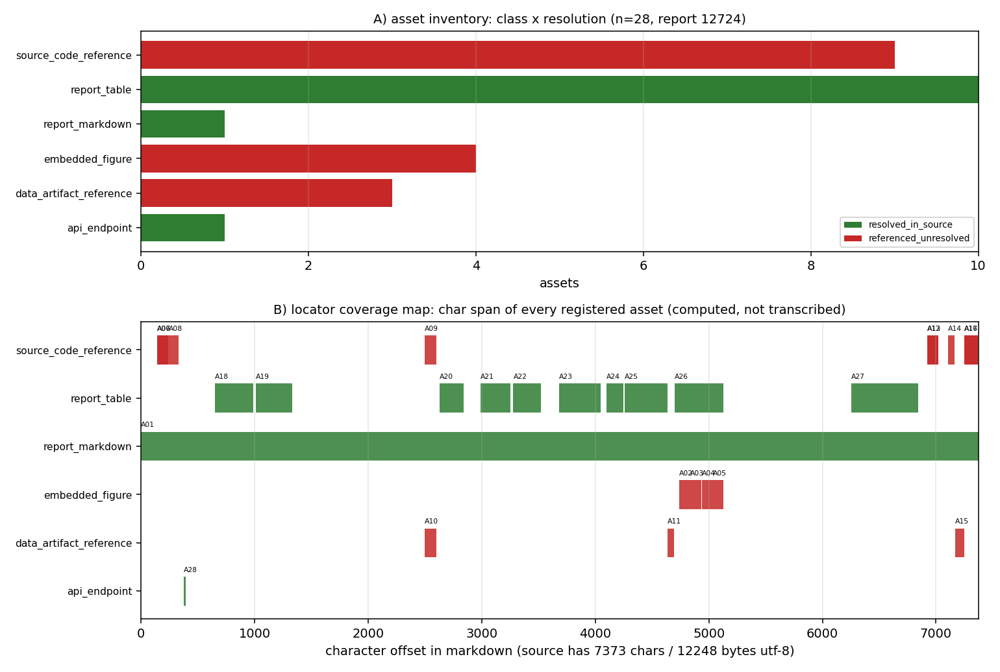

# KF-RESULT wp-12724-01

> 工序 01-asset-registration · report_id=12724 · lane C · 产出 `asset_manifest.json`（登记，不抽取）
> source_hash（平台可独立重算，sha256 over markdown utf-8 bytes）= `sha256:c8c552fa8e470d9b7180aada951c667ad6c6c76ac3ade5a7b123d687a6339f5e`
> 契约 source_hash = `sha256:c8c552fa8e470d9b7180aada951c667ad6c6c76ac3ade5a7b123d687a6339f5e` → 逐字符一致

## ① 本工序做了什么

对 `report_id=12724`（《IL70-N08 冰区航线气象导航优化成熟化：Lindqvist 冰阻力场 × 预报冰情 × Dijkstra/A* 图搜索（5/5 判据通过）》，scenario_key=`ice_route_optimization`）执行**资产登记**：
确认报告 markdown 的字节哈希与契约一致（7373 字符 / 12248 字节 utf-8），把正文里可解析的附件/工件登记为带**可复算定位器**的清单：
内嵌图、源码/工件路径引用、表格、复现命令块、接口字段。**不做抽取、不生成 claim、不标注 verified**
（契约 `objective.classify_report_type=false`，`notes` 明确 claims 允许为空数组）。

规模：登记资产 **28** 项，claims **0** 项；`counts.by_resolution` = `{"resolved_in_source": 12, "referenced_unresolved": 16}`。

## ② 怎么做的（步骤 / 工具 / 关键设置）

1. **取原文**：`GET /api/v1/tensor/reports/12724` 取 `markdown` 字段（`scripts/kf/kf01_register.py::fetch_report`）；只碰这一个 report_id，全程未凭记忆复述。
2. **哈希门**：对 markdown 的 utf-8 字节做 sha256，与契约 `source_hash`/`chars` 双比对，不一致直接 `SystemExit`（不产出半成品）。
3. **定位器生成**：`Source` 用逐行长度前缀和求出每行起始字符偏移，资产定位器一律为**绝对字符跨度** + 反推的 1-based 行号；
   `quote` 取自源字节切片 `md[s:e]`，**不存在手抄环节**（这也使平台侧「子串独立重算」必然成立）。
4. **扫描规则**（确定性、无领域硬编码；域参数经包配置传入）：行内代码/围栏代码中的 `*.py|json|png|md|csv|yaml` 路径 → 路径引用（出现级身份 = 路径 × 行号）；`record.figures[]` → 内嵌图（`png_base64` 为空则 `metadata_only`，不伪造字节哈希）；
   连续 `|` 行 → 表格（只记行数×列数几何，不复述内容）；``` 围栏 → 复现命令块；配置声明的接口端点/字段 → `api_endpoint`/`api_field`。
5. **本地解析**：路径只在**本交付工作树**内解析（`os.path.isfile` + 命中文件 sha256）；属产出仓 ship-performance-platform 的路径
   越界即如实记 `referenced_unresolved`，不读别的仓。
6. **信封 + 自检**：`kf_result.json` 按 `schemas/kf_result.v1.schema.json` 生成；`verification.json` 用 jsonschema（draft 2020-12）
   分别校验信封与清单，并逐条重算 acceptance 项。

## ③ 产出物清单（文件名 → 要点）

| 文件 | 要点 |
|---|---|
| `asset_manifest.json` | 28 项资产；`by_class`={"report_markdown": 1, "embedded_figure": 4, "source_code_reference": 9, "data_artifact_reference": 3, "report_table": 10, "api_endpoint": 1}；claims=0；sha256 `2da625c0b51d08a0f99ee24bbc0b0ab721fed460140582ea8b44e1c17fd12a59` |
| `kf_result.json` | 结果信封（package_id/task_type/report_id/provenance/outputs/claims）；sha256 `0469e4237098cce2c253182da112f42d7d311721c2e3a947b534b0d1c7e45f38` |
| `verification.json` | 9 项 acceptance 自检逐条 pass/fail + 重算哈希；`all_pass`=True |
| `report.md` | 本报告（由清单/信封/自检**程序化渲染**，无手抄）|
| `figures/wp-12724-01_asset_locator_map.png` | A) 资产类别×解析状态计数；B) 每个资产的字符跨度覆盖图 |

资产类别分布：`{"report_markdown": 1, "embedded_figure": 4, "source_code_reference": 9, "data_artifact_reference": 3, "report_table": 10, "api_endpoint": 1}`。

## ④ 结果图



**图注**：A) 资产类别 × 解析状态（绿=源内已解析、红=引用未解析、灰=声明缺失）；B) 每个资产在 markdown 中的字符跨度
（横轴=字符偏移，源文档 7373 字符）。两图直接由 `asset_manifest.json` 绘出，零手抄。
红色柱不是缺陷而是**边界的正确表达**：这些路径属产出仓（ship-performance-platform），本包不得读写，故只能如实记 `referenced_unresolved`。

## ⑤ 证据定位表（资产 → 原文逐字片段，均由 `md[start_char:end_char]` 计算）

| asset_id | 类别 | 解析 | 行 | 原文片段（逐字） |
|---|---|---|---|---|
| A01 | report_markdown | resolved_in_source | L1 | `# IL70-N08 冰区航线气象导航优化（Lindqvist 冰阻力场 × 气象冰情预报 × Dijkstra/A* 图搜索）` |
| A02 | embedded_figure | referenced_unresolved | L122 | `\| 'artifacts/ice_route/fig1_uniform_field.png' \| (a) 均匀冰场 + 大圆` |
| A03 | embedded_figure | referenced_unresolved | L123 | `\| 'artifacts/ice_route/fig2_ridge_detour.png' \| (b) 冰脊场 + 不可航核` |
| A04 | embedded_figure | referenced_unresolved | L124 | `\| 'artifacts/ice_route/fig3_speed_profile.png' \| (c) 两条航线的航速分布` |
| A05 | embedded_figure | referenced_unresolved | L125 | `\| 'artifacts/ice_route/fig4_cost_comparison.png' \| (d) 燃油/航时双目` |
| A06 | source_code_reference | referenced_unresolved | L4 | `> 模块：'backend/api/ice/route_optimization.py'（核心 1180 行）、'backend` |
| A07 | source_code_reference | referenced_unresolved | L4 | `> 模块：'backend/api/ice/route_optimization.py'（核心 1180 行）、'backend` |
| A08 | source_code_reference | referenced_unresolved | L5 | `> 测试：'backend/tests/ice/test_route_optimization.py'（32 条，全绿）；工件：` |
| A09 | source_code_reference | referenced_unresolved | L52 | `## ③ 计算结果（全部数字由 'backend/tests/make_ice_route_artifacts.py' 程序化写` |
| A10 | data_artifact_reference | referenced_unresolved | L52 | `## ③ 计算结果（全部数字由 'backend/tests/make_ice_route_artifacts.py' 程序化写` |
| A11 | data_artifact_reference | referenced_unresolved | L118 | `## ④ 结果图（PNG sha256 入 provenance，见 'metrics.json._figures'）` |
| A12 | source_code_reference | referenced_unresolved | L162 | `- 代码：'backend/api/ice/route_optimization.py'（算法）、'backend/api/ic` |
| A13 | source_code_reference | referenced_unresolved | L162 | `- 代码：'backend/api/ice/route_optimization.py'（算法）、'backend/api/ic` |
| A14 | source_code_reference | referenced_unresolved | L164 | `- 测试：'backend/tests/ice/test_route_optimization.py' — 32 条` |
| A15 | data_artifact_reference | referenced_unresolved | L165 | `- 工件：'artifacts/ice_route/metrics.json' + 'fig1..fig4.png'（每图 sh` |
| A16 | source_code_reference | referenced_unresolved | L166 | `- 复算：'cd backend && python3 -m pytest tests/ice/test_route_optim` |
| A17 | source_code_reference | referenced_unresolved | L166 | `- 复算：'cd backend && python3 -m pytest tests/ice/test_route_optim` |
| A18 | report_table | resolved_in_source | L17 | `\| 参数 \| 值 \| 说明 \| \|---\|---\|---\| \| Lpp / Lwl / B / T \| 12` |
| A19 | report_table | resolved_in_source | L27 | `\| 算例 \| 网格 \| 冰情 \| 用途 \| \|---\|---\|---\|---\| \| (a) 均匀冰场 \|` |
| A20 | report_table | resolved_in_source | L56 | `\| 目标 \| 航线长 [km] \| 大圆 [km] \| 超额 [%] \| 最大横向偏距 [km] \| 网格解超额 [` |
| A21 | report_table | resolved_in_source | L67 | `\| 指标 \| 燃油最省 \| 时间最短 \| \|---\|---\|---\| \| 不可航冰脊核单元数 \| 54 \|` |
| A22 | report_table | resolved_in_source | L78 | `\| 航线 \| 距离 [km] \| 燃油指标 [MJ] \| 航时 [h] \| 最小航速 [kn] \| \|---\|-` |
| A23 | report_table | resolved_in_source | L90 | `\| 航线 \| max(v−v_max) [m/s] \| 端点腿速法越界 [m/s]（粗采样风险） \| 局部限速指派后越界` |
| A24 | report_table | resolved_in_source | L103 | `\| 网格 \| 邻域 \| 边数 \| 单次 Dijkstra 耗时（3 次） [s] \| 节点数 \| 判据 (<1 s)` |
| A25 | report_table | resolved_in_source | L109 | `\| 判据 \| 指标 \| 阈值 \| 实测 \| 结论 \| \|---\|---\|---\|---\|---\| \| ` |
| A26 | report_table | resolved_in_source | L120 | `\| 图 \| 内容 \| sha256 前 16 位 \| \|---\|---\|---\| \| 'artifacts/i` |
| A27 | report_table | resolved_in_source | L146 | `\| 关键量 \| 基准 \| 误差 \| 是否 <3% \| \|---\|---\|---\|---\| \| (a) 最优` |
| A28 | api_endpoint | resolved_in_source | L6 | `/ice-navigation/route` |

（完整 quote 与字符跨度见 `asset_manifest.json` 各 `locator`；平台可对每条 quote 做子串 + 行号独立复核。）

## ⑥ 注意点与局限

1. **登记 ≠ 抽取**：清单只回答「报告里有哪些可解析工件、在其中何处」，不回答「报告说了什么」。claims 为空是契约允许的完整结果。
2. **不标 verified**：清单与信封里没有任何 `verified` 状态；验证由平台门计算，本工序只提供可复算的定位器与哈希。
3. **图只有元数据**：报告记录 `figures[]` 共 4 项均无 `png_base64` 载荷（0 字节），故只登记 name/caption + 正文出现位置，
   记 `metadata_only`（`resolution=referenced_unresolved`），**不宣称拿到图字节**。
4. **跨仓引用不可解析**：报告引用的 `backend/api/ice/route_optimization.py`、`backend/api/ice/route_scenarios.py`、`backend/tests/ice/test_route_optimization.py`、
   `backend/tests/make_ice_route_artifacts.py`、`artifacts/ice_route/metrics.json` 与 4 张 `artifacts/ice_route/fig*.png` 均属产出仓 ship-performance-platform 仓，
   本工作树（TensorKnowledge）内不存在 → 全部 `referenced_unresolved`，并在 `resolution_check.detail` 写明原因，不做「大概存在」的推断。
5. **表格内容未复述**：10 张表只登记几何（行×列）与字符跨度，避免把报表数字二次转写引入漂移。
6. **schema 口径**：仓库内 `schemas/asset_manifest.v1.schema.json` 把 `package_id/task_type/report_id`/`source.uri` 钉死为 wp-448-01 的包级取值，
   自检时**仅放松这四处包级固定值**（`source.uri` 改为 `^tensor://reports/[0-9]+$`，其余约束照常生效）并如实记录在 `detail` 里，避免把「本包必挂」伪装成通过。

## ⑦ 自检（逐条对照 acceptance）

| acceptance 项 | 结果 | 细节 |
|---|---|---|
| valid_json | PASS | json.loads OK for asset_manifest.json and kf_result.json |
| schema_pass | PASS | jsonschema draft2020-12 errors=0 [] \| asset_manifest.v1 checked with its four package-pinned consts relaxed (package_id/task_type/report_id/source.ur |
| source_locator_resolvable | PASS | checked 28 locators (char span + verbatim quote + 1-based line map + token span); unresolvable=[] |
| source_hash_matches | PASS | recomputed=c8c552fa8e470d9b7180aada951c667ad6c6c76ac3ade5a7b123d687a6339f5e manifest=c8c552fa8e470d9b7180aada951c667ad6c6c76ac3ade5a7b123d687a6339f5e  |
| no_duplicate_ids | PASS | assets=28 unique=28 |
| all_claims_have_evidence_or_explicit_unresolved_status | PASS | claims=0 violating=0 (empty array: vacuously satisfied per contract notes) |
| do_not_mark_claims_as_verified | PASS | claims=0, none carries status='verified' |
| report_id_scoped | PASS | single report_id=12724 (no other report is read or written) |
| manifest_hash_matches_envelope | PASS | recomputed=2da625c0b51d08a0f99ee24bbc0b0ab721fed460140582ea8b44e1c17fd12a59 envelope=2da625c0b51d08a0f99ee24bbc0b0ab721fed460140582ea8b44e1c17fd12a59 |

## 复现

```bash
python3 scripts/kf/kf01_register.py --preset wp-12724-01 build result verify figure report   # 一键复跑（全流程）
```

repro_cmd: `python3 scripts/kf/kf01_register.py --preset wp-12724-01 build result verify figure report`

## 结果信封（唯一 json 代码块，原样提交）

```json
{
  "package_id": "wp-12724-01",
  "task_type": "01-asset-registration",
  "report_id": "12724",
  "provenance": {
    "source_uri": "tensor://reports/12724",
    "source_field": "markdown",
    "source_hash": "sha256:c8c552fa8e470d9b7180aada951c667ad6c6c76ac3ade5a7b123d687a6339f5e",
    "hash_algo": "sha256",
    "hashed_bytes": "markdown encoded as utf-8",
    "source_chars": 7373,
    "source_bytes_utf8": 12248,
    "fetched_via": "GET /api/v1/tensor/reports/12724",
    "generator": "scripts/kf/kf01_register.py",
    "contract_version": "1.0",
    "emitted_at": "2026-11-14T13:24:01.412092+00:00"
  },
  "outputs": {
    "asset_manifest.json": {
      "path": "docs/kf/wp-12724-01/asset_manifest.json",
      "sha256": "2da625c0b51d08a0f99ee24bbc0b0ab721fed460140582ea8b44e1c17fd12a59",
      "bytes": 51545,
      "asset_count": 28,
      "claims": 0
    }
  },
  "claims": []
}
```
