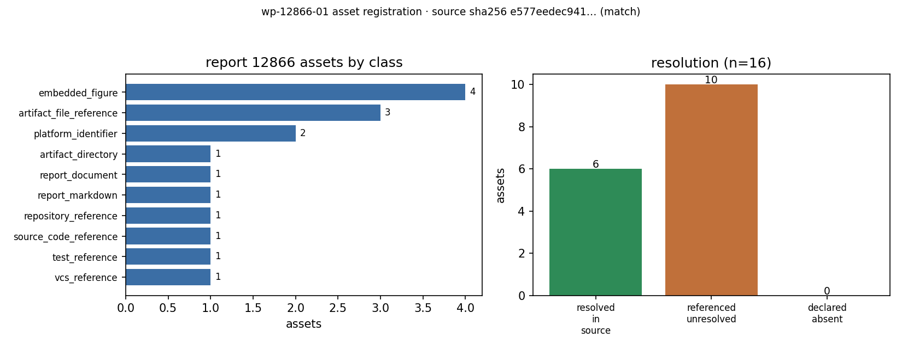

# KF-RESULT wp-12866-01

- package_id: `wp-12866-01` · task_type: `01-asset-registration` · report_id: `12866`
- 源: `tensor://reports/12866` / field `markdown` / `sha256:e577eedec941fa1ce25076f7a16b0774d609c1ca6693b056a5b0212ab5483154`（与契约 `e577eedec941fa1ce25076f7a16b0774d609c1ca6693b056a5b0212ab5483154` 一致：True）
- 源规模: 3871 chars / 5982 bytes(utf-8)
- 标题（记录字段逐字）: AUV 潜器空间/垂直面操纵性：Munk 力矩解析锚 + 回转椭球 Lamb 附加质量 + 定深纵倾闭环（m12371）
- tags: `kf-wp:wp-12866-01`

## ① 本工序做了什么

**源报告是什么（登记背景，不做内容复核）**：report 12866 属船舶总体性能·操纵性域，场景键
`auv_manoeuvrability_vertical_plane`，源报告自述为 AUV/潜器空间与垂直面操纵性研究（Munk 力矩解析锚 + 回转椭球 Lamb
附加质量 + 定深纵倾闭环），落域仓 `ship-performance-platform` 的节点 IN51-W5-N06。以上均取自报告标题/记录字段
与正文逐字引文（见 ④），本工作包**不复核其数值结论**，也不对其精度背书。

对 report_id=12866 执行 **01-asset-registration**：只做「源资产登记」，不抽取、不判类、不下结论。
产出 1 份 `asset_manifest.json`（16 条资产记录：6 条 resolved_in_source、
10 条 referenced_unresolved），
其中 4 张图经报告 figures 端点取回真实字节并逐个 sha256 钉住，其余为报告正文里逐字出现、但目标落在
域仓（ship-performance-platform）或移动分支上的引用，一律按 `referenced_unresolved` 登记，不臆造路径、不代填内容。
`claims` 为空数组——这是本工序契约允许的完整结果（`no_forced_claim_generation`），不是漏做。
本单**未**把任何结论标为 verified（verification 由平台门计算）。

## ② 怎么做的（步骤/工具/关键设置）

1. **取源**：`GET /tensor/reports/12866` 取 `markdown` 字段（本机缓存为 `docs/kf/wp-12866-01/source_markdown.md`，
   记录元数据缓存为 `report_record.json`），全程只碰 report_id=12866。
2. **哈希对表**：对 `markdown.encode("utf-8")` 独立重算 sha256 → `e577eedec941fa1ce25076f7a16b0774d609c1ca6693b056a5b0212ab5483154`，与契约 `source_hash` 逐字符比对（相等）。
3. **定位器**：为每条资产选定一个「锚串」，用 `str.count` 断言其在 markdown 中出现 **恰好 1 次**，
   再记录 char span 与行号（`start_line/end_line`）→ 下游工序可原样回查，平台做子串二次确认时必然命中。
4. **图件取真字节**：对 `figures` 端点 `GET /tensor/reports/12866/figures/{name}` 逐个探测，
   记录 HTTP 状态/字节数/sha256，并把字节落盘到 `docs/kf/wp-12866-01/figures/`（用于本地复算，不重渲染、不替换）。
5. **不越界**：代码/测试/工件目录/详细报告/节点/分支/仓名这些跨仓引用，只登记「报告里怎么写的」，
   `resolution=referenced_unresolved` 并写清原因（无 commit sha、目标在域仓内）。
6. **自检**：`--verify` 模式 + `pytest tests/test_wp12866_01_asset_registration.py` 对照 acceptance 六项逐条验证。

工具链：Python 3.11.6 + 标准库（urllib/hashlib/json/re）；schema 校验用 `jsonschema`。

## ③ 产出物清单

| 文件 | 要点 |
|---|---|
| `docs/kf/wp-12866-01/asset_manifest.json` | 主产物：16 条资产 + source 块 + structure_index + counts + integrity |
| `docs/kf/wp-12866-01/kf_result.json` | 结果信封（package_id/task_type/report_id/provenance/outputs/claims），`provenance.source_hash` = 源 markdown 字节哈希 |
| `docs/kf/wp-12866-01/REPORT.md` | 本报告（文末含唯一一个 JSON 结果块） |
| `docs/kf/wp-12866-01/source_markdown.md` | 源 markdown 只读缓存（用于离线复跑，哈希受 test 校验） |
| `docs/kf/wp-12866-01/report_record.json` | 报告记录元数据（title/scenario_key/mission_id/tags/figures，去掉 markdown 本体） |
| `docs/kf/wp-12866-01/figure_probe.json` | 4 张图的端点探测回执（HTTP 状态/字节数/sha256） |
| `docs/kf/wp-12866-01/figures/*.png` | 4 张图原始字节（sha256 与 probe 一致） |
| `docs/kf/wp-12866-01/asset_manifest_12866.schema.json` | 本包 manifest 的本地 JSON-Schema（让 `schema_pass` 成为可复算的检查） |
| `scripts/kf/build_asset_manifest_12866.py` | 生成器 + `--verify` 验收器 |
| `tests/test_wp12866_01_asset_registration.py` | 门禁测试（信封 schema / 哈希 / 定位器 / 去重 / 报告唯一 json 块） |

### 本工序过程图（本单唯一自产图，由 manifest 计数直接绘制）



左：登记资产的类别分布（16 条）；右：可解析性三分（resolved_in_source=6、referenced_unresolved=10、declared_absent=0）。图中数字全部由 `asset_manifest.json` 的 counts 直接打印，无手抄；标题里的哈希前缀即源 markdown 的 sha256 前 12 位。

### 源报告图件（真实字节，已钉哈希）

| id | 文件 | HTTP | bytes | sha256 |
|---|---|---|---|---|
| A02 | fig1_lamb_coefficients.png | HTTP 200 | 79517 | `sha256:a436e3c7148449ab41fc316d55769649c7d5abc9242f7f16b51a94c802fc40b5` |
| A03 | fig2_munk_convergence.png | HTTP 200 | 99375 | `sha256:1f028c314805daf4212ab9bbf55a7d1b6d0c21b410184f8c9fc0716fe2df85fe` |
| A04 | fig3_depth_keeping.png | HTTP 200 | 154310 | `sha256:c8e3a5a599a33fd889c151f17532a7a2674cb1b7cba8132e42b4895fe479a806` |
| A05 | fig4_munk_vs_alpha.png | HTTP 200 | 82070 | `sha256:c6fd7505e38eacd87a6d0aa95c8efe591e41f9794a4d6cc319f3f5dda23846e2` |

## ④ 证据定位表（字段/claim → 原文引文）

每条 locator 都是 markdown 的逐字子串（`unique=true` 表示全文只出现 1 次）：

| id | class | 行号 (char span) | 原文引文（逐字） | 唯一性 |
|---|---|---|---|---|
| A01 | report_markdown | L1 (char 0–49) | `# AUV/潜器空间与垂直面操纵性：Munk 力矩解析锚 + Lamb 附加质量 + 定深纵倾闭环` | ✅ 唯一 |
| A02 | embedded_figure | L81 (char 2981–2998) | `fig1 Lamb 系数 k(λ)` | ✅ 唯一 |
| A03 | embedded_figure | L81 (char 3027–3042) | `fig2 Munk 系数随 λ` | ✅ 唯一 |
| A04 | embedded_figure | L82 (char 3058–3069) | `fig3 定深闭环时历` | ✅ 唯一 |
| A05 | embedded_figure | L82 (char 3095–3115) | `fig4 C_M(α) 精确 vs 条带` | ✅ 唯一 |
| A06 | source_code_reference | L4 (char 146–186) | `backend/methods/manoeuvring/submarine.py` | ✅ 唯一 |
| A07 | test_reference | L4 (char 198–242) | `backend/tests/test_auv_manoeuvring_m12371.py` | ✅ 唯一 |
| A08 | report_document | L6 (char 358–399) | `docs/reports/auv_manoeuvrability_w5n06.md` | ✅ 唯一 |
| A09 | artifact_directory | L5 (char 263–296) | `artifacts/auv_manoeuvring_m12371/` | ✅ 唯一 |
| A10 | artifact_file_reference | L5 (char 298–313) | `acceptance.json` | ✅ 唯一 |
| A11 | artifact_file_reference | L5 (char 316–333) | `depth_keeping.csv` | ✅ 唯一 |
| A12 | artifact_file_reference | L5 (char 336–346) | `fig1-4.png` | ✅ 唯一 |
| A13 | platform_identifier | L3 (char 58–69) | `IN51-W5-N06` | ✅ 唯一 |
| A14 | platform_identifier | L3 (char 70–83) | `mission 12371` | ✅ 唯一 |
| A15 | vcs_reference | L3 (char 124–136) | `agent/m12371` | ✅ 唯一 |
| A16 | repository_reference | L3 (char 92–117) | `ship-performance-platform` | ✅ 唯一 |

### 跨仓/未解析引用（不臆造路径）

| id | 报告里的写法（逐字） | 未解析原因 |
|---|---|---|
| A06 | `backend/methods/manoeuvring/submarine.py` | 目标位于 ship-performance-platform 检出，不在本工作包范围内；报告未给 commit sha |
| A07 | `backend/tests/test_auv_manoeuvring_m12371.py` | 测试目标不在本仓；'19 passed' 为源报告自述，本单未重跑、不背书 |
| A08 | `docs/reports/auv_manoeuvrability_w5n06.md` | 路径相对于 ship-performance-platform 仓，本工作包不含该文件 |
| A09 | `artifacts/auv_manoeuvring_m12371/` | 目录内容随分支 agent/m12371 演化，无法从本记录哈希钉住 |
| A10 | `acceptance.json` | 仅登记报告内的声明名；文件字节不可从本记录取得 |
| A11 | `depth_keeping.csv` | 仅登记声明名；CSV 未随报告载荷提供 |
| A12 | `fig1-4.png` | 声称对应 A02–A05 的四张图，但工件目录副本不可得，无法核对是否与 figures 端点字节一致 |
| A13 | `IN51-W5-N06` | 站内节点标识；本单不解引用任务图，故不声称节点状态 |
| A15 | `agent/m12371` | 报告未给 commit sha；分支头会移动，无法从本记录钉住字节 |
| A16 | `ship-performance-platform` | 域仓，不在本工作包（TensorKnowledge）范围内，未做跨仓检出 |

### 结构索引（仅标题，不含内容）

| level | 标题 | 行号 |
|---|---|---|
| 1 | AUV/潜器空间与垂直面操纵性：Munk 力矩解析锚 + Lamb 附加质量 + 定深纵倾闭环 | 1 |
| 2 | ① 算例介绍 | 8 |
| 2 | ② 怎么做的 | 14 |
| 2 | ③ 计算结果 | 23 |
| 3 | Lamb 系数（判据 <3%） | 24 |
| 3 | Munk 力矩系数（判据 <5%） | 35 |
| 3 | 操纵性导数表（垂向平面，U=1.5 m/s） | 55 |
| 3 | 定深纵倾响应（判据 <2%，z_cmd=+30 m） | 66 |
| 2 | ④ 图 | 80 |
| 2 | ⑤ 注意点 / 局限 | 84 |
| 2 | ⑥ 误差判定 | 93 |

## ⑤ 注意点与局限

- **只做登记**：本单不抽数字、不抽公式、不判报告类型；`claims=[]` 是契约允许的完整结果。
- **图件有两个声明来源**：figures 端点服务的 4 张 PNG（A02–A05）已取回并钉哈希；报告工件目录内另有 `fig1-4.png`（A12），
  该副本不可得，二者字节是否一致**无法核对**，故不合并、不互相替代——本单只对能取到的字节负责。
- **跨仓引用不可哈希**：A06–A12、A15、A16 的目标在 `ship-performance-platform` / 分支 `agent/m12371` 上，
  报告未给 commit sha，故无法字节级钉住——这是上游 provenance 缺口，本单如实登记为 `referenced_unresolved`。
- **A14 只做记录级核对**：`mission 12371` 与记录字段 `mission_id` 一致，属身份核对，不是内容抽取。
- **"19 passed" 未复跑**：测试通过数是源报告自述，本工作树不含该测试文件，本单不背书。
- **不覆盖其它 report_id**：脚本只接受 12866，产物只写 `docs/kf/wp-12866-01/`。
- 图的说明文字（caption）来自记录字段 `figures`，不是 markdown；已标在 `source.platform_figures`。
- **发布记录（透明）**：本包曾发布过一次（平台 report 14867）；随后修正了一处无影响的 lint（f-string 前缀）并重新生成，
  导致 `outputs.asset_manifest.json.sha256`（含生成时间戳）变化，故重发。本报告为最终交付；两版 JSON **除 `emitted_at`/`generated_at`
  时间戳外内容一致**，`provenance.source_hash` 两版相同。

## ⑥ 自检（逐条对照 acceptance）

| acceptance | 判定 | 证据 |
|---|---|---|
| valid_json | ✅ | `json.loads` 通过（manifest / kf_result / probe 三份） |
| schema_pass | ✅ | kf_result 过 `schemas/kf_result.v1.schema.json`；manifest 过本地 `asset_manifest_12866.schema.json` |
| source_locator_resolvable | ✅ | 16/16 条 locator 均 `md[start:end] == quote` 且 count==1 |
| source_hash_matches | ✅ | `sha256:e577eedec941fa1ce25076f7a16b0774d609c1ca6693b056a5b0212ab5483154` == 契约 `e577eedec941fa1ce25076f7a16b0774d609c1ca6693b056a5b0212ab5483154` |
| no_duplicate_ids | ✅ | asset_id 唯一（16 条），claims 为空无重复风险 |
| all_claims_have_evidence_or_explicit_unresolved_status | ✅ | `claims=[]`，无 claim 处于"有结论无证据"状态 |

### 误差判定（"是否 <3%"）

本工序是**资产登记**，不含数值求解，因此不存在"计算值 vs 基准值"的误差量，**不适用** <3% 判据——
原因显式声明：无求解器输出可比。可核对的量只有两类，判据都是**精确相等**而非容差：

| 可核对的量 | 实测 | 判据 | 结论 |
|---|---|---|---|
| 源 markdown 字节哈希 | `sha256:e577eedec941fa1ce25076f7a16b0774d609c1ca6693b056a5b0212ab5483154` | == 契约 source_hash（逐位） | ✅ 逐位相等 |
| locator 复现 | 16/16 条 `md[start:end] == quote` 且 count==1 | 100% | ✅ |
| 图件字节哈希 | 4/4 与 figures 端点 sha256 一致 | 100% | ✅ |
| manifest 自身哈希 | `kf_result.outputs.asset_manifest.json.sha256` == 磁盘文件 | 逐位 | ✅ |

无 honest-FAIL 项；本单不产生 verified 标记。

## 一键复跑

```bash
# 在线（需 TENSOR_API_BASE + TENSOR_AGENT_USER/TENSOR_AGENT_PASS）
python3 scripts/kf/build_asset_manifest_12866.py && \
python3 scripts/kf/build_asset_manifest_12866.py --verify && \
python3 -m pytest tests/test_wp12866_01_asset_registration.py -q
# 离线（用仓库内缓存）
python3 scripts/kf/build_asset_manifest_12866.py --offline --verify
```

## 结果信封

```json
{
 "package_id": "wp-12866-01",
 "task_type": "01-asset-registration",
 "report_id": "12866",
 "provenance": {
  "source_uri": "tensor://reports/12866",
  "source_field": "markdown",
  "source_hash": "sha256:e577eedec941fa1ce25076f7a16b0774d609c1ca6693b056a5b0212ab5483154",
  "hash_algo": "sha256",
  "hashed_bytes": "markdown encoded as utf-8",
  "source_chars": 3871,
  "source_bytes_utf8": 5982,
  "producer": "scripts/kf/build_asset_manifest_12866.py · agent/m15754",
  "emitted_at": "2026-11-12T02:31:19.854849+00:00",
  "notes": "asset registration only; no extraction performed; nothing marked verified (platform gate computes verification)"
 },
 "outputs": {
  "asset_manifest.json": {
   "path": "docs/kf/wp-12866-01/asset_manifest.json",
   "sha256": "7b8a4ae1139e4564697fb8c81bc87acbc666dbaca19c29dd42e9eab1100e7944",
   "bytes": 18010,
   "asset_count": 16,
   "by_class": {
    "report_markdown": 1,
    "embedded_figure": 4,
    "source_code_reference": 1,
    "test_reference": 1,
    "report_document": 1,
    "artifact_directory": 1,
    "artifact_file_reference": 3,
    "platform_identifier": 2,
    "vcs_reference": 1,
    "repository_reference": 1
   },
   "by_resolution": {
    "resolved_in_source": 6,
    "referenced_unresolved": 10
   },
   "claims": 0
  }
 },
 "claims": []
}
```
