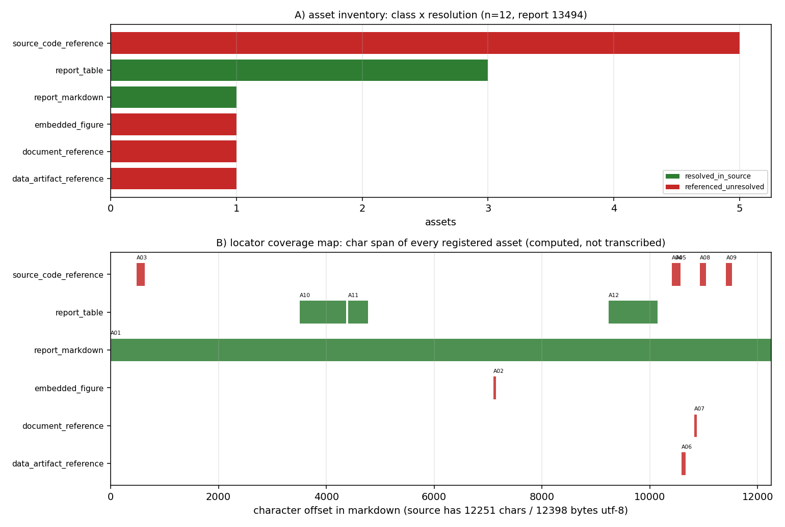

# KF-RESULT wp-13494-01

> 工序 01-asset-registration · report_id=13494 · lane C · 产出 `asset_manifest.json`（登记，不抽取）
> source_hash（平台可独立重算，sha256 over markdown utf-8 bytes）= `sha256:ad61f9e0bc3dbe8c8f4ae40ce90056f06c98477c9a33302193f8297756783abe`
> 契约 source_hash = `sha256:ad61f9e0bc3dbe8c8f4ae40ce90056f06c98477c9a33302193f8297756783abe` → 逐字符一致

## ① 本工序做了什么

对 `report_id=13494`（《TensorDEM GPU 100K Gate — CPU Scaling & Correctness Verification》，scenario_key=`p447w2-n03-dem-gpu-100k`，mission 14000，状态 `published`）执行**资产登记**：
确认报告 markdown 的字节哈希与契约一致（12251 字符 / 12398 字节 utf-8），把正文里可解析的附件/工件登记为带**可复算定位器**的清单：
内嵌图、源码/工件路径引用、表格、复现命令块。**不做抽取、不生成 claim、不标注 verified**。

规模：登记资产 **12** 项，claims **0** 项；`counts.by_resolution` = `{"resolved_in_source": 4, "referenced_unresolved": 8}`；`counts.distinct_referenced_paths` = 5。

## ② 怎么做的（步骤 / 工具 / 关键设置）

1. **取原文**：`GET /api/v1/tensor/reports/13494` 取 `markdown` 字段；只碰这一个 report_id，全程未凭记忆复述。
2. **哈希门**：对 markdown 的 utf-8 字节做 sha256，与契约 `source_hash`/`chars` 双比对，不一致直接 `SystemExit`（不产出半成品）。
3. **定位器生成**：逐行长度前缀和求出每行起始字符偏移，资产定位器一律为**绝对字符跨度** + 反推的 1-based 行号；
   `quote` 取自源字节切片 `md[s:e]`，**不存在手抄环节**。
4. **扫描规则**（确定性、无领域硬编码）：行内/围栏代码里的 `*.py|json|png|md|csv|yaml` 路径 → 路径引用（出现级身份 = 路径 × 行号）；
   `record.figures[]` → 内嵌图（`png_base64` 为空则 `metadata_only`，不伪造字节哈希）；连续 `|` 行 → 表格（只记行数×列数几何）；``` 围栏 → 复现命令块。
5. **本地解析**：路径只在**本交付工作树**内解析（`os.path.isfile` + 命中文件 sha256）；属产出仓 TensorDEM 的路径越界即如实记 `referenced_unresolved`，不读别的仓。
6. **复用而非分叉**：扫描/定位器代码直接 import `scripts/kf/kf01_register.py`（lane C 通用登记器），
   本包不复制一份实现；该共享工具是多个在开 PR 的热文件，本包**不改动它**（manifest `producer` 同时记录 generator 与本 driver）。
7. **两份附加证据**：`determinism.json`（两次独立重建的规范化对比）与 `published_check.json`（对 live 记录的状态/标题/图清单/哈希 + 全部定位器重解析逐条核对）。
8. **自检**：信封按 `schemas/kf_result.v1.schema.json`，清单按 `schemas/asset_manifest.v1.schema.json`（仅放松四处包级固定值），
   jsonschema draft 2020-12；`verification.json` 逐条重算 acceptance。

## ③ 产出物清单（文件名 → 要点）

| 文件 | 要点 |
|---|---|
| `asset_manifest.json` | 12 项资产；`by_class`={"report_markdown": 1, "embedded_figure": 1, "source_code_reference": 5, "data_artifact_reference": 1, "document_reference": 1, "report_table": 3}；claims=0；sha256 `bd65c1dd08f6b0737eea410ea6e5cae625472c281865cd6c1ac5e9a111ab11b8` |
| `kf_result.json` | 结果信封（package_id/task_type/report_id/provenance/outputs/claims），source_hash 与契约一致 |
| `verification.json` | 9 项 acceptance 自检逐条 pass/fail；`all_pass`=True |
| `determinism.json` | 2 次独立重建，规范化后一致；图为逐字节一致；`all_identical`=True |
| `published_check.json` | 8 项 live 记录核对；`all_pass`=True |
| `report_payload.json` | POST `/tensor/reports` 的请求体（标题/摘要/图内嵌 base64） |
| `report.md` | 本报告（由清单/信封/自检/证据**程序化渲染**，无手抄） |
| `figures/wp-13494-01_asset_locator_map.png` | A) 资产类别×解析状态计数；B) 每个资产在源文档中的字符跨度覆盖图 |

资产类别分布：`{"report_markdown": 1, "embedded_figure": 1, "source_code_reference": 5, "data_artifact_reference": 1, "document_reference": 1, "report_table": 3}`。

## ④ 结果图



**图注**：A) 资产类别 × 解析状态（绿=源内已解析、红=引用未解析、灰=声明缺失）；B) 每个资产在 markdown 中的字符跨度
（横轴=字符偏移，源文档 12251 字符）。两图直接由 `asset_manifest.json` 绘出，零手抄。
红色条不是缺陷而是**边界的正确表达**：`record.figures[0]`（fig1_scaling）只有 name+caption、`png_base64` 为空，本包不伪造字节哈希，如实记 `metadata_only`（`referenced_unresolved`）。

## ⑤ 证据定位表（资产 → 原文逐字片段，均由 `md[start_char:end_char]` 计算）

| asset_id | 类别 | 解析 | 行 | 原文片段（逐字） |
|---|---|---|---|---|
| A01 | report_markdown | resolved_in_source | L1 | `# TensorDEM GPU 100K Gate — Final Report  **Mission**: p44` |
| A02 | embedded_figure | referenced_unresolved | L169 | `` |
| A03 | source_code_reference | referenced_unresolved | L15 | `1. **Vectorized DEM engine** (`dem_vectorized.py`) impleme` |
| A04 | source_code_reference | referenced_unresolved | L234 | `- `src/tensordem/dem_vectorized.py` — GPU-ready vectorized` |
| A05 | source_code_reference | referenced_unresolved | L235 | `- `tests/test_dem_vectorized_100k.py` — comprehensive test` |
| A06 | data_artifact_reference | referenced_unresolved | L238 | `- `artifacts/dem_gpu_100k/scaling_study.json` — scaling da` |
| A07 | document_reference | referenced_unresolved | L243 | `- This report (`docs/dem_gpu_100k_report.md`)` |
| A08 | source_code_reference | referenced_unresolved | L250 | `1. **GPU-ready algorithm implemented**: counting–prefix-su` |
| A09 | source_code_reference | referenced_unresolved | L257 | `1. **Port to GPU**: when CUDA hardware available, port `de` |
| A10 | report_table | resolved_in_source | L80 | `\| Test Category \| Test Name \| Status \| Notes \| \|----` |
| A11 | report_table | resolved_in_source | L96 | `\| N (particles) \| Grid (nx³) \| Time/step (ms) \| Contac` |
| A12 | report_table | resolved_in_source | L216 | `\| Criterion \| Target \| Achieved \| Status \| Notes \| \` |

（完整 quote、字符跨度与 `token_span` 见 `asset_manifest.json` 各 `locator`；平台可对每条 quote 做子串 + 行号独立复核，
本包在 `published_check.json::all_locators_resolve_in_live_source` 里已自己先跑过一遍。）

## ⑥ 注意点与局限

1. **登记 ≠ 抽取**：清单只回答「报告里有哪些可解析工件、在其中何处」，不回答「报告说了什么」。claims 为空是契约允许的完整结果。
2. **不标 verified**：清单与信封里没有任何 `verified` 状态；验证由平台门计算。
3. **图只有元数据**：`record.figures[]` 共 1 项且 `png_base64` 为空（0 字节），故只登记 name/caption + 正文出现位置（`metadata_only`）。
4. **跨仓引用不可解析**：报告引用的 `src/tensordem/dem_vectorized.py`、`tests/test_dem_vectorized_100k.py`、
   `artifacts/dem_gpu_100k/scaling_study.json` 等属 TensorDEM 仓，本工作树（TensorKnowledge）内不存在 → 全部 `referenced_unresolved`，
   并在 `resolution_check.detail` 写明原因，不做「大概存在」的推断。
5. **表格内容未复述**：3 张表只登记几何（行×列）与字符跨度，避免把报表数字二次转写引入漂移。
6. **确定性 ≠ 逐字节相同**：两次构建各写自己的构建时钟（`generated_at` / `provenance.emitted_at`），
   这两个字段在 `determinism.json.method.excluded_volatile_fields` 中显式命名并在哈希前移除；其余字段必须逐字段一致。
7. **schema 口径**：`schemas/asset_manifest.v1.schema.json` 把 `package_id/task_type/report_id`/`source.uri` 钉死为 wp-448-01 的包级取值，
   自检时**仅放松这四处包级固定值**（`source.uri` 改为 `^tensor://reports/[0-9]+$`，其余约束照常生效）并如实记录在 `detail` 里。
8. **不提「GPU 已实现」**：源报告的核心结论是 GPU NOT_SUPPORTED（loong64 无 CUDA），本包只登记该结论所在位置，不转述为能力。

## ⑦ 自检（逐条对照 acceptance）

| acceptance 项 | 结果 | 细节 |
|---|---|---|
| `valid_json` | PASS | json.loads OK for asset_manifest.json and kf_result.json |
| `schema_pass` | PASS | jsonschema draft2020-12 errors=0 [] \| asset_manifest.v1 checked with its four package-pinned consts relaxed (package_id/task_type/report_id/source.ur |
| `source_locator_resolvable` | PASS | checked 12 locators (char span + verbatim quote + 1-based line map + token span); unresolvable=[] |
| `source_hash_matches` | PASS | recomputed=ad61f9e0bc3dbe8c8f4ae40ce90056f06c98477c9a33302193f8297756783abe manifest=ad61f9e0bc3dbe8c8f4ae40ce90056f06c98477c9a33302193f8297756783abe  |
| `no_duplicate_ids` | PASS | assets=12 unique=12 |
| `all_claims_have_evidence_or_explicit_unresolved_status` | PASS | claims=0 violating=0 (empty array: vacuously satisfied per contract notes) |
| `do_not_mark_claims_as_verified` | PASS | claims=0, none carries status='verified' |
| `report_id_scoped` | PASS | single report_id=13494 (no other report is read or written) |
| `manifest_hash_matches_envelope` | PASS | recomputed=bd65c1dd08f6b0737eea410ea6e5cae625472c281865cd6c1ac5e9a111ab11b8 envelope=bd65c1dd08f6b0737eea410ea6e5cae625472c281865cd6c1ac5e9a111ab11b8 |

### ⑦b 确定性（`determinism.json`）

| 归一化对象 | run A sha256 | run B sha256 | 一致 |
|---|---|---|---|
| `asset_manifest.json`（去 `generated_at`） | `92911680054b76e9` | `92911680054b76e9` | True |
| `kf_result.json`（去 2 处时钟 + 归一化输出路径） | `abf7ed176a18c120` | `abf7ed176a18c120` | True |
| 定位器图 PNG（逐字节） | `5cd6dd7e43dd4706` | `5cd6dd7e43dd4706` | True |

环境：python 3.11.6 / matplotlib 3.10.8 / jsonschema 4.26.0 / loongarch64。

### ⑦c 发布状态核对（`published_check.json`）

| 检查项 | 结果 | 细节 |
|---|---|---|
| `report_is_published` | PASS | GET /api/v1/tensor/reports/13494 -> status='published' (package registration assumes a published record) |
| `source_hash_matches_live_record` | PASS | live=ad61f9e0bc3dbe8c8f4ae40ce90056f06c98477c9a33302193f8297756783abe manifest=ad61f9e0bc3dbe8c8f4ae40ce90056f06c98477c9a33302193f8297756783abe contra |
| `source_chars_match_live_record` | PASS | live=12251 manifest=12251 contract=12251 |
| `title_matches_live_record` | PASS | live='TensorDEM GPU 100K Gate — CPU Scaling & Correctness Verification' manifest='TensorDEM GPU 100K Gate — CPU Scaling & Correctness Verification' |
| `scenario_key_matches_live_record` | PASS | live='p447w2-n03-dem-gpu-100k' manifest='p447w2-n03-dem-gpu-100k' |
| `figure_inventory_matches_live_record` | PASS | live=['fig1_scaling'] manifest=['fig1_scaling'] |
| `manifest_hash_matches_envelope` | PASS | recomputed=bd65c1dd08f6b0737eea410ea6e5cae625472c281865cd6c1ac5e9a111ab11b8 envelope=bd65c1dd08f6b0737eea410ea6e5cae625472c281865cd6c1ac5e9a111ab11b8 |
| `all_locators_resolve_in_live_source` | PASS | re-resolved 12 locators against the live markdown; unresolvable=[] |

## 复现

```bash
python3 scripts/kf/kf_wp13494_01.py build result verify figure determinism published report
```

repro_cmd: `python3 scripts/kf/kf_wp13494_01.py build result verify figure determinism published report`

## 结果信封（唯一 json 代码块，原样提交）

```json
{
  "package_id": "wp-13494-01",
  "task_type": "01-asset-registration",
  "report_id": "13494",
  "provenance": {
    "source_uri": "tensor://reports/13494",
    "source_field": "markdown",
    "source_hash": "sha256:ad61f9e0bc3dbe8c8f4ae40ce90056f06c98477c9a33302193f8297756783abe",
    "hash_algo": "sha256",
    "hashed_bytes": "markdown encoded as utf-8",
    "source_chars": 12251,
    "source_bytes_utf8": 12398,
    "fetched_via": "GET /api/v1/tensor/reports/13494",
    "generator": "scripts/kf/kf01_register.py",
    "contract_version": "1.0",
    "emitted_at": "2026-11-14T14:33:29.746712+00:00"
  },
  "outputs": {
    "asset_manifest.json": {
      "path": "docs/kf/wp-13494-01/asset_manifest.json",
      "sha256": "bd65c1dd08f6b0737eea410ea6e5cae625472c281865cd6c1ac5e9a111ab11b8",
      "bytes": 31213,
      "asset_count": 12,
      "claims": 0
    }
  },
  "claims": []
}
```
