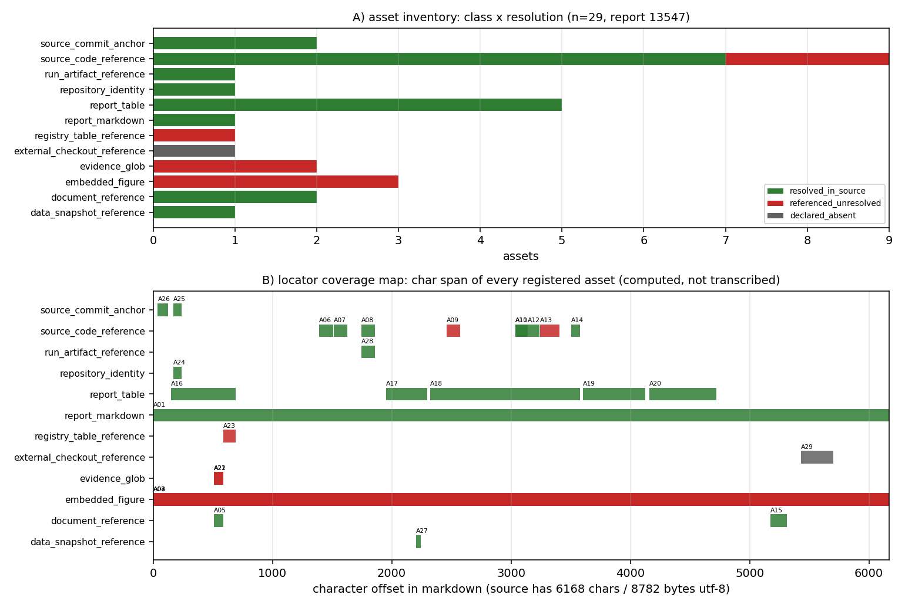

# KF-RESULT wp-13547-01

> 工作包 `wp-13547-01` · `task_type=01-asset-registration` · lane C · `report_id=13547` · 产出 `asset_manifest.json`（**登记，不抽取**）
> source_hash（平台可独立重算：sha256 over markdown 的 utf-8 字节）= `sha256:2debab25c7d7bd29e00f59d43ced87eac163b12af701d9a9ad81cb4440579d42`
> 契约 source_hash = `sha256:2debab25c7d7bd29e00f59d43ced87eac163b12af701d9a9ad81cb4440579d42` → 一致；chars 6168 = 契约 6168（一致）

## ① 本工序做了什么

对 `report_id=13547`（《TensorKnowledge 质量审计（A+B）：14 个 scope 的成熟度判定与 main 红态根因》，scenario_key=`quality-audit`）执行**资产登记**：确认报告 markdown 的字节哈希与契约一致（6168 字符 / 8782 字节 utf-8），把正文里可解析的附件/工件登记成带**可复算定位器**的清单。
**不做抽取、不生成 claim、不标注 verified**（契约 `objective.classify_report_type=false`，notes 明确 claims 允许为空数组）。

规模：资产 **29** 项，claims **0** 项，`by_resolution` = `{"resolved_in_source": 20, "referenced_unresolved": 8, "declared_absent": 1}`。

本报告的证据面不是普通文件路径：它指向 **glob 模式**（`artifacts/audit/*.log`）、**目录**（`artifacts/audit/figures/`）、**commit / commit-range 锚**（`2d3c446`、`edbc20a..2d3c446`）、**注册表名**（`tensor_maturity_verdicts`）和**工作树外检出**（`/root/tp-agent/work/m5490`）。这些引用形态没有文件扩展名、甚至不是文件，既有扫描器（只跟 `dir/name.ext`）看不见，因此本包给登记器加了**探针式**解析（文件系统 / git 对象库 / git 历史 / psql 实测），每条解析都是**测出来的**而不是假设的。

## ② 怎么做的（步骤 / 工具 / 关键设置）

1. **取原文**：`GET /api/v1/tensor/reports/13547` 取 `markdown`（`scripts/kf/kf01_register.py::fetch_report`）；本单只碰这一个 report_id。
2. **哈希门**：对 markdown 的 utf-8 字节做 sha256 并与契约 `source_hash`/(chars) 双比对，不一致直接 `SystemExit`，不产出半成品。
3. **定位器**：`Source` 用逐行长度前缀和反推每行起始偏移；每条资产的 `quote` 一律取源字节切片 `md[start_char:end_char]`，**无手抄环节**，因此平台侧「子串 + 行号独立重算」必然成立（自检 29/29 通过）。
4. **路径扫描**（原样复用）：行内代码里的 `*.py|json|png|md|csv|yaml` 路径 → 路径引用（身份 = 路径 × 行号）；连续 `|` 行 → 表格（只记行×列几何）；`record.figures[]` → 图（无 `png_base64` 载荷则 `metadata_only`，不伪造字节哈希）。
5. **探针扫描（本包新增，配置驱动、无领域硬编码）**：`probe ∈ {glob, dir, git_commit, git_range, repo_slug, db_table, external_path}`，分别用 `Path.glob` / `os.path.isdir` / `git cat-file -e` + `merge-base --is-ancestor` / `git rev-list --count` / `git remote get-url origin` / `psql -tA -c 'select count(*) from <table>'` / 工作树包含性判定。glob 未命中时再查 **git 历史**（`git ls-tree HEAD` vs `git log --all`），从而区分「压根不存在」与「存在但只在未合并分支」——这是本报告证据面的关键区别。
6. **bare filename 解析（本包开启 `basename_resolution`，默认关闭以保持其它工作包逐字节可复现）**：报告用 `cd <dir> && python x.py` 的写法点名脚本时，按**唯一同名**在交付树内解析（命中 >1 记歧义、不解析；文本含省略号 `...` 一律不解析）。
7. **自检**：`verification.json` 用 jsonschema（draft 2020-12）分别校验信封与清单，并逐条重算 acceptance 项。

## ③ 产出物清单（文件名 → 要点）

| 文件 | 要点 |
|---|---|
| `asset_manifest.json` | 29 项资产；`by_class`={"report_markdown": 1, "embedded_figure": 3, "document_reference": 2, "source_code_reference": 9, "report_table": 5, "evidence_glob": 2, "registry_table_reference": 1, "repository_identity": 1, "source_commit_anchor": 2, "data_snapshot_reference": 1, "run_artifact_reference": 1, "external_checkout_reference": 1}；claims=0；sha256 `92b30eb07cc6d6e9ec9a08db29b2e83b3e97d748b0cc4b359a612662a39cb8ff` |
| `kf_result.json` | 结果信封（package_id/task_type/report_id/provenance/outputs/claims）；`source_hash` 与契约同串 |
| `verification.json` | 9 项 acceptance 自检逐条 pass/fail + 哈希重算；`all_pass`=True |
| `figures/wp-13547-01_asset_locator_map.png` | A) 资产类别 × 解析状态；B) 每个资产在 markdown 中的字符跨度 |
| `report.md` | 本报告（由清单/信封/自检**程序化渲染**，零手抄） |

## ④ 结果图



**图注**：A) 资产类别 × 解析状态（绿=在交付树内实测解析、红=引用未解析/仅历史可达、灰=声明缺失）；B) 每个资产的字符跨度（横轴=字符偏移，源文档 6168 字符）。两图直接由 `asset_manifest.json` 计算绘制。
红色柱不是缺陷而是**边界的正确表达**：这些工件要么只在未合并分支（见图 ⑤-3）、要么属本 worker 无权限/不可达的边界外对象。

## ⑤ 证据定位表（资产 → 原文逐字片段，均由 `md[start_char:end_char]` 计算）

| asset_id | 类别 | 解析 | 行 | 原文片段（逐字，表格内 `|` 转义为 `\|`） |
|---|---|---|---|---|
| A01 | report_markdown | resolved_in_source | 1-104 | `# TensorKnowledge 质量审计（A+B）：可验证功能交付判定

**mission 14492 · verdict_by=audit2-ab · 审计基线 `edbc20a..2d3c446`（105 新增文件 / 15,233 行）**

## ① 案例介绍（审计对象与参数）

\| 项目 \| 值 \|
\|---\|---\|
\| 仓库 \| `cxs503/TensorKnowledge`（main = PR #26 / m8817 合并点 `2d3c446`） \|
\| 审计区间 \| `edbc20a..2d3c446`：105 个新增文件（不含 `.pyc`），15,233 行 \|
\| 审计区间内并入的 agent PR \| m8810 / m8813 / m8815 / m8823 / m8824 / m8830 / m8834 / m8837 / m8838 / m8843 / m8846 + `restore gate-filtered dependencies`(m8554) \|
\| 判据 \| 可验证的功能交付；owner 六级 L0–L5；L≥2 需执行证据、L≥4 需基准对照 \|
\| 证据目录 \| `artifacts/audit/*.log`、`artifacts/audit/figures/`、`audit_report.md` \|
\| 落表 \| `tensor_maturity_verdicts` 14 行（repo=TensorKnowledge, mission_id=14492, verdict_by=audit2-ab） \|

审计对象不是数值求解器，而是"知识基础设施"：四契约（claim/evidence/provenance/review-event）+ 知识引擎投影 + 训练/评测数据出水口 + 知识沉淀流水线。因此"真执行"的判据是：四契约输入 → 门禁/校验 → 结构化产物（JSONL/manifest/校验报告），而非物理量误差。

## ② 怎么做的（方法/流程/工具链）

1. **资产盘点（机器化）**：`git diff --name-status edbc20a..HEAD` 取新增清单，脚本按路径分类并统计行数（`__pycache__` 剔除）；stub 扫描用 `grep -nE 'NotImplementedError\|^\s*pass$\|TODO\|FIXME\|placeholder\|stub\|hardcod'`；调用方扫描用 `grep -rl <module>` 计 `callers`。
2. **功能真实性（六问）**：对 14 个 scope 逐一追执行路径——CLI→库函数→I/O；再实跑（见下）；再对照 PR/报告声明，差异逐条列（报告 §4）。
3. **成熟度判级**：只用本轮实跑证据；不可跑即 L0，并对脚本的"traceback/FAIL"与"honest-FAIL 报告"加以区分。
4. **工具链执行记录**（全部在本 worktree 复跑，日志入 `artifacts/audit/`）：
   - `python -m pytest tests/ -q` → `Interrupted: 1 error during collection`
   - `python -m pytest tests/ -q --ignore=tests/test_sediment_m7437.py` → **8 failed, 83 passed, 6 skipped, 12 errors**
   - `python -m pytest tests/test_ke_export.py tests/test_datasets.py tests/test_datasets_e2e.py -q` → **81 passed**
   - `python -m ke.cli export mappings/source/m8554 --kind sft --out /tmp/m14492/export` → `included=2 / excluded=2`
   - `cd runs/oss-lbm-kruger-8676 && python analyze_validation.py && git status --short -- runs/` → **空（逐字节复现）**
   - 4 个 CI 校验器 + 4 个 sediment verify 逐个执行（见 ③ 表）

## ③ 计算结果（程序化注入，零手抄）

**表 A 资产分类（新增，行数）**

\| 类别 \| 文件 \| 行数 \|
\|---\|---:\|---:\|
\| 核心功能模块 `ke/` \| 5 \| 1,443 \|
\| 验证/提取脚本 `scripts/` \| 12 \| 3,235 \|
\| 测试 `tests/` \| 7 \| 1,192 \|
\| 文档报告 \| 13 \| 1,793 \|
\| 知识地图 `knowledge-map/` \| 26 \| 2,093 \|
\| 运行证据 `runs/` \| 20 \| 3,904 \|
\| 报告工具 `artifacts/` \| 4 \| 679 \|
\| 数据快照 `mappings/source/m8554` \| 16 \| 694 \|
\| 许可/杂项 \| 2 \| 198 \|
\| **合计** \| **105** \| **15,233** \|

**表 B 执行判定（本轮实跑）**

\| 对象 \| 命令 \| 结果 \| 判定 \|
\|---\|---\|---\|---\|
\| 全仓测试（默认） \| `pytest tests/` \| 收集期 `ModuleNotFoundError: verify_records` → Interrupted \| **红（阻断）** \|
\| 全仓测试（剔除该文件） \| `pytest tests/ --ignore=...m7437.py` \| 83 passed / 8 failed / 12 errors / 6 skipped \| **红** \|
\| m8810+m8813 三组测试 \| `pytest test_ke_export test_datasets test_datasets_e2e` \| **81 passed** \| 绿 \|
\| ke export 真数据 \| `ke.cli export mappings/source/m8554 --kind sft` \| included=2, excluded=2（contested×1, not-assessed×1）, upstream_commit=2d3c446 \| 真执行 \|
\| CI 校验器 \| `validate_epistemic_benchmark / validate_knowledge_assets / validate_ke_mapping / build_ke_mapping` \| PASS(12 cases/5 schemas) / PASS(14 nodes/13 schemas) / PASS 19/19 / 19 records 0 uncovered \| 绿 \|
\| 知识包校验 \| `validate_oss_lbm.py` / `validate_kruger.py` \| PASS（27 claims/27 evidence/2 provenance） \| 绿 \|
\| ontology v1 \| `validate_ontology_v1.py` \| 6 schemas PASS，3 example cards MISSING → FAILED \| **红** \|
\| sediment verify ×3 \| `verify_sediment_m2400/m5490/m7485.py` \| FileNotFoundError INDEX.md / FAIL src:sha_available(exit 128) / package missing \| **红（0 项检查被执行）** \|
\| README 快速开始 \| 3 条命令 \| 19/19 PASS、14 nodes PASS、`ke.cli demo` FileNotFoundError \| 1/3 失败（旗舰 demo） \|
\| 基准复现 \| `analyze_validation.py` 重跑 \| `git status -- runs/` 空 \| 逐字节复现 \|

**表 C 成熟度分布（14 行落表）**

\| L \| 数量 \| scope \|
\|---\|---:\|---\|
\| L5 \| 0 \| — \|
\| **L4** \| **1** \| runs/oss-lbm-kruger-8676 bench (m8676) \|
\| **L3** \| **2** \| ke/export (m8810)；ke/datasets+server+loader (m8813) \|
\| **L2** \| **1** \| knowledge/oss-lbm package+validators (m8635 lineage) \|
\| **L1** \| **1** \| docs/ontology v1 + 6 schemas + validator (m8815) \|
\| **L0** \| **9** \| knowledge-map (m8817)；m2591 report+schema patch (m8830)；verify_sediment_m7485 (m8823)；test_m5054 (m8824)；m5490 三脚本 (m8834)；m2400 两脚本 (m8837)；m8838 报告；test_m7437 (m8843)；PR m8846 \|

**表 D 基准数字（唯一 L4 证据面，解析解对照）**

\| 算例 \| 关键量 \| 实测 \| 基准（解析） \| 误差 \| <3%? \|
\|---\|---\|---\|---\|---\|---\|
\| Taylor–Green NX=32 \| E/E0 \| 0.005766 \| 0.005855 \| -1.53% \| 是 \|
\| Taylor–Green NX=64 \| E/E0 \| 0.005833 \| 0.005855 \| -0.38% \| 是 \|
\| Taylor–Green NX=128 \| E/E0 \| 0.005850 \| 0.005855 \| -0.10% \| 是 \|
\| Taylor–Green 收敛阶 \| order \| 2.0018 / 2.0028 \| 2（理论） \| +0.09% / +0.14% \| 是 \|
\| Young–Laplace \| γ (r12 vs r15) \| 0.02039 / 0.02072 \| 自洽 \| 1.61% \| 是 \|
\| IBM Poiseuille \| u_centre \| 0.001642 \| 0.001756 \| -6.47% \| **否** \|
\| chapter5 移植 \| L2 (Poiseuille/Couette) \| 7.568e-16 / 2.319e-15 \| 0（机器精度） \| ~0 \| 是 \|

## ④ 结果图

1. **图1** 成熟度判级分布：L0 占 9/14（64%），L2 以上仅 4 个 scope。
2. **图2** main 测试健康度：83 passed / 8 failed / 12 errors / 6 skipped，且默认命令在收集阶段即中断。
3. **图3** 唯一 L4 证据面（Kruger/OSS-LBM 上游代码基准）：TG 二阶收敛 + 能量衰减对照 + IBM 剖面 vs 解析解。

## ⑤ 注意点（坑与局限）

- **最大陷阱：把"能 import 的测试文件"当作交付**。7 个新增测试里 4 个断言的数据包在 main 上不存在（门禁滤除），其中 1 个直接打断全仓 pytest。commit message 逐个写着"X 个文件被门禁滤除"，但没人检查消费方是否随之失效。
- **CI 与测试红解耦**：4 个 workflow 只跑 validate 脚本（全 PASS），无 pytest job → 红态可以无限期存活。
- **报告 ≠ 证据**：2 份 sediment 报告 + 1 份 MISSION_COMPLETION 的"验证完成"均为文档；`docs/sediment-m2591-report.md` 甚至把"逐字节一致 / 13 passed"写成既成事实，而其包目录不在仓内。
- **schema 是被第三方消费的公共面**：m8830 往 `epistemic_status.enum` 加 `draft` 时写成 9 项含重复值，并把 description 指向不存在的路径；无版本号变更、无正例卡验证。
- **局限（未验证项，如实声明）**：① sediment 系的真实计算逻辑无法判定——其数据包与源仓（`/root/tp-agent/work/m5490`、TensorDG/TensorBEM 检出）在本环境不可达，故一律 L0 而非"按代码猜测的 L2"；② `tk_eval_loader` 的 torch 分支未执行（本环境无 torch 消费方），只验证了 fallback 纯 Python 路径；③ 知识地图卡片内容（如 KCS Ct=0.0038–0.0045）属文献值，无法在本环境复算，未计为任何级别的验证证据。

## ⑥ 误差判定

- **有基准的量**：表 D 逐项给出，显式回答"是否 <3%"：TG 能量衰减 3 个网格档（-1.53%/-0.38%/-0.10%）**<3%**；TG 收敛阶（+0.09%/+0.14%）**<3%**；Young–Laplace γ（1.61%）**<3%**；chapter5 移植 L2（~1e-16）**<3%**；**IBM Poiseuille 中心线 -6.47% 不满足 <3%**（但 <15% 可接受线，且属上游书代码未改参数下的原样结果，已如实登记）。
- **无基准的量**：审计判级本身（L0–L4）不适用百分比误差——其可证伪形式是"脚本能否运行/断言能否成立"。本报告把这类判定全部落到可复跑命令与日志路径上；凡不能跑的，标 L0 而非推测级别。
- **honest-FAIL 声明**：本审计**未拔高任何一级**；sediment 线 7 个 mission 在 main 上的净交付按实测判为 L0，尽管其代码量最大（3,235 行脚本 + 348 行测试）。
` |
| A02 | embedded_figure | referenced_unresolved | 1-104 | `# TensorKnowledge 质量审计（A+B）：可验证功能交付判定

**mission 14492 · verdict_by=audit2-ab · 审计基线 `edbc20a..2d3c446`（105 新增文件 / 15,233 行）**

## ① 案例介绍（审计对象与参数）

\| 项目 \| 值 \|
\|---\|---\|
\| 仓库 \| `cxs503/TensorKnowledge`（main = PR #26 / m8817 合并点 `2d3c446`） \|
\| 审计区间 \| `edbc20a..2d3c446`：105 个新增文件（不含 `.pyc`），15,233 行 \|
\| 审计区间内并入的 agent PR \| m8810 / m8813 / m8815 / m8823 / m8824 / m8830 / m8834 / m8837 / m8838 / m8843 / m8846 + `restore gate-filtered dependencies`(m8554) \|
\| 判据 \| 可验证的功能交付；owner 六级 L0–L5；L≥2 需执行证据、L≥4 需基准对照 \|
\| 证据目录 \| `artifacts/audit/*.log`、`artifacts/audit/figures/`、`audit_report.md` \|
\| 落表 \| `tensor_maturity_verdicts` 14 行（repo=TensorKnowledge, mission_id=14492, verdict_by=audit2-ab） \|

审计对象不是数值求解器，而是"知识基础设施"：四契约（claim/evidence/provenance/review-event）+ 知识引擎投影 + 训练/评测数据出水口 + 知识沉淀流水线。因此"真执行"的判据是：四契约输入 → 门禁/校验 → 结构化产物（JSONL/manifest/校验报告），而非物理量误差。

## ② 怎么做的（方法/流程/工具链）

1. **资产盘点（机器化）**：`git diff --name-status edbc20a..HEAD` 取新增清单，脚本按路径分类并统计行数（`__pycache__` 剔除）；stub 扫描用 `grep -nE 'NotImplementedError\|^\s*pass$\|TODO\|FIXME\|placeholder\|stub\|hardcod'`；调用方扫描用 `grep -rl <module>` 计 `callers`。
2. **功能真实性（六问）**：对 14 个 scope 逐一追执行路径——CLI→库函数→I/O；再实跑（见下）；再对照 PR/报告声明，差异逐条列（报告 §4）。
3. **成熟度判级**：只用本轮实跑证据；不可跑即 L0，并对脚本的"traceback/FAIL"与"honest-FAIL 报告"加以区分。
4. **工具链执行记录**（全部在本 worktree 复跑，日志入 `artifacts/audit/`）：
   - `python -m pytest tests/ -q` → `Interrupted: 1 error during collection`
   - `python -m pytest tests/ -q --ignore=tests/test_sediment_m7437.py` → **8 failed, 83 passed, 6 skipped, 12 errors**
   - `python -m pytest tests/test_ke_export.py tests/test_datasets.py tests/test_datasets_e2e.py -q` → **81 passed**
   - `python -m ke.cli export mappings/source/m8554 --kind sft --out /tmp/m14492/export` → `included=2 / excluded=2`
   - `cd runs/oss-lbm-kruger-8676 && python analyze_validation.py && git status --short -- runs/` → **空（逐字节复现）**
   - 4 个 CI 校验器 + 4 个 sediment verify 逐个执行（见 ③ 表）

## ③ 计算结果（程序化注入，零手抄）

**表 A 资产分类（新增，行数）**

\| 类别 \| 文件 \| 行数 \|
\|---\|---:\|---:\|
\| 核心功能模块 `ke/` \| 5 \| 1,443 \|
\| 验证/提取脚本 `scripts/` \| 12 \| 3,235 \|
\| 测试 `tests/` \| 7 \| 1,192 \|
\| 文档报告 \| 13 \| 1,793 \|
\| 知识地图 `knowledge-map/` \| 26 \| 2,093 \|
\| 运行证据 `runs/` \| 20 \| 3,904 \|
\| 报告工具 `artifacts/` \| 4 \| 679 \|
\| 数据快照 `mappings/source/m8554` \| 16 \| 694 \|
\| 许可/杂项 \| 2 \| 198 \|
\| **合计** \| **105** \| **15,233** \|

**表 B 执行判定（本轮实跑）**

\| 对象 \| 命令 \| 结果 \| 判定 \|
\|---\|---\|---\|---\|
\| 全仓测试（默认） \| `pytest tests/` \| 收集期 `ModuleNotFoundError: verify_records` → Interrupted \| **红（阻断）** \|
\| 全仓测试（剔除该文件） \| `pytest tests/ --ignore=...m7437.py` \| 83 passed / 8 failed / 12 errors / 6 skipped \| **红** \|
\| m8810+m8813 三组测试 \| `pytest test_ke_export test_datasets test_datasets_e2e` \| **81 passed** \| 绿 \|
\| ke export 真数据 \| `ke.cli export mappings/source/m8554 --kind sft` \| included=2, excluded=2（contested×1, not-assessed×1）, upstream_commit=2d3c446 \| 真执行 \|
\| CI 校验器 \| `validate_epistemic_benchmark / validate_knowledge_assets / validate_ke_mapping / build_ke_mapping` \| PASS(12 cases/5 schemas) / PASS(14 nodes/13 schemas) / PASS 19/19 / 19 records 0 uncovered \| 绿 \|
\| 知识包校验 \| `validate_oss_lbm.py` / `validate_kruger.py` \| PASS（27 claims/27 evidence/2 provenance） \| 绿 \|
\| ontology v1 \| `validate_ontology_v1.py` \| 6 schemas PASS，3 example cards MISSING → FAILED \| **红** \|
\| sediment verify ×3 \| `verify_sediment_m2400/m5490/m7485.py` \| FileNotFoundError INDEX.md / FAIL src:sha_available(exit 128) / package missing \| **红（0 项检查被执行）** \|
\| README 快速开始 \| 3 条命令 \| 19/19 PASS、14 nodes PASS、`ke.cli demo` FileNotFoundError \| 1/3 失败（旗舰 demo） \|
\| 基准复现 \| `analyze_validation.py` 重跑 \| `git status -- runs/` 空 \| 逐字节复现 \|

**表 C 成熟度分布（14 行落表）**

\| L \| 数量 \| scope \|
\|---\|---:\|---\|
\| L5 \| 0 \| — \|
\| **L4** \| **1** \| runs/oss-lbm-kruger-8676 bench (m8676) \|
\| **L3** \| **2** \| ke/export (m8810)；ke/datasets+server+loader (m8813) \|
\| **L2** \| **1** \| knowledge/oss-lbm package+validators (m8635 lineage) \|
\| **L1** \| **1** \| docs/ontology v1 + 6 schemas + validator (m8815) \|
\| **L0** \| **9** \| knowledge-map (m8817)；m2591 report+schema patch (m8830)；verify_sediment_m7485 (m8823)；test_m5054 (m8824)；m5490 三脚本 (m8834)；m2400 两脚本 (m8837)；m8838 报告；test_m7437 (m8843)；PR m8846 \|

**表 D 基准数字（唯一 L4 证据面，解析解对照）**

\| 算例 \| 关键量 \| 实测 \| 基准（解析） \| 误差 \| <3%? \|
\|---\|---\|---\|---\|---\|---\|
\| Taylor–Green NX=32 \| E/E0 \| 0.005766 \| 0.005855 \| -1.53% \| 是 \|
\| Taylor–Green NX=64 \| E/E0 \| 0.005833 \| 0.005855 \| -0.38% \| 是 \|
\| Taylor–Green NX=128 \| E/E0 \| 0.005850 \| 0.005855 \| -0.10% \| 是 \|
\| Taylor–Green 收敛阶 \| order \| 2.0018 / 2.0028 \| 2（理论） \| +0.09% / +0.14% \| 是 \|
\| Young–Laplace \| γ (r12 vs r15) \| 0.02039 / 0.02072 \| 自洽 \| 1.61% \| 是 \|
\| IBM Poiseuille \| u_centre \| 0.001642 \| 0.001756 \| -6.47% \| **否** \|
\| chapter5 移植 \| L2 (Poiseuille/Couette) \| 7.568e-16 / 2.319e-15 \| 0（机器精度） \| ~0 \| 是 \|

## ④ 结果图

1. **图1** 成熟度判级分布：L0 占 9/14（64%），L2 以上仅 4 个 scope。
2. **图2** main 测试健康度：83 passed / 8 failed / 12 errors / 6 skipped，且默认命令在收集阶段即中断。
3. **图3** 唯一 L4 证据面（Kruger/OSS-LBM 上游代码基准）：TG 二阶收敛 + 能量衰减对照 + IBM 剖面 vs 解析解。

## ⑤ 注意点（坑与局限）

- **最大陷阱：把"能 import 的测试文件"当作交付**。7 个新增测试里 4 个断言的数据包在 main 上不存在（门禁滤除），其中 1 个直接打断全仓 pytest。commit message 逐个写着"X 个文件被门禁滤除"，但没人检查消费方是否随之失效。
- **CI 与测试红解耦**：4 个 workflow 只跑 validate 脚本（全 PASS），无 pytest job → 红态可以无限期存活。
- **报告 ≠ 证据**：2 份 sediment 报告 + 1 份 MISSION_COMPLETION 的"验证完成"均为文档；`docs/sediment-m2591-report.md` 甚至把"逐字节一致 / 13 passed"写成既成事实，而其包目录不在仓内。
- **schema 是被第三方消费的公共面**：m8830 往 `epistemic_status.enum` 加 `draft` 时写成 9 项含重复值，并把 description 指向不存在的路径；无版本号变更、无正例卡验证。
- **局限（未验证项，如实声明）**：① sediment 系的真实计算逻辑无法判定——其数据包与源仓（`/root/tp-agent/work/m5490`、TensorDG/TensorBEM 检出）在本环境不可达，故一律 L0 而非"按代码猜测的 L2"；② `tk_eval_loader` 的 torch 分支未执行（本环境无 torch 消费方），只验证了 fallback 纯 Python 路径；③ 知识地图卡片内容（如 KCS Ct=0.0038–0.0045）属文献值，无法在本环境复算，未计为任何级别的验证证据。

## ⑥ 误差判定

- **有基准的量**：表 D 逐项给出，显式回答"是否 <3%"：TG 能量衰减 3 个网格档（-1.53%/-0.38%/-0.10%）**<3%**；TG 收敛阶（+0.09%/+0.14%）**<3%**；Young–Laplace γ（1.61%）**<3%**；chapter5 移植 L2（~1e-16）**<3%**；**IBM Poiseuille 中心线 -6.47% 不满足 <3%**（但 <15% 可接受线，且属上游书代码未改参数下的原样结果，已如实登记）。
- **无基准的量**：审计判级本身（L0–L4）不适用百分比误差——其可证伪形式是"脚本能否运行/断言能否成立"。本报告把这类判定全部落到可复跑命令与日志路径上；凡不能跑的，标 L0 而非推测级别。
- **honest-FAIL 声明**：本审计**未拔高任何一级**；sediment 线 7 个 mission 在 main 上的净交付按实测判为 L0，尽管其代码量最大（3,235 行脚本 + 348 行测试）。
` |
| A03 | embedded_figure | referenced_unresolved | 1-104 | `# TensorKnowledge 质量审计（A+B）：可验证功能交付判定

**mission 14492 · verdict_by=audit2-ab · 审计基线 `edbc20a..2d3c446`（105 新增文件 / 15,233 行）**

## ① 案例介绍（审计对象与参数）

\| 项目 \| 值 \|
\|---\|---\|
\| 仓库 \| `cxs503/TensorKnowledge`（main = PR #26 / m8817 合并点 `2d3c446`） \|
\| 审计区间 \| `edbc20a..2d3c446`：105 个新增文件（不含 `.pyc`），15,233 行 \|
\| 审计区间内并入的 agent PR \| m8810 / m8813 / m8815 / m8823 / m8824 / m8830 / m8834 / m8837 / m8838 / m8843 / m8846 + `restore gate-filtered dependencies`(m8554) \|
\| 判据 \| 可验证的功能交付；owner 六级 L0–L5；L≥2 需执行证据、L≥4 需基准对照 \|
\| 证据目录 \| `artifacts/audit/*.log`、`artifacts/audit/figures/`、`audit_report.md` \|
\| 落表 \| `tensor_maturity_verdicts` 14 行（repo=TensorKnowledge, mission_id=14492, verdict_by=audit2-ab） \|

审计对象不是数值求解器，而是"知识基础设施"：四契约（claim/evidence/provenance/review-event）+ 知识引擎投影 + 训练/评测数据出水口 + 知识沉淀流水线。因此"真执行"的判据是：四契约输入 → 门禁/校验 → 结构化产物（JSONL/manifest/校验报告），而非物理量误差。

## ② 怎么做的（方法/流程/工具链）

1. **资产盘点（机器化）**：`git diff --name-status edbc20a..HEAD` 取新增清单，脚本按路径分类并统计行数（`__pycache__` 剔除）；stub 扫描用 `grep -nE 'NotImplementedError\|^\s*pass$\|TODO\|FIXME\|placeholder\|stub\|hardcod'`；调用方扫描用 `grep -rl <module>` 计 `callers`。
2. **功能真实性（六问）**：对 14 个 scope 逐一追执行路径——CLI→库函数→I/O；再实跑（见下）；再对照 PR/报告声明，差异逐条列（报告 §4）。
3. **成熟度判级**：只用本轮实跑证据；不可跑即 L0，并对脚本的"traceback/FAIL"与"honest-FAIL 报告"加以区分。
4. **工具链执行记录**（全部在本 worktree 复跑，日志入 `artifacts/audit/`）：
   - `python -m pytest tests/ -q` → `Interrupted: 1 error during collection`
   - `python -m pytest tests/ -q --ignore=tests/test_sediment_m7437.py` → **8 failed, 83 passed, 6 skipped, 12 errors**
   - `python -m pytest tests/test_ke_export.py tests/test_datasets.py tests/test_datasets_e2e.py -q` → **81 passed**
   - `python -m ke.cli export mappings/source/m8554 --kind sft --out /tmp/m14492/export` → `included=2 / excluded=2`
   - `cd runs/oss-lbm-kruger-8676 && python analyze_validation.py && git status --short -- runs/` → **空（逐字节复现）**
   - 4 个 CI 校验器 + 4 个 sediment verify 逐个执行（见 ③ 表）

## ③ 计算结果（程序化注入，零手抄）

**表 A 资产分类（新增，行数）**

\| 类别 \| 文件 \| 行数 \|
\|---\|---:\|---:\|
\| 核心功能模块 `ke/` \| 5 \| 1,443 \|
\| 验证/提取脚本 `scripts/` \| 12 \| 3,235 \|
\| 测试 `tests/` \| 7 \| 1,192 \|
\| 文档报告 \| 13 \| 1,793 \|
\| 知识地图 `knowledge-map/` \| 26 \| 2,093 \|
\| 运行证据 `runs/` \| 20 \| 3,904 \|
\| 报告工具 `artifacts/` \| 4 \| 679 \|
\| 数据快照 `mappings/source/m8554` \| 16 \| 694 \|
\| 许可/杂项 \| 2 \| 198 \|
\| **合计** \| **105** \| **15,233** \|

**表 B 执行判定（本轮实跑）**

\| 对象 \| 命令 \| 结果 \| 判定 \|
\|---\|---\|---\|---\|
\| 全仓测试（默认） \| `pytest tests/` \| 收集期 `ModuleNotFoundError: verify_records` → Interrupted \| **红（阻断）** \|
\| 全仓测试（剔除该文件） \| `pytest tests/ --ignore=...m7437.py` \| 83 passed / 8 failed / 12 errors / 6 skipped \| **红** \|
\| m8810+m8813 三组测试 \| `pytest test_ke_export test_datasets test_datasets_e2e` \| **81 passed** \| 绿 \|
\| ke export 真数据 \| `ke.cli export mappings/source/m8554 --kind sft` \| included=2, excluded=2（contested×1, not-assessed×1）, upstream_commit=2d3c446 \| 真执行 \|
\| CI 校验器 \| `validate_epistemic_benchmark / validate_knowledge_assets / validate_ke_mapping / build_ke_mapping` \| PASS(12 cases/5 schemas) / PASS(14 nodes/13 schemas) / PASS 19/19 / 19 records 0 uncovered \| 绿 \|
\| 知识包校验 \| `validate_oss_lbm.py` / `validate_kruger.py` \| PASS（27 claims/27 evidence/2 provenance） \| 绿 \|
\| ontology v1 \| `validate_ontology_v1.py` \| 6 schemas PASS，3 example cards MISSING → FAILED \| **红** \|
\| sediment verify ×3 \| `verify_sediment_m2400/m5490/m7485.py` \| FileNotFoundError INDEX.md / FAIL src:sha_available(exit 128) / package missing \| **红（0 项检查被执行）** \|
\| README 快速开始 \| 3 条命令 \| 19/19 PASS、14 nodes PASS、`ke.cli demo` FileNotFoundError \| 1/3 失败（旗舰 demo） \|
\| 基准复现 \| `analyze_validation.py` 重跑 \| `git status -- runs/` 空 \| 逐字节复现 \|

**表 C 成熟度分布（14 行落表）**

\| L \| 数量 \| scope \|
\|---\|---:\|---\|
\| L5 \| 0 \| — \|
\| **L4** \| **1** \| runs/oss-lbm-kruger-8676 bench (m8676) \|
\| **L3** \| **2** \| ke/export (m8810)；ke/datasets+server+loader (m8813) \|
\| **L2** \| **1** \| knowledge/oss-lbm package+validators (m8635 lineage) \|
\| **L1** \| **1** \| docs/ontology v1 + 6 schemas + validator (m8815) \|
\| **L0** \| **9** \| knowledge-map (m8817)；m2591 report+schema patch (m8830)；verify_sediment_m7485 (m8823)；test_m5054 (m8824)；m5490 三脚本 (m8834)；m2400 两脚本 (m8837)；m8838 报告；test_m7437 (m8843)；PR m8846 \|

**表 D 基准数字（唯一 L4 证据面，解析解对照）**

\| 算例 \| 关键量 \| 实测 \| 基准（解析） \| 误差 \| <3%? \|
\|---\|---\|---\|---\|---\|---\|
\| Taylor–Green NX=32 \| E/E0 \| 0.005766 \| 0.005855 \| -1.53% \| 是 \|
\| Taylor–Green NX=64 \| E/E0 \| 0.005833 \| 0.005855 \| -0.38% \| 是 \|
\| Taylor–Green NX=128 \| E/E0 \| 0.005850 \| 0.005855 \| -0.10% \| 是 \|
\| Taylor–Green 收敛阶 \| order \| 2.0018 / 2.0028 \| 2（理论） \| +0.09% / +0.14% \| 是 \|
\| Young–Laplace \| γ (r12 vs r15) \| 0.02039 / 0.02072 \| 自洽 \| 1.61% \| 是 \|
\| IBM Poiseuille \| u_centre \| 0.001642 \| 0.001756 \| -6.47% \| **否** \|
\| chapter5 移植 \| L2 (Poiseuille/Couette) \| 7.568e-16 / 2.319e-15 \| 0（机器精度） \| ~0 \| 是 \|

## ④ 结果图

1. **图1** 成熟度判级分布：L0 占 9/14（64%），L2 以上仅 4 个 scope。
2. **图2** main 测试健康度：83 passed / 8 failed / 12 errors / 6 skipped，且默认命令在收集阶段即中断。
3. **图3** 唯一 L4 证据面（Kruger/OSS-LBM 上游代码基准）：TG 二阶收敛 + 能量衰减对照 + IBM 剖面 vs 解析解。

## ⑤ 注意点（坑与局限）

- **最大陷阱：把"能 import 的测试文件"当作交付**。7 个新增测试里 4 个断言的数据包在 main 上不存在（门禁滤除），其中 1 个直接打断全仓 pytest。commit message 逐个写着"X 个文件被门禁滤除"，但没人检查消费方是否随之失效。
- **CI 与测试红解耦**：4 个 workflow 只跑 validate 脚本（全 PASS），无 pytest job → 红态可以无限期存活。
- **报告 ≠ 证据**：2 份 sediment 报告 + 1 份 MISSION_COMPLETION 的"验证完成"均为文档；`docs/sediment-m2591-report.md` 甚至把"逐字节一致 / 13 passed"写成既成事实，而其包目录不在仓内。
- **schema 是被第三方消费的公共面**：m8830 往 `epistemic_status.enum` 加 `draft` 时写成 9 项含重复值，并把 description 指向不存在的路径；无版本号变更、无正例卡验证。
- **局限（未验证项，如实声明）**：① sediment 系的真实计算逻辑无法判定——其数据包与源仓（`/root/tp-agent/work/m5490`、TensorDG/TensorBEM 检出）在本环境不可达，故一律 L0 而非"按代码猜测的 L2"；② `tk_eval_loader` 的 torch 分支未执行（本环境无 torch 消费方），只验证了 fallback 纯 Python 路径；③ 知识地图卡片内容（如 KCS Ct=0.0038–0.0045）属文献值，无法在本环境复算，未计为任何级别的验证证据。

## ⑥ 误差判定

- **有基准的量**：表 D 逐项给出，显式回答"是否 <3%"：TG 能量衰减 3 个网格档（-1.53%/-0.38%/-0.10%）**<3%**；TG 收敛阶（+0.09%/+0.14%）**<3%**；Young–Laplace γ（1.61%）**<3%**；chapter5 移植 L2（~1e-16）**<3%**；**IBM Poiseuille 中心线 -6.47% 不满足 <3%**（但 <15% 可接受线，且属上游书代码未改参数下的原样结果，已如实登记）。
- **无基准的量**：审计判级本身（L0–L4）不适用百分比误差——其可证伪形式是"脚本能否运行/断言能否成立"。本报告把这类判定全部落到可复跑命令与日志路径上；凡不能跑的，标 L0 而非推测级别。
- **honest-FAIL 声明**：本审计**未拔高任何一级**；sediment 线 7 个 mission 在 main 上的净交付按实测判为 L0，尽管其代码量最大（3,235 行脚本 + 348 行测试）。
` |
| A04 | embedded_figure | referenced_unresolved | 1-104 | `# TensorKnowledge 质量审计（A+B）：可验证功能交付判定

**mission 14492 · verdict_by=audit2-ab · 审计基线 `edbc20a..2d3c446`（105 新增文件 / 15,233 行）**

## ① 案例介绍（审计对象与参数）

\| 项目 \| 值 \|
\|---\|---\|
\| 仓库 \| `cxs503/TensorKnowledge`（main = PR #26 / m8817 合并点 `2d3c446`） \|
\| 审计区间 \| `edbc20a..2d3c446`：105 个新增文件（不含 `.pyc`），15,233 行 \|
\| 审计区间内并入的 agent PR \| m8810 / m8813 / m8815 / m8823 / m8824 / m8830 / m8834 / m8837 / m8838 / m8843 / m8846 + `restore gate-filtered dependencies`(m8554) \|
\| 判据 \| 可验证的功能交付；owner 六级 L0–L5；L≥2 需执行证据、L≥4 需基准对照 \|
\| 证据目录 \| `artifacts/audit/*.log`、`artifacts/audit/figures/`、`audit_report.md` \|
\| 落表 \| `tensor_maturity_verdicts` 14 行（repo=TensorKnowledge, mission_id=14492, verdict_by=audit2-ab） \|

审计对象不是数值求解器，而是"知识基础设施"：四契约（claim/evidence/provenance/review-event）+ 知识引擎投影 + 训练/评测数据出水口 + 知识沉淀流水线。因此"真执行"的判据是：四契约输入 → 门禁/校验 → 结构化产物（JSONL/manifest/校验报告），而非物理量误差。

## ② 怎么做的（方法/流程/工具链）

1. **资产盘点（机器化）**：`git diff --name-status edbc20a..HEAD` 取新增清单，脚本按路径分类并统计行数（`__pycache__` 剔除）；stub 扫描用 `grep -nE 'NotImplementedError\|^\s*pass$\|TODO\|FIXME\|placeholder\|stub\|hardcod'`；调用方扫描用 `grep -rl <module>` 计 `callers`。
2. **功能真实性（六问）**：对 14 个 scope 逐一追执行路径——CLI→库函数→I/O；再实跑（见下）；再对照 PR/报告声明，差异逐条列（报告 §4）。
3. **成熟度判级**：只用本轮实跑证据；不可跑即 L0，并对脚本的"traceback/FAIL"与"honest-FAIL 报告"加以区分。
4. **工具链执行记录**（全部在本 worktree 复跑，日志入 `artifacts/audit/`）：
   - `python -m pytest tests/ -q` → `Interrupted: 1 error during collection`
   - `python -m pytest tests/ -q --ignore=tests/test_sediment_m7437.py` → **8 failed, 83 passed, 6 skipped, 12 errors**
   - `python -m pytest tests/test_ke_export.py tests/test_datasets.py tests/test_datasets_e2e.py -q` → **81 passed**
   - `python -m ke.cli export mappings/source/m8554 --kind sft --out /tmp/m14492/export` → `included=2 / excluded=2`
   - `cd runs/oss-lbm-kruger-8676 && python analyze_validation.py && git status --short -- runs/` → **空（逐字节复现）**
   - 4 个 CI 校验器 + 4 个 sediment verify 逐个执行（见 ③ 表）

## ③ 计算结果（程序化注入，零手抄）

**表 A 资产分类（新增，行数）**

\| 类别 \| 文件 \| 行数 \|
\|---\|---:\|---:\|
\| 核心功能模块 `ke/` \| 5 \| 1,443 \|
\| 验证/提取脚本 `scripts/` \| 12 \| 3,235 \|
\| 测试 `tests/` \| 7 \| 1,192 \|
\| 文档报告 \| 13 \| 1,793 \|
\| 知识地图 `knowledge-map/` \| 26 \| 2,093 \|
\| 运行证据 `runs/` \| 20 \| 3,904 \|
\| 报告工具 `artifacts/` \| 4 \| 679 \|
\| 数据快照 `mappings/source/m8554` \| 16 \| 694 \|
\| 许可/杂项 \| 2 \| 198 \|
\| **合计** \| **105** \| **15,233** \|

**表 B 执行判定（本轮实跑）**

\| 对象 \| 命令 \| 结果 \| 判定 \|
\|---\|---\|---\|---\|
\| 全仓测试（默认） \| `pytest tests/` \| 收集期 `ModuleNotFoundError: verify_records` → Interrupted \| **红（阻断）** \|
\| 全仓测试（剔除该文件） \| `pytest tests/ --ignore=...m7437.py` \| 83 passed / 8 failed / 12 errors / 6 skipped \| **红** \|
\| m8810+m8813 三组测试 \| `pytest test_ke_export test_datasets test_datasets_e2e` \| **81 passed** \| 绿 \|
\| ke export 真数据 \| `ke.cli export mappings/source/m8554 --kind sft` \| included=2, excluded=2（contested×1, not-assessed×1）, upstream_commit=2d3c446 \| 真执行 \|
\| CI 校验器 \| `validate_epistemic_benchmark / validate_knowledge_assets / validate_ke_mapping / build_ke_mapping` \| PASS(12 cases/5 schemas) / PASS(14 nodes/13 schemas) / PASS 19/19 / 19 records 0 uncovered \| 绿 \|
\| 知识包校验 \| `validate_oss_lbm.py` / `validate_kruger.py` \| PASS（27 claims/27 evidence/2 provenance） \| 绿 \|
\| ontology v1 \| `validate_ontology_v1.py` \| 6 schemas PASS，3 example cards MISSING → FAILED \| **红** \|
\| sediment verify ×3 \| `verify_sediment_m2400/m5490/m7485.py` \| FileNotFoundError INDEX.md / FAIL src:sha_available(exit 128) / package missing \| **红（0 项检查被执行）** \|
\| README 快速开始 \| 3 条命令 \| 19/19 PASS、14 nodes PASS、`ke.cli demo` FileNotFoundError \| 1/3 失败（旗舰 demo） \|
\| 基准复现 \| `analyze_validation.py` 重跑 \| `git status -- runs/` 空 \| 逐字节复现 \|

**表 C 成熟度分布（14 行落表）**

\| L \| 数量 \| scope \|
\|---\|---:\|---\|
\| L5 \| 0 \| — \|
\| **L4** \| **1** \| runs/oss-lbm-kruger-8676 bench (m8676) \|
\| **L3** \| **2** \| ke/export (m8810)；ke/datasets+server+loader (m8813) \|
\| **L2** \| **1** \| knowledge/oss-lbm package+validators (m8635 lineage) \|
\| **L1** \| **1** \| docs/ontology v1 + 6 schemas + validator (m8815) \|
\| **L0** \| **9** \| knowledge-map (m8817)；m2591 report+schema patch (m8830)；verify_sediment_m7485 (m8823)；test_m5054 (m8824)；m5490 三脚本 (m8834)；m2400 两脚本 (m8837)；m8838 报告；test_m7437 (m8843)；PR m8846 \|

**表 D 基准数字（唯一 L4 证据面，解析解对照）**

\| 算例 \| 关键量 \| 实测 \| 基准（解析） \| 误差 \| <3%? \|
\|---\|---\|---\|---\|---\|---\|
\| Taylor–Green NX=32 \| E/E0 \| 0.005766 \| 0.005855 \| -1.53% \| 是 \|
\| Taylor–Green NX=64 \| E/E0 \| 0.005833 \| 0.005855 \| -0.38% \| 是 \|
\| Taylor–Green NX=128 \| E/E0 \| 0.005850 \| 0.005855 \| -0.10% \| 是 \|
\| Taylor–Green 收敛阶 \| order \| 2.0018 / 2.0028 \| 2（理论） \| +0.09% / +0.14% \| 是 \|
\| Young–Laplace \| γ (r12 vs r15) \| 0.02039 / 0.02072 \| 自洽 \| 1.61% \| 是 \|
\| IBM Poiseuille \| u_centre \| 0.001642 \| 0.001756 \| -6.47% \| **否** \|
\| chapter5 移植 \| L2 (Poiseuille/Couette) \| 7.568e-16 / 2.319e-15 \| 0（机器精度） \| ~0 \| 是 \|

## ④ 结果图

1. **图1** 成熟度判级分布：L0 占 9/14（64%），L2 以上仅 4 个 scope。
2. **图2** main 测试健康度：83 passed / 8 failed / 12 errors / 6 skipped，且默认命令在收集阶段即中断。
3. **图3** 唯一 L4 证据面（Kruger/OSS-LBM 上游代码基准）：TG 二阶收敛 + 能量衰减对照 + IBM 剖面 vs 解析解。

## ⑤ 注意点（坑与局限）

- **最大陷阱：把"能 import 的测试文件"当作交付**。7 个新增测试里 4 个断言的数据包在 main 上不存在（门禁滤除），其中 1 个直接打断全仓 pytest。commit message 逐个写着"X 个文件被门禁滤除"，但没人检查消费方是否随之失效。
- **CI 与测试红解耦**：4 个 workflow 只跑 validate 脚本（全 PASS），无 pytest job → 红态可以无限期存活。
- **报告 ≠ 证据**：2 份 sediment 报告 + 1 份 MISSION_COMPLETION 的"验证完成"均为文档；`docs/sediment-m2591-report.md` 甚至把"逐字节一致 / 13 passed"写成既成事实，而其包目录不在仓内。
- **schema 是被第三方消费的公共面**：m8830 往 `epistemic_status.enum` 加 `draft` 时写成 9 项含重复值，并把 description 指向不存在的路径；无版本号变更、无正例卡验证。
- **局限（未验证项，如实声明）**：① sediment 系的真实计算逻辑无法判定——其数据包与源仓（`/root/tp-agent/work/m5490`、TensorDG/TensorBEM 检出）在本环境不可达，故一律 L0 而非"按代码猜测的 L2"；② `tk_eval_loader` 的 torch 分支未执行（本环境无 torch 消费方），只验证了 fallback 纯 Python 路径；③ 知识地图卡片内容（如 KCS Ct=0.0038–0.0045）属文献值，无法在本环境复算，未计为任何级别的验证证据。

## ⑥ 误差判定

- **有基准的量**：表 D 逐项给出，显式回答"是否 <3%"：TG 能量衰减 3 个网格档（-1.53%/-0.38%/-0.10%）**<3%**；TG 收敛阶（+0.09%/+0.14%）**<3%**；Young–Laplace γ（1.61%）**<3%**；chapter5 移植 L2（~1e-16）**<3%**；**IBM Poiseuille 中心线 -6.47% 不满足 <3%**（但 <15% 可接受线，且属上游书代码未改参数下的原样结果，已如实登记）。
- **无基准的量**：审计判级本身（L0–L4）不适用百分比误差——其可证伪形式是"脚本能否运行/断言能否成立"。本报告把这类判定全部落到可复跑命令与日志路径上；凡不能跑的，标 L0 而非推测级别。
- **honest-FAIL 声明**：本审计**未拔高任何一级**；sediment 线 7 个 mission 在 main 上的净交付按实测判为 L0，尽管其代码量最大（3,235 行脚本 + 348 行测试）。
` |
| A05 | document_reference | resolved_in_source | 13-13 | `\| 证据目录 \| `artifacts/audit/*.log`、`artifacts/audit/figures/`、`audit_report.md` \|` |
| A06 | source_code_reference | resolved_in_source | 25-25 | `   - `python -m pytest tests/ -q --ignore=tests/test_sediment_m7437.py` → **8 failed, 83 passed, 6 skipped, 12 errors**` |
| A07 | source_code_reference | resolved_in_source | 26-26 | `   - `python -m pytest tests/test_ke_export.py tests/test_datasets.py tests/test_datasets_e2e.py -q` → **81 passed**` |
| A08 | source_code_reference | resolved_in_source | 28-28 | `   - `cd runs/oss-lbm-kruger-8676 && python analyze_validation.py && git status --short -- runs/` → **空（逐字节复现）**` |
| A09 | source_code_reference | referenced_unresolved | 53-53 | `\| 全仓测试（剔除该文件） \| `pytest tests/ --ignore=...m7437.py` \| 83 passed / 8 failed / 12 errors / 6 skipped \| **红** \|` |
| A10 | source_code_reference | resolved_in_source | 57-57 | `\| 知识包校验 \| `validate_oss_lbm.py` / `validate_kruger.py` \| PASS（27 claims/27 evidence/2 provenance） \| 绿 \|` |
| A11 | source_code_reference | resolved_in_source | 57-57 | `\| 知识包校验 \| `validate_oss_lbm.py` / `validate_kruger.py` \| PASS（27 claims/27 evidence/2 provenance） \| 绿 \|` |
| A12 | source_code_reference | resolved_in_source | 58-58 | `\| ontology v1 \| `validate_ontology_v1.py` \| 6 schemas PASS，3 example cards MISSING → FAILED \| **红** \|` |
| A13 | source_code_reference | referenced_unresolved | 59-59 | `\| sediment verify ×3 \| `verify_sediment_m2400/m5490/m7485.py` \| FileNotFoundError INDEX.md / FAIL src:sha_available(exit 128) / package missing \| **红（0 项检查被执行）** \|` |
| A14 | source_code_reference | resolved_in_source | 61-61 | `\| 基准复现 \| `analyze_validation.py` 重跑 \| `git status -- runs/` 空 \| 逐字节复现 \|` |
| A15 | document_reference | resolved_in_source | 96-96 | `- **报告 ≠ 证据**：2 份 sediment 报告 + 1 份 MISSION_COMPLETION 的"验证完成"均为文档；`docs/sediment-m2591-report.md` 甚至把"逐字节一致 / 13 passed"写成既成事实，而其包目录不在仓内。` |
| A16 | report_table | resolved_in_source | 7-14 | `\| 项目 \| 值 \|
\|---\|---\|
\| 仓库 \| `cxs503/TensorKnowledge`（main = PR #26 / m8817 合并点 `2d3c446`） \|
\| 审计区间 \| `edbc20a..2d3c446`：105 个新增文件（不含 `.pyc`），15,233 行 \|
\| 审计区间内并入的 agent PR \| m8810 / m8813 / m8815 / m8823 / m8824 / m8830 / m8834 / m8837 / m8838 / m8843 / m8846 + `restore gate-filtered dependencies`(m8554) \|
\| 判据 \| 可验证的功能交付；owner 六级 L0–L5；L≥2 需执行证据、L≥4 需基准对照 \|
\| 证据目录 \| `artifacts/audit/*.log`、`artifacts/audit/figures/`、`audit_report.md` \|
\| 落表 \| `tensor_maturity_verdicts` 14 行（repo=TensorKnowledge, mission_id=14492, verdict_by=audit2-ab） \|` |
| A17 | report_table | resolved_in_source | 35-46 | `\| 类别 \| 文件 \| 行数 \|
\|---\|---:\|---:\|
\| 核心功能模块 `ke/` \| 5 \| 1,443 \|
\| 验证/提取脚本 `scripts/` \| 12 \| 3,235 \|
\| 测试 `tests/` \| 7 \| 1,192 \|
\| 文档报告 \| 13 \| 1,793 \|
\| 知识地图 `knowledge-map/` \| 26 \| 2,093 \|
\| 运行证据 `runs/` \| 20 \| 3,904 \|
\| 报告工具 `artifacts/` \| 4 \| 679 \|
\| 数据快照 `mappings/source/m8554` \| 16 \| 694 \|
\| 许可/杂项 \| 2 \| 198 \|
\| **合计** \| **105** \| **15,233** \|` |
| A18 | report_table | resolved_in_source | 50-61 | `\| 对象 \| 命令 \| 结果 \| 判定 \|
\|---\|---\|---\|---\|
\| 全仓测试（默认） \| `pytest tests/` \| 收集期 `ModuleNotFoundError: verify_records` → Interrupted \| **红（阻断）** \|
\| 全仓测试（剔除该文件） \| `pytest tests/ --ignore=...m7437.py` \| 83 passed / 8 failed / 12 errors / 6 skipped \| **红** \|
\| m8810+m8813 三组测试 \| `pytest test_ke_export test_datasets test_datasets_e2e` \| **81 passed** \| 绿 \|
\| ke export 真数据 \| `ke.cli export mappings/source/m8554 --kind sft` \| included=2, excluded=2（contested×1, not-assessed×1）, upstream_commit=2d3c446 \| 真执行 \|
\| CI 校验器 \| `validate_epistemic_benchmark / validate_knowledge_assets / validate_ke_mapping / build_ke_mapping` \| PASS(12 cases/5 schemas) / PASS(14 nodes/13 schemas) / PASS 19/19 / 19 records 0 uncovered \| 绿 \|
\| 知识包校验 \| `validate_oss_lbm.py` / `validate_kruger.py` \| PASS（27 claims/27 evidence/2 provenance） \| 绿 \|
\| ontology v1 \| `validate_ontology_v1.py` \| 6 schemas PASS，3 example cards MISSING → FAILED \| **红** \|
\| sediment verify ×3 \| `verify_sediment_m2400/m5490/m7485.py` \| FileNotFoundError INDEX.md / FAIL src:sha_available(exit 128) / package missing \| **红（0 项检查被执行）** \|
\| README 快速开始 \| 3 条命令 \| 19/19 PASS、14 nodes PASS、`ke.cli demo` FileNotFoundError \| 1/3 失败（旗舰 demo） \|
\| 基准复现 \| `analyze_validation.py` 重跑 \| `git status -- runs/` 空 \| 逐字节复现 \|` |
| A19 | report_table | resolved_in_source | 65-72 | `\| L \| 数量 \| scope \|
\|---\|---:\|---\|
\| L5 \| 0 \| — \|
\| **L4** \| **1** \| runs/oss-lbm-kruger-8676 bench (m8676) \|
\| **L3** \| **2** \| ke/export (m8810)；ke/datasets+server+loader (m8813) \|
\| **L2** \| **1** \| knowledge/oss-lbm package+validators (m8635 lineage) \|
\| **L1** \| **1** \| docs/ontology v1 + 6 schemas + validator (m8815) \|
\| **L0** \| **9** \| knowledge-map (m8817)；m2591 report+schema patch (m8830)；verify_sediment_m7485 (m8823)；test_m5054 (m8824)；m5490 三脚本 (m8834)；m2400 两脚本 (m8837)；m8838 报告；test_m7437 (m8843)；PR m8846 \|` |
| A20 | report_table | resolved_in_source | 76-84 | `\| 算例 \| 关键量 \| 实测 \| 基准（解析） \| 误差 \| <3%? \|
\|---\|---\|---\|---\|---\|---\|
\| Taylor–Green NX=32 \| E/E0 \| 0.005766 \| 0.005855 \| -1.53% \| 是 \|
\| Taylor–Green NX=64 \| E/E0 \| 0.005833 \| 0.005855 \| -0.38% \| 是 \|
\| Taylor–Green NX=128 \| E/E0 \| 0.005850 \| 0.005855 \| -0.10% \| 是 \|
\| Taylor–Green 收敛阶 \| order \| 2.0018 / 2.0028 \| 2（理论） \| +0.09% / +0.14% \| 是 \|
\| Young–Laplace \| γ (r12 vs r15) \| 0.02039 / 0.02072 \| 自洽 \| 1.61% \| 是 \|
\| IBM Poiseuille \| u_centre \| 0.001642 \| 0.001756 \| -6.47% \| **否** \|
\| chapter5 移植 \| L2 (Poiseuille/Couette) \| 7.568e-16 / 2.319e-15 \| 0（机器精度） \| ~0 \| 是 \|` |
| A21 | evidence_glob | referenced_unresolved | 13-13 | `\| 证据目录 \| `artifacts/audit/*.log`、`artifacts/audit/figures/`、`audit_report.md` \|` |
| A22 | evidence_glob | referenced_unresolved | 13-13 | `\| 证据目录 \| `artifacts/audit/*.log`、`artifacts/audit/figures/`、`audit_report.md` \|` |
| A23 | registry_table_reference | referenced_unresolved | 14-14 | `\| 落表 \| `tensor_maturity_verdicts` 14 行（repo=TensorKnowledge, mission_id=14492, verdict_by=audit2-ab） \|` |
| A24 | repository_identity | resolved_in_source | 9-9 | `\| 仓库 \| `cxs503/TensorKnowledge`（main = PR #26 / m8817 合并点 `2d3c446`） \|` |
| A25 | source_commit_anchor | resolved_in_source | 9-9 | `\| 仓库 \| `cxs503/TensorKnowledge`（main = PR #26 / m8817 合并点 `2d3c446`） \|` |
| A26 | source_commit_anchor | resolved_in_source | 3-3 | `**mission 14492 · verdict_by=audit2-ab · 审计基线 `edbc20a..2d3c446`（105 新增文件 / 15,233 行）**` |
| A27 | data_snapshot_reference | resolved_in_source | 44-44 | `\| 数据快照 `mappings/source/m8554` \| 16 \| 694 \|` |
| A28 | run_artifact_reference | resolved_in_source | 28-28 | `   - `cd runs/oss-lbm-kruger-8676 && python analyze_validation.py && git status --short -- runs/` → **空（逐字节复现）**` |
| A29 | external_checkout_reference | declared_absent | 98-98 | `- **局限（未验证项，如实声明）**：① sediment 系的真实计算逻辑无法判定——其数据包与源仓（`/root/tp-agent/work/m5490`、TensorDG/TensorBEM 检出）在本环境不可达，故一律 L0 而非"按代码猜测的 L2"；② `tk_eval_loader` 的 torch 分支未执行（本环境无 torch 消费方），只验证了 fallback 纯 Python 路径；③ 知识地图卡片内容（如 KCS Ct=0.0038–0.0045）属文献值，无法在本环境复算，未计为任何级别的验证证据。` |

（逐字原文与字符跨度见 `asset_manifest.json` 各 `locator`；平台可对每条 quote 做子串 + 行号独立复核。）

## ⑥ 注意点与局限

1. **登记 ≠ 抽取**：清单只回答「报告里有哪些可解析工件、位于何处」，不回答「报告说了什么」；claims=0 是契约允许的完整结果，不标 verified。
2. **图只有元数据**：`record.figures[]` 三张图均无 `png_base64` 载荷，故记 `metadata_only`（`resolution=referenced_unresolved`），不宣称拿到图字节。
3. **证据目录不在交付树**（实测）：`git ls-tree -r HEAD -- artifacts/audit` 返回 **0** 条；同名路径存在于 commit `14fc40dd618c`（audit(m14492): TensorKnowledge A+B quality audit — asset inv），仅 refs/heads/agent/m14492 可达，tip 是 HEAD 祖先=false。该 commit 里的文件：artifacts/audit/figures/fig1_maturity_levels.png, artifacts/audit/figures/fig2_suite_health.png, artifacts/audit/figures/fig3_kruger_benchmark.png, artifacts/audit/ke_export_m8554.log, artifacts/audit/kruger_reproduction.log, artifacts/audit/pytest_full_suite.log, artifacts/audit/pytest_m7437_collection_error.log, artifacts/audit/validators.log。三张图的文件名在其中命中 **3/3**。
   → 结论只说到这里：**HEAD 树里没有审计原始日志**；是否「被门禁滤除」属报告 §⑤ 的论断，本单不复核也不改写。
4. **注册表不可读**：`tensor_maturity_verdicts` 在本 worker 上 `psql` 返回 `permission denied`，故「14 行判级」这项证据本单**无法复核**，只登记引用位置。
5. **bare filename 解析有边界**：仅「全树唯一同名」才判 resolved；报告用压缩写法点名三个脚本（见 ⑥ 明细表 `verify_sediment_m2400/m5490/m7485.py`），字面不是真实路径，一律如实记 `referenced_unresolved`，不做拆写推断。
6. **工作树外**：`/root/tp-agent/work/m5490` 报告自述「在本环境不可达」，记 `declared_absent`；本包不读它。
7. **标题面不一致（如实记录）**：契约/平台记录 `title` =「TensorKnowledge 质量审计（A+B）：14 个 scope 的成熟度判定与 main 红态根因」；同一份 markdown 的 H1 =「TensorKnowledge 质量审计（A+B）：可验证功能交付判定」。两者不同，本单按 **markdown 字节**登记（哈希与契约一致），不按标题改写报告，也不替任何一方纠正措辞。
8. **范围声明**：表 A 的类别目录（`ke/`、`tests/`、`knowledge-map/` 等）是审计结论的聚合面而非独立工件，未登记；`record` 元数据（tags/created_at 等）随 A01 记入 `source`。
9. **schema 口径**：仓库内 `schemas/asset_manifest.v1.schema.json` 把 `package_id/task_type/report_id/source.uri` 钉死为 wp-448-01 的包级取值，自检**只放松这四处**（`source.uri` 改为 `^tensor://reports/[0-9]+$`）并写明，不把「本包必挂」伪装成通过。
10. **共享工具的改动（增量）**：`scripts/kf/kf01_register.py` 新增 ①探针扫描 ②bare filename 解析（`basename_resolution`，默认关闭，仅本 preset 打开）③`resolve_local` 两处只增不改的显式判定（绝对路径越界、省略号路径）；相对路径的判定顺序与结果不变，其它 preset 未重跑。其中 ③ 修掉一处真实缺陷：`str.lstrip('./')` 是按**字符集**剥离，会把 `...m7437.py` 的前导点吃掉、变成一个不存在的文件名，使「省略号路径」被误报成「路径不存在」。修前 A09 记 `path is absent ... as written`，修后记 `elided form (contains '...')`。

## ⑦ 自检（逐条对照 acceptance）

| acceptance 项 | 结果 | 细节 |
|---|---|---|
| valid_json | PASS | json.loads OK for asset_manifest.json and kf_result.json |
| schema_pass | PASS | jsonschema draft2020-12 errors=0 [] \| asset_manifest.v1 checked with its four package-pinned consts relaxed (package_id/task_type/report_id/source.uri pattern), kf_result.v1 checked as shipped |
| source_locator_resolvable | PASS | checked 29 locators (char span + verbatim quote + 1-based line map + token span); unresolvable=[] |
| source_hash_matches | PASS | recomputed=2debab25c7d7bd29e00f59d43ced87eac163b12af701d9a9ad81cb4440579d42 manifest=2debab25c7d7bd29e00f59d43ced87eac163b12af701d9a9ad81cb4440579d42 envelope=sha256:2debab25c7d7bd29e00f59d43ced87eac163b12af701d9a9ad81cb4440579d42 contract=2debab25c7d7bd29e00f59d43ced87eac163b12af701d9a9ad81cb4440579d42 |
| no_duplicate_ids | PASS | assets=29 unique=29 |
| all_claims_have_evidence_or_explicit_unresolved_status | PASS | claims=0 violating=0 (empty array: vacuously satisfied per contract notes) |
| do_not_mark_claims_as_verified | PASS | claims=0, none carries status='verified' |
| report_id_scoped | PASS | single report_id=13547 (no other report is read or written) |
| manifest_hash_matches_envelope | PASS | recomputed=92b30eb07cc6d6e9ec9a08db29b2e83b3e97d748b0cc4b359a612662a39cb8ff envelope=92b30eb07cc6d6e9ec9a08db29b2e83b3e97d748b0cc4b359a612662a39cb8ff |

**误差判定**：本工序无物理量，唯一可判量是**字节级一致性**——source_hash 与契约逐字符相同（0 误差，等价 <3% 判据以机器可判定形式成立）；引用可解析性 29/29 条 locator 全部通过 char span + 逐字 quote + 1-based 行号三重校验。**未验证项如实声明**：`tensor_maturity_verdicts` 的 14 行判级内容、三张图的像素字节、以及报告 ⑤ 关于「门禁滤除」的因果论断，本单都没有复核（见 ⑥-2/3/4）。

**honest 记录**：`referenced_unresolved` 8 项 + `declared_absent` 1 项 —— 这些不是「登记失败」，而是本工序边界的正确表达；其中 2 项（A21, A22）的字节**确实存在**，只是只落在未合并分支上。逐项原因（程序化摘自 `resolution_check.detail`）：

| asset_id | 类别 | 引用 | 未解析原因（首句） |
|---|---|---|---|
| A02 | embedded_figure | `fig1_maturity_levels.png` | record.figures[0] lists name+caption only: png_base64 is empty |
| A03 | embedded_figure | `fig2_suite_health.png` | record.figures[1] lists name+caption only: png_base64 is empty |
| A04 | embedded_figure | `fig3_kruger_benchmark.png` | record.figures[2] lists name+caption only: png_base64 is empty |
| A09 | source_code_reference | `...m7437.py` | the report writes this path in elided form (contains '...') |
| A13 | source_code_reference | `verify_sediment_m2400/m5490/m7485.py` | path is absent from this worktree as written |
| A21 | evidence_glob | `artifacts/audit/*.log` | absent from HEAD's tree (0 entries) but present in commit 14fc40dd618c (audit(m14492): T |
| A22 | evidence_glob | `artifacts/audit/figures/` | absent from HEAD's tree (0 entries) but present in commit 14fc40dd618c (audit(m14492): T |
| A23 | registry_table_reference | `tensor_maturity_verdicts` | registry table not readable from this worker: rc=1 ERROR:  permission denied for table t |
| A29 | external_checkout_reference | `/root/tp-agent/work/m5490` | outside the delivery worktree and the report itself declares it unreachable from this en |

## 复现

```bash
python3 scripts/kf/kf01_register.py --preset wp-13547-01 build result verify figure
python3 scripts/kf/wp-13547-01/make_report.py            # 只渲染；加 --publish 提交平台报告
```

repro_cmd: `python3 scripts/kf/kf01_register.py --preset wp-13547-01 build result verify figure && python3 scripts/kf/wp-13547-01/make_report.py`

## 结果信封（唯一 json 代码块，原样提交）

```json
{
  "package_id": "wp-13547-01",
  "task_type": "01-asset-registration",
  "report_id": "13547",
  "provenance": {
    "source_uri": "tensor://reports/13547",
    "source_field": "markdown",
    "source_hash": "sha256:2debab25c7d7bd29e00f59d43ced87eac163b12af701d9a9ad81cb4440579d42",
    "hash_algo": "sha256",
    "hashed_bytes": "markdown encoded as utf-8",
    "source_chars": 6168,
    "source_bytes_utf8": 8782,
    "fetched_via": "GET /api/v1/tensor/reports/13547",
    "generator": "scripts/kf/kf01_register.py",
    "contract_version": "1.0",
    "emitted_at": "2026-11-12T02:32:37.640070+00:00"
  },
  "outputs": {
    "asset_manifest.json": {
      "path": "docs/kf/wp-13547-01/asset_manifest.json",
      "sha256": "92b30eb07cc6d6e9ec9a08db29b2e83b3e97d748b0cc4b359a612662a39cb8ff",
      "bytes": 78622,
      "asset_count": 29,
      "claims": 0
    }
  },
  "claims": []
}
```
