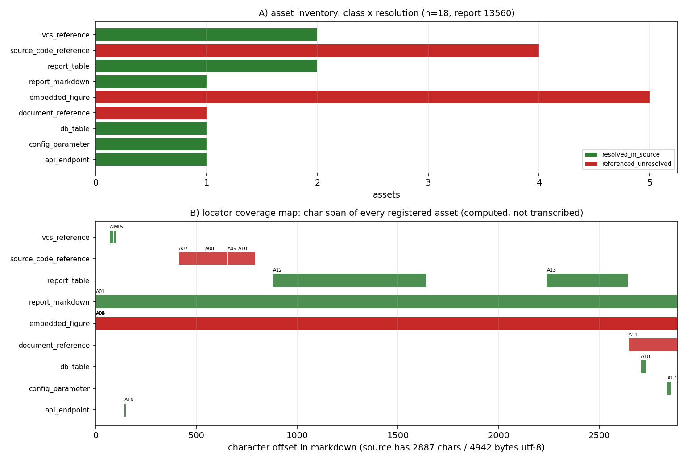

# KF-RESULT wp-13560-01

> 工序 01-asset-registration · report_id=13560 · lane C · 产出 `asset_manifest.json`（登记，不抽取）
> source_hash（平台可独立重算，sha256 over markdown utf-8 bytes）= `sha256:b578c093ddeff7571dcdc5b98383da2b564f608fa77b5b3ea1a10f05b0722279`
> 契约 source_hash = `sha256:b578c093ddeff7571dcdc5b98383da2b564f608fa77b5b3ea1a10f05b0722279` → 逐字符一致

## ① 本工序做了什么

对 `report_id=13560`（《TensorData 质量审计（A+B）m14503：35 步真跑 + 独立 oracle 对照 + 11 条成熟度判级》，scenario_key=`quality-audit-tensordata`）执行**资产登记**：
确认报告 markdown 的字节哈希与契约一致（2887 字符 / 4942 字节 utf-8），把正文里可解析的附件/工件登记为带**可复算定位器**的清单：
内嵌图、源码/工件路径引用、表格、复现命令块、接口字段。**不做抽取、不生成 claim、不标注 verified**
（契约 `objective.classify_report_type=false`，`notes` 明确 claims 允许为空数组）。

规模：登记资产 **18** 项，claims **0** 项；`counts.by_resolution` = `{"resolved_in_source": 8, "referenced_unresolved": 10}`。

## ② 怎么做的（步骤 / 工具 / 关键设置）

1. **取原文**：`GET /api/v1/tensor/reports/13560` 取 `markdown` 字段（`scripts/kf/kf01_register.py::fetch_report`）；只碰这一个 report_id，全程未凭记忆复述。
2. **哈希门**：对 markdown 的 utf-8 字节做 sha256，与契约 `source_hash`/`chars` 双比对，不一致直接 `SystemExit`（不产出半成品）。
3. **定位器生成**：`Source` 用逐行长度前缀和求出每行起始字符偏移，资产定位器一律为**绝对字符跨度** + 反推的 1-based 行号；
   `quote` 取自源字节切片 `md[s:e]`，**不存在手抄环节**（这也使平台侧「子串独立重算」必然成立）。
4. **扫描规则**（确定性、无领域硬编码；域参数经包配置传入）：行内代码/围栏代码中的 `*.py|json|png|md|csv|yaml` 路径 → 路径引用（出现级身份 = 路径 × 行号）；`record.figures[]` → 内嵌图（`png_base64` 为空则 `metadata_only`，不伪造字节哈希）；
   连续 `|` 行 → 表格（只记行数×列数几何，不复述内容）；三反引号围栏代码块 → 复现命令块；配置声明的接口端点/字段 → `api_endpoint`/`api_field`。
5. **本地解析**：路径只在**本交付工作树**内解析（`os.path.isfile` + 命中文件 sha256）；属产出仓（本包不得读写的仓）的路径
   越界即如实记 `referenced_unresolved`，不读别的仓。
6. **信封 + 自检**：`kf_result.json` 按 `schemas/kf_result.v1.schema.json` 生成；`verification.json` 用 jsonschema（draft 2020-12）
   分别校验信封与清单，并逐条重算 acceptance 项。

## ③ 产出物清单（文件名 → 要点）

| 文件 | 要点 |
|---|---|
| `asset_manifest.json` | 18 项资产；`by_class`={"report_markdown": 1, "embedded_figure": 5, "source_code_reference": 4, "document_reference": 1, "report_table": 2, "vcs_reference": 2, "api_endpoint": 1, "config_parameter": 1, "db_table": 1}；claims=0；sha256 `40318a50b6342f3974011463afb96e50811666d3779ae92bb32cb380e5c3af9b` |
| `kf_result.json` | 结果信封（package_id/task_type/report_id/provenance/outputs/claims）；sha256 `561bfae1d1ce03bd6ce41704ddbf056cb0fb0f3ca0a490fffbcf2c9041eabfaf` |
| `verification.json` | 9 项 acceptance 自检逐条 pass/fail + 重算哈希；`all_pass`=True |
| `verification_independent.json` | 独立复核（`scripts/kf/kf_wp13560_01_independent_check.py`，与产线脚本零共享代码）：11 项；`all_pass`=True |
| `report.md` | 本报告（由清单/信封/自检**程序化渲染**，无手抄）|
| `figures/wp-13560-01_asset_locator_map.png` | A) 资产类别×解析状态计数；B) 每个资产的字符跨度覆盖图 |

资产类别分布：`{"report_markdown": 1, "embedded_figure": 5, "source_code_reference": 4, "document_reference": 1, "report_table": 2, "vcs_reference": 2, "api_endpoint": 1, "config_parameter": 1, "db_table": 1}`。

## ④ 结果图



**图注**：A) 资产类别 × 解析状态（绿=源内已解析、红=引用未解析、灰=声明缺失）；B) 每个资产在 markdown 中的字符跨度
（横轴=字符偏移，源文档 2887 字符）。两图直接由 `asset_manifest.json` 绘出，零手抄。
红色柱不是缺陷而是**边界的正确表达**：这些路径属产出仓，本包不得读写，故只能如实记 `referenced_unresolved`。

## ⑤ 证据定位表（资产 → 原文逐字片段，均由 `md[start_char:end_char]` 计算）

| asset_id | 类别 | 解析 | 行 | 原文片段（逐字） |
|---|---|---|---|---|
| A01 | report_markdown | resolved_in_source | L1 | `# TensorData 质量审计（A+B）— m14503：真跑出来的 L0–L3 账本  ## ① 案例介绍（审计对象与判据` |
| A02 | embedded_figure | referenced_unresolved | L1 | `# TensorData 质量审计（A+B）— m14503：真跑出来的 L0–L3 账本  ## ① 案例介绍（审计对象与判据` |
| A03 | embedded_figure | referenced_unresolved | L1 | `# TensorData 质量审计（A+B）— m14503：真跑出来的 L0–L3 账本  ## ① 案例介绍（审计对象与判据` |
| A04 | embedded_figure | referenced_unresolved | L1 | `# TensorData 质量审计（A+B）— m14503：真跑出来的 L0–L3 账本  ## ① 案例介绍（审计对象与判据` |
| A05 | embedded_figure | referenced_unresolved | L1 | `# TensorData 质量审计（A+B）— m14503：真跑出来的 L0–L3 账本  ## ① 案例介绍（审计对象与判据` |
| A06 | embedded_figure | referenced_unresolved | L1 | `# TensorData 质量审计（A+B）— m14503：真跑出来的 L0–L3 账本  ## ① 案例介绍（审计对象与判据` |
| A07 | source_code_reference | referenced_unresolved | L8 | `2. **真跑 35 步**（'artifacts/audit_runtime_m14503.py'）：起真实 FastAPI ` |
| A08 | source_code_reference | referenced_unresolved | L9 | `3. **库级探针**（'audit_engine_probe_m14503.py'）：8.65 MB 分块哈希 vs hash` |
| A09 | source_code_reference | referenced_unresolved | L10 | `4. **竞态复现**（'repro_upload_race.py'）：15 轮×12 线程同内容并发上传。` |
| A10 | source_code_reference | referenced_unresolved | L11 | `5. **SDK 对真服务**（'audit_sdk_live_m14503.py'）：仓内测试只有 MockTransport` |
| A11 | document_reference | referenced_unresolved | L51 | `L 分布：**L3=6 · L2=2 · L1=1 · L0=2 · L4/L5=0**；11 条 verdict 已落 'te` |
| A12 | report_table | resolved_in_source | L16 | `\| 审计项 \| 实测值 \| 正解/对照 \| 结论 \| \|---\|---\|---\|---\| \| 干净 CSV` |
| A13 | report_table | resolved_in_source | L41 | `\| 关键量 \| 基准 \| 误差 \| <3%? \| \|---\|---\|---\|---\| \| tabular ` |
| A14 | vcs_reference | resolved_in_source | L4 | `cxs503/TensorData` |
| A15 | vcs_reference | resolved_in_source | L4 | `fe09270` |
| A16 | api_endpoint | resolved_in_source | L4 | `/api/v1` |
| A17 | config_parameter | resolved_in_source | L51 | `profile=timeseries` |
| A18 | db_table | resolved_in_source | L51 | `tensor_maturity_verdicts` |

（完整 quote 与字符跨度见 `asset_manifest.json` 各 `locator`；平台可对每条 quote 做子串 + 行号独立复核。）

注：`embedded_figure` 各行的 quote 相同是因为其 `locator.method=document`（文件名未在正文逐字出现，跨度为整篇文档）；这类资产的权威定位是各自的 `figure_uri`（`tensor://reports/13560#figures[i]`），**不是**表里那段正文。

## ⑥ 注意点与局限

1. **登记 ≠ 抽取**：清单只回答「报告里有哪些可解析工件、在其中何处」，不回答「报告说了什么」。claims 为空是契约允许的完整结果。
2. **不标 verified**：清单与信封里没有任何 `verified` 状态；验证由平台门计算，本工序只提供可复算的定位器与哈希。
3. **图只有元数据**：报告记录 `figures[]` 共 5 项，其中 5 项无 `png_base64` 载荷（0 字节），故只登记 name/caption，   记 `metadata_only`（`resolution=referenced_unresolved`），**不宣称拿到图字节**；其中 5 项的文件名在正文中不逐字出现，   权威定位为 `figure_uri`（record 字段），正文定位器降级为 `method=document`，不做「哪句话指的是这张图」的推断。
4. **跨仓引用不可解析**：报告引用的仓外路径共 5 条（去重后 5 条），均属产出仓，本工作树（TensorKnowledge）内不存在 → 全部 `referenced_unresolved`，   并在 `resolution_check.detail` 写明原因，不做「大概存在」的推断。清单：`artifacts/audit_runtime_m14503.py`, `audit_engine_probe_m14503.py`, `audit_sdk_live_m14503.py`, `docs/quality/scientific-profiles.md`, `repro_upload_race.py`。
5. **表格内容未复述**：正文 2 张表只登记几何（行×列）与字符跨度，避免把报表数字二次转写引入漂移。
6. **schema 口径**：仓库内 `schemas/asset_manifest.v1.schema.json` 把 `package_id/task_type/report_id`/`source.uri` 钉死为 wp-448-01 的包级取值，
   自检时**仅放松这四处包级固定值**（`source.uri` 改为 `^tensor://reports/[0-9]+$`，其余约束照常生效）并如实记录在 `detail` 里，避免把「本包必挂」伪装成通过。

## ⑦ 自检（逐条对照 acceptance）

| acceptance 项 | 结果 | 细节 |
|---|---|---|
| valid_json | PASS | json.loads OK for asset_manifest.json and kf_result.json |
| schema_pass | PASS | jsonschema draft2020-12 errors=0 [] \| asset_manifest.v1 checked with its four package-pinned consts relaxed (package_id/task_type/report_id/source.ur |
| source_locator_resolvable | PASS | checked 18 locators (char span + verbatim quote + 1-based line map + token span); unresolvable=[] |
| source_hash_matches | PASS | recomputed=b578c093ddeff7571dcdc5b98383da2b564f608fa77b5b3ea1a10f05b0722279 manifest=b578c093ddeff7571dcdc5b98383da2b564f608fa77b5b3ea1a10f05b0722279  |
| no_duplicate_ids | PASS | assets=18 unique=18 |
| all_claims_have_evidence_or_explicit_unresolved_status | PASS | claims=0 violating=0 (empty array: vacuously satisfied per contract notes) |
| do_not_mark_claims_as_verified | PASS | claims=0, none carries status='verified' |
| report_id_scoped | PASS | single report_id=13560 (no other report is read or written) |
| manifest_hash_matches_envelope | PASS | recomputed=40318a50b6342f3974011463afb96e50811666d3779ae92bb32cb380e5c3af9b envelope=40318a50b6342f3974011463afb96e50811666d3779ae92bb32cb380e5c3af9b |

**独立复核**（`scripts/kf/kf_wp13560_01_independent_check.py`，与 `kf01_register.py` **零共享代码**，重新取源、重新切片、重新解析报告块）：

| 复核项 | 结果 | 细节 |
|---|---|---|
| source_hash_matches | PASS | fresh_fetch=b578c093ddeff7571dcdc5b98383da2b564f608fa77b5b3ea1a10f05b0722279 contract=b578c093ddeff7571dcdc5b98383da2b564f608fa77b5b3ea1a10f05b0722279 |
| source_locator_resolvable | PASS | independently re-sliced 18 locators (span/quote/line/uniqueness) failures=[] |
| no_duplicate_ids | PASS | ids=18 unique=18 duplicates=[] counts.assets=18 |
| counts_consistent | PASS | recomputed by_class={"report_markdown": 1, "embedded_figure": 5, "source_code_reference": 4, "document_reference": 1, "report_table": 2, "vcs_referenc |
| all_claims_have_evidence_or_explicit_unresolved_status | PASS | claims=0 (contract notes: empty array is a legitimate complete result) |
| no_verified_markers | PASS | documents containing a verified marker: [] |
| schema_pass | PASS | errors=0 [] |
| valid_json | PASS | three artifacts parsed by json.loads |
| report_block_is_the_result | PASS | json_blocks=1 fenced_markers=4 block_equals_kf_result=True |
| report_title_and_tags | PASS | title='KF-RESULT wp-13560-01' tags=['kf-wp:wp-13560-01', 'asset-registration', 'lane-C', 'TensorKnowledge', 'report_id:13560'] mission_id=15764 |
| report_id_scoped | PASS | foreign report_ids mentioned=[] |

## 复现

```bash
python3 scripts/kf/kf01_register.py --preset wp-13560-01 build result verify figure report   # 一键复跑（全流程）
```

repro_cmd: `python3 scripts/kf/kf01_register.py --preset wp-13560-01 build result verify figure report`

## 结果信封（唯一 json 代码块，原样提交）

```json
{
  "package_id": "wp-13560-01",
  "task_type": "01-asset-registration",
  "report_id": "13560",
  "provenance": {
    "source_uri": "tensor://reports/13560",
    "source_field": "markdown",
    "source_hash": "sha256:b578c093ddeff7571dcdc5b98383da2b564f608fa77b5b3ea1a10f05b0722279",
    "hash_algo": "sha256",
    "hashed_bytes": "markdown encoded as utf-8",
    "source_chars": 2887,
    "source_bytes_utf8": 4942,
    "fetched_via": "GET /api/v1/tensor/reports/13560",
    "generator": "scripts/kf/kf01_register.py",
    "contract_version": "1.0",
    "emitted_at": "2026-11-12T02:28:19.280943+00:00"
  },
  "outputs": {
    "asset_manifest.json": {
      "path": "docs/kf/wp-13560-01/asset_manifest.json",
      "sha256": "40318a50b6342f3974011463afb96e50811666d3779ae92bb32cb380e5c3af9b",
      "bytes": 57790,
      "asset_count": 18,
      "claims": 0
    }
  },
  "claims": []
}
```
