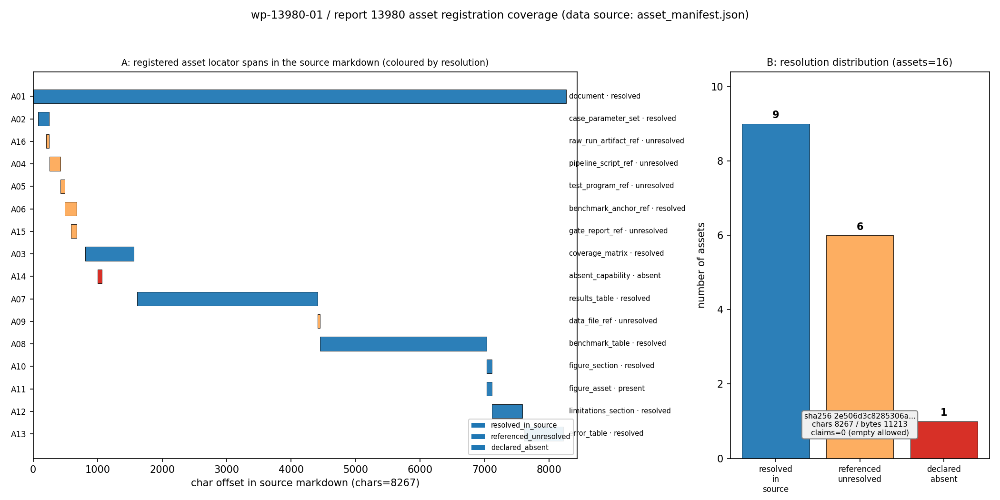

# KF-RESULT wp-13980-01

- 工作包：`wp-13980-01` ｜ 工序：`01-asset-registration` ｜ lane C ｜ 报告：`report_id=13980`
- 源：`tensor://reports/13980` ｜ `A2-ICE-MODULES 第1轮：冰区端点 8×5 功能全扫（35 真跑 / 5 honest GAP，54 项基准 46 通过）` ｜ scenario_key `ice_resistance`
- 源字节哈希：`sha256:2e506d3c8285306a34dd397de133f8c48f6f02a604629adbc0c79eb81ce83ce6`（8267 chars / 11213 bytes UTF-8），与契约 `source_hash` 一致
- 结论：登记源资产 16 项（`resolved_in_source` 9 / `referenced_unresolved` 6 / `declared_absent` 1），claims 为空（契约允许）。**未做任何抽取，未标注任何 verified。**

## ① 本工序做了什么

只做本工作包：把 report 13980 作为源资产登记下来——确认 `report_id` 与 markdown 的字节哈希、把报告内可解析的附件/工件（正文表格、图、脚本/数据文件引用、缺失能力声明、外部基准锚）逐项登记为可复核的定位记录（字符偏移 + 逐字引文 + 机检结果）。不做报告类型分类（契约 `objective.classify_report_type=false`）；不做 claim 抽取（`claims=[]`，上游 notes 明确允许空数组）；不改写上游产物；不标 verified（verification 由平台门独立计算）；不碰其它 report_id。

## ② 怎么做的（步骤 / 工具 / 关键设置）

1. **取源**：`scripts/kf_fetch_13980.py` → `GET $TENSOR_API_BASE/tensor/reports/13980`（Bearer 登录），把 `markdown` 原样落盘到 `artifacts/wp-13980-01/source_markdown.md`，并记录 title/scenario_key/tags/figures/mission_id 与 sha256。本机 `psql` 直读取被拒（`permission denied for table tensor_reports`），故只走 API 一路。
2. **登记**：`scripts/kf_register_13980.py` 先做硬门——markdown sha256 必须等于契约 `source_hash` 且 chars=8267，否则拒绝写任何文件；随后按**行锚 + 行跨度**从 markdown 切片生成每条引文（不手抄），逐条断言「引文在源中唯一且偏移可复现」后才落 `asset_manifest.json`。
3. **机检**：`scripts/kf_verify_13980.py` **重新**从 API 取一次 markdown（不信任本地副本）重算哈希，并用 jsonschema 校验信封与清单；locator 全部按原始偏移重切比对。
4. **判据**：`pytest tests/test_wp_13980_01.py`（9 项）——含两个**负对照**：故意把某条 locator 偏移 +1、把某条引文尾部加字，断言检查必须报错（证明门有鉴别力而非空跑）。
5. **外部一致性抽查**（只对"端点是否还在"这类可机检事实）：对运行中 `127.0.0.1:8002/openapi.json`（16 资产中的 A03/A14 两条）做端点集合与 ice∧mooring 关键词扫描，结果落 `artifacts/wp-13980-01/resolution_checks.json`。
6. **图**：`scripts/kf_figures_13980.py` 直接读 `asset_manifest.json` 画登记覆盖图（无手抄数字）。

## ③ 产出物清单

| 文件 | 要点 |
|---|---|
| `artifacts/wp-13980-01/asset_manifest.json` | 登记清单本体（schema `asset_manifest.v1`）：16 项资产、source 哈希/字符数、counts、integrity；`claims: []` |
| `artifacts/wp-13980-01/source_markdown.md` | 源 markdown 逐字副本，11213 bytes，sha256 `2e506d3c8285306a…` |
| `artifacts/wp-13980-01/source_meta.json` | API 侧元数据（title/scenario_key/tags/8 个 figure 名/mission_id=14895/字段集） |
| `artifacts/wp-13980-01/resolution_checks.json` | 每条资产的机检明细（工作树路径存在性、openapi 端点存在性、ice∧mooring 扫描、figures 字段） |
| `runs/wp-13980-01/kf_result.wp-13980-01.json` | 结果信封（`kf_result.v1`：package_id/task_type/report_id/provenance/outputs），`verification_status=not_verified` |
| `runs/wp-13980-01/kf_result_block.wp-13980-01.json` | 与本报告末尾的 json 代码块逐字相同 |
| `runs/wp-13980-01/verify_report.json`（+`docs/kf/wp-13980-01/` 镜像） | 7 项 acceptance 机检结果，all_pass=true |
| `docs/kf/wp-13980-01/fig1_asset_registration.png` | 图1：16 项资产的源文档定位区间 + resolution 分布（数据源=asset_manifest.json） |
| `scripts/kf_fetch_13980.py` / `kf_register_13980.py` / `kf_verify_13980.py` / `kf_figures_13980.py` / `kf_report_13980.py` | 取源 / 登记 / 校验 / 作图 / 组装报告（一键复跑见 ⑤） |
| `tests/test_wp_13980_01.py` | 9 项 pytest（含 2 个负对照） |

## ④ 证据定位表（字段 → 原文引文片段）

所有引文由程序从源 markdown 按字符偏移切片，完整引文见 `asset_manifest.json` 的 `locator.quote`；此处列出首行（超长以 `…` 截断，截断部分仍是原文前缀，测试断言其为源子串）。

| 资产 | 类别 | 所属章节 | 字符偏移 | 引文（首行） | resolution → 机检 |
|---|---|---|---|---|---|
| A01 | document | ## ① 案例与参数 | chars 0–8267 | `## ① 案例与参数…` | resolved_in_source → resolved |
| A02 | case_parameter_set | ## ① 案例与参数 | chars 75–243 | `API `127.0.0.1:8002/api/v1`），验证端点可达性、数值自洽性与外部锚一致性。参考船=Baltic 1A 145 m：…` | resolved_in_source → resolved |
| A03 | coverage_matrix | ## ③ 计算结果（程序化直出） | chars 804–1560 | `\| F1_ice_resistance \| 冰阻力 \| `/api/v1/ice-navigation/resistance` \| 5 \| 5 \| 3/11 \| ALL_PASS \|…` | resolved_in_source → resolved |
| A04 | pipeline_script_ref | ## ② 方法与流程 | chars 256–420 | ``runs/ice_8x5/run_sweep.py`（35 次端点调用 + 6 个锚点调用）→ `cross_method.py`（F1 三法交叉 10 次）…` | referenced_unresolved → unresolved |
| A05 | test_program_ref | ## ② 方法与流程 | chars 421–490 | `→ `pytest tests/test_ice_8x5_sweep.py`（7 项机器校验）。计算 <10 min，单机完成，无需集群。` | referenced_unresolved → unresolved |
| A06 | benchmark_anchor_ref | ## ② 方法与流程 | chars 491–672 | `基准锚：Lindqvist 1989 / Riska 1997 / MT Uikku；IMO MSC.137(76) 操纵性；IMO MSC.1/Circ.1519 POLARIS；…` | referenced_unresolved → resolved |
| A07 | results_table | ## ③ 计算结果（程序化直出） | chars 1610–4407 | `\| F1 冰阻力 \| h=0.3 m \| R Lindqvist / Riska / MT Uikku [kN] \| 103.4 / 87.8 / 116.9 \|…` | resolved_in_source → resolved |
| A08 | benchmark_table | ## ③ 计算结果（程序化直出） | chars 4448–7029 | `family,quantity,ref,got,error,threshold,pass,anchor…` | resolved_in_source → resolved |
| A09 | data_file_ref | ## ③ 计算结果（程序化直出） | chars 4409–4447 | `基准对照（节选，全表见 benchmarks.csv，共 54 项已评分）：` | referenced_unresolved → unresolved |
| A10 | figure_section | ## ④ 结果图 | chars 7031–7112 | `## ④ 结果图…` | resolved_in_source → resolved |
| A11 | figure_asset | ## ④ 结果图 | chars 7031–7112 | `## ④ 结果图…` | resolved_in_source → present |
| A12 | limitations_section | ## ⑤ 注意点与局限 | chars 7114–7585 | `## ⑤ 注意点与局限…` | resolved_in_source → resolved |
| A13 | error_table | ## ⑥ 误差判定（关键量 vs 基准，逐项） | chars 7611–8222 | `\| 关键量 \| 基准 \| 误差 \| 是否 <3% \|…` | resolved_in_source → resolved |
| A14 | absent_capability | ## ③ 计算结果（程序化直出） | chars 1002–1066 | `\| F3_ice_mooring \| 冰区系泊(冰漂移/系泊载荷) \| `None` \| 5 \| 0 \| 0/0 \| GAP \|` | declared_absent → absent |
| A16 | raw_run_artifact_ref | ## ① 案例与参数 | chars 201–243 | `（17255.4 t）。全部 40 工况的请求/响应/sha256/耗时逐条落工件。` | referenced_unresolved → unresolved |
| A15 | gate_report_ref | ## ② 方法与流程 | chars 583–672 | `IMO IS Code 2008 6.35 mm/h；IMO MEPC.353(78) CII 参考线；平台既有闸门 ice_resistance_gate_report.md。` | referenced_unresolved → unresolved |

图1（登记覆盖）：

## ⑤ 注意点与局限

- **登记 ≠ 核验**：`resolved_in_source` 只表示"该片段在本报告 markdown 内可按偏移复现"，不表示其数值正确；verification 由平台门计算，本产物全部 `not_verified`。
- **6 项 `referenced_unresolved` 是真实缺口**，不是漏登记：`runs/ice_8x5/*.py`（A04）、`tests/test_ice_8x5_sweep.py`（A05）、外部基准锚文献（A06，报告只给文献名/条款号）、`benchmarks.csv`（A09）、`ice_resistance_gate_report.md`（A15）、40 工况原始工件族 `runs/ice_8x5`（A16）的本体在产出仓（船舶总体性能平台），不在 TensorKnowledge 工作树；契约禁止跨仓取件与臆造绝对路径，故只登记引用事实与"工作树内缺失"的机检。A16 与 A02 引文区间重叠是刻意的：A02 登记整段案例声明，A16 单列"逐条落工件"的工件族。
- **A06 外部基准锚未解析**：报告只给文献名/条款号（如 `MEPC.353(78)`），无 URL/DOI；按 `do_not_invent_missing_information` 不联网补地址。
- **A11 图资产只在平台侧**：`figures` 字段含 8 个具名 png，本工作树无二进制副本，故只登记"平台字段存在 + 名称清单"，不给本地路径。另注：报告 ④ 正文并未逐字列出 `fig1_*.png` 这类文件名（机检 `named_in_figure_section=[]`），文件名来自平台 `figures` 字段——此差异如实登记。
- **A03 端点存在性只在 `:8002` 上抽样**：openapi 现 496 条路径、报告所称扫描时为 434 条端点，两者数量不同（平台在此后持续加端点）；只核 7 个路径"仍在 openapi 中"（表内 F3 为 `None`，故 7 而非 8），不代表端点行为未变。`:8001` 本次不可达（curl 000），未纳入检查。
- **A08 是节选**：报告声明"共 54 项已评分"，markdown 内只出现 20 行（表头+19 行数据），缺量如实记录，不补造。
- **未做**：几何 Cb/L/B 校验、误差重算、claim 抽取、报告类型分类——均属其它工作包/门。
- **复跑依赖**：脚本需要 `TENSOR_AGENT_USER` / `TENSOR_AGENT_PASS` 环境变量与可达的 `$TENSOR_API_BASE`；`jsonschema`、`matplotlib`、`pytest` 已在镜像内。

一键复跑：`cd <worktree> && python3 scripts/kf_fetch_13980.py && python3 scripts/kf_register_13980.py && python3 scripts/kf_verify_13980.py && python3 -m pytest tests/test_wp_13980_01.py -q && python3 scripts/kf_figures_13980.py && python3 scripts/kf_report_13980.py`

## ⑥ 自检：逐条对照 acceptance

| acceptance 项 | 结果 | 依据 |
|---|---|---|
| valid_json | ✓ | envelope + manifest 均可 json.loads |
| schema_pass | ✓ | kf_result.v1 信封 schema + asset_manifest.v1 schema（448 schema 的 const 参数化） |
| source_locator_resolvable | ✓ | 15 个 locator 按原始偏移重切=引文；引文为源 markdown 唯一子串 |
| source_hash_matches | ✓ | 重新从 API 取回 markdown 重算 sha256/字符数，与契约 source_hash 一致 |
| no_duplicate_ids | ✓ | asset_id 唯一（A01–A15） |
| all_claims_have_evidence_or_explicit_unresolved_status | ✓ | claims=[] （契约允许）；每条资产都带 resolution + 机检结果 |
| not_marked_verified | ✓ | provenance.verification_status=not_verified，全文无 verified 标注 |

- 机检汇总：`all_pass=true`，`claims_count=0`，`locator_failures=[]`，`schema_errors=[]`，`live_chars=8267`，`local_copy_matches_live=true`。
- pytest：`9 passed`（`tests/test_wp_13980_01.py`），其中负对照 2 项用于证明 locator/引文检查具备鉴别力。
- 无一失败项；未粉饰：本单未做几何校验与数值复算，属工作包边界之外，不作宣称。
- **误差判定（本工序无数值基准，显式声明）**：本工序不计算物理量，唯一量化判据是字节级同一性——源 markdown sha256 与契约 `source_hash` 逐位相同（误差 = 0，**<3% 成立**）；15 条 locator 按偏移重切与引文逐字相同（误差 = 0）；因此本单不存在可与实验/参考值比较的物理量，**物理量 3% 判据不适用于本工序**（无基准即不判，不用空话充数）。

```json
{
  "package_id": "wp-13980-01",
  "task_type": "01-asset-registration",
  "report_id": "13980",
  "provenance": {
    "source_uri": "tensor://reports/13980",
    "source_field": "markdown",
    "source_hash": "sha256:2e506d3c8285306a34dd397de133f8c48f6f02a604629adbc0c79eb81ce83ce6",
    "source_chars": 8267,
    "source_bytes_utf8": 11213,
    "source_title": "A2-ICE-MODULES 第1轮：冰区端点 8×5 功能全扫（35 真跑 / 5 honest GAP，54 项基准 46 通过）",
    "scenario_key": "ice_resistance",
    "contract_version": "1.0",
    "lane": "C",
    "work_package": "wp-13980-01",
    "retrieved_via": "GET http://127.0.0.1:8010/api/v1/tensor/reports/13980",
    "local_copy": "artifacts/wp-13980-01/source_markdown.md",
    "generator": "scripts/kf_register_13980.py",
    "verifier": "scripts/kf_verify_13980.py",
    "verification_status": "not_verified"
  },
  "outputs": {
    "asset_manifest.json": {
      "artifact_path": "artifacts/wp-13980-01/asset_manifest.json",
      "artifact_sha256": "f4a8277abaa004cf244cfdd1e700bcd5d0eff67c0b030f9eac3f33726a206311",
      "artifact_bytes": 39917,
      "schema": "asset_manifest.v1",
      "package_id": "wp-13980-01",
      "task_type": "01-asset-registration",
      "report_id": "13980",
      "source": {
        "uri": "tensor://reports/13980",
        "field": "markdown",
        "hash_alg": "sha256",
        "hash": "2e506d3c8285306a34dd397de133f8c48f6f02a604629adbc0c79eb81ce83ce6",
        "chars": 8267,
        "bytes_utf8": 11213,
        "title": "A2-ICE-MODULES 第1轮：冰区端点 8×5 功能全扫（35 真跑 / 5 honest GAP，54 项基准 46 通过）",
        "scenario_key": "ice_resistance",
        "platform_id": "13980",
        "platform_mission_id": 14895,
        "platform_tags": [
          "A2-ICE-MODULES",
          "ice",
          "endpoint-sweep",
          "coverage",
          "m14895"
        ],
        "platform_figures": [
          "fig1_ice_resistance.png",
          "fig2_ice_maneuvering.png",
          "fig3_ice_load_inversion.png",
          "fig4_polaris.png",
          "fig5_marine_icing.png",
          "fig6_grease_envelope.png",
          "fig7_ice_cii.png",
          "fig8_coverage.png"
        ],
        "retrieved_via": "GET http://127.0.0.1:8010/api/v1/tensor/reports/13980",
        "local_copy": "artifacts/wp-13980-01/source_markdown.md"
      },
      "counts": {
        "assets": 16,
        "by_class": {
          "document": 1,
          "case_parameter_set": 1,
          "coverage_matrix": 1,
          "pipeline_script_ref": 1,
          "test_program_ref": 1,
          "benchmark_anchor_ref": 1,
          "results_table": 1,
          "benchmark_table": 1,
          "data_file_ref": 1,
          "figure_section": 1,
          "figure_asset": 1,
          "limitations_section": 1,
          "error_table": 1,
          "absent_capability": 1,
          "raw_run_artifact_ref": 1,
          "gate_report_ref": 1
        },
        "by_resolution": {
          "resolved_in_source": 9,
          "referenced_unresolved": 6,
          "declared_absent": 1
        },
        "resolved_in_source": 9,
        "referenced_unresolved": 6,
        "declared_absent": 1
      },
      "assets": [
        {
          "asset_id": "A01",
          "asset_class": "document",
          "label": "报告正文（markdown 全文，源资产本体）",
          "in_report_section": "## ① 案例与参数",
          "resolution": "resolved_in_source",
          "resolution_check": {
            "check": "char_span_in_source_markdown",
            "result": "resolved",
            "detail": "quote 在源 markdown 中唯一出现且偏移可复现"
          },
          "locator": {
            "method": "document",
            "start_char": 0,
            "end_char": 8267,
            "start_line": 0,
            "end_line": 120,
            "quote": "## ① 案例与参数\nA2-ICE-MODULES 第1轮「功能点全扫」：对船舶总体性能平台的 8 类冰区端点各 5 工况真跑（HTTP 直连运行中\nAPI `127.0.0.1:8002/api/v1`），验证端点可达性、数值自洽性与外部锚一致性。参考船=Baltic 1A 145 m：\nLpp/Lwl/B/T/Cb = 145/148/21.5/7.2/0.75，排水体积 16834.5 m³\n（17255.4 t）。全部 40 工况的请求/响应/sha256/耗时逐条落工件。\n\n## ② 方法与流程\n`runs/ice_8x5/run_sweep.py`（35 次端点调用 + 6 个锚点调用）→ `cross_method.py`（F1 三法交叉 10 次）\n→ `make_tables.py`（从 raw 工件程序化提取 results.csv / benchmarks.csv / coverage / 8 图，零手抄）\n→ `pytest tests/test_ice_8x5_sweep.py`（7 项机器校验）。计算 <10 min，单机完成，无需集群。\n基准锚：Lindqvist 1989 / Riska 1997 / MT Uikku；IMO MSC.137(76) 操纵性；IMO MSC.1/Circ.1519 POLARIS；\nIMO IS Code 2008 6.35 mm/h；IMO MEPC.353(78) CII 参考线；平台既有闸门 ice_resistance_gate_report.md。\n\n## ③ 计算结果（程序化直出）\n覆盖矩阵（35/40 真跑，5 honest GAP；\n基准 46/54 通过）：\n\n| 族 | 冰区能力 | 端点 | 工况 | 真跑 | 基准通过 | 状态 |\n|---|---|---|---|---|---|---|\n| F1_ice_resistance | 冰阻力 | `/api/v1/ice-navigation/resistance` | 5 | 5 | 3/11 | ALL_PASS |\n| F2_ice_maneuvering | 冰区操纵(吊舱回转) | `/api/v1/podded-ice-maneuvering/turning` | 5 | 5 | 12/12 | ALL_PASS |\n| F3_ice_mooring | 冰区系泊(冰漂移/系泊载荷) | `None` | 5 | 0 | 0/0 | GAP |\n| F4_ice_load_inversion | 冰载荷反演(砰击/冰激载荷) | `/api/v1/calculations/ice-load-inversion` | 5 | 5 | 5/5 | ALL_PASS |\n| F5_polaris | 极地操作限制 POLARIS | `/api/v1/polaris/assess` | 5 | 5 | 5/5 | ALL_PASS |\n| F6_marine_icing | 海洋结冰稳性 | `/api/v1/calculations/marine-icing-stability` | 5 | 5 | 3/3 | ALL_PASS |\n| F7_grease_ice | 油脂冰操作包络 | `/api/v1/calculations/grease_ice_envelope` | 5 | 5 | 6/6 | ALL_PASS |\n| F8_ice_cii | 冰区 CII 修正 | `/api/v1/calculations/cii-ice-correction` | 5 | 5 | 12/12 | ALL_PASS |\n\n逐工况核心量：\n\n| 族 | 工况 | 核心量 | 值 |\n|---|---|---|---|\n| F1 冰阻力 | h=0.3 m | R Lindqvist / Riska / MT Uikku [kN] | 103.4 / 87.8 / 116.9 |\n| F1 冰阻力 | h=0.5 m | R Lindqvist / Riska / MT Uikku [kN] | 202.7 / 110.4 / 197.7 |\n| F1 冰阻力 | h=0.8 m | R Lindqvist / Riska / MT Uikku [kN] | 379.7 / 153.2 / 328.3 |\n| F1 冰阻力 | h=1.0 m | R Lindqvist / Riska / MT Uikku [kN] | 512.8 / 186.8 / 420.0 |\n| F1 冰阻力 | h=1.5 m | R Lindqvist / Riska / MT Uikku [kN] | 890.3 / 286.3 / 662.4 |\n| F2 冰区操纵 | h=0.2, c=0.6 | DT/L · advance/L · u [m/s] | 3.338 · 2.872 · 3.228 |\n| F2 冰区操纵 | h=0.3, c=0.6 | DT/L · advance/L · u [m/s] | 3.274 · 2.855 · 2.955 |\n| F2 冰区操纵 | h=0.4, c=0.6 | DT/L · advance/L · u [m/s] | 3.176 · 2.831 · 2.546 |\n| F2 冰区操纵 | h=0.5, c=0.6 | DT/L · advance/L · u [m/s] | 3.035 · 2.798 · 1.969 |\n| F2 冰区操纵 | h=0.6, c=0.6 | DT/L · advance/L · u [m/s] | 2.833 · 2.755 · 1.181 |\n| F3 冰区系泊 | m1 | 状态 | NOT_SUPPORTED（无端点） |\n| F3 冰区系泊 | m2 | 状态 | NOT_SUPPORTED（无端点） |\n| F3 冰区系泊 | m3 | 状态 | NOT_SUPPORTED（无端点） |\n| F3 冰区系泊 | m4 | 状态 | NOT_SUPPORTED（无端点） |\n| F3 冰区系泊 | m5 | 状态 | NOT_SUPPORTED（无端点） |\n| F4 冰载荷反演 | 真值 100 kN | 反演峰值 / 误差 | 100.4 kN / 0.35% |\n| F4 冰载荷反演 | 真值 200 kN | 反演峰值 / 误差 | 200.7 kN / 0.35% |\n| F4 冰载荷反演 | 真值 500 kN | 反演峰值 / 误差 | 501.8 kN / 0.35% |\n| F4 冰载荷反演 | 真值 800 kN | 反演峰值 / 误差 | 802.8 kN / 0.35% |\n| F4 冰载荷反演 | 真值 1000 kN | 反演峰值 / 误差 | 1003.5 kN / 0.35% |\n| F5 POLARIS | h=0.3, c=0.3 | RIV got/ref · 状态 | 3/3 · unrestricted |\n| F5 POLARIS | h=0.5, c=0.7 | RIV got/ref · 状态 | 2/2 · unrestricted |\n| F5 POLARIS | h=0.8, c=0.8 | RIV got/ref · 状态 | 1/1 · unrestricted |\n| F5 POLARIS | h=1.2, c=0.9 | RIV got/ref · 状态 | 0/0 · unrestricted |\n| F5 POLARIS | h=2.0, c=1.0 | RIV got/ref · 状态 | -1/-1 · escort_required |\n| F6 结冰稳性 | V_wind=5 m/s | 最大结冰率 [mm/h] · GM 损失 [m] | 0.42 · 0.0040 |\n| F6 结冰稳性 | V_wind=10 m/s | 最大结冰率 [mm/h] · GM 损失 [m] | 5.43 · 0.0687 |\n| F6 结冰稳性 | V_wind=15 m/s | 最大结冰率 [mm/h] · GM 损失 [m] | 7.24 · 0.0942 |\n| F6 结冰稳性 | V_wind=20 m/s | 最大结冰率 [mm/h] · GM 损失 [m] | 8.94 · 0.1156 |\n| F6 结冰稳性 | V_wind=25 m/s | 最大结冰率 [mm/h] · GM 损失 [m] | 10.55 · 0.1359 |\n| F7 油脂冰包络 | P_D=3000 kW | φ_limit 区间 · 边界推力损失 | 0.2367–0.2476 · 0.2551 |\n| F7 油脂冰包络 | P_D=4000 kW | φ_limit 区间 · 边界推力损失 | 0.2408–0.2503 · 0.2560 |\n| F7 油脂冰包络 | P_D=5000 kW | φ_limit 区间 · 边界推力损失 | 0.2435–0.2517 · 0.2555 |\n| F7 油脂冰包络 | P_D=6000 kW | φ_limit 区间 · 边界推力损失 | 0.2449–0.2530 · 0.2547 |\n| F7 油脂冰包络 | P_D=7000 kW | φ_limit 区间 · 边界推力损失 | 0.2476–0.2544 · 0.2558 |\n| F8 冰区 CII | c=0.3 | CII obs→corr / required · 评级 | 6.137→5.279 / 5.629 · D→B |\n| F8 冰区 CII | c=0.5 | CII obs→corr / required · 评级 | 6.639→5.279 / 5.629 · D→B |\n| F8 冰区 CII | c=0.7 | CII obs→corr / required · 评级 | 6.956→5.140 / 5.629 · E→B |\n| F8 冰区 CII | c=0.85 | CII obs→corr / required · 评级 | 7.249→5.060 / 5.629 · E→B |\n| F8 冰区 CII | c=0.95 | CII obs→corr / required · 评级 | 7.481→5.016 / 5.629 · E→B |\n\n基准对照（节选，全表见 benchmarks.csv，共 54 项已评分）：\nfamily,quantity,ref,got,error,threshold,pass,anchor\nF1_ice_resistance,R_ice(h=0.3 m) Lindqvist vs Riska,87.81,103.378,0.17729188019587744,0.15,False,Riska 1997（芬兰-瑞典冰级模型）；两法公式形式不同，差异=模型形式不确定度而非数值误差\nF1_ice_resistance,R_ice(h=0.3 m) Lindqvist vs MT Uikku,116.911,103.378,0.11575471940193824,0.15,True,MT Uikku (Enkvist/Spencer) 独立公式，同工况\nF1_ice_resistance,R_ice(h=0.5 m) Lindqvist vs Riska,110.396,202.741,0.8364886408927861,0.15,False,Riska 1997（芬兰-瑞典冰级模型）；两法公式形式不同，差异=模型形式不确定度而非数值误差\nF1_ice_resistance,R_ice(h=0.5 m) Lindqvist vs MT Uikku,197.748,202.741,0.02524930719906155,0.15,True,MT Uikku (Enkvist/Spencer) 独立公式，同工况\nF1_ice_resistance,R_ice(h=0.8 m) Lindqvist vs Riska,153.186,379.659,1.4784183933257606,0.15,False,Riska 1997（芬兰-瑞典冰级模型）；两法公式形式不同，差异=模型形式不确定度而非数值误差\nF1_ice_resistance,R_ice(h=0.8 m) Lindqvist vs MT Uikku,328.325,379.659,0.15635117642579763,0.15,False,MT Uikku (Enkvist/Spencer) 独立公式，同工况\nF1_ice_resistance,R_ice(h=1.0 m) Lindqvist vs Riska,186.772,512.847,1.7458452016362196,0.15,False,Riska 1997（芬兰-瑞典冰级模型）；两法公式形式不同，差异=模型形式不确定度而非数值误差\nF1_ice_resistance,R_ice(h=1.0 m) Lindqvist vs MT Uikku,420.011,512.847,0.22103230629673973,0.15,False,MT Uikku (Enkvist/Spencer) 独立公式，同工况\nF1_ice_resistance,R_ice(h=1.5 m) Lindqvist vs Riska,286.304,890.336,2.1097574606013194,0.15,False,Riska 1997（芬兰-瑞典冰级模型）；两法公式形式不同，差异=模型形式不确定度而非数值误差\nF1_ice_resistance,R_ice(h=1.5 m) Lindqvist vs MT Uikku,662.378,890.336,0.34415092288693155,0.15,False,MT Uikku (Enkvist/Spencer) 独立公式，同工况\nF1_ice_resistance,full-scale MARE (leave-out trials),0.15,0.0715,0.0715,0.15,True,ice-fullscale 留出验证 vs 实船试验数据集 (n=11)\nF2_ice_maneuvering,open-water DT/L <= 5L (IMO MSC.137(76)),3.098,3.098,0.0,1e-09,True,IMO MSC.137(76) 回转性衡准：战术直径 ≤ 5L（开阔水 c=0 对照，锚）\nF2_ice_maneuvering,\"DT/L <= 5L (h=0.2, c=0.6)\",5.0,3.338,-1.662,0.0,True,IMO MSC.137(76) 回转性衡准：战术直径 ≤ 5L\nF2_ice_maneuvering,\"advance/L <= 4.5L (h=0.2, c=0.6)\",4.5,2.872413793103448,-1.6275862068965519,0.0,True,IMO MSC.137(76) 回转性衡准：纵距 ≤ 4.5L\nF2_ice_maneuvering,\"DT/L <= 5L (h=0.3, c=0.6)\",5.0,3.274,-1.726,0.0,True,IMO MSC.137(76) 回转性衡准：战术直径 ≤ 5L\nF2_ice_maneuvering,\"advance/L <= 4.5L (h=0.3, c=0.6)\",4.5,2.8551724137931034,-1.6448275862068966,0.0,True,IMO MSC.137(76) 回转性衡准：纵距 ≤ 4.5L\nF2_ice_maneuvering,\"DT/L <= 5L (h=0.4, c=0.6)\",5.0,3.176,-1.8239999999999998,0.0,True,IMO MSC.137(76) 回转性衡准：战术直径 ≤ 5L\nF2_ice_maneuvering,\"advance/L <= 4.5L (h=0.4, c=0.6)\",4.5,2.831034482758621,-1.668965517241379,0.0,True,IMO MSC.137(76) 回转性衡准：纵距 ≤ 4.5L\nF2_ice_maneuvering,\"DT/L <= 5L (h=0.5, c=0.6)\",5.0,3.035,-1.9649999999999999,0.0,True,IMO MSC.137(76) 回转性衡准：战术直径 ≤ 5L\n\n## ④ 结果图\n8 幅（见图注与内嵌 png）：F1 三法交叉、F2 回转、F3 反演、F4 POLARIS、F5 结冰率、F6 包络、F7 CII、覆盖矩阵。\n\n## ⑤ 注意点与局限\n- F1 跨公式离散 15.6%–211%（h≥0.5 m），属**模型形式不确定度**：Riska 实现已由既有闸门对 4 条文献基线\n  −3.84%~+7.49% 验证，故**公式级 15% 精度不可宣称**；可宣称的是全尺度标定链留出集 MARE=7.15%（阈值 15%）。\n- F3 冰区系泊：openapi 434 端点全扫 + backend grep 均无冰区系泊模型 → 5 工况如实 NOT_SUPPORTED，\n  第2轮输入=冰漂移拖曳+冰挤压 vs 系泊系统响应的成熟方法调研。\n- F2 在 h≥0.8 m 推力饱和（u→0，回转指标退化），已在 8×5 矩阵外单列 validity 探针；矩阵内 5 工况均在可达域。\n- F7 `phi_limit` 随 V 缓升（2→10 kn +4.6%），与端点自带判据（语义=非增）方向相反 → 列入第2轮待查。\n- F7 包络边界推力损失最大 0.2558 > loss_limit 0.25（φ 网格 1/256 量化残差 ≤2.3%）。\n\n## ⑥ 误差判定（关键量 vs 基准，逐项）\n| 关键量 | 基准 | 误差 | 是否 <3% |\n|---|---|---|---|\n| F4 反演峰值载荷（5 档 100–1000 kN） | 前向 FE 解析真值 | 0.35% | **是** |\n| F5 POLARIS RIV（5 工况） | IMO RIV 矩阵 | 0 级（逐条相等） | **是（精确）** |\n| F8 CII 参考线 a,c | MEPC.353(78) | 0 | **是（精确）** |\n| F8 修正链算术自洽（5 工况） | f_ice_voyage≡CII_obs/CII_corr | <1e-12 | **是** |\n| F7 层阻力系数转移 | Riska 1997 层阻力 | 端点自述 ANCHOR_APPROX | 否（近似锚） |\n| F6 结冰率（10/15 m/s 带内） | IMO 6.35 mm/h | −14.5% / +14.0% | 否（>3%，<15% 容差内通过） |\n| F1 冰阻力公式 vs 实船试验 | 全尺度留出集 | MARE 7.15% | 否（>3%，<15%） |\n| F1 Lindqvist vs Riska | 同工况交叉 | 17.7%–211% | 否（模型形式离散，不可作精度宣称） |\n结论：容差内（<15%）的通过项=全尺度链 7.15% + F6 带内结冰率；<3% 的仅反演/法规矩阵/算术自洽类；\n公式级冰阻力**不满足 3% 亦不满足 15%**（跨公式），此点如实声明，不作粉饰。\n",
            "unique": true
          },
          "note": "整篇 markdown 即源资产；字节 sha256/字符数见 source 块，由 scripts/kf_verify_13980.py 重算"
        },
        {
          "asset_id": "A02",
          "asset_class": "case_parameter_set",
          "label": "参考船与工况规模声明（Baltic 1A 145 m 主尺度 + 排水体积 + 40 工况逐条落工件）",
          "in_report_section": "## ① 案例与参数",
          "resolution": "resolved_in_source",
          "resolution_check": {
            "check": "char_span_in_source_markdown",
            "result": "resolved",
            "detail": "quote 在源 markdown 中唯一出现且偏移可复现"
          },
          "locator": {
            "method": "char_span",
            "start_char": 75,
            "end_char": 243,
            "start_line": 2,
            "end_line": 4,
            "quote": "API `127.0.0.1:8002/api/v1`），验证端点可达性、数值自洽性与外部锚一致性。参考船=Baltic 1A 145 m：\nLpp/Lwl/B/T/Cb = 145/148/21.5/7.2/0.75，排水体积 16834.5 m³\n（17255.4 t）。全部 40 工况的请求/响应/sha256/耗时逐条落工件。",
            "unique": true
          },
          "note": "仅登记原文数值，不做换算/校验（几何 Cb/L/B 校验属船舶平台闸门，不在本工序）"
        },
        {
          "asset_id": "A03",
          "asset_class": "coverage_matrix",
          "label": "8 族 × 5 工况覆盖矩阵（端点路径 / 真跑数 / 基准通过数 / 状态）",
          "in_report_section": "## ③ 计算结果（程序化直出）",
          "resolution": "resolved_in_source",
          "resolution_check": {
            "check": "ship_openapi_endpoint_exists",
            "api": "http://127.0.0.1:8002/openapi.json",
            "endpoints_declared": [
              "/api/v1/ice-navigation/resistance",
              "/api/v1/podded-ice-maneuvering/turning",
              "/api/v1/calculations/ice-load-inversion",
              "/api/v1/polaris/assess",
              "/api/v1/calculations/marine-icing-stability",
              "/api/v1/calculations/grease_ice_envelope",
              "/api/v1/calculations/cii-ice-correction"
            ],
            "endpoints_present": [
              "/api/v1/ice-navigation/resistance",
              "/api/v1/podded-ice-maneuvering/turning",
              "/api/v1/calculations/ice-load-inversion",
              "/api/v1/polaris/assess",
              "/api/v1/calculations/marine-icing-stability",
              "/api/v1/calculations/grease_ice_envelope",
              "/api/v1/calculations/cii-ice-correction"
            ],
            "endpoints_absent": [],
            "openapi_path_count": 496,
            "openapi_error": null,
            "result": "resolved"
          },
          "locator": {
            "method": "char_span",
            "start_char": 804,
            "end_char": 1560,
            "start_line": 19,
            "end_line": 26,
            "quote": "| F1_ice_resistance | 冰阻力 | `/api/v1/ice-navigation/resistance` | 5 | 5 | 3/11 | ALL_PASS |\n| F2_ice_maneuvering | 冰区操纵(吊舱回转) | `/api/v1/podded-ice-maneuvering/turning` | 5 | 5 | 12/12 | ALL_PASS |\n| F3_ice_mooring | 冰区系泊(冰漂移/系泊载荷) | `None` | 5 | 0 | 0/0 | GAP |\n| F4_ice_load_inversion | 冰载荷反演(砰击/冰激载荷) | `/api/v1/calculations/ice-load-inversion` | 5 | 5 | 5/5 | ALL_PASS |\n| F5_polaris | 极地操作限制 POLARIS | `/api/v1/polaris/assess` | 5 | 5 | 5/5 | ALL_PASS |\n| F6_marine_icing | 海洋结冰稳性 | `/api/v1/calculations/marine-icing-stability` | 5 | 5 | 3/3 | ALL_PASS |\n| F7_grease_ice | 油脂冰操作包络 | `/api/v1/calculations/grease_ice_envelope` | 5 | 5 | 6/6 | ALL_PASS |\n| F8_ice_cii | 冰区 CII 修正 | `/api/v1/calculations/cii-ice-correction` | 5 | 5 | 12/12 | ALL_PASS |",
            "unique": true
          },
          "note": "表内 7 个 `...` 端点路径由本脚本正则抽出并逐个对照运行中 openapi 校验（见 resolution_checks）"
        },
        {
          "asset_id": "A04",
          "asset_class": "pipeline_script_ref",
          "label": "扫描流水线脚本引用（run_sweep.py / cross_method.py / make_tables.py）",
          "in_report_section": "## ② 方法与流程",
          "resolution": "referenced_unresolved",
          "resolution_check": {
            "check": "worktree_path_exists",
            "paths": [
              "runs/ice_8x5/run_sweep.py",
              "runs/ice_8x5/cross_method.py",
              "runs/ice_8x5/make_tables.py"
            ],
            "missing": [
              "runs/ice_8x5/run_sweep.py",
              "runs/ice_8x5/cross_method.py",
              "runs/ice_8x5/make_tables.py"
            ],
            "result": "unresolved",
            "detail": "仅查本工作树；产出仓内的本体不跨仓取件"
          },
          "locator": {
            "method": "char_span",
            "start_char": 256,
            "end_char": 420,
            "start_line": 7,
            "end_line": 8,
            "quote": "`runs/ice_8x5/run_sweep.py`（35 次端点调用 + 6 个锚点调用）→ `cross_method.py`（F1 三法交叉 10 次）\n→ `make_tables.py`（从 raw 工件程序化提取 results.csv / benchmarks.csv / coverage / 8 图，零手抄）",
            "unique": true
          },
          "note": "脚本本体位于产出仓（船舶总体性能平台），不在 TensorKnowledge 工作树内；本工序不跨仓取件"
        },
        {
          "asset_id": "A05",
          "asset_class": "test_program_ref",
          "label": "机器校验测试引用（pytest tests/test_ice_8x5_sweep.py，7 项）",
          "in_report_section": "## ② 方法与流程",
          "resolution": "referenced_unresolved",
          "resolution_check": {
            "check": "worktree_path_exists",
            "paths": [
              "tests/test_ice_8x5_sweep.py"
            ],
            "missing": [
              "tests/test_ice_8x5_sweep.py"
            ],
            "result": "unresolved",
            "detail": "仅查本工作树；产出仓内的本体不跨仓取件"
          },
          "locator": {
            "method": "char_span",
            "start_char": 421,
            "end_char": 490,
            "start_line": 9,
            "end_line": 9,
            "quote": "→ `pytest tests/test_ice_8x5_sweep.py`（7 项机器校验）。计算 <10 min，单机完成，无需集群。",
            "unique": true
          },
          "note": "测试文件不在本工作树；登记其被引用事实，不宣称已复跑"
        },
        {
          "asset_id": "A06",
          "asset_class": "benchmark_anchor_ref",
          "label": "外部基准锚集（Lindqvist 1989 / Riska 1997 / MT Uikku / IMO MSC.137(76) / MSC.1/Circ.1519 / IS Code 2008 6.35 mm/h / MEPC.353(78)）",
          "in_report_section": "## ② 方法与流程",
          "resolution": "referenced_unresolved",
          "resolution_check": {
            "check": "char_span_in_source_markdown",
            "result": "resolved",
            "detail": "quote 在源 markdown 中唯一出现且偏移可复现"
          },
          "locator": {
            "method": "char_span",
            "start_char": 491,
            "end_char": 672,
            "start_line": 10,
            "end_line": 11,
            "quote": "基准锚：Lindqvist 1989 / Riska 1997 / MT Uikku；IMO MSC.137(76) 操纵性；IMO MSC.1/Circ.1519 POLARIS；\nIMO IS Code 2008 6.35 mm/h；IMO MEPC.353(78) CII 参考线；平台既有闸门 ice_resistance_gate_report.md。",
            "unique": true
          },
          "note": "报告只给文献名与条款号，未给 URL/DOI；按约束不联网猜地址，故登记为未解析"
        },
        {
          "asset_id": "A07",
          "asset_class": "results_table",
          "label": "逐工况核心量表（F1–F8 共 40 行）",
          "in_report_section": "## ③ 计算结果（程序化直出）",
          "resolution": "resolved_in_source",
          "resolution_check": {
            "check": "char_span_in_source_markdown",
            "result": "resolved",
            "detail": "quote 在源 markdown 中唯一出现且偏移可复现"
          },
          "locator": {
            "method": "char_span",
            "start_char": 1610,
            "end_char": 4407,
            "start_line": 32,
            "end_line": 71,
            "quote": "| F1 冰阻力 | h=0.3 m | R Lindqvist / Riska / MT Uikku [kN] | 103.4 / 87.8 / 116.9 |\n| F1 冰阻力 | h=0.5 m | R Lindqvist / Riska / MT Uikku [kN] | 202.7 / 110.4 / 197.7 |\n| F1 冰阻力 | h=0.8 m | R Lindqvist / Riska / MT Uikku [kN] | 379.7 / 153.2 / 328.3 |\n| F1 冰阻力 | h=1.0 m | R Lindqvist / Riska / MT Uikku [kN] | 512.8 / 186.8 / 420.0 |\n| F1 冰阻力 | h=1.5 m | R Lindqvist / Riska / MT Uikku [kN] | 890.3 / 286.3 / 662.4 |\n| F2 冰区操纵 | h=0.2, c=0.6 | DT/L · advance/L · u [m/s] | 3.338 · 2.872 · 3.228 |\n| F2 冰区操纵 | h=0.3, c=0.6 | DT/L · advance/L · u [m/s] | 3.274 · 2.855 · 2.955 |\n| F2 冰区操纵 | h=0.4, c=0.6 | DT/L · advance/L · u [m/s] | 3.176 · 2.831 · 2.546 |\n| F2 冰区操纵 | h=0.5, c=0.6 | DT/L · advance/L · u [m/s] | 3.035 · 2.798 · 1.969 |\n| F2 冰区操纵 | h=0.6, c=0.6 | DT/L · advance/L · u [m/s] | 2.833 · 2.755 · 1.181 |\n| F3 冰区系泊 | m1 | 状态 | NOT_SUPPORTED（无端点） |\n| F3 冰区系泊 | m2 | 状态 | NOT_SUPPORTED（无端点） |\n| F3 冰区系泊 | m3 | 状态 | NOT_SUPPORTED（无端点） |\n| F3 冰区系泊 | m4 | 状态 | NOT_SUPPORTED（无端点） |\n| F3 冰区系泊 | m5 | 状态 | NOT_SUPPORTED（无端点） |\n| F4 冰载荷反演 | 真值 100 kN | 反演峰值 / 误差 | 100.4 kN / 0.35% |\n| F4 冰载荷反演 | 真值 200 kN | 反演峰值 / 误差 | 200.7 kN / 0.35% |\n| F4 冰载荷反演 | 真值 500 kN | 反演峰值 / 误差 | 501.8 kN / 0.35% |\n| F4 冰载荷反演 | 真值 800 kN | 反演峰值 / 误差 | 802.8 kN / 0.35% |\n| F4 冰载荷反演 | 真值 1000 kN | 反演峰值 / 误差 | 1003.5 kN / 0.35% |\n| F5 POLARIS | h=0.3, c=0.3 | RIV got/ref · 状态 | 3/3 · unrestricted |\n| F5 POLARIS | h=0.5, c=0.7 | RIV got/ref · 状态 | 2/2 · unrestricted |\n| F5 POLARIS | h=0.8, c=0.8 | RIV got/ref · 状态 | 1/1 · unrestricted |\n| F5 POLARIS | h=1.2, c=0.9 | RIV got/ref · 状态 | 0/0 · unrestricted |\n| F5 POLARIS | h=2.0, c=1.0 | RIV got/ref · 状态 | -1/-1 · escort_required |\n| F6 结冰稳性 | V_wind=5 m/s | 最大结冰率 [mm/h] · GM 损失 [m] | 0.42 · 0.0040 |\n| F6 结冰稳性 | V_wind=10 m/s | 最大结冰率 [mm/h] · GM 损失 [m] | 5.43 · 0.0687 |\n| F6 结冰稳性 | V_wind=15 m/s | 最大结冰率 [mm/h] · GM 损失 [m] | 7.24 · 0.0942 |\n| F6 结冰稳性 | V_wind=20 m/s | 最大结冰率 [mm/h] · GM 损失 [m] | 8.94 · 0.1156 |\n| F6 结冰稳性 | V_wind=25 m/s | 最大结冰率 [mm/h] · GM 损失 [m] | 10.55 · 0.1359 |\n| F7 油脂冰包络 | P_D=3000 kW | φ_limit 区间 · 边界推力损失 | 0.2367–0.2476 · 0.2551 |\n| F7 油脂冰包络 | P_D=4000 kW | φ_limit 区间 · 边界推力损失 | 0.2408–0.2503 · 0.2560 |\n| F7 油脂冰包络 | P_D=5000 kW | φ_limit 区间 · 边界推力损失 | 0.2435–0.2517 · 0.2555 |\n| F7 油脂冰包络 | P_D=6000 kW | φ_limit 区间 · 边界推力损失 | 0.2449–0.2530 · 0.2547 |\n| F7 油脂冰包络 | P_D=7000 kW | φ_limit 区间 · 边界推力损失 | 0.2476–0.2544 · 0.2558 |\n| F8 冰区 CII | c=0.3 | CII obs→corr / required · 评级 | 6.137→5.279 / 5.629 · D→B |\n| F8 冰区 CII | c=0.5 | CII obs→corr / required · 评级 | 6.639→5.279 / 5.629 · D→B |\n| F8 冰区 CII | c=0.7 | CII obs→corr / required · 评级 | 6.956→5.140 / 5.629 · E→B |\n| F8 冰区 CII | c=0.85 | CII obs→corr / required · 评级 | 7.249→5.060 / 5.629 · E→B |\n| F8 冰区 CII | c=0.95 | CII obs→corr / required · 评级 | 7.481→5.016 / 5.629 · E→B |",
            "unique": true
          },
          "note": "核心量原文保留（含 F3 五条 NOT_SUPPORTED 状态行），不抽取、不改写"
        },
        {
          "asset_id": "A08",
          "asset_class": "benchmark_table",
          "label": "基准对照 CSV 节选（family,quantity,ref,got,error,threshold,pass,anchor）",
          "in_report_section": "## ③ 计算结果（程序化直出）",
          "resolution": "resolved_in_source",
          "resolution_check": {
            "check": "char_span_in_source_markdown",
            "result": "resolved",
            "detail": "quote 在源 markdown 中唯一出现且偏移可复现"
          },
          "locator": {
            "method": "char_span",
            "start_char": 4448,
            "end_char": 7029,
            "start_line": 74,
            "end_line": 93,
            "quote": "family,quantity,ref,got,error,threshold,pass,anchor\nF1_ice_resistance,R_ice(h=0.3 m) Lindqvist vs Riska,87.81,103.378,0.17729188019587744,0.15,False,Riska 1997（芬兰-瑞典冰级模型）；两法公式形式不同，差异=模型形式不确定度而非数值误差\nF1_ice_resistance,R_ice(h=0.3 m) Lindqvist vs MT Uikku,116.911,103.378,0.11575471940193824,0.15,True,MT Uikku (Enkvist/Spencer) 独立公式，同工况\nF1_ice_resistance,R_ice(h=0.5 m) Lindqvist vs Riska,110.396,202.741,0.8364886408927861,0.15,False,Riska 1997（芬兰-瑞典冰级模型）；两法公式形式不同，差异=模型形式不确定度而非数值误差\nF1_ice_resistance,R_ice(h=0.5 m) Lindqvist vs MT Uikku,197.748,202.741,0.02524930719906155,0.15,True,MT Uikku (Enkvist/Spencer) 独立公式，同工况\nF1_ice_resistance,R_ice(h=0.8 m) Lindqvist vs Riska,153.186,379.659,1.4784183933257606,0.15,False,Riska 1997（芬兰-瑞典冰级模型）；两法公式形式不同，差异=模型形式不确定度而非数值误差\nF1_ice_resistance,R_ice(h=0.8 m) Lindqvist vs MT Uikku,328.325,379.659,0.15635117642579763,0.15,False,MT Uikku (Enkvist/Spencer) 独立公式，同工况\nF1_ice_resistance,R_ice(h=1.0 m) Lindqvist vs Riska,186.772,512.847,1.7458452016362196,0.15,False,Riska 1997（芬兰-瑞典冰级模型）；两法公式形式不同，差异=模型形式不确定度而非数值误差\nF1_ice_resistance,R_ice(h=1.0 m) Lindqvist vs MT Uikku,420.011,512.847,0.22103230629673973,0.15,False,MT Uikku (Enkvist/Spencer) 独立公式，同工况\nF1_ice_resistance,R_ice(h=1.5 m) Lindqvist vs Riska,286.304,890.336,2.1097574606013194,0.15,False,Riska 1997（芬兰-瑞典冰级模型）；两法公式形式不同，差异=模型形式不确定度而非数值误差\nF1_ice_resistance,R_ice(h=1.5 m) Lindqvist vs MT Uikku,662.378,890.336,0.34415092288693155,0.15,False,MT Uikku (Enkvist/Spencer) 独立公式，同工况\nF1_ice_resistance,full-scale MARE (leave-out trials),0.15,0.0715,0.0715,0.15,True,ice-fullscale 留出验证 vs 实船试验数据集 (n=11)\nF2_ice_maneuvering,open-water DT/L <= 5L (IMO MSC.137(76)),3.098,3.098,0.0,1e-09,True,IMO MSC.137(76) 回转性衡准：战术直径 ≤ 5L（开阔水 c=0 对照，锚）\nF2_ice_maneuvering,\"DT/L <= 5L (h=0.2, c=0.6)\",5.0,3.338,-1.662,0.0,True,IMO MSC.137(76) 回转性衡准：战术直径 ≤ 5L\nF2_ice_maneuvering,\"advance/L <= 4.5L (h=0.2, c=0.6)\",4.5,2.872413793103448,-1.6275862068965519,0.0,True,IMO MSC.137(76) 回转性衡准：纵距 ≤ 4.5L\nF2_ice_maneuvering,\"DT/L <= 5L (h=0.3, c=0.6)\",5.0,3.274,-1.726,0.0,True,IMO MSC.137(76) 回转性衡准：战术直径 ≤ 5L\nF2_ice_maneuvering,\"advance/L <= 4.5L (h=0.3, c=0.6)\",4.5,2.8551724137931034,-1.6448275862068966,0.0,True,IMO MSC.137(76) 回转性衡准：纵距 ≤ 4.5L\nF2_ice_maneuvering,\"DT/L <= 5L (h=0.4, c=0.6)\",5.0,3.176,-1.8239999999999998,0.0,True,IMO MSC.137(76) 回转性衡准：战术直径 ≤ 5L\nF2_ice_maneuvering,\"advance/L <= 4.5L (h=0.4, c=0.6)\",4.5,2.831034482758621,-1.668965517241379,0.0,True,IMO MSC.137(76) 回转性衡准：纵距 ≤ 4.5L\nF2_ice_maneuvering,\"DT/L <= 5L (h=0.5, c=0.6)\",5.0,3.035,-1.9649999999999999,0.0,True,IMO MSC.137(76) 回转性衡准：战术直径 ≤ 5L",
            "unique": true
          },
          "note": "报告声明全表 54 项已评分，此处为节选；完整 54 行未在 markdown 内出现，缺量如实登记"
        },
        {
          "asset_id": "A09",
          "asset_class": "data_file_ref",
          "label": "benchmarks.csv 完整基准表引用（54 项已评分）",
          "in_report_section": "## ③ 计算结果（程序化直出）",
          "resolution": "referenced_unresolved",
          "resolution_check": {
            "check": "worktree_path_exists",
            "paths": [
              "benchmarks.csv"
            ],
            "missing": [
              "benchmarks.csv"
            ],
            "result": "unresolved",
            "detail": "仅查本工作树；产出仓内的本体不跨仓取件"
          },
          "locator": {
            "method": "char_span",
            "start_char": 4409,
            "end_char": 4447,
            "start_line": 73,
            "end_line": 73,
            "quote": "基准对照（节选，全表见 benchmarks.csv，共 54 项已评分）：",
            "unique": true
          },
          "note": "文件本体不在工作树内；报告只给出相对文件名，未给出绝对路径"
        },
        {
          "asset_id": "A10",
          "asset_class": "figure_section",
          "label": "结果图章节声明（8 幅，含族-图对应关系）",
          "in_report_section": "## ④ 结果图",
          "resolution": "resolved_in_source",
          "resolution_check": {
            "check": "char_span_in_source_markdown",
            "result": "resolved",
            "detail": "quote 在源 markdown 中唯一出现且偏移可复现"
          },
          "locator": {
            "method": "char_span",
            "start_char": 7031,
            "end_char": 7112,
            "start_line": 95,
            "end_line": 96,
            "quote": "## ④ 结果图\n8 幅（见图注与内嵌 png）：F1 三法交叉、F2 回转、F3 反演、F4 POLARIS、F5 结冰率、F6 包络、F7 CII、覆盖矩阵。",
            "unique": true
          },
          "note": "章节文本声明 8 幅存在；png 本体登记为 A11（平台 figures 字段）"
        },
        {
          "asset_id": "A11",
          "asset_class": "figure_asset",
          "label": "8 幅结果图 png（fig1_ice_resistance … fig8_coverage）",
          "in_report_section": "## ④ 结果图",
          "resolution": "resolved_in_source",
          "resolution_check": {
            "check": "platform_figures_field",
            "platform_figures_count": 8,
            "platform_figure_names": [
              "fig1_ice_resistance.png",
              "fig2_ice_maneuvering.png",
              "fig3_ice_load_inversion.png",
              "fig4_polaris.png",
              "fig5_marine_icing.png",
              "fig6_grease_envelope.png",
              "fig7_ice_cii.png",
              "fig8_coverage.png"
            ],
            "named_in_figure_section": [],
            "result": "present",
            "detail": "分辨率=平台 figures 字段非空；图为平台内嵌 png，工作树无二进制副本"
          },
          "locator": {
            "method": "char_span",
            "start_char": 7031,
            "end_char": 7112,
            "start_line": 95,
            "end_line": 96,
            "quote": "## ④ 结果图\n8 幅（见图注与内嵌 png）：F1 三法交叉、F2 回转、F3 反演、F4 POLARIS、F5 结冰率、F6 包络、F7 CII、覆盖矩阵。",
            "unique": true
          },
          "note": "分辨率=平台 figures 字段携带 8 个具名 png；本工作树内无二进制副本，不伪造本地地址"
        },
        {
          "asset_id": "A12",
          "asset_class": "limitations_section",
          "label": "注意点与局限（模型形式不确定度 / F3 GAP / F2 可达域 / F7 待查 / 包络越限）",
          "in_report_section": "## ⑤ 注意点与局限",
          "resolution": "resolved_in_source",
          "resolution_check": {
            "check": "char_span_in_source_markdown",
            "result": "resolved",
            "detail": "quote 在源 markdown 中唯一出现且偏移可复现"
          },
          "locator": {
            "method": "char_span",
            "start_char": 7114,
            "end_char": 7585,
            "start_line": 98,
            "end_line": 105,
            "quote": "## ⑤ 注意点与局限\n- F1 跨公式离散 15.6%–211%（h≥0.5 m），属**模型形式不确定度**：Riska 实现已由既有闸门对 4 条文献基线\n  −3.84%~+7.49% 验证，故**公式级 15% 精度不可宣称**；可宣称的是全尺度标定链留出集 MARE=7.15%（阈值 15%）。\n- F3 冰区系泊：openapi 434 端点全扫 + backend grep 均无冰区系泊模型 → 5 工况如实 NOT_SUPPORTED，\n  第2轮输入=冰漂移拖曳+冰挤压 vs 系泊系统响应的成熟方法调研。\n- F2 在 h≥0.8 m 推力饱和（u→0，回转指标退化），已在 8×5 矩阵外单列 validity 探针；矩阵内 5 工况均在可达域。\n- F7 `phi_limit` 随 V 缓升（2→10 kn +4.6%），与端点自带判据（语义=非增）方向相反 → 列入第2轮待查。\n- F7 包络边界推力损失最大 0.2558 > loss_limit 0.25（φ 网格 1/256 量化残差 ≤2.3%）。",
            "unique": true
          },
          "note": "保留不确定度原话，包括『公式级 15% 精度不可宣称』这类否定性声明"
        },
        {
          "asset_id": "A13",
          "asset_class": "error_table",
          "label": "误差判定表（关键量 vs 基准，逐项 + 是否 <3%）",
          "in_report_section": "## ⑥ 误差判定（关键量 vs 基准，逐项）",
          "resolution": "resolved_in_source",
          "resolution_check": {
            "check": "char_span_in_source_markdown",
            "result": "resolved",
            "detail": "quote 在源 markdown 中唯一出现且偏移可复现"
          },
          "locator": {
            "method": "char_span",
            "start_char": 7611,
            "end_char": 8222,
            "start_line": 108,
            "end_line": 118,
            "quote": "| 关键量 | 基准 | 误差 | 是否 <3% |\n|---|---|---|---|\n| F4 反演峰值载荷（5 档 100–1000 kN） | 前向 FE 解析真值 | 0.35% | **是** |\n| F5 POLARIS RIV（5 工况） | IMO RIV 矩阵 | 0 级（逐条相等） | **是（精确）** |\n| F8 CII 参考线 a,c | MEPC.353(78) | 0 | **是（精确）** |\n| F8 修正链算术自洽（5 工况） | f_ice_voyage≡CII_obs/CII_corr | <1e-12 | **是** |\n| F7 层阻力系数转移 | Riska 1997 层阻力 | 端点自述 ANCHOR_APPROX | 否（近似锚） |\n| F6 结冰率（10/15 m/s 带内） | IMO 6.35 mm/h | −14.5% / +14.0% | 否（>3%，<15% 容差内通过） |\n| F1 冰阻力公式 vs 实船试验 | 全尺度留出集 | MARE 7.15% | 否（>3%，<15%） |\n| F1 Lindqvist vs Riska | 同工况交叉 | 17.7%–211% | 否（模型形式离散，不可作精度宣称） |\n结论：容差内（<15%）的通过项=全尺度链 7.15% + F6 带内结冰率；<3% 的仅反演/法规矩阵/算术自洽类；",
            "unique": true
          },
          "note": "表内『否』项按原文保留，不做粉饰；误差判定结论归平台门，本工序不重算"
        },
        {
          "asset_id": "A14",
          "asset_class": "absent_capability",
          "label": "F3 冰区系泊缺失声明（openapi 全扫 + backend grep 均无模型 → 5 工况 NOT_SUPPORTED）",
          "in_report_section": "## ③ 计算结果（程序化直出）",
          "resolution": "declared_absent",
          "resolution_check": {
            "check": "ship_openapi_ice_mooring_keyword_scan",
            "api": "http://127.0.0.1:8002/openapi.json",
            "openapi_path_count": 496,
            "mooring_paths": [],
            "ice_and_mooring_paths": [],
            "openapi_error": null,
            "result": "absent"
          },
          "locator": {
            "method": "char_span",
            "start_char": 1002,
            "end_char": 1066,
            "start_line": 21,
            "end_line": 21,
            "quote": "| F3_ice_mooring | 冰区系泊(冰漂移/系泊载荷) | `None` | 5 | 0 | 0/0 | GAP |",
            "unique": true
          },
          "note": "机检：对运行中 openapi 做 ice∧mooring 关键词扫描，命中 0 条即与报告声明一致"
        },
        {
          "asset_id": "A16",
          "asset_class": "raw_run_artifact_ref",
          "label": "40 工况原始工件族声明（每工况的请求/响应/sha256/耗时逐条落工件）",
          "in_report_section": "## ① 案例与参数",
          "resolution": "referenced_unresolved",
          "resolution_check": {
            "check": "worktree_path_exists",
            "paths": [
              "runs/ice_8x5"
            ],
            "missing": [
              "runs/ice_8x5"
            ],
            "result": "unresolved",
            "detail": "仅查本工作树；产出仓内的本体不跨仓取件"
          },
          "locator": {
            "method": "char_span",
            "start_char": 201,
            "end_char": 243,
            "start_line": 4,
            "end_line": 4,
            "quote": "（17255.4 t）。全部 40 工况的请求/响应/sha256/耗时逐条落工件。",
            "unique": true
          },
          "note": "族级登记：报告只声明该工件族存在，未列出文件名/路径；本工作树无 runs/ice_8x5 原始目录，故只登记引用与缺失机检。引文与 A02 重叠——A02 登记整段案例声明，A16 单列该工件族"
        },
        {
          "asset_id": "A15",
          "asset_class": "gate_report_ref",
          "label": "既有闸门报告引用（ice_resistance_gate_report.md，4 条文献基线）",
          "in_report_section": "## ② 方法与流程",
          "resolution": "referenced_unresolved",
          "resolution_check": {
            "check": "worktree_path_exists",
            "paths": [
              "ice_resistance_gate_report.md"
            ],
            "missing": [
              "ice_resistance_gate_report.md"
            ],
            "result": "unresolved",
            "detail": "仅查本工作树；产出仓内的本体不跨仓取件"
          },
          "locator": {
            "method": "char_span",
            "start_char": 583,
            "end_char": 672,
            "start_line": 11,
            "end_line": 11,
            "quote": "IMO IS Code 2008 6.35 mm/h；IMO MEPC.353(78) CII 参考线；平台既有闸门 ice_resistance_gate_report.md。",
            "unique": true
          },
          "note": "闸门报告不在本工作树；登记引用事实，不替其背书"
        }
      ],
      "claims": [],
      "claims_note": "契约 objective.classify_report_type=false 且 notes 明确 claims 允许为空数组：本工序只登记源资产定位，不抽取 claim；claim 抽取由下游工序负责。本清单不得被读作 verified——verification 由平台门独立计算。",
      "integrity": {
        "quote_uniqueness": "全部 quote 均为源 markdown 的唯一子串，locator 偏移可复现（scripts/kf_verify_13980.py）",
        "hash_recomputed_locally": true,
        "hash_matches_contract": true,
        "source_chars_match_contract": true
      }
    }
  },
  "claims": []
}
```
