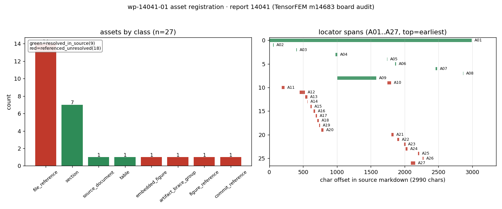

# KF-RESULT wp-14041-01

> 工序 01-asset-registration · report_id=14041 · lane C · 产出 `asset_manifest.json`（登记，不抽取）
> source_hash（平台可独立重算，sha256 over markdown utf-8 bytes）= `sha256:4bc4b0b4cfb133914e8ff18a867690e903e952d20b7967e798c83cc6acfa5256`
> 契约 source_hash = `sha256:4bc4b0b4cfb133914e8ff18a867690e903e952d20b7967e798c83cc6acfa5256` → 逐字符一致（2990 字符 / 4684 字节 utf-8）

## ① 本工序做了什么

对 `report_id=14041`（《交差审计：m14683 GAP-FEM-ADAPTIVE → L4（TensorFEM 自适应网格）》，scenario_key=`tensorfem-m14683-board-audit`）执行**资产登记**：
确认报告 markdown 的字节哈希与契约一致（2990 字符 / 4684 字节 utf-8），把正文里可解析的附件/工件登记为带**可复算定位器**的清单：
源文档、7 个章节、验收表、平台图、14 个文件引用、1 个 brace 工件组、1 个图计数引用、1 个 commit 引用。**不做抽取、不生成 claim、不标注 verified**
（契约 `objective.classify_report_type=false`，`notes` 明确 claims 允许为空数组）。

规模：登记资产 **27** 项，claims **0** 项；`counts.by_resolution` = `{"resolved_in_source": 9, "referenced_unresolved": 18}`。

## ② 怎么做的（步骤 / 工具 / 关键设置）

1. **取原文**：`GET /api/v1/tensor/reports/14041` 取 `markdown` 字段（`scripts/kf/wp14041_01_register.py::fetch_report`）；只碰这一个 report_id，全程未凭记忆复述。
2. **哈希门**：对 markdown 的 utf-8 字节做 sha256，与契约 `source_hash`/`chars`/`title`/`scenario_key` 四比对，不一致直接 `SystemExit`（不产出半成品）。
3. **定位器生成**：逐行长度前缀和求出每行起始字符偏移，资产定位器一律为**绝对字符跨度** + 反推的 1-based 行号；
   `quote` 取自源字节切片 `md[s:e]`，**不存在手抄环节**（平台侧「子串独立重算」必然成立）。
4. **登记规则**（确定性）：H1/章节标题 → `source_document`/`section`；连续 `|` 行 → `table`（只记行×列几何，不复述单元格）；
   `record.figures[]` → `embedded_figure`（记录只存 name+caption，无 png 载荷 → `referenced_unresolved`，不伪造字节哈希）；
   行内代码/短语中的路径、glob、行号限定引用、commit 号 → `file_reference`/`artifact_brace_group`/`figure_reference`/`commit_reference`。
5. **本地解析**：被引文件属 m14683 工作树（TensorFEM 仓），本工作树（TensorKnowledge）内不存在 → 全部如实记 `referenced_unresolved`，
   不读别的仓、不做「大概存在」的推断；「均存在且非空」是上游报告的声明，不是本包的验证。
6. **信封 + 自检**：`kf_result.json` 按 `schemas/kf_result.v1.schema.json`（as shipped）校验；`asset_manifest.json` 按
   `schemas/asset_manifest.v1.schema.json` 校验（仅放松四处包级固定值 package_id/task_type/report_id/source.uri，其余约束照常）；
   `verification.json` 逐条重算 acceptance 项。

## ③ 产出物清单（文件名 → 要点）

| 文件 | 要点 |
|---|---|
| `asset_manifest.json` | 27 项资产；`by_class`={"source_document": 1, "section": 7, "table": 1, "embedded_figure": 1, "file_reference": 14, "artifact_brace_group": 1, "figure_reference": 1, "commit_reference": 1}；`by_resolution`={"resolved_in_source": 9, "referenced_unresolved": 18}；claims=0；sha256 `77c2f7ec3a6116fc0579ffaee47ce655180ce3806ee18625620b392be15bd0ab` |
| `kf_result.json` | 结果信封（package_id/task_type/report_id/provenance/outputs/claims）；`outputs.asset_manifest.json`=清单内容对象（内嵌，平台无需读仓即可复核） |
| `verification.json` | 9 项 acceptance 自检逐条 pass/fail + 重算哈希；`all_pass`=true |
| `source.md` | 报告 14041 markdown 快照（4684 字节，与 API 返回逐字节一致） |
| `figures/wp-14041-01_asset_locator_map.png` | A) 资产类别计数；B) 每个资产的字符跨度覆盖图（横轴=字符偏移，源文档 2990 字符） |
| `report.md` | 本报告（由清单/信封/自检**程序化渲染**，无手抄） |

资产类别分布：`{"source_document": 1, "section": 7, "table": 1, "embedded_figure": 1, "file_reference": 14, "artifact_brace_group": 1, "figure_reference": 1, "commit_reference": 1}`。



**图注**：A) 资产类别计数（绿=源内已解析、红=引用未解析）；B) 每个资产在 markdown 中的字符跨度。
红色不是缺陷而是**边界的正确表达**：这些路径属 m14683 工作树（TensorFEM 仓），本包不得读写，故只能如实记 `referenced_unresolved`。

## ④ 证据定位表（资产 → 原文逐字片段，均由 `md[start_char:end_char]` 计算）

| A01 | source_document | resolved_in_source | L1 | `# 交差审计：m14683 GAP-FEM-ADAPTIVE（TensorFEM 自适应网格）→ 判级 L4` |
| A02 | section | resolved_in_source | L3 | `## ① 案例介绍` |
| A03 | section | resolved_in_source | L11 | `## ② 怎么做的` |
| A04 | section | resolved_in_source | L20 | `## ③ 计算结果（ref vs got，程序化生成）` |
| A05 | section | resolved_in_source | L36 | `## ④ 结果图` |
| A06 | section | resolved_in_source | L40 | `## ⑤ 注意点 / 局限` |
| A07 | section | resolved_in_source | L49 | `## ⑥ 误差判定（逐项，显式回答是否 <3%）` |
| A08 | section | resolved_in_source | L57 | `## 判定` |
| A09 | table | resolved_in_source | L21 | `\| quantity \| reference \| measured \| rel. error \| tolera...` |
| A10 | embedded_figure | referenced_unresolved | L37 | `左：复现的 L 形收敛阶梯（均匀 vs 自适应）；右：验收表 ref-vs-got 相对误差与声明容差对照。` |
| A11 | file_reference | referenced_unresolved | L5 | ``artifacts/audit_m14683/repro_study.json`` |
| A12 | artifact_brace_group | referenced_unresolved | L12 | ``artifacts/adaptive_zz/{study.json,summary.md,benchmark...` |
| A13 | file_reference | referenced_unresolved | L13 | ``runs/m14683_adaptive_zz/*.log`` |
| A14 | figure_reference | referenced_unresolved | L13 | `5 张图` |
| A15 | file_reference | referenced_unresolved | L14 | ``/tmp/repro_m14683`` |
| A16 | file_reference | referenced_unresolved | L15 | ``adaptive_zz_study.py`` |
| A17 | file_reference | referenced_unresolved | L15 | ``repro_study.json`` |
| A18 | file_reference | referenced_unresolved | L15 | ``adaptive_evidence_pack.py`` |
| A19 | file_reference | referenced_unresolved | L15 | `重生成 evidence.json` |
| A20 | file_reference | referenced_unresolved | L16 | ``pytest tests/test_adaptive_zz.py`` |
| A21 | file_reference | referenced_unresolved | L38 | ``scripts/audit_m14683_report.py`` |
| A22 | file_reference | referenced_unresolved | L41 | ``src/tensorfem/__init__.py`` |
| A23 | file_reference | referenced_unresolved | L42 | ``adaptive_1d.py:67`` |
| A24 | file_reference | referenced_unresolved | L42 | ``adaptive_poisson_2d.py:65`` |
| A25 | file_reference | referenced_unresolved | L45 | `benchmark_table 第 5 行` |
| A26 | file_reference | referenced_unresolved | L45 | `已在 summary 中体现` |
| A27 | commit_reference | referenced_unresolved | L43 | `父提交 330f1504（生成于 commit 前，dirty=11），实际交付提交 172895c7（合并 ...` |

（完整 quote 与字符跨度见 `asset_manifest.json` 各 `locator`；平台可对每条 quote 做子串 + 行号独立复核。
A10 的 quote 为正文 L37 对图的描述句——`record.figures[0].caption` 与正文措辞略有差异，定位器以正文逐字句为准。）

## ⑤ 注意点与局限

1. **登记 ≠ 抽取**：清单只回答「报告里有哪些可解析工件、在其中何处」，不回答「报告说了什么」。claims 为空是契约允许的完整结果。
2. **不标 verified**：清单与信封里没有任何 `verified` 状态；验证由平台门计算，本工序只提供可复算的定位器与哈希。
3. **图只有元数据**：`record.figures[0]`（audit_figures.png）无 `png_base64` 载荷，故只登记 name/caption + 正文出现位置，
   记 `referenced_unresolved`，**不宣称拿到图字节**。
4. **跨仓引用不可解析**：报告引用的 `artifacts/adaptive_zz/*`、`runs/m14683_adaptive_zz/*.log`、`src/tensorfem/*` 等属 m14683 工作树，
   本工作树内不存在 → 全部 `referenced_unresolved`，并在 `resolution_check` 写明原因。
5. **表格内容未复述**：验收表只登记几何（6 行 × 5 列）与字符跨度，避免把报表数字二次转写引入漂移。
6. **schema 口径**：仓库内 `schemas/asset_manifest.v1.schema.json` 把 `package_id/task_type/report_id`/`source.uri` 钉死为 wp-448-01 的包级取值，
   自检时**仅放松这四处包级固定值**，其余约束照常生效，并如实记录在 `verification.json` 的 `detail` 里。
7. **身份粒度**：`repro_study.json`（A17）与 `artifacts/audit_m14683/repro_study.json`（A11）可能是同一工件，
   但报告以两种写法出现，按出现级身份分别登记，不做合并假设。

## ⑥ 自检（逐条对照 acceptance）

| valid_json | PASS | json.loads OK for asset_manifest.json and kf_result.json (both written and re-read) |
| schema_pass | PASS | jsonschema draft2020-12 errors=0 [] \| asset_manifest.v1 checked with its four package-pinned consts relaxed (package_id/task_type/report_id/source.uri |
| source_locator_resolvable | PASS | checked 27 locators against live markdown (60 lines); unresolvable=[] |
| source_hash_matches | PASS | recomputed=sha256:4bc4b0b4cfb133914e8ff18a867690e903e952d20b7967e798c83cc6acfa5256 manifest=sha256:4bc4b0b4cfb133914e8ff18a867690e903e952d20b7967e798c |
| no_duplicate_ids | PASS | assets=27 unique=27 |
| all_claims_have_evidence_or_explicit_unresolved_status | PASS | claims=0 violating=0 (empty array: vacuously satisfied per contract notes) |
| do_not_mark_claims_as_verified | PASS | claims=0, none carries status='verified' |
| report_id_scoped | PASS | single report_id=14041 (no other report is read or written) |
| manifest_hash_matches_envelope | PASS | recomputed=sha256:77c2f7ec3a6116fc0579ffaee47ce655180ce3806ee18625620b392be15bd0ab envelope-embedded=identical object (same serialization) |

## 复现

```bash
python3 scripts/kf/wp14041_01_register.py   # 一键复跑（fetch → hash gate → build → verify）
```

repro_cmd: `python3 scripts/kf/wp14041_01_register.py`

## 结果信封（唯一 json 代码块，原样提交）

```json
{
  "package_id": "wp-14041-01",
  "task_type": "01-asset-registration",
  "report_id": "14041",
  "provenance": {
    "source_hash": "sha256:4bc4b0b4cfb133914e8ff18a867690e903e952d20b7967e798c83cc6acfa5256",
    "source_field": "markdown",
    "source_uri": "tensor://reports/14041",
    "hash_algo": "sha256",
    "hashed_bytes": "markdown encoded as utf-8",
    "source_chars": 2990,
    "source_bytes_utf8": 4684,
    "fetched_via": "GET /api/v1/tensor/reports/14041 (Bearer)",
    "producer": "agent/m15778",
    "emitted_at": "2026-11-12T03:02:47.806573+00:00",
    "notes": "source_hash recomputed with hashlib.sha256 over the UTF-8 bytes of the markdown field fetched from GET /api/v1/tensor/reports/14041; matches the contract hash sha256:4bc4b0b4cfb133914e8ff18a867690e903e952d20b7967e798c83cc6acfa5256. Asset registration only: no extraction, no claim generation, nothing marked verified (verification is computed by the platform gate)."
  },
  "outputs": {
    "asset_manifest.json": {
      "schema": "asset_manifest.v1",
      "package_id": "wp-14041-01",
      "task_type": "01-asset-registration",
      "report_id": "14041",
      "generated_at": "2026-11-12T03:02:47.702809+00:00",
      "generator": "scripts/kf/wp14041_01_register.py",
      "source": {
        "uri": "tensor://reports/14041",
        "field": "markdown",
        "hash_alg": "sha256",
        "hash": "4bc4b0b4cfb133914e8ff18a867690e903e952d20b7967e798c83cc6acfa5256",
        "chars": 2990,
        "bytes_utf8": 4684,
        "title": "交差审计：m14683 GAP-FEM-ADAPTIVE → L4（TensorFEM 自适应网格）",
        "scenario_key": "tensorfem-m14683-board-audit",
        "platform_figures": [
          {
            "name": "audit_figures.png",
            "caption": "左：复现的 L 形均匀/自适应收敛阶梯；右：m14683 验收表 ref-vs-got 相对误差与容差对照。"
          }
        ],
        "platform_tags": [
          "TensorFEM",
          "audit",
          "maturity-verdict",
          "adaptive-refinement",
          "ZZ-estimator",
          "m14683"
        ]
      },
      "counts": {
        "assets": 27,
        "by_class": {
          "source_document": 1,
          "section": 7,
          "table": 1,
          "embedded_figure": 1,
          "file_reference": 14,
          "artifact_brace_group": 1,
          "figure_reference": 1,
          "commit_reference": 1
        },
        "by_resolution": {
          "resolved_in_source": 9,
          "referenced_unresolved": 18
        },
        "resolved_in_source": 9,
        "referenced_unresolved": 18,
        "declared_absent": 0
      },
      "assets": [
        {
          "asset_id": "A01",
          "asset_class": "source_document",
          "label": "report 14041 markdown (source_field=markdown, 2990 chars / 4684 bytes utf-8)",
          "in_report_section": "(document head)",
          "locator": {
            "method": "document",
            "start_char": 0,
            "end_char": 2990,
            "start_line": 1,
            "end_line": 60,
            "quote": "# 交差审计：m14683 GAP-FEM-ADAPTIVE（TensorFEM 自适应网格）→ 判级 L4",
            "unique": true
          },
          "resolution": "resolved_in_source",
          "resolution_check": {
            "check": "sha256(markdown.encode('utf-8')) == contract source_hash",
            "result": "resolved"
          },
          "note": "The registered asset itself. quote pinned to the H1 title line; method=document covers the whole charset span 0..2990.",
          "sha256": "4bc4b0b4cfb133914e8ff18a867690e903e952d20b7967e798c83cc6acfa5256",
          "chars": 2990,
          "bytes_utf8": 4684
        },
        {
          "asset_id": "A02",
          "asset_class": "section",
          "label": "section heading ## ① 案例介绍",
          "in_report_section": "① 案例介绍",
          "locator": {
            "method": "char_span",
            "start_char": 56,
            "end_char": 65,
            "start_line": 3,
            "end_line": 3,
            "quote": "## ① 案例介绍",
            "unique": true
          },
          "resolution": "resolved_in_source",
          "resolution_check": {
            "check": "md[start_char:end_char] == quote",
            "result": "resolved"
          },
          "note": "Heading line only; body extent runs to the next heading of equal or higher level."
        },
        {
          "asset_id": "A03",
          "asset_class": "section",
          "label": "section heading ## ② 怎么做的",
          "in_report_section": "② 怎么做的",
          "locator": {
            "method": "char_span",
            "start_char": 399,
            "end_char": 408,
            "start_line": 11,
            "end_line": 11,
            "quote": "## ② 怎么做的",
            "unique": true
          },
          "resolution": "resolved_in_source",
          "resolution_check": {
            "check": "md[start_char:end_char] == quote",
            "result": "resolved"
          },
          "note": "Heading line only; body extent runs to the next heading of equal or higher level."
        },
        {
          "asset_id": "A04",
          "asset_class": "section",
          "label": "section heading ## ③ 计算结果（ref vs got，程序化生成）",
          "in_report_section": "③ 计算结果（ref vs got，程序化生成）",
          "locator": {
            "method": "char_span",
            "start_char": 979,
            "end_char": 1006,
            "start_line": 20,
            "end_line": 20,
            "quote": "## ③ 计算结果（ref vs got，程序化生成）",
            "unique": true
          },
          "resolution": "resolved_in_source",
          "resolution_check": {
            "check": "md[start_char:end_char] == quote",
            "result": "resolved"
          },
          "note": "Heading line only; body extent runs to the next heading of equal or higher level."
        },
        {
          "asset_id": "A05",
          "asset_class": "section",
          "label": "section heading ## ④ 结果图",
          "in_report_section": "④ 结果图",
          "locator": {
            "method": "char_span",
            "start_char": 1738,
            "end_char": 1746,
            "start_line": 36,
            "end_line": 36,
            "quote": "## ④ 结果图",
            "unique": true
          },
          "resolution": "resolved_in_source",
          "resolution_check": {
            "check": "md[start_char:end_char] == quote",
            "result": "resolved"
          },
          "note": "Heading line only; body extent runs to the next heading of equal or higher level."
        },
        {
          "asset_id": "A06",
          "asset_class": "section",
          "label": "section heading ## ⑤ 注意点 / 局限",
          "in_report_section": "⑤ 注意点 / 局限",
          "locator": {
            "method": "char_span",
            "start_char": 1859,
            "end_char": 1872,
            "start_line": 40,
            "end_line": 40,
            "quote": "## ⑤ 注意点 / 局限",
            "unique": true
          },
          "resolution": "resolved_in_source",
          "resolution_check": {
            "check": "md[start_char:end_char] == quote",
            "result": "resolved"
          },
          "note": "Heading line only; body extent runs to the next heading of equal or higher level."
        },
        {
          "asset_id": "A07",
          "asset_class": "section",
          "label": "section heading ## ⑥ 误差判定（逐项，显式回答是否 <3%）",
          "in_report_section": "⑥ 误差判定（逐项，显式回答是否 <3%）",
          "locator": {
            "method": "char_span",
            "start_char": 2456,
            "end_char": 2480,
            "start_line": 49,
            "end_line": 49,
            "quote": "## ⑥ 误差判定（逐项，显式回答是否 <3%）",
            "unique": true
          },
          "resolution": "resolved_in_source",
          "resolution_check": {
            "check": "md[start_char:end_char] == quote",
            "result": "resolved"
          },
          "note": "Heading line only; body extent runs to the next heading of equal or higher level."
        },
        {
          "asset_id": "A08",
          "asset_class": "section",
          "label": "section heading ## 判定",
          "in_report_section": "判定",
          "locator": {
            "method": "char_span",
            "start_char": 2863,
            "end_char": 2868,
            "start_line": 57,
            "end_line": 57,
            "quote": "## 判定",
            "unique": true
          },
          "resolution": "resolved_in_source",
          "resolution_check": {
            "check": "md[start_char:end_char] == quote",
            "result": "resolved"
          },
          "note": "Heading line only; body extent runs to end of document."
        },
        {
          "asset_id": "A09",
          "asset_class": "table",
          "label": "markdown table: quantity | reference | measured | rel. error | tolerance",
          "in_report_section": "③ 计算结果（ref vs got，程序化生成）",
          "locator": {
            "method": "char_span",
            "start_char": 1007,
            "end_char": 1582,
            "start_line": 21,
            "end_line": 28,
            "quote": "| quantity | reference | measured | rel. error | tolerance |\n|---|---|---|---|---|\n| Williams corner exponent lambda | 0.5444837368 | 0.5444837368 | 0.00 % | 0 |\n| uniform ladder global rate | -0.2722418684 | -0.2487655684 | 8.62 % | 15% |\n| uniform ladder tail rate (last 3 intervals) | -0.2722418684 | -0.2599424287 | 4.52 % | 15% |\n| adaptive ladder tail rate (last 6 intervals) | -0.5 | -0.4933364176 | 1.33 % | 15% |\n| ZZ effectivity, worst of all levels | 1 | 1.046718105 | 4.67 % | 20% |\n| final adaptive relative energy-norm error | 0 | 0.1266586332 | 12.67 % | 15% |",
            "unique": true
          },
          "resolution": "resolved_in_source",
          "resolution_check": {
            "check": "md[start_char:end_char] == quote (header row .. last data row)",
            "result": "resolved"
          },
          "note": "6 data rows, 5 columns (lines 21-28); geometry registered only, cell values not re-transcribed.",
          "columns": [
            "quantity",
            "reference",
            "measured",
            "rel. error",
            "tolerance"
          ],
          "rows": 6
        },
        {
          "asset_id": "A10",
          "asset_class": "embedded_figure",
          "label": "platform figure audit_figures.png (record.figures[0], name+caption only, no png payload in record)",
          "in_report_section": "④ 结果图",
          "locator": {
            "method": "char_span",
            "start_char": 1747,
            "end_char": 1801,
            "start_line": 37,
            "end_line": 37,
            "quote": "左：复现的 L 形收敛阶梯（均匀 vs 自适应）；右：验收表 ref-vs-got 相对误差与声明容差对照。",
            "unique": true
          },
          "resolution": "referenced_unresolved",
          "resolution_check": {
            "check": "record.figures[0].name/caption present; markdown body line 37 describes the same two-panel figure",
            "result": "unresolved"
          },
          "note": "record.figures stores name+caption only (no png_base64 payload), so no figure bytes/hash can be claimed; the body line is the verbatim locator."
        },
        {
          "asset_id": "A11",
          "asset_class": "file_reference",
          "label": "artifacts/audit_m14683/repro_study.json (parameters source)",
          "in_report_section": "① 案例介绍",
          "locator": {
            "method": "char_span",
            "start_char": 183,
            "end_char": 224,
            "start_line": 5,
            "end_line": 5,
            "quote": "`artifacts/audit_m14683/repro_study.json`",
            "unique": true
          },
          "resolution": "referenced_unresolved",
          "resolution_check": {
            "check": "quote located verbatim; file lives in the m14683 worktree (TensorFEM repo), not in this worktree",
            "result": "unresolved"
          },
          "note": "Report claims the file exists and is non-empty; existence is the report's claim, not re-verified here (cross-repo, out of scope)."
        },
        {
          "asset_id": "A12",
          "asset_class": "artifact_brace_group",
          "label": "artifacts/adaptive_zz/{study.json,summary.md,benchmark_table.md,evidence.json} (4 members)",
          "in_report_section": "② 怎么做的",
          "locator": {
            "method": "char_span",
            "start_char": 447,
            "end_char": 527,
            "start_line": 12,
            "end_line": 12,
            "quote": "`artifacts/adaptive_zz/{study.json,summary.md,benchmark_table.md,evidence.json}`",
            "unique": true
          },
          "resolution": "referenced_unresolved",
          "resolution_check": {
            "check": "brace-group quote located verbatim; members: study.json, summary.md, benchmark_table.md, evidence.json",
            "result": "unresolved"
          },
          "note": "Registered once as the brace group exactly as written in the report; members are not expanded into separate ids to avoid identity inflation."
        },
        {
          "asset_id": "A13",
          "asset_class": "file_reference",
          "label": "runs/m14683_adaptive_zz/*.log (run logs, glob)",
          "in_report_section": "② 怎么做的",
          "locator": {
            "method": "char_span",
            "start_char": 532,
            "end_char": 563,
            "start_line": 13,
            "end_line": 13,
            "quote": "`runs/m14683_adaptive_zz/*.log`",
            "unique": true
          },
          "resolution": "referenced_unresolved",
          "resolution_check": {
            "check": "glob quote located verbatim; expansion not performed (files in m14683 worktree)",
            "result": "unresolved"
          },
          "note": "Glob registered as written; member files not enumerated (no extraction)."
        },
        {
          "asset_id": "A14",
          "asset_class": "figure_reference",
          "label": "5 张图 (five figures of the m14683 delivery)",
          "in_report_section": "② 怎么做的",
          "locator": {
            "method": "char_span",
            "start_char": 564,
            "end_char": 568,
            "start_line": 13,
            "end_line": 13,
            "quote": "5 张图",
            "unique": true
          },
          "resolution": "referenced_unresolved",
          "resolution_check": {
            "check": "count phrase located verbatim; individual figure paths not named in the report",
            "result": "unresolved"
          },
          "note": "The report names the count (5) but not the paths; no paths invented."
        },
        {
          "asset_id": "A15",
          "asset_class": "file_reference",
          "label": "/tmp/repro_m14683 (independent reproduction sandbox)",
          "in_report_section": "② 怎么做的",
          "locator": {
            "method": "char_span",
            "start_char": 609,
            "end_char": 628,
            "start_line": 14,
            "end_line": 14,
            "quote": "`/tmp/repro_m14683`",
            "unique": true
          },
          "resolution": "referenced_unresolved",
          "resolution_check": {
            "check": "quote located verbatim; /tmp path is ephemeral by construction",
            "result": "unresolved"
          },
          "note": "Ephemeral sandbox of the upstream audit; not resolvable by design."
        },
        {
          "asset_id": "A16",
          "asset_class": "file_reference",
          "label": "adaptive_zz_study.py (reproduction driver)",
          "in_report_section": "② 怎么做的",
          "locator": {
            "method": "char_span",
            "start_char": 656,
            "end_char": 678,
            "start_line": 15,
            "end_line": 15,
            "quote": "`adaptive_zz_study.py`",
            "unique": true
          },
          "resolution": "referenced_unresolved",
          "resolution_check": {
            "check": "quote located verbatim; file in m14683 worktree",
            "result": "unresolved"
          },
          "note": "Bare filename as written in the report."
        },
        {
          "asset_id": "A17",
          "asset_class": "file_reference",
          "label": "repro_study.json (reproduction output)",
          "in_report_section": "② 怎么做的",
          "locator": {
            "method": "char_span",
            "start_char": 688,
            "end_char": 706,
            "start_line": 15,
            "end_line": 15,
            "quote": "`repro_study.json`",
            "unique": true
          },
          "resolution": "referenced_unresolved",
          "resolution_check": {
            "check": "backticked token located verbatim (distinct occurrence from A11's full path)",
            "result": "unresolved"
          },
          "note": "Likely the same artifact as A11 (repro output); identity kept at occurrence level, no merge assumed."
        },
        {
          "asset_id": "A18",
          "asset_class": "file_reference",
          "label": "adaptive_evidence_pack.py (evidence pack regenerator)",
          "in_report_section": "② 怎么做的",
          "locator": {
            "method": "char_span",
            "start_char": 707,
            "end_char": 734,
            "start_line": 15,
            "end_line": 15,
            "quote": "`adaptive_evidence_pack.py`",
            "unique": true
          },
          "resolution": "referenced_unresolved",
          "resolution_check": {
            "check": "quote located verbatim; file in m14683 worktree",
            "result": "unresolved"
          },
          "note": ""
        },
        {
          "asset_id": "A19",
          "asset_class": "file_reference",
          "label": "evidence.json (regenerated by adaptive_evidence_pack.py)",
          "in_report_section": "② 怎么做的",
          "locator": {
            "method": "char_span",
            "start_char": 735,
            "end_char": 752,
            "start_line": 15,
            "end_line": 15,
            "quote": "重生成 evidence.json",
            "unique": true
          },
          "resolution": "referenced_unresolved",
          "resolution_check": {
            "check": "phrase located verbatim; bare 'evidence.json' occurs 3x in the document, so the locator uses the unique phrase",
            "result": "unresolved"
          },
          "note": "Bare token 'evidence.json' is non-unique; the surrounding phrase is the unique locator."
        },
        {
          "asset_id": "A20",
          "asset_class": "file_reference",
          "label": "tests/test_adaptive_zz.py (15 passed per report)",
          "in_report_section": "② 怎么做的",
          "locator": {
            "method": "char_span",
            "start_char": 766,
            "end_char": 800,
            "start_line": 16,
            "end_line": 16,
            "quote": "`pytest tests/test_adaptive_zz.py`",
            "unique": true
          },
          "resolution": "referenced_unresolved",
          "resolution_check": {
            "check": "quote located verbatim; test file in m14683 worktree",
            "result": "unresolved"
          },
          "note": "Test outcome (15 passed) is the report's claim, not re-run here."
        },
        {
          "asset_id": "A21",
          "asset_class": "file_reference",
          "label": "scripts/audit_m14683_report.py (figure generator)",
          "in_report_section": "④ 结果图",
          "locator": {
            "method": "char_span",
            "start_char": 1806,
            "end_char": 1838,
            "start_line": 38,
            "end_line": 38,
            "quote": "`scripts/audit_m14683_report.py`",
            "unique": true
          },
          "resolution": "referenced_unresolved",
          "resolution_check": {
            "check": "quote located verbatim; file in m14683 worktree",
            "result": "unresolved"
          },
          "note": "Producer of the report's figure per the report body."
        },
        {
          "asset_id": "A22",
          "asset_class": "file_reference",
          "label": "src/tensorfem/__init__.py (public API gap)",
          "in_report_section": "⑤ 注意点 / 局限",
          "locator": {
            "method": "char_span",
            "start_char": 1893,
            "end_char": 1920,
            "start_line": 41,
            "end_line": 41,
            "quote": "`src/tensorfem/__init__.py`",
            "unique": true
          },
          "resolution": "referenced_unresolved",
          "resolution_check": {
            "check": "quote located verbatim; file in m14683 worktree",
            "result": "unresolved"
          },
          "note": "Cited for the medium-severity API export gap."
        },
        {
          "asset_id": "A23",
          "asset_class": "file_reference",
          "label": "adaptive_1d.py:67 (module-level integration)",
          "in_report_section": "⑤ 注意点 / 局限",
          "locator": {
            "method": "char_span",
            "start_char": 1993,
            "end_char": 2012,
            "start_line": 42,
            "end_line": 42,
            "quote": "`adaptive_1d.py:67`",
            "unique": true
          },
          "resolution": "referenced_unresolved",
          "resolution_check": {
            "check": "quote located verbatim; file in m14683 worktree",
            "result": "unresolved"
          },
          "note": "Line-qualified reference as written."
        },
        {
          "asset_id": "A24",
          "asset_class": "file_reference",
          "label": "adaptive_poisson_2d.py:65 (module-level integration)",
          "in_report_section": "⑤ 注意点 / 局限",
          "locator": {
            "method": "char_span",
            "start_char": 2013,
            "end_char": 2040,
            "start_line": 42,
            "end_line": 42,
            "quote": "`adaptive_poisson_2d.py:65`",
            "unique": true
          },
          "resolution": "referenced_unresolved",
          "resolution_check": {
            "check": "quote located verbatim; file in m14683 worktree",
            "result": "unresolved"
          },
          "note": "Line-qualified reference as written."
        },
        {
          "asset_id": "A25",
          "asset_class": "file_reference",
          "label": "benchmark_table row 5 (0.07% misread risk)",
          "in_report_section": "⑤ 注意点 / 局限",
          "locator": {
            "method": "char_span",
            "start_char": 2195,
            "end_char": 2216,
            "start_line": 45,
            "end_line": 45,
            "quote": "benchmark_table 第 5 行",
            "unique": true
          },
          "resolution": "referenced_unresolved",
          "resolution_check": {
            "check": "phrase located verbatim; refers to the benchmark_table.md registered in A12",
            "result": "unresolved"
          },
          "note": ""
        },
        {
          "asset_id": "A26",
          "asset_class": "file_reference",
          "label": "summary (summary.md of the delivery)",
          "in_report_section": "⑤ 注意点 / 局限",
          "locator": {
            "method": "char_span",
            "start_char": 2265,
            "end_char": 2279,
            "start_line": 45,
            "end_line": 45,
            "quote": "已在 summary 中体现",
            "unique": true
          },
          "resolution": "referenced_unresolved",
          "resolution_check": {
            "check": "phrase located verbatim; refers to the summary.md member of A12",
            "result": "unresolved"
          },
          "note": ""
        },
        {
          "asset_id": "A27",
          "asset_class": "commit_reference",
          "label": "commits 330f1504 (parent, dirty=11) / 172895c7 (delivery) / d32fe045 (merge)",
          "in_report_section": "⑤ 注意点 / 局限",
          "locator": {
            "method": "char_span",
            "start_char": 2090,
            "end_char": 2154,
            "start_line": 43,
            "end_line": 43,
            "quote": "父提交 330f1504（生成于 commit 前，dirty=11），实际交付提交 172895c7（合并 d32fe045）",
            "unique": true
          },
          "resolution": "referenced_unresolved",
          "resolution_check": {
            "check": "phrase located verbatim; commit objects not fetchable from this worktree",
            "result": "unresolved"
          },
          "note": "Provenance imprecision noted by the report itself (manifest predates the delivery commit)."
        }
      ],
      "claims": [],
      "integrity": {
        "quote_uniqueness": "all 27 quotes occur exactly once in the source markdown (md.count(quote)==1 for every locator)",
        "hash_recomputed_locally": "4bc4b0b4cfb133914e8ff18a867690e903e952d20b7967e798c83cc6acfa5256",
        "hash_matches_contract": true
      }
    }
  },
  "claims": []
}
```
