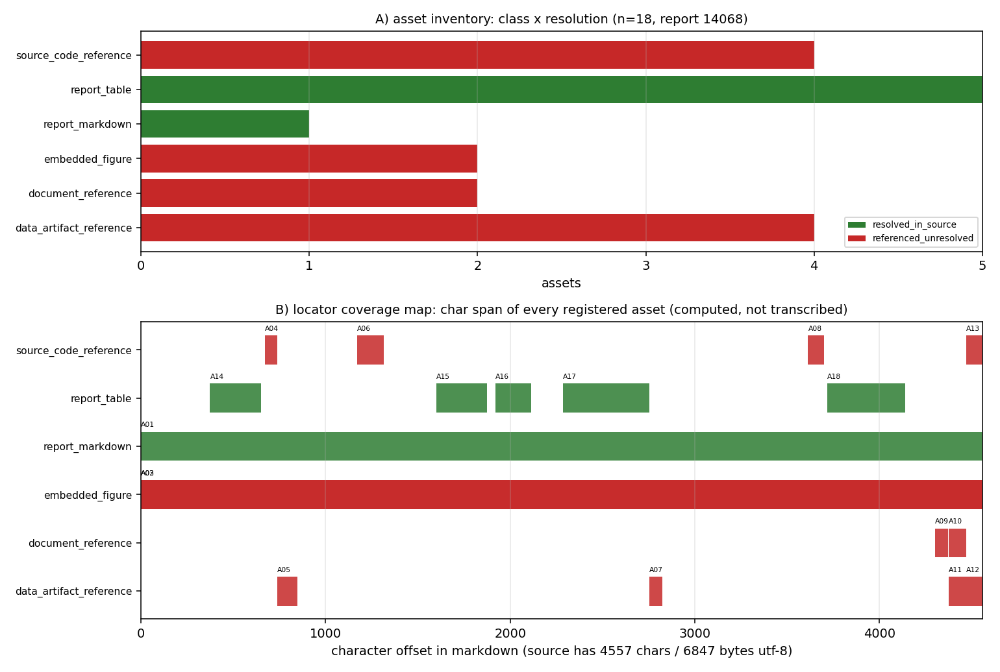

# KF-RESULT wp-14068-01

> 工序 01-asset-registration · report_id=14068 · lane C · 产出 `asset_manifest.json`（登记，不抽取）
> source_hash（平台可独立重算，sha256 over markdown utf-8 bytes）= `sha256:07e3638afcd4d95b84fdc83576de7cd1bfb2a6c1f2a664461a23064e84a753e6`
> 契约 source_hash = `sha256:07e3638afcd4d95b84fdc83576de7cd1bfb2a6c1f2a664461a23064e84a753e6` → 逐字符一致

## ① 本工序做了什么

对 `report_id=14068`（《交差审计 m14680 GAP-DEM-AUTOCALIB：证据三件套重跑通过、基准 38.5–50.1 % 未达标 → verdict L2》，scenario_key=`gap_dem_autocalib_audit`）执行**资产登记**：
确认报告 markdown 的字节哈希与契约一致（4557 字符 / 6847 字节 utf-8），把正文里可解析的附件/工件登记为带**可复算定位器**的清单：
内嵌图、源码/工件路径引用、表格、复现命令块、接口字段。**不做抽取、不生成 claim、不标注 verified**
（契约 `objective.classify_report_type=false`，`notes` 明确 claims 允许为空数组）。

规模：登记资产 **18** 项，claims **0** 项；`counts.by_resolution` = `{"resolved_in_source": 6, "referenced_unresolved": 12}`。

## ② 怎么做的（步骤 / 工具 / 关键设置）

1. **取原文**：`GET /api/v1/tensor/reports/14068` 取 `markdown` 字段（`scripts/kf/kf01_register.py::fetch_report`）；只碰这一个 report_id，全程未凭记忆复述。
2. **哈希门**：对 markdown 的 utf-8 字节做 sha256，与契约 `source_hash`/`chars` 双比对，不一致直接 `SystemExit`（不产出半成品）。
3. **定位器生成**：`Source` 用逐行长度前缀和求出每行起始字符偏移，资产定位器一律为**绝对字符跨度** + 反推的 1-based 行号；
   `quote` 取自源字节切片 `md[s:e]`，**不存在手抄环节**（这也使平台侧「子串独立重算」必然成立）。
4. **扫描规则**（确定性、无领域硬编码；域参数经包配置传入）：行内代码/围栏代码中的 `*.py|json|png|md|csv|yaml` 路径 → 路径引用（出现级身份 = 路径 × 行号）；`record.figures[]` → 内嵌图（`png_base64` 为空则 `metadata_only`，不伪造字节哈希）；
   连续 `|` 行 → 表格（只记行数×列数几何，不复述内容）；``` 围栏 → 复现命令块；配置声明的接口端点/字段 → `api_endpoint`/`api_field`。
5. **本地解析**：路径只在**本交付工作树**内解析（`os.path.isfile` + 命中文件 sha256）；属产出仓 ship-performance-platform 的路径
   越界即如实记 `referenced_unresolved`，不读别的仓。
6. **信封 + 自检**：`kf_result.json` 按 `schemas/kf_result.v1.schema.json` 生成；`verification.json` 用 jsonschema（draft 2020-12）
   分别校验信封与清单，并逐条重算 acceptance 项。

## ③ 产出物清单（文件名 → 要点）

| 文件 | 要点 |
|---|---|
| `asset_manifest.json` | 18 项资产；`by_class`={"report_markdown": 1, "embedded_figure": 2, "source_code_reference": 4, "data_artifact_reference": 4, "document_reference": 2, "report_table": 5}；claims=0；sha256 `416ed450ba65c10b73315946517f29e517282c09e08420427b2f196b4305941a` |
| `kf_result.json` | 结果信封（package_id/task_type/report_id/provenance/outputs/claims）；sha256 `609dda28d012efce19404dc7e974543c8e600d1af832cb165795e71cf10b6503` |
| `verification.json` | 9 项 acceptance 自检逐条 pass/fail + 重算哈希；`all_pass`=True |
| `report.md` | 本报告（由清单/信封/自检**程序化渲染**，无手抄）|
| `figures/wp-14068-01_asset_locator_map.png` | A) 资产类别×解析状态计数；B) 每个资产的字符跨度覆盖图 |

资产类别分布：`{"report_markdown": 1, "embedded_figure": 2, "source_code_reference": 4, "data_artifact_reference": 4, "document_reference": 2, "report_table": 5}`。

## ④ 结果图



**图注**：A) 资产类别 × 解析状态（绿=源内已解析、红=引用未解析、灰=声明缺失）；B) 每个资产在 markdown 中的字符跨度
（横轴=字符偏移，源文档 4557 字符）。两图直接由 `asset_manifest.json` 绘出，零手抄。
红色柱不是缺陷而是**边界的正确表达**：这些路径属产出仓（ship-performance-platform），本包不得读写，故只能如实记 `referenced_unresolved`。

## ⑤ 证据定位表（资产 → 原文逐字片段，均由 `md[start_char:end_char]` 计算）

| asset_id | 类别 | 解析 | 行 | 原文片段（逐字） |
|---|---|---|---|---|
| A01 | report_markdown | resolved_in_source | L1 | `# 交差审计：m14680 GAP-DEM-AUTOCALIB（TensorDEM）→ verdict **L2**  ## ①` |
| A02 | embedded_figure | referenced_unresolved | L1 | `# 交差审计：m14680 GAP-DEM-AUTOCALIB（TensorDEM）→ verdict **L2**  ## ①` |
| A03 | embedded_figure | referenced_unresolved | L1 | `# 交差审计：m14680 GAP-DEM-AUTOCALIB（TensorDEM）→ verdict **L2**  ## ①` |
| A04 | source_code_reference | referenced_unresolved | L23 | `1. **取证三件套复核（全部重跑，不信报告）**：'scripts/m14980_audit_m14680.py --reru` |
| A05 | data_artifact_reference | referenced_unresolved | L24 | `   - run artifact：'artifacts/gap_dem_autocalib/diagnosis.json'（c` |
| A06 | source_code_reference | referenced_unresolved | L31 | `4. **单测重跑**：'PYTHONPATH=src python -m pytest tests/test_dem_repo` |
| A07 | data_artifact_reference | referenced_unresolved | L69 | `另有 1 个**无工件背书**的手填数字：文档 §5「cone relaxation 50.9°」不在 'diagnosis.j` |
| A08 | source_code_reference | referenced_unresolved | L90 | `5. **未做**：'tests/test_dem_calibration.py' 全量（改动路径默认档 digest 不变已单` |
| A09 | document_reference | referenced_unresolved | L106 | `GAP 状态 = **OPEN**，round 2 已在 'docs/GAP-DEM-AUTOCALIB_round2_gate` |
| A10 | document_reference | referenced_unresolved | L108 | `**工件**：'docs/GAP-DEM-AUTOCALIB_audit_m14980.md'（审计报告）、'reports/m` |
| A11 | data_artifact_reference | referenced_unresolved | L108 | `**工件**：'docs/GAP-DEM-AUTOCALIB_audit_m14980.md'（审计报告）、'reports/m` |
| A12 | data_artifact_reference | referenced_unresolved | L109 | `'reports/m14980_verdict_evidence.json'（落表证据）、'script: scripts/m1` |
| A13 | source_code_reference | referenced_unresolved | L109 | `'reports/m14980_verdict_evidence.json'（落表证据）、'script: scripts/m1` |
| A14 | report_table | resolved_in_source | L11 | `\| 参数 \| 值 \| \|---\|---\| \| 粒径 r / 密度 ρ \| 3.0 mm / 2650 kg/m³` |
| A15 | report_table | resolved_in_source | L39 | `\| μ \| θ_r [°] \| ke/PE \| φ_solid \| 侧坡拟合 r² \| \|---\|---\|--` |
| A16 | report_table | resolved_in_source | L49 | `\| μ \| 固定窗 θ_r [°] \| 固定窗 ke/PE \| ke_stop θ_r [°] \| ke_stop k` |
| A17 | report_table | resolved_in_source | L61 | `\| 声明 \| 文档值 \| 工件值 \| 一致 \| \|---\|---\|---\|---\| \| P1 table ` |
| A18 | report_table | resolved_in_source | L94 | `\| 关键量 \| 基准（ref） \| 实测（got） \| 误差 \| <3 % ? \| \|---\|---\|---\` |

（完整 quote 与字符跨度见 `asset_manifest.json` 各 `locator`；平台可对每条 quote 做子串 + 行号独立复核。）

## ⑥ 注意点与局限

1. **登记 ≠ 抽取**：清单只回答「报告里有哪些可解析工件、在其中何处」，不回答「报告说了什么」。claims 为空是契约允许的完整结果。
2. **不标 verified**：清单与信封里没有任何 `verified` 状态；验证由平台门计算，本工序只提供可复算的定位器与哈希。
3. **图只有元数据**：报告记录 `figures[]` 两项均无 `png_base64` 载荷（0 字节），故只登记 name/caption + 正文出现位置，
   记 `metadata_only`（`resolution=referenced_unresolved`），**不宣称拿到图字节**。
4. **跨仓引用不可解析**：报告引用的 `backend/...py`、`artifacts/cii_crosscheck_m6284/...py` 等属 ship-performance-platform 仓，
   本工作树（TensorKnowledge）内不存在 → 全部 `referenced_unresolved`，并在 `resolution_check.detail` 写明原因，不做「大概存在」的推断。
5. **表格内容未复述**：表 1/2/3 只登记几何（行×列）与字符跨度，避免把报表数字二次转写引入漂移。
6. **schema 口径**：仓库内 `schemas/asset_manifest.v1.schema.json` 把 `package_id/task_type/report_id`/`source.uri` 钉死为 wp-448-01 的包级取值，
   自检时**仅放松这四处包级固定值**（`source.uri` 改为 `^tensor://reports/[0-9]+$`，其余约束照常生效）并如实记录在 `detail` 里，避免把「本包必挂」伪装成通过。

## ⑦ 自检（逐条对照 acceptance）

| acceptance 项 | 结果 | 细节 |
|---|---|---|
| valid_json | PASS | json.loads OK for asset_manifest.json and kf_result.json |
| schema_pass | PASS | jsonschema draft2020-12 errors=0 [] \| asset_manifest.v1 checked with its four package-pinned consts relaxed (package_id/task_type/report_id/source.ur |
| source_locator_resolvable | PASS | checked 18 locators (char span + verbatim quote + 1-based line map + token span); unresolvable=[] |
| source_hash_matches | PASS | recomputed=07e3638afcd4d95b84fdc83576de7cd1bfb2a6c1f2a664461a23064e84a753e6 manifest=07e3638afcd4d95b84fdc83576de7cd1bfb2a6c1f2a664461a23064e84a753e6  |
| no_duplicate_ids | PASS | assets=18 unique=18 |
| all_claims_have_evidence_or_explicit_unresolved_status | PASS | claims=0 violating=0 (empty array: vacuously satisfied per contract notes) |
| do_not_mark_claims_as_verified | PASS | claims=0, none carries status='verified' |
| report_id_scoped | PASS | single report_id=14068 (no other report is read or written) |
| manifest_hash_matches_envelope | PASS | recomputed=416ed450ba65c10b73315946517f29e517282c09e08420427b2f196b4305941a envelope=416ed450ba65c10b73315946517f29e517282c09e08420427b2f196b4305941a |

## 复现

```bash
python3 scripts/kf/kf01_register.py --preset wp-7450-01 build result verify figure report   # 一键复跑（全流程）
```

repro_cmd: `python3 scripts/kf/kf01_register.py --preset wp-7450-01 build result verify figure report`

## 结果信封（唯一 json 代码块，原样提交）

```json
{
  "package_id": "wp-14068-01",
  "task_type": "01-asset-registration",
  "report_id": "14068",
  "provenance": {
    "source_uri": "tensor://reports/14068",
    "source_field": "markdown",
    "source_hash": "sha256:07e3638afcd4d95b84fdc83576de7cd1bfb2a6c1f2a664461a23064e84a753e6",
    "hash_algo": "sha256",
    "hashed_bytes": "markdown encoded as utf-8",
    "source_chars": 4557,
    "source_bytes_utf8": 6847,
    "fetched_via": "GET /api/v1/tensor/reports/14068",
    "generator": "scripts/kf/kf01_register.py",
    "contract_version": "1.0",
    "emitted_at": "2026-11-12T02:43:32.850323+00:00"
  },
  "outputs": {
    "asset_manifest.json": {
      "path": "docs/kf/wp-14068-01/asset_manifest.json",
      "sha256": "416ed450ba65c10b73315946517f29e517282c09e08420427b2f196b4305941a",
      "bytes": 46264,
      "asset_count": 18,
      "claims": 0
    }
  },
  "claims": []
}
```
