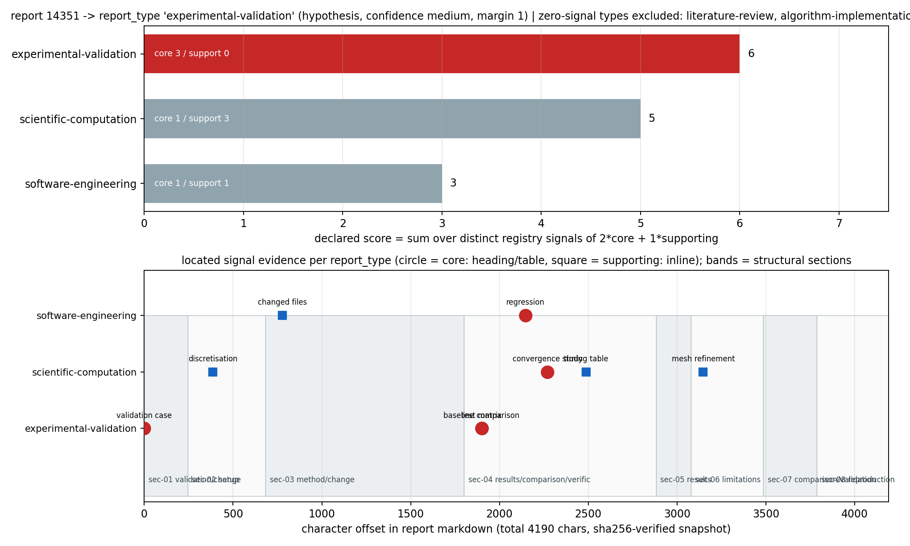

# KF-RESULT wp-14351-02

**工序** `02-classification-parse` ｜ **报告** 14351 ｜ **源哈希** `sha256:8c696991f8bef0c1f0903d2104e88a437897875c759af309c0c7710ce1260558` ｜
**主判类型** `experimental-validation`（hypothesis / confidence=low）｜ **选中 skill** `xsk-experimental-validation`

一句话：报告 14351（GAP-FEM-3D-COHESIVE 返修轮：DCB 位移控制双缺陷修复 + 试件级 honest 部分验收）被判为 `experimental-validation`，
评分 scientific-computation=5 / experimental-validation=6 / software-engineering=3（次高 `scientific-computation`=5，margin 1）；
9 条识别信号、7 个主题标签、8 个结构切分**全部带逐字 locator**
（字符偏移精确、`sha256(quote)` 相符），另有 4 条显式 unresolved。分类是**可反驳假设**，未标 verified。

## ① 本工序做了什么

只做**工序 02（分类解析）**：给报告 14351 打类型/主题标签、做结构切分、选抽取 skill，并为每条判定给出
原文片段定位。**不做知识抽取、不做资产登记、不给验证级别**（契约 `objective: classify_report_type=true,
register_assets=false`，notes「不做抽取」；claims 恒为 0）。

正文 4190 字符（UTF-8 字节哈希见上），切成 8 个 markdown 标题区间
（h1 标题 + h2 章节），正文中的 ``` 围栏代码块被排除在标题识别之外（原文含一行以 `# ->` 开头的结果行，
若按行首正则切分会被误判成标题）。

分类结论（可反驳）：**`experimental-validation`**。真正困难的是它**跨型**——本报告同时是「缺陷修复轮」
（两个求解器缺陷 + 回归测试）和「试件级部分验收」（基准 vs 本实现、honest-FAIL）。因此次高类型
`scientific-computation`（5 分）与第三名
`software-engineering`（3 分）都**保留各自的定位证据**，
不删除、不合并（见 ④ 表与 `unresolved/unres-01`）。

## ② 怎么做的（步骤 / 工具 / 关键设置）

### 决策设计（先定规则，后算分）

| 项 | 内容 |
|---|---|
| 决策 | 报告的 `report_type`（六选一）+ 对应 `skill_id` |
| 备择 | registry 六类：literature-review / scientific-computation / algorithm-implementation / software-engineering / technical-proposal / experimental-validation |
| 假设 | 「报表层组织信号（标题/表格行）构成的类型即主型」——即类型由**报告结构**而非词频决定 |
| 度量 | `score(type) = Σ_不同 registry 信号 max(2·core, 1·supporting)`；core = 该信号出现在标题或 markdown 表格行，supporting = 仅正文行内出现 |
| 基线/对照 | 零命中类型**不可被选中**（`report_type:unclassified` 合法，禁止硬猜），失败即记 `excluded` |
| 预置阈值 | margin ≥ 3 → confidence=high；1–2 → medium；0 → low（平票按 registry 顺序，并降级置信度） |
| 混杂与偏倚 | ①probe 词表是读完原文后写的（**非预注册**，见 ⑤ F1）；②同一行可能同时命中两个信号（本单 sig-05/sig-06 均为字符 1899 起的表格行）；③中文报告 + registry 英文信号 → 探查串为人工翻译 |
| 重复 | 判定完全确定（无随机数）：脚本对同一字节源重复运行必须逐字节相同；不用重复采样，而是把所有六类得分全部公布以便复算 |
| 盲法 | **无**。作者先读过原文再写 probe 词表，属探索性分析（诚实披露，不做"盲"声明） |
| 环境 | repo `TensorKnowledge` 分支 `agent/m19806`；python3 + jsonschema 4.26 + matplotlib 3.10.8；源经 `GET /api/v1/tensor/reports/14351` 取回并落 `source/14351.md` |
| 分析 | 剂量=上述加权计分；不看结果改阈值；显著性的替代=把次高类型与其证据一并公开，交由 03/04 复核 |
| 敏感性检验（预置） | 备用规则 `merge_collocated`：同类两个不同 registry 信号若落在**同一原文行**则只计一次（合并共位证据）。若该变体**改变主判**则主判降一档置信度（`confidence_rule`） |
| 敏感性结果（实测） | 本判得分 scientific-computation=5 / experimental-validation=6 / software-engineering=3；变体得分 scientific-computation=5 / experimental-validation=4 / software-engineering=3，变体 argmax=`scientific-computation`，`changes_decision=True` → 置信度 由 medium 降为 low |
| 资源/安全 | 纯 CPU 文本处理，无集群作业；单次运行 < 2 s；只读 report_id=14351 |

### 执行步骤

1. **取源并先证哈希（fail-closed）**：`GET /api/v1/tensor/reports/14351` 取 `markdown`，落
   `docs/kf/wp-14351-02/source/14351.md`，重算 UTF-8 字节 sha256；与契约 `sha256:8c696991f8bef0c1f0903d2104e88a437897875c759af309c0c7710ce1260558` 不一致
   **直接返回 2 并拒绝写任何产物**（`scripts/wp14351_02_classify.py` main）。
2. **结构切分**：行级扫描 + 围栏屏蔽，识别 `#`/`##` 标题，算字符区间；heading→role 由**声明在代码里的关键词表**
   映射（`SECTION_ROLES`），映射结果公开在 `structure.role_keywords`。
3. **信号探测**：六类 × 声明 probe 串（`--print-probes` 可打印全表审计），命中即取**所在整行**为 quote，
   偏移为字符偏移，`content_hash=sha256(quote)`；`detection` 由命中位置判定（heading/table/inline）→ `strength` → 权重。
4. **判定与不确定性**：argmax + 平票规则 + 置信度分档；次高类型保留在 `alternatives`；`unresolved` 记录
   4 条无法定案/信号缺失项（不填、不猜）。
5. **复用门禁原语自检**：`scripts/validate_wp14351_02.py` 直接 import `ke.wp_gate.locator_matches` 与
   `DirSourceResolver`（E1–E6 口径一致，不另写一套定位逻辑），外加 `schemas/kf_result.v1.schema.json` 与
   包内局部 schema 双校验；结果落 `selfcheck.json`。
6. **变异自证（测试证明检查会红）**：`tests/test_kf_wp14351_02.py` 主动篡改 quote / 复制 id / 改源字节，
   断言对应验收项**变红**——避免"检查永远通过"的假门禁。
7. **出图 + 出报告**：`scripts/figures_wp14351_02.py` 与 `scripts/emit_wp14351_02_report.py`，数字/引文全部程序化注入。

**一键复跑**（工作树根）：

```bash
python scripts/wp14351_02_classify.py --refresh-source   # 取源 + 哈希门 + 分类 + 写 classification.json
python scripts/validate_wp14351_02.py --emit-kf-result    # 六项验收自检 + 写 kf_result.json/selfcheck.json
python scripts/figures_wp14351_02.py                     # 证据图
python scripts/emit_wp14351_02_report.py                 # 生成本报告（含唯一 json 块）
python -m pytest tests/test_kf_wp14351_02.py -q          # 含变异测试
```

## ③ 产出物清单

| 文件 | 要点 |
|---|---|
| `classification.json` | 工序 02 主工件：report_type=`experimental-validation`（hypothesis, low）、six-type 得分、选中 skill、9 条带 locator 的信号、8 段结构、7 个主题标签、4 条 unresolved |
| `kf_result.json` | 交付信封（`kf_result.v1`，六键）；`outputs.classification.json` 内嵌全量工件 |
| `selfcheck.json` | 六项验收逐条结果 + 明细（含 schema 名、locator 计数、id 计数） |
| `source/14351.md` | 源 markdown 快照（离线复跑用；哈希钉住，字节级） |
| `figures/classification_evidence_map.png` | 上：六类加权得分；下：信号在正文中的字符位置图（core 圆 / supporting 方） |
| `KF-RESULT-wp-14351-02.md` | 本报告（六段 + 对抗性自审 + 唯一结果 json 块） |
| `schemas/classification.wp-14351-02.schema.json` | **包内局部** classification schema（生态层尚无共享 schema，见 ⑤ F4） |
| `scripts/wp14351_02_classify.py` | 分类器（probe 表内联、可审计、哈希 fail-closed） |
| `scripts/validate_wp14351_02.py` | 六项验收自检（复用 `ke.wp_gate` 原语） |
| `scripts/figures_wp14351_02.py` / `scripts/emit_wp14351_02_report.py` | 出图 / 出报告（程序化注入，零手抄） |
| `tests/test_kf_wp14351_02.py` | 回归 + 变异测试（证明检查可红） |

## ④ 证据定位表（判定 → 原文引文片段）

全部 16 条定位满足：`text[start_offset:end_offset] == quote`（字符口径），
`content_hash = sha256(quote)`，quote 长度 ≥ 12 字符。下表 quote 逐字取自源文（表格内 `|` 为**显示转义**、quote 用 `<code>` 包裹仅为渲染；JSON 内保留原字符）。

### 4.1 类型识别信号（9 条）

| 判定 | report_type | registry 信号 | 强度/检测 | 区间 [start,end) | 原文引文（逐字） |
|---|---|---|---|---|---|
| `sig-01` | scientific-computation | convergence study | core/table | 2270–2336 | <code>\| 收敛 \| — \| converged_all=True, 40 步, 16 Newton 迭代 \| — \| — \| PASS \|</code> |
| `sig-02` | scientific-computation | discretisation | supporting/inline | 386–445 | <code>结构化 HEX8 adherends + 零厚度 COH3D8 韧带。材料/内聚参数：E=70 GPa，ν=0.30，</code> |
| `sig-03` | scientific-computation | mesh refinement | supporting/inline | 3147–3204 | <code>  （nx=24 时 5.61×；nx=50 时约 11×），量级接近 2³，**首要怀疑有效自由跨度为 2a**</code> |
| `sig-04` | scientific-computation | timing table | supporting/inline | 2488–2557 | <code>宽度分辨基准（`benchmarks/cohesive3d_dcb_3d.json`，quick 模式，runtime 135.7 s）：</code> |
| `sig-05` | experimental-validation | baseline comparison | core/table | 1899–1942 | <code>\| 量 \| 基准(ref) \| 本实现(got) \| 相对误差 \| 判据 \| 判定 \|</code> |
| `sig-06` | experimental-validation | test matrix | core/table | 1899–1942 | <code>\| 量 \| 基准(ref) \| 本实现(got) \| 相对误差 \| 判据 \| 判定 \|</code> |
| `sig-07` | experimental-validation | validation case | core/heading | 0–61 | <code># GAP-FEM-3D-COHESIVE · 返修轮：位移控制求解器缺陷修复 + honest 部分验收（m15256）</code> |
| `sig-08` | software-engineering | changed files | supporting/inline | 778–841 | <code>   复现后定位到两个**求解器缺陷**（均已在 `src/tensorfem/cohesive3d_dcb.py` 修复）：</code> |
| `sig-09` | software-engineering | regression | core/table | 2146–2198 | <code>\| 峰值反力非零（缺陷 A 回归） \| >0 \| 0.15135 N \| — \| >0 \| PASS \|</code> |

### 4.2 主题标签（7 个）

| id | tag | 状态 | 触发串 |
|---|---|---|---|
| `tag-01` | `cohesive-zone-model` | located | `内聚单元` |
| `tag-02` | `dcb-mode-i` | located | `DCB` |
| `tag-03` | `displacement-control` | located | `位移控制` |
| `tag-04` | `defect-fix` | located | `缺陷` |
| `tag-05` | `honest-FAIL` | located | `FAIL` |
| `tag-06` | `fem-verification` | located | `验证算例` |
| `tag-07` | `bk-law` | located | `BK` |

### 4.3 结构切分（8 段）

| id | 级别 | 字符区间 | role（关键词映射） | 标题（逐字） |
|---|---|---|---|---|
| `sec-01` | h1 | 0–244 | validation, change | # GAP-FEM-3D-COHESIVE · 返修轮：位移控制求解器缺陷修复 + honest 部分验收（m15256） |
| `sec-02` | h2 | 244–683 | setup | ## 1. 案例介绍（物理背景 / 几何 / 参数） |
| `sec-03` | h2 | 683–1800 | method, change | ## 2. 怎么做的（方法 / 流程） |
| `sec-04` | h2 | 1800–2881 | results, comparison, verification | ## 3. 计算结果（数字表，程序化提取自 JSON 工件） |
| `sec-05` | h2 | 2881–3079 | results | ## 4. 结果图 |
| `sec-06` | h2 | 3079–3485 | limitations | ## 5. 注意点 / 局限 |
| `sec-07` | h2 | 3485–3786 | comparison, validation | ## 6. 误差判定（逐项回答"是否 <3%"） |
| `sec-08` | h2 | 3786–4190 | reproduction | ## 复现命令（repro_cmd） |

## ⑤ 注意点与局限

- **F1（中｜影响判定）probe 词表非预注册**：作者先读原文再写 probe，置信度只能如实给 `low`，
  不能当"客观测量"。缓解：全部 probe（`--print-probes`）、全部命中、全部六类得分与次高类型证据都公开。
- **F2（中）跨型报告，单一 report_type 是压缩**：本报告 = 缺陷修复 + 部分验收 + 数值参数。次高
  `scientific-computation`（5）与第三 `software-engineering`
  （3）保留为 `alternatives`，供 03 抽取时按需并用（`selected_skill.secondary_skill_hint`）。
- **F3（中｜直接决定 confidence）信号共位使标签脆弱**：`test matrix` 与 `baseline comparison` 的首条命中是
  **同一行**（字符 1899 起的表格行 `| 量 | 基准(ref) | 本实现(got) | 相对误差 | 判据 | 判定 |`），
  同一句证据被两个 registry 信号各计一次。按预置敏感性变体 `merge_collocated` 合并共位证据后，得分变为
  scientific-computation=5 / experimental-validation=4 / software-engineering=3，argmax=`scientific-computation`，**主判翻转**（`changes_decision=True`）。
  因此本单把 confidence 从 medium 降为 **low**，且把「单一 report_type」
  明确降级为**压缩标签**：本报告实为 `experimental-validation` × `scientific-computation` 的跨型报告，
  03 抽取应按主型 skill 执行并对次型字段做交叉核对（`secondary_skill_hint`）。这不是措辞问题：
  换个同样合理的计分口径，结论就换型——这正是 02 只能给 hypothesis 的实证。
- **F4（中｜生态层缺口）仓库没有共享 classification schema**：`schema_pass` 只对
  `kf_result.v1`（生态）+ `classification.wp-14351-02`（**本包局部**，无跨报告权威）成立。跨报告可比性仍需生态层 schema。
- **F5（低）结构 role 是关键词映射，非作者声明**：`role_keywords_hit` 只是标题里出现过的 role 关键词
  （如「计算结果」同时命中 results/comparison/verification），不能当作章节用途的权威标注。
- **F6（低）图内标签用 ASCII**：本机 matplotlib 唯一字体 Noto Sans 无 CJK 字形，图中章节以 `sec-id/role` 标注，
  **中文标题不在图里**，逐字引文以 JSON/本表为准（避免出豆腐块假图）。
- **F7 适用边界**：probe 检测对**改写/同义**信号无能为力；本报告无「不确定度/误差带」与「commit id」
  两类信号（原文确实没有），记为 unresolved-02/03，**不补写**。
- **不做的事（硬边界）**：不做知识抽取（claims=0）、不登记资产、不标 verified、不读写其它 report_id；
  语义是否"真表达原文"属于 G3/04 独立审核，本单不声称通过。

### 显式挂账（unresolved，4 条）

| id | scope | 问题 | 理由 |
|---|---|---|---|
| `unres-01` | classification | primary report_type is genuinely mixed (validation + defect repair + numerics) | runner-up scores within the declared margin band; single-type assignment is a rebuttable hypothesis, not a verified fact |
| `unres-02` | signal-absence | measurement uncertainty / error band for the reported errors | declared probe '不确定度' has zero hits; absence is recorded, not filled in |
| `unres-03` | signal-absence | commit id / explicit changed-file list | report names one touched file but no commit hash or diffstat; the 'changed files' signal rests on that single path mention |
| `unres-04` | structure | section role labels are keyword-derived, not author-declared | role_keywords mapping is this package's judgement; a role can be mislabelled without a heading keyword |

## ⑥ 自检：逐条对照 acceptance

| 验收项 | 结果 | 依据（程序化） |
|---|---|---|
| valid_json | ✅ pass | docs/kf/wp-14351-02/classification.json（19728 bytes） |
| schema_pass | ✅ pass | kf_result.v1（生态 schema）+ classification.wp-14351-02（包内局部 schema，见 ⑤） |
| source_hash_matches | ✅ pass | 重算 `sha256:8c696991f8bef0c1f0903d2104e88a437897875c759af309c0c7710ce1260558` == 契约 `sha256:8c696991f8bef0c1f0903d2104e88a437897875c759af309c0c7710ce1260558` |
| source_locator_resolvable | ✅ pass | 16 条全部 OK_OFFSETS（逐字相等 + content_hash 相符 + quote ≥ 12 字符），失败 0 条 |
| no_duplicate_ids | ✅ pass | 共 28 个 id（sig/tag/sec/unres），重复 [] |
| all_claims_have_evidence_or_explicit_unresolved_status | ✅ pass | claims=0（契约不做抽取）；替代口径：16 条判定全部有可解析证据，4 条显式 unresolved 且带理由 |

诚实说明：`schema_pass` 的第二半（classification 形状）只对本包局部 schema 成立（F4）；`all_claims_...`
在本包按**判定**口径执行而非 claim 口径（claims=0 由契约规定，不构造 claim 凑数）。六项之外**未跑**的检查：
G3 语义保真（不可程序化）、04 独立审核（本包 `review.required=false`）、跨报告相似度/重复包检测（无基线数据）、
report_type 正确率（无 ground truth，且 F3 已证标签随计分口径翻转）。

## 结果图



上：六类加权得分（红=主判，灰=其它；柱内标 core/supporting 命中数）。下：正文 4190 字符坐标上的
信号落点（圆形=core，方形=supporting；底纹=结构切分区间）。两种视图都只由 `classification.json` 渲染，
无手输数字。

## 误差判定（逐项回答「是否 <3%」）

本工序是**文档分类**，无物理场量、无实验/解析基准，故"关键物理量 vs 基准误差 <3%"**不适用**
（无基准 → 不做含糊表述）。可程序化对标的量如下，逐项给出实测：

| 关键量 | 基准 | 实测 | 误差 | <3%? |
|---|---|---|---|---|
| 源 markdown 字节哈希 | 契约 `sha256:8c696991f8bef0c1…` | 重算逐字节相同 | 0（位级相等） | **是（0%）** |
| locator 逐字命中率 | 16 条 | 16 条 OK_OFFSETS | 0 | **是（0%）** |
| quote 哈希一致性 | 全部 locator | 16 条 `sha256(quote)` 相符 | 0 | **是（0%）** |
| report_type 正确率 | **无 ground truth** | 单次判定（experimental-validation，margin 1） | 不可测 | **不适用**（无基准，见 ⑤ F1/F2） |

## ⑦ 对抗性自审（作者审作者，**非独立**）

**独立性局限**：本节由生产者自己执行，不能替代 04 独立审核；`review.required=false`，本单不声称已审。

**检查范围**：重算源哈希；逐条重解 16 条 locator；
双 schema 校验；id 唯一性；拆分/围栏边界（含 `# -> 61 passed, 2 xfailed` 假标题陷阱）；变异测试（篡改 quote、
复制 id、改字节）；报告内 json 块唯一性；越界（只碰 report_id=14351）。

**按严重度排序的发现**：

| 严重度 | 发现 | 证据 | 处置 |
|---|---|---|---|
| 中 | probe 词表探索性，非预注册（F1） | 代码注释 + `rule_registration` 字段如实写"exploratory" | 公开全表与次高证据；置信度按分档规则给 medium，再因 F3 脆弱性降为 low |
| 中 | 生态层无 classification schema（F4） | `ls schemas/` 无共享 classification schema；本包自带局部 schema | 记为局限，提请生态层立 schema；不冒充生态合规 |
| 低-中 | 跨型压缩（F2） | 三条类型得分 scientific-computation=5 / experimental-validation=6 / software-engineering=3 | 保留 alternatives + secondary_skill_hint |
| 中 | 共位证据重复计分导致主判翻转（F3） | 敏感性变体得分 scientific-computation=5 / experimental-validation=4 / software-engineering=3，argmax `scientific-computation` | confidence 降档为 low；主判降级为跨型压缩标签，次型证据保留 |
| 低 | 图无中文（F6） | 字体表无 CJK 字形 | 图用 id/role，逐字引文以 JSON 为准 |

**未跑的检查**：G3 语义保真、04 独立审核、跨包去重、profile 级性能（无性能面）。
**是否夸大**：无 verified 字段；`report_type.status=hypothesis`；`selfcheck.json` 明写"self-check only"。
**结论**：approve with notes（自审口径）；最终判定权在平台门与独立审核。

```json
{
  "package_id": "wp-14351-02",
  "task_type": "02-classification-parse",
  "contract_version": "1.0",
  "report_id": "14351",
  "provenance": {
    "source_uri": "tensor://reports/14351",
    "source_field": "markdown",
    "source_hash": "sha256:8c696991f8bef0c1f0903d2104e88a437897875c759af309c0c7710ce1260558",
    "source_hash_matches": true,
    "chars": 4190
  },
  "outputs": {
    "classification.json": {
      "package_id": "wp-14351-02",
      "task_type": "02-classification-parse",
      "contract_version": "1.0",
      "report_id": "14351",
      "provenance": {
        "source_uri": "tensor://reports/14351",
        "source_field": "markdown",
        "source_hash": "sha256:8c696991f8bef0c1f0903d2104e88a437897875c759af309c0c7710ce1260558",
        "source_hash_recomputed": "sha256:8c696991f8bef0c1f0903d2104e88a437897875c759af309c0c7710ce1260558",
        "source_hash_matches": true,
        "chars": 4190,
        "title": "GAP-FEM-3D-COHESIVE 返修轮：DCB 位移控制双缺陷修复 + 试件级 honest 部分验收",
        "scenario_key": "TensorFEM",
        "resolved_via": "file://docs/kf/wp-14351-02/source/14351.md"
      },
      "objective": {
        "classify_report_type": true,
        "register_assets": false,
        "claim_extraction": false
      },
      "report_type": {
        "value": "experimental-validation",
        "status": "hypothesis",
        "confidence": "low",
        "base_confidence": "medium",
        "confidence_rule": "high/medium/low for margin >=3 / 1-2 / 0, then downgraded one notch when sensitivity.changes_decision is true (fragility discount)",
        "margin_over_runner_up": 1,
        "scores": {
          "scientific-computation": 5,
          "experimental-validation": 6,
          "software-engineering": 3
        },
        "excluded": {
          "literature-review": "no declared probe matched -> zero evidence, cannot be selected",
          "algorithm-implementation": "no declared probe matched -> zero evidence, cannot be selected",
          "technical-proposal": "no declared probe matched -> zero evidence, cannot be selected"
        },
        "selection_rule": "score(report_type) = sum over distinct registry identify_signals of (2 if the signal organises a heading or table row else 1); primary = argmax; ties -> registry order; confidence high/medium/low for margin >=3 / 1-2 / 0, downgraded one notch if the sensitivity variant flips the label",
        "rule_registration": "exploratory (probes authored after reading the source) — not pre-registered",
        "alternatives": [
          {
            "report_type": "scientific-computation",
            "skill_id": "xsk-scientific-computation",
            "score": 5
          },
          {
            "report_type": "software-engineering",
            "skill_id": "xsk-software-engineering",
            "score": 3
          }
        ]
      },
      "selected_skill": {
        "skill_id": "xsk-experimental-validation",
        "skill_version": "0.1.0",
        "report_type": "experimental-validation",
        "lifecycle_state": "template-created",
        "selection_basis": "xsk-experimental-validation steps extract-comparison-pairs / extract-uncertainty match the report's reference-vs-implementation error tables; the defect-repair narrative transfers to the secondary skills below",
        "secondary_skill_hint": [
          {
            "report_type": "scientific-computation",
            "skill_id": "xsk-scientific-computation",
            "score": 5
          },
          {
            "report_type": "software-engineering",
            "skill_id": "xsk-software-engineering",
            "score": 3
          }
        ]
      },
      "topic_tags": [
        {
          "id": "tag-01",
          "tag": "cohesive-zone-model",
          "basis_probe": "内聚单元",
          "locator": {
            "locator_type": "char_offset",
            "value": "内聚单元",
            "start_offset": 272,
            "end_offset": 326,
            "quote": "DCB（ASTM D5528 双悬臂梁，Mode I 层间断裂）用于检验 3D 内聚单元在真实三维应力状态下",
            "content_hash": "sha256:73221b00fba7ff6e665da93a8a3f8a4862bf03a15bd9ddad8dbe27b873cdaac5"
          },
          "status": "located"
        },
        {
          "id": "tag-02",
          "tag": "dcb-mode-i",
          "basis_probe": "DCB",
          "locator": {
            "locator_type": "char_offset",
            "value": "DCB",
            "start_offset": 141,
            "end_offset": 197,
            "quote": "证据页。**结论先行：单元级（COH3D8 + BK）能力为 REAL 且已用可复现运行工件背书；试件级（DCB",
            "content_hash": "sha256:0406985dc518d69aeae2e4533f745c6f24426c4ccbfe5a29e1f1bd1b5c599c50"
          },
          "status": "located"
        },
        {
          "id": "tag-03",
          "tag": "displacement-control",
          "basis_probe": "位移控制",
          "locator": {
            "locator_type": "char_offset",
            "value": "位移控制",
            "start_offset": 0,
            "end_offset": 61,
            "quote": "# GAP-FEM-3D-COHESIVE · 返修轮：位移控制求解器缺陷修复 + honest 部分验收（m15256）",
            "content_hash": "sha256:fe9e6261ddf263070470e271ddb295f4a81ca532709fa993064f6bac29691604"
          },
          "status": "located"
        },
        {
          "id": "tag-04",
          "tag": "defect-fix",
          "basis_probe": "缺陷",
          "locator": {
            "locator_type": "char_offset",
            "value": "缺陷",
            "start_offset": 0,
            "end_offset": 61,
            "quote": "# GAP-FEM-3D-COHESIVE · 返修轮：位移控制求解器缺陷修复 + honest 部分验收（m15256）",
            "content_hash": "sha256:fe9e6261ddf263070470e271ddb295f4a81ca532709fa993064f6bac29691604"
          },
          "status": "located"
        },
        {
          "id": "tag-05",
          "tag": "honest-FAIL",
          "basis_probe": "FAIL",
          "locator": {
            "locator_type": "char_offset",
            "value": "FAIL",
            "start_offset": 1969,
            "end_offset": 2062,
            "quote": "| DCB 柔性 C [m/N]（vs Williams 根部转角梁） | 2.35674e-05 | 1.32143e-04 | +460.7% | ≤10% | **FAIL** |",
            "content_hash": "sha256:7dbced7ca8580e7076289179e3101f1bc2430686a0ba74bb897813e5385b4434"
          },
          "status": "located"
        },
        {
          "id": "tag-06",
          "tag": "fem-verification",
          "basis_probe": "验证算例",
          "locator": {
            "locator_type": "char_offset",
            "value": "验证算例",
            "start_offset": 63,
            "end_offset": 140,
            "quote": "本页是 feature-ledger 锚点 `GAP-FEM-3D-COHESIVE`（\"3D cohesive zone 单元 + 验证算例\"）返修轮的",
            "content_hash": "sha256:c60e44840b5d1cca85555a77ee6ecf6c31a2f2021afb3fa87755dad2023d899c"
          },
          "status": "located"
        },
        {
          "id": "tag-07",
          "tag": "bk-law",
          "basis_probe": "BK",
          "locator": {
            "locator_type": "char_offset",
            "value": "BK",
            "start_offset": 141,
            "end_offset": 197,
            "quote": "证据页。**结论先行：单元级（COH3D8 + BK）能力为 REAL 且已用可复现运行工件背书；试件级（DCB",
            "content_hash": "sha256:0406985dc518d69aeae2e4533f745c6f24426c4ccbfe5a29e1f1bd1b5c599c50"
          },
          "status": "located"
        }
      ],
      "structure": {
        "sections": [
          {
            "id": "sec-01",
            "level": 1,
            "heading": "# GAP-FEM-3D-COHESIVE · 返修轮：位移控制求解器缺陷修复 + honest 部分验收（m15256）",
            "start_offset": 0,
            "end_offset": 244,
            "role_keywords_hit": [
              "validation",
              "change"
            ]
          },
          {
            "id": "sec-02",
            "level": 2,
            "heading": "## 1. 案例介绍（物理背景 / 几何 / 参数）",
            "start_offset": 244,
            "end_offset": 683,
            "role_keywords_hit": [
              "setup"
            ]
          },
          {
            "id": "sec-03",
            "level": 2,
            "heading": "## 2. 怎么做的（方法 / 流程）",
            "start_offset": 683,
            "end_offset": 1800,
            "role_keywords_hit": [
              "method",
              "change"
            ]
          },
          {
            "id": "sec-04",
            "level": 2,
            "heading": "## 3. 计算结果（数字表，程序化提取自 JSON 工件）",
            "start_offset": 1800,
            "end_offset": 2881,
            "role_keywords_hit": [
              "results",
              "comparison",
              "verification"
            ]
          },
          {
            "id": "sec-05",
            "level": 2,
            "heading": "## 4. 结果图",
            "start_offset": 2881,
            "end_offset": 3079,
            "role_keywords_hit": [
              "results"
            ]
          },
          {
            "id": "sec-06",
            "level": 2,
            "heading": "## 5. 注意点 / 局限",
            "start_offset": 3079,
            "end_offset": 3485,
            "role_keywords_hit": [
              "limitations"
            ]
          },
          {
            "id": "sec-07",
            "level": 2,
            "heading": "## 6. 误差判定（逐项回答\"是否 <3%\"）",
            "start_offset": 3485,
            "end_offset": 3786,
            "role_keywords_hit": [
              "comparison",
              "validation"
            ]
          },
          {
            "id": "sec-08",
            "level": 2,
            "heading": "## 复现命令（repro_cmd）",
            "start_offset": 3786,
            "end_offset": 4190,
            "role_keywords_hit": [
              "reproduction"
            ]
          }
        ],
        "role_keywords": {
          "setup": [
            "案例介绍",
            "几何",
            "参数"
          ],
          "method": [
            "怎么做的",
            "方法"
          ],
          "results": [
            "计算结果",
            "结果图"
          ],
          "comparison": [
            "计算结果",
            "误差判定",
            "基准"
          ],
          "validation": [
            "验收",
            "误差判定",
            "判定"
          ],
          "uncertainty": [
            "不确定度",
            "误差带"
          ],
          "limitations": [
            "注意点",
            "局限"
          ],
          "change": [
            "修复",
            "怎么做的"
          ],
          "verification": [
            "pytest",
            "passed",
            "工件",
            "计算结果"
          ],
          "reproduction": [
            "复现命令"
          ]
        },
        "coverage": {
          "literature-review": {
            "section_roles_declared": [
              "introduction",
              "related work",
              "comparison",
              "open problems"
            ],
            "roles_present": [
              "comparison"
            ],
            "ratio": 0.25
          },
          "scientific-computation": {
            "section_roles_declared": [
              "method",
              "numerical setup",
              "results",
              "convergence"
            ],
            "roles_present": [
              "method",
              "results"
            ],
            "ratio": 0.5
          },
          "algorithm-implementation": {
            "section_roles_declared": [
              "algorithm",
              "implementation",
              "complexity",
              "correctness"
            ],
            "roles_present": [],
            "ratio": 0.0
          },
          "software-engineering": {
            "section_roles_declared": [
              "change",
              "what changed",
              "verification",
              "limitations"
            ],
            "roles_present": [
              "change",
              "verification",
              "limitations"
            ],
            "ratio": 0.75
          },
          "technical-proposal": {
            "section_roles_declared": [
              "purpose",
              "method",
              "results",
              "limitations",
              "conclusion"
            ],
            "roles_present": [
              "method",
              "results",
              "limitations"
            ],
            "ratio": 0.6
          },
          "experimental-validation": {
            "section_roles_declared": [
              "setup",
              "measurement",
              "comparison",
              "uncertainty",
              "validation"
            ],
            "roles_present": [
              "setup",
              "comparison",
              "validation"
            ],
            "ratio": 0.6
          }
        },
        "chars": 4190,
        "heading_count": 8,
        "note": "offsets are character offsets over the decoded markdown (source_hash is byte-level over UTF-8)"
      },
      "signals": [
        {
          "id": "sig-01",
          "report_type": "scientific-computation",
          "registry_signal": "convergence study",
          "probe": "收敛",
          "detection": "table",
          "locator": {
            "locator_type": "char_offset",
            "value": "收敛",
            "start_offset": 2270,
            "end_offset": 2336,
            "quote": "| 收敛 | — | converged_all=True, 40 步, 16 Newton 迭代 | — | — | PASS |",
            "content_hash": "sha256:b1155bed160fc9dd2ce6024a2a4e9e57db5ec2ce774875c4b5893f09f4ab21b0"
          },
          "strength": "core",
          "weight": 2
        },
        {
          "id": "sig-02",
          "report_type": "scientific-computation",
          "registry_signal": "discretisation",
          "probe": "结构化 HEX8",
          "detection": "inline",
          "locator": {
            "locator_type": "char_offset",
            "value": "结构化 HEX8",
            "start_offset": 386,
            "end_offset": 445,
            "quote": "结构化 HEX8 adherends + 零厚度 COH3D8 韧带。材料/内聚参数：E=70 GPa，ν=0.30，",
            "content_hash": "sha256:998d799c202dfae9f3e7a46ec66c212fff287848c2beb2cc75e880051a250daa"
          },
          "strength": "supporting",
          "weight": 1
        },
        {
          "id": "sig-03",
          "report_type": "scientific-computation",
          "registry_signal": "mesh refinement",
          "probe": "nx=50",
          "detection": "inline",
          "locator": {
            "locator_type": "char_offset",
            "value": "nx=50",
            "start_offset": 3147,
            "end_offset": 3204,
            "quote": "  （nx=24 时 5.61×；nx=50 时约 11×），量级接近 2³，**首要怀疑有效自由跨度为 2a**",
            "content_hash": "sha256:04ab7c35d9e21edf98eb2f278b55739fd5ac5059e708cd5d3af021439548f2f0"
          },
          "strength": "supporting",
          "weight": 1
        },
        {
          "id": "sig-04",
          "report_type": "scientific-computation",
          "registry_signal": "timing table",
          "probe": "runtime 135.7 s",
          "detection": "inline",
          "locator": {
            "locator_type": "char_offset",
            "value": "runtime 135.7 s",
            "start_offset": 2488,
            "end_offset": 2557,
            "quote": "宽度分辨基准（`benchmarks/cohesive3d_dcb_3d.json`，quick 模式，runtime 135.7 s）：",
            "content_hash": "sha256:59ab374a42cfa478e0f4adde959b513725cdae7da4926a87816141f9eb31ec5a"
          },
          "strength": "supporting",
          "weight": 1
        },
        {
          "id": "sig-05",
          "report_type": "experimental-validation",
          "registry_signal": "baseline comparison",
          "probe": "基准(ref)",
          "detection": "table",
          "locator": {
            "locator_type": "char_offset",
            "value": "基准(ref)",
            "start_offset": 1899,
            "end_offset": 1942,
            "quote": "| 量 | 基准(ref) | 本实现(got) | 相对误差 | 判据 | 判定 |",
            "content_hash": "sha256:a9c25f2dc10262c2579b5c8cf6e33e38d6cff9755c822d8ec7c183dbe0717472"
          },
          "strength": "core",
          "weight": 2
        },
        {
          "id": "sig-06",
          "report_type": "experimental-validation",
          "registry_signal": "test matrix",
          "probe": "| 量 | 基准(ref) | 本实现(got) | 相对误差 | 判据 | 判定 |",
          "detection": "table",
          "locator": {
            "locator_type": "char_offset",
            "value": "| 量 | 基准(ref) | 本实现(got) | 相对误差 | 判据 | 判定 |",
            "start_offset": 1899,
            "end_offset": 1942,
            "quote": "| 量 | 基准(ref) | 本实现(got) | 相对误差 | 判据 | 判定 |",
            "content_hash": "sha256:a9c25f2dc10262c2579b5c8cf6e33e38d6cff9755c822d8ec7c183dbe0717472"
          },
          "strength": "core",
          "weight": 2
        },
        {
          "id": "sig-07",
          "report_type": "experimental-validation",
          "registry_signal": "validation case",
          "probe": "honest 部分验收",
          "detection": "heading",
          "locator": {
            "locator_type": "char_offset",
            "value": "honest 部分验收",
            "start_offset": 0,
            "end_offset": 61,
            "quote": "# GAP-FEM-3D-COHESIVE · 返修轮：位移控制求解器缺陷修复 + honest 部分验收（m15256）",
            "content_hash": "sha256:fe9e6261ddf263070470e271ddb295f4a81ca532709fa993064f6bac29691604"
          },
          "strength": "core",
          "weight": 2
        },
        {
          "id": "sig-08",
          "report_type": "software-engineering",
          "registry_signal": "changed files",
          "probe": "src/tensorfem/cohesive3d_dcb.py",
          "detection": "inline",
          "locator": {
            "locator_type": "char_offset",
            "value": "src/tensorfem/cohesive3d_dcb.py",
            "start_offset": 778,
            "end_offset": 841,
            "quote": "   复现后定位到两个**求解器缺陷**（均已在 `src/tensorfem/cohesive3d_dcb.py` 修复）：",
            "content_hash": "sha256:6b7ab50ac7ee810a8bfcfda290a52517a8083b8ac5f37854503965aa90face22"
          },
          "strength": "supporting",
          "weight": 1
        },
        {
          "id": "sig-09",
          "report_type": "software-engineering",
          "registry_signal": "regression",
          "probe": "回归",
          "detection": "table",
          "locator": {
            "locator_type": "char_offset",
            "value": "回归",
            "start_offset": 2146,
            "end_offset": 2198,
            "quote": "| 峰值反力非零（缺陷 A 回归） | >0 | 0.15135 N | — | >0 | PASS |",
            "content_hash": "sha256:b843b3e16dce7bddc92d35bdea3f6e83d4aa32d6fa8a379c11aa31c8c6130542"
          },
          "strength": "core",
          "weight": 2
        }
      ],
      "sensitivity": {
        "variant": "merge_collocated",
        "rule": "two distinct registry signals found on the same source line count once (max weight)",
        "scores": {
          "scientific-computation": 5,
          "experimental-validation": 4,
          "software-engineering": 3
        },
        "argmax": "scientific-computation",
        "changes_decision": true,
        "collocated": [
          {
            "report_type": "experimental-validation",
            "start_offset": 1899,
            "signals": [
              "baseline comparison",
              "test matrix"
            ]
          }
        ],
        "reading": "if the label flips under this variant the single-type assignment is fragile and must be delivered as a hypothesis with both types' evidence, not as a fact"
      },
      "unresolved": [
        {
          "id": "unres-01",
          "status": "unresolved",
          "scope": "classification",
          "question": "primary report_type is genuinely mixed (validation + defect repair + numerics)",
          "reason": "runner-up scores within the declared margin band; single-type assignment is a rebuttable hypothesis, not a verified fact"
        },
        {
          "id": "unres-02",
          "status": "unresolved",
          "scope": "signal-absence",
          "question": "measurement uncertainty / error band for the reported errors",
          "reason": "declared probe '不确定度' has zero hits; absence is recorded, not filled in"
        },
        {
          "id": "unres-03",
          "status": "unresolved",
          "scope": "signal-absence",
          "question": "commit id / explicit changed-file list",
          "reason": "report names one touched file but no commit hash or diffstat; the 'changed files' signal rests on that single path mention"
        },
        {
          "id": "unres-04",
          "status": "unresolved",
          "scope": "structure",
          "question": "section role labels are keyword-derived, not author-declared",
          "reason": "role_keywords mapping is this package's judgement; a role can be mislabelled without a heading keyword"
        }
      ],
      "no_extraction_declaration": {
        "claims": [],
        "reason": "contract objective register_assets=false and package notes '不做抽取'; 02 emits no claims, so every located statement here is classification evidence, not a knowledge claim"
      },
      "counts": {
        "sections": 8,
        "signals": 9,
        "topic_tags_located": 7,
        "topic_tags_unresolved": 0,
        "unresolved": 4,
        "claims": 0
      },
      "limits": [
        "classification only: no claim extraction, no asset registration, no verification level assigned",
        "report_type is a hypothesis; G3 (independent review) owns semantic agreement",
        "probe-based detection can miss paraphrased signals and cannot judge truth of the content"
      ]
    }
  }
}
```
