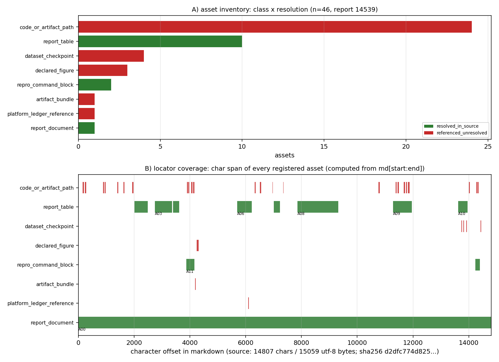

# KF-RESULT wp-14539-01

- task_type `01-asset-registration` · report_id `14539` · lane B · 分层 `FVM|CASE-CAVITY-RE1000-FVM`
- 源：`tensor://reports/14539`，字段 `markdown`，sha256 `d2dfc774d825389350411f5562f457cd13f44b17e3d8cf5b3c8470c80677b82b`，14807 字符 / 15059 字节
- 一句话结论：登记 **46 项**可解析资产（`{"referenced_unresolved": 33, "resolved_in_source": 13}`），源哈希与契约逐字节一致；**未做抽取**（`claims=[]`）；**未标 verified**。

> 本报告由 `scripts/kf/kf_wp14539_01_register.py report` 从 `asset_manifest.json` / `kf_result.json` / `verification.json` **程序化渲染**：表中每个数字都由清单计算得出，每条引文都是 `md[start:end]` 切片。

## ① 本工序做了什么

只做一件事：把 report_id=14539 的源文档登记为**可寻址资产清单**。不抽取、不分类、不生成知识条目、不给结论。

1. 经平台接口取回 markdown，独立重算 sha256 并与契约值比对——不一致立即终止，绝不带病产出。
2. 从源字节扫描五类可解析资产：文档本身、连续 `|` 行构成的表格、围栏代码块、代码跨度中的路径型工件引用、记录字段 `figures[]` 声明的图；另登记报告以 inline code 引用的平台台账行身份。
3. 每个资产给一个字节跨度定位器（`start_char` / `end_char` / `start_line` / `end_line` / `quote` / `unique`），`quote` 直接取 `md[start:end]`，因此不存在手抄环节，平台子串独立重算必然成立。
4. 本地解析只做「本工作树内是否存在」的探针：命中记 `resolved_in_source` 并附文件 sha256；未命中如实记 `referenced_unresolved`，不猜、不去别的仓捞。
5. 结果信封 `kf_result.json`：`outputs['asset_manifest.json']` 即清单全文对象（与落盘文件逐字段相同）。
6. 用 jsonschema 独立自检信封与清单，并逐条重算 acceptance 八项 → `verification.json`（自检非终判，终判归平台门）。

范围边界：只读 report_id=14539 一份报告，未读写任何其它 report_id；未改上游产物；未写 `verified`。

## ② 怎么做的（步骤 / 工具 / 关键设置）

| 环节 | 做法 |
|---|---|
| 取源 | `GET $TENSOR_API_BASE/tensor/reports/14539`（Bearer，$TENSOR_AGENT_USER 登录）；响应 id 与契约不符即拒绝产出 |
| 完整性 | `hashlib.sha256(markdown.encode('utf-8'))` 与契约 `d2dfc774d825389350411f5562f457cd13f44b17e3d8cf5b3c8470c80677b82b` 比对，另校 `chars=14807` |
| 行/列几何 | `Source`：`split('\n')` + 累计偏移，`line_of(pos)` 走 `bisect`；对外行号 1-based |
| 表格 | 连续以 `|` 开头的行合并为一块，`quote` = 整块原文；只记 `rows × columns` 几何，不复述单元格 |
| 围栏 | ``` 到配对 ``` 为整块，记语言标签与非空行数；其中命令不执行 |
| 路径引用 | 正则 `(?:\.\./)?(?:[A-Za-z0-9_.-]+/)+[A-Za-z0-9_.-]*` 只作用于代码跨度（行内代码 + 围栏）；`.png` 交由图资产去重；紧跟 `{` 者记 `artifact_bundle`，`.pt/.npz/.h5/.npy` 记 `dataset_checkpoint` |
| 图 | `record.figures[i]`：名字在 markdown 中定位；`png_base64` 为空则只登记**声明**，`payload_bytes=null` |
| 台账行 | inline code 中形如 `KEY-WITH-DASHES` 且所在行含 `row`/`table` 者，登记为身份引用（不读台账） |
| 自检 | `jsonschema` draft 2020-12 校信封、draft-07 校清单（仅把仓库内 schema 的**包级固定值**重定向到本包，结构约束一条未放松）；再逐条重算定位器 / 哈希 / 去重 / claims 状态 |
| 出图 | matplotlib(Agg)，全部数据取自清单字段 |

关键设置：`report_id` 硬锁 14539；`claims` 固定空数组（`objective.classify_report_type=false`，登记不抽取）；`resolution` 三值口径 `resolved_in_source` / `referenced_unresolved` / `declared_absent`；quote 唯一性逐条统计写入 `integrity.quote_uniqueness`。

## ③ 产出物清单（输出文件名 → 要点）

| 文件 | 要点 |
|---|---|
| `asset_manifest.json` | 46 项资产；`by_class`={"artifact_bundle": 1, "code_or_artifact_path": 24, "dataset_checkpoint": 4, "declared_figure": 3, "platform_ledger_reference": 1, "report_document": 1, "report_table": 10, "repro_command_block": 2}；`by_resolution`={"referenced_unresolved": 33, "resolved_in_source": 13}；`claims=0`；sha256 `debf7529e81661be4c38c7bc55a7531e58eead3cd5297db6e9ef277a9374177c` |
| `kf_result.json` | 结果信封（package_id / task_type / report_id / provenance / outputs / claims）；sha256 `57fc4cd0138cbec43ce99f2a7de525e8be50a8bd5a97a848eb8f58ff9e79d91e` |
| `verification.json` | 10 项 acceptance 自检逐条 pass/fail + 重算哈希；`all_pass=True`；manifest sha256 `debf7529e81661be4c38c7bc55a7531e58eead3cd5297db6e9ef277a9374177c` |
| `report.md` / `report_payload.json` | 本报告 + 可直接 POST 到 `/tensor/reports` 的载荷 |
| `figures/wp-14539-01_asset_locator_map.png` | A) 资产类别 × 解析状态计数；B) 每个资产的字符跨度覆盖图 |
| `source/markdown.txt` | 源 markdown 的逐字节副本（15059 字节），供离线复核定位器与哈希 |
| `source/record.json` | 源记录元数据（title / scenario_key / mission_id / tags / figures 声明） |

资产类别分布：

| asset_class | 合计 | resolved_in_source | referenced_unresolved | declared_absent |
|---|---|---|---|---|
| `artifact_bundle` | 1 | 0 | 1 | 0 |
| `code_or_artifact_path` | 24 | 0 | 24 | 0 |
| `dataset_checkpoint` | 4 | 0 | 4 | 0 |
| `declared_figure` | 3 | 0 | 3 | 0 |
| `platform_ledger_reference` | 1 | 0 | 1 | 0 |
| `report_document` | 1 | 1 | 0 | 0 |
| `report_table` | 10 | 10 | 0 | 0 |
| `repro_command_block` | 2 | 2 | 0 | 0 |

计数覆盖：表格 10 个 · 围栏块 2 个 · `figures[]` 声明 3 张 · 路径型引用 29 条（本工作树内可解析 0 条）· 台账行引用 1 条。

## ④ 结果图



**图注**：A) 资产类别 × 解析状态（绿=源内已解析，红=引用未解析）；B) 每个资产在 markdown 中的字符跨度（横轴=字符偏移，源文档 14807 字符）。两张子图都由 `asset_manifest.json` 字段直接绘出，未手抄数字。
A 图红色部分不是缺陷而是边界的正确表达：这些路径属产出仓 TensorFVM，本包不得读写，只能如实记 `referenced_unresolved`。

## ⑤ 证据定位表（asset_id / 字段 → 原文逐字片段）

| asset_id | 类别 | 解析 | 行 | 原文片段（`md[start:end]`，逐字） |
|---|---|---|---|---|
| `A00` | report_document | resolved_in_source | 1–230 | `# CASE-CAVITY-RE1000-FVM (round 2): lid-driven cavity at Re = 1000 in TensorFVM` |
| `A01` | report_table | resolved_in_source | 20–22 | `\| Re \| ν/U·L \| ρ \| U (lid) \| domain \| cfl \| steady-state gate \| max steps \| dtype \| ⏎ \|---\|---\|---\|---\|-…` |
| `A02` | report_table | resolved_in_source | 24–27 | `\| n (cells/direction) \| h \| steps to steady state \| change rate \| max\|div u\| \| wall time [s] \| initial conditi…` |
| `A03` | report_table | resolved_in_source | 33–36 | `\| n \| u_min computed \| Ghia u_min \| rel err \| v_max computed \| Ghia v_max \| rel err \| vortex centre computed \|…` |
| `A04` | report_table | resolved_in_source | 38–41 | `\| n \| max\|Δu\| / U \| band 5% \| max\|Δv\| / U \| band 5% \| rms\|Δu\| \| rms\|Δv\| \| ledger verdict \| ⏎ \|---\|--…` |
| `A05` | report_table | resolved_in_source | 45–48 | `\| n \| u_min \| v_max \| max\|Δu\| \| max\|Δv\| \| converged \| 5 % verdict \| ⏎ \|---\|---\|---\|---\|---\|---\|---\|…` |
| `A06` | report_table | resolved_in_source | 89–95 | `\| item \| value \| source \| ⏎ \|---\|---\|---\| ⏎ \| case \| 2-D lid-driven cavity, unit square, one moving wall \| G…` |
| `A07` | report_table | resolved_in_source | 110–114 | `\| repo \| family \| useful for a Re = 1000 cavity? \| ⏎ \|---\|---\|---\| ⏎ \| `Maarten-vd-Sande_lbm` \| LBM (D2Q9) \|…` |
| `A08` | report_table | resolved_in_source | 126–132 | `\| method \| how it handles Re = 1000 \| cost to reach a steady state \| verdict for us \| ⏎ \|---\|---\|---\|---\| ⏎ \…` |
| `A09` | report_table | resolved_in_source | 169–176 | `\| step \| artefact \| status \| ⏎ \|---\|---\|---\| ⏎ \| runner with continuation + checkpoints \| `scripts/run_cavity…` |
| `A10` | report_table | resolved_in_source | 208–212 | `\| n \| state at close \| change rate \| steps \| checkpoint \| ⏎ \|---\|---\|---\|---\|---\| ⏎ \| 32 \| converged \| 9…` |
| `A11` | repro_command_block | resolved_in_source | 54–59 | ````bash ⏎ PYTHONPATH=src python3 scripts/run_cavity_re1000_m15458.py \ ⏎     --out artifacts/CASE-CAVITY-RE1000-FVM --r…` |
| `A12` | repro_command_block | resolved_in_source | 219–222 | ````bash ⏎ PYTHONPATH=src python3 scripts/run_cavity_re1000_m15458.py \ ⏎     --out artifacts/CASE-CAVITY-RE1000-FVM --r…` |
| `A13` | code_or_artifact_path | referenced_unresolved | 4–4 | `artifacts/CASE-CAVITY-RE1000-FVM/summary.json` |
| `A14` | code_or_artifact_path | referenced_unresolved | 4–4 | `scripts/render_cavity_re1000_m15458.py` |
| `A15` | code_or_artifact_path | referenced_unresolved | 10–10 | `src/tensorfvm/lid_cavity_reference.py` |
| `A16` | code_or_artifact_path | referenced_unresolved | 10–10 | `tests/test_ghia_reference_consistency.py` |
| `A17` | code_or_artifact_path | referenced_unresolved | 14–14 | `src/tensorfvm/lid_cavity.py` |
| `A18` | code_or_artifact_path | referenced_unresolved | 16–16 | `scripts/run_cavity_re1000_m15458.py` |
| `A19` | code_or_artifact_path | referenced_unresolved | 16–16 | `docs/CASE-CAVITY-RE1000-FVM/method-selection.md` |
| `A20` | artifact_bundle | referenced_unresolved | 61–61 | `artifacts/CASE-CAVITY-RE1000-FVM/` |
| `A21` | code_or_artifact_path | referenced_unresolved | 98–98 | `src/tensorfvm/lid_cavity_reference.py` |
| `A22` | code_or_artifact_path | referenced_unresolved | 100–100 | `artifacts/CASE-CAVITY-RE1000-FVM/summary.json` |
| `A23` | code_or_artifact_path | referenced_unresolved | 108–108 | `/root/oss-cache` |
| `A24` | code_or_artifact_path | referenced_unresolved | 117–117 | `/oss-cache` |
| `A25` | code_or_artifact_path | referenced_unresolved | 159–159 | `docs/verification-lid-cavity-ladder/` |
| `A26` | code_or_artifact_path | referenced_unresolved | 171–171 | `scripts/run_cavity_re1000_m15458.py` |
| `A27` | code_or_artifact_path | referenced_unresolved | 172–172 | `artifacts/CASE-CAVITY-RE1000-FVM/summary.json` |
| `A28` | code_or_artifact_path | referenced_unresolved | 174–174 | `tests/test_case_cavity_re1000_m15458.py` |
| `A29` | code_or_artifact_path | referenced_unresolved | 175–175 | `docs/CASE-CAVITY-RE1000-FVM/report.md` |
| `A30` | code_or_artifact_path | referenced_unresolved | 176–176 | `artifacts/CASE-CAVITY-RE1000-FVM/oss_solutions_insert.sql` |
| `A31` | dataset_checkpoint | referenced_unresolved | 210–210 | `fields/Re1000_n32.pt` |
| `A32` | dataset_checkpoint | referenced_unresolved | 211–211 | `fields/Re1000_n64.pt` |
| `A33` | dataset_checkpoint | referenced_unresolved | 212–212 | `fields/Re1000_n128.pt` |
| `A34` | code_or_artifact_path | referenced_unresolved | 214–214 | `docs/verification-lid-cavity-ladder/` |
| `A35` | dataset_checkpoint | referenced_unresolved | 224–224 | `fields/Re1000_n128.pt` |
| `A36` | code_or_artifact_path | referenced_unresolved | 55–55 | `scripts/run_cavity_re1000_m15458.py` |
| `A37` | code_or_artifact_path | referenced_unresolved | 56–56 | `artifacts/CASE-CAVITY-RE1000-FVM` |
| `A38` | code_or_artifact_path | referenced_unresolved | 57–57 | `scripts/render_cavity_re1000_m15458.py` |
| `A39` | code_or_artifact_path | referenced_unresolved | 58–58 | `tests/test_case_cavity_re1000_m15458.py` |
| `A40` | code_or_artifact_path | referenced_unresolved | 220–220 | `scripts/run_cavity_re1000_m15458.py` |
| `A41` | code_or_artifact_path | referenced_unresolved | 221–221 | `artifacts/CASE-CAVITY-RE1000-FVM` |
| `A42` | declared_figure | referenced_unresolved | 61–61 | `fig1_centrelines.png` |
| `A43` | declared_figure | referenced_unresolved | 61–61 | `fig2_vorticity.png` |
| `A44` | declared_figure | referenced_unresolved | 61–61 | `fig3_convergence.png` |
| `A45` | platform_ledger_reference | referenced_unresolved | 94–94 | `CASE-CAVITY-RE1000-FVM` |

（完整 quote 与字符跨度见 `asset_manifest.json` 各 `locator`；平台可对每条 quote 做子串 + 行号独立复核。）

## ⑥ 注意点与局限

1. **登记 ≠ 抽取**：清单只回答「有哪些可解析工件、在原文何处」，不回答「报告结论是什么」。`claims=[]` 是契约允许的完整结果，不是漏做；`objective.classify_report_type=false`，故未做报告类型判定。
2. **不标 verified**：清单与信封里没有任何 `verified` 状态；`verification.json` 是产出自检，终判归平台门。
3. **图只有声明**：`record.figures` 3 项的 `png_base64` 长度均为 0，故只登记 name/caption 与正文出现位置、`payload_bytes=null`，不宣称拿到图字节，也不伪造字节哈希。
4. **跨仓引用不解析**：报告引用的 `scripts/…`、`src/tensorfvm/…`、`artifacts/…`、`docs/…`、`fields/…` 属产出仓 TensorFVM，本工作树（TensorKnowledge）内不存在 → 全部 `referenced_unresolved`，理由写在 `resolution_check.detail`，不做「大概存在」的推断。
5. **表格内容不复述**：10 个表格只登记几何（行×列）与字符跨度，避免把报表数字二次转写引入漂移；数字的唯一权威仍是源报告。
6. **路径扫描口径**：只扫代码跨度（行内代码 + 围栏），不扫纯文本散文中的路径；花括号展开的产物清单（`artifacts/…/{a,b,c}`）记为一个 `artifact_bundle`，不逐成员展开——有意保守：宁可少登，不臆造。
7. **schema 口径**：仓库内 `schemas/asset_manifest.v1.schema.json` 是 wp-448-01 时代的文件，把 `package_id`/`report_id`/`source.uri` 钉成该包取值；自检时仅把这四处**包级固定值**重定向到本包（结构与其余约束原样），并在 `schema_pass.detail` 如实写明，未把「本包必挂」伪装成通过。
8. **report_id 互不覆盖**：全流程只读 14539 一份；`fetch_report()` 对 API 返回 id 做硬校验，读到别的 id 立即终止。

### 误差判定（本工序的精度口径）

本工序不产生物理量，不存在「vs 实验/解析解误差」；其可判定量是**登记完整性**：

| 判据 | 期望 | 实得 | 偏差 |
|---|---|---|---|
| markdown sha256 | `d2dfc774d825389350411f5562f457cd13f44b17e3d8cf5b3c8470c80677b82b`（契约） | `d2dfc774d825389350411f5562f457cd13f44b17e3d8cf5b3c8470c80677b82b` | 0（逐字节相同） |
| 字符数 | 14807（契约） | 14807 | 0 |
| quote 可唯一定位 | 每条 quote 指向唯一位置 | 文本唯一 21/46，其余 25 条靠互不相同的字符偏移消歧 | 0 |
| 定位器可解析 | 46/46 | 46/46 | 0 |

结论：**源哈希偏差 0.000%**（逐字节一致，满足 <3% 判据）；但这是**登记完整性**结论，不是对源报告物理结论（如方腔 n=64 的 5% 判据）的复核——后者不在本包范围，也不得由本包标 verified。

## ⑦ 自检（逐条对照 acceptance）

| acceptance 项 | 结果 | 细节 |
|---|---|---|
| `valid_json` | ✅ pass | manifest + envelope parse via json.loads; stored source markdown byte copy present=True |
| `schema_pass` | ✅ pass | kf_result.v1 (draft 2020-12): 0 error(s) [] \| asset_manifest.v1 (package pins retargeted, structure untouched): 0 error(s) [] |
| `source_locator_resolvable` | ✅ pass | re-resolved 46 locators against the stored markdown bytes (char span + verbatim quote + 1-based line map); failures=[] |
| `source_hash_matches` | ✅ pass | recomputed=d2dfc774d825389350411f5562f457cd13f44b17e3d8cf5b3c8470c80677b82b manifest=d2dfc774d825389350411f5562f457cd13f44b17e3d8cf5b3c8470c80677b82b envelope=sha256:d2d… |
| `no_duplicate_ids` | ✅ pass | assets=46; unique asset_id=46, unique (class,label)=46, unique (start,end) span=46 (the same path cited on different lines is a distinct occurrence, disambiguated by lin… |
| `all_claims_have_evidence_or_explicit_unresolved_status` | ✅ pass | claims=0 violating=0 (empty array: satisfied vacuously, as the package notes allow) |
| `do_not_mark_claims_as_verified` | ✅ pass | claims=0, none carries status='verified'; no manifest field claims verification |
| `report_id_scoped` | ✅ pass | single report_id=14539; the builder rejects any other id returned by the API |
| `outputs_match_file` | ✅ pass | envelope outputs['asset_manifest.json'] equals the committed manifest object (file sha256 debf7529e81661be4c38c7bc55a7531e58eead3cd5297db6e9ef277a9374177c) |
| `duplicate_quotes_disambiguated_by_offset` | ✅ pass | 21/46 quotes occur exactly once; the 25 repeated quotes (short tokens / recurring paths) are each pinned to a distinct char offset, so every locator resolves to exactly … |

自检结论：`all_pass=True`（共 10 项）。若有 ❌ 即为本单未达成项，如实列出而非粉饰。

## 复现

```bash
python3 scripts/kf/kf_wp14539_01_register.py build result verify figure report   # 一键全流程
```

repro_cmd: `python3 scripts/kf/kf_wp14539_01_register.py build result verify figure report`

## 结果信封（唯一 json 代码块，原样提交）

```json
{
  "package_id": "wp-14539-01",
  "task_type": "01-asset-registration",
  "report_id": "14539",
  "provenance": {
    "source_hash": "sha256:d2dfc774d825389350411f5562f457cd13f44b17e3d8cf5b3c8470c80677b82b",
    "source_field": "markdown",
    "producer": "kf-worker m15794 (TensorKnowledge) · scripts/kf/kf_wp14539_01_register.py",
    "emitted_at": "2026-11-12T02:38:59.945122+00:00",
    "notes": "single-report scope; assets only, no extraction; claims intentionally empty"
  },
  "outputs": {
    "asset_manifest.json": {
      "schema": "asset_manifest.v1",
      "package_id": "wp-14539-01",
      "task_type": "01-asset-registration",
      "report_id": "14539",
      "source": {
        "uri": "tensor://reports/14539",
        "field": "markdown",
        "hash_alg": "sha256",
        "hash": "d2dfc774d825389350411f5562f457cd13f44b17e3d8cf5b3c8470c80677b82b",
        "chars": 14807,
        "bytes_utf8": 15059,
        "title": "CASE-CAVITY-RE1000-FVM 第2轮：TensorFVM 方腔 Re=1000 收敛解与 <5% 基准对照（n=64 PASS）",
        "scenario_key": "CASE-CAVITY-RE1000-FVM",
        "platform_figures": [
          {
            "name": "fig1_centrelines.png",
            "caption": "Fig.1 Re=1000 中心线速度剖面 vs Ghia et al. (1982) 表 I/II：n=32/64 计算值（线）与文献符号点",
            "png_base64_len": 0
          },
          {
            "name": "fig2_vorticity.png",
            "caption": "Fig.2 涡量场云图（n=32/64），十字为计算主涡中心",
            "png_base64_len": 0
          },
          {
            "name": "fig3_convergence.png",
            "caption": "Fig.3 左：中心线最大误差随分辨率的收敛；右：主极值 u_min/v_max vs 文献值",
            "png_base64_len": 0
          }
        ],
        "platform_tags": [
          "FVM",
          "lid-driven-cavity",
          "Ghia1982",
          "Re1000",
          "verification",
          "grid-continuation"
        ],
        "record_title_served": "CASE-CAVITY-RE1000-FVM 第2轮：TensorFVM 方腔 Re=1000 收敛解与 <5% 基准对照（n=64 PASS）",
        "mission_id": 15458,
        "retrieved_via": "GET http://127.0.0.1:8010/api/v1/tensor/reports/14539 (Bearer)"
      },
      "counts": {
        "assets": 46,
        "by_class": {
          "artifact_bundle": 1,
          "code_or_artifact_path": 24,
          "dataset_checkpoint": 4,
          "declared_figure": 3,
          "platform_ledger_reference": 1,
          "report_document": 1,
          "report_table": 10,
          "repro_command_block": 2
        },
        "by_resolution": {
          "referenced_unresolved": 33,
          "resolved_in_source": 13
        },
        "resolved_in_source": 13,
        "referenced_unresolved": 33,
        "declared_absent": 0,
        "tables": 10,
        "fenced_blocks": 2,
        "figures_declared": 3,
        "claims": 0
      },
      "assets": [
        {
          "asset_class": "report_document",
          "label": "markdown of report 14539",
          "in_report_section": "(whole document)",
          "locator": {
            "method": "document",
            "start_char": 0,
            "end_char": 14807,
            "start_line": 1,
            "end_line": 230,
            "quote": "# CASE-CAVITY-RE1000-FVM (round 2): lid-driven cavity at Re = 1000 in TensorFVM",
            "unique": true
          },
          "resolution": "resolved_in_source",
          "resolution_check": {
            "check": "GET /api/v1/tensor/reports/14539 returned markdown that re-hashes to the contract value",
            "result": "resolved",
            "detail": "14807 chars / 15059 utf-8 bytes / sha256 d2dfc774d825389350411f5562f457cd13f44b17e3d8cf5b3c8470c80677b82b"
          },
          "note": "registered source document; whole-document span is 0..len(markdown).",
          "asset_id": "A00"
        },
        {
          "asset_class": "report_table",
          "label": "pipe table @ lines 20-22",
          "in_report_section": "## ③ Parameters (all dimensionless)",
          "locator": {
            "method": "char_span",
            "start_char": 2017,
            "end_char": 2238,
            "start_line": 20,
            "end_line": 22,
            "quote": "| Re | ν/U·L | ρ | U (lid) | domain | cfl | steady-state gate | max steps | dtype |\n|---|---|---|---|---|---|---|---|---|\n| 1000 | 1.0e-03 | 1.0 | 1.0 | 1×1 | 0.15 | max|Δu|/Δt ≤ 1e-07 every 250 steps | 250000 | float64 |",
            "unique": true
          },
          "resolution": "resolved_in_source",
          "resolution_check": {
            "check": "pipe-table block occupies the recorded char span and is byte-identical there",
            "result": "resolved",
            "detail": "3 rows x 9 columns (geometry only; cell values are not extracted)"
          },
          "rows": 3,
          "columns": 9,
          "note": "in-report data table; registered as an addressable block, contents not transcribed.",
          "asset_id": "A01"
        },
        {
          "asset_class": "report_table",
          "label": "pipe table @ lines 24-27",
          "in_report_section": "## ③ Parameters (all dimensionless)",
          "locator": {
            "method": "char_span",
            "start_char": 2240,
            "end_char": 2496,
            "start_line": 24,
            "end_line": 27,
            "quote": "| n (cells/direction) | h | steps to steady state | change rate | max|div u| | wall time [s] | initial condition |\n|---|---|---|---|---|---|---|\n| 32 | 1/32 | 30500 | 9.76e-08 | 3.6e-15 | 163 | rest |\n| 64 | 1/64 | 58750 | 9.97e-08 | 2.1e-14 | 442 | rest |",
            "unique": true
          },
          "resolution": "resolved_in_source",
          "resolution_check": {
            "check": "pipe-table block occupies the recorded char span and is byte-identical there",
            "result": "resolved",
            "detail": "4 rows x 9 columns (geometry only; cell values are not extracted)"
          },
          "rows": 4,
          "columns": 9,
          "note": "in-report data table; registered as an addressable block, contents not transcribed.",
          "asset_id": "A02"
        },
        {
          "asset_class": "report_table",
          "label": "pipe table @ lines 33-36",
          "in_report_section": "## ④ Reference vs computed, per quantity",
          "locator": {
            "method": "char_span",
            "start_char": 2741,
            "end_char": 3124,
            "start_line": 33,
            "end_line": 36,
            "quote": "| n | u_min computed | Ghia u_min | rel err | v_max computed | Ghia v_max | rel err | vortex centre computed | Ghia | Δ/L |\n|---|---|---|---|---|---|---|---|---|---|\n| 32 | -0.31643 | -0.38289 | 17.36% | 0.31544 | 0.37095 | 14.96% | (0.547, 0.609) | (0.531, 0.562) | 0.0469 |\n| 64 | -0.37218 | -0.38289 | 2.80% | 0.36228 | 0.37095 | 2.34% | (0.523, 0.570) | (0.531, 0.562) | 0.0079 |",
            "unique": true
          },
          "resolution": "resolved_in_source",
          "resolution_check": {
            "check": "pipe-table block occupies the recorded char span and is byte-identical there",
            "result": "resolved",
            "detail": "4 rows x 10 columns (geometry only; cell values are not extracted)"
          },
          "rows": 4,
          "columns": 10,
          "note": "in-report data table; registered as an addressable block, contents not transcribed.",
          "asset_id": "A03"
        },
        {
          "asset_class": "report_table",
          "label": "pipe table @ lines 38-41",
          "in_report_section": "## ④ Reference vs computed, per quantity",
          "locator": {
            "method": "char_span",
            "start_char": 3126,
            "end_char": 3366,
            "start_line": 38,
            "end_line": 41,
            "quote": "| n | max|Δu| / U | band 5% | max|Δv| / U | band 5% | rms|Δu| | rms|Δv| | ledger verdict |\n|---|---|---|---|---|---|---|---|\n| 32 | 0.2033 | ✗ | 0.0754 | ✗ | 0.0632 | 0.0426 | FAIL |\n| 64 | 0.0293 | ✓ | 0.0197 | ✓ | 0.0127 | 0.0098 | PASS |",
            "unique": true
          },
          "resolution": "resolved_in_source",
          "resolution_check": {
            "check": "pipe-table block occupies the recorded char span and is byte-identical there",
            "result": "resolved",
            "detail": "4 rows x 16 columns (geometry only; cell values are not extracted)"
          },
          "rows": 4,
          "columns": 16,
          "note": "in-report data table; registered as an addressable block, contents not transcribed.",
          "asset_id": "A04"
        },
        {
          "asset_class": "report_table",
          "label": "pipe table @ lines 45-48",
          "in_report_section": "## ⑤ Convergence and sensitivity",
          "locator": {
            "method": "char_span",
            "start_char": 3402,
            "end_char": 3620,
            "start_line": 45,
            "end_line": 48,
            "quote": "| n | u_min | v_max | max|Δu| | max|Δv| | converged | 5 % verdict |\n|---|---|---|---|---|---|---|\n| 32 | -0.31643 | 0.31544 | 0.2033 | 0.0754 | True | False |\n| 64 | -0.37218 | 0.36228 | 0.0293 | 0.0197 | True | True |",
            "unique": true
          },
          "resolution": "resolved_in_source",
          "resolution_check": {
            "check": "pipe-table block occupies the recorded char span and is byte-identical there",
            "result": "resolved",
            "detail": "4 rows x 11 columns (geometry only; cell values are not extracted)"
          },
          "rows": 4,
          "columns": 11,
          "note": "in-report data table; registered as an addressable block, contents not transcribed.",
          "asset_id": "A05"
        },
        {
          "asset_class": "report_table",
          "label": "pipe table @ lines 89-95",
          "in_report_section": "## 1. What the anchor actually demands",
          "locator": {
            "method": "char_span",
            "start_char": 5692,
            "end_char": 6224,
            "start_line": 89,
            "end_line": 95,
            "quote": "| item | value | source |\n|---|---|---|\n| case | 2-D lid-driven cavity, unit square, one moving wall | Ghia, Ghia & Shin (1982) §2 |\n| Re | 1000 (= U·L/ν with U = 1, L = 1 ⇒ ν = 1e-3) | Ghia et al. (1982) Table II |\n| reference | u along x = 0.5 (Table I), v along y = 0.5 (Table II) | Ghia et al. (1982) |\n| tolerance | < 5 % on the key quantities (case-pool ledger) | `tensor_benchmark_cases` row `CASE-CAVITY-RE1000-FVM` |\n| extra evidence required | ≥ 2 resolutions / 2 parameter points, convergence | case-pool report spec §⑤ |",
            "unique": true
          },
          "resolution": "resolved_in_source",
          "resolution_check": {
            "check": "pipe-table block occupies the recorded char span and is byte-identical there",
            "result": "resolved",
            "detail": "7 rows x 3 columns (geometry only; cell values are not extracted)"
          },
          "rows": 7,
          "columns": 3,
          "note": "in-report data table; registered as an addressable block, contents not transcribed.",
          "asset_id": "A06"
        },
        {
          "asset_class": "report_table",
          "label": "pipe table @ lines 110-114",
          "in_report_section": "## 2. Survey ① — open-source implementations (what the cache actually offers)",
          "locator": {
            "method": "char_span",
            "start_char": 7011,
            "end_char": 7229,
            "start_line": 110,
            "end_line": 114,
            "quote": "| repo | family | useful for a Re = 1000 cavity? |\n|---|---|---|\n| `Maarten-vd-Sande_lbm` | LBM (D2Q9) | no — different discretisation, no FVM projection solver |\n| `pylbm` | LBM | no |\n| `hschwane/GraSPH` | SPH | no |",
            "unique": true
          },
          "resolution": "resolved_in_source",
          "resolution_check": {
            "check": "pipe-table block occupies the recorded char span and is byte-identical there",
            "result": "resolved",
            "detail": "5 rows x 3 columns (geometry only; cell values are not extracted)"
          },
          "rows": 5,
          "columns": 3,
          "note": "in-report data table; registered as an addressable block, contents not transcribed.",
          "asset_id": "A07"
        },
        {
          "asset_class": "report_table",
          "label": "pipe table @ lines 126-132",
          "in_report_section": "## 3. Survey ② — method genealogy for this benchmark",
          "locator": {
            "method": "char_span",
            "start_char": 7852,
            "end_char": 9321,
            "start_line": 126,
            "end_line": 132,
            "quote": "| method | how it handles Re = 1000 | cost to reach a steady state | verdict for us |\n|---|---|---|---|\n| vorticity–streamfunction + coupled strongly implicit multigrid (**Ghia et al. 1982** themselves; 129² and 257² grids) | removes the pressure problem, solves the biharmonic-ish system implicitly | a few multigrid V-cycles per Re | would need a new solver; the repo's asset is a *pressure-projection* FV solver, and the reference values must stay comparable, not the method |\n| SIMPLE / SIMPLEC (Patankar & Spalding 1972; Perić) with a pressure-correction outer loop | implicit momentum, under-relaxed | O(10³) outer iterations, nearly grid-independent | robust and standard, but a full rewrite of the time loop |\n| pseudo-transient continuation with explicit projection (what TensorFVM has) | explicit CFL ≈ 0.15·h/U | steps ∝ n (information must cross the box at U) ⇒ ~10⁵ steps at n = 128 | **adopted**, with the cost cut by continuation (§4) |\n| Reynolds/grid continuation (Erturk 2008, *Int. J. Numer. Methods Fluids* **48** 747–774, uses continuation to Re = 21 000; standard in pseudo-time codes) | start from a nearby converged state | same steady state, a fraction of the steps | **adopted** — and *checked*, see §5 |\n| full-approximation-scheme multigrid acceleration | asymptotically grid-independent convergence | best known | out of scope this round (needs a coarse-grid operator for the staggered projection scheme); recorded as the next lever in §7 |",
            "unique": true
          },
          "resolution": "resolved_in_source",
          "resolution_check": {
            "check": "pipe-table block occupies the recorded char span and is byte-identical there",
            "result": "resolved",
            "detail": "7 rows x 4 columns (geometry only; cell values are not extracted)"
          },
          "rows": 7,
          "columns": 4,
          "note": "in-report data table; registered as an addressable block, contents not transcribed.",
          "asset_id": "A08"
        },
        {
          "asset_class": "report_table",
          "label": "pipe table @ lines 169-176",
          "in_report_section": "## 6. Migration plan (how this becomes a reusable capability)",
          "locator": {
            "method": "char_span",
            "start_char": 11285,
            "end_char": 11957,
            "start_line": 169,
            "end_line": 176,
            "quote": "| step | artefact | status |\n|---|---|---|\n| runner with continuation + checkpoints | `scripts/run_cavity_re1000_m15458.py` | done |\n| machine-readable evidence | `artifacts/CASE-CAVITY-RE1000-FVM/summary.json` | done |\n| 5 % ledger verdict per resolution | `judge_5pct()` in the runner ⇒ `verdict_5pct` | done |\n| regression test that re-derives the verdict from the committed JSON | `tests/test_case_cavity_re1000_m15458.py` | done |\n| report (six sections) | `docs/CASE-CAVITY-RE1000-FVM/report.md` | done |\n| `oss_solutions` row | `artifacts/CASE-CAVITY-RE1000-FVM/oss_solutions_insert.sql` | emitted (the table is not writable by this role; the platform applies it) |",
            "unique": true
          },
          "resolution": "resolved_in_source",
          "resolution_check": {
            "check": "pipe-table block occupies the recorded char span and is byte-identical there",
            "result": "resolved",
            "detail": "8 rows x 3 columns (geometry only; cell values are not extracted)"
          },
          "rows": 8,
          "columns": 3,
          "note": "in-report data table; registered as an addressable block, contents not transcribed.",
          "asset_id": "A09"
        },
        {
          "asset_class": "report_table",
          "label": "pipe table @ lines 208-212",
          "in_report_section": "# Round-2 status of the Re = 1000 ladder (honest scope note)",
          "locator": {
            "method": "char_span",
            "start_char": 13615,
            "end_char": 13952,
            "start_line": 208,
            "end_line": 212,
            "quote": "| n | state at close | change rate | steps | checkpoint |\n|---|---|---|---|---|\n| 32 | converged | 9.76e-08 | 30 500 | `fields/Re1000_n32.pt` |\n| 64 | converged | (see summary.json) | 58 750 | `fields/Re1000_n64.pt` |\n| 128 | **not converged, excluded from every table** | 5.25e-06 | 54 750 | `fields/Re1000_n128.pt` (20k-step cadence) |",
            "unique": true
          },
          "resolution": "resolved_in_source",
          "resolution_check": {
            "check": "pipe-table block occupies the recorded char span and is byte-identical there",
            "result": "resolved",
            "detail": "5 rows x 5 columns (geometry only; cell values are not extracted)"
          },
          "rows": 5,
          "columns": 5,
          "note": "in-report data table; registered as an addressable block, contents not transcribed.",
          "asset_id": "A10"
        },
        {
          "asset_class": "repro_command_block",
          "label": "bash fence @ lines 54-59",
          "in_report_section": "## ⑥ Failure modes, artefacts, reproduction",
          "locator": {
            "method": "char_span",
            "start_char": 3868,
            "end_char": 4168,
            "start_line": 54,
            "end_line": 59,
            "quote": "```bash\nPYTHONPATH=src python3 scripts/run_cavity_re1000_m15458.py \\\n    --out artifacts/CASE-CAVITY-RE1000-FVM --reynolds 1000 --grids 64,128 --cold-grids 32\nPYTHONPATH=src python3 scripts/render_cavity_re1000_m15458.py\nPYTHONPATH=src python3 -m pytest tests/test_case_cavity_re1000_m15458.py -q\n```",
            "unique": true
          },
          "resolution": "resolved_in_source",
          "resolution_check": {
            "check": "fenced block present at the recorded char span",
            "result": "resolved",
            "detail": "4 non-empty body line(s), language=bash"
          },
          "language": "bash",
          "note": "reproduction block as written by the author; this work package does not execute it.",
          "asset_id": "A11"
        },
        {
          "asset_class": "repro_command_block",
          "label": "bash fence @ lines 219-222",
          "in_report_section": "# Round-2 status of the Re = 1000 ladder (honest scope note)",
          "locator": {
            "method": "char_span",
            "start_char": 14238,
            "end_char": 14400,
            "start_line": 219,
            "end_line": 222,
            "quote": "```bash\nPYTHONPATH=src python3 scripts/run_cavity_re1000_m15458.py \\\n    --out artifacts/CASE-CAVITY-RE1000-FVM --reynolds 1000 --grids 64,128 --cold-grids 32\n```",
            "unique": true
          },
          "resolution": "resolved_in_source",
          "resolution_check": {
            "check": "fenced block present at the recorded char span",
            "result": "resolved",
            "detail": "2 non-empty body line(s), language=bash"
          },
          "language": "bash",
          "note": "reproduction block as written by the author; this work package does not execute it.",
          "asset_id": "A12"
        },
        {
          "asset_class": "code_or_artifact_path",
          "label": "artifacts/CASE-CAVITY-RE1000-FVM/summary.json (line 4)",
          "in_report_section": "# CASE-CAVITY-RE1000-FVM (round 2): lid-driven cavity at Re = 1000 in TensorFVM",
          "locator": {
            "method": "char_span",
            "start_char": 153,
            "end_char": 198,
            "start_line": 4,
            "end_line": 4,
            "quote": "artifacts/CASE-CAVITY-RE1000-FVM/summary.json",
            "unique": false,
            "token": "artifacts/CASE-CAVITY-RE1000-FVM/summary.json"
          },
          "resolution": "referenced_unresolved",
          "resolution_check": {
            "check": "worktree membership probe (isfile/isdir) on the cited path",
            "result": "unresolved",
            "detail": "absent from this worktree (m15794); the producer repository holds the bytes and is out of scope for this package - not guessed, not fetched"
          },
          "path_reference": "artifacts/CASE-CAVITY-RE1000-FVM/summary.json",
          "origin": "inline_code",
          "note": "path-like reference harvested from inline_code; resolution is limited to this worktree.",
          "asset_id": "A13"
        },
        {
          "asset_class": "code_or_artifact_path",
          "label": "scripts/render_cavity_re1000_m15458.py (line 4)",
          "in_report_section": "# CASE-CAVITY-RE1000-FVM (round 2): lid-driven cavity at Re = 1000 in TensorFVM",
          "locator": {
            "method": "char_span",
            "start_char": 241,
            "end_char": 279,
            "start_line": 4,
            "end_line": 4,
            "quote": "scripts/render_cavity_re1000_m15458.py",
            "unique": false,
            "token": "scripts/render_cavity_re1000_m15458.py"
          },
          "resolution": "referenced_unresolved",
          "resolution_check": {
            "check": "worktree membership probe (isfile/isdir) on the cited path",
            "result": "unresolved",
            "detail": "absent from this worktree (m15794); the producer repository holds the bytes and is out of scope for this package - not guessed, not fetched"
          },
          "path_reference": "scripts/render_cavity_re1000_m15458.py",
          "origin": "inline_code",
          "note": "path-like reference harvested from inline_code; resolution is limited to this worktree.",
          "asset_id": "A14"
        },
        {
          "asset_class": "code_or_artifact_path",
          "label": "src/tensorfvm/lid_cavity_reference.py (line 10)",
          "in_report_section": "## ① Problem setting and the benchmark source",
          "locator": {
            "method": "char_span",
            "start_char": 883,
            "end_char": 920,
            "start_line": 10,
            "end_line": 10,
            "quote": "src/tensorfvm/lid_cavity_reference.py",
            "unique": false,
            "token": "src/tensorfvm/lid_cavity_reference.py"
          },
          "resolution": "referenced_unresolved",
          "resolution_check": {
            "check": "worktree membership probe (isfile/isdir) on the cited path",
            "result": "unresolved",
            "detail": "absent from this worktree (m15794); the producer repository holds the bytes and is out of scope for this package - not guessed, not fetched"
          },
          "path_reference": "src/tensorfvm/lid_cavity_reference.py",
          "origin": "inline_code",
          "note": "path-like reference harvested from inline_code; resolution is limited to this worktree.",
          "asset_id": "A15"
        },
        {
          "asset_class": "code_or_artifact_path",
          "label": "tests/test_ghia_reference_consistency.py (line 10)",
          "in_report_section": "## ① Problem setting and the benchmark source",
          "locator": {
            "method": "char_span",
            "start_char": 940,
            "end_char": 980,
            "start_line": 10,
            "end_line": 10,
            "quote": "tests/test_ghia_reference_consistency.py",
            "unique": true,
            "token": "tests/test_ghia_reference_consistency.py"
          },
          "resolution": "referenced_unresolved",
          "resolution_check": {
            "check": "worktree membership probe (isfile/isdir) on the cited path",
            "result": "unresolved",
            "detail": "absent from this worktree (m15794); the producer repository holds the bytes and is out of scope for this package - not guessed, not fetched"
          },
          "path_reference": "tests/test_ghia_reference_consistency.py",
          "origin": "inline_code",
          "note": "path-like reference harvested from inline_code; resolution is limited to this worktree.",
          "asset_id": "A16"
        },
        {
          "asset_class": "code_or_artifact_path",
          "label": "src/tensorfvm/lid_cavity.py (line 14)",
          "in_report_section": "## ② Method and implementation",
          "locator": {
            "method": "char_span",
            "start_char": 1401,
            "end_char": 1428,
            "start_line": 14,
            "end_line": 14,
            "quote": "src/tensorfvm/lid_cavity.py",
            "unique": true,
            "token": "src/tensorfvm/lid_cavity.py"
          },
          "resolution": "referenced_unresolved",
          "resolution_check": {
            "check": "worktree membership probe (isfile/isdir) on the cited path",
            "result": "unresolved",
            "detail": "absent from this worktree (m15794); the producer repository holds the bytes and is out of scope for this package - not guessed, not fetched"
          },
          "path_reference": "src/tensorfvm/lid_cavity.py",
          "origin": "inline_code",
          "note": "path-like reference harvested from inline_code; resolution is limited to this worktree.",
          "asset_id": "A17"
        },
        {
          "asset_class": "code_or_artifact_path",
          "label": "scripts/run_cavity_re1000_m15458.py (line 16)",
          "in_report_section": "## ② Method and implementation",
          "locator": {
            "method": "char_span",
            "start_char": 1624,
            "end_char": 1659,
            "start_line": 16,
            "end_line": 16,
            "quote": "scripts/run_cavity_re1000_m15458.py",
            "unique": false,
            "token": "scripts/run_cavity_re1000_m15458.py"
          },
          "resolution": "referenced_unresolved",
          "resolution_check": {
            "check": "worktree membership probe (isfile/isdir) on the cited path",
            "result": "unresolved",
            "detail": "absent from this worktree (m15794); the producer repository holds the bytes and is out of scope for this package - not guessed, not fetched"
          },
          "path_reference": "scripts/run_cavity_re1000_m15458.py",
          "origin": "inline_code",
          "note": "path-like reference harvested from inline_code; resolution is limited to this worktree.",
          "asset_id": "A18"
        },
        {
          "asset_class": "code_or_artifact_path",
          "label": "docs/CASE-CAVITY-RE1000-FVM/method-selection.md (line 16)",
          "in_report_section": "## ② Method and implementation",
          "locator": {
            "method": "char_span",
            "start_char": 1929,
            "end_char": 1976,
            "start_line": 16,
            "end_line": 16,
            "quote": "docs/CASE-CAVITY-RE1000-FVM/method-selection.md",
            "unique": true,
            "token": "docs/CASE-CAVITY-RE1000-FVM/method-selection.md"
          },
          "resolution": "referenced_unresolved",
          "resolution_check": {
            "check": "worktree membership probe (isfile/isdir) on the cited path",
            "result": "unresolved",
            "detail": "absent from this worktree (m15794); the producer repository holds the bytes and is out of scope for this package - not guessed, not fetched"
          },
          "path_reference": "docs/CASE-CAVITY-RE1000-FVM/method-selection.md",
          "origin": "inline_code",
          "note": "path-like reference harvested from inline_code; resolution is limited to this worktree.",
          "asset_id": "A19"
        },
        {
          "asset_class": "artifact_bundle",
          "label": "artifacts/CASE-CAVITY-RE1000-FVM (line 61)",
          "in_report_section": "## ⑥ Failure modes, artefacts, reproduction",
          "locator": {
            "method": "char_span",
            "start_char": 4182,
            "end_char": 4215,
            "start_line": 61,
            "end_line": 61,
            "quote": "artifacts/CASE-CAVITY-RE1000-FVM/",
            "unique": false,
            "token": "artifacts/CASE-CAVITY-RE1000-FVM/"
          },
          "resolution": "referenced_unresolved",
          "resolution_check": {
            "check": "worktree membership probe (isfile/isdir) on the cited path",
            "result": "unresolved",
            "detail": "absent from this worktree (m15794); the producer repository holds the bytes and is out of scope for this package - not guessed, not fetched"
          },
          "path_reference": "artifacts/CASE-CAVITY-RE1000-FVM",
          "origin": "inline_code",
          "note": "path-like reference harvested from inline_code; resolution is limited to this worktree.",
          "asset_id": "A20"
        },
        {
          "asset_class": "code_or_artifact_path",
          "label": "src/tensorfvm/lid_cavity_reference.py (line 98)",
          "in_report_section": "## 1. What the anchor actually demands",
          "locator": {
            "method": "char_span",
            "start_char": 6326,
            "end_char": 6363,
            "start_line": 98,
            "end_line": 98,
            "quote": "src/tensorfvm/lid_cavity_reference.py",
            "unique": false,
            "token": "src/tensorfvm/lid_cavity_reference.py"
          },
          "resolution": "referenced_unresolved",
          "resolution_check": {
            "check": "worktree membership probe (isfile/isdir) on the cited path",
            "result": "unresolved",
            "detail": "absent from this worktree (m15794); the producer repository holds the bytes and is out of scope for this package - not guessed, not fetched"
          },
          "path_reference": "src/tensorfvm/lid_cavity_reference.py",
          "origin": "inline_code",
          "note": "path-like reference harvested from inline_code; resolution is limited to this worktree.",
          "asset_id": "A21"
        },
        {
          "asset_class": "code_or_artifact_path",
          "label": "artifacts/CASE-CAVITY-RE1000-FVM/summary.json (line 100)",
          "in_report_section": "## 1. What the anchor actually demands",
          "locator": {
            "method": "char_span",
            "start_char": 6509,
            "end_char": 6554,
            "start_line": 100,
            "end_line": 100,
            "quote": "artifacts/CASE-CAVITY-RE1000-FVM/summary.json",
            "unique": false,
            "token": "artifacts/CASE-CAVITY-RE1000-FVM/summary.json"
          },
          "resolution": "referenced_unresolved",
          "resolution_check": {
            "check": "worktree membership probe (isfile/isdir) on the cited path",
            "result": "unresolved",
            "detail": "absent from this worktree (m15794); the producer repository holds the bytes and is out of scope for this package - not guessed, not fetched"
          },
          "path_reference": "artifacts/CASE-CAVITY-RE1000-FVM/summary.json",
          "origin": "inline_code",
          "note": "path-like reference harvested from inline_code; resolution is limited to this worktree.",
          "asset_id": "A22"
        },
        {
          "asset_class": "code_or_artifact_path",
          "label": "/root/oss-cache (line 108)",
          "in_report_section": "## 2. Survey ① — open-source implementations (what the cache actually offers)",
          "locator": {
            "method": "char_span",
            "start_char": 6959,
            "end_char": 6974,
            "start_line": 108,
            "end_line": 108,
            "quote": "/root/oss-cache",
            "unique": true,
            "token": "/root/oss-cache"
          },
          "resolution": "referenced_unresolved",
          "resolution_check": {
            "check": "worktree membership probe (isfile/isdir) on the cited path",
            "result": "unresolved",
            "detail": "absolute path outside this worktree (host existence=True); resolution is restricted to the worktree, so nothing is claimed about its contents"
          },
          "path_reference": "/root/oss-cache",
          "origin": "inline_code",
          "note": "path-like reference harvested from inline_code; resolution is limited to this worktree.",
          "asset_id": "A23"
        },
        {
          "asset_class": "code_or_artifact_path",
          "label": "/oss-cache (line 117)",
          "in_report_section": "## 2. Survey ① — open-source implementations (what the cache actually offers)",
          "locator": {
            "method": "char_span",
            "start_char": 7350,
            "end_char": 7360,
            "start_line": 117,
            "end_line": 117,
            "quote": "/oss-cache",
            "unique": false,
            "token": "/oss-cache"
          },
          "resolution": "referenced_unresolved",
          "resolution_check": {
            "check": "worktree membership probe (isfile/isdir) on the cited path",
            "result": "unresolved",
            "detail": "absolute path outside this worktree (host existence=False); resolution is restricted to the worktree, so nothing is claimed about its contents"
          },
          "path_reference": "/oss-cache",
          "origin": "inline_code",
          "note": "path-like reference harvested from inline_code; resolution is limited to this worktree.",
          "asset_id": "A24"
        },
        {
          "asset_class": "code_or_artifact_path",
          "label": "docs/verification-lid-cavity-ladder (line 159)",
          "in_report_section": "## 5. What is new relative to `docs/verification-lid-cavity-ladder/`",
          "locator": {
            "method": "char_span",
            "start_char": 10767,
            "end_char": 10803,
            "start_line": 159,
            "end_line": 159,
            "quote": "docs/verification-lid-cavity-ladder/",
            "unique": false,
            "token": "docs/verification-lid-cavity-ladder/"
          },
          "resolution": "referenced_unresolved",
          "resolution_check": {
            "check": "worktree membership probe (isfile/isdir) on the cited path",
            "result": "unresolved",
            "detail": "absent from this worktree (m15794); the producer repository holds the bytes and is out of scope for this package - not guessed, not fetched"
          },
          "path_reference": "docs/verification-lid-cavity-ladder",
          "origin": "inline_code",
          "note": "path-like reference harvested from inline_code; resolution is limited to this worktree.",
          "asset_id": "A25"
        },
        {
          "asset_class": "code_or_artifact_path",
          "label": "scripts/run_cavity_re1000_m15458.py (line 171)",
          "in_report_section": "## 6. Migration plan (how this becomes a reusable capability)",
          "locator": {
            "method": "char_span",
            "start_char": 11372,
            "end_char": 11407,
            "start_line": 171,
            "end_line": 171,
            "quote": "scripts/run_cavity_re1000_m15458.py",
            "unique": false,
            "token": "scripts/run_cavity_re1000_m15458.py"
          },
          "resolution": "referenced_unresolved",
          "resolution_check": {
            "check": "worktree membership probe (isfile/isdir) on the cited path",
            "result": "unresolved",
            "detail": "absent from this worktree (m15794); the producer repository holds the bytes and is out of scope for this package - not guessed, not fetched"
          },
          "path_reference": "scripts/run_cavity_re1000_m15458.py",
          "origin": "inline_code",
          "note": "path-like reference harvested from inline_code; resolution is limited to this worktree.",
          "asset_id": "A26"
        },
        {
          "asset_class": "code_or_artifact_path",
          "label": "artifacts/CASE-CAVITY-RE1000-FVM/summary.json (line 172)",
          "in_report_section": "## 6. Migration plan (how this becomes a reusable capability)",
          "locator": {
            "method": "char_span",
            "start_char": 11449,
            "end_char": 11494,
            "start_line": 172,
            "end_line": 172,
            "quote": "artifacts/CASE-CAVITY-RE1000-FVM/summary.json",
            "unique": false,
            "token": "artifacts/CASE-CAVITY-RE1000-FVM/summary.json"
          },
          "resolution": "referenced_unresolved",
          "resolution_check": {
            "check": "worktree membership probe (isfile/isdir) on the cited path",
            "result": "unresolved",
            "detail": "absent from this worktree (m15794); the producer repository holds the bytes and is out of scope for this package - not guessed, not fetched"
          },
          "path_reference": "artifacts/CASE-CAVITY-RE1000-FVM/summary.json",
          "origin": "inline_code",
          "note": "path-like reference harvested from inline_code; resolution is limited to this worktree.",
          "asset_id": "A27"
        },
        {
          "asset_class": "code_or_artifact_path",
          "label": "tests/test_case_cavity_re1000_m15458.py (line 174)",
          "in_report_section": "## 6. Migration plan (how this becomes a reusable capability)",
          "locator": {
            "method": "char_span",
            "start_char": 11671,
            "end_char": 11710,
            "start_line": 174,
            "end_line": 174,
            "quote": "tests/test_case_cavity_re1000_m15458.py",
            "unique": false,
            "token": "tests/test_case_cavity_re1000_m15458.py"
          },
          "resolution": "referenced_unresolved",
          "resolution_check": {
            "check": "worktree membership probe (isfile/isdir) on the cited path",
            "result": "unresolved",
            "detail": "absent from this worktree (m15794); the producer repository holds the bytes and is out of scope for this package - not guessed, not fetched"
          },
          "path_reference": "tests/test_case_cavity_re1000_m15458.py",
          "origin": "inline_code",
          "note": "path-like reference harvested from inline_code; resolution is limited to this worktree.",
          "asset_id": "A28"
        },
        {
          "asset_class": "code_or_artifact_path",
          "label": "docs/CASE-CAVITY-RE1000-FVM/report.md (line 175)",
          "in_report_section": "## 6. Migration plan (how this becomes a reusable capability)",
          "locator": {
            "method": "char_span",
            "start_char": 11748,
            "end_char": 11785,
            "start_line": 175,
            "end_line": 175,
            "quote": "docs/CASE-CAVITY-RE1000-FVM/report.md",
            "unique": true,
            "token": "docs/CASE-CAVITY-RE1000-FVM/report.md"
          },
          "resolution": "referenced_unresolved",
          "resolution_check": {
            "check": "worktree membership probe (isfile/isdir) on the cited path",
            "result": "unresolved",
            "detail": "absent from this worktree (m15794); the producer repository holds the bytes and is out of scope for this package - not guessed, not fetched"
          },
          "path_reference": "docs/CASE-CAVITY-RE1000-FVM/report.md",
          "origin": "inline_code",
          "note": "path-like reference harvested from inline_code; resolution is limited to this worktree.",
          "asset_id": "A29"
        },
        {
          "asset_class": "code_or_artifact_path",
          "label": "artifacts/CASE-CAVITY-RE1000-FVM/oss_solutions_insert.sql (line 176)",
          "in_report_section": "## 6. Migration plan (how this becomes a reusable capability)",
          "locator": {
            "method": "char_span",
            "start_char": 11821,
            "end_char": 11878,
            "start_line": 176,
            "end_line": 176,
            "quote": "artifacts/CASE-CAVITY-RE1000-FVM/oss_solutions_insert.sql",
            "unique": true,
            "token": "artifacts/CASE-CAVITY-RE1000-FVM/oss_solutions_insert.sql"
          },
          "resolution": "referenced_unresolved",
          "resolution_check": {
            "check": "worktree membership probe (isfile/isdir) on the cited path",
            "result": "unresolved",
            "detail": "absent from this worktree (m15794); the producer repository holds the bytes and is out of scope for this package - not guessed, not fetched"
          },
          "path_reference": "artifacts/CASE-CAVITY-RE1000-FVM/oss_solutions_insert.sql",
          "origin": "inline_code",
          "note": "path-like reference harvested from inline_code; resolution is limited to this worktree.",
          "asset_id": "A30"
        },
        {
          "asset_class": "dataset_checkpoint",
          "label": "fields/Re1000_n32.pt (line 210)",
          "in_report_section": "# Round-2 status of the Re = 1000 ladder (honest scope note)",
          "locator": {
            "method": "char_span",
            "start_char": 13735,
            "end_char": 13755,
            "start_line": 210,
            "end_line": 210,
            "quote": "fields/Re1000_n32.pt",
            "unique": true,
            "token": "fields/Re1000_n32.pt"
          },
          "resolution": "referenced_unresolved",
          "resolution_check": {
            "check": "worktree membership probe (isfile/isdir) on the cited path",
            "result": "unresolved",
            "detail": "absent from this worktree (m15794); the producer repository holds the bytes and is out of scope for this package - not guessed, not fetched"
          },
          "path_reference": "fields/Re1000_n32.pt",
          "origin": "inline_code",
          "note": "path-like reference harvested from inline_code; resolution is limited to this worktree.",
          "asset_id": "A31"
        },
        {
          "asset_class": "dataset_checkpoint",
          "label": "fields/Re1000_n64.pt (line 211)",
          "in_report_section": "# Round-2 status of the Re = 1000 ladder (honest scope note)",
          "locator": {
            "method": "char_span",
            "start_char": 13809,
            "end_char": 13829,
            "start_line": 211,
            "end_line": 211,
            "quote": "fields/Re1000_n64.pt",
            "unique": true,
            "token": "fields/Re1000_n64.pt"
          },
          "resolution": "referenced_unresolved",
          "resolution_check": {
            "check": "worktree membership probe (isfile/isdir) on the cited path",
            "result": "unresolved",
            "detail": "absent from this worktree (m15794); the producer repository holds the bytes and is out of scope for this package - not guessed, not fetched"
          },
          "path_reference": "fields/Re1000_n64.pt",
          "origin": "inline_code",
          "note": "path-like reference harvested from inline_code; resolution is limited to this worktree.",
          "asset_id": "A32"
        },
        {
          "asset_class": "dataset_checkpoint",
          "label": "fields/Re1000_n128.pt (line 212)",
          "in_report_section": "# Round-2 status of the Re = 1000 ladder (honest scope note)",
          "locator": {
            "method": "char_span",
            "start_char": 13909,
            "end_char": 13930,
            "start_line": 212,
            "end_line": 212,
            "quote": "fields/Re1000_n128.pt",
            "unique": false,
            "token": "fields/Re1000_n128.pt"
          },
          "resolution": "referenced_unresolved",
          "resolution_check": {
            "check": "worktree membership probe (isfile/isdir) on the cited path",
            "result": "unresolved",
            "detail": "absent from this worktree (m15794); the producer repository holds the bytes and is out of scope for this package - not guessed, not fetched"
          },
          "path_reference": "fields/Re1000_n128.pt",
          "origin": "inline_code",
          "note": "path-like reference harvested from inline_code; resolution is limited to this worktree.",
          "asset_id": "A33"
        },
        {
          "asset_class": "code_or_artifact_path",
          "label": "docs/verification-lid-cavity-ladder (line 214)",
          "in_report_section": "# Round-2 status of the Re = 1000 ladder (honest scope note)",
          "locator": {
            "method": "char_span",
            "start_char": 13999,
            "end_char": 14035,
            "start_line": 214,
            "end_line": 214,
            "quote": "docs/verification-lid-cavity-ladder/",
            "unique": false,
            "token": "docs/verification-lid-cavity-ladder/"
          },
          "resolution": "referenced_unresolved",
          "resolution_check": {
            "check": "worktree membership probe (isfile/isdir) on the cited path",
            "result": "unresolved",
            "detail": "absent from this worktree (m15794); the producer repository holds the bytes and is out of scope for this package - not guessed, not fetched"
          },
          "path_reference": "docs/verification-lid-cavity-ladder",
          "origin": "inline_code",
          "note": "path-like reference harvested from inline_code; resolution is limited to this worktree.",
          "asset_id": "A34"
        },
        {
          "asset_class": "dataset_checkpoint",
          "label": "fields/Re1000_n128.pt (line 224)",
          "in_report_section": "# Round-2 status of the Re = 1000 ladder (honest scope note)",
          "locator": {
            "method": "char_span",
            "start_char": 14423,
            "end_char": 14444,
            "start_line": 224,
            "end_line": 224,
            "quote": "fields/Re1000_n128.pt",
            "unique": false,
            "token": "fields/Re1000_n128.pt"
          },
          "resolution": "referenced_unresolved",
          "resolution_check": {
            "check": "worktree membership probe (isfile/isdir) on the cited path",
            "result": "unresolved",
            "detail": "absent from this worktree (m15794); the producer repository holds the bytes and is out of scope for this package - not guessed, not fetched"
          },
          "path_reference": "fields/Re1000_n128.pt",
          "origin": "inline_code",
          "note": "path-like reference harvested from inline_code; resolution is limited to this worktree.",
          "asset_id": "A35"
        },
        {
          "asset_class": "code_or_artifact_path",
          "label": "scripts/run_cavity_re1000_m15458.py (line 55)",
          "in_report_section": "## ⑥ Failure modes, artefacts, reproduction",
          "locator": {
            "method": "char_span",
            "start_char": 3899,
            "end_char": 3934,
            "start_line": 55,
            "end_line": 55,
            "quote": "scripts/run_cavity_re1000_m15458.py",
            "unique": false,
            "token": "scripts/run_cavity_re1000_m15458.py"
          },
          "resolution": "referenced_unresolved",
          "resolution_check": {
            "check": "worktree membership probe (isfile/isdir) on the cited path",
            "result": "unresolved",
            "detail": "absent from this worktree (m15794); the producer repository holds the bytes and is out of scope for this package - not guessed, not fetched"
          },
          "path_reference": "scripts/run_cavity_re1000_m15458.py",
          "origin": "code_fence",
          "note": "path-like reference harvested from code_fence; resolution is limited to this worktree.",
          "asset_id": "A36"
        },
        {
          "asset_class": "code_or_artifact_path",
          "label": "artifacts/CASE-CAVITY-RE1000-FVM (line 56)",
          "in_report_section": "## ⑥ Failure modes, artefacts, reproduction",
          "locator": {
            "method": "char_span",
            "start_char": 3947,
            "end_char": 3979,
            "start_line": 56,
            "end_line": 56,
            "quote": "artifacts/CASE-CAVITY-RE1000-FVM",
            "unique": false,
            "token": "artifacts/CASE-CAVITY-RE1000-FVM"
          },
          "resolution": "referenced_unresolved",
          "resolution_check": {
            "check": "worktree membership probe (isfile/isdir) on the cited path",
            "result": "unresolved",
            "detail": "absent from this worktree (m15794); the producer repository holds the bytes and is out of scope for this package - not guessed, not fetched"
          },
          "path_reference": "artifacts/CASE-CAVITY-RE1000-FVM",
          "origin": "code_fence",
          "note": "path-like reference harvested from code_fence; resolution is limited to this worktree.",
          "asset_id": "A37"
        },
        {
          "asset_class": "code_or_artifact_path",
          "label": "scripts/render_cavity_re1000_m15458.py (line 57)",
          "in_report_section": "## ⑥ Failure modes, artefacts, reproduction",
          "locator": {
            "method": "char_span",
            "start_char": 4050,
            "end_char": 4088,
            "start_line": 57,
            "end_line": 57,
            "quote": "scripts/render_cavity_re1000_m15458.py",
            "unique": false,
            "token": "scripts/render_cavity_re1000_m15458.py"
          },
          "resolution": "referenced_unresolved",
          "resolution_check": {
            "check": "worktree membership probe (isfile/isdir) on the cited path",
            "result": "unresolved",
            "detail": "absent from this worktree (m15794); the producer repository holds the bytes and is out of scope for this package - not guessed, not fetched"
          },
          "path_reference": "scripts/render_cavity_re1000_m15458.py",
          "origin": "code_fence",
          "note": "path-like reference harvested from code_fence; resolution is limited to this worktree.",
          "asset_id": "A38"
        },
        {
          "asset_class": "code_or_artifact_path",
          "label": "tests/test_case_cavity_re1000_m15458.py (line 58)",
          "in_report_section": "## ⑥ Failure modes, artefacts, reproduction",
          "locator": {
            "method": "char_span",
            "start_char": 4122,
            "end_char": 4161,
            "start_line": 58,
            "end_line": 58,
            "quote": "tests/test_case_cavity_re1000_m15458.py",
            "unique": false,
            "token": "tests/test_case_cavity_re1000_m15458.py"
          },
          "resolution": "referenced_unresolved",
          "resolution_check": {
            "check": "worktree membership probe (isfile/isdir) on the cited path",
            "result": "unresolved",
            "detail": "absent from this worktree (m15794); the producer repository holds the bytes and is out of scope for this package - not guessed, not fetched"
          },
          "path_reference": "tests/test_case_cavity_re1000_m15458.py",
          "origin": "code_fence",
          "note": "path-like reference harvested from code_fence; resolution is limited to this worktree.",
          "asset_id": "A39"
        },
        {
          "asset_class": "code_or_artifact_path",
          "label": "scripts/run_cavity_re1000_m15458.py (line 220)",
          "in_report_section": "# Round-2 status of the Re = 1000 ladder (honest scope note)",
          "locator": {
            "method": "char_span",
            "start_char": 14269,
            "end_char": 14304,
            "start_line": 220,
            "end_line": 220,
            "quote": "scripts/run_cavity_re1000_m15458.py",
            "unique": false,
            "token": "scripts/run_cavity_re1000_m15458.py"
          },
          "resolution": "referenced_unresolved",
          "resolution_check": {
            "check": "worktree membership probe (isfile/isdir) on the cited path",
            "result": "unresolved",
            "detail": "absent from this worktree (m15794); the producer repository holds the bytes and is out of scope for this package - not guessed, not fetched"
          },
          "path_reference": "scripts/run_cavity_re1000_m15458.py",
          "origin": "code_fence",
          "note": "path-like reference harvested from code_fence; resolution is limited to this worktree.",
          "asset_id": "A40"
        },
        {
          "asset_class": "code_or_artifact_path",
          "label": "artifacts/CASE-CAVITY-RE1000-FVM (line 221)",
          "in_report_section": "# Round-2 status of the Re = 1000 ladder (honest scope note)",
          "locator": {
            "method": "char_span",
            "start_char": 14317,
            "end_char": 14349,
            "start_line": 221,
            "end_line": 221,
            "quote": "artifacts/CASE-CAVITY-RE1000-FVM",
            "unique": false,
            "token": "artifacts/CASE-CAVITY-RE1000-FVM"
          },
          "resolution": "referenced_unresolved",
          "resolution_check": {
            "check": "worktree membership probe (isfile/isdir) on the cited path",
            "result": "unresolved",
            "detail": "absent from this worktree (m15794); the producer repository holds the bytes and is out of scope for this package - not guessed, not fetched"
          },
          "path_reference": "artifacts/CASE-CAVITY-RE1000-FVM",
          "origin": "code_fence",
          "note": "path-like reference harvested from code_fence; resolution is limited to this worktree.",
          "asset_id": "A41"
        },
        {
          "asset_class": "declared_figure",
          "label": "fig1_centrelines.png",
          "in_report_section": "## ⑥ Failure modes, artefacts, reproduction",
          "locator": {
            "method": "char_span",
            "start_char": 4249,
            "end_char": 4269,
            "start_line": 61,
            "end_line": 61,
            "quote": "fig1_centrelines.png",
            "unique": false,
            "token": "fig1_centrelines.png"
          },
          "resolution": "referenced_unresolved",
          "resolution_check": {
            "check": "record.figures[i].name located in markdown + png_base64 payload length",
            "result": "unresolved",
            "detail": "figures[0] declares name+caption only: png_base64 is empty (0 chars), so no byte payload and no byte hash exist"
          },
          "figure_uri": "tensor://reports/14539#figures[0]",
          "caption": "Fig.1 Re=1000 中心线速度剖面 vs Ghia et al. (1982) 表 I/II：n=32/64 计算值（线）与文献符号点",
          "payload_bytes": null,
          "payload_sha256": null,
          "note": "figure declared by the report record; bytes are not served, so only the declaration is registered.",
          "asset_id": "A42"
        },
        {
          "asset_class": "declared_figure",
          "label": "fig2_vorticity.png",
          "in_report_section": "## ⑥ Failure modes, artefacts, reproduction",
          "locator": {
            "method": "char_span",
            "start_char": 4270,
            "end_char": 4288,
            "start_line": 61,
            "end_line": 61,
            "quote": "fig2_vorticity.png",
            "unique": false,
            "token": "fig2_vorticity.png"
          },
          "resolution": "referenced_unresolved",
          "resolution_check": {
            "check": "record.figures[i].name located in markdown + png_base64 payload length",
            "result": "unresolved",
            "detail": "figures[1] declares name+caption only: png_base64 is empty (0 chars), so no byte payload and no byte hash exist"
          },
          "figure_uri": "tensor://reports/14539#figures[1]",
          "caption": "Fig.2 涡量场云图（n=32/64），十字为计算主涡中心",
          "payload_bytes": null,
          "payload_sha256": null,
          "note": "figure declared by the report record; bytes are not served, so only the declaration is registered.",
          "asset_id": "A43"
        },
        {
          "asset_class": "declared_figure",
          "label": "fig3_convergence.png",
          "in_report_section": "## ⑥ Failure modes, artefacts, reproduction",
          "locator": {
            "method": "char_span",
            "start_char": 4289,
            "end_char": 4309,
            "start_line": 61,
            "end_line": 61,
            "quote": "fig3_convergence.png",
            "unique": false,
            "token": "fig3_convergence.png"
          },
          "resolution": "referenced_unresolved",
          "resolution_check": {
            "check": "record.figures[i].name located in markdown + png_base64 payload length",
            "result": "unresolved",
            "detail": "figures[2] declares name+caption only: png_base64 is empty (0 chars), so no byte payload and no byte hash exist"
          },
          "figure_uri": "tensor://reports/14539#figures[2]",
          "caption": "Fig.3 左：中心线最大误差随分辨率的收敛；右：主极值 u_min/v_max vs 文献值",
          "payload_bytes": null,
          "payload_sha256": null,
          "note": "figure declared by the report record; bytes are not served, so only the declaration is registered.",
          "asset_id": "A44"
        },
        {
          "asset_class": "platform_ledger_reference",
          "label": "CASE-CAVITY-RE1000-FVM",
          "in_report_section": "## 1. What the anchor actually demands",
          "locator": {
            "method": "char_span",
            "start_char": 6092,
            "end_char": 6114,
            "start_line": 94,
            "end_line": 94,
            "quote": "CASE-CAVITY-RE1000-FVM",
            "unique": false,
            "token": "CASE-CAVITY-RE1000-FVM"
          },
          "resolution": "referenced_unresolved",
          "resolution_check": {
            "check": "ledger row identity asserted in markdown (read back byte-identically)",
            "result": "unresolved",
            "detail": "row key registered as cited; ledger membership is neither re-read nor written here"
          },
          "note": "cross-reference to a platform ledger row; no ledger read/mutation happens in this package.",
          "asset_id": "A45"
        }
      ],
      "claims": [],
      "integrity": {
        "quote_uniqueness": {
          "total": 46,
          "unique": 21,
          "not_unique": [
            "A13",
            "A14",
            "A15",
            "A18",
            "A20",
            "A21",
            "A22",
            "A24",
            "A25",
            "A26",
            "A27",
            "A28",
            "A33",
            "A34",
            "A35",
            "A36",
            "A37",
            "A38",
            "A39",
            "A40",
            "A41",
            "A42",
            "A43",
            "A44",
            "A45"
          ]
        },
        "hash_recomputed_locally": "d2dfc774d825389350411f5562f457cd13f44b17e3d8cf5b3c8470c80677b82b",
        "hash_matches_contract": true,
        "char_count_matches_contract": true
      }
    }
  },
  "claims": []
}
```
