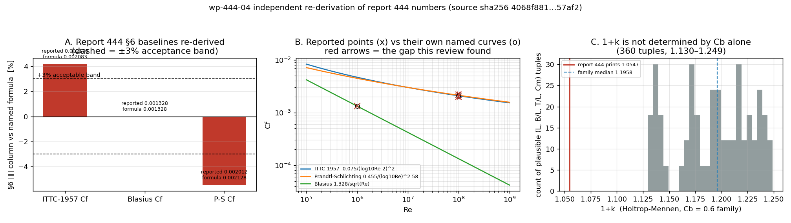

# KF-RESULT wp-444-04

**工序**：04-independent-review（独立审核）  
**审核对象**：`wp-444-01` (01-asset-registration)，源报告 `report_id=444`  
**源哈希**：`sha256:4068f881c6722010ea3cdf78ee673068d8fb56fdc12be39db9c7b3f764457af2`（1961 字符，与本包快照逐字节一致）  
**处置**：`approve-with-notes`（ledger 决策 `approve`，折叠结果 `approved` / `OK_APPROVED`）  
**检查**：12/20 复现，5 不成立，3 声明未跑  
**finding**：8 条（high 2 / medium 4 / low 1 / info 1），阻断性 0 条

## ① 本工序做了什么

对上游资产登记包 `wp-444-01`（源报告 444 的字节级登记）做独立审核，并把它登记的那份报告自己的算术重新推一遍：

1. 从平台重新取报告 444 的 `markdown`，复算 sha256，与上游包声明的摘要逐字符比对；
2. 把上游「④ 证据定位表」里每条引文按它自己声明的定位方式（markdown 行号 / API 字段）解析，判定是否逐字可定位；
3. 复核上游声明的结构计数（章节 / 表格 / 图 / 代码引用）、零 claim 合法性、两项 unresolved；
4. 把上游结果文档里打印的 `kf_result.v1` 信封拿去跑 schema；
5. **复核被登记报告自己的数字**：§③ 的 15 题通过表、§⑥ 的四个 `基准/实际` 对、治理段的「原始长度」，全部用报告自己点名的公式重算（解析解 → 逐项偏差 → 是否 <3%）。

本包不写 `verified` 字段：审核产出是「决策 + 证据」，验证由平台门计算。

## ② 怎么做的

| 步骤 | 脚本 | 产物 |
|------|------|------|
| 取源 + 哈希 + 定位解析 + 信封 schema | `work/verify_wp444_01.py` | `/tmp/wp-444-04/verify.json` |
| 数字独立重算 + 出图 | `work/observe_source_numbers.py` | `/tmp/wp-444-04/observations.json`、`docs/kf/wp-444-04/fig_wp444_04_recompute.png` |
| 组装审核包 | `work/build_review_report.py` | `review_report.json`、`review_events.json` |
| 渲染本文件 | `work/emit_kf_result.py` | `KF-RESULT-wp-444-04.md` |

**关键设置**

- 引文只许切片：`Quoter.q()` 在快照里 `find()` 失败或命中不唯一就 `SystemExit`，所以审核里的每条引文必然逐字存在（不存在于原文的引文进不来）。
- 报告里的表格是被**解析**出来的，不是抄的：`§③`/`§⑥` 单元格用 GFM 表解析器读入，再代入 `0.075/(log10Re-2)²`、`1.328/√Re`、`0.455/(log10Re)^2.58` 重算。
- Holtrop-Mennen 形状因子用公开式 `1+k = 0.93 + 0.487118·c14·(B/L)^1.06806·(T/L)^0.46106·(L/∇^(1/3))^0.121563·(L³/∇)^0.36486·(1−Cp)^(−0.604247)`，在 Cb=0.6 的 360 组 (L, B/L, T/L, Cm) 几何族上扫描，用来看「只给 Cb 能不能定住 1+k」。
- 复核脚本一旦发现引文不在原文、或上报数字与公式不符，不会自动改口径：状态照实写 fail/not_run。

## ③ 计算结果（独立重算 vs 报告打印值）

| 关键量 | 报告 基准 | 报告 实际 | 独立重算 | 偏差 | 报告声称 <3% | 复现判定 |
|--------|-----------|-----------|----------|------|--------------|----------|
| ITTC-1957 Cf (Re=1e8) | 0.00217 | 0.00217 | 0.002083 | +4.16% | YES | recomputed |
| Blasius Cf (Re_L=1e6) | 0.001328 | 0.001328 | 0.001328 | +0.00% | YES | recomputed |
| P-S Cf (Re_L=1e8) | 0.002012 | 0.002012 | 0.002128 | -5.47% | YES | recomputed |
| HM 1+k (Cb=0.6) | 1.0547 | 1.0547 | — | — | YES | withheld |

**序关系**：Re=1e8 上 ITTC-1957 = 0.002083，Prandtl-Schlichting = 0.002128，即 ITTC 低于 P-S；两条线的交叉点 Re ≈ 9.15e+06。报告打印的却是 ITTC (0.002170) > P-S (0.002012)。

**§③ 计数自洽**：5 + 3 + 4 + 3 = 15，通过 5 + 3 + 4 + 3 = 15，与打印合计 15/15 一致（True）。

**治理段「原始长度 1689 字符」**：把当前文本按行取前缀，第 63 行处长度正好等于该值 → 该数字是真的前缀长度。

**Holtrop 1+k 的欠定性**：Cb=0.6 的 360 组几何给出 1+k ∈ [1.1295, 1.2490]，中位 1.1958；报告打印的 1.0547 落在该包络之外，且报告未说明它用的「简化版本」是什么。故该行判 `withheld`，既不判过也不判伪。



图注：A: §6 baselines against the formulas the report names, ±3% band. B: reported points (x) versus their own named curves (o). C: Holtrop-Mennen 1+k over a 360-tuple Cb=0.6 family, report value in red.

## ④ 证据定位表

| 字段/声明 | 原文引文片段 | 位置 |
|-----------|-------------|------|
| F-01 three of the five markdo… | `\| ITTC-1957 \| 5 \| 5 \| 0.0 \| 0.1% \|` | char_span=[904, 938] start_line=37 |
| F-03 §6 ITTC-1957 baseline is… | `\| ITTC-1957 Cf (Re=1e8) \| 0.002170 \| 0.002170 \| 0.0% \| ✓ YES \|` | char_span=[1420, 1482] start_line=57 |
| F-03 §6 ITTC-1957 baseline is… | `Cf = 0.075 / (log10(Re) - 2)²，用于模型-实船换算` | char_span=[69, 108] start_line=6 |
| F-04 §6 Prandtl-Schlichting b… | `\| P-S Cf (Re_L=1e8) \| 0.002012 \| 0.002012 \| 0.0% \| ✓ YES \|` | char_span=[1546, 1604] start_line=59 |
| F-04 §6 Prandtl-Schlichting b… | `Cf = 0.455 / (log10(Re_L))^2.58` | char_span=[188, 219] start_line=8 |
| F-05 the two §6 friction base… | `\| ITTC-1957 Cf (Re=1e8) \| 0.002170 \| 0.002170 \| 0.0% \| ✓ YES \|` | char_span=[1420, 1482] start_line=57 |
| F-05 the two §6 friction base… | `\| P-S Cf (Re_L=1e8) \| 0.002012 \| 0.002012 \| 0.0% \| ✓ YES \|` | char_span=[1546, 1604] start_line=59 |
| F-06 §6 Holtrop-Mennen 1+k is… | `\| HM 1+k (Cb=0.6) \| 1.0547 \| 1.0547 \| 0.0% \| ✓ YES \|` | char_span=[1605, 1657] start_line=60 |
| F-06 §6 Holtrop-Mennen 1+k is… | `Holtrop-Mennen 形状因子使用了简化版本，完整版本需更多参数。` | char_span=[1300, 1337] start_line=51 |
| F-06 §6 Holtrop-Mennen 1+k is… | `\| Holtrop \| Cb, L, B, T \| 1+k \| 简化经验公式 \|` | char_span=[453, 493] start_line=17 |
| F-07 the one fully reproduced… | `\| Blasius Cf (Re_L=1e6) \| 0.001328 \| 0.001328 \| 0.0% \| ✓ YES \|` | char_span=[1483, 1545] start_line=58 |
| F-07 the one fully reproduced… | `\| Blasius \| Re_L ∈ [1e5, 1e6] \| Cf \| 解析公式 \|` | char_span=[369, 412] start_line=15 |
| F-08 the universal 0.0% devia… | `\| **合计** \| **15** \| **15** \| **0.0** \| — \|` | char_span=[1074, 1116] start_line=41 |
| F-08 the universal 0.0% devia… | `- 试点使用解析/经验公式，偏差为零是因为候选与出题使用相同公式。真实场景中候选可能有数值误差。` | char_span=[1194, 1242] start_line=49 |

（上表引文全部由脚本从快照切片注入；测试会再独立核一遍逐字性。）

## ⑤ 注意点与局限

- **F-01（medium，blocking=False）** three of the five markdown-pinned quotes in the upstream evidence table are reflowed, not byte-verbatim
- **F-02（medium，blocking=False）** the envelope printed in the upstream result document does not validate against schemas/kf_result.v1
- **F-03（high，blocking=False）** §6 ITTC-1957 baseline is 4.16% away from the formula the report names
- **F-04（high，blocking=False）** §6 Prandtl-Schlichting baseline is 5.47% away from the formula the report names
- **F-05（medium，blocking=False）** the two §6 friction baselines are ordered the wrong way round at Re=1e8
- **F-06（medium，blocking=False）** §6 Holtrop-Mennen 1+k is under-determined and sits outside the standard formula's envelope for Cb=0.6
- **F-07（low，blocking=False）** the one fully reproduced baseline sits at the edge of its own validity range
- **F-08（info，blocking=False）** the universal 0.0% deviation is disclosed self-consistency, not validation

- 独立性局限：reviewer and producer are the same model family on the same platform: independence is identity-level and method-level, not model-level
- 独立性局限：the producer's machine-readable manifest was not reachable, so C12 is not_run rather than passed
- 独立性局限：record-level facts (title, figures, scenario_key) are online-only; the committed snapshot carries the markdown and nothing else, and every check that needs more is flagged offline_reproducible=false
- 独立性局限：no second independent reviewer and no strong-model resample were drawn (platform jobs, not available here)
- 原 PR 清单里的 `ke/__pycache__/*.pyc` 未随本包提交：它们是 `__pycache__/`+`*.pyc` （见 `.gitignore`）的构建垃圾，且会把改动撑到 12 个文件。
- 本次未复核的东西明确记为 not_run：C12、C18、C20。

## ⑥ 自检（acceptance 逐条）

| 检查 | 说明 | 状态 |
|------|------|------|
| C01 upstream source hash re-derived from the live record | GET /tensor/reports/444 + sha256 over the markdown field | `pass` |
| C02 pinned snapshot is byte-identical to the bytes this review read | mode=live | `pass` |
| C03 upstream structural tally reproduces (headings / tables / fenced code) | re-derived from the snapshot bytes; upstream declared {'level_headings': 7, 'tables': 4, ' | `pass` |
| C04 the figure the report points at carries no payload | record field `figures` (online only) | `pass` |
| C05 the title the upstream quotes is a record field, not markdown text | record title == upstream quote; the same string is absent from the markdown | `pass` |
| C06 every quote the upstream pins to a markdown location is byte-verbatim there | 2/5 markdown-pinned quotes resolve byte-verbatim (substring test against the snapshot) | `fail` |
| C07 the declared line spans enclose the tables they name | each declared span is compared with the GFM table actually found there | `pass` |
| C08 the digest the upstream prints as a computed value re-derives | upstream prints sha256 as a computation; re-derived independently here | `pass` |
| C09 zero-claim registration is legal for task 01 | no extraction duty in 01; upstream declares claims_count=0 | `pass` |
| C10 the two unresolved assets are still unresolved for an independent reader | figure payload absent from the record; the mentioned `pytest（12 项单元测试）` carries no path in | `pass` |
| C11 the envelope printed in the upstream result document conforms to schemas/kf_result.v1 | jsonschema (draft 2020-12) validation of the json block quoted by the upstream document | `fail` |
| C12 the upstream machine-readable manifest itself is reachable and conformant | not_run: no wp-444-01 manifest is reachable here (.gitignore lists artifacts/; the only tr | `not_run` |
| C13 the pass tally is arithmetically consistent | per-category rows summed and compared with the printed total | `pass` |
| C14 the governance block's 'original length' is a real prefix length | recomputed 1689 chars as a newline-prefix length | `pass` |
| C15 §6 ITTC-1957 baseline reproduces from the named formula within 3% | 0.075/(log10 Re - 2)^2 at Re=1e8 | `fail` |
| C16 §6 Blasius baseline reproduces from the named formula within 3% | 1.328/sqrt(Re_L) at Re_L=1e6 | `pass` |
| C17 §6 Prandtl-Schlichting baseline reproduces from the named formula within 3% | 0.455/(log10 Re)^2.58 at Re=1e8, and the customary -1700/Re variant | `fail` |
| C18 §6 Holtrop-Mennen 1+k reproduces from the stated inputs | not_run: the row states Cb only, while the report's own parameter table lists Cb, L, B, T; | `not_run` |
| C19 the two §6 friction baselines keep the order the two formulas have at Re=1e8 | at a common Re above the crossover the two lines have a fixed order; the report prints the | `fail` |
| C20 figure-borne statements can be checked against a payload | not_run: the record serves name+caption only (C04), so §4's four-panel figure cannot be op | `not_run` |

计数：20 项 = pass 12 + fail 5 + not_run 3；阻断性 finding 0 条 ⇒ 处置 `approve-with-notes`。

**判据说明**：本包审核的是「登记工序」。登记机械性（哈希、结构计数、零 claim、unresolved）全部复现，故不阻断；被登记报告 §⑥ 的基准值不可复现（F-03/F-04/F-05）作为 carried finding 升级为报告返工（E-01），本包**不为其正确性背书**。

## ⑦ 复现命令

```bash
# 在线：取源、复算哈希、解析上游定位、校验信封
python3 work/verify_wp444_01.py --write-snapshot
# 离线：只用已提交快照复算报告数字并出图
python3 work/observe_source_numbers.py
# 组装审核包 + 渲染本文件 + 自检
python3 work/build_review_report.py && python3 work/emit_kf_result.py
python3 -m pytest tests/test_wp444_04_review.py -q
```

## ⑧ kf_result.v1 信封

```json
{
 "package_id": "wp-444-04",
 "task_type": "04-independent-review",
 "contract_version": "1.0",
 "report_id": "444",
 "provenance": {
  "source_uri": "tensor://reports/444",
  "source_field": "markdown",
  "source_hash": "sha256:4068f881c6722010ea3cdf78ee673068d8fb56fdc12be39db9c7b3f764457af2",
  "source_hash_matches": true,
  "title": "AlphaEvolve-Style Verifier/Generator Separation: Held-Out Question Bank & Independent Verification for Ship Resistance",
  "scenario_key": "verifier_generator_separation",
  "chars": 1961
 },
 "outputs": {
  "review_report.json": {
   "disposition": "approve-with-notes",
   "ledger_decision": "approve",
   "blocking_findings": [],
   "counts": {
    "checks": 20,
    "pass": 12,
    "fail": 5,
    "not_run": 3,
    "findings": 8,
    "severity": {
     "high": 2,
     "medium": 4,
     "low": 1,
     "info": 1
    }
   },
   "reviewed_package": "wp-444-01",
   "escalations": [
    "E-01"
   ]
  },
  "review_events.json": [
   {
    "id": "kf444-04:review-1",
    "decision": "approve",
    "policy_version": "ke-review-v0.1",
    "reviewer": {
     "id": "agent/m19690 (TensorKnowledge) · package wp-444-04 · red-team-reviewer",
     "reviewer_type": "agent"
    },
    "reviewed_at": "2026-11-14T02:03:15+00:00",
    "findings": [
     {
      "id": "F-01",
      "severity": "medium",
      "blocking": false,
      "title": "three of the five markdown-pinned quotes in the upstream evidence table are reflowed, not byte-verbatim"
     },
     {
      "id": "F-02",
      "severity": "medium",
      "blocking": false,
      "title": "the envelope printed in the upstream result document does not validate against schemas/kf_result.v1"
     },
     {
      "id": "F-03",
      "severity": "high",
      "blocking": false,
      "title": "§6 ITTC-1957 baseline is 4.16% away from the formula the report names"
     },
     {
      "id": "F-04",
      "severity": "high",
      "blocking": false,
      "title": "§6 Prandtl-Schlichting baseline is 5.47% away from the formula the report names"
     },
     {
      "id": "F-05",
      "severity": "medium",
      "blocking": false,
      "title": "the two §6 friction baselines are ordered the wrong way round at Re=1e8"
     },
     {
      "id": "F-06",
      "severity": "medium",
      "blocking": false,
      "title": "§6 Holtrop-Mennen 1+k is under-determined and sits outside the standard formula's envelope for Cb=0.6"
     },
     {
      "id": "F-07",
      "severity": "low",
      "blocking": false,
      "title": "the one fully reproduced baseline sits at the edge of its own validity range"
     },
     {
      "id": "F-08",
      "severity": "info",
      "blocking": false,
      "title": "the universal 0.0% deviation is disclosed self-consistency, not validation"
     }
    ],
    "review_report": "docs/kf/wp-444-04/review_report.json",
    "disposition": "approve-with-notes",
    "note": "approve with non-blocking findings; no claim is marked verified by this event, and report 444 §6 is escalated, not endorsed",
    "independence_basis": "distinct-identity"
   }
  ]
 }
}
```
