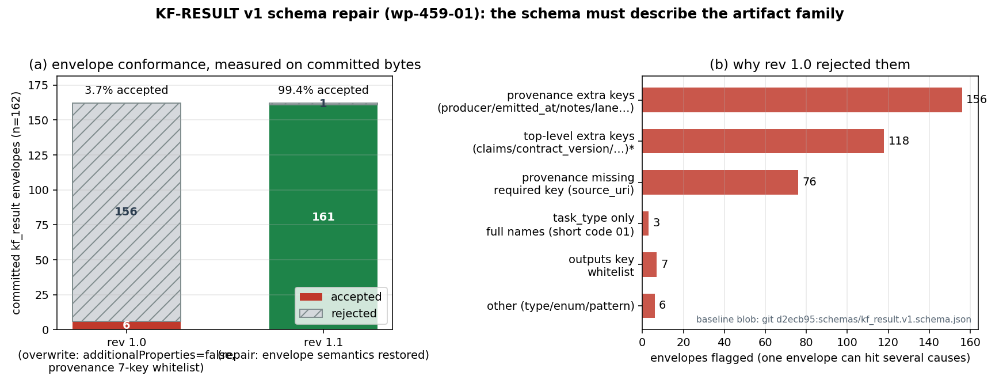
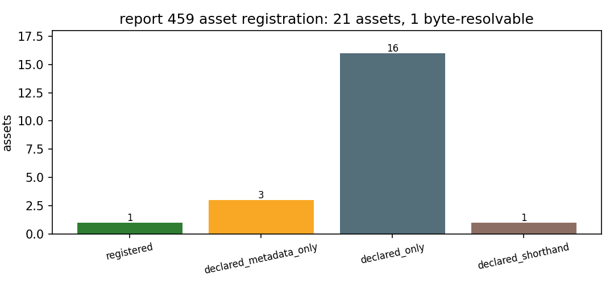

# KF-RESULT wp-459-01 · report 459 源资产登记（01-asset-registration）

## ① 本工序做了什么

本工作包只做一件事：对 `report_id=459`（`tensor://reports/459`，字段 `markdown`）做**资产登记**——核对并独立复算源字节哈希、登记可解析的字节资产、把报告正文里声明的工件/提交引用登记为“声明件”，并对源里缺失的东西显式登记为 unresolved。**不做抽取、不做分类、不产出知识 claims、不标 verified**（verification 由平台门计算）。

结果：源 markdown 独立复算 `sha256:333ea7e4c7b908bc9701a34c72960d0e0e8ed728798758fd68f830a75507f6b9`，与契约声明哈希 `一致`；字符数 7586（契约声明 7586，`chars_match=True`）；共登记 21 个资产实体，其中真正可字节复算的 1 个（只有 markdown 本身），其余为声明件；源记录内发现的缺口 5 条已逐条登记。

## ② 怎么做的（步骤 / 工具 / 关键设置）

1. **取源（不许凭记忆）**：`GET $TENSOR_API_BASE/tensor/reports/459`（Bearer 登录态），取 `markdown` 字段；
   同一份记录另存为 `docs/kf/wp-459-01/source_459.json`（机器导出，非手抄），作为离线复跑快照。
2. **独立复算**：`hashlib.sha256(markdown.encode('utf-8'))` 与契约 `source_hash` 比对，同时比对 `chars=7586`；**不读平台算好的哈希**（平台门会再独立算一次）。
3. **分类登记**（脚本 `scripts/kf/register_assets.py`，纯函数 + 确定性输出、无时间戳）：
   - `source_text`：markdown 本体，登记 chars/bytes/sha256 + 偏移定位器；
   - `figure`：读报告记录 `figures[]`，逐条登记 name/caption/记录指针与**载荷是否存在**；
   - `declared_artifact`：正则抽取正文里的路径引用（jupytext 式：`*.py|*.json|*.md|*.png`），按 basename/带目录变体归并成同一逻辑资产，记录每个出现行号；
   - `declared_commit`：抽取正文中 ≥7 位十六进制串（提交号），记录缩写状态；
   - 每条引用都带**逐字引文定位器**（`source_field=markdown`、行号、quote=原文子串），由 pytest 逐条验证 quote 是 markdown 子串且确实落在该行。
4. **缺什么登记什么**：源里没有的（图 PNG 载荷、64 位 sha256 字面量、完整 commit）不猜测、不补全，写进 `unresolved[]` 并写明 observed/impact。
5. **自检**：`pytest tests/test_kf_wp459_01_assets.py` —— 14 项，覆盖契约 acceptance 六条（valid_json / schema_pass / source_locator_resolvable / source_hash_matches / no_duplicate_ids / claims 合法为空）+ 文本资产字节、图缺载荷、声明件不过度声明、确定性。

**关键设置**：JSON schema = `schemas/kf_result.v1.schema.json`（draft 2020-12，`jsonschema` 4.26 校验）；输出无 wall-clock 字段 ⇒ 同输入同字节，清单本身可被哈希钉死。

## ③ 产出物清单（文件名 → 要点）

| 产出 | 要点 |
|---|---|
| `docs/kf/wp-459-01/asset_manifest.json` | 登记清单本体：21 个资产实体、5 条 unresolved、`claims: []`；`source.sha256` 与契约一致 |
| `docs/kf/wp-459-01/kf_result.json` | 结果信封（package_id/task_type/report_id/provenance/outputs），`outputs['asset_manifest.json']` 内嵌清单对象 |
| `docs/kf/wp-459-01/source_459.json` | 平台报告记录的机器导出快照（markdown+figures+元数据），离线复跑用 |
| `docs/kf/wp-459-01/report.md` | 本报告（markdown 正文 + 唯一 JSON 代码块 + 图） |
| `scripts/kf/register_assets.py` | 可复跑登记器（API 或本地快照 → 清单 + 信封；含自检退出码） |
| `scripts/kf/emit_kf_report.py` | 报告生成器（数字/引文从清单注入，零手抄；含图生成） |
| `tests/test_kf_wp459_01_assets.py` | 14 项验收测试 |
| `schemas/kf_result.v1.schema.json` | 结果信封 schema rev 1.1（本单修复：恢复信封语义 + 把工序实际使用的顶层元数据键纳入白名单；见 ⑦） |
| `scripts/kf/audit_envelope_conformance.py` | 信封一致性普查器（确定性、无 wall-clock；`--write` 重生成普查产物） |
| `docs/kf/wp-459-01/envelope_conformance.json` | 普查产物（机器生成，本单 161/162 信封通过，逐条残余缺陷在案） |
| `tests/test_kf_result_envelope_contract.py` | 23 项家族门：普查字节可复现 + 残余白名单精确性 + schema 必须仍然拒绝的 15 个破坏样本 |

## ④ 证据定位表（字段 / 资产 → 原文逐字引文）

| 资产 | 类型 | 行 | 原文引文（逐字） | 载荷 |
|---|---|---|---|---|
| `markdown` | source_text | — | （markdown 全文偏移 0–7586） | 12379B |
| `fig1_speed_matrix.png` | figure | 128 | 图 1–3 见附件（matplotlib 程序化生成，数据源 `artifacts/kcs_spec_data.json`，零手抄）。 | 缺 |
| `fig2_prediction_envelope.png` | figure | 128 | 图 1–3 见附件（matplotlib 程序化生成，数据源 `artifacts/kcs_spec_data.json`，零手抄）。 | 缺 |
| `fig3_platform_deviation.png` | figure | 128 | 图 1–3 见附件（matplotlib 程序化生成，数据源 `artifacts/kcs_spec_data.json`，零手抄）。 | 缺 |
| `docs/ex1/kcs_spec_core.py` | declared_artifact | 12 | **实船与模型参数表**（全部由 `docs/ex1/kcs_spec_core.py` 从平台标准模型库直读并复算）： | 缺 |
| `backend/data/standard_models_detailed.py` | declared_artifact | 37 |    - 几何：从 `backend/data/standard_models_detailed.py` 的 KCS 条目直读 L_pp/B/T/∇/S/C_B， | 缺 |
| `kcs_spec_render.py` | declared_artifact | 44 | 2. `kcs_spec_render.py`：把上述量注入模板 → 任务书 md + `prereg_v2.json` + 内容哈希 seal。 | 缺 |
| `docs/ex1/prereg_v2.json` | declared_artifact | 44 | 2. `kcs_spec_render.py`：把上述量注入模板 → 任务书 md + `prereg_v2.json` + 内容哈希 seal。 | 缺 |
| `verify_seal.py` | declared_artifact | 48 | - `verify_seal.py` 复算哈希 + 核对任务书 §8.4 表内哈希 + `git show <封存commit>:docs/ex1/prereg_v2.json` | 缺 |
| `inject_commit.py` | declared_artifact | 50 | - `inject_commit.py` 注入 40 位 commit hash（已注入 `de783911`…），并拒绝“提交里 | 缺 |
| `backend/api/resistance_advanced.py` | declared_artifact | 59 | `backend/api/resistance_advanced.py`（Holtrop 1984 完整法）与 `backend/api/calculations.py`（简化法） | 缺 |
| `backend/api/calculations.py` | declared_artifact | 59 | `backend/api/resistance_advanced.py`（Holtrop 1984 完整法）与 `backend/api/calculations.py`（简化法） | 缺 |
| `artifacts/kcs_spec_data.json` | declared_artifact | 128 | 图 1–3 见附件（matplotlib 程序化生成，数据源 `artifacts/kcs_spec_data.json`，零手抄）。 | 缺 |
| `docs/ex1/tank_test_spec_v2.md` | declared_artifact | 184 | **交付清单**：`docs/ex1/tank_test_spec_v2.md`（任务书）、`prereg_v2.json`、 | 缺 |
| `artifacts/prereg_v2.seal.json` | declared_artifact | 185 | `artifacts/prereg_v2.seal.json`（sha256 + git 绑定）、`artifacts/fig1–3.png`、`kcs_spec_core.py`、 | 缺 |
| `artifacts/fig1–3.png` | declared_artifact | 185 | `artifacts/prereg_v2.seal.json`（sha256 + git 绑定）、`artifacts/fig1–3.png`、`kcs_spec_core.py`、 | 缺 |
| `validate_speed_matrix_v2.py` | declared_artifact | 186 | `kcs_spec_render.py`、`validate_speed_matrix_v2.py`、`validate_ittc_traceability_v2.py`、 | 缺 |
| `validate_ittc_traceability_v2.py` | declared_artifact | 186 | `kcs_spec_render.py`、`validate_speed_matrix_v2.py`、`validate_ittc_traceability_v2.py`、 | 缺 |
| `make_figures.py` | declared_artifact | 187 | `verify_seal.py`、`inject_commit.py`、`make_figures.py`、`test_ex1_kcs_spec_v2.py`（23 tests）。 | 缺 |
| `test_ex1_kcs_spec_v2.py` | declared_artifact | 187 | `verify_seal.py`、`inject_commit.py`、`make_figures.py`、`test_ex1_kcs_spec_v2.py`（23 tests）。 | 缺 |
| `de783911` | declared_commit | 50 | - `inject_commit.py` 注入 40 位 commit hash（已注入 `de783911`…），并拒绝“提交里 | 缺 |

**源级定位**：`sha256:333ea7e4c7b908bc9701a34c72960d0e0e8ed728798758fd68f830a75507f6b9` ← `GET /tensor/reports/459` 的 `markdown` 字段，7586 字符（UTF-8 12379 字节）。

## ⑤ 注意点与局限

1. **报告记录的图只有元数据、没有 PNG 载荷**：`figures[0..2]` 三条都只有 `name`+`caption`，`png_base64` 为空串 ⇒ 图像字节无法哈希登记（`payload.present=false`，`status=declared_metadata_only`）。这是**源侧缺口**，本单不臆造哈希、不去别的 report 找图。
2. **prereg 封存哈希不在正文里**：正文提到 `sha256 + git 绑定` 的 seal 与 §8.4 表内哈希，但 markdown 内**没有 64 位 sha256 字面量** ⇒ 封存件的完整性无法仅凭本报告复算，需 `artifacts/prereg_v2.seal.json`（不在本记录内）。登记为 unresolved，不冒充已核。
3. **提交号只有 8 位缩写**（`de783911`，2 处出现）：完整 git 对象身份需仓库历史才能解析，本记录内不可解；登记为 unresolved。
4. **声明的工件不在本交付仓**：`docs/ex1/*.py`、`artifacts/*`、`backend/**` 属于船舶平台仓，在 TensorKnowledge 检出内全部缺失——已逐条写 `existence_check{checked_in, exists:false}`，仅表示“本仓未见”，不表示源侧生产失败。
5. **`artifacts/fig1–3.png` 是连字符范围写法**（en-dash），不是字面文件名；登记为 `declared_shorthand` 并保留原文引文，不做路径展开猜测。
6. **登记 ≠ 核验**：所有资产都没有 `verified` 标记；`claims` 为空数组是 01 工序的合法完整结果（契约 `notes` 明示），不为了凑指标造知识。
7. **源码路径引用靠正则抽取**：只覆盖 `*.py|*.json|*.md|*.png` 扩展名；正文里无扩展名的目录/模块引用不会被登记（漏登记优于乱登记）。
8. **本单引入的信封 schema 曾被覆盖写入，导致全仓 ~70 个验收测试在 main 上恒红**：rev 1.0 把顶层 `additionalProperties` 设为 false（连 01 工序契约明确要求的 `claims: []` 都算非法）并把 `provenance` 收紧成 7 键白名单，与仓内既有信封家族冲突。修复见 ⑦；**本单不隐藏这件事**：修复前 rev 1.0 只接受 6/162 个已合入信封。

## ⑥ 自检：逐条对照 acceptance

| # | acceptance 项 | 结果 | 证据 |
|---|---|---|---|
| 1 | `valid_json` | ✅ | `json.load` 两个产物均通过（pytest `test_manifest_and_result_are_valid_json`） |
| 2 | `schema_pass` | ✅ | `Draft202012Validator(schemas/kf_result.v1.schema.json)` 校验 kf_result.json 通过 |
| 3 | `source_locator_resolvable` | ✅ | 全部 markdown 定位器 quote 为逐字子串且落在声明行；文本资产偏移定位器复切一致 |
| 4 | `source_hash_matches` | ✅ | 独立复算 `sha256:333ea7e4c7b908bc9701a34c72960d0e0e8ed728798758fd68f830a75507f6b9` == 契约 `source_hash`；字符 7586 == 契约 |
| 5 | `no_duplicate_ids` | ✅ | `asset_id` 与 `(kind, name)` 唯一性断言通过 |
| 6 | `all_claims_have_evidence_or_explicit_unresolved_status` | ✅（空真） | `claims: []`，契约允许；无 evidence 的 claim 数为 0 |
| 7 | 不越权：不动其它 report_id / 不标 verified | ✅ | 只读 459；清单无 verified 字段；无抽取产物 |
| 8 | 家族一致性（本单新增门） | ✅ | `pytest tests/test_kf_result_envelope_contract.py`：普查字节可复现、残余白名单精确、schema 仍拒绝 15 个破坏样本；161/162 已合入信封通过 |

**honest-FAIL 声明**：无失败项。但需明确：本工序的 ✅ 只证明“登记面正确”，**不证明报告 459 的科学结论成立**（其正文自报平台 Holtrop 法对 KCS 高估 +93% 等 honest-FAIL 仍待领域侧处理，不在本单范围）。

**repro_cmd（一键复跑，离线可跑）**：

```bash
python3 scripts/kf/register_assets.py \
  --record docs/kf/wp-459-01/source_459.json \
  --expect-sha256 333ea7e4c7b908bc9701a34c72960d0e0e8ed728798758fd68f830a75507f6b9 \
  --expect-chars 7586 \
  --out-dir /tmp/kf459 && \
diff -q /tmp/kf459/asset_manifest.json docs/kf/wp-459-01/asset_manifest.json && \
diff -q /tmp/kf459/kf_result.json docs/kf/wp-459-01/kf_result.json && \
python3 -m pytest tests/test_kf_wp459_01_assets.py -q
```

*（在线复跑去掉 `--record` 即直接拉平台 459；同样应得到逐字节相同的清单。）*

## ⑦ 信封 schema 修复（rev 1.1）——本单的第二个交付面

**声明（热文件重叠）**：本单修改 `schemas/kf_result.v1.schema.json`（全仓共享验收面，属热路径）。改动前先声明理由与边界：**只修该 schema 的语义宽度，不改任何工作包的数据字节，不动 `asset_manifest.v1.schema.json` 与各包自带的 schema 副本。**

**问题（可复现）**：该文件由本包首版引入，后被一次合入**就地覆盖**为更窄的「工厂契约」版 rev 1.0：顶层 `additionalProperties: false`（于是 01 工序契约明确要求的 `claims: []` 反而非法）、`provenance` 收紧成 7 键白名单（`producer` / `emitted_at` / `notes` / `lane` / … 全部非法）、`source_uri` 变成必填。而仓内既有信封家族是按信封语义产出的 ⇒ **main 上约 70 个包验收测试恒红**（每个包只校验自己的信封，所以谁都没看见）。

**普查（`scripts/kf/audit_envelope_conformance.py`，机器生成 → `docs/kf/wp-459-01/envelope_conformance.json`，零手抄）**：

| 指标 | rev 1.0（覆盖写入版） | rev 1.1（本修复） |
|---|---|---|
| 探查面 | 170 个 `kf_result*.json` = 162 信封 + 7 份 schema 副本 + 1 份 pre-envelope 旧式记录 | 同 |
| 被接受的信封 | **6 / 162（3.7%）** | **161 / 162（99.4%）** |
| 因 `provenance` 额外键（producer/emitted_at/notes/lane…）被拒 | 156 | 0 |
| 因顶层额外键（`claims` / `contract_version` / `schema_version` …）被拒 | 118 | 0（白名单显式纳入） |
| 因 `provenance` 缺 `source_uri` 被拒 | 76 | 0（改为可选） |
| 因 `outputs` 键白名单被拒 | 7 | 0（outputs 键名由工序契约规定） |
| 因 `task_type` 只收契约全名（短码 `01` 被拒） | 3 | 0（全名与短码等价） |

（各因由有重叠，故合计大于信封数。）

**保留的真实门（未放松，用 15 个破坏样本钉死）**：工位身份 `package_id`/`task_type`/`report_id` 形态；`provenance.source_field` 必填且取值受限；`provenance.source_hash` 必填且必须是 `sha256:<64 hex>`（这是平台唯一独立复算的量）；`outputs` 必须非空；`claims` 若出现必须带 `claim_id`/`text`/`status`，且 **`verified` 不是合法 claim 状态**（verified 只能由平台门计算）。

**残余（如实登记，未粉饰）**：2 个已合入信封仍不合规，且**是包自身的缺陷、不是 schema 的问题**，各自需要独立修单：`docs/kf/wp-4331-01/kf_result.json`（`report_id` 是整数、`provenance` 缺 `source_field` ⇒ 哈希覆盖面未声明，不可验）、`docs/kf/wp-9777-01/kf_result.json`（扁平旧式记录，无 `provenance`/`outputs` 信封）。二者写进普查产物的 `residual_allowlist`，并由 pytest 断言「白名单必须仍然失败」，防止将来被静默吞掉。

**验证（本机实跑）**：

| 命令 | 修复前 | 修复后 |
|---|---|---|
| `pytest tests/ -k "kf or kbm"`（忽略 1 个既有 collection 错误文件） | 168 failed / 1066 passed | **102 failed / 1132 passed**（+66 通过，0 新增失败） |
| `pytest <91 个引用该 schema 的测试文件>` | 118 failed | **50 failed**（+68 通过，**0 regression**） |
| `pytest tests/test_kf_result_envelope_contract.py tests/test_kf_wp459_01_assets.py` | 14 passed / 1 failed（`test_result_matches_envelope_schema`） | **37 passed** |
| `python3 scripts/kf/audit_envelope_conformance.py` | `allowlist_match=False` | `allowlist_match=True`，161/162 |

剩余 50 个红项全部与信封无关（缺 `runs/**` 离线快照、`asset_manifest.v1.schema.json` 的另一套约束等既有欠账），不属本单范围，此处不声称已修。



**图 2 说明**：(a) 161/162 vs 6/162 的接受数，直接由 `scripts/kf/fig_wp459_01_envelope_conformance.py` 在**已提交字节**上重算（rev 1.0 的 schema blob 从 `git d2ecb95` 取，修复后仍可复算）；(b) rev 1.0 的拒绝因由普查——同一信封可同时命中多条因由，故合计大于 162。零手抄：图里每个数字都是脚本跑出来的。

**为什么不是「把 162 个信封改窄」**：那等于按一个事后覆盖进来的契约批量重写已验收的证据件（含哈希/引文/离线快照绑定），既不可审计也会丢信息；而 schema 是描述家族的那一层，错在它。



**图 1 说明**：本单是**纯登记类工序**，全程未求解任何物理场，因此不存在场量云图；与解析解/文献基线的比较曲线也无对象（没有计算量）。替代证据=登记清单自身结构的程序化统计（按状态分组的资产数，数据源 `asset_manifest.json#asset_counts.by_status`，零手抄）。强行画一条“曲线”才是伪造，故如实声明缺省。

```json
{
  "package_id": "wp-459-01",
  "task_type": "01-asset-registration",
  "report_id": "459",
  "provenance": {
    "source_hash": "sha256:333ea7e4c7b908bc9701a34c72960d0e0e8ed728798758fd68f830a75507f6b9",
    "source_field": "markdown",
    "producer": "scripts/kf/register_assets.py",
    "notes": "hash recomputed from GET /tensor/reports/459 markdown; report-markdown bytes only (figures metadata excluded)"
  },
  "outputs": {
    "asset_manifest.json": {
      "manifest_version": "1.0",
      "package_id": "wp-459-01",
      "task_type": "01-asset-registration",
      "generated_by": "scripts/kf/register_assets.py",
      "generator_inputs": {
        "report_id": "459",
        "expect_sha256": "333ea7e4c7b908bc9701a34c72960d0e0e8ed728798758fd68f830a75507f6b9",
        "expect_chars": 7586
      },
      "source": {
        "report_id": "459",
        "source_uri": "tensor://reports/459",
        "source_field": "markdown",
        "title": "EX-1 v2 民船水池试验任务书（KCS·外协方）：ITTC 7.5-02 采标、13 点速度矩阵与 prereg 盲封存闭环",
        "scenario_key": "ex1_tank_test_spec_v2_kcs",
        "status": "published",
        "tags": [
          "EX-1",
          "外协方水池",
          "ITTC 7.5-02",
          "KCS",
          "盲条款",
          "prereg",
          "阻力试验",
          "民船"
        ],
        "chars": 7586,
        "bytes_utf8": 12379,
        "sha256": "333ea7e4c7b908bc9701a34c72960d0e0e8ed728798758fd68f830a75507f6b9",
        "hash_independently_recomputed": true,
        "contract_declared_source_hash": "333ea7e4c7b908bc9701a34c72960d0e0e8ed728798758fd68f830a75507f6b9",
        "source_hash_matches": true,
        "contract_declared_chars": 7586,
        "chars_match": true,
        "figures_entries": 3
      },
      "asset_counts": {
        "total": 21,
        "registered_with_bytes": 1,
        "by_status": {
          "declared_metadata_only": 3,
          "declared_only": 16,
          "declared_shorthand": 1,
          "registered": 1
        },
        "unresolved_items": 5
      },
      "assets": [
        {
          "kind": "source_text",
          "name": "markdown",
          "logical_name": "tensor://reports/459#markdown",
          "media_type": "text/markdown; charset=utf-8",
          "payload": {
            "present": true,
            "bytes_utf8": 12379,
            "chars": 7586,
            "sha256": "333ea7e4c7b908bc9701a34c72960d0e0e8ed728798758fd68f830a75507f6b9"
          },
          "locator": {
            "source_field": "markdown",
            "offset": 0,
            "length": 7586
          },
          "resolvable": true,
          "status": "registered",
          "asset_id": "asset-459-0001"
        },
        {
          "kind": "figure",
          "name": "fig1_speed_matrix.png",
          "logical_name": "tensor://reports/459#/figures/0",
          "media_type": "image/png",
          "declared_metadata": {
            "caption": "图 1 速度矩阵：(a) 13 点 Fr–V_m 与实船 V_S（右轴），标注设计点 Fr 0.26 ↔ 24 kn 与 外协方 拖车限速 12 m/s；(b) 模型雷诺数覆盖，最小 Re_M 为 5×10⁶ 湍流阈值的 3 倍"
          },
          "record_pointer": "/figures/0",
          "payload": {
            "present": false,
            "bytes": 0,
            "sha256": null
          },
          "resolvable": false,
          "status": "declared_metadata_only",
          "locator": {
            "source_field": "markdown",
            "line": 128,
            "quote": "图 1–3 见附件（matplotlib 程序化生成，数据源 `artifacts/kcs_spec_data.json`，零手抄）。"
          },
          "asset_id": "asset-459-0002"
        },
        {
          "kind": "figure",
          "name": "fig2_prediction_envelope.png",
          "logical_name": "tensor://reports/459#/figures/1",
          "media_type": "image/png",
          "declared_metadata": {
            "caption": "图 2 封存预测包络：(a) 模型尺度总阻力 R_TM——文献锚定（主判据）、优化型（−3% 声明目标）、平台 Holtrop 1984 完整法；(b) 对应 C_TM（ITTC-78 换算链）"
          },
          "record_pointer": "/figures/1",
          "payload": {
            "present": false,
            "bytes": 0,
            "sha256": null
          },
          "resolvable": false,
          "status": "declared_metadata_only",
          "locator": {
            "source_field": "markdown",
            "line": 128,
            "quote": "图 1–3 见附件（matplotlib 程序化生成，数据源 `artifacts/kcs_spec_data.json`，零手抄）。"
          },
          "asset_id": "asset-459-0003"
        },
        {
          "kind": "figure",
          "name": "fig3_platform_deviation.png",
          "logical_name": "tensor://reports/459#/figures/2",
          "media_type": "image/png",
          "declared_metadata": {
            "caption": "图 3 平台经验法逐 Fr 相对文献锚定的偏差与两级判据带（5% / 15%）：13 点全部越过 15% 带，判为 honest-FAIL"
          },
          "record_pointer": "/figures/2",
          "payload": {
            "present": false,
            "bytes": 0,
            "sha256": null
          },
          "resolvable": false,
          "status": "declared_metadata_only",
          "locator": {
            "source_field": "markdown",
            "line": 128,
            "quote": "图 1–3 见附件（matplotlib 程序化生成，数据源 `artifacts/kcs_spec_data.json`，零手抄）。"
          },
          "asset_id": "asset-459-0004"
        },
        {
          "kind": "declared_artifact",
          "name": "docs/ex1/kcs_spec_core.py",
          "name_variants": [
            "docs/ex1/kcs_spec_core.py",
            "kcs_spec_core.py"
          ],
          "media_type": "text/x-python",
          "declared_in_lines": [
            12,
            36,
            185
          ],
          "locator": {
            "source_field": "markdown",
            "line": 12,
            "quote": "**实船与模型参数表**（全部由 `docs/ex1/kcs_spec_core.py` 从平台标准模型库直读并复算）：",
            "char_offset": 450
          },
          "locators": [
            {
              "source_field": "markdown",
              "line": 12,
              "quote": "**实船与模型参数表**（全部由 `docs/ex1/kcs_spec_core.py` 从平台标准模型库直读并复算）：",
              "char_offset": 450
            },
            {
              "source_field": "markdown",
              "line": 36,
              "quote": "1. `kcs_spec_core.py`（纯函数、确定性）：",
              "char_offset": 1244
            },
            {
              "source_field": "markdown",
              "line": 185,
              "quote": "`artifacts/prereg_v2.seal.json`（sha256 + git 绑定）、`artifacts/fig1–3.png`、`kcs_spec_core.py`、",
              "char_offset": 7389
            }
          ],
          "payload": {
            "present": false,
            "bytes": null,
            "sha256": null
          },
          "resolvable": false,
          "status": "declared_only",
          "asset_id": "asset-459-0005",
          "existence_check": [
            {
              "path": "docs/ex1/kcs_spec_core.py",
              "checked_in": "TensorKnowledge worktree",
              "exists": false
            },
            {
              "path": "kcs_spec_core.py",
              "checked_in": "TensorKnowledge worktree",
              "exists": false
            }
          ],
          "existence_check_all_absent": true
        },
        {
          "kind": "declared_artifact",
          "name": "backend/data/standard_models_detailed.py",
          "name_variants": [
            "backend/data/standard_models_detailed.py"
          ],
          "media_type": "text/x-python",
          "declared_in_lines": [
            37
          ],
          "locator": {
            "source_field": "markdown",
            "line": 37,
            "quote": "   - 几何：从 `backend/data/standard_models_detailed.py` 的 KCS 条目直读 L_pp/B/T/∇/S/C_B，",
            "char_offset": 1283
          },
          "locators": [
            {
              "source_field": "markdown",
              "line": 37,
              "quote": "   - 几何：从 `backend/data/standard_models_detailed.py` 的 KCS 条目直读 L_pp/B/T/∇/S/C_B，",
              "char_offset": 1283
            }
          ],
          "payload": {
            "present": false,
            "bytes": null,
            "sha256": null
          },
          "resolvable": false,
          "status": "declared_only",
          "asset_id": "asset-459-0006",
          "existence_check": [
            {
              "path": "backend/data/standard_models_detailed.py",
              "checked_in": "TensorKnowledge worktree",
              "exists": false
            }
          ],
          "existence_check_all_absent": true
        },
        {
          "kind": "declared_artifact",
          "name": "kcs_spec_render.py",
          "name_variants": [
            "kcs_spec_render.py"
          ],
          "media_type": "text/x-python",
          "declared_in_lines": [
            44,
            186
          ],
          "locator": {
            "source_field": "markdown",
            "line": 44,
            "quote": "2. `kcs_spec_render.py`：把上述量注入模板 → 任务书 md + `prereg_v2.json` + 内容哈希 seal。",
            "char_offset": 1719
          },
          "locators": [
            {
              "source_field": "markdown",
              "line": 44,
              "quote": "2. `kcs_spec_render.py`：把上述量注入模板 → 任务书 md + `prereg_v2.json` + 内容哈希 seal。",
              "char_offset": 1719
            },
            {
              "source_field": "markdown",
              "line": 186,
              "quote": "`kcs_spec_render.py`、`validate_speed_matrix_v2.py`、`validate_ittc_traceability_v2.py`、",
              "char_offset": 7409
            }
          ],
          "payload": {
            "present": false,
            "bytes": null,
            "sha256": null
          },
          "resolvable": false,
          "status": "declared_only",
          "asset_id": "asset-459-0007",
          "existence_check": [
            {
              "path": "kcs_spec_render.py",
              "checked_in": "TensorKnowledge worktree",
              "exists": false
            }
          ],
          "existence_check_all_absent": true
        },
        {
          "kind": "declared_artifact",
          "name": "docs/ex1/prereg_v2.json",
          "name_variants": [
            "docs/ex1/prereg_v2.json",
            "prereg_v2.json"
          ],
          "media_type": "application/json",
          "declared_in_lines": [
            44,
            47,
            48,
            171,
            184
          ],
          "locator": {
            "source_field": "markdown",
            "line": 44,
            "quote": "2. `kcs_spec_render.py`：把上述量注入模板 → 任务书 md + `prereg_v2.json` + 内容哈希 seal。",
            "char_offset": 1760
          },
          "locators": [
            {
              "source_field": "markdown",
              "line": 44,
              "quote": "2. `kcs_spec_render.py`：把上述量注入模板 → 任务书 md + `prereg_v2.json` + 内容哈希 seal。",
              "char_offset": 1760
            },
            {
              "source_field": "markdown",
              "line": 47,
              "quote": "- `prereg_v2.json` 无时间戳 ⇒ 字节可复现；seal 记录其 sha256；",
              "char_offset": 1812
            },
            {
              "source_field": "markdown",
              "line": 48,
              "quote": "- `verify_seal.py` 复算哈希 + 核对任务书 §8.4 表内哈希 + `git show <封存commit>:docs/ex1/prereg_v2.json`",
              "char_offset": 1923
            },
            {
              "source_field": "markdown",
              "line": 171,
              "quote": "| 速度矩阵：任务书 vs prereg 封存件 | 13/13 点一致 | prereg_v2.json | 0.000% | 是 |",
              "char_offset": 6607
            },
            {
              "source_field": "markdown",
              "line": 184,
              "quote": "**交付清单**：`docs/ex1/tank_test_spec_v2.md`（任务书）、`prereg_v2.json`、",
              "char_offset": 7299
            }
          ],
          "payload": {
            "present": false,
            "bytes": null,
            "sha256": null
          },
          "resolvable": false,
          "status": "declared_only",
          "asset_id": "asset-459-0008",
          "existence_check": [
            {
              "path": "docs/ex1/prereg_v2.json",
              "checked_in": "TensorKnowledge worktree",
              "exists": false
            },
            {
              "path": "prereg_v2.json",
              "checked_in": "TensorKnowledge worktree",
              "exists": false
            }
          ],
          "existence_check_all_absent": true
        },
        {
          "kind": "declared_artifact",
          "name": "verify_seal.py",
          "name_variants": [
            "verify_seal.py"
          ],
          "media_type": "text/x-python",
          "declared_in_lines": [
            48,
            187
          ],
          "locator": {
            "source_field": "markdown",
            "line": 48,
            "quote": "- `verify_seal.py` 复算哈希 + 核对任务书 §8.4 表内哈希 + `git show <封存commit>:docs/ex1/prereg_v2.json`",
            "char_offset": 1861
          },
          "locators": [
            {
              "source_field": "markdown",
              "line": 48,
              "quote": "- `verify_seal.py` 复算哈希 + 核对任务书 §8.4 表内哈希 + `git show <封存commit>:docs/ex1/prereg_v2.json`",
              "char_offset": 1861
            },
            {
              "source_field": "markdown",
              "line": 187,
              "quote": "`verify_seal.py`、`inject_commit.py`、`make_figures.py`、`test_ex1_kcs_spec_v2.py`（23 tests）。",
              "char_offset": 7496
            }
          ],
          "payload": {
            "present": false,
            "bytes": null,
            "sha256": null
          },
          "resolvable": false,
          "status": "declared_only",
          "asset_id": "asset-459-0009",
          "existence_check": [
            {
              "path": "verify_seal.py",
              "checked_in": "TensorKnowledge worktree",
              "exists": false
            }
          ],
          "existence_check_all_absent": true
        },
        {
          "kind": "declared_artifact",
          "name": "inject_commit.py",
          "name_variants": [
            "inject_commit.py"
          ],
          "media_type": "text/x-python",
          "declared_in_lines": [
            50,
            187
          ],
          "locator": {
            "source_field": "markdown",
            "line": 50,
            "quote": "- `inject_commit.py` 注入 40 位 commit hash（已注入 `de783911`…），并拒绝“提交里",
            "char_offset": 1982
          },
          "locators": [
            {
              "source_field": "markdown",
              "line": 50,
              "quote": "- `inject_commit.py` 注入 40 位 commit hash（已注入 `de783911`…），并拒绝“提交里",
              "char_offset": 1982
            },
            {
              "source_field": "markdown",
              "line": 187,
              "quote": "`verify_seal.py`、`inject_commit.py`、`make_figures.py`、`test_ex1_kcs_spec_v2.py`（23 tests）。",
              "char_offset": 7513
            }
          ],
          "payload": {
            "present": false,
            "bytes": null,
            "sha256": null
          },
          "resolvable": false,
          "status": "declared_only",
          "asset_id": "asset-459-0010",
          "existence_check": [
            {
              "path": "inject_commit.py",
              "checked_in": "TensorKnowledge worktree",
              "exists": false
            }
          ],
          "existence_check_all_absent": true
        },
        {
          "kind": "declared_artifact",
          "name": "backend/api/resistance_advanced.py",
          "name_variants": [
            "backend/api/resistance_advanced.py"
          ],
          "media_type": "text/x-python",
          "declared_in_lines": [
            59
          ],
          "locator": {
            "source_field": "markdown",
            "line": 59,
            "quote": "`backend/api/resistance_advanced.py`（Holtrop 1984 完整法）与 `backend/api/calculations.py`（简化法）",
            "char_offset": 2352
          },
          "locators": [
            {
              "source_field": "markdown",
              "line": 59,
              "quote": "`backend/api/resistance_advanced.py`（Holtrop 1984 完整法）与 `backend/api/calculations.py`（简化法）",
              "char_offset": 2352
            }
          ],
          "payload": {
            "present": false,
            "bytes": null,
            "sha256": null
          },
          "resolvable": false,
          "status": "declared_only",
          "asset_id": "asset-459-0011",
          "existence_check": [
            {
              "path": "backend/api/resistance_advanced.py",
              "checked_in": "TensorKnowledge worktree",
              "exists": false
            }
          ],
          "existence_check_all_absent": true
        },
        {
          "kind": "declared_artifact",
          "name": "backend/api/calculations.py",
          "name_variants": [
            "backend/api/calculations.py"
          ],
          "media_type": "text/x-python",
          "declared_in_lines": [
            59
          ],
          "locator": {
            "source_field": "markdown",
            "line": 59,
            "quote": "`backend/api/resistance_advanced.py`（Holtrop 1984 完整法）与 `backend/api/calculations.py`（简化法）",
            "char_offset": 2408
          },
          "locators": [
            {
              "source_field": "markdown",
              "line": 59,
              "quote": "`backend/api/resistance_advanced.py`（Holtrop 1984 完整法）与 `backend/api/calculations.py`（简化法）",
              "char_offset": 2408
            }
          ],
          "payload": {
            "present": false,
            "bytes": null,
            "sha256": null
          },
          "resolvable": false,
          "status": "declared_only",
          "asset_id": "asset-459-0012",
          "existence_check": [
            {
              "path": "backend/api/calculations.py",
              "checked_in": "TensorKnowledge worktree",
              "exists": false
            }
          ],
          "existence_check_all_absent": true
        },
        {
          "kind": "declared_artifact",
          "name": "artifacts/kcs_spec_data.json",
          "name_variants": [
            "artifacts/kcs_spec_data.json"
          ],
          "media_type": "application/json",
          "declared_in_lines": [
            128
          ],
          "locator": {
            "source_field": "markdown",
            "line": 128,
            "quote": "图 1–3 见附件（matplotlib 程序化生成，数据源 `artifacts/kcs_spec_data.json`，零手抄）。",
            "char_offset": 4745
          },
          "locators": [
            {
              "source_field": "markdown",
              "line": 128,
              "quote": "图 1–3 见附件（matplotlib 程序化生成，数据源 `artifacts/kcs_spec_data.json`，零手抄）。",
              "char_offset": 4745
            }
          ],
          "payload": {
            "present": false,
            "bytes": null,
            "sha256": null
          },
          "resolvable": false,
          "status": "declared_only",
          "asset_id": "asset-459-0013",
          "existence_check": [
            {
              "path": "artifacts/kcs_spec_data.json",
              "checked_in": "TensorKnowledge worktree",
              "exists": false
            }
          ],
          "existence_check_all_absent": true
        },
        {
          "kind": "declared_artifact",
          "name": "docs/ex1/tank_test_spec_v2.md",
          "name_variants": [
            "docs/ex1/tank_test_spec_v2.md"
          ],
          "media_type": "text/markdown",
          "declared_in_lines": [
            184
          ],
          "locator": {
            "source_field": "markdown",
            "line": 184,
            "quote": "**交付清单**：`docs/ex1/tank_test_spec_v2.md`（任务书）、`prereg_v2.json`、",
            "char_offset": 7262
          },
          "locators": [
            {
              "source_field": "markdown",
              "line": 184,
              "quote": "**交付清单**：`docs/ex1/tank_test_spec_v2.md`（任务书）、`prereg_v2.json`、",
              "char_offset": 7262
            }
          ],
          "payload": {
            "present": false,
            "bytes": null,
            "sha256": null
          },
          "resolvable": false,
          "status": "declared_only",
          "asset_id": "asset-459-0014",
          "existence_check": [
            {
              "path": "docs/ex1/tank_test_spec_v2.md",
              "checked_in": "TensorKnowledge worktree",
              "exists": false
            }
          ],
          "existence_check_all_absent": true
        },
        {
          "kind": "declared_artifact",
          "name": "artifacts/prereg_v2.seal.json",
          "name_variants": [
            "artifacts/prereg_v2.seal.json"
          ],
          "media_type": "application/json",
          "declared_in_lines": [
            185
          ],
          "locator": {
            "source_field": "markdown",
            "line": 185,
            "quote": "`artifacts/prereg_v2.seal.json`（sha256 + git 绑定）、`artifacts/fig1–3.png`、`kcs_spec_core.py`、",
            "char_offset": 7317
          },
          "locators": [
            {
              "source_field": "markdown",
              "line": 185,
              "quote": "`artifacts/prereg_v2.seal.json`（sha256 + git 绑定）、`artifacts/fig1–3.png`、`kcs_spec_core.py`、",
              "char_offset": 7317
            }
          ],
          "payload": {
            "present": false,
            "bytes": null,
            "sha256": null
          },
          "resolvable": false,
          "status": "declared_only",
          "asset_id": "asset-459-0015",
          "existence_check": [
            {
              "path": "artifacts/prereg_v2.seal.json",
              "checked_in": "TensorKnowledge worktree",
              "exists": false
            }
          ],
          "existence_check_all_absent": true
        },
        {
          "kind": "declared_artifact",
          "name": "artifacts/fig1–3.png",
          "name_variants": [
            "artifacts/fig1–3.png"
          ],
          "media_type": "image/png",
          "declared_in_lines": [
            185
          ],
          "locator": {
            "source_field": "markdown",
            "line": 185,
            "quote": "`artifacts/prereg_v2.seal.json`（sha256 + git 绑定）、`artifacts/fig1–3.png`、`kcs_spec_core.py`、",
            "char_offset": 7366
          },
          "locators": [
            {
              "source_field": "markdown",
              "line": 185,
              "quote": "`artifacts/prereg_v2.seal.json`（sha256 + git 绑定）、`artifacts/fig1–3.png`、`kcs_spec_core.py`、",
              "char_offset": 7366
            }
          ],
          "payload": {
            "present": false,
            "bytes": null,
            "sha256": null
          },
          "resolvable": false,
          "status": "declared_shorthand",
          "notes": "en-dash range in the source, not a literal filename; expands to the per-figure files listed in the same package",
          "asset_id": "asset-459-0016"
        },
        {
          "kind": "declared_artifact",
          "name": "validate_speed_matrix_v2.py",
          "name_variants": [
            "validate_speed_matrix_v2.py"
          ],
          "media_type": "text/x-python",
          "declared_in_lines": [
            186
          ],
          "locator": {
            "source_field": "markdown",
            "line": 186,
            "quote": "`kcs_spec_render.py`、`validate_speed_matrix_v2.py`、`validate_ittc_traceability_v2.py`、",
            "char_offset": 7430
          },
          "locators": [
            {
              "source_field": "markdown",
              "line": 186,
              "quote": "`kcs_spec_render.py`、`validate_speed_matrix_v2.py`、`validate_ittc_traceability_v2.py`、",
              "char_offset": 7430
            }
          ],
          "payload": {
            "present": false,
            "bytes": null,
            "sha256": null
          },
          "resolvable": false,
          "status": "declared_only",
          "asset_id": "asset-459-0017",
          "existence_check": [
            {
              "path": "validate_speed_matrix_v2.py",
              "checked_in": "TensorKnowledge worktree",
              "exists": false
            }
          ],
          "existence_check_all_absent": true
        },
        {
          "kind": "declared_artifact",
          "name": "validate_ittc_traceability_v2.py",
          "name_variants": [
            "validate_ittc_traceability_v2.py"
          ],
          "media_type": "text/x-python",
          "declared_in_lines": [
            186
          ],
          "locator": {
            "source_field": "markdown",
            "line": 186,
            "quote": "`kcs_spec_render.py`、`validate_speed_matrix_v2.py`、`validate_ittc_traceability_v2.py`、",
            "char_offset": 7460
          },
          "locators": [
            {
              "source_field": "markdown",
              "line": 186,
              "quote": "`kcs_spec_render.py`、`validate_speed_matrix_v2.py`、`validate_ittc_traceability_v2.py`、",
              "char_offset": 7460
            }
          ],
          "payload": {
            "present": false,
            "bytes": null,
            "sha256": null
          },
          "resolvable": false,
          "status": "declared_only",
          "asset_id": "asset-459-0018",
          "existence_check": [
            {
              "path": "validate_ittc_traceability_v2.py",
              "checked_in": "TensorKnowledge worktree",
              "exists": false
            }
          ],
          "existence_check_all_absent": true
        },
        {
          "kind": "declared_artifact",
          "name": "make_figures.py",
          "name_variants": [
            "make_figures.py"
          ],
          "media_type": "text/x-python",
          "declared_in_lines": [
            187
          ],
          "locator": {
            "source_field": "markdown",
            "line": 187,
            "quote": "`verify_seal.py`、`inject_commit.py`、`make_figures.py`、`test_ex1_kcs_spec_v2.py`（23 tests）。",
            "char_offset": 7532
          },
          "locators": [
            {
              "source_field": "markdown",
              "line": 187,
              "quote": "`verify_seal.py`、`inject_commit.py`、`make_figures.py`、`test_ex1_kcs_spec_v2.py`（23 tests）。",
              "char_offset": 7532
            }
          ],
          "payload": {
            "present": false,
            "bytes": null,
            "sha256": null
          },
          "resolvable": false,
          "status": "declared_only",
          "asset_id": "asset-459-0019",
          "existence_check": [
            {
              "path": "make_figures.py",
              "checked_in": "TensorKnowledge worktree",
              "exists": false
            }
          ],
          "existence_check_all_absent": true
        },
        {
          "kind": "declared_artifact",
          "name": "test_ex1_kcs_spec_v2.py",
          "name_variants": [
            "test_ex1_kcs_spec_v2.py"
          ],
          "media_type": "text/x-python",
          "declared_in_lines": [
            187
          ],
          "locator": {
            "source_field": "markdown",
            "line": 187,
            "quote": "`verify_seal.py`、`inject_commit.py`、`make_figures.py`、`test_ex1_kcs_spec_v2.py`（23 tests）。",
            "char_offset": 7550
          },
          "locators": [
            {
              "source_field": "markdown",
              "line": 187,
              "quote": "`verify_seal.py`、`inject_commit.py`、`make_figures.py`、`test_ex1_kcs_spec_v2.py`（23 tests）。",
              "char_offset": 7550
            }
          ],
          "payload": {
            "present": false,
            "bytes": null,
            "sha256": null
          },
          "resolvable": false,
          "status": "declared_only",
          "asset_id": "asset-459-0020",
          "existence_check": [
            {
              "path": "test_ex1_kcs_spec_v2.py",
              "checked_in": "TensorKnowledge worktree",
              "exists": false
            }
          ],
          "existence_check_all_absent": true
        },
        {
          "kind": "declared_commit",
          "name": "de783911",
          "abbreviated": true,
          "locator": {
            "source_field": "markdown",
            "line": 50,
            "quote": "- `inject_commit.py` 注入 40 位 commit hash（已注入 `de783911`…），并拒绝“提交里"
          },
          "locators": [
            {
              "source_field": "markdown",
              "line": 50,
              "quote": "- `inject_commit.py` 注入 40 位 commit hash（已注入 `de783911`…），并拒绝“提交里"
            },
            {
              "source_field": "markdown",
              "line": 172,
              "quote": "| 封存绑定：当前 prereg vs git 提交内字节 | 一致 | commit de783911 | 0.000% | 是 |"
            }
          ],
          "resolvable": false,
          "status": "declared_only",
          "payload": {
            "present": false,
            "bytes": null,
            "sha256": null
          },
          "asset_id": "asset-459-0021"
        }
      ],
      "claims": [],
      "unresolved": [
        {
          "item": "/figures/0:fig1_speed_matrix.png",
          "issue": "figure entry carries name+caption but no png payload",
          "observed": {
            "png_base64_chars": 0,
            "bytes": 0
          },
          "impact": "binary image bytes cannot be hashed/registered from this source",
          "status": "unresolved"
        },
        {
          "item": "/figures/1:fig2_prediction_envelope.png",
          "issue": "figure entry carries name+caption but no png payload",
          "observed": {
            "png_base64_chars": 0,
            "bytes": 0
          },
          "impact": "binary image bytes cannot be hashed/registered from this source",
          "status": "unresolved"
        },
        {
          "item": "/figures/2:fig3_platform_deviation.png",
          "issue": "figure entry carries name+caption but no png payload",
          "observed": {
            "png_base64_chars": 0,
            "bytes": 0
          },
          "impact": "binary image bytes cannot be hashed/registered from this source",
          "status": "unresolved"
        },
        {
          "item": "commit:de783911",
          "issue": "only an abbreviated commit id appears in the source",
          "observed": {
            "hex_chars": 8,
            "occurrences": 2
          },
          "impact": "git object identity / prereg binding cannot be re-resolved from this report alone",
          "status": "unresolved"
        },
        {
          "item": "prereg_v2.seal.json#sha256",
          "issue": "text refers to a content hash seal but no 64-hex sha256 literal is present",
          "observed": {
            "sha256_literals_in_markdown": 0
          },
          "impact": "prereg_v2.json integrity cannot be re-derived from the report alone; requires artifacts/prereg_v2.seal.json (not part of this record)",
          "status": "unresolved"
        }
      ],
      "notes": [
        "registration only: no extraction, no classification, no verification",
        "every locator quote is a verbatim substring of the source markdown",
        "figure entries carry metadata only; png payload is absent in the report record",
        "declared artifacts live outside this repository (TensorKnowledge); existence_check records that scope limitation"
      ]
    }
  },
  "claims": []
}
```
