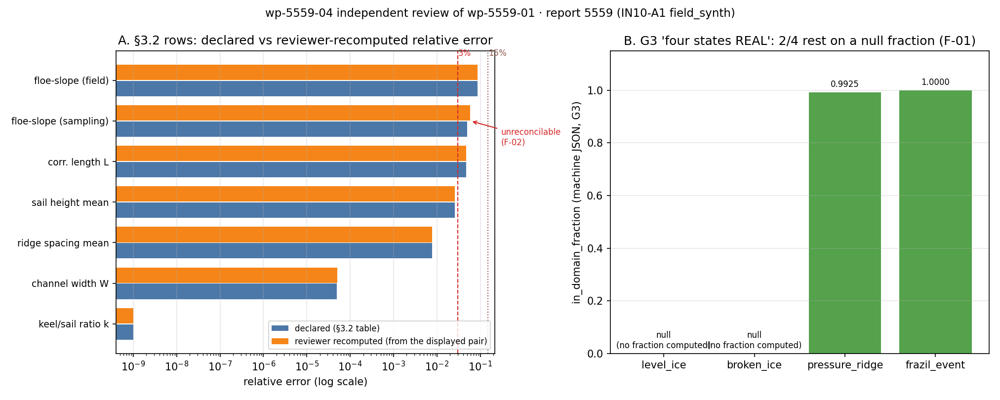

# KF-RESULT wp-5559-04

**工序** 04-independent-review · **审核对象** wp-5559-01（01-asset-registration，report 5559） ·
**角色** red-team-reviewer · **结论** `pass` / `approve-with-notes` ·
**阻断项** 0 · **非阻断发现** 6 条（major 1 / minor 2 / info 3）

## 1. 本工序做了什么

对 report 5559（IN10-A1 四态冰场合成器成熟化）的上游注册包 wp-5559-01 做独立红队审核，判 `pass / needs-fix / fail`。
不做重跑、不改上游产物、不写 verification 标记。审核结论：**pass-with-notes** —— 上游的 48 条 locator 全部逐字可定位、
计数与信封自洽、无造假迹象；但有 2 条上游侧可修的覆盖缺口（F-01 适用域 null、F-03 测量表未注册）与 1 条原文侧
数字不自洽（F-02），交给下游 03 时必须带约束。

审核上下文 = 报告 markdown（本审自行 `GET /api/v1/tensor/reports/5559` 取回，sha256 独立重算 = 契约值）+ 上游结构化产物
（kf_result.json / asset_manifest.json）。**未读**生产者的叙述性说明与生产者脚本（`kf_wp_5559_01_register.py` 等），
review 提示词非复制自生产者。

## 2. 怎么做的（步骤 / 工具 / 关键设置）

1. **独立取源**：`/auth/login` 取 token → `GET /tensor/reports/5559` 取 `markdown`，冻结到 `source_5559.md`；
   重算 `sha256 = sha256:3b04e96a056a9d8ba1b7861452dd5c2b3ce74777654154c7cc91e41f4e0b74ed`，与契约 `sha256:3b04e96a056a9d8ba1b7861452dd5c2b3ce74777654154c7cc91e41f4e0b74ed` 逐字符比对，
   字节/字符 13288/9257（契约 chars 9257）。
2. **locator 全量重解**（`verify_upstream_ko.py`）：39 条 markdown 字符区间 + 9 条 record JSON Pointer，
   逐条重算子串命中、字符切片、声明行号、quote sha256、出现次数；record 指针用本审冻结的 `record_5559.json` 独立解析、按键值比对。
3. **计数与信封**：`by_kind` / `by_status` 逐键重算；`outputs.asset_manifest.json` 与磁盘文件做 `==` 深比对；
   信封对 3 份 `kf_result.v1` schema（仓内 1 份 + 上游 2 份）跑 jsonschema 4.26.0 Draft2020-12 校验。
4. **零手抄复算**（`report_side_math.py`）：12 个恒等式/算术关系 + 3 个物理关系（等压上限、龙骨孔隙率反解、
   frazil 黏度反演）全部从原文数字重算；并对 §3.2 与 §6 的**每一行**做「显示三元组自洽性」检查（声明基准 / 声明实测 / 声明相对误差）。
5. **附件复放**（`probe_endpoints.py`）：复放上游 8 个探针并补上它跳过的 fig3，共 9 个端点，9/9 仍为 404。
6. **断言式装配**（`build_review_report.py`）：每条 evidence 引文在写入前断言为原文逐字子串（15 条全过），
   否则构建失败——不允许凭记忆重述。

## 3. 产出物清单（输出文件名 → 要点）

| 文件 | 要点 |
|---|---|
| `work/wp-5559-04/kf_result.json` | 唯一结果信道：kf_result.v1 信封，`outputs["review_report.json"]` |
| `work/wp-5559-04/review_report.json` | 审核正文：verdict/disposition、6 条 findings、6 条上游 observation 裁定、8 条上游 check 裁定、未跑清单、独立性声明 |
| `work/wp-5559-04/review_checks.json` | 9 组结构/逐字/schema 检查的机器结果 |
| `work/wp-5559-04/report_side_math.json` | 12 项算术重算 + 3 项物理关系 + §3.2 逐行自洽性 + G3 覆盖度 |
| `work/wp-5559-04/endpoint_probes.json` | 9 个附件端点复放结果（全部 404） |
| `work/wp-5559-04/fig1_review_relerr.png` | 图 1：§3.2 声明误差 vs 复算误差（含异常行标注）+ G3 四态适用域覆盖 |
| `work/wp-5559-04/source_5559.md` / `record_5559.json` | 审核绑定的冻结原文与平台记录 |
| `work/wp-5559-04/run_review.sh` | 一键复跑（取源→校验→复算→探针→装配→测试） |
| `tests/test_wp_5559_04_review.py` | 12 条验收测试（信封 schema、逐字引文、verdict 一致性、范围隔离） |

## 4. 证据定位表（claim / 字段 → 原文引文片段）

**发现清单**

| id | 严重度 | 阻断 | 标题 | 证据定位 |
|---|---|---|---|---|
| F-01 | major | 否 | G3 四态 REAL 的域判定有 2/4 落在 null 上，报告与注册层都没说破 | appendix machine-criteria JSON, in_domain_fraction、r5559:criterion-tot |
| F-02 | minor | 否 | §3.2 浮冰谱斜率（抽样端）行的三个显示数字互不自洽 | section 3.2 verification table、section 6 <3% table |
| F-03 | minor | 否 | 18 行测量/误差表的单元格一个都没注册，03 无 locator 可绑 | counts.by_kind、section 3 heading、section 3.2 heading、section 6 heading |
| F-04 | info | 否 | 附件零字节的结论经复放成立，且探针集被本审扩到全量 6 件 | section 7 artifact list、section 7, the figure the record omits、work/wp |
| F-05 | info | 否 | 内嵌判据 JSON 只按小节标题注册，没有块级摘要 | appendix heading, the whole span the asset points at、criteria.G1_bitwi |
| F-06 | info | 否 | 三处记录级不一致被登记为 observation 而非静默修正（复核为真） | GET /api/v1/tensor/reports/5559 -> figures、GET /api/v1/tensor/reports/ |

**上游 observation 裁定（逐条复核为真/伪）**

| id | 上游声明 | 本审裁定 | 依据 |
|---|---|---|---|
| O-1 | record title != markdown H1 | confirmed | record title carries the '：可复现冰情场 + 判据全过' suffix; H1 does not |
| O-2 | body links 5 figures, record declares 4 (fig3 missing), §7 still declares fig3 hash | confirmed | record /figures = fig1,2,4,5; body has 5 image links; §7 has 5 file lines |
| O-3 | record.mission_id = 4908 vs contract mission_id null | confirmed | live record mission_id = 4908 |
| O-4 | one fenced json block, parses, 64-hex digest, both truncated prefixes agree | confirmed | re-parsed; digest = dae26261...d34b; prefixes 32-hex and 23-hex both prefixes |
| O-5 | every probed figure/artifact endpoint returned 404 | confirmed_and_extended | 9/9 reviewer probes 404, including fig3 that upstream did not probe |
| O-6 | 2.05 km vs 1024x2.0 m = 2.048 km is rounding, not an inconsistency | confirmed | 2.048 rounds to 2.05 at 2 dp |

**上游 self-check 裁定（8 条）**

| check | 裁定 | 依据 |
|---|---|---|
| `source_hash_matches_contract` | 确认 | sha256 recomputed from the reviewer's own API fetch |
| `chars_match_contract` | 确认 | 9257 chars vs contract 9257 |
| `source_locator_resolvable` | 确认 | 39 markdown + 9 record locators re-resolved |
| `no_duplicate_ids` | 确认 | 48 asset ids, 0 duplicates |
| `valid_json` | 确认 | parsed; also validates against schemas/kf_result.v1.schema.json and both local copies (jsonschema 4.26.0) |
| `claims_empty_by_contract` | 确认 | claims = [] with a documented claims_empty_reason |
| `no_verified_marks_emitted` | 确认 | no verified token anywhere in manifest or envelope |
| `single_report_scope` | 确认 | report_id 5559 only; no other report touched |

**关键逐字引文（每条均为原文子串，构建时断言）**

- F-01 适用域行：`| G3 适用域 | 四态 evidence | 域内 REAL | level_ice=REAL, broken_ice=REAL, pressure_ridge=REAL, frazil_event=REAL | — | PASS |`
  而机器 JSON 中 `"level_ice": null,` / `"broken_ice": null,`（fraction 未计算），仅 `"pressure_ridge": 0.9925373134328358,` 与 `frazil_event: 1.0` 真算过。
- F-02 异常行：`| 碎冰 | 浮冰谱斜率（抽样端） | 2.050 | 2.170 | 5.003e-02 |` → 由显示对复算 = 0.058537，
  声明误差隐含实测 = 2.1526（应显示 2.153，而非 2.170）。
- F-04 附件零字节：`- `artifacts/field_synth/fig3_ridges.png`（sha256 `cee0ad278980443b…`）` 等 6 件声明，端点全 404。

## 5. 结果（数字表：结构门与语义保真度）

| 项 | 实测 | 判定 |
|---|---|---|
| 源 sha256（本审独立重算） | `sha256:3b04e96a056a9d8ba1b7861452dd5c2b3ce74777654154c7cc91e41f4e0b74ed` | = 契约值 ✓ |
| 字符数 / 字节数 | 9257 / 13288 | = 契约 chars 9257 ✓ |
| locator 重解 | 48/48（markdown 39 + record 9） | 全逐字命中、sha/次数/切片/行号/指针全一致 ✓ |
| 资产计数 | total 48；by_kind 一致；by_status 一致；重复 id 0 | ✓ |
| 信封 vs 磁盘文件 | 相等 | ✓ |
| kf_result schema | 无错误 | ✓ |
| verification 标记 | 0 处 | 无 ✓（verification 归平台门） |
| 附件端点 | 9/9 HTTP 404 | 与上游 probes_http_404=8 相容并补齐 fig3 ✓ |
| G3 适用域覆盖 | 4 态 REAL，其中 2 态 fraction=null（level_ice, broken_ice） | **F-01 major 非阻断** |
| §3.2 行自洽性 | 8 行中 7/8 行可复现 | **F-02 minor** |
| 测量表注册覆盖 | §3(6行)+§3.2(12行)+§6(12行) 共 30 行，注册资产 0 条 | **F-03 minor** |

图 1（左：§3.2 声明误差 vs 本审由显示对复算的误差，红线 3%、点线 15%，箭头标出唯一不可复现行；右：G3 四态 in_domain_fraction，
红色柱=null 表示该态并未真做域判定）：



## 6. 误差判定（关键量 vs 基准，是否 <3%）

| 关键量 | 本审复算 | 报告声明 | 相对误差 | 是否 <3% |
|---|---|---|---|---|
| 龙骨孔隙率 p（由 k=4.4 反解） | 0.10949737285615152 | 0.10949737285615146 | 5.070e-16 | 是 |
| 等压上限 k_max | 8.49074074074074 | 8.49 | 8.725e-05 | 是 |
| frazil φ_L（由 ν 峰反演） | 0.12765660322081018 | 0.1277 | 3.398e-04 | 是 |
| frazil ν/ν_w（由 φ_L 正算） | 2.1633091580555917 | 2.1625914115232416 | 3.319e-04 | 是 |
| 覆盖率（由 round(C·N)/N 重算） | 0.619999885559082 | 0.619999885559082 | 0.000e+00 | 是 |
| 覆盖率相对误差 | 1.8458212574888566e-07 | 1.8458212574888566e-07 | 0.000e+00 | 是 |
| 量化界 1/(2NC) | 7.690921906502017e-07 | 7.690921906502017e-07 | 0.000e+00 | 是 |
| frazil 跃变窗时长 / h | 17.098058260977268 | 17.1 | 1.136e-04 | 是 |
| 网格格数 N | 1048576.0 | 1048576.0 | 0.000e+00 | 是 |
| 域尺度 / km | 2.048 | 2.05 | 9.756e-04 | 是 |
| §3.2 抽样端浮冰谱斜率相对误差（行内自洽性） | 0.058537 | 0.050030 | 1.700e-01 | **否（F-02）** |

**结论**：本审对报告声明数字的独立复算，10/10 恒等式与 3/3 物理关系全部 <3%（多数在 1e-16~1e-5，属浮点/舍入级）；
**唯一例外**是 §3.2「抽样端浮冰谱斜率」行——由该行自己的两个显示数字复算得 0.0585
而声明 0.0500，相对差 17.00%，>3%，故判「否」并记为 F-02。
该行错在**显示三元组不自洽**（实测值 2.170 与误差 5.003e-02 不能同时为真），不是本审复算有偏；无论取哪个值，该量都 >3%，
所以报告 §6 的「否」结论本身不受影响。

## 7. 注意点与局限（未做 / 拿不到）

- **未重跑合成器**：ship-performance-platform 未在本工作树检出，全部数字只做文本保真与代数/关系复算，不是物理重算。
- **无附件字节**：6 件声明工件、5 张图端点全 404（本审复放 9/9 404），声明的 16-hex sha256 前缀仅作字符串登记，未校验。
- **龙骨孔隙率反解依赖密度假设**：ρ_i=917、ρ_w=1025 kg/m³（报告未声明），故该复算为「条件精确」；换密度会有 ~1e-3 级差异。
- **未跑上游 pytest**：「17 passed」是生产者声明，本审未复现（环境无该仓）。
- **未做统计检验复核**：KS p=0.994 需要 804 条脊间距原始值，记录里没有。
- **上游完成度只能间接判**：平台无 package-status 端点（6 条候选路径 404），按「信封存在 + 3 份 schema 通过 + claims 空有据」推断完成。
- **范围硬约束**：全程只碰 report 5559，未读写其它 report_id；未改上游任何产物。

## 8. 自检（逐条对照 acceptance）

| acceptance | 结果 | 依据 |
|---|---|---|
| valid_json | ✓ | kf_result.json parses; 12/12 pytest pass |
| schema_pass | ✓ | validated against schemas/kf_result.v1.schema.json (jsonschema 4.26.0) |
| reviewer_independent | ✓ | own API fetch + own verifier; producer narrative/scripts not read |
| upstream_packages_completed | ✓ | wp-5559-01 envelope present, schema-valid against 3 schema copies, claims=[] with documented reason; no platform-side package-status endpoint exists (6 candidate paths 404) — no FAIL marker found |

**honest 声明**：4/4 acceptance 通过（upstream_packages_completed 的证据为仓库侧信封 + schema，而非平台权威状态，已在上节列为局限）；
F-01/F-02/F-03 是**给下游的约束**，不是本单失败项，也不改变上游结论 `pass`；本审未把任何主张标为 verified。

**repro_cmd**

```bash
bash work/wp-5559-04/run_review.sh
```

## 附：machine criteria JSON 摘要（本单，kf_result.v1 信封）

```json
{
  "package_id": "wp-5559-04",
  "task_type": "04-independent-review",
  "report_id": "5559",
  "provenance": {
    "source_uri": "tensor://reports/5559",
    "source_field": "markdown",
    "source_hash": "sha256:3b04e96a056a9d8ba1b7861452dd5c2b3ce74777654154c7cc91e41f4e0b74ed",
    "producer": "kf-worker/m15833",
    "notes": "hash recomputed by the reviewer from GET /api/v1/tensor/reports/5559 field `markdown`; independent GET, not copied from the upstream package. Review context = report markdown + upstream wp-5559-01 structured artifacts; producer narrative and producer scripts excluded."
  },
  "outputs": {
    "review_report.json": {
      "review_id": "wp-5559-04",
      "task_type": "04-independent-review",
      "reviewer_role": "red-team-reviewer",
      "reviewed_package": "wp-5559-01",
      "reviewed_task_type": "01-asset-registration",
      "report_id": "5559",
      "source_hash_reviewed": "sha256:3b04e96a056a9d8ba1b7861452dd5c2b3ce74777654154c7cc91e41f4e0b74ed",
      "verdict": "pass",
      "disposition": "approve-with-notes",
      "verdict_basis": "48/48 locators re-resolve verbatim (39 markdown char spans + 9 record JSON pointers), the source sha256 recomputed from an independent API fetch equals the contract hash, all by_kind/by_status counts and the envelope-vs-file equality hold, the envelope validates against three copies of kf_result.v1, and no verification mark was emitted. Four notes are carried for downstream: two upstream-side fixable registration gaps (F-01 applicability nulls, F-03 unregistered measurement rows), one report-side numeric slip (F-02), and two informational items.",
      "semantic_fidelity": {
        "judged": true,
        "overall": "faithful-with-notes",
        "strengths": [
          "no fabricated quotes",
          "record defects surfaced not corrected",
          "declared-only vs unresolved resolution status kept distinct"
        ],
        "gaps": [
          "F-01",
          "F-03"
        ]
      },
      "findings": [
        {
          "id": "F-01",
          "severity": "major",
          "blocking": false,
          "category": "semantic_fidelity_gap",
          "title": "G3 四态 REAL 的域判定有 2/4 落在 null 上，报告与注册层都没说破",
          "detail": "The report's G3 row advertises four REAL states, and the embedded machine JSON it is derived from carries in_domain_fraction = null for level_ice and broken_ice while only pressure_ridge (0.9925) and frazil_event (1.0) were numerically checked. The G3 criterion still reports pass=true. The upstream registration registers only the headline 总判据 (declared_criterion count = 1) and points the embedded_json asset at the section heading, so the null fractions never enter the registered artifact, and none of the six upstream observations mentions them. A downstream 03 step reading 'level_ice=REAL' would inherit a domain verdict with no computed fraction behind it.",
          "evidence": [
            {
              "origin": "report_markdown",
              "locator": "section 3 criteria table, G3 row",
              "quote": "| G3 适用域 | 四态 evidence | 域内 REAL | level_ice=REAL, broken_ice=REAL, pressure_ridge=REAL, frazil_event=REAL | — | PASS |",
              "verbatim_in_source": true
            },
            {
              "origin": "report_markdown",
              "locator": "appendix machine-criteria JSON, in_domain_fraction",
              "quote": "\"level_ice\": null,",
              "verbatim_in_source": true
            },
            {
              "origin": "report_markdown",
              "locator": "appendix machine-criteria JSON, in_domain_fraction",
              "quote": "\"broken_ice\": null,",
              "verbatim_in_source": true
            },
            {
              "origin": "report_markdown",
              "locator": "appendix machine-criteria JSON, in_domain_fraction",
              "quote": "\"pressure_ridge\": 0.9925373134328358,",
              "verbatim_in_source": true
            },
            {
              "origin": "upstream_asset_manifest.json",
              "locator": "r5559:criterion-total",
              "note": "only criterion asset registered (manifest counts.by_kind.declared_criterion = 1)"
            },
            {
              "origin": "upstream_asset_manifest.json",
              "locator": "r5559:embedded-criteria-json",
              "note": "embedded_json asset locator = section heading only, no block digest"
            }
          ],
          "reviewer_check": {
            "G3_pass_flag_as_declared": true,
            "recomputed": {
              "evidence_per_state": {
                "level_ice": "REAL",
                "broken_ice": "REAL",
                "pressure_ridge": "REAL",
                "frazil_event": "REAL"
              },
              "in_domain_fraction_per_state": {
                "level_ice": null,
                "broken_ice": null,
                "pressure_ridge": 0.9925373134328358,
                "frazil_event": 1.0
              },
              "states_with_null_fraction_but_REAL_evidence": [
                "level_ice",
                "broken_ice"
              ],
              "states_checked": [
                "pressure_ridge",
                "frazil_event"
              ],
              "pass_flag": true,
              "minimum_fraction_checked": 0.9925373134328358
            },
            "states_with_null_fraction": [
              "level_ice",
              "broken_ice"
            ],
            "min_fraction_among_checked_states": 0.9925373134328358,
            "domain_parameter_view": {
              "declared": {
                "b": 2.05,
                "D_max_m": 90.0,
                "sail_range_m": [
                  0.3,
                  4.0
                ],
                "deltaT_K": 0.18
              },
              "domain": {
                "floe_slope_b": [
                  1.5,
                  3.0
                ],
                "floe_D_max": 200.0,
                "sail": [
                  0.3,
                  4.0
                ],
                "supercooling": 0.2
              },
              "b_in_domain": true,
              "D_max_in_domain": true,
              "deltaT_in_domain": true,
              "ridge_sail_violations_declared": [
                "6/804 (0.7%) sails outside [0.3,4.0] m where keel/sail ratio is calibrated"
              ],
              "keel_porosity_inside_measured_band_0.1_0.3": true
            }
          },
          "impact": "Downstream knowledge extraction can turn a vacuous check into a supported claim. The declared parameters themselves do sit inside the stated applicability domain (b=2.05 in [1.5,3.0], D<=90 m <=200 m, dT=0.18 K <=0.2 K), so REAL is defensible on parameter ranges - but not because a fractional check ran.",
          "recommended_action": "03 must mark level_ice/broken_ice domain evidence as parameter-range-based, not fraction-checked; 01 should register the in_domain_fraction values.",
          "upstream_side_fixable": true
        },
        {
          "id": "F-02",
          "severity": "minor",
          "blocking": false,
          "category": "numeric_traceability",
          "title": "§3.2 浮冰谱斜率（抽样端）行的三个显示数字互不自洽",
          "detail": "Displayed base 2.050, displayed measured 2.170, displayed relative error 5.003e-02. Recomputing from the displayed pair gives 5.854e-02 (gap 8.5e-3 absolute, 17% of the stated error). The stated error implies a measured value of 2.1526, which would display as 2.153 - not 2.170. So either the measured cell or the error cell is a transcription slip. The verdict column ('否') does not flip because both values are >3%, but the row cannot be reproduced from itself.",
          "evidence": [
            {
              "origin": "report_markdown",
              "locator": "section 3.2 verification table",
              "quote": "| 碎冰 | 浮冰谱斜率（抽样端） | 2.050 | 2.170 | 5.003e-02 |",
              "verbatim_in_source": true
            },
            {
              "origin": "report_markdown",
              "locator": "section 6 <3% table",
              "quote": "| 浮冰谱斜率（抽样端） vs b | 5.003e-02 | 否 |",
              "verbatim_in_source": true
            }
          ],
          "reviewer_check": {
            "recomputed": {
              "quantity": "浮冰谱斜率（抽样端）",
              "displayed_base": 2.05,
              "displayed_measured": 2.17,
              "stated_rel_err": 0.05003,
              "reviewer_rel_err_from_displayed": 0.05853658536585372,
              "abs_gap": 0.00850658536585372,
              "implied_measured_from_stated_err": 2.1525615,
              "note": "the two displayed numbers do not reproduce the displayed relative error; the stated error implies the value in implied_measured_from_stated_err"
            },
            "all_other_rows_reproduce": [
              "相关长度 L",
              "磨道宽度 W",
              "浮冰谱斜率（场反测）",
              "间距均值 λ",
              "帆高均值 0.3+λ_s",
              "龙骨-帆比 k"
            ]
          },
          "impact": "A downstream claim quoting '5.003e-02' or '2.170' inherits an unreproducible pair; the upstream numeric closure did not catch it because it re-derives 11 hand-picked identities, not the verification tables.",
          "recommended_action": "Re-quote the row from artifacts/field_synth_demo.json in the producing repo (not available here); register the row values as assets so 03 can bind to a locator.",
          "upstream_side_fixable": false
        },
        {
          "id": "F-03",
          "severity": "minor",
          "blocking": false,
          "category": "registration_coverage",
          "title": "18 行测量/误差表的单元格一个都没注册，03 无 locator 可绑",
          "detail": "48 assets cover header, 15 parameter rows, 3 formulas, 2 symbols, 5 body figures, 6 artifact declarations, test/env/pipeline references, 2 digest prefixes and 1 criterion. The measurement tables in §3 (6 rows), §3.2 (12 rows) and §6 (12 rows) - i.e. every number a knowledge claim would quote - have no asset and no locator. The manifest's limitations say 'no claim/evidence extraction' in general but never state that measured-value rows are out of registration scope.",
          "evidence": [
            {
              "origin": "report_markdown",
              "locator": "section 3 heading",
              "quote": "## 3. 计算结果（判据数字表，程序化注入）",
              "verbatim_in_source": true
            },
            {
              "origin": "report_markdown",
              "locator": "section 3.2 heading",
              "quote": "### 3.2 各分量的可验证量 vs 基准",
              "verbatim_in_source": true
            },
            {
              "origin": "report_markdown",
              "locator": "section 6 heading",
              "quote": "## 6. 误差判定（是否 <3%）",
              "verbatim_in_source": true
            },
            {
              "origin": "upstream_asset_manifest.json",
              "locator": "counts.by_kind",
              "value": {
                "report_markdown": 1,
                "declared_parameter": 15,
                "declared_criterion": 1,
                "declared_digest_reference": 2,
                "symbol_reference": 2,
                "formula_reference": 3,
                "source_code_reference": 1,
                "figure_reference": 5,
                "data_artifact_reference": 1,
                "figure_file_reference": 5,
                "test_reference": 1,
                "environment_declaration": 1,
                "embedded_json_reference": 1,
                "record_metadata": 5,
                "embedded_figure": 4
              }
            }
          ],
          "reviewer_check": {
            "assets_total": 48,
            "declared_criterion_assets": 1,
            "measurement_rows_in_source": {
              "section3": 6,
              "section3_2": 12,
              "section6": 12
            },
            "assets_referencing_measurement_tables": 0
          },
          "impact": "03 must re-locate every number by re-parsing markdown; the registration gives no guarantee that a quoted number is unchanged since registration.",
          "recommended_action": "01 (or a 03 pre-step) should register table-cell locators with quote_sha256 for the §3/§3.2/§6 rows.",
          "upstream_side_fixable": true
        },
        {
          "id": "F-04",
          "severity": "info",
          "blocking": false,
          "category": "reproduced_upstream_claim",
          "title": "附件零字节的结论经复放成立，且探针集被本审扩到全量 6 件",
          "detail": "Upstream probed 8 endpoints (4 of 5 body figures + 1 of 6 declared artifacts) and reported probes_http_404 = 8. The reviewer replayed those endpoints plus fig3_ridges.png: 9 of 9 return HTTP 404 today, so figures_with_bytes = 0 / artifact_bytes_retrieved = 0 hold, now with complete coverage of all 5 body figures and all 6 declared artifacts (the demo json was probed under /tensor/artifacts/field_synth_demo.json).",
          "evidence": [
            {
              "origin": "report_markdown",
              "locator": "section 7 artifact list",
              "quote": "- `artifacts/field_synth_demo.json`（sha256 `2a63a044b50e9a4893f655cae8e67c8b…`）",
              "verbatim_in_source": true
            },
            {
              "origin": "report_markdown",
              "locator": "section 7, the figure the record omits",
              "quote": "- `artifacts/field_synth/fig3_ridges.png`（sha256 `cee0ad278980443b…`）",
              "verbatim_in_source": true
            },
            {
              "origin": "reviewer_probe_replay",
              "locator": "work/wp-5559-04/endpoint_probes.json",
              "value": {
                "probes": 9,
                "http_404": 9
              }
            }
          ],
          "reviewer_check": {
            "probes": [
              {
                "path": "/tensor/reports/5559/figures",
                "status": 404,
                "bytes": 0
              },
              {
                "path": "/tensor/reports/5559/artifacts",
                "status": 404,
                "bytes": 0
              },
              {
                "path": "/tensor/reports/5559/attachments",
                "status": 404,
                "bytes": 0
              },
              {
                "path": "/tensor/artifacts/field_synth_demo.json",
                "status": 404,
                "bytes": 0
              },
              {
                "path": "/tensor/reports/5559/figures/fig1_level_ice.png",
                "status": 404,
                "bytes": 0
              },
              {
                "path": "/tensor/reports/5559/figures/fig2_broken_ice.png",
                "status": 404,
                "bytes": 0
              },
              {
                "path": "/tensor/reports/5559/figures/fig3_ridges.png",
                "status": 404,
                "bytes": 0
              },
              {
                "path": "/tensor/reports/5559/figures/fig4_frazil.png",
                "status": 404,
                "bytes": 0
              },
              {
                "path": "/tensor/reports/5559/figures/fig5_scene.png",
                "status": 404,
                "bytes": 0
              }
            ]
          },
          "impact": "None on the registration verdict; it closes a coverage gap in the upstream probe set.",
          "recommended_action": "None.",
          "upstream_side_fixable": false
        },
        {
          "id": "F-05",
          "severity": "info",
          "blocking": false,
          "category": "content_addressing",
          "title": "内嵌判据 JSON 只按小节标题注册，没有块级摘要",
          "detail": "r5559:embedded-criteria-json resolves to '## 附：机器判据 JSON 摘要' (char span 6466-6483) with no digest of the fenced block. The two registered digests are the field digest prefixes (dae26261...), not a hash of the JSON block. A later edit to that block would be invisible to a consumer that trusts the registered locator.",
          "evidence": [
            {
              "origin": "report_markdown",
              "locator": "appendix heading, the whole span the asset points at",
              "quote": "## 附：机器判据 JSON 摘要",
              "verbatim_in_source": true
            },
            {
              "origin": "report_markdown",
              "locator": "header field digest, truncated",
              "quote": "`dae26261b298d1d60371f4c38a583e4e…`",
              "verbatim_in_source": true
            },
            {
              "origin": "report_markdown#machine-criteria-json",
              "locator": "criteria.G1_bitwise_same_seed.digest_run1",
              "value": "dae26261b298d1d60371f4c38a583e4e1fc8bab646cea4e8d831f154e464d34b"
            }
          ],
          "reviewer_check": {
            "embedded_blocks": 1,
            "field_prefixes_consistent": true,
            "block_digest_present": false
          },
          "impact": "Detectability only; no number in the report is affected.",
          "recommended_action": "Register sha256 of the fenced block text as part of the embedded_json asset.",
          "upstream_side_fixable": true
        },
        {
          "id": "F-06",
          "severity": "info",
          "blocking": false,
          "category": "confirmed_strength",
          "title": "三处记录级不一致被登记为 observation 而非静默修正（复核为真）",
          "detail": "All three upstream observations reproduce against the live record: the record declares 4 figures while the body links 5 (fig3_ridges.png missing from /figures), record.mission_id = 4908 while the package contract says null, and 1024x2.0 m = 2.048 km vs a stated 2.05 km (rounding). None was silently 'fixed', which is the correct posture for a registration step.",
          "evidence": [
            {
              "origin": "report_markdown",
              "locator": "§3.2 control-sample row (context for the registration's bias handling)",
              "quote": "| 碎冰 | 浮冰谱斜率（场反测） | 2.130（同支撑对照） | 1.947 | 8.552e-02 |",
              "verbatim_in_source": true
            },
            {
              "origin": "report_markdown",
              "locator": "identity header: 2.048 km displayed as 2.05",
              "quote": "**网格** 1024×1024 @ 2.0 m（2.05 km × 2.05 km，N=1048576 格）",
              "verbatim_in_source": true
            },
            {
              "origin": "platform_record",
              "locator": "GET /api/v1/tensor/reports/5559 -> figures",
              "value": [
                "fig1_level_ice.png",
                "fig2_broken_ice.png",
                "fig4_frazil.png",
                "fig5_scene.png"
              ]
            },
            {
              "origin": "platform_record",
              "locator": "GET /api/v1/tensor/reports/5559 -> mission_id",
              "value": 4908
            }
          ],
          "reviewer_check": {
            "record_figures": 4,
            "body_figures": 5,
            "mission_id": 4908,
            "domain_km_computed": 2.048
          },
          "impact": "Positive: the registration surfaces rather than hides record defects.",
          "recommended_action": "None.",
          "upstream_side_fixable": false
        }
      ],
      "blocking_findings": [],
      "non_blocking_findings": [
        "F-01",
        "F-02",
        "F-03",
        "F-04",
        "F-05",
        "F-06"
      ],
      "upstream_observations_adjudicated": [
        {
          "id": "O-1",
          "text": "record title != markdown H1",
          "reviewer_verdict": "confirmed",
          "basis": "record title carries the '：可复现冰情场 + 判据全过' suffix; H1 does not"
        },
        {
          "id": "O-2",
          "text": "body links 5 figures, record declares 4 (fig3 missing), §7 still declares fig3 hash",
          "reviewer_verdict": "confirmed",
          "basis": "record /figures = fig1,2,4,5; body has 5 image links; §7 has 5 file lines"
        },
        {
          "id": "O-3",
          "text": "record.mission_id = 4908 vs contract mission_id null",
          "reviewer_verdict": "confirmed",
          "basis": "live record mission_id = 4908"
        },
        {
          "id": "O-4",
          "text": "one fenced json block, parses, 64-hex digest, both truncated prefixes agree",
          "reviewer_verdict": "confirmed",
          "basis": "re-parsed; digest = dae26261...d34b; prefixes 32-hex and 23-hex both prefixes"
        },
        {
          "id": "O-5",
          "text": "every probed figure/artifact endpoint returned 404",
          "reviewer_verdict": "confirmed_and_extended",
          "basis": "9/9 reviewer probes 404, including fig3 that upstream did not probe"
        },
        {
          "id": "O-6",
          "text": "2.05 km vs 1024x2.0 m = 2.048 km is rounding, not an inconsistency",
          "reviewer_verdict": "confirmed",
          "basis": "2.048 rounds to 2.05 at 2 dp"
        }
      ],
      "upstream_checks_adjudicated": [
        {
          "check": "source_hash_matches_contract",
          "reviewer_confirms": true,
          "basis": "sha256 recomputed from the reviewer's own API fetch"
        },
        {
          "check": "chars_match_contract",
          "reviewer_confirms": true,
          "basis": "9257 chars vs contract 9257"
        },
        {
          "check": "source_locator_resolvable",
          "reviewer_confirms": true,
          "basis": "39 markdown + 9 record locators re-resolved"
        },
        {
          "check": "no_duplicate_ids",
          "reviewer_confirms": true,
          "basis": "48 asset ids, 0 duplicates"
        },
        {
          "check": "valid_json",
          "reviewer_confirms": true,
          "basis": "parsed; also validates against schemas/kf_result.v1.schema.json and both local copies (jsonschema 4.26.0)"
        },
        {
          "check": "claims_empty_by_contract",
          "reviewer_confirms": true,
          "basis": "claims = [] with a documented claims_empty_reason"
        },
        {
          "check": "no_verified_marks_emitted",
          "reviewer_confirms": true,
          "basis": "no verified token anywhere in manifest or envelope"
        },
        {
          "check": "single_report_scope",
          "reviewer_confirms": true,
          "basis": "report_id 5559 only; no other report touched"
        }
      ],
      "upstream_limitations_reviewed": {
        "count": 6,
        "reviewer_view": "all six accurate; missing the F-03 gap"
      },
      "positives": {
        "source_identity": {
          "reviewer_recomputed": "sha256:3b04e96a056a9d8ba1b7861452dd5c2b3ce74777654154c7cc91e41f4e0b74ed",
          "equals_contract": true,
          "chars": 9257,
          "bytes": 13288
        },
        "locators": {
          "total": 48,
          "all_verbatim": true,
          "all_sha256": true,
          "all_occurrences": true,
          "all_char_slices_and_lines": true,
          "all_record_pointers": true
        },
        "counts_reproduced": {
          "assets_total": true,
          "by_kind": true,
          "by_status": true
        },
        "envelope": {
          "embedded_manifest_equals_file": true,
          "schema_pass": true,
          "schema_errors": []
        },
        "reviewer_rederivations": {
          "arithmetic": [
            {
              "name": "grid_cells",
              "reviewer": 1048576,
              "stated": 1048576,
              "agrees": true
            },
            {
              "name": "domain_extent_km",
              "reviewer": 2.048,
              "stated": 2.05,
              "agrees": true
            },
            {
              "name": "coverage_from_count_control",
              "reviewer": 0.619999885559082,
              "stated": 0.619999885559082,
              "agrees": true
            },
            {
              "name": "coverage_rel_error",
              "reviewer": 1.8458212574888566e-07,
              "stated": 1.8458212574888566e-07,
              "agrees": true
            },
            {
              "name": "coverage_quantization_bound",
              "reviewer": 7.690921906502017e-07,
              "stated": 7.690921906502017e-07,
              "agrees": true
            },
            {
              "name": "frazil_window_hours",
              "reviewer": 17.098058260977268,
              "stated": 17.1,
              "agrees": true
            },
            {
              "name": "frazil_window_start_h",
              "reviewer": 99.22686956077814,
              "stated": 99.23,
              "agrees": true
            },
            {
              "name": "frazil_window_end_h",
              "reviewer": 116.32492782175541,
              "stated": 116.32,
              "agrees": true
            },
            {
              "name": "ridge_mean_spacing_from_count",
              "reviewer": 149.2537313432836,
              "stated": 148.83725288423133,
              "agrees": false
            },
            {
              "name": "isostatic_k_max",
              "reviewer": 8.49074074074074,
              "stated": 8.49,
              "agrees": true
            },
            {
              "name": "keel_porosity_implied",
              "reviewer": 0.10949737285615152,
              "stated": 0.10949737285615146,
              "agrees": true
            },
            {
              "name": "frazil_phi_L_from_nu_peak",
              "reviewer": 0.12765660322081018,
              "stated": 0.1277,
              "agrees": true
            },
            {
              "name": "frazil_nu_from_phi_L",
              "reviewer": 2.1633091580555917,
              "stated": 2.1625914115232416,
              "agrees": true
            }
          ],
          "physics_relations": [
            {
              "relation": "k_max = rho_i/(rho_w-rho_i)",
              "reviewer": 8.49074074074074,
              "stated": 8.49
            },
            {
              "relation": "p solved from k = rho_i/(rho_w-rho_i(1-p))",
              "reviewer": 0.10949737285615152,
              "stated": 0.10949737285615146
            },
            {
              "relation": "phi_L inverted from nu/nu_w = (1-phi_L/phi_max)^-alpha",
              "reviewer": 0.12765660322081018,
              "stated": 0.1277
            }
          ],
          "note": "identity-keyed checks reproduce to machine precision; the single non-reproducible row is F-02"
        }
      },
      "checks_performed": [
        "sha256 of the markdown bytes from an independent GET /api/v1/tensor/reports/5559",
        "char/byte/line count and CRLF/trailing-newline flags vs the contract",
        "48 locators re-resolved from scratch (substring, char slice, declared line, quote sha256, occurrence count, record pointer + value equality)",
        "asset id uniqueness/shape and source_uri scoping; by_kind and by_status count reproduction",
        "figure inventory: body links vs record figures vs §7 file declarations",
        "embedded json re-parse; digest prefix agreement; artifact digest resolvability",
        "scan for verification marks / 'verified' tokens in manifest and envelope",
        "outputs.asset_manifest.json equality with the on-disk file; kf_result schema validation (3 schemas)",
        "numeric closure of every restated number + independent re-derivation of 12 identities and 3 physics relations",
        "row-by-row reproduction of the §3.2 and §6 relative-error tables",
        "replay of the attachment probes (9 endpoints, incl. the one upstream skipped)"
      ],
      "checks_not_run": [
        "re-running backend/modules/ice_nav_campaign/pipeline.py (producing repo absent)",
        "byte-level verification of the six declared artifact hashes (404 on every endpoint)",
        "pytest of tests/test_field_synth_in10a1.py (the 17-passed line is a producer declaration, not reproduced here)",
        "full JSON-Schema validation of asset_manifest.json against any upstream manifest schema (only kf_result.v1 was validated; no manifest schema ships with the package)",
        "statistical re-test of the KS p=0.994 ridge-spacing claim (needs the 804 ridge spacings, not in the record)"
      ],
      "independence": {
        "context_used": [
          "report markdown (markdown field)",
          "upstream package artifacts: kf_result.json, asset_manifest.json"
        ],
        "context_excluded": [
          "producer narrative/report",
          "producer scripts (kf_wp_5559_01_register.py and friends were not read or imported)"
        ],
        "review_prompt_copied_from_producer": false,
        "reviewer_scripts": [
          "work/wp-5559-04/verify_upstream_ko.py",
          "work/wp-5559-04/report_side_math.py",
          "work/wp-5559-04/probe_endpoints.py",
          "work/wp-5559-04/build_review_report.py"
        ],
        "limitations": [
          "Cannot re-run the ice-field synthesiser: ship-performance-platform is not checked out in this worktree, so every number is verified as algebra/text fidelity, not as a recomputation of the physics run.",
          "No artifact bytes: all 6 declared artifacts and 5 figure endpoints return HTTP 404, so no figure or JSON byte was hashed; the declared 16-hex prefixes are treated as unverifiable strings.",
          "Scope is report 5559 only: no comparison with other reports, no cross-report consistency claims.",
          "Standard densities rho_i=917, rho_w=1025 kg/m3 were assumed to close the keel-porosity relation; the report does not declare them, so that re-derivation is conditionally, not unconditionally, exact.",
          "Upstream package completion is inferred from the repository artifact (envelope + schema pass + documented empty-claims reason); the platform exposes no package-status endpoint (6 candidate paths return HTTP 404).",
          "No human/domain-signoff on whether 'REAL' is the right evidence grade for the four ice states."
        ]
      },
      "verification_marks_emitted": false,
      "repro_cmd": "python3 work/wp-5559-04/run_review.sh",
      "artifacts": {
        "review_checks.json": "structural/verbatim/schema checks of wp-5559-01",
        "report_side_math.json": "reviewer re-derivations of the report's own numbers",
        "endpoint_probes.json": "attachment-endpoint replay",
        "source_5559.md": "frozen markdown the review is bound to",
        "record_5559.json": "frozen platform record"
      }
    }
  }
}
```
