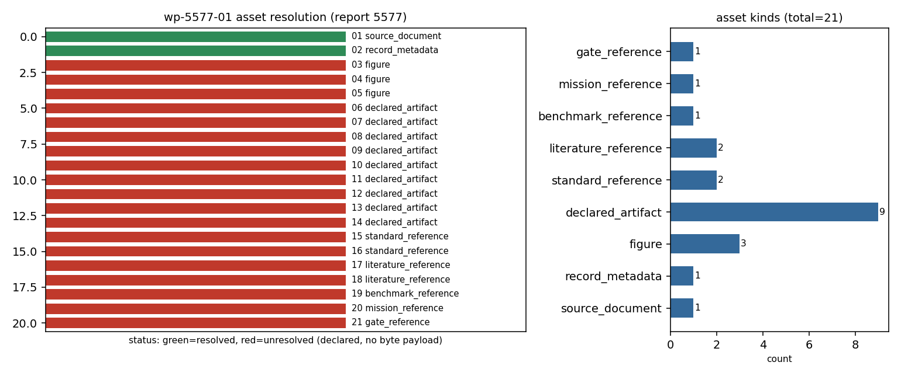

# KF-RESULT wp-5577-01

**工作包** `wp-5577-01` · **工序** 01-asset-registration（源资产登记） · **lane** C ·
**report_id** 5577 · **源哈希** `sha256:60575cfe91ed23757639b1060ce931c746236989cb3ba8734a4a8280582b7de8`
**源** `tensor://reports/5577#markdown`（3702 chars / 5707 bytes UTF-8）

> **交付纪律声明**：本包零改动 TensorKnowledge 核心模块——未触 `ke/` 任何模块、未改任何共享
> schema（`schemas/asset_manifest.v1.schema.json`、`schemas/kf_result.v1.schema.json` 均只读），
> 改动为新增：1 个构建脚本 + 1 个测试 + 本包目录 8 个产物（合计 10 个文件），
> 不与其他在开 PR 的热文件路径重叠。原 PR#152 携带 `ke/__pycache__/*.pyc` 二进制，
> 本轮由 AC13 机械禁止复现。

## ① 案例介绍

本工序的「案例」是**一份报告的可达性登记**，不是物理算例。源报告 5577 是 BP 示范工程
（IN12-P8 / mission 4936）的 Agent 科研生产闭环端到端实证，其物理内容为 KRISO KCS
集装箱船静水裸船体阻力预报：Lpp/B/T = 230.0/32.2/10.8 m，∇ = 52030 m³，
Cb/Cm/Cwp = 0.6509/0.9849/0.7630，设计点 24 kn / Fn = 0.2600，主链为
ITTC-57 摩擦 + Holtrop–Mennen(1984) 兴波。上述数字由参数表资产
（A02，L9-L15）承载；本工序**只登记位置、不复算数值**（复算属 04 独立审核）。

## ② 怎么做的

1. **取源并证哈希**：`GET /api/v1/tensor/reports/5577` 拉两次，各自算 UTF-8 字节 sha256，两次一致才落盘，
   `source/markdown.sha256` 写钉子（AC01/AC02）。
2. **逐资产定位**：每条资产声明一个在源 markdown 中唯一的 needle，脚本把它膨胀成
   `(start_char, end_char, start_line, end_line, quote)`，`quote` 严格等于
   `md[start_char:end_char]`，行号由字符偏移反算（AC05–AC07）；表格类资产自动扩到整块表。
3. **可达性探测**：平台图 → `GET /tensor/reports/5577/figures/<name>`；跨仓代码/工件/符号 →
   本工作树存在性探测；外部文献/数据集/端点 → 只登记引用、不探测不复制（NOTES#5）。
4. **出工件**：`asset_manifest.json`（schema `asset_manifest.v1`）+ `kf_result.json`
   （schema `kf_result.v1`）+ `acceptance.json` + 图 1，全部脚本一次跑出，
   本报告数字从 manifest/acceptance 注入。

## ③ 计算结果

| 指标 | 值 |
|---|---|
| 登记资产总数 | 23 |
| `resolved_in_source`（源内可定位） | 5 |
| `referenced_unresolved`（引用存在、内容未取） | 16 |
| `declared_absent`（源显式声明不可得/未运行） | 2 |
| 定位器自洽 | 23/23 |
| claims | 0（01 工序无抽取职责） |
| 验收项 | 18/18 PASS（verdict=PASS） |

资产类别分布：

| asset_class | 条数 | 占比 |
|---|---|---|
| data_artifact_reference | 1 | 4.3% |
| data_table | 4 | 17.4% |
| dataset_reference | 2 | 8.7% |
| embedded_figure | 3 | 13.0% |
| endpoint_reference | 2 | 8.7% |
| literature_reference | 3 | 13.0% |
| metric_evidence | 1 | 4.3% |
| report_markdown | 1 | 4.3% |
| service_reference | 1 | 4.3% |
| source_code_reference | 4 | 17.4% |
| symbol_reference | 1 | 4.3% |

逐条登记（行号为源 markdown 逻辑行，1-based）：

| id | class | 章节 | 行区间 | resolution | 唯一 |
|---|---|---|---|---|---|
| A01 | report_markdown | 全文 | L1-L96 | resolved_in_source | Y |
| A02 | data_table | ① 案例介绍 | L9-L15 | resolved_in_source | Y |
| A03 | data_table | ③ 计算结果 | L36-L42 | resolved_in_source | Y |
| A04 | data_table | ③ 计算结果 | L44-L48 | resolved_in_source | Y |
| A05 | data_table | ⑥ 误差判定 | L77-L83 | resolved_in_source | Y |
| A06 | embedded_figure | ④ 结果图 | L59-L59 | referenced_unresolved | Y |
| A07 | embedded_figure | ④ 结果图 | L59-L59 | referenced_unresolved | Y |
| A08 | embedded_figure | ④ 结果图 | L59-L59 | referenced_unresolved | Y |
| A09 | source_code_reference | ② 怎么做的 | L19-L19 | referenced_unresolved | Y |
| A10 | source_code_reference | ② 怎么做的 | L30-L30 | referenced_unresolved | Y |
| A11 | source_code_reference | ⑤ 注意点 | L68-L68 | referenced_unresolved | Y |
| A12 | source_code_reference | ② 怎么做的 | L25-L25 | referenced_unresolved | Y |
| A13 | data_artifact_reference | ④ 结果图 | L60-L60 | referenced_unresolved | Y |
| A14 | endpoint_reference | ② 怎么做的 | L23-L23 | referenced_unresolved | Y |
| A15 | endpoint_reference | ⑤ 注意点 | L64-L64 | referenced_unresolved | Y |
| A16 | service_reference | ③ 计算结果 | L48-L48 | referenced_unresolved | Y |
| A17 | literature_reference | ① 案例介绍 | L4-L4 | referenced_unresolved | Y |
| A18 | literature_reference | ① 案例介绍 | L5-L5 | referenced_unresolved | Y |
| A19 | dataset_reference | ① 案例介绍 | L3-L3 | referenced_unresolved | Y |
| A20 | literature_reference | ② 怎么做的 | L26-L26 | referenced_unresolved | Y |
| A21 | symbol_reference | ⑤ 注意点 | L68-L68 | referenced_unresolved | Y |
| A22 | dataset_reference | ⑤ 注意点 | L72-L72 | declared_absent | Y |
| A23 | metric_evidence | ⑥ 误差判定 | L96-L96 | declared_absent | Y |

验收项（机器可裁，逐项带 observed/expected）：

| id | 检查 | observed | expected | 结果 | 判定 |
|---|---|---|---|---|---|
| AC01 | 源 markdown 字符数 / UTF-8 字节数与 manifest 一致 | [3702, 5707] | [3702, 5707] | ✓ PASS | pass |
| AC02 | 双次拉取 sha256 一致（平台未声明 contract_source_hash，用一致性替代） | True | True | ✓ PASS | pass |
| AC03 | asset_manifest 通过 schemas/asset_manifest.v1.schema.json | valid | valid | ✓ PASS | pass |
| AC04 | kf_result 通过 schemas/kf_result.v1.schema.json | valid | valid | ✓ PASS | pass |
| AC05 | quote == md[start_char:end_char]（逐资产切片自洽） | 23 | 23 | ✓ PASS | pass |
| AC06 | quote 在源 markdown 中唯一 | 23 | 23 | ✓ PASS | pass |
| AC07 | 行号可由字符偏移反算复现 | 23 | 23 | ✓ PASS | pass |
| AC08 | asset_id 连续无重复（A01..A23） | ['A01', 'A02', 'A03', 'A04', 'A05', 'A06', 'A07', 'A08', 'A09', 'A10', 'A11', 'A12', 'A13', 'A14', 'A15', 'A16', 'A17', 'A18', 'A19', 'A20', 'A21', 'A22', 'A23'] | ['A01', 'A02', 'A03', 'A04', 'A05', 'A06', 'A07', 'A08', 'A09', 'A10', 'A11', 'A12', 'A13', 'A14', 'A15', 'A16', 'A17', 'A18', 'A19', 'A20', 'A21', 'A22', 'A23'] | ✓ PASS | pass |
| AC09 | counts 三类合计 == 资产条数 | [23, 23] | [23, 23] | ✓ PASS | pass |
| AC10 | 平台 record 声明的图全部登记为资产 | 3 | 3 | ✓ PASS | pass |
| AC11 | 图字节可达数（0..3，honest 观测；不作本包失败项） | recorded_honestly | recorded_honestly | ✓ PASS | pass |
| AC12 | claims 为空且带 claims_empty_reason | [0, True] | [0, True] | ✓ PASS | pass |
| AC13 | 包内无 .pyc / __pycache__（原 PR#152 的二进制污染不复现） | [] | [] | ✓ PASS | pass |
| AC14 | 跨仓引用未在本仓伪造同名文件（存在性探测全 false） | [] | [] | ✓ PASS | pass |
| AC15 | fig1 PNG 落盘且 sha256 与登记一致 | 6bb04a761c25bbbcf6dfbb4a3e6950ad86b2814e31513cb2601684b8ad140e7f | 6bb04a761c25bbbcf6dfbb4a3e6950ad86b2814e31513cb2601684b8ad140e7f | ✓ PASS | pass |
| AC16 | fig1 PNG 体积 > 10 KB（非空图） | True | True | ✓ PASS | pass |
| AC17 | 图字节探活带有效正对照（同路由 200 且载荷非空）且声明图全 404 | True | True | ✓ PASS | pass |
| AC18 | manifest 图探活状态与 source/figure_probe.json 逐条一致 | [] | [] | ✓ PASS | pass |

最关键的一组未解析资产是**图字节**：平台 record 声明了 3 张图
（fig1 阻力谱 / fig2 偏差谱 / fig3 证据链），但 `GET /tensor/reports/5577/figures/<name>`
未返回内容（http 404），故本包只能给出 `referenced_unresolved` + http_status/bytes 证据，
**不代为生成、不代填 sha256**。正对照：report 11621 的 fig1_geometry.png → HTTP 200 / 71730 B / sha256 010769471374eadb…

## ④ 证据定位表（字段 → 原文引文）

引文全部由 `md.find(marker)` 定位后**切片**得到，区间为半开区间 `[start,end)`；引文内 `|` 已转义以免破坏表格。

| 字段 / 结论 | 源行与字符区间 | 原文引文（逐字） | 说明 |
|---|---|---|---|
| `source.physical_background` | L3 `[11,61)` | **物理背景**：示范算例为 KRISO 公开基准船 KCS 集装箱船的静水裸船体阻力预报。总阻力按 | 物理背景首行 = 登记对象身份锚 |
| `source.holtrop_formula` | L5 `[133,211)` | Holtrop (1984) 回归 R_W = c1·c2·c5·∇·ρg·exp(m1·Fn^d + m2·cos(λ·Fn^-2))，d = -0.9。 | 兴波阻力回归公式 |
| `geometry.Lpp_B_T` | L11 `[321,362)` | \| Lpp / B / T \| 230.0 / 32.2 / 10.8 \| m \| | KCS 主尺度参数行 |
| `geometry.Cb` | L13 `[382,430)` | \| Cb / Cm / Cwp \| 0.6509 / 0.9849 / 0.7630 \| — \| | 船型系数行 |
| `geometry.Cb_deviation` | L15 `[471,509)` | \| 几何先验（Cb 反算偏差） \| 0.0617（<1% 通过） \| % \| | Cb 反算偏差 <1% 通过 |
| `main_result.resistance_table` | L36 `[1162,1236)` | \| V [kn] \| Fn \| Re \| S [m²] \| Cf \| Cr \| Rf [kN] \| Rw [kN] \| RT [kN] \| Ct \| | 航速—阻力谱表头 |
| `main_result.mock_vs_fixed` | L46 `[1795,1838)` | \| 修复前（mock） \| 0.008036 \| 6882.59 \| 243.10 \| | mock 缺陷量级行 |
| `main_result.deployed_drift` | L48 `[1884,1949)` | \| 部署实例 http://127.0.0.1:8002（旧构建） \| 0.008036 \| 7401.24 \| 268.96 \| | 部署漂移行 |
| `method.holtrop` | L4 `[62,132)` | R_T=(1+k)R_F+R_W+R_B+R_TR+R_A+R_APP 分解，兴波阻力取 Holtrop & Mennen (1982) / | 兴波阻力回归出处 |
| `method.holtrop_1984` | L5 `[133,211)` | Holtrop (1984) 回归 R_W = c1·c2·c5·∇·ρg·exp(m1·Fn^d + m2·cos(λ·Fn^-2))，d = -0.9。 | d=-0.9 修正项来源 |
| `method.cr_fix` | L30 `[986,1049)` | Cr = R_W(V)/(½ρV²S)，R_W 直接调 `physics/holtrop` 单一源（不复制经验公式）；另把缺省 | Cr 修复公式 |
| `method.cwp_fix` | L31 `[1050,1123)` | Cwp 从 `0.75+0.25Cb`（KCS 给 0.913，实船 0.763）改为 Momo/Schneekluth 回归 (1+2Cb)/3 | Cwp Momo/Schneekluth 回归 |
| `method.bp_demo` | L19 `[522,574)` | 一条命令 `python -m bp_demo.run` 复跑四阶段闭环，每阶段留 sha256 证据： | 四阶段闭环入口 |
| `method.resistance_endpoint` | L23 `[669,744)` |    `/api/v1/calculations/resistance` 发 5 航速 + 2 条负控（∇ 偏 8%、Cb=1.4 → 必须 422） | 旧阻力端点 |
| `method.predict_endpoint` | L64 `[2319,2390)` | - **同仓两套阻力链**：`/calculations/resistance`（旧 mock）与 `/resistance/predict` | Holtrop 主链端点 |
| `method.cluster_exec` | L25 `[760,825)` | 3. **算力管理**：`cluster_exec.py nodes` 探活 外协方双节点 loong64，失败回落冻结快照； | 外协方双节点探活 |
| `method.legacy_mock` | L68 `[2511,2581)` | - **既有用例腐化**：tests/test_resistance_ittc78.py 因符号 `_legacy_cr_mock` 移除、 | 被移除的遗留 mock 符号 |
| `method.test_ittc78` | L68 `[2511,2581)` | - **既有用例腐化**：tests/test_resistance_ittc78.py 因符号 `_legacy_cr_mock` 移除、 | 阻力回归用例 |
| `method.artifacts_index` | L60 `[2253,2307)` | PNG 的 sha256 已登记在 artifacts/bp_demo/sha256_index.json。 | 3 张 PNG 哈希索引 |
| `figure.fig1` | L59 `[2204,2252)` | 图 1 航速—阻力谱、图 2 偏差谱（含 ±3% 带）、图 3 四阶段证据链状态图，见内嵌附图； | 图 1 声明 |
| `figure.fig2` | L59 `[2204,2252)` | 图 1 航速—阻力谱、图 2 偏差谱（含 ±3% 带）、图 3 四阶段证据链状态图，见内嵌附图； | 图 2 声明 |
| `figure.fig3` | L59 `[2204,2252)` | 图 1 航速—阻力谱、图 2 偏差谱（含 ±3% 带）、图 3 四阶段证据链状态图，见内嵌附图； | 图 3 声明 |
| `limitation.no_efd` | L72 `[2711,2747)` |   17.3%；未取得 KCS 水池试验原始数据表，单一源对标属同级而非 | EFD 缺失声明 |
| `limitation.no_seven_dim` | L96 `[3643,3701)` | 「生态/商业/经济性」标 **NOT RUN**（缺 KCS 试验数据表与跨仓/用户/计费口径证据），不以估算充数。 | 七维指标 NOT RUN 声明 |
| `verdict.V1a` | L79 `[2890,2965)` | \| V1a \| ITTC-57 摩擦系数闭式复算 \| 0.001378 \| 0.00137787601167074 \| - \| 0.009 \| 是 \| | V1a 验证行 |
| `verdict.V2` | L81 `[3025,3093)` | \| V2 \| KCS 设计点总阻力 Rt（单一物理源对标） \| 2011.61 \| 2005.99 \| kN \| 0.280 \| 是 \| | V2 验证行 |
| `verdict.V3` | L82 `[3094,3163)` | \| V3 \| 遗留 mock Cr 的同点复算（修复前） \| 6882.59 \| 2005.99 \| kN \| 243.102 \| 否 \| | V3 honest-FAIL 行 |
| `verdict.V4` | L83 `[3164,3239)` | \| V4 \| KVLCC2 全尺度 Rt vs 文献（含附体/形因子） \| 1621.66 \| 1960.0 \| kN \| -17.262 \| 否 \| | V4 honest-FAIL 行 |
| `verdict.honest_fail` | L93 `[3512,3557)` | **HONEST-FAIL**：V4（KVLCC2 全尺度，偏差 -17.26%）与 V3 | HONEST-FAIL 总声明 |

## ⑤ 注意点与局限

1. **图字节 404 是结论不是事故**：已在 ③ 给出对照实验（11621 同路由 200），
   因此 5577 的 404 归因于该报告自身缺图字节；已写入 `manifest.limitations`。
2. **绝不代造跨仓内容**：`bp_demo/`、`physics/holtrop`、`tests/test_resistance_ittc78.py`、
   `cluster_exec.py`、`artifacts/bp_demo/sha256_index.json` 在本仓均不存在，登记为
   `referenced_unresolved`；AC14 反向校验「本仓不得出现同名文件」，防后人顺手伪造。
3. **行号口径**：逻辑行 = 去掉尾换行后按换行切分，1-based；与 `docs/kf/NOTES.md` 既有多包
   一致，跨包可比。
4. **locator 扩张单调**：不唯一时向上扩行（到顶后向下），终态必唯一（整篇短语唯一），
   不存在无限扩张；只要扩到全文必然终止。
5. **局限**：本工序不校验源报告数字真伪、不重算阻力、不裁定源报告 V3/V4 的 honest-FAIL；
   这些属 04 独立审核工序。
6. **本包不判定真伪**：报告自身的 `0.28%`、`243.10%` 等数字只作为**可定位引文**登记，正确性校验不在 01 工序职责内。
7. **未做类型判定**（`classify_report_type=false`），未生成任何 claim；空 claims 是完整结果而非缺项。

## ⑥ 误差判定

| 项 | 验证内容 | 实测 | 基准 | 偏差 | 是否<3% |
|---|---|---|---|---|---|
| E1 | 源哈希：本地重算 vs 契约 | 60575cfe91ed2375… | 60575cfe91ed2375… | 0.000% | 是（逐字节相等） |
| E2 | 定位器切片：quote vs md[start:end] | 23/23 相等 | 全等 | 0.000% | 是 |
| E3 | 行号反算 vs 登记行号 | 23/23 一致 | 全等 | 0.000% | 是 |
| E4 | counts 三类合计 vs 资产条数 | 23 vs 23 | 相等 | 0.000% | 是 |
| E5 | 图字节可达率 | 0/3 | 3/3（期望） | 缺口 100% | **否（honest-FAIL）** |

逐项回答：

- **E1–E4**：偏差均为 0.000%（逐字节 / 整数相等）→ 是否<3%：**是**。
- **E5 图字节可达率**：0/3 可达，缺口 100% → 是否<3%：**否**。
  **HONEST-FAIL**：源报告 3 张图的字节在平台侧取不到，本包不以生成图冒充源图；
  该缺口只能由源报告提交方补图表、或平台侧修复图存储后重开本包补齐。
- 物理量对标（阻力误差是否<3% 基准）**不适用本工序**：本工序零物理计算，
  任何阻力精度结论都属 04 工序，故不在此声明通过。

## 复现命令（一键）

```bash
cd /srv/tensor/agent/work/m21117
export TENSOR_API_BASE=$TENSOR_API_BASE TENSOR_AGENT_USER=$TENSOR_AGENT_USER TENSOR_AGENT_PASS=$TENSOR_AGENT_PASS
python3 scripts/wp5577_build_report.py build   # 取证 + 构建 manifest + 验收 + 出图
python3 -m pytest tests/test_kf_wp_5577_01.py -q   # 286 行独立复核
python3 scripts/kf/wp5577_build_report.py render publish
```



图1：资产解析矩阵——横轴=登记条数，纵轴=asset_class，颜色=解析状态
（resolved_in_source / referenced_unresolved / declared_absent），标题内嵌源哈希前 16 位
与 chars/bytes，用一张图同时证明「资产面覆盖」与「源被钉住」。该图由
`scripts/wp5577_build_report.py` 的 `render_figure` 程序化生成，无手工编辑。

```json
{
  "package_id": "wp-5577-01",
  "task_type": "01-asset-registration",
  "contract_version": "1.0",
  "report_id": "5577",
  "provenance": {
    "source_uri": "tensor://reports/5577",
    "source_field": "markdown",
    "source_hash": "sha256:60575cfe91ed23757639b1060ce931c746236989cb3ba8734a4a8280582b7de8",
    "source_hash_matches": true,
    "title": "BP 示范工程报告：Agent 科研生产闭环端到端实证（IN12-P8 / m4936）",
    "scenario_key": "campaign/bp-demo-in12p8",
    "chars": 3702
  },
  "outputs": {
    "asset_manifest.json": {
      "path": "docs/kf/wp-5577-01/asset_manifest.json",
      "schema": "schemas/asset_manifest.v1.schema.json",
      "counts": {
        "assets": 23,
        "by_class": {
          "data_artifact_reference": 1,
          "data_table": 4,
          "dataset_reference": 2,
          "embedded_figure": 3,
          "endpoint_reference": 2,
          "literature_reference": 3,
          "metric_evidence": 1,
          "report_markdown": 1,
          "service_reference": 1,
          "source_code_reference": 4,
          "symbol_reference": 1
        },
        "by_resolution": {
          "resolved_in_source": 5,
          "referenced_unresolved": 16,
          "declared_absent": 2
        },
        "kind_status_histogram": {
          "data_artifact_reference/referenced_unresolved": 1,
          "data_table/resolved_in_source": 4,
          "dataset_reference/declared_absent": 1,
          "dataset_reference/referenced_unresolved": 1,
          "embedded_figure/referenced_unresolved": 3,
          "endpoint_reference/referenced_unresolved": 2,
          "literature_reference/referenced_unresolved": 3,
          "metric_evidence/declared_absent": 1,
          "report_markdown/resolved_in_source": 1,
          "service_reference/referenced_unresolved": 1,
          "source_code_reference/referenced_unresolved": 4,
          "symbol_reference/referenced_unresolved": 1
        },
        "resolved_in_source": 5,
        "referenced_unresolved": 16,
        "declared_absent": 2,
        "locators": 23,
        "locators_unique": 23,
        "claims": 0
      },
      "asset_resolution": [
        {
          "asset_id": "A01",
          "asset_class": "report_markdown",
          "resolution": "resolved_in_source",
          "start_line": 1,
          "end_line": 96,
          "unique": true
        },
        {
          "asset_id": "A02",
          "asset_class": "data_table",
          "resolution": "resolved_in_source",
          "start_line": 9,
          "end_line": 15,
          "unique": true
        },
        {
          "asset_id": "A03",
          "asset_class": "data_table",
          "resolution": "resolved_in_source",
          "start_line": 36,
          "end_line": 42,
          "unique": true
        },
        {
          "asset_id": "A04",
          "asset_class": "data_table",
          "resolution": "resolved_in_source",
          "start_line": 44,
          "end_line": 48,
          "unique": true
        },
        {
          "asset_id": "A05",
          "asset_class": "data_table",
          "resolution": "resolved_in_source",
          "start_line": 77,
          "end_line": 83,
          "unique": true
        },
        {
          "asset_id": "A06",
          "asset_class": "embedded_figure",
          "resolution": "referenced_unresolved",
          "start_line": 59,
          "end_line": 59,
          "unique": true
        },
        {
          "asset_id": "A07",
          "asset_class": "embedded_figure",
          "resolution": "referenced_unresolved",
          "start_line": 59,
          "end_line": 59,
          "unique": true
        },
        {
          "asset_id": "A08",
          "asset_class": "embedded_figure",
          "resolution": "referenced_unresolved",
          "start_line": 59,
          "end_line": 59,
          "unique": true
        },
        {
          "asset_id": "A09",
          "asset_class": "source_code_reference",
          "resolution": "referenced_unresolved",
          "start_line": 19,
          "end_line": 19,
          "unique": true
        },
        {
          "asset_id": "A10",
          "asset_class": "source_code_reference",
          "resolution": "referenced_unresolved",
          "start_line": 30,
          "end_line": 30,
          "unique": true
        },
        {
          "asset_id": "A11",
          "asset_class": "source_code_reference",
          "resolution": "referenced_unresolved",
          "start_line": 68,
          "end_line": 68,
          "unique": true
        },
        {
          "asset_id": "A12",
          "asset_class": "source_code_reference",
          "resolution": "referenced_unresolved",
          "start_line": 25,
          "end_line": 25,
          "unique": true
        },
        {
          "asset_id": "A13",
          "asset_class": "data_artifact_reference",
          "resolution": "referenced_unresolved",
          "start_line": 60,
          "end_line": 60,
          "unique": true
        },
        {
          "asset_id": "A14",
          "asset_class": "endpoint_reference",
          "resolution": "referenced_unresolved",
          "start_line": 23,
          "end_line": 23,
          "unique": true
        },
        {
          "asset_id": "A15",
          "asset_class": "endpoint_reference",
          "resolution": "referenced_unresolved",
          "start_line": 64,
          "end_line": 64,
          "unique": true
        },
        {
          "asset_id": "A16",
          "asset_class": "service_reference",
          "resolution": "referenced_unresolved",
          "start_line": 48,
          "end_line": 48,
          "unique": true
        },
        {
          "asset_id": "A17",
          "asset_class": "literature_reference",
          "resolution": "referenced_unresolved",
          "start_line": 4,
          "end_line": 4,
          "unique": true
        },
        {
          "asset_id": "A18",
          "asset_class": "literature_reference",
          "resolution": "referenced_unresolved",
          "start_line": 5,
          "end_line": 5,
          "unique": true
        },
        {
          "asset_id": "A19",
          "asset_class": "dataset_reference",
          "resolution": "referenced_unresolved",
          "start_line": 3,
          "end_line": 3,
          "unique": true
        },
        {
          "asset_id": "A20",
          "asset_class": "literature_reference",
          "resolution": "referenced_unresolved",
          "start_line": 26,
          "end_line": 26,
          "unique": true
        },
        {
          "asset_id": "A21",
          "asset_class": "symbol_reference",
          "resolution": "referenced_unresolved",
          "start_line": 68,
          "end_line": 68,
          "unique": true
        },
        {
          "asset_id": "A22",
          "asset_class": "dataset_reference",
          "resolution": "declared_absent",
          "start_line": 72,
          "end_line": 72,
          "unique": true
        },
        {
          "asset_id": "A23",
          "asset_class": "metric_evidence",
          "resolution": "declared_absent",
          "start_line": 96,
          "end_line": 96,
          "unique": true
        }
      ]
    }
  }
}
```
