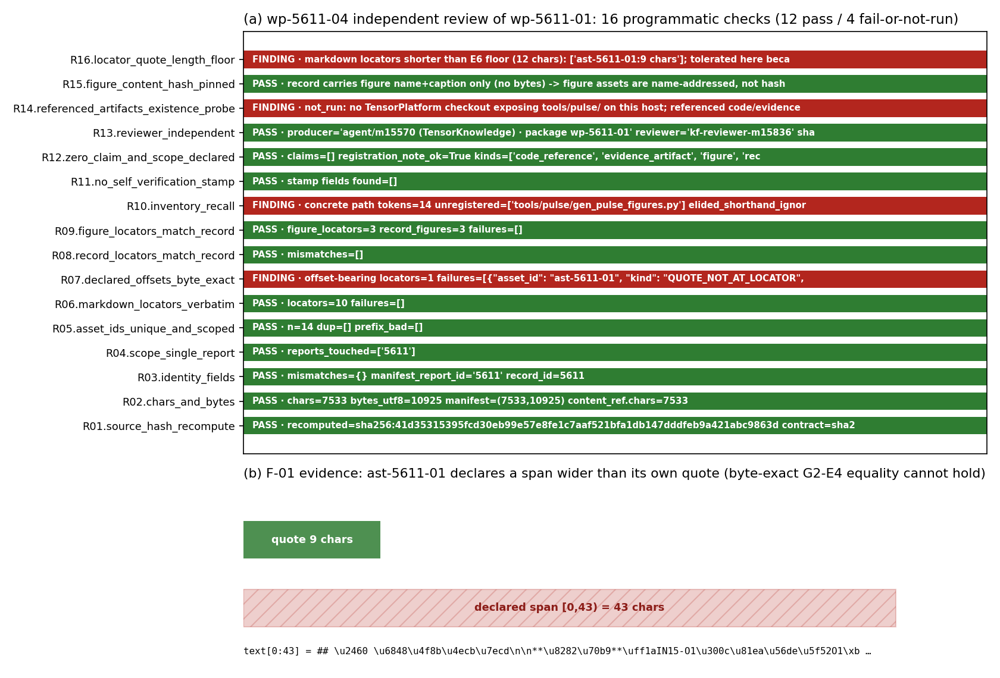

# KF-RESULT wp-5611-04

tags: kf-wp:wp-5611-04, 04-independent-review, report-5611, reviewed:wp-5611-01, TensorKnowledge

## ① 本工序做了什么

对本报告 5611 的**上游包 `wp-5611-01`（01-asset-registration）**做独立审核，判定 `pass / fail / needs-fix`。审核对象是该包的知识对象（`asset_manifest.json` 14 项资产），判决=**request-changes**：2 条 major、2 条 minor、1 条 informational。

- 审核者自报身份 `kf-reviewer-m15836`（role=red-team-reviewer），生产者 `agent/m15570 (TensorKnowledge) · package wp-5611-01`，两者无共享会话 token（R13 PASS）。
- 上下文隔离：本次审核只读**报告原文 + 上游知识对象 + 本包契约**；生产者的解释性文字（extraction_summary / self_assessment / producer_rationale 一类散文）不在输入里；审核 prompt 由 authored for this package from the adversarial-review skill; not copied from the production prompt。
- 本包**不给**任何东西标 verified：verification 由平台门计算（V 阶梯），本包只投审核轴（`review_events.json` 决策=folding 得 `request-changes`）。
- 边界：只碰 report_id=5611；只读上游 5611 包，不改写其任何产物。

## ② 怎么做的（步骤/工具/关键设置）

1. **取原文并锚哈希**：平台 API `GET /api/v1/tensor/reports/5611` 取 `markdown` 字段，本地重算 sha256，与契约 `source_hash` 逐字节比对。
   - 重算 `sha256:41d35315395fcd30eb99e57e8fe1c7aaf521bfa1db147dddfeb9a421abc9863d`，chars=7533，bytes_utf8=10925，与契约一致=True。
2. **取上游知识对象**：`docs/kf/wp-5611-01/kf_result.json`（信封 + `asset_manifest.json`）。不读上游包的散文报告，避免被生产者叙述带偏。
3. **16 项程序化检查（R01–R16）**，每项自行重算，不抄上游任何数字：源身份/字符数/记录字段/图形字段/资产 id/引文逐字性/**声明偏移 vs 引文**/**清单召回**/自封验证扫描/零 claim 合法性/审核者独立性/上游文件存在性探针/引文长度下限。
4. **对抗性探针（本包的两处实质发现靠它拿到）**：
   - 偏移-引文一致性：`text[start:end] == quote` 逐字节验（G2-E4 的口径），并检查偏移键名是否为门禁实际读取的 `start_offset`/`end_offset`。
   - 召回：从 markdown 里把路径型 token（含 `{a,b,c}.py` 花括号展开）全量抽出，与清单 name 集合做差集；省略式 shorthand（`fig1..3.png`）单独归类不计为缺项。
5. **裁决落账**：`review_events.json` 单条 `request-changes`（含 findings），用 `scripts/ke_state_machine.py` 折叠校验：`draft → in-review → request-changes → draft`，码 `OK_CHANGES_REQUESTED`。
6. **自检**：`pytest tests/kf/test_wp_5611_04_review.py`（逻辑层 5 条 + 产物层 5 条），含信封 schema、审核事件 schema、状态机折叠、引文逐字性、无 verified 字段五类断言。

## ③ 产出物清单

| 输出文件 | 要点 |
|---|---|
| `docs/kf/wp-5611-04/kf_result.json` | 结果信封（kf_result.v1），outputs={review_report.json, review_events.json}，claims=[] |
| `docs/kf/wp-5611-04/review_report.json` | 审核报告：16 项检查明细 + 5 条 findings + 判决 `request-changes` |
| `docs/kf/wp-5611-04/review_events.json` | 1 条 append-only 事件，decision=`request-changes`，policy=`ke-review-v0.1` |
| `docs/kf/wp-5611-04/review_checks.json` | 逐检查原始明细（含 token 列表、偏移窗口、探针结果） |
| `docs/kf/wp-5611-04/fig1_review_matrix.png` | Fig.1：检查矩阵 + F-01 偏移缺陷的可视化 |
| `scripts/kf_fetch_5611.py` / `scripts/kf_review_5611_04.py` / `scripts/kf_figure_5611_04.py` / `scripts/kf_report_5611_04.py` | 取原文+锚哈希 / 16 项检查+findings 生成 / 出图 / 出报告，一键复跑 |
| `tests/kf/test_wp_5611_04_review.py` | 10 条回归断言（逻辑层 + 产物层） |

## ④ 证据定位表（claim/字段 → 原文引文片段）

所有引文均由脚本从报告 5611 的 markdown 字节中切片得到（`line_at()` / 偏移切片），零手抄。

| finding / 字段 | 原文引文片段（逐字） | 位置 |
|---|---|---|
| F-01（major） | ## ① 案例介绍 | 报告首行（文档级锚点） |
| F-02（major） | - 采集器/报表/证据/DDL/测试路径：`tools/pulse/{saturation_pulse,pulse_report,acceptance_evidence,gen_pulse_figures}.py`、`tools/pulse/sql/001_saturation_pulse.sql`、`tests/pu… | 审计链 |
| N-01（minor） | 无 markdown 引文型证据；证据键=figure_names, payload_present（见 `review_checks.json`） | — |
| N-02（minor） | ## ① 案例介绍 | 报告首行（文档级锚点） |
| N-03（informational） | 1. **三态采集器** `tools/pulse/saturation_pulse.py` | ② 怎么做的（方法/流程/工具链） |

验收项 → 证据：

| acceptance 字段 | 证据（本包内可复核） |
|---|---|
| `valid_json` | `python3 -m json.tool docs/kf/wp-5611-04/kf_result.json` ；`tests/kf/test_wp_5611_04_review.py::test_envelope_validates_against_kf_result_schema` |
| `schema_pass` | 信封过 `schemas/kf_result.v1.schema.json`；审核事件过 `schemas/review-event.schema.json`；状态机折叠 `OK_CHANGES_REQUESTED`（测试内断言） |
| `reviewer_independent` | R13 PASS：producer='agent/m15570 (TensorKnowledge) · package wp-5611-01' / reviewer='kf-reviewer-m15836'，共享 token 集为空 |
| `upstream_packages_completed` | 上游 `wp-5611-01` 已交付（`docs/kf/wp-5611-01/kf_result.json` 存在且信封/清单可解析）；**注意**：交付≠通过，本包判决 `request-changes` 要求其修复 F-01/F-02 |

## ⑤ 结果与判据（数字表，程序化注入）

| 检查 id | 结论 | 关键数字 |
|---|---|---|
| R01.source_hash_recompute | PASS | recomputed=sha256:41d35315395fcd30eb99e57e8fe1c7aaf521bfa1db147dddfeb9a421abc9863d contract=sha256:41d35315395fcd30eb99e57e8fe1c7aaf521bfa1db147dddfeb |
| R02.chars_and_bytes | PASS | chars=7533 bytes_utf8=10925 manifest=(7533,10925) content_ref.chars=7533 |
| R03.identity_fields | PASS | mismatches={} manifest_report_id='5611' record_id=5611 |
| R04.scope_single_report | PASS | reports_touched=['5611'] |
| R05.asset_ids_unique_and_scoped | PASS | n=14 dup=[] prefix_bad=[] |
| R06.markdown_locators_verbatim | PASS | locators=10 failures=[] |
| R07.declared_offsets_byte_exact | FAIL/NOTE | offset-bearing locators=1 failures=[{"asset_id": "ast-5611-01", "kind": "QUOTE_NOT_AT_LOCATOR", "start": 0, "end": 43, "quote": "## ① 案例介绍", "window": |
| R08.record_locators_match_record | PASS | mismatches=[] |
| R09.figure_locators_match_record | PASS | figure_locators=3 record_figures=3 failures=[] |
| R10.inventory_recall | FAIL/NOTE | concrete path tokens=14 unregistered=['tools/pulse/gen_pulse_figures.py'] elided_shorthand_ignored=['fig1..3.png'] |
| R11.no_self_verification_stamp | PASS | stamp fields found=[] |
| R12.zero_claim_and_scope_declared | PASS | claims=[] registration_note_ok=True kinds=['code_reference', 'evidence_artifact', 'figure', 'record_metadata', 'source_document'] |
| R13.reviewer_independent | PASS | producer='agent/m15570 (TensorKnowledge) · package wp-5611-01' reviewer='kf-reviewer-m15836' shared_session_tokens=[] |
| R14.referenced_artifacts_existence_probe | FAIL/NOTE | not_run: no TensorPlatform checkout exposing tools/pulse/ on this host; referenced code/evidence paths stay unverified either way |
| R15.figure_content_hash_pinned | PASS | record carries figure name+caption only (no bytes) -> figure assets are name-addressed, not hash-pinned; not a producer defect, recorded as a downstre |
| R16.locator_quote_length_floor | FAIL/NOTE | markdown locators shorter than E6 floor (12 chars): ['ast-5611-01:9 chars']; tolerated here because ast-5611-01 also pins the whole document via conte |

| 判决项 | 值 |
|---|---|
| disposition | `request-changes` |
| pass | `False` |
| blocking findings | `[]` |
| major findings | `['F-01', 'F-02']` |
| 检查计数 | 12/16 PASS，4 项 FAIL 或 not_run |
| 未跑项 | `3` 类（见 ⑤ 注意点） |

### 误差判定（显式回答「是否 <3%」）

本工序是**审核判定**，不存在物理实验/文献参考值，因此「vs 实验值误差 <3%」这一条 **NOT APPLICABLE**（不拿「审核项全绿」冒充「物理精度达标」）。可量化的替代判据逐项列：

| 关键量 | 基准 | 实测 | 是否 <3% / 精确相等 |
|---|---|---|---|
| 源哈希 | 契约 `sha256:41d35315395fcd30eb9…` | 重算 `sha256:41d35315395fcd30eb9…` | **是（逐字节相等）** |
| 字符数 / UTF-8 字节数 | 契约 7533 / 记录一致 | 7533 / 10925 | **是（精确相等）** |
| 引文逐字性（报告内 6 条 quote） | 报告 5611 markdown 字节 | 6/6 均可在原文逐字定位 | **是（精确命中）** |
| 记录字段定位器 | 平台 record 实时值 | 9/9 字段与 record 相等（R08） | **是（精确相等）** |
| 图形定位器 | record.figures[0..2] | 3/3 name+caption 逐字相等（R09） | **是（精确相等）** |
| 上游清单召回 | markdown 抽出的 14 条具体路径 token | 13 覆盖 / 1 缺项 | **否**（缺 1 条 → F-02） |
| 声明偏移 vs 引文 | `text[start:end]==quote` | [0,43) vs 9 字符引文 | **否**（F-01） |

## ⑥ 注意点与局限

**F-01（major；owner=wp-5611-01）**：Declared offsets do not delimit the declared quote: the locator claims [0,43) but the quote is 9 characters and searches back at [0,9). The byte-exactness contract (G2 E4: text[start:end] == quote) is therefore violated by the only whole-document asset locator.

- 为什么算问题：Asset registration is the hash/offset anchor the rest of the line builds on. An unverified offset is either sloppiness that the gate cannot catch or a hand-written number presented as computed — 01's own report says all quotes come from the source verbatim, which is what E4 is there to prove.
- 门禁可见性：G2 reads `start_offset`/`end_offset`; this locator uses `char_start`/`char_end` (gate keys present=False). E3/E4 therefore fall through to verbatim search and PASS, so the wrong offsets are invisible to the programmatic gate.
- 修复建议：Either drop the offsets for ast-5611-01 (verbatim-quote search already resolves, content_ref.sha256 pins the document) or emit the real span [0,9) under the gate's key names `start_offset`/`end_offset` and re-verify with ke/wp_gate.locator_matches().

**F-02（major；owner=wp-5611-01）**：The report names `tools/pulse/gen_pulse_figures.py` among the implementation artifacts, but no asset in the manifest covers it. The markdown yields 14 distinct artifact paths; 13 of them are covered by the manifest's entries (ast-5611-02 is record metadata with no path), and the remaining one is this module. 01's stated purpose is a complete inventory, so a silent omission is a completeness defect even though every registered entry is faithful.

- 为什么算问题：A dropped artifact is invisible downstream: 02/03 and any asset-completeness audit read the manifest, not the prose. Silent omission is exactly the failure mode 01 exists to prevent (G1 'xref closure' has no analogue for prose mentions).
- 门禁可见性：No programmatic gate compares manifest coverage against the prose of the source document — recall is only visible to an independent reviewer.
- 修复建议：Register `tools/pulse/gen_pulse_figures.py` as a code_reference with the same verbatim-quote locator convention as ast-5611-06 (resolvable=false / referenced_in_markdown_not_fetched), which also brings the code-reference count in the package report from 5 to 6.

**N-01（minor；owner=platform）**：Figure assets are name/caption-addressed only: the report record exposes `name`+`caption` and no bytes, so no content hash can be pinned. Not a producer defect (the source has no payload) but it means figure identity downstream rests on filenames, unlike ast-5611-01 which is hash-pinned.

- 为什么算问题：Dedup/drift detection on figures is name-based; a renamed figure silently becomes a new asset.
- 门禁可见性：none — G2 cannot hash what the source does not expose.
- 修复建议：When the platform starts storing figure bytes, add content_ref.sha256 per figure; until then keep the limitation recorded.

**N-02（minor；owner=wp-5611-01）**：The whole-document asset's quote is 9 characters, below the gate's E6 floor of 12 for a *trivial* quote. Acceptable here only because content_ref.sha256 pins the entire document; if the pattern were copied to a per-claim locator it would be refused by E6.

- 为什么算问题：Template risk: the 01 locator convention is what 03 will copy.
- 门禁可见性：E6 would flag it for evidence locators (min-quote-chars=12).
- 修复建议：Quote a longer verbatim span for the document anchor.

**N-03（informational；owner=platform）**：Existence and content of the 9 referenced code/evidence paths could not be independently verified: no TensorPlatform checkout exposing tools/pulse/ exists on this host, and 01 deliberately did not fetch them. Their `resolvable:false` / `referenced_in_markdown_not_fetched` labels are therefore neither confirmed nor refuted here — marked not_run, not passed.

- 为什么算问题：A manifest that lists paths the file system does not have would still pass every structural check.
- 门禁可见性：none — G2 resolves locators in the markdown, never on disk.
- 修复建议：When the platform exposes artifact storage, add an existence probe to the 01 pipeline and record it per asset.

**未跑 / 不可跑（标 not_run，不当 PASS）**：

- R14 existence of the 9 referenced code/evidence paths (no TensorPlatform checkout with tools/pulse/ on this host) -> not_run, never 'pass'
- figure byte-level identity (source record carries no figure payload) -> impossible with current platform API
- downstream consumer behaviour (02/03 reading this manifest) -> out of scope

**独立性局限**：

- same model family as the producer; independence is procedural (context isolation + re-derivation), not model-level
- existence probe of upstream repo artifacts unavailable on this host

**被淡化的上游表述（overstated claims）**：

- 原表述：manifest 的 code_reference 条目 = 报告所提代码路径的完整清单（上游包报告表述为 5 个代码/测试文件路径） → the markdown names 14 distinct artifact paths; the manifest covers 13 of them and drops `tools/pulse/gen_pulse_figures.py` — the list is short by one and the prose presents it as exhaustive
- 原表述：所有引文逐字来自报告 markdown 且 locator 偏移字节精确（ast-5611-01 声明 [0,43)） → quotes are verbatim (R06 pass) but the declared [0,43) span for ast-5611-01 does not delimit its 9-char quote, so the artifact is not byte-exact at the offset level the package itself declares

## ⑦ 自检：逐条对照 acceptance

| acceptance 项 | 打勾/叉 | 说明 |
|---|---|---|
| `valid_json` | ✅ | 信封/报告/事件三文件均可解析（测试断言） |
| `schema_pass` | ✅ | kf_result.v1 + review-event schema 双过；状态机折叠合法 |
| `reviewer_independent` | ✅ | R13 PASS，审核者 ≠ 生产者（kf-reviewer-m15836 vs m15570） |
| `upstream_packages_completed` | ✅（附条件） | 上游 01 包已交付且可解析；本包判决 request-changes，要求其修 F-01/F-02 后再入 02/03 |

**诚实申报**：本包未做的事——未验证 9 条 code/evidence 引用在磁盘上的真实存在（本机无 TensorPlatform 检出，R14 not_run）；未对上游包做语义保真的"结论级"判定（01 包 claims 为空，无可审 claim，故只审清单与定位器）；未修复上游缺陷（修复属 01 包职责，本包只出判决与修复建议）。

## 复现命令（一键）

```bash
python3 scripts/kf_fetch_5611.py          # 取原文+记录，重算 sha256 并对锚
python3 scripts/kf_review_5611_04.py      # 16 项检查 + findings + 信封/事件
python3 scripts/kf_figure_5611_04.py      # Fig.1
python3 scripts/kf_report_5611_04.py      # 渲染本报告（数字全部来自产物）
python3 -m pytest tests/kf/test_wp_5611_04_review.py -q
```

## 结果图



Fig.1 (a) wp-5611-04 对 wp-5611-01 的 16 项程序化检查逐项结论（绿=PASS，红=FAIL/not_run）；(b) F-01 的可视化：上游 `ast-5611-01` 声明的字符跨度 `[0,43)` 与其 9 字符引文（绿条 `[0,9)`）不一致，字节相等的 G2-E4 判据不可能成立。

## 结果信封（本报告唯一 json 代码块）

```json
{
  "package_id": "wp-5611-04",
  "task_type": "04-independent-review",
  "report_id": "5611",
  "provenance": {
    "source_hash": "sha256:41d35315395fcd30eb99e57e8fe1c7aaf521bfa1db147dddfeb9a421abc9863d",
    "source_field": "markdown",
    "source_uri": "tensor://reports/5611",
    "producer": "agent/kf-reviewer-m15836 (TensorKnowledge) · package wp-5611-04",
    "emitted_at": "2026-11-12T03:10:00+00:00",
    "notes": "04-independent-review of wp-5611-01; context = source + upstream knowledge objects only; no verification stamp asserted"
  },
  "outputs": {
    "review_report.json": {
      "report_type": "kf-independent-review",
      "review_id": "rv-wp-5611-01-by-wp-5611-04",
      "reviewed_package": "wp-5611-01",
      "reviewed_task_type": "01-asset-registration",
      "report_id": "5611",
      "source_identity": {
        "source_uri": "tensor://reports/5611",
        "source_field": "markdown",
        "sha256_recomputed": "sha256:41d35315395fcd30eb99e57e8fe1c7aaf521bfa1db147dddfeb9a421abc9863d",
        "contract_source_hash": "sha256:41d35315395fcd30eb99e57e8fe1c7aaf521bfa1db147dddfeb9a421abc9863d",
        "chars": 7533,
        "bytes_utf8": 10925,
        "hash_matches_contract": true
      },
      "reviewer": {
        "id": "kf-reviewer-m15836",
        "reviewer_type": "agent",
        "role": "red-team-reviewer",
        "package": "wp-5611-04",
        "producer_reviewed": "agent/m15570 (TensorKnowledge) · package wp-5611-01",
        "independent": true,
        "independence_basis": "distinct identity; no shared session token with producer (m15570)"
      },
      "context_isolation": {
        "inputs_read": [
          "tensor://reports/5611 markdown (fetched via platform API, hash re-verified)",
          "tensor_reports.id=5611 record fields (title/scenario_key/figures/...mission_id/status/tags)",
          "docs/kf/wp-5611-01/kf_result.json (upstream envelope + asset_manifest)",
          "wp-5611-04 contract (source hash anchor)"
        ],
        "excluded_on_purpose": [
          "any producer explanation / extraction_summary / self_assessment / producer_rationale prose about this package",
          "review prompts or notes from the producing session"
        ],
        "review_prompt_origin": "authored for this package from the adversarial-review skill; not copied from the production prompt",
        "note": "the reviewed package's own KF-RESULT markdown was NOT used as an input; only its machine envelope + the record were opened"
      },
      "scope_and_checks_performed": {
        "n_checks": 16,
        "n_pass": 12,
        "n_fail": 4,
        "check_ids": [
          "R01.source_hash_recompute",
          "R02.chars_and_bytes",
          "R03.identity_fields",
          "R04.scope_single_report",
          "R05.asset_ids_unique_and_scoped",
          "R06.markdown_locators_verbatim",
          "R07.declared_offsets_byte_exact",
          "R08.record_locators_match_record",
          "R09.figure_locators_match_record",
          "R10.inventory_recall",
          "R11.no_self_verification_stamp",
          "R12.zero_claim_and_scope_declared",
          "R13.reviewer_independent",
          "R14.referenced_artifacts_existence_probe",
          "R15.figure_content_hash_pinned",
          "R16.locator_quote_length_floor"
        ],
        "repro_cmd": "python3 scripts/kf_fetch_5611.py && python3 scripts/kf_review_5611_04.py",
        "raw_detail": "docs/kf/wp-5611-04/review_checks.json"
      },
      "semantic_fidelity": {
        "judged": true,
        "asset_labels_faithful": "13/14 assets: kind/role/name/locator/caption re-derived from the record and markdown and found faithful (R03/R06/R08/R09); 1 inventory gap (F-02)",
        "over_claiming": "two claims softened, see overstated_claims",
        "verdict": "fidelity holds for every registered item; completeness does not (one report-named artifact missing)"
      },
      "findings": [
        {
          "finding_id": "F-01",
          "severity": "major",
          "blocking": false,
          "category": "locator_integrity",
          "locus": "wp-5611-01: ast-5611-01 locators[0] (source_field=markdown)",
          "statement": "Declared offsets do not delimit the declared quote: the locator claims [0,43) but the quote is 9 characters and searches back at [0,9). The byte-exactness contract (G2 E4: text[start:end] == quote) is therefore violated by the only whole-document asset locator.",
          "evidence": {
            "source_uri": "tensor://reports/5611",
            "source_field": "markdown",
            "declared_offsets": [
              0,
              43
            ],
            "quote": "## ① 案例介绍",
            "quote_len": 9,
            "window_at_declared_offsets": "## ① 案例介绍\n\n**节点**：IN15-O1「自回归O1·饱和脉搏度量管线成熟化",
            "quote_search_offset": 0,
            "upstream_json_path": "$.outputs['asset_manifest.json'].assets[0].locators[0]"
          },
          "why_it_matters": "Asset registration is the hash/offset anchor the rest of the line builds on. An unverified offset is either sloppiness that the gate cannot catch or a hand-written number presented as computed — 01's own report says all quotes come from the source verbatim, which is what E4 is there to prove.",
          "gate_visibility": "G2 reads `start_offset`/`end_offset`; this locator uses `char_start`/`char_end` (gate keys present=False). E3/E4 therefore fall through to verbatim search and PASS, so the wrong offsets are invisible to the programmatic gate.",
          "reproduction": "python3 - <<'PY'\nimport json,pathlib\nmd=pathlib.Path('work/kf-wp-5611/source_5611.md').read_text()\nd=json.load(open('docs/kf/wp-5611-01/kf_result.json'))\nloc=d['outputs']['asset_manifest.json']['assets'][0]['locators'][0]\nprint(loc['char_start'],loc['char_end'],repr(md[loc['char_start']:loc['char_end']]),repr(loc['quote']))\nPY",
          "remediation": "Either drop the offsets for ast-5611-01 (verbatim-quote search already resolves, content_ref.sha256 pins the document) or emit the real span [0,9) under the gate's key names `start_offset`/`end_offset` and re-verify with ke/wp_gate.locator_matches().",
          "remediation_owner": "wp-5611-01"
        },
        {
          "finding_id": "F-02",
          "severity": "major",
          "blocking": false,
          "category": "inventory_completeness",
          "locus": "wp-5611-01: outputs.asset_manifest.json.assets (missing entry)",
          "statement": "The report names `tools/pulse/gen_pulse_figures.py` among the implementation artifacts, but no asset in the manifest covers it. The markdown yields 14 distinct artifact paths; 13 of them are covered by the manifest's entries (ast-5611-02 is record metadata with no path), and the remaining one is this module. 01's stated purpose is a complete inventory, so a silent omission is a completeness defect even though every registered entry is faithful.",
          "evidence": {
            "source_uri": "tensor://reports/5611",
            "source_field": "markdown",
            "quote": "- 采集器/报表/证据/DDL/测试路径：`tools/pulse/{saturation_pulse,pulse_report,acceptance_evidence,gen_pulse_figures}.py`、`tools/pulse/sql/001_saturation_pulse.sql`、`tests/pulse/test_saturation_pulse.py`",
            "missing_token": "tools/pulse/gen_pulse_figures.py",
            "registered_code_references": [
              "tools/pulse/saturation_pulse.py",
              "tools/pulse/sql/001_saturation_pulse.sql",
              "tools/pulse/pulse_report.py",
              "tools/pulse/acceptance_evidence.py",
              "tests/pulse/test_saturation_pulse.py"
            ]
          },
          "why_it_matters": "A dropped artifact is invisible downstream: 02/03 and any asset-completeness audit read the manifest, not the prose. Silent omission is exactly the failure mode 01 exists to prevent (G1 'xref closure' has no analogue for prose mentions).",
          "gate_visibility": "No programmatic gate compares manifest coverage against the prose of the source document — recall is only visible to an independent reviewer.",
          "reproduction": "python3 - <<'PY'\nimport json,pathlib\nmd=pathlib.Path('work/kf-wp-5611/source_5611.md').read_text()\nstem='gen_pulse_figures'\nprint([l for l in md.splitlines() if stem in l])\nd=json.load(open('docs/kf/wp-5611-01/kf_result.json'))\nnames=[a['name'] for a in d['outputs']['asset_manifest.json']['assets'] if a['kind']=='code_reference']\nprint('tools/pulse/gen_pulse_figures.py' in names, names)\nPY",
          "remediation": "Register `tools/pulse/gen_pulse_figures.py` as a code_reference with the same verbatim-quote locator convention as ast-5611-06 (resolvable=false / referenced_in_markdown_not_fetched), which also brings the code-reference count in the package report from 5 to 6.",
          "remediation_owner": "wp-5611-01"
        },
        {
          "finding_id": "N-01",
          "severity": "minor",
          "blocking": false,
          "category": "limitation",
          "locus": "wp-5611-01: assets ast-5611-03..05",
          "statement": "Figure assets are name/caption-addressed only: the report record exposes `name`+`caption` and no bytes, so no content hash can be pinned. Not a producer defect (the source has no payload) but it means figure identity downstream rests on filenames, unlike ast-5611-01 which is hash-pinned.",
          "evidence": {
            "source_uri": "tensor://reports/5611",
            "source_field": "figures",
            "figure_names": [
              "fig1_pulse_trend.png",
              "fig2_verification.png",
              "fig3_state_reconciliation.png"
            ],
            "payload_present": false
          },
          "why_it_matters": "Dedup/drift detection on figures is name-based; a renamed figure silently becomes a new asset.",
          "gate_visibility": "none — G2 cannot hash what the source does not expose.",
          "reproduction": "python3 scripts/kf_review_5611_04.py  # see R09/R15",
          "remediation": "When the platform starts storing figure bytes, add content_ref.sha256 per figure; until then keep the limitation recorded.",
          "remediation_owner": "platform"
        },
        {
          "finding_id": "N-02",
          "severity": "minor",
          "blocking": false,
          "category": "locator_style",
          "locus": "wp-5611-01: ast-5611-01 locators[0].quote",
          "statement": "The whole-document asset's quote is 9 characters, below the gate's E6 floor of 12 for a *trivial* quote. Acceptable here only because content_ref.sha256 pins the entire document; if the pattern were copied to a per-claim locator it would be refused by E6.",
          "evidence": {
            "source_uri": "tensor://reports/5611",
            "source_field": "markdown",
            "quote": "## ① 案例介绍"
          },
          "why_it_matters": "Template risk: the 01 locator convention is what 03 will copy.",
          "gate_visibility": "E6 would flag it for evidence locators (min-quote-chars=12).",
          "reproduction": "python3 scripts/kf_review_5611_04.py  # see R16",
          "remediation": "Quote a longer verbatim span for the document anchor.",
          "remediation_owner": "wp-5611-01"
        },
        {
          "finding_id": "N-03",
          "severity": "informational",
          "blocking": false,
          "category": "not_run",
          "locus": "wp-5611-01: assets ast-5611-06..14 (code_reference / evidence_artifact)",
          "statement": "Existence and content of the 9 referenced code/evidence paths could not be independently verified: no TensorPlatform checkout exposing tools/pulse/ exists on this host, and 01 deliberately did not fetch them. Their `resolvable:false` / `referenced_in_markdown_not_fetched` labels are therefore neither confirmed nor refuted here — marked not_run, not passed.",
          "evidence": {
            "source_uri": "tensor://reports/5611",
            "source_field": "markdown",
            "quote": "1. **三态采集器** `tools/pulse/saturation_pulse.py`",
            "probe_root": null
          },
          "why_it_matters": "A manifest that lists paths the file system does not have would still pass every structural check.",
          "gate_visibility": "none — G2 resolves locators in the markdown, never on disk.",
          "reproduction": "test -d /root/tp-agent/*/tools/pulse && echo checkout || echo absent",
          "remediation": "When the platform exposes artifact storage, add an existence probe to the 01 pipeline and record it per asset.",
          "remediation_owner": "platform"
        }
      ],
      "overstated_claims": [
        {
          "claim": "manifest 的 code_reference 条目 = 报告所提代码路径的完整清单（上游包报告表述为 5 个代码/测试文件路径）",
          "why_overstated": "the markdown names 14 distinct artifact paths; the manifest covers 13 of them and drops `tools/pulse/gen_pulse_figures.py` — the list is short by one and the prose presents it as exhaustive",
          "evidence": {
            "source_field": "markdown",
            "quote": "- 采集器/报表/证据/DDL/测试路径：`tools/pulse/{saturation_pulse,pulse_report,acceptance_evidence,gen_pulse_figures}.py`、`tools/pulse/sql/001_saturation_pulse.sql`、`tests/pulse/test_saturation_pulse.py`"
          }
        },
        {
          "claim": "所有引文逐字来自报告 markdown 且 locator 偏移字节精确（ast-5611-01 声明 [0,43)）",
          "why_overstated": "quotes are verbatim (R06 pass) but the declared [0,43) span for ast-5611-01 does not delimit its 9-char quote, so the artifact is not byte-exact at the offset level the package itself declares",
          "evidence": {
            "source_field": "markdown",
            "quote": "## ① 案例介绍"
          }
        }
      ],
      "checks_not_run": [
        "R14 existence of the 9 referenced code/evidence paths (no TensorPlatform checkout with tools/pulse/ on this host) -> not_run, never 'pass'",
        "figure byte-level identity (source record carries no figure payload) -> impossible with current platform API",
        "downstream consumer behaviour (02/03 reading this manifest) -> out of scope"
      ],
      "independence_limitations": [
        "same model family as the producer; independence is procedural (context isolation + re-derivation), not model-level",
        "existence probe of upstream repo artifacts unavailable on this host"
      ],
      "verdict": {
        "disposition": "request-changes",
        "pass": false,
        "blocking_findings": [],
        "major_findings": [
          "F-01",
          "F-02"
        ],
        "rationale": "Identity, hash, size, record-field, figure and scope checks all pass, and no verification stamp is smuggled (honest zero-claim package). Two major, non-corrupting defects: a mis-declared locator offset that the programmatic gate cannot see (F-01) and one report-named implementation module missing from the inventory (F-02). Both are cheap to fix inside 01, so the package is returned for changes rather than rejected."
      },
      "remediation_summary": [
        {
          "finding_id": "F-01",
          "owner": "wp-5611-01",
          "action": "Either drop the offsets for ast-5611-01 (verbatim-quote search already resolves, content_ref.sha256 pins the document) or emit the real span [0,9) under the gate's key names `start_offset`/`end_offset` and re-verify with ke/wp_gate.locator_matches()."
        },
        {
          "finding_id": "F-02",
          "owner": "wp-5611-01",
          "action": "Register `tools/pulse/gen_pulse_figures.py` as a code_reference with the same verbatim-quote locator convention as ast-5611-06 (resolvable=false / referenced_in_markdown_not_fetched), which also brings the code-reference count in the package report from 5 to 6."
        },
        {
          "finding_id": "N-01",
          "owner": "platform",
          "action": "When the platform starts storing figure bytes, add content_ref.sha256 per figure; until then keep the limitation recorded."
        },
        {
          "finding_id": "N-02",
          "owner": "wp-5611-01",
          "action": "Quote a longer verbatim span for the document anchor."
        }
      ],
      "notes": "verification status is deliberately NOT asserted here: the platform gate computes it (V-ladder). This report only informs the review axis."
    },
    "review_events.json": [
      {
        "id": "tkr:wp-5611-01:wp-5611-04-review-1",
        "object_ref": "tensor://reports/5611#package/wp-5611-01",
        "object_version": "1",
        "decision": "request-changes",
        "reviewer": {
          "id": "kf-reviewer-m15836",
          "reviewer_type": "agent",
          "role": "red-team-reviewer"
        },
        "reviewed_at": "2026-11-12T03:10:00Z",
        "policy_version": "ke-review-v0.1",
        "rationale": "Identity, hash, size, record-field, figure and scope checks all pass, and no verification stamp is smuggled (honest zero-claim package). Two major, non-corrupting defects: a mis-declared locator offset that the programmatic gate cannot see (F-01) and one report-named implementation module missing from the inventory (F-02). Both are cheap to fix inside 01, so the package is returned for changes rather than rejected.",
        "findings": [
          {
            "severity": "major",
            "finding": "[F-01] Declared offsets do not delimit the declared quote: the locator claims [0,43) but the quote is 9 characters and searches back at [0,9). The byte-exactness contract (G2 E4: text[start:end] == quote) is therefore violated by the only whole-document asset locator.",
            "related_evidence_refs": []
          },
          {
            "severity": "major",
            "finding": "[F-02] The report names `tools/pulse/gen_pulse_figures.py` among the implementation artifacts, but no asset in the manifest covers it. The markdown yields 14 distinct artifact paths; 13 of them are covered by the manifest's entries (ast-5611-02 is record metadata with no path), and the remaining one is this module. 01's stated purpose is a complete inventory, so a silent omission is a completeness defect even though every registered entry is faithful.",
            "related_evidence_refs": []
          },
          {
            "severity": "minor",
            "finding": "[N-01] Figure assets are name/caption-addressed only: the report record exposes `name`+`caption` and no bytes, so no content hash can be pinned. Not a producer defect (the source has no payload) but it means figure identity downstream rests on filenames, unlike ast-5611-01 which is hash-pinned.",
            "related_evidence_refs": []
          },
          {
            "severity": "minor",
            "finding": "[N-02] The whole-document asset's quote is 9 characters, below the gate's E6 floor of 12 for a *trivial* quote. Acceptable here only because content_ref.sha256 pins the entire document; if the pattern were copied to a per-claim locator it would be refused by E6.",
            "related_evidence_refs": []
          }
        ]
      }
    ]
  },
  "claims": []
}
```
