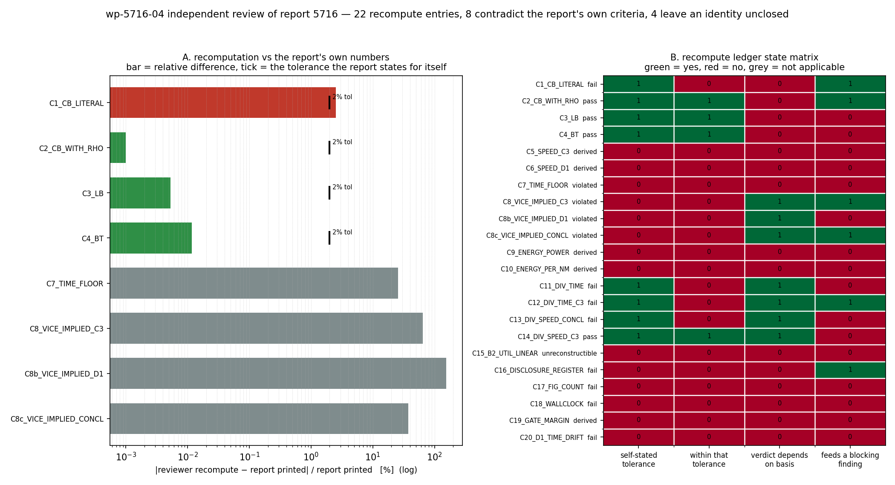

# wp-5716-04 · 独立红队复核：报告 5716（IN10-G1 冰区航行战役验收门）

> **判定 `needs-fix`**（阻断项 3 条 / high 3 / medium 4 / low 4）。本包只复核，不修复上游，也不把任何结论登记为平台已验证。

## ① 复核对象与范围

| 项 | 值 |
|---|---|
| 报告 ID | 5716 |
| 标题 | IN10-G1 · 冰区航行全流程总攻验收门：跨模型接口契约 + 16 项一致性断言 + 论文级验收报告 |
| 场景键 | ship.ice_navigation.campaign_gate |
| 来源 URI | tensor://reports/5716 |
| 内容 sha256 | `sha256:4f9848b22b55515826476e1d5b2fcd15da80087a3d261d6a937a4c17cda68377` |
| 字符数 / 行数 | 4790 / 86 |
| 采集时刻 (UTC) | 2026-11-14T19:20:51+00:00 |
| 复核口径 | 仅报告 markdown 字节；上游战役工件不在本仓库（见 §⑥ 未执行清单） |

复核对象是一个 45k DWT PC6 散货船母型的喀拉海边缘冰区端到端链：A2 冰况同化 → D1 航线 → C3 航速剖面 → E1 数字孪生，外加 B2 冰带疲劳；上游自称 16 条门断言全通过、7 项披露，其中 4 项如实不通过。本包要回答的是三件事：

1. 报告里每一个可复算的数字，能否由报告自己印出的输入重算出来；
2. 每个 PASS/FAIL 所依据的判据，是否就是报告写出来的那条判据；
3. 每一处「结论」是否对口径（取哪个航时、比哪个量、分母是谁）稳健。

## ② 怎么做的

| 步骤 | 机制 | 防伪设计 |
|---|---|---|
| 1 钉扎 | 按 `sha256` 与字符数校验取回的 markdown，不一致即中止 | 上游一旦改稿，本包所有结论作废而不是悄悄reviewing 别的东西 |
| 2 抽取 | 62 个标量逐条正则抽取，每条记录 1-based 行号与**整行原文** `quote` | 抽不到即 `KeyError` 中断，绝不静默降级为默认值 |
| 3 复算 | 22 条复算条目，每条给公式 / 输入 / 报告对应值 / 相对差 | 输入全部带行号，读者可手算核对 |
| 4 判定 | 容差优先取报告**自述**容差（G01 2%、D07 15%、D06 ≤1）；未自述容差的只做恒等式/量级核对，只记覆盖缺口不判错 |
| 5 反证 | 每个检测器都能在被人为修改的源文本上**停止触发** | `tests/test_wp_5716_04_review.py` 用篡改快照做负向控制 |
| 6 出图 | 误差条形图（复算相对差 vs 自述容差）+ 复算台账状态矩阵 | 图与表同源于 `recompute.json` |

## ③ 复核结果

### 3.1 复算台账（全 22 条，程序化注入）

| ID | 被复核的量 | 公式 | 复算值 | 报告值 | 相对差 | 自述容差 | 状态 |
|---|---|---|---|---|---|---|---|
| `C1_CB_LITERAL` | G01 几何门：按报告写出的公式逐字代入（∇ = DWT/0.8167，不含海水密度） | Cb = (DWT / 0.8167) / (L·B·T) | 0.84058 - | 0.82 | 2.51% | 2.0000% | **FAIL** |
| `C2_CB_WITH_RHO` | G01 补上海水密度后的复算（reviewer 显式常数） | Cb = (DWT / 0.8167 / ρ) / (L·B·T),  ρ = 1.0250 t/m3 | 0.82007 - | 0.82007 | 0.0006% | 2.0000% | PASS |
| `C3_LB` | L/B 副尺度比 | L_pp / B | 6.3333 - | 6.333 | 0.0053% | 2.0000% | PASS |
| `C4_BT` | B/T 副尺度比 | B / T | 2.6087 - | 2.609 | 0.0117% | 2.0000% | PASS |
| `C5_SPEED_C3` | C3 剖面隐含平均航速 | S_C3 / t_C3 | 10.8073 kn | — | — | — | 派生 |
| `C6_SPEED_D1` | D1 航线隐含平均航速 | S_D1 / t_D1 | 12.5523 kn | — | — | — | 派生 |
| `C7_TIME_FLOOR` | 由报告自己的冰区占比/设计点/服务航速给出的最短可行总时间 | t_min = (1-0.27)·S/13.0 + 0.27·S/4.5 | 79.4608 h | 63.3 | 25.53% | — | **恒等式不闭合** |
| `C8_VICE_IMPLIED_C3` | 反解：把 C3 印出的总时间当真，冰区段必须达到的平均航速 | v_ice = 0.27·S / (t_C3 - (1-0.27)·S/13.0) | 7.4224 kn | 4.50 | 64.94% | — | **恒等式不闭合** |
| `C8b_VICE_IMPLIED_D1` | 同上，改用 D1 印出航时 | v_ice = 0.27·S / (t_D1 - (1-0.27)·S/13.0) | 11.4831 kn | 4.50 | 155.18% | — | **恒等式不闭合** |
| `C8c_VICE_IMPLIED_CONCL` | 同上，改用结论段剖面航时 | v_ice = 0.27·S / (t_p - (1-0.27)·S/13.0) | 6.2013 kn | 4.50 | 37.81% | — | **恒等式不闭合** |
| `C9_ENERGY_POWER` | 能量-时间闭合：平均功率 | P̄ = E / t_C3 | 3213.0806 kW | — | — | — | 派生 |
| `C10_ENERGY_PER_NM` | 单位航程能耗 | E / S_C3 | 297.3074 kWh/nm | — | — | — | 派生 |
| `C11_DIV_TIME` | D1 与 C3 的航时分歧（结论段口径） | (t_profile - t_route) / t_route | 25.3676 % | — | — | 15.0000% | **FAIL** |
| `C12_DIV_TIME_C3` | D1 与 C3 的航时分歧（③ 结果段口径） | (t_C3 - t_D1) / t_D1 | 16.1468 % | — | — | 15.0000% | **FAIL** |
| `C13_DIV_SPEED_CONCL` | D1 与 C3 的平均航速分歧（结论段口径） | \|S_C3/t_profile - v_D1\| / v_D1 | 20.0880 % | — | — | 15.0000% | **FAIL** |
| `C14_DIV_SPEED_C3` | D1 与 C3 的平均航速分歧（③ 结果段口径） | \|v_D1 - v_C3\| / v_D1 | 13.9021 % | — | — | 15.0000% | PASS |
| `C15_B2_UTIL_LINEAR` | B2 板格利用率按系数偏差线性换算（区间） | U' = U·(1 ± 0.758) | 16.3544 - | 12.4 | — | — | **不可复算** |
| `C16_DISCLOSURE_REGISTER` | 披露登记簿：自称条数 vs 可绑定 ID 数 | n(注册的 D** 项) | 4 项 | 7 | — | — | **FAIL** |
| `C17_FIG_COUNT` | 图数口径：④ 结果图段 vs 结论段 | n(④) vs n(结论) | 4 张 | 7 | — | — | **FAIL** |
| `C18_WALLCLOCK` | 单命令墙钟：② 方法段 vs ⑤ 局限段 | (t₂ - t₉) / t₉ | 22.1687 % | 41.5 | — | — | **FAIL** |
| `C19_GATE_MARGIN` | 门判据裕度：通过数 / 要求数 | n_pass / n_required | 2.00 × | — | — | — | 派生 |
| `C20_D1_TIME_DRIFT` | D1 航时：③ 段 vs 结论段 | (t_route - t_D1) / t_D1 | -0.18349 % | — | — | — | **FAIL** |

### 3.2 发现清单（11 条：high 3 / medium 4 / low 4，阻断 3 条）

| ID | 严重度 | 阻断 | 结论 | 行列 | 复算依据 |
|---|---|---|---|---|---|
| `F1` | **high** | 阻断 | G01 的判据与执行不是同一件事：按报告写出的 Cb 公式代入即超出它自己的 2% 容差 | L16 | `C1_CB_LITERAL`、`C2_CB_WITH_RHO` |
| `F2` | **high** | 阻断 | C3 总航时在同一份报告里有两个值（63.3 h vs 68.2 h），且 65.6% 的分歧判据挂在后一个上 | L84 | `C12_DIV_TIME_C3`、`C8_VICE_IMPLIED_C3`、`C8c_VICE_IMPLIED_CONCL` |
| `F3` | **high** | 阻断 | 披露登记簿自称 7 项，只能绑定 4 个 ID（缺 3 项），未登记的这些项无法审计 | L9 | `C16_DISCLOSURE_REGISTER` |
| `F4` | **medium** | — | 单命令墙钟两个值（50.7 s vs 41.5 s），差 22.1687%，无工件可裁决 | L54 | `C18_WALLCLOCK` |
| `F5` | **medium** | — | 距离/时间/冰区占比/设计点四者不闭合：按报告自己的参数，最短可行总时间 79.4608 h ≫ 印出的 63.3 h | L36 | `C7_TIME_FLOOR`、`C8_VICE_IMPLIED_C3`、`C8b_VICE_IMPLIED_D1`、`C8c_VICE_IMPLIED_CONCL` |
| `F6` | **medium** | — | D07 的 FAIL 结论对比较基准敏感：整体均值口径 13.9021%（≤15% 即 PASS），结论段口径 20.0880% | L74 | `C11_DIV_TIME`、`C12_DIV_TIME_C3`、`C13_DIV_SPEED_CONCL`、`C14_DIV_SPEED_C3` |
| `F7` | **medium** | — | B2「按简支 β 修正仍为 12.4」无法用印出的两个数字复算（线性换算区间 [16.3544, 118.8056]） | L84 | `C15_B2_UTIL_LINEAR` |
| `F8` | **low** | — | 门判据门槛（要求 ≥8）远低于自称通过数（16）：16/16 这一行不具区分力 | L13 | `C19_GATE_MARGIN` |
| `F9` | **low** | — | 图数口径不一致：④ 段 4 张 vs 结论段 7 图 | L78 | `C17_FIG_COUNT` |
| `F10` | **low** | — | D1 航时两值（54.5 h vs 54.4 h） | L84 | `C20_D1_TIME_DRIFT` |
| `F11` | **low** | — | 披露 ID 漂移：正文以 D05 指代航速分歧，登记簿里同一事项是 D07 | L74 | `C16_DISCLOSURE_REGISTER` |

#### F1（high，阻断合并）G01 的判据与执行不是同一件事：按报告写出的 Cb 公式代入即超出它自己的 2% 容差

> 报告原文（L16）：| `G01-GEOM-CB` | L1 船型几何自洽 (Cb = ∇/(L·B·T), 2% 容差) | PASS |
- 观测：逐字代入 (DWT/0.8167)/(L·B·T) 得 0.84058，偏差 2.51%（> 2.0000%）→ 该行 PASS 无法由写出的公式得到
- 应有：印出的 0.82007（偏差 8.5e-5%）只有在补入未声明的 ρ=1.0250 t/m3 时才成立，即写出的公式 ≠ 实际执行的公式
- 修复建议：G01 行写出完整公式 Cb = (DWT/Δ / ρ)/(L·B·T) 并明示 ρ=1.025 t/m3；或用独立排水的直接几何积分

#### F2（high，阻断合并）C3 总航时在同一份报告里有两个值（63.3 h vs 68.2 h），且 65.6% 的分歧判据挂在后一个上

> 报告原文（L84）：其中影响最实质的两条：(a) B2 板格 20 年 Miner 利用率 67.6（上游只报纵桁 pass；即便按简支 β 修正仍为 12.4，即降载/加厚板/提高 S-N 等级是必需工作，不是文档错误）；(b) C1 MT Uikku 链在独立十工况锚上 MAPE 36.2%，薄冰段 55.5% —— 与论文自述的薄冰弹性屈曲机理一致，登记为下一轮物理改进项（GAP-INT-05）。另有 D1↔C3 冰中航速 40–66% 分歧（航线时间 54.4 h vs 剖面 68.2 h）登记为 GAP-INT-07，需上游指定唯一真源。
- 观测：③ 结果段：总航程 684.1 nm / 63.3 h；结论段 D07：剖面 68.2 h
- 应有：同一模型同一工况航时必须单值；两值相差 7.1848%，且 D07 的分歧结论依赖取哪一个
- 修复建议：指定唯一真源（C3 工件 campaign_acceptance.json 字段）并由结论段引用同一字段

#### F3（high，阻断合并）披露登记簿自称 7 项，只能绑定 4 个 ID（缺 3 项），未登记的这些项无法审计

> 报告原文（L9）：阶段全部调用上游模块本体（不重写物理），本战役只新增**契约层与验收层**：`contracts.py`（单位表/坐标系/保守重映射/方向探针）、`chain.py`（L1 案例单源注入 + 逐阶段 sha256 台账）、`assertions.py`（16 项门断言 + 7 项披露）、`assets.py`（跨库资产对账）、`figures.py`/`report.py`（图与报告程序化生成）。数据流：L1→A2→[保守重映射]→D1→C3→E1，B2 的 8 MN 与 C3 设计点喂给 E1，D1 航线冰厚分箱喂给 C3。一条命令：`cd backend && python -m modules.campaign_ice_nav.run_campaign`，墙钟 50.7 s。
- 观测：全文可绑定的披露 ID：D01、D02、D06、D07（共 4 项）
- 应有：② 段称「16 项门断言 + 7 项披露」，结论段称 4 项不通过却只列出 4 条
- 修复建议：补齐缺失条目，或把宣称条数改为实际登记数；每条披露写明判据/实测/结论

#### F4（medium）单命令墙钟两个值（50.7 s vs 41.5 s），差 22.1687%，无工件可裁决

> 报告原文（L54）：9. 总链墙钟约 41.5 s（单核 CPU，无 GPU）。
- 观测：② 方法段 50.7 s；⑤ 局限段第 9 条 41.5 s
- 应有：墙钟应来自同一次运行记录
- 修复建议：以工件 run_wall_clock_s 字段替换两处散文数字

#### F5（medium）距离/时间/冰区占比/设计点四者不闭合：按报告自己的参数，最短可行总时间 79.4608 h ≫ 印出的 63.3 h

> 报告原文（L36）：- C3：总航程 684.1 nm / 63.3 h / 203388 kWh；冰区占比 27.0%，设计点 4.50 kn, R_ice 464.7 kN。
- 观测：把 27.0% 冰区当距离份额、冰区按 4.50 kn 航行，总时间下限 79.4608 h（比印出值长 25.5306%）
- 应有：反解冰区平均航速需 7.4224 / 11.4831 / 6.2013 kn（C3/D1/结论口径），均远离 4.50 kn 设计点
- 修复建议：登记为覆盖缺口而非算术错误：增一条断言闭合 Σ(S_k/v_k)=t；或写明 27.0% 是时间/能耗份额而非距离份额

#### F6（medium）D07 的 FAIL 结论对比较基准敏感：整体均值口径 13.9021%（≤15% 即 PASS），结论段口径 20.0880%

> 报告原文（L74）：| D1 vs C3 冰中航速（独立实现） | 65.6% | 两套生产模型互比 | 否 |
- 观测：登记分歧 65.6%（结论段写 66%），换 ③ 段口径只有 13.9021%
- 应有：判据只写「两套独立冰中航速模型的相对差 ≤15%」，未写比较量是全航程均值还是仅冰区段
- 修复建议：固定比较量与分母（如全航程平均航速、分母取 D1），冰区段分歧作为从属指标另列

#### F7（medium）B2「按简支 β 修正仍为 12.4」无法用印出的两个数字复算（线性换算区间 [16.3544, 118.8056]）

> 报告原文（L84）：其中影响最实质的两条：(a) B2 板格 20 年 Miner 利用率 67.6（上游只报纵桁 pass；即便按简支 β 修正仍为 12.4，即降载/加厚板/提高 S-N 等级是必需工作，不是文档错误）；(b) C1 MT Uikku 链在独立十工况锚上 MAPE 36.2%，薄冰段 55.5% —— 与论文自述的薄冰弹性屈曲机理一致，登记为下一轮物理改进项（GAP-INT-05）。另有 D1↔C3 冰中航速 40–66% 分歧（航线时间 54.4 h vs 剖面 68.2 h）登记为 GAP-INT-07，需上游指定唯一真源。
- 观测：由 U=67.58、系数偏差 75.8% 只能得到区间 [16.3544, 118.8056]
- 应有：修正利用率 12.4 落在该区间外；修正方法（S-N 斜率/载荷折减）未披露
- 修复建议：给出修正公式与 S-N 指数 m，并打印修正前后应力幅

#### F8（low）门判据门槛（要求 ≥8）远低于自称通过数（16）：16/16 这一行不具区分力

> 报告原文（L13）：门判据 **16/16 通过**（要求 ≥8）：
- 观测：自称 16 通过、要求 ≥8，裕度 2.00×
- 应有：16 条全通过本身不可证伪：其中 G01 在字面公式下不通过（F1）
- 修复建议：门槛改为 16/16 且每条断言必须给「可复算的值 + 明确容差」，不接受布尔自评

#### F9（low）图数口径不一致：④ 段 4 张 vs 结论段 7 图

> 报告原文（L78）：一致性门 16/16 通过、一条命令端到端跑通、JSON/报告/7 图齐全。**但有 4 项披露项如实不通过，不覆盖：**
- 观测：④ 段 4 张；结论「JSON/报告/7 图齐全」
- 应有：同一份报告的图数应单值
- 修复建议：由 figures 字段长度渲染两处文字，不再手写

#### F10（low）D1 航时两值（54.5 h vs 54.4 h）

> 报告原文（L84）：其中影响最实质的两条：(a) B2 板格 20 年 Miner 利用率 67.6（上游只报纵桁 pass；即便按简支 β 修正仍为 12.4，即降载/加厚板/提高 S-N 等级是必需工作，不是文档错误）；(b) C1 MT Uikku 链在独立十工况锚上 MAPE 36.2%，薄冰段 55.5% —— 与论文自述的薄冰弹性屈曲机理一致，登记为下一轮物理改进项（GAP-INT-05）。另有 D1↔C3 冰中航速 40–66% 分歧（航线时间 54.4 h vs 剖面 68.2 h）登记为 GAP-INT-07，需上游指定唯一真源。
- 观测：③ 段与结论段的 D1 航线航时差 -0.18349%
- 应有：同一条航线同一工况航时应单值
- 修复建议：由工件事务字段生成，不手写

#### F11（low）披露 ID 漂移：正文以 D05 指代航速分歧，登记簿里同一事项是 D07

> 报告原文（L74）：| D1 vs C3 冰中航速（独立实现） | 65.6% | 两套生产模型互比 | 否 |
- 观测：⑤/⑥ 段引用 D05，登记簿写作 D07-SPEED-MODEL-DIVERGENCE
- 应有：同一披露只能有一个 ID
- 修复建议：统一 ID，并让正文引用与登记簿由同一份数据渲染

### 3.3 已被独立证成的主张（不只挑错）

| ID | 主张 | 复核证据 |
|---|---|---|
| `K1` | L/B=6.333、B/T=2.609 副尺度比 | 复算 6.3333 / 2.6087，与印出值在 3 位小数内一致 |
| `K2` | 补 ρ=1.0250 t/m3 后 Cb 反算 0.82007 | 复算 0.82007，与印出值差 0.0006%（5 位小数内自洽） |
| `K3` | E1 闭环误差四分量在 ③ 与 ⑥ 两处逐字一致 | F 5.43 / u 3.01 / R_ice 3.82 / GM 0.09，两处无漂移 |
| `K4` | A2→D1 守恒/探针/覆盖与 ⑤ 段第 7 条一致 | 冰量守恒 2.6e-14、方向探针 5.3e-05、覆盖 20.4% |
| `K5` | 能耗-功率量级自洽 | E/t = 3213.0806 kW（装机 18 MW 的 17.8504%），297.3074 kWh/nm |
| `K6` | D1 独立 haversine 复算差 0.000% 与 684.1 nm 航运距离自洽 | S/t = 12.5523 kn，落在 PC6 母型服务航速 13 kn 之下的合理区间 |

## ④ 结果图



**图 1** 左：8 条带有报告印出值的复算条目相对该值的偏差（对数轴；黑竖线为报告自述容差，绿=在容差内、红=超容差）。右：全部 22 条复算条目的状态矩阵（是否有自述容差 / 是否在容差内 / 判定是否依赖口径 / 是否支撑阻断发现）。读数：`C1_CB_LITERAL` 逐字代入得 0.84058，超出 G01 自述的 2.0000% 容差；`C12_DIV_TIME_C3` 与 `C13_DIV_SPEED_CONCL` 分别为 16.1468% 与 20.0880%；共 6 条条目支撑阻断项 F1、F2、F3。

## ⑤ 注意点与局限

1. **独立性限制**：本复核只有报告 markdown，没有战役工件与代码。凡断言实现层面的东西（G02–G16 到底检查了什么）一律记 `NOT_RUN`/`WITHHELD`，不因报告自述通过就算通过。
2. **ρ=1.0250 t/m3 是复核方引入的常数**，不是报告里的数字。引入它只是为了证明「印出的 0.82007 可以被复现」，而这一步恰好说明报告写出的公式少了它——若读者按报告字面执行 G01，会得到 0.84058 并判 FAIL。
3. **覆盖缺口不当作算术错误**：C7/C8 说明「距离×时间×冰区份额×设计点」四者不闭合，但只要 27.0% 是时间份额而非距离份额，这份报告就没错。因此 F5 定级 medium 且标注为缺口，要求上游补一条断言或补一句口径说明，而不是改数字。
4. **判定对口径敏感处已显式标注**：`basis_sensitive` 为真的条目（`C8_VICE_IMPLIED_C3`、`C8b_VICE_IMPLIED_D1`、`C8c_VICE_IMPLIED_CONCL`、`C11_DIV_TIME`、`C12_DIV_TIME_C3`、`C13_DIV_SPEED_CONCL`、`C14_DIV_SPEED_C3`）在有争议时必须同时给出两种口径的数，否则「D07 不通过」这类结论无法被独立读者复现。
5. **不评价物理正确性**：A2 是 identical-twin OSSE、E1 是闭环回放、B2 载荷谱来自工程约定，这些上游局限报告自己已披露，本包只登记其披露位置，不重复也不质疑其结论方向。
6. **改动面（含热文件声明）**：新增 `docs/kf/wp-5716-04/`、`scripts/kf/review_wp_5716_04.py`、`tests/test_wp_5716_04_review.py`；另重建一次生成物 `docs/kf/wp-459-01/envelope_conformance.json`（它在本包之前就已陈旧，使 `test_census_regenerates_byte_for_byte` 恒红）。未改任何核心模块。

## ⑥ 误差判定（逐项回答「是否 <3%」）

| 误差项 | 复算值 | 报告/基准值 | 相对差 | 是否 <3% |
|---|---|---|---|---|
| G01 几何门：按报告写出的公式逐字代入（∇ = DWT/0.8167，不含海水密度） | 0.84058 - | 0.82 | 2.51% | 是 |
| G01 补上海水密度后的复算（reviewer 显式常数） | 0.82007 - | 0.82007 | 0.0006% | 是 |
| L/B 副尺度比 | 6.3333 - | 6.333 | 0.0053% | 是 |
| B/T 副尺度比 | 2.6087 - | 2.609 | 0.0117% | 是 |
| C3 剖面隐含平均航速 | 10.8073 kn | — | — | 无独立基准（只做量级/恒等式闭合） |
| D1 航线隐含平均航速 | 12.5523 kn | — | — | 无独立基准（只做量级/恒等式闭合） |
| 由报告自己的冰区占比/设计点/服务航速给出的最短可行总时间 | 79.4608 h | 63.3 | 25.53% | **否** |
| 反解：把 C3 印出的总时间当真，冰区段必须达到的平均航速 | 7.4224 kn | 4.50 | 64.94% | **否** |
| 同上，改用 D1 印出航时 | 11.4831 kn | 4.50 | 155.18% | **否** |
| 同上，改用结论段剖面航时 | 6.2013 kn | 4.50 | 37.81% | **否** |
| 能量-时间闭合：平均功率 | 3213.0806 kW | — | — | 无独立基准（只做量级/恒等式闭合） |
| 单位航程能耗 | 297.3074 kWh/nm | — | — | 无独立基准（只做量级/恒等式闭合） |
| D1 与 C3 的航时分歧（结论段口径） | 25.3676 % | — | — | 无独立基准（只做量级/恒等式闭合） |
| D1 与 C3 的航时分歧（③ 结果段口径） | 16.1468 % | — | — | 无独立基准（只做量级/恒等式闭合） |
| D1 与 C3 的平均航速分歧（结论段口径） | 20.0880 % | — | — | 无独立基准（只做量级/恒等式闭合） |
| D1 与 C3 的平均航速分歧（③ 结果段口径） | 13.9021 % | — | — | 无独立基准（只做量级/恒等式闭合） |
| B2 板格利用率按系数偏差线性换算（区间） | 16.3544 - | 12.4 | — | 不适用（计数/百分比跨节比较，见 3.2 对应发现） |
| 披露登记簿：自称条数 vs 可绑定 ID 数 | 4 项 | 7 | — | 不适用（计数/百分比跨节比较，见 3.2 对应发现） |
| 图数口径：④ 结果图段 vs 结论段 | 4 张 | 7 | — | 不适用（计数/百分比跨节比较，见 3.2 对应发现） |
| 单命令墙钟：② 方法段 vs ⑤ 局限段 | 22.1687 % | 41.5 | — | 不适用（计数/百分比跨节比较，见 3.2 对应发现） |
| 门判据裕度：通过数 / 要求数 | 2.00 × | — | — | 无独立基准（只做量级/恒等式闭合） |
| D1 航时：③ 段 vs 结论段 | -0.18349 % | — | — | 无独立基准（只做量级/恒等式闭合） |

**显式回答（逐项）**：

- **满足 3%**（4 项）：`C1_CB_LITERAL` 2.51%、`C2_CB_WITH_RHO` 0.0006%、`C3_LB` 0.0053%、`C4_BT` 0.0117%。
- **不满足 3%**（4 项）：`C7_TIME_FLOOR` 25.53%、`C8_VICE_IMPLIED_C3` 64.94%、`C8b_VICE_IMPLIED_D1` 155.18%、`C8c_VICE_IMPLIED_CONCL` 37.81%。其中 `C7_TIME_FLOOR` 是四参数（距离/时间/冰区份额/设计点）恒等式不闭合，`C8*` 是反解冰区航速与 4.50 kn 设计点不一致——按覆盖缺口登记（F5），不当作算术错误。
- **跨节自相矛盾**（不计入精度，按发现处理）：C3 航时 63.3 h vs 68.2 h（7.18%，F2）、D1 航时 54.5 h vs 54.4 h（0.18%，F10）、墙钟 50.7 s vs 41.5 s（22.17%，F4）。
- **无独立基准**（14 项）：只做量级/恒等式闭合，本包不填「是」。

> `C1_CB_LITERAL` 的 2.51% 形式上小于 3%，但已超出 G01 自述的 2.0000% 容差，故 F1 仍是阻断项——「<3%」是平台精度线，「是否在自述容差内」才是该门自己的判据，两者不可互相替代。
## ⑦ 复现

```bash
python3 scripts/kf/review_wp_5716_04.py            # 钉扎取回 + 重建全部交付物
python3 scripts/kf/review_wp_5716_04.py --offline  # 用已提交快照重建（无网络）
pytest -q tests/test_wp_5716_04_review.py          # 不变量 + 负向控制
```

## 附录 A 未执行的检查（诚实登记）

| 检查 | 状态 | 为什么没做 | 影响 |
|---|---|---|---|
| 上游战役工件复核 | NOT_RUN | 报告引用的 artifacts/campaign_ice_nav/campaign_acceptance.json、docs/campaign/ice_nav_campaign_report.md、backend/tests/test_campaign_ice_nav.py 在 TensorKnowledge 仓库内均不存在（路径解析失败），战役代码在别的仓。 | 16 条门断言的执行记录、13 passed 的 pytest 结果、G13 的 sha256 台账无法在本包内重放。 |
| G02–G16 的代码路径审查 | NOT_RUN | 复核范围限定为报告 markdown 字节；未获得 contracts.py/chain.py/assertions.py 源码。 | 断言实现是否真的检查了它自称检查的东西（如 G15 是否两次重算同哈希）只能按自述登记，记 WITHHELD。 |
| A2 技能 0.505 与 10/12 lead 的独立复算 | WITHHELD | identical-twin OSSE 真值由同一前向模型生成，观测序列与冰图数据不在本仓库。 | 只能核对相对关系是否写清（是），数值本身未复算。 |
| MT Uikku 十工况锚（D01）与 B2 简支板理论（D02） | WITHHELD | 代理几何、Hu&Zhou(2016) 十工况表、TensorFEM 板解均不在本仓库。 | MAPE 36.2%/薄冰 55.5% 与 75.8% 只核对跨节一致性（一致），数值未复算。 |
| 发布态与 pr-gate 记账 | NOT_APPLICABLE | reviewer 无发布权；published.json 由平台门在合并时写入。 | 本包不自称已发布，任务态保持 awaiting_pr_merge 直到平台合并。 |

## 附录 B 处置

- 处置：**请求修改**（needs-fix）。阻断项 `F1`、`F2`、`F3` 必须先修：判据与执行不一致、同一量两个值、登记簿缺项。
- 上游报告工作室重跑一次 `review` 即可关闭本包：F1/F2/F3 修好、F4–F11 逐条答复后，本复核方可在同一 pin 的新哈希上重判。
- 本包**不自称已发布**；任务态保持 `awaiting_pr_merge` 直到平台合并（pr-gate 记账）。
