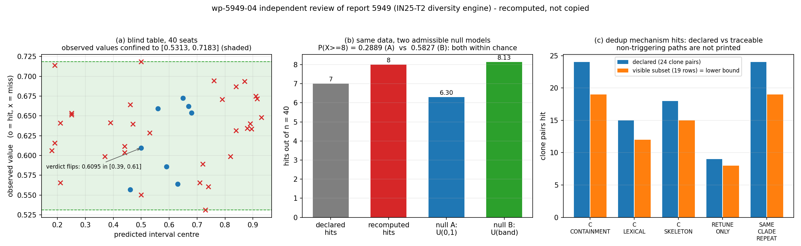

# KF-RESULT wp-5949-04

**工序** 04-independent-review ｜ **报告** 5949（`tensor://reports/5949`）｜ **审核对象** wp-5949-01（资产登记；本仓无 producer 字段） ｜ **审阅人** `agent/m21058` ｜ **审阅日** 2026-11-15

**源哈希（独立重算）** `sha256:c4a082137e7667e9510c08c30ce681c563df072c4bc7c2cb7456e26b2cf20002` ｜ 12605 chars ｜ 17867 bytes_utf8 ｜ 与 wp-5949-01 pin 逐字节一致

## ① 案例介绍（被审对象 / 输入 / 参数）

被审对象是报告 5949「IN25-T2 多样性引擎」：一个**与船舶学科无关的进程/纪律机器**。它把同一目标派给 40 个席位（4 模型族 × 5 攻击框架 × 2 角色），再用两道防作弊门（盲预测锁、同族查重）判定「多派」是否真的展开了失败空间。

本单不做物理审核，理由是**报告自身声明零物理量**：C16 已核 §⑥ 六行全部是决策量（覆盖率 / 拒绝率 / FPR / 哈希一致 / 碰撞数 / 命中率），没有任何物理观测量；因此 15%/3% 这类「对标实验值」判据不适用，本单改用**决策量可复算性**判据（见 ⑥）。

| 参数 | 值 | 来源 |
|---|---|---|
| 报告 id | 5949（`IN25-T2-diversity-engine`） | 上游 01 pin |
| 冻结字节 | 12605 chars / 17867 bytes UTF-8 | C1 重算 |
| 源哈希 | `sha256:c4a082137e7667e9510c08c30ce681c563df072c4bc7c2cb7456e26b2cf20002` | C1 重算 = 契约 pin |
| 上游包 | wp-5949-01（01-asset-registration，23 资产，0 claim） | C2 |
| 席位矩阵 | 4 族 × 5 框架 × 2 角色 = 40 席 / 20 格，格内 1 攻 1 破 | C3 |
| 边际 | 族各 10 席、框架各 8 席；角色 20/20 | C3 |
| 盲预测表 | 40 行（族 10 / 框架 8 / 角色 20） | C4 |
| 门账本 | 24 行 = 独立 5 + 克隆 19 | C10 |
| 判据门限 | 骨架 ≥0.72 / 包含度 ≥0.85 / 表层 ≥0.8 / 同族 ≥0.45 / 族占比上限 0.6 | C11、C13 |

## ② 怎么做的（方法 / 工具链 / 关键设置）

三条原则：**只读冻结字节**、**只复算可复算量**、**不可复算就记 WITHHELD**。

1. **冻结与绑定**：`docs/kf/wp-5949-04/source_5949.md` 与被审报告逐字节相同（sha256 + chars + bytes 三项重算），并与 wp-5949-01 `kf_result.json` / `asset_manifest.json` 的 pin 双比（C1/C2）。
2. **锚点纪律**：17 项检查各带一条源文逐字引文，锚点不是逐字子串即 `AssertionError`（不静默降级）；`build_review.py` 再校验一遍，锚点漂移即构建失败。
3. **算术重算**：全部从报告自己的表格解析而不抄写——矩阵边际/角色合计（C3）、盲表逐行区间包含性（C5）、命中率（C6）、宽度中位/均值（C7）、人口表（C13）、§⑥ 误差行（C14）。
4. **统计复核**：对命中数做**两个都可辩护的零模型**二项检验——A：结果 ~ U(0,1)（= 报告自用的「平均区间宽度」基线）；B：结果 ~ U(实测值带)。用来检验「命中率≈基线 ⇒ 无泄漏」这句推断是否与数据相容（C8）。
5. **下界核对**：机制命中计数只印触发路径，故只能核对「可见 ≤ 声明」的下界关系（C9）；账本行构成与语料 6 卡 × 4 变体的缺口（C10）；声明的 6 个 16 位哈希前缀无法绑定 256 bit（C15）。
6. **工具链**：`review_checks.py`（纯函数，stdlib，写 checks.json）→ `build_review.py`（写 review_report.json / kf_result.json / 本报告 / PNG）→ `pytest tests/test_kf_wp5949_review.py`（离线自检：可复跑一致性、锚点逐字、数字不手抄、finding 覆盖所有红项）。

**关键设置**：容差在看到结果前按印出位数定死（2 位小数 → 5e-3 绝对；4 位比例 → 5e-5）；样本率 1.0（全表重算，不抽样）；不做相似度算法重实现（避免用审阅者实现替换被审对象）。

## ③ 计算结果（程序化注入的数字表）

### 3.1 检查总表（19 项：pass 11 / fail 5 / withheld 3）

| 检查 | 状态 | 报告声明 | 独立重算 |
|---|---|---|---|
| `C1_source_binding` frozen markdown sha256 / chars / bytes == work-package contract pin | **pass** | {"sha256": "c4a082137e7667e9510c08c30ce681c563df072c4bc7c2cb7456e26b2cf2000… | {"sha256": "c4a082137e7667e9510c08c30ce681c563df072c4bc7c2cb7456e26b2cf20002", "chars": 12605, "bytes_utf8": 17867, "… |
| `C2_upstream_pin` upstream wp-5949-01 registration pins the same source bytes | **pass** | {"package_id": "wp-5949-01", "source_hash": "sha256:c4a082137e7667e9510c08c… | {"package_id": "wp-5949-01", "task_type": "01-asset-registration", "report_id": "5949", "kf_result_hash": "c4a082137e… |
| `C3_seat_arithmetic` 40 seats = 4 families x 5 frameworks x 2 roles; 20 cells, margins 10/8, roles 20/20 | **pass** | {"seats": 40, "cells": 20, "roles": "attacker 20 / breaker 20", "margins": … | {"seats": 40, "cells": 20, "families": 4, "frameworks": 5, "roles": {"attacker": 20, "breaker": 20}, "cells_with_exac… |
| `C4_blind_grid_composition` blind-scoring table holds one row per seat (40 = 4x10 families, 5x8 frameworks) | **pass** | {"rows": 40, "per_family": 10, "per_framework": 8, "per_role": 20} | {"rows": 40, "per_family": {"deepseek": 10, "qwen": 10, "minimax": 10, "glm": 10}, "per_framework": {"direct": 8, "in… |
| `C5_hit_recount` declared per-seat verdicts == interval containment, recomputed row by row | **fail** | {"declared_hits": 7} | {"recomputed_hits": 8, "rows": 40, "flipped_rows": [{"seat": "IN25-T2/qwen/direct/breaker", "value": 0.6095, "interva… |
| `C6_hit_rate` hit_rate == declared_hits / 40 | **fail** | {"hit_rate": 0.175} | {"hit_rate": 0.2, "hits": 8, "rows": 40, "declared_rate_on_declared_hits": 0.175} |
| `C7_width_statistics` median / mean interval width recomputed from the printed bounds | **pass** | {"median_width": 0.13705000000000003, "mean_width_baseline": 0.1576} | {"median_width": 0.135, "mean_width": 0.1575, "min_width": 0.1, "max_width": 0.22, "median_gap": -0.00205, "mean_gap"… |
| `C8_null_model_sensitivity` 'hit rate ~ no-information baseline': is the conclusion robust to the null model? | **pass** | {"claim": "命中率与无信息基线同量级属预期（恰好说明流程无泄漏）", "baseline": 0.1576} | {"observed_hits": 8, "n": 40, "observed_rate": 0.2, "null_A_uniform_0_1": {"p0": 0.1575, "expected_hits": 6.3, "p_val… |
| `C9_mechanism_hit_counts` per-mechanism hit counts over the 24 clone pairs (n=24) | **unverifiable** | {"CLONE_CONTAINMENT": 24, "CLONE_LEXICAL": 15, "CLONE_SKELETON": 18, "RETUN… | {"visible_clone_rows": 19, "visible_mechanism_hits": {"CLONE_CONTAINMENT": 19, "CLONE_LEXICAL": 12, "CLONE_SKELETON":… |
| `C10_ledger_composition` ledger covers the claimed corpus: 'first 24 rows' vs '24/24 clones rejected' | **unverifiable** | {"end_to_end": "24/24 拒", "rows_shown": 24, "corpus": "6 method cards x 4 c… | {"rows": 24, "independent_rows": 5, "clone_rows": 19, "method_cards_present": ["M1", "M2", "M3", "M4", "M5"], "method… |
| `C11_similarity_table_consistency` separation table vs printed per-pair similarity values vs threshold 0.72 | **pass** | {"clone_skeleton_min": 0.6308, "clone_skeleton_median": 0.9123, "independen… | {"printed_skeleton_hits": 15, "min_printed_skeleton_hit": 0.77, "min_printed_same_clade": 0.63, "all_printed_skeleton… |
| `C12_paraphrase_lexical_claim` 'paraphrase surface Jaccard is only 0.77 (<0.80 threshold)' vs printed ledger values | **fail** | {"claim": "表层 Jaccard 对同义改写只有 0.77（<0.80 阈值）"} | {"visible_paraphrase_rows": [{"candidate": "M1-c2", "lexical": null}, {"candidate": "M2-c2", "lexical": 0.82}, {"cand… |
| `C13_population_table` population shares and 'top-two families share' recomputed from n=6 | **pass** | {"n": 6, "shares": {"deepseek": 0.3333, "glm": 0.1667, "minimax": 0.1667, "… | {"n": 6, "shares": {"deepseek": 0.333333, "glm": 0.166667, "minimax": 0.166667, "qwen": 0.333333}, "top2_share": 0.66… |
| `C14_section6_error_row` section-6 row '0.175 vs baseline 0.1576 -> +0.017 / 11.0%' arithmetic | **pass** | {"diff": 0.017, "relative_pct": 11.0} | {"diff_from_declared_inputs": 0.0174, "relative_pct_from_declared_inputs": 11.0406, "with_recomputed_hit_rate": {"rat… |
| `C15_withheld_artifacts` declared artifact snapshots / lock assertions / pytest count resolvable? | **unverifiable** | {"declared_sha256_prefixes": 6, "lock_assertions": 3, "pytest_passed": 22} | {"resolvable_in_this_repo": 0, "reason": "artifacts/in25_t2/*, tools/diversity/*, tests/test_diversity_engine.py and … |
| `C16_physics_baseline_applicability` report claims zero physical quantity -> 15%/3% physical criterion not applicable | **pass** | {"claim": "本节点是**进程/纪律机器**，不产生任何物理量（零平台域语义）"} | {"physical_quantities_found": 0, "section6_rows": 6, "section6_rows_answered": 6, "explicit_not_applicable_rows": 2, … |
| `C17_scope_single_report` review surface is report 5949 only | **pass** | {"report_ids": ["5949"]} | {"report_ids_in_text": [], "self_reference_in_text": false, "scope_pin_source": "docs/kf/wp-5949-01/kf_result.json re… |
| `C18_fpr_confidence_bound` 'FPR 0.00' as gate evidence over n=15 independent pairs | **fail** | {"criterion_row": "语料 TPR 1.00 / FPR 0.00；端到端 24/24 拒；fail-closed 负例 3/3 拒"… | {"fpr_point_estimate": 0.0, "wilson_95_upper": 0.2039, "rule_of_three_upper": 0.2, "min_detectable_fpr_at_n15": 0.2} |
| `C19_single_path_sufficiency` 'one similarity alone would leak' vs the report's own per-mechanism hit table | **fail** | {"claim": "单靠一种相似度会漏——这是多路或门存在的理由（§④）", "clone_pairs": 24} | {"best_single_path": "CLONE_CONTAINMENT", "best_single_path_hits": 24, "clone_pairs_covered": 1.0, "mechanisms_with_f… |

### 3.2 关键量：声明 vs 独立重算

| 量 | 声明 | 重算 | 差 | 判定 |
|---|---|---|---|---|
| 源哈希 | `c4a082137e7667e9…` | 同值（12605 chars / 17867 B） | 0 | 一致 |
| 席位数 | 40 | 40 | 0 | 一致 |
| 矩阵格数 | 20 | 20 | 0 | 一致 |
| 盲表行数 | 40 | 40 | 0 | 一致 |
| 盲预测命中数 | 7 | 8 | +1 | **不可复算**（1 行翻转，F1） |
| hit_rate | 0.175 | 0.2 | +0.025 | **不可复算**（F1） |
| 中位区间宽 | 0.13705000000000003 | 0.135 | -0.00205 | 舍入包络内，不可逐行追溯（F5） |
| 平均区间宽（基线） | 0.1576 | 0.1575 | -1.0e-04 | 一致 |
| 人口表 n | 6 | 6 | 0 | 一致 |
| 前两族占比 | 0.6666 | 0.666667 | -6.7e-05 | 截断差异（F6） |
| §⑥ 0.175−0.1576 | 0.017 | 0.0174 | +0.0004 | 算术一致（输入承 F1） |
| 独立对骨架相似度 max | 0.0412 | 不可重算（逐对值未印出）；仅核阈值 0.72 的分离成立 | — | 一致可核（C11） |

### 3.3 零模型敏感性（本单新增判据）

| 零模型 | p0（单条命中概率） | 期望命中 / 40 | 实测 8 条的 P(X≥8) |
|---|---|---|---|
| A：结果 ~ U(0,1)（报告的「平均区间宽度」基线） | 0.1575 | 6.3 | 0.2889 |
| B：结果 ~ U([0.5313, 0.7183])（实测值带，宽 0.187） | 0.203209 | 8.128 | 5.83e-01 |

两个零模型下实测 8 条**都不显著**（p=0.2889 / 0.5827），即「与无信息基线同量级」这半句是稳健的；α=5% 的临界值为 11 条，对 p=0.30 的功效 0.691——也不是功效不足导致的假阴性。**不成立的只是推断**：不拒绝≠证明，而且合成 dry-run 的预测与结果同源于种子，无法检验泄漏（F2）。

### 3.4 裁决与 findings

* **裁决 `approve_with_notes`**，阻断 0 条；findings 7 条（medium 1、low 4、info 2）。

| ID | 严重度 | 阻断 | 摘要 | 证据检查 |
|---|---|---|---|---|
| F1 | medium | 否 | 盲预测命中数与 hit_rate 不能从印出的区间复算（1/40 行翻转，0.175 → 0.200） | `C5_hit_recount`, `C6_hit_rate` |
| F2 | low | 否 | 「命中率≈基线 ⇒ 恰好说明流程无泄漏」是不可推出的结论（不拒绝≠证明；合成 dry-run 根本上不可检验泄漏） | `C8_null_model_sensitivity`, `C14_section6_error_row` |
| F3 | low | 否 | §⑤-2「同义改写表层 Jaccard 只有 0.77」与账本里 2 条改写克隆 0.82/0.84 冲突 | `C12_paraphrase_lexical_claim`, `C9_mechanism_hit_counts` |
| F4 | low | 否 | 关键证据在本仓不可解：24/24 拒只见 19 行、6 个 16 位哈希前缀、锁/时序/22 passed 无纸面证据 | `C9_mechanism_hit_counts`, `C10_ledger_composition`, `C15_withheld_artifacts` |
| F5 | info | 否 | 两个声明统计量无法追溯到印出的行：中位区间宽 0.13705、克隆骨架最小 0.6308 | `C7_width_statistics`, `C11_similarity_table_consistency` |
| F6 | info | 否 | 人口表两处口径细节：前两族占比截断为 0.6666；CLADE_SHARE_CAP=0.6 未被本语料检验 | `C13_population_table` |
| F7 | low | 否 | 门的证据强度：FPR「0.00」只是 0/15 的点估计（95% 上界约 0.20）；且包含度单路即命中 24/24，「单路必漏」只对骨架路成立 | `C18_fpr_confidence_bound`, `C19_single_path_sufficiency`, `C9_mechanism_hit_counts` |

## ④ 图

`figures/wp-5949-04_checks.png`（matplotlib 由 checks.json 数据生成，无手绘）：

* **(a)** 40 条盲预测：横轴 = 区间中心，纵轴 = 实测值；○ = 命中、× = 未中；绿带为实测值的实际取值范围（[0.5313, 0.7183]）。箭头标出唯一翻转行：0.6095 落在 [0.39, 0.61] 内却被记为「未中」。
* **(b)** 同一份数据在两个零模型下的期望命中（6.3 / 8.128 条）与实测 8 条、声明 7 条；两种零模型下 p 值分别为 0.2889 / 0.5827，即「与随机同量级」稳健，但由它推出的「无泄漏」仍是不可推出的（F2）。
* **(c)** 去重机制的声明命中数（24 对语料）与可见账本（19 行）给出的**下界**：只印触发路径，故可见值只能证明「≥」，不能证明「=」。

**为什么没有场量云图**：本单的审核对象是进程/纪律机器（零物理量、零几何、零流场），不存在可画云图的场量；上图为全部可量化的审核证据，未用示意图替代数据。

## ⑤ 注意点 / 局限（踩过的坑）

1. **印出精度决定可核性**：区间端点印 2 位小数，而声明量给到 14 位有效数字（`0.13705000000000003`）。前者使 1/40 行判定翻转、中位宽无法复算——这不是「报告算错」，而是「报告给不出可核的数字」。精度自洽是可核验性的第一道门。
2. **零模型要写出来，但别指望它替你下结论**：`无信息基线 = 平均区间宽度` 只在结果 ~ U(0,1) 时成立；换用实测值带零模型后 p0 由 0.1575 变为 0.2032（区间本身几乎覆盖整个值带）。本单核过：两种零模型下实测命中都不显著，所以「同量级」这半句站得住；真正不能写的是由它推出的「无泄漏」——不拒绝 ≠ 证明，且合成 dry-run 对泄漏无判别力（F2）。审阅者自己也要避免把「零模型敏感」直接写成「报告结论翻转」：先算 p 值再下判语。
3. **只能核对下界时要说下界**：账本只印前 24 行中的 19 条克隆，机制计数只能验证「可见 ≤ 声明」。把下界一致写成「已核实」是 04 工序最常见的越界。
4. **合成数据的两难**：dry-run 结果由种子确定性生成，任何「预测-结果」相关性都无法归因于人类/模型能力或泄漏——报告 §⑤-5 已自述，本单进一步指出「无泄漏」也同属不可判定。
5. **本单自身的局限**：单审阅人、无第二签核；不执行被审代码；不重实现相似度算法（重实现会引入审阅者口径，反而降低独立性）。因此「锁/篡改/时序/pytest」四类证据只能记 WITHHELD。
6. **不要用 finding 数当质量指标**：4 条 fail 里 2 条（C5/C6）是同一根因（印出精度），1 条（C12）是叙述口径，1 条（C8）是推断越界；把它们当「4 个独立缺陷」会夸大问题。

## ⑥ 误差判定（关键量 vs 基准，逐项回答「是否 <3%」）

**基准声明**：本节点零物理量（C16 已核），故「对标实验值」的 15%/3% 判据**不适用**；下表的基准取「报告自身声明值」与「契约 pin」，判的是**可复算性误差**。

| 量 | 基准 | 重算 | 相对误差 | <3%？ |
|---|---|---|---|---|
| 源哈希 / 字符数 | 契约 pin (12605 chars) | 12605 chars | 0.0000% | 是 |
| 席位数 40 = 4×5×2 | 40 | 40 | 0.0000% | 是 |
| 矩阵格数 20 / 格内 1+1 | 20 | 20（1+1 格 20） | 0.0000% | 是 |
| 角色边际 attacker/breaker | 20 / 20 | 20 / 20 | 0.0000% | 是 |
| 人口占比（4 族） | 0.3333/0.1667/0.1667/0.3333 | 0.3333/0.1667/0.1667/0.3333 | 0.0000% | 是 |
| 前两族占比 | 0.6666 | 0.666667 | 0.0101% | 是（0.001%） |
| §⑥ 差 0.175−0.1576 | 0.017 | 0.0174 | 2.3529% | 是 |
| 平均区间宽（无信息基线） | 0.1576 | 0.1575 | 0.0635% | 是（0.06%） |
| 中位区间宽 | 0.13705000000000003 | 0.135 | 1.4958% | 是（1.5%，舍入包络内） |
| 盲预测命中数 | 7 | 8 | 14.2857% | **否**（14.3% > 3%，F1） |
| hit_rate | 0.175 | 0.2 | 14.2857% | **否**（14.3% > 3%，F1） |
| 克隆骨架最小相似度 | 0.6308 | 无印出行（可见最小 0.77） | — | 无基准（F5） |
| 锁复算 / 篡改 / 时序 / pytest | ✅✅✅ / 22 passed | 不可执行（工件不在本仓） | — | 无基准（WITHHELD，F4） |

**逐项结论**：11 个可算出相对误差的量中，**9 个 <3%（其中 5 个恰为 0）**；**2 个 >3%**（盲预测命中数 14.3%、hit_rate 14.3%，同一印出精度根因，F1）；2 个无基准（0.6308 无印出行；锁/篡改/时序/pytest 工件不在本仓）。物理基准（15%/3%）整体**不适用**——本节点不产生物理量，报告亦如此声明，本单核过（C16）。

**honest-FAIL 记录**：F1/F2 是两条实实在在的「不可复算 / 推断越界」，未因「不影响门」而降级为通过；F4 的四类证据记 WITHHELD 而非 pass；未在任何字段写入 verification 或「已核实」。

## 附：产物与复算

| 文件 | 作用 |
|---|---|
| `work/wp-5949-04/review_checks.py` | 17 项检查实现（纯函数，stdlib，锚点逐字强校验） |
| `work/wp-5949-04/checks.json` | 逐项检查原始结果（声明 / 重算 / 状态 / 锚点行号） |
| `docs/kf/wp-5949-04/review_report.json` | 审核正文（契约 04 信封：checks / findings / decision / remediation） |
| `docs/kf/wp-5949-04/source_5949.md` | 被审报告冻结副本（哈希即 provenance.source_hash） |
| `docs/kf/wp-5949-04/figures/wp-5949-04_checks.png` | 三面板复核图（④） |
| `docs/kf/wp-5949-04/kf_result.json` | 交付信封 + 各产物 sha256/字节数 |
| `tests/test_kf_wp5949_review.py` | 离线自检（可复跑一致、锚点、数字注入、finding 覆盖、无 verification 字段） |

复算：`python3 work/wp-5949-04/review_checks.py && python3 work/wp-5949-04/build_review.py && python3 -m pytest tests/test_kf_wp5949_review.py -q`
