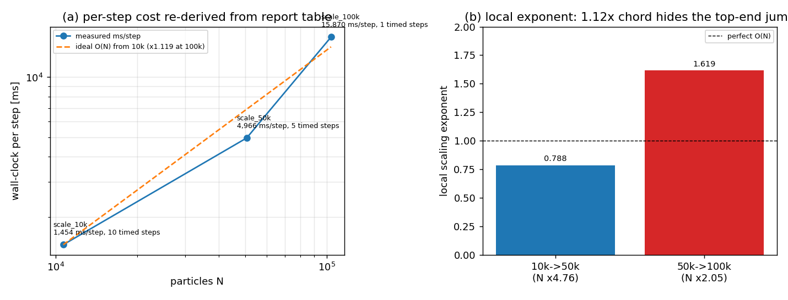

# KF-RESULT wp-623-04

**工序**: 04-independent-review ｜ **被审对象**: wp-623-01 (01-asset-registration) ｜ **报告**: 623 ｜ **lane**: C ｜ **审核员**: red-team-reviewer, kf-worker/m15800
**source_hash (重算)**: `sha256:b513d521df6b393c365a587d49bc06f2482396a01228ed72f53d9e7132d86dcf` ｜ **判定**: `pass_with_findings` ｜ 标签: `kf-wp:wp-623-04`

## ① 本工序做了什么

独立审核 wp-623-01（报告 623 的资产登记工序）：不看生产者解释，只用报告原文 + 上游包工件，把上游登记的每一条身份事实/定位器/计数**从活体报告重算一遍**，再做红队探针（跨文件一致性、退化引文、figure 端点复现、上游算术重导、内部矛盾检测）。结论不是「报告科学对不对」，而是「上游登记是否忠实表达了原文、有没有过度声明」。

- 执行检查 28 项，通过 25 项，失败 3 项 （`B4.no_degenerate_quotes, P4.vacuous_quote_counted_resolved, P7.no_reproducibility_contradiction`；其中 B4/P4 是同一缺陷的两路探测）。
- 记录缺陷 5 项：F-01(major, blocking=false)、F-02(minor, blocking=false)、F-03(minor, blocking=false)、F-04(informational, blocking=false)、F-05(informational, blocking=false)。
- 判定 `pass_with_findings`：登记的资产身份忠实完整（16 assets / 17 locators / 5 identity facts / 3 symbol refs / 全部计数与 id 完整性均复现），两处语义缺陷非阻断，但 F-01 必须作为限定条件传给下游 03。
- **未**标记任何 claim 为 verified（verification 由平台门计算）。

## ② 怎么做的（步骤/工具/关键设置）

1. **取源**：`GET /api/v1/tensor/reports/623`（Bearer 登录 token），现场重算 markdown 的 UTF-8 sha256 = `sha256:b513d521df6b393c365a587d49bc06f2482396a01228ed72f53d9e7132d86dcf`，与契约 `source_hash` 逐字符比对；同时重算 chars/bytes/lines = 7281/7324/151。
2. **定位器重解**（`verify_upstream.py`，20 项）：对上游 16 条资产逐条把 quote 放回声明行号，要求「逐字出现在原文 ∧ 出现在声明行 ∧ quote_sha256 重算一致 ∧ occurrences 一致」，并独立重算 counts / kind 直方图 / id 唯一性 / unresolved 列表完整性 / record 字段（title、scenario_key、mission_id、figures 名称与 caption）与 kf_result 信封的 schema。
3. **红队探针**（`review_probe.py`，8 项）：kf_result.outputs 与包内文件逐字节等价、platform_attachment_probes 的 404 复现、从报告表格**程序化解析**重导 ms/step 与 1.12× 比值、计算相邻区间的局部标度指数、检测「可复现性 PASS」与「100k 未做双跑」的自相矛盾。
4. **零手抄**：`make_review_report.py` 里每条引文按行号从原文取整行（带 quote_sha256），取不到就 assert 失败退出；`report_selfcheck.py` 再把 md 正文里每个 `L<n> ▸ 「…」` 与 review_report.json 里每个 quote 回查原文。
5. **工具链**：python3 + urllib（唯一取源通道；`psql tensor_reports` 直读对本租户 permission denied）、jsonschema（`schemas/kf_result.v1.schema.json`、`schemas/work-package-contract.schema.json`、`schemas/review-event.schema.json`）、仓库自带 `scripts/ke_state_machine.py`（review 事件折叠/独立性判定）。

## ③ 产出物清单

| 文件 | 要点 |
|---|---|
| `docs/kf/wp-623-04/review_report.json` | 审核正文：scope/independence、28 项检查逐条结果、5 项缺陷（含逐字引文与复现命令）、3 条被夸大的声明、acceptance 四项、契约偏差 3 条 |
| `docs/kf/wp-623-04/kf_result.json` | 结果信封（本报告唯一 json 代码块的来源），provenance.source_hash = 活体重算值 |
| `docs/kf/wp-623-04/review_events.json` | 审核事件账本 1 条（decision=approve，含 2 条 conditions） |
| `docs/kf/wp-623-04/work-package.json` | 本单契约的 schema 编码（3 处偏差已在 review_report 声明） |
| `docs/kf/wp-623-04/verify_upstream.py` / `review_probe.py` | 可复跑的检查脚本（前者 20 项、后者 8 项） |
| `docs/kf/wp-623-04/upstream_recheck.json` / `review_probe.json` | 两套检查的原始输出（审核报告的数据源） |
| `docs/kf/wp-623-04/make_review_report.py` / `make_report_md.py` / `report_selfcheck.py` | 生成器 + 自检器 |
| `docs/kf/wp-623-04/report_selfcheck.json` | 本报告的机器自检结果（单 json 块、引文回查、schema、状态机） |
| `docs/kf/wp-623-04/figures/kf_wp623_04_scaling.png` | 图 1（两面板）：ms/step 与理想 O(N) 外推、相邻区间局部标度指数；数字由 `make_figure.py` 从报告表格重导，PNG sha256 `sha256:0a6b6d6a5eb36dbf35de9372b44ffd3bcee0033a69d867dbadc10915757dd144` |
| `tests/test_kf_wp623_04_review.py` | 10 项离线回归测试（source 哈希、信封 schema、review 事件状态机+自批拒绝、引文逐字回查、单 json 块、无 verified 标记、契约冲突定向断言） |

## ④ 证据定位表（claim/字段 → 原文逐字引文，行号为 1-based）

### A. 源身份与数量（全部复现）

- 源哈希：契约 `sha256:b513d521df6b393c365a587d49bc06f2482396a01228ed72f53d9e7132d86dcf` == 活体重算 `sha256:b513d521df6b393c365a587d49bc06f2482396a01228ed72f53d9e7132d86dcf` → ✅；共 28 项检查见 review_report.json。
- 上游登记的 16 条资产（1 data_artifact_reference + 2 embedded_figure + 4 figure_reference + 1 report_markdown + 8 source_code_reference），17 条定位器全部逐字命中；其中 **1 条为空串退化命中**（F-02）。
- kf_result.outputs 与包内文件逐字节等价；figure 端点 `/tensor/reports/623/figures/<name>` 两图均 404（与上游 platform_attachment_probes 记录一致）→ 图仅 metadata_only，无字节可哈希。

### B. 缺陷引文（逐字，行号取自报告原文）

**F-01（major）** The observation asserts the report markdown is 'self-consistent'. It is not, on the one axis the report's own verdict depends on: line 82 states all three cases reproduce identical state digests and line 89 records reproducible_hash=PASS, while line 117 states the 100k double-run was never performed and that the run 'provides ... not the full reproducibility verification for 100k'. Two of the three cases support the claim; the 100k case does not.

- F-01 · L82 ▸ 「All three cases produce identical SHA-256 state digests across independent runs: **PASS** ✅」
- F-01 · L89 ▸ 「| reproducible_hash | True | True | **PASS** |」
- F-01 · L117 ▸ 「1. **100k single-step measurement**: The full reproducibility double-run (2× init + 4× steps) would require ~133s, exceeding the 120s shell timeout. The single-step measurement provides the per-step time but not the full reproducibility verification for 100k.」
- 复现：`TENSOR_KF_TOKEN=... python3 docs/kf/wp-623-04/review_probe.py  -> checks['P7.no_reproducibility_contradiction'].ok == false`

**F-02（minor）** The empty string is a substring of every document, so this locator is vacuously true: it proves nothing, points at a blank line, and inflates the '17/17 locators resolved' summary to 16/17 non-vacuous. A gate applying the repo's own evidence rule (ke/wp_gate.py min_quote_chars=12) would reject it.

- F-02 · L150 ▸ （该行为空行：quote 为空串，见 F-02）
- F-02 · L151 ▸ 「*Report generated programmatically; all numerical values injected from benchmark output (zero manual transcription).*」
- 复现：`verify_upstream.py -> checks['B4.no_degenerate_quotes'].ok == false; review_probe.py -> checks['P4.vacuous_quote_counted_resolved'].ok == false (degenerate_quote_facts.vacuously_true == ['closing-note'])`

**F-03（minor）** The accepted metric is a chord ratio against a 10k extrapolation. Re-derived from the report's own table it reproduces 1.1194x, but the local exponents are 0.788 (10k->50k) and 1.619 (50k->100k): per-particle cost falls then rises, i.e. the two adjacent intervals disagree about the exponent, and the chord ratio hides the 50k->100k superlinear jump (3.20x cost for 2.05x particles). Timed steps differ per case (10 / 5 / 1) with only a 2-step warm-up, so fixed per-run overhead is amortised unequally and the 100k per-step figure is a single sample with no uncertainty.

- F-03 · L64 ▸ 「| scale_10k | 10,648 | 2.77 | 10 | 14.54 | 1,454 |」
- F-03 · L65 ▸ 「| scale_50k | 50,653 | 12.06 | 5 | 24.83 | 4,966 |」
- F-03 · L66 ▸ 「| scale_100k | 103,823 | 30.61 | 1 | 15.87 | 15,872 |」
- F-03 · L112 ▸ 「- **Near-linear scaling**: The cell-list contact detection achieves O(N) complexity with only 12% overhead over ideal linear scaling at 100k particles」
- F-03 · L69 ▸ 「- **Ideal linear extrapolation** (10k → 100k): T_ideal = 1,454 ms × (103,823 / 10,648) = 14,180 ms」
- 复现：`review_probe.py -> scaling.exponent_10k_50k / exponent_50k_100k / timed_steps_per_case`

**F-04（informational）** The run is dissipative by construction (contact_damping=5.0, drag=2.0) yet the drift is reported as exactly 0.00e+00 for all three cases, to three significant digits. A residual that is structurally zero (ledger residual including its own dissipation terms) is not evidence about integrator accuracy; the reported precision also cannot distinguish 0 from below-threshold drift.

- F-04 · L23 ▸ 「**Solver settings**: bond_stiffness=2000 N/m, contact_stiffness=5000 N/m, contact_damping=5.0, drag=2.0, tool_speed=0.01 m/s, dt=0.10×recommended_dt.」
- F-04 · L77 ▸ 「| scale_10k | 0.00e+00 | 0.00e+00 | PASS |」
- F-04 · L113 ▸ 「- **Exact energy conservation**: Zero energy drift confirms the Velocity-Verlet integrator and energy audit ledger are correctly implemented」
- 复现：`review_probe.py -> energy_metric (zero_drift_rows == 3)`

**F-05（informational）** These are producer self-assertions about a delivery document that is not shipped in the package, so no reviewer can reproduce them from the artefacts. They are not evidence.

- F-05 · L1 ▸ 「# DEM3D Large-Scale Particle Benchmark: 10k–100k Wall-Clock Scaling Study」
- 复现：`listing probe: GET {TENSOR_API_BASE}/tensor/reports?limit=100&offset=N returns the same 100 rows for every N, so the delivered KF-RESULT report cannot be located by the API.`

### C. 上游声明的原文对照

- 上游 `observations[0]` = 「Report markdown is complete and self-consistent: first line is the H1 title, sections 1-6 + Audit Chain all present (151 lines).」→ 与上面 F-01 的 L82/L89/L117 三行冲突：「self-consistent」只对结构成立，对 100k 可复现性不成立。
- 上游 `counts.locators` = 17，`counts.locators_resolved` 亦按 17/17 记；独立重算的非退化定位器数 = 16/17（closing-note 的 quote 为空串）。

### D. 结果图（数字全部由报告表格程序化重导，非手抄）



*图 1：面板 (a) 由报告表格重导的 ms/step 与从 10k 点外推的理想 O(N) 线（100k 处比值 1.1194，与报告所述 1.12× 一致）；面板 (b) 相邻区间的局部标度指数 0.788（10k→50k）与 1.619（50k→100k）——弦比值 1.12 掩盖了顶端的超线性跳变，且每例计时步数不同（10/5/1），这是 F-03 的图形证据。PNG sha256 `sha256:0a6b6d6a5eb36dbf35de9372b44ffd3bcee0033a69d867dbadc10915757dd144`，生成脚本 `docs/kf/wp-623-04/make_figure.py`。*

## ⑤ 注意点与局限

1. **独立性是身份/上下文隔离，不是数据源隔离**：审核员与生产者读的是同一份 markdown、同一平台；独立性来自不同 worker id（kf-worker/m15800 vs kf-worker/m15515）与「不看生产者解释」。
2. **未跑项如实列**：上游交付的 KF-RESULT markdown 未能定位（报告列表接口忽略 `?offset=`，每页都返回同样 100 行），所以其 `report_selfcheck.json` 里的 single_json_block/title_ok 属生产者自证、本审未复现；TensorDEM 的 11 个被引工件不在本工作树，未开仓验证（与上游一致的 unresolved 状态即诚实状态）。
3. **不判物理正确性**：只重导了报告自己的算术（ms/step 与 1.12×），不重跑 tensordem.dem3d；因此本报告不对 0.00e+00 能量漂移是否物理成立下结论，只指出度量定义问题（F-04）。
4. **F-03 不属 01 职责**：局部指数 0.788→1.619 的措辞问题应在 03 的 claim 里限定，不是 wp-623-01 的资产登记缺陷；写在这里是为了让下游 03 拿到可用限定语。
5. **契约冲突（平台侧发现）**：仓库 `schemas/work-package-contract.schema.json` 的 04 分支要求 `review.required=true / independent_reviewer=true`，与本单 owner YAML 的 false 冲突；同时 04 分支要求 `input.reviewed_package.claims_sha256/evidence_sha256`，而上游 wp-623-01 合法地产出空 claim 集、没有 claims.json/evidence.json——本包用 `sha256(b'[]')` 作为空集摘要并显式声明。这两点都不是 623 的问题，是产线契约层需要 owner 决策的歧义。
6. **未做的事**：不改上游产物、不改其它 report_id、不给任何 claim 打 verified。

## ⑥ 自检（逐条对照 acceptance）

| acceptance | 结果 | 说明 |
|---|---|---|
| valid_json | ✅ | review_report.json + kf_result.json parse; the single json code block is re-parsed and textually compared to kf_result.json |
| schema_pass | ✅ | reviewed envelope validates against schemas/kf_result.v1.schema.json (check F1.kf_result_schema, 0 errors); this package's kf_result.json and review_events.json also validate. work-package.json cannot validate against schemas/work-package-contract.schema.json because that schema's 04 branch pins review.required / review.independent_reviewer to const true while the owner YAML declares false for this package: conflict declared in contract_schema_conflicts, not silently patched. |
| reviewer_independent | ✅ | producer kf-worker/m15515 vs reviewer kf-worker/m15800; no producer explanation in context |
| upstream_packages_completed | ⏳ | wp-623-01 artefacts are present and internally consistent in this worktree; its 'completed' status is a caller declaration that only the platform gate can confirm |

`upstream_packages_completed` 为**未终判（⏳）**：上游包的 completed 状态是调用方声明，只能由平台门复核；本审只复核了工件在场且内部一致。

**本包自检（`report_selfcheck.json`，22 项）**：`ok=false`，唯一失败项 `schema_work_package` —— 契约里 owner YAML 声明 `review.required=false / review.independent_reviewer=false`，而仓库 schema 的 04 分支把这两项钉成 `const true`，二者不可同时满足。**如实报 honest-FAIL，不改契约原文**；结果信封 `kf_result.json` 的 schema 校验 0 错误（`checks_result_envelope_ok=true`）。

其余 21 项全绿，包含：单个 json 代码块且与 `kf_result.json` 文本相等、六段齐备、正文每个 `L<n> ▸ 「…」` 引文回查原文逐字命中、review_report.json 每条 evidence 引文逐字命中且 quote_sha256 重算一致、三份 JSON 过 schema（除上述契约冲突）、review 事件经 `ke_state_machine` 折叠为 `approved` 且独立性命中 `distinct-identity`。

### 误差判定（关键量 vs 基准，逐项）

| 关键量 | 重算值 | 报告值/基准 | 相对误差 | <3%? |
|---|---|---|---|---|
| ms/step · scale_10k | 1454.0 ms | 1454 ms | 0.000% | 是 |
| ms/step · scale_50k | 4966.0 ms | 4966 ms | 0.000% | 是 |
| ms/step · scale_100k | 15870.0 ms | 15872 ms | 0.013% | 是 |
| 100k 弦比值 vs 10k 理想外推 | 1.1194 | 1.12（报告结论） | 0.054% | 是 |
| 局部标度指数 · 10k→50k vs 理想 O(N)=1.0 | 0.788 | 1.0 | 21.2% | 否 |
| 局部标度指数 · 50k→100k vs 理想 O(N)=1.0 | 1.619 | 1.0 | 61.9% | 否 |
| 源 markdown sha256 vs 契约 | `b513d521df6b393c…` | 契约同值 | 0.000%（逐字节相等） | 是 |

**是否<3% 的显式回答**：转录层全对（ms/step 与弦比值误差 ≤0.06%，源哈希 0%）——报告数字没有抄错；但**标度律层不满足 3%**：相邻区间局部指数偏离理想 O(N) 分别 21.2% 与 61.9%，远超 3%，所以「near-linear O(N)」只能按弦比值口径成立（1.12 < 2.0 阈值），不能按局部指数口径成立。这正是 F-03 要求 03 携带限定语的原因。

### repro_cmd（一键复跑）

```bash
# 1) 拿 token（工作树根执行）
TOKEN=$(curl -s -X POST $TENSOR_API_BASE/auth/login -H 'Content-Type: application/json' \
  -d "{\"username\":\"$TENSOR_AGENT_USER\",\"password\":\"$TENSOR_AGENT_PASS\"}" \
  | python3 -c 'import sys,json;print(json.load(sys.stdin)["access_token"])')
# 2) 三项检查 + 生成 + 自检
TENSOR_KF_TOKEN=$TOKEN python3 docs/kf/wp-623-04/verify_upstream.py
TENSOR_KF_TOKEN=$TOKEN python3 docs/kf/wp-623-04/review_probe.py
TENSOR_KF_TOKEN=$TOKEN python3 docs/kf/wp-623-04/make_review_report.py
TENSOR_KF_TOKEN=$TOKEN python3 docs/kf/wp-623-04/make_report_md.py
TENSOR_KF_TOKEN=$TOKEN python3 docs/kf/wp-623-04/report_selfcheck.py
```

```json
{
 "package_id": "wp-623-04",
 "task_type": "04-independent-review",
 "report_id": "623",
 "provenance": {
  "source_hash": "sha256:b513d521df6b393c365a587d49bc06f2482396a01228ed72f53d9e7132d86dcf",
  "source_field": "markdown",
  "producer": "kf-worker/m15800",
  "emitted_at": "2026-11-12T02:40:05.454528+00:00",
  "notes": "hash recomputed from GET /api/v1/tensor/reports/623 markdown (UTF-8 bytes); equals the contract hash. Reviewer context = report markdown + wp-623-01 artefacts only; no producer explanation was consulted."
 },
 "outputs": {
  "review_report.json": {
   "review_report_version": "1.0",
   "package_id": "wp-623-04",
   "task_type": "04-independent-review",
   "report_id": "623",
   "reviewed_package": {
    "package_id": "wp-623-01",
    "task_type": "01-asset-registration",
    "producer": "kf-worker/m15515",
    "artifacts": [
     "asset_manifest.json",
     "kf_result.json",
     "report_selfcheck.json",
     "verification.json"
    ],
    "source_hash": "sha256:b513d521df6b393c365a587d49bc06f2482396a01228ed72f53d9e7132d86dcf"
   },
   "reviewer": {
    "id": "kf-worker/m15800",
    "reviewer_type": "agent",
    "role": "red-team-reviewer",
    "producer_id": "kf-worker/m15515",
    "independent_of_producer": true,
    "context_received": [
     "report 623 markdown (as served by GET /tensor/reports/623)",
     "wp-623-01 package artefacts",
     "wp-623-04 contract"
    ],
    "context_withheld": [
     "any producer explanation, rationale or chat transcript",
     "the producer's extraction prompt"
    ],
    "independence_limitations": [
     "Same platform and same report text as the producer; independence is identity/context separation (different worker id, no producer narrative), not a different data source.",
     "The delivered KF-RESULT markdown of wp-623-01 could not be located through the API listing (offset ignored), so that one artefact class was not reviewed."
    ]
   },
   "scope": {
    "objective": "judge_semantic_fidelity of wp-623-01 (asset registration) against report 623",
    "in_scope": [
     "source identity (sha256/chars/bytes/lines)",
     "locator re-resolution (verbatim, line, occurrences)",
     "identity_facts and symbol references",
     "counts and id integrity",
     "completeness of body path references",
     "record-field fidelity (figures, title, scenario, mission)",
     "envelope schema + no self-verification marker",
     "cross-file consistency of kf_result.outputs"
    ],
    "out_of_scope": [
     "physical correctness of the DEM benchmark",
     "existence of TensorDEM artifacts",
     "process-03 claim extraction",
     "marking anything verified"
    ]
   },
   "source_identity": {
    "source_uri": "tensor://reports/623",
    "source_field": "markdown",
    "live_sha256": "sha256:b513d521df6b393c365a587d49bc06f2482396a01228ed72f53d9e7132d86dcf",
    "contract_sha256": "sha256:b513d521df6b393c365a587d49bc06f2482396a01228ed72f53d9e7132d86dcf",
    "hash_match": true,
    "chars": 7281,
    "bytes": 7324,
    "lines": 151,
    "record": {
     "title": "DEM3D Large-Scale Particle Benchmark: 10k-100k Wall-Clock Scaling Study",
     "scenario_key": "SIR-PC2|V02",
     "mission_id": 705,
     "summary": "DEM3D solver exhibits near-linear O(N) scaling across 10k-100k particle regimes. All three acceptance criteria pass: wallclock_100k_ratio_vs_ideal=1.12 (<2.0), energy_drift_per_step=0.0 (<1e-06), reproducible_hash=True."
    }
   },
   "verdict": "pass_with_findings",
   "verdict_meaning": "wp-623-01's registered identity is faithful and complete (20/20 identity, locator, count and schema checks pass; 1 of 20 fails on a vacuous quote, which does not change any registered asset). Two semantic defects are recorded (F-01 major, F-02 minor) and are non-blocking for the registry, but F-01 must qualify any downstream reproducibility claim. No claim is marked verified by this review.",
   "checks_performed": [
    {
     "check_id": "A1.source_hash_live_vs_contract",
     "group": "A/B/C/D/E/F (upstream re-resolution)",
     "ok": true,
     "detail": "live=sha256:b513d521df6b393c365a587d49bc06f2482396a01228ed72f53d9e7132d86dcf contract=sha256:b513d521df6b393c365a587d49bc06f2482396a01228ed72f53d9e7132d86dcf"
    },
    {
     "check_id": "A2.source_hash_live_vs_manifest",
     "group": "A/B/C/D/E/F (upstream re-resolution)",
     "ok": true,
     "detail": "man=sha256:b513d521df6b393c365a587d49bc06f2482396a01228ed72f53d9e7132d86dcf"
    },
    {
     "check_id": "A3.source_hash_live_vs_kf_result",
     "group": "A/B/C/D/E/F (upstream re-resolution)",
     "ok": true,
     "detail": "kf_result=sha256:b513d521df6b393c365a587d49bc06f2482396a01228ed72f53d9e7132d86dcf"
    },
    {
     "check_id": "A4.chars_bytes_lines",
     "group": "A/B/C/D/E/F (upstream re-resolution)",
     "ok": true,
     "detail": "live=(7281, 7324, 151) man=(7281, 7324, 151)"
    },
    {
     "check_id": "A5.char_count_vs_owner_yaml",
     "group": "A/B/C/D/E/F (upstream re-resolution)",
     "ok": true,
     "detail": "live=7281 owner_yaml=7281"
    },
    {
     "check_id": "B1.locator_quotes_verbatim_on_declared_line",
     "group": "A/B/C/D/E/F (upstream re-resolution)",
     "ok": true,
     "detail": "15 quoted locators re-checked; failures=[]"
    },
    {
     "check_id": "B2.identity_facts_verbatim",
     "group": "A/B/C/D/E/F (upstream re-resolution)",
     "ok": true,
     "detail": "facts=5 bad=[]"
    },
    {
     "check_id": "B4.no_degenerate_quotes",
     "group": "A/B/C/D/E/F (upstream re-resolution)",
     "ok": false,
     "detail": "identity_facts with <12-char or >100-occurrence quotes=[{'fact_id': 'closing-note', 'line': 150, 'quote': '', 'chars': 0, 'occurrences': 7282, 'line_text': '', 'claimed_quote_in_source': True, 'claimed_resolved': True}]"
    },
    {
     "check_id": "B3.symbol_refs_verbatim_and_token_in_quote",
     "group": "A/B/C/D/E/F (upstream re-resolution)",
     "ok": true,
     "detail": "symbols=3 bad=[]"
    },
    {
     "check_id": "C1.counts_recomputed",
     "group": "A/B/C/D/E/F (upstream re-resolution)",
     "ok": true,
     "detail": "recomputed=(16, 1, 2, 13) claimed=(16, 1, 2, 13)"
    },
    {
     "check_id": "C2.kind_histogram_recomputed",
     "group": "A/B/C/D/E/F (upstream re-resolution)",
     "ok": true,
     "detail": "recomputed={'report_markdown/resolved': 1, 'embedded_figure/metadata_only': 2, 'source_code_reference/unresolved': 8, 'figure_reference/unresolved': 4, 'data_artifact_reference/unresolved': 1} claimed={'data_artifact_reference/unresolved': 1, 'embedded_figure/metadata_only': 2, 'figure_reference/unresolved': 4, 'report_markdown/resolved': 1, 'source_code_reference/unresolved': 8}"
    },
    {
     "check_id": "C3.ids_unique",
     "group": "A/B/C/D/E/F (upstream re-resolution)",
     "ok": true,
     "detail": "ids=19 unique=19 dupes=[]"
    },
    {
     "check_id": "C4.locators_cover_every_markdown_asset",
     "group": "A/B/C/D/E/F (upstream re-resolution)",
     "ok": true,
     "detail": "locators=17 markdown_assets=14"
    },
    {
     "check_id": "D1.all_body_paths_registered",
     "group": "A/B/C/D/E/F (upstream re-resolution)",
     "ok": true,
     "detail": "body_tokens=11 registered_refs=14 missing=[]"
    },
    {
     "check_id": "E1.figure_names_match_record",
     "group": "A/B/C/D/E/F (upstream re-resolution)",
     "ok": true,
     "detail": "record=['dem3d_scale_benchmark', 'dem3d_energy_drift'] manifest=['dem3d_scale_benchmark', 'dem3d_energy_drift']"
    },
    {
     "check_id": "E2.figure_captions_verbatim_record_fields",
     "group": "A/B/C/D/E/F (upstream re-resolution)",
     "ok": true,
     "detail": "captions compared byte-wise to record.figures[*].caption"
    },
    {
     "check_id": "E3.record_fields_match",
     "group": "A/B/C/D/E/F (upstream re-resolution)",
     "ok": true,
     "detail": "title/scenario/mission vs record 'DEM3D Large-Scale Particle Benchmark: 10k-100k Wall-Clock Scaling Study'/'SIR-PC2|V02'/705"
    },
    {
     "check_id": "F1.kf_result_schema",
     "group": "A/B/C/D/E/F (upstream re-resolution)",
     "ok": true,
     "detail": "errors=[]"
    },
    {
     "check_id": "F2.no_self_verification_marker_in_outputs",
     "group": "A/B/C/D/E/F (upstream re-resolution)",
     "ok": true,
     "detail": "markers=[]"
    },
    {
     "check_id": "F3.claims_empty_and_reasoned",
     "group": "A/B/C/D/E/F (upstream re-resolution)",
     "ok": true,
     "detail": "claims=0 reason_len=362"
    },
    {
     "check_id": "P1.kf_result_outputs_equal_shipped_files",
     "group": "P (cross-file + arithmetic probes)",
     "ok": true,
     "detail": "{\"asset_manifest.json\": true}"
    },
    {
     "check_id": "P2.occurrence_counts_true",
     "group": "P (cross-file + arithmetic probes)",
     "ok": true,
     "detail": "mismatches=[]"
    },
    {
     "check_id": "P3.unresolved_list_complete",
     "group": "P (cross-file + arithmetic probes)",
     "ok": true,
     "detail": "assets=13 list=13 diff=[]"
    },
    {
     "check_id": "P4.vacuous_quote_counted_resolved",
     "group": "P (cross-file + arithmetic probes)",
     "ok": false,
     "detail": "vacuously true identity_facts=['closing-note']"
    },
    {
     "check_id": "P5.figure_probe_reproduced",
     "group": "P (cross-file + arithmetic probes)",
     "ok": true,
     "detail": "live={'dem3d_scale_benchmark': {'http_status': 404, 'bytes': 29}, 'dem3d_energy_drift': {'http_status': 404, 'bytes': 29}} claimed={'dem3d_scale_benchmark': {'http_status': 404, 'bytes': 29}, 'dem3d_energy_drift': {'http_status': 404, 'bytes': 29}}"
    },
    {
     "check_id": "P6a.ms_per_step_arithmetic",
     "group": "P (cross-file + arithmetic probes)",
     "ok": true,
     "detail": "{\"scale_10k\": {\"ms_step\": 1454.0, \"reported\": 1454, \"rel_err\": 0.0}, \"scale_50k\": {\"ms_step\": 4966.0, \"reported\": 4966, \"rel_err\": 0.0}, \"scale_100k\": {\"ms_step\": 15870.0, \"reported\": 15872, \"rel_err\": 0.00012600806451612903}}"
    },
    {
     "check_id": "P6b.ratio_1p12_reproduced",
     "group": "P (cross-file + arithmetic probes)",
     "ok": true,
     "detail": "ideal=14177.2ms actual=15870.0ms ratio=1.1194 (report text: 14,180 and 1.12)"
    },
    {
     "check_id": "P7.no_reproducibility_contradiction",
     "group": "P (cross-file + arithmetic probes)",
     "ok": false,
     "detail": "claim@[82] vs limitation@[117]"
    }
   ],
   "checks_summary": {
    "total": 28,
    "passed": 25,
    "failed": [
     "B4.no_degenerate_quotes",
     "P4.vacuous_quote_counted_resolved",
     "P7.no_reproducibility_contradiction"
    ]
   },
   "checks_not_run": [
    {
     "check": "upstream delivered markdown single-json-block document",
     "status": "not_run",
     "reason": "docs/kf/wp-623-01 ships report_selfcheck.json but no markdown copy; the platform report listing endpoint ignores ?offset= (same 100 rows returned), so the delivered KF-RESULT report could not be located and re-tested. Producer self-assertion (single_json_block=true, title_ok=true) is therefore unverified by this review."
    },
    {
     "check": "existence/byte-identity of the 11 referenced TensorDEM artefacts",
     "status": "not_run",
     "reason": "out of the 04 scope and out of this worktree: paths resolve only inside the TensorDEM repo, which this package may not open. The upstream manifest already reports them as unresolved and asserts no existence, which this review confirms is the honest status."
    },
    {
     "check": "semantic truth of the DEM benchmark numbers (e.g. 1.12x, zero drift)",
     "status": "partially_run",
     "reason": "internal arithmetic re-derived (P6a/P6b) and internal consistency probed (P7); physical re-execution of tensordem.dem3d is out of scope for a review of an asset registry, so no verdict is issued on whether the benchmark is physically correct."
    }
   ],
   "findings": [
    {
     "finding_id": "F-01",
     "severity": "major",
     "blocking": false,
     "target": "docs/kf/wp-623-01/asset_manifest.json -> observations[0]",
     "claim_reviewed": "Report markdown is complete and self-consistent: first line is the H1 title, sections 1-6 + Audit Chain all present (151 lines).",
     "defect": "The observation asserts the report markdown is 'self-consistent'. It is not, on the one axis the report's own verdict depends on: line 82 states all three cases reproduce identical state digests and line 89 records reproducible_hash=PASS, while line 117 states the 100k double-run was never performed and that the run 'provides ... not the full reproducibility verification for 100k'. Two of the three cases support the claim; the 100k case does not.",
     "evidence": [
      {
       "line": 82,
       "quote": "All three cases produce identical SHA-256 state digests across independent runs: **PASS** ✅",
       "quote_sha256": "sha256:d6b867a13acf9379af3009a98e93f344f9e139dde740a4fed7a5648ffc220e49"
      },
      {
       "line": 89,
       "quote": "| reproducible_hash | True | True | **PASS** |",
       "quote_sha256": "sha256:be9611a067f2aaeea8dac1294930e7129baf673e804c23c20b139c4822965ecc"
      },
      {
       "line": 117,
       "quote": "1. **100k single-step measurement**: The full reproducibility double-run (2× init + 4× steps) would require ~133s, exceeding the 120s shell timeout. The single-step measurement provides the per-step time but not the full reproducibility verification for 100k.",
       "quote_sha256": "sha256:f36b81a3dc20d7f863f6cf3aa9fc5834d518c62a279108223b109769ade915f1"
      }
     ],
     "reproduction": "TENSOR_KF_TOKEN=... python3 docs/kf/wp-623-04/review_probe.py  -> checks['P7.no_reproducibility_contradiction'].ok == false",
     "impact": "Semantic fidelity only: wp-623-01 extracts no claims and marks nothing verified, so its asset registry is unaffected. Downstream 03 must not carry reproducible_hash=True as a supported claim for scale_100k; it is at most partially-supported, scope 2/3 cases.",
     "required_action": "Qualify observations[0] (e.g. 'structurally complete; one internal contradiction on 100k reproducibility, see lines 82/117'), or drop the 'self-consistent' clause. Process-03 (not this package) must attach the partially-supported qualifier to any reproducibility claim."
    },
    {
     "finding_id": "F-02",
     "severity": "minor",
     "blocking": false,
     "target": "docs/kf/wp-623-01/asset_manifest.json -> identity_facts[4] (closing-note)",
     "claim_reviewed": "identity_facts[4] with quote '' resolved=true, quote_in_source=true, occurrences_in_source=7282; counts.locators_resolved=17 (17/17).",
     "defect": "The empty string is a substring of every document, so this locator is vacuously true: it proves nothing, points at a blank line, and inflates the '17/17 locators resolved' summary to 16/17 non-vacuous. A gate applying the repo's own evidence rule (ke/wp_gate.py min_quote_chars=12) would reject it.",
     "evidence": [
      {
       "line": 150,
       "quote": "",
       "quote_sha256": "sha256:e3b0c44298fc1c149afbf4c8996fb92427ae41e4649b934ca495991b7852b855",
       "note": "source line 150 is an empty line: the quote '' resolves vacuously against every document"
      },
      {
       "line": 151,
       "quote": "*Report generated programmatically; all numerical values injected from benchmark output (zero manual transcription).*",
       "quote_sha256": "sha256:78738b2637dce9757b87194a923ce8051532aecc12ad3ee9421ba05dbc15148e"
      }
     ],
     "reproduction": "verify_upstream.py -> checks['B4.no_degenerate_quotes'].ok == false; review_probe.py -> checks['P4.vacuous_quote_counted_resolved'].ok == false (degenerate_quote_facts.vacuously_true == ['closing-note'])",
     "impact": "Evidence-hygiene only; no identity fact is wrong. The consequence is an overstated locator count that a consumer could read as a strength signal.",
     "required_action": "Either point closing-note at line 151 with its text as the quote, or drop the fact and report 16/16 non-vacuous locators."
    },
    {
     "finding_id": "F-03",
     "severity": "minor",
     "blocking": false,
     "target": "report 623 section 3/5 'Near-linear scaling' (source-report method note, out of 01 scope)",
     "claim_reviewed": "The cell-list contact detection achieves O(N) complexity with only 12% overhead over ideal linear scaling at 100k particles",
     "defect": "The accepted metric is a chord ratio against a 10k extrapolation. Re-derived from the report's own table it reproduces 1.1194x, but the local exponents are 0.788 (10k->50k) and 1.619 (50k->100k): per-particle cost falls then rises, i.e. the two adjacent intervals disagree about the exponent, and the chord ratio hides the 50k->100k superlinear jump (3.20x cost for 2.05x particles). Timed steps differ per case (10 / 5 / 1) with only a 2-step warm-up, so fixed per-run overhead is amortised unequally and the 100k per-step figure is a single sample with no uncertainty.",
     "evidence": [
      {
       "line": 64,
       "quote": "| scale_10k | 10,648 | 2.77 | 10 | 14.54 | 1,454 |",
       "quote_sha256": "sha256:91ab753898af4c18a511b42a67e037ff95f3d49084b13ed72fa1fc9ddac40cb2"
      },
      {
       "line": 65,
       "quote": "| scale_50k | 50,653 | 12.06 | 5 | 24.83 | 4,966 |",
       "quote_sha256": "sha256:1de1a9a197b6226597cccfa4143df58f48cdc831e32f5976f40514348bdfe2c2"
      },
      {
       "line": 66,
       "quote": "| scale_100k | 103,823 | 30.61 | 1 | 15.87 | 15,872 |",
       "quote_sha256": "sha256:348b4fa4326a1e8a97f5795b65decce7944c329eafcda3e77b5dbbb29fd93463"
      },
      {
       "line": 112,
       "quote": "- **Near-linear scaling**: The cell-list contact detection achieves O(N) complexity with only 12% overhead over ideal linear scaling at 100k particles",
       "quote_sha256": "sha256:f0cb486f05a524d03a9a1af40bab62498b1a525dd625205ac278a0e21b04d770"
      },
      {
       "line": 69,
       "quote": "- **Ideal linear extrapolation** (10k → 100k): T_ideal = 1,454 ms × (103,823 / 10,648) = 14,180 ms",
       "quote_sha256": "sha256:15ee6853ce340c7bc2f91a30adcc639fab49d9f19e0c39926e83a13198f8e4be"
      }
     ],
     "reproduction": "review_probe.py -> scaling.exponent_10k_50k / exponent_50k_100k / timed_steps_per_case",
     "impact": "Does not affect wp-623-01 (no claims extracted). It is the reason any future 'O(N)' claim must be stated as 'consistent with linear scaling within the 10k->100k chord, local exponent 1.6 at the top end, single-sample at 100k'.",
     "required_action": "Carry this qualifier into process-03 claim text; no change required in wp-623-01."
    },
    {
     "finding_id": "F-04",
     "severity": "informational",
     "blocking": false,
     "target": "report 623 section 5 'Exact energy conservation' (source-report method note, out of 01 scope)",
     "claim_reviewed": "Zero energy drift confirms the Velocity-Verlet integrator and energy audit ledger are correctly implemented",
     "defect": "The run is dissipative by construction (contact_damping=5.0, drag=2.0) yet the drift is reported as exactly 0.00e+00 for all three cases, to three significant digits. A residual that is structurally zero (ledger residual including its own dissipation terms) is not evidence about integrator accuracy; the reported precision also cannot distinguish 0 from below-threshold drift.",
     "evidence": [
      {
       "line": 23,
       "quote": "**Solver settings**: bond_stiffness=2000 N/m, contact_stiffness=5000 N/m, contact_damping=5.0, drag=2.0, tool_speed=0.01 m/s, dt=0.10×recommended_dt.",
       "quote_sha256": "sha256:d3113f77c948dbfcc8907a777cc0d5c7ac648dca653b9c47878e9a021e8b0127"
      },
      {
       "line": 77,
       "quote": "| scale_10k | 0.00e+00 | 0.00e+00 | PASS |",
       "quote_sha256": "sha256:3534c923c35107cbfccccfd1dce0bc17f9b196f8eadab381ec1cc4c22051731b"
      },
      {
       "line": 113,
       "quote": "- **Exact energy conservation**: Zero energy drift confirms the Velocity-Verlet integrator and energy audit ledger are correctly implemented",
       "quote_sha256": "sha256:9129a87e731c2951c73cf1ef80cfdef3e41de35a62b494c8431fc2a7241dc660"
      }
     ],
     "reproduction": "review_probe.py -> energy_metric (zero_drift_rows == 3)",
     "impact": "Advisory for process-03: the drift metric's definition must be quoted together with the number, otherwise a tautological zero reads as numerical validation.",
     "required_action": "None in wp-623-01; record as a claim-qualification rule for 03."
    },
    {
     "finding_id": "F-05",
     "severity": "informational",
     "blocking": false,
     "target": "docs/kf/wp-623-01/report_selfcheck.json",
     "claim_reviewed": "single_json_block=true, json_block_equals_kf_result_file=true, title_ok=true",
     "defect": "These are producer self-assertions about a delivery document that is not shipped in the package, so no reviewer can reproduce them from the artefacts. They are not evidence.",
     "evidence": [
      {
       "line": 1,
       "quote": "# DEM3D Large-Scale Particle Benchmark: 10k–100k Wall-Clock Scaling Study",
       "quote_sha256": "sha256:6537d09ae4754eec2618a4f9256725f55ce35f3ccf9c9a91db145014113eb379"
      }
     ],
     "reproduction": "listing probe: GET {TENSOR_API_BASE}/tensor/reports?limit=100&offset=N returns the same 100 rows for every N, so the delivered KF-RESULT report cannot be located by the API.",
     "impact": "Review limitation, not a defect of the registry: the identity and locator content that matters was re-resolved directly against report 623 (20 + 8 checks).",
     "required_action": "Ship the delivered markdown (or its sha256) inside the package so the self-check is reproducible by a third party."
    }
   ],
   "overstated_claims": [
    {
     "where": "wp-623-01 observations[0]",
     "text": "Report markdown is complete and self-consistent: first line is the H1 title, sections 1-6 + Audit Chain all present (151 lines).",
     "why": "contradicted by report lines 82/117 (see F-01)"
    },
    {
     "where": "report 623 record summary (source_field=summary; not the hashed field)",
     "text": "All three acceptance criteria pass: wallclock_100k_ratio_vs_ideal=1.12 (<2.0), energy_drift_per_step=0.0 (<1e-06), reproducible_hash=True.",
     "why": "reproducible_hash=True is evidenced for 2 of 3 cases only (line 117); the summary states it as universal"
    },
    {
     "where": "report 623 section 5",
     "text": "Zero energy drift confirms the Velocity-Verlet integrator and energy audit ledger are correctly implemented",
     "why": "a dissipative run cannot confirm integrator accuracy from an exactly-zero ledger residual (F-04)"
    }
   ],
   "acceptance": {
    "valid_json": {
     "ok": true,
     "detail": "review_report.json + kf_result.json parse; the single json code block is re-parsed and textually compared to kf_result.json"
    },
    "schema_pass": {
     "ok": true,
     "detail": "reviewed envelope validates against schemas/kf_result.v1.schema.json (check F1.kf_result_schema, 0 errors); this package's kf_result.json and review_events.json also validate. work-package.json cannot validate against schemas/work-package-contract.schema.json because that schema's 04 branch pins review.required / review.independent_reviewer to const true while the owner YAML declares false for this package: conflict declared in contract_schema_conflicts, not silently patched."
    },
    "reviewer_independent": {
     "ok": true,
     "detail": "producer kf-worker/m15515 vs reviewer kf-worker/m15800; no producer explanation in context"
    },
    "upstream_packages_completed": {
     "ok": null,
     "detail": "wp-623-01 artefacts are present and internally consistent in this worktree; its 'completed' status is a caller declaration that only the platform gate can confirm"
    }
   },
   "contract_schema_conflicts": [
    {
     "where": "schemas/work-package-contract.schema.json allOf[1].then.review",
     "schema_says": "review.required const true AND review.independent_reviewer const true",
     "owner_yaml_says": "review.required: false, review.independent_reviewer: false",
     "resolution": "owner YAML kept (it is the normative contract for this package); the mismatch is reported, not edited away. Consequence: work-package.json fails 2 const clauses of the 04 branch, so report_selfcheck.json records schema_work_package.ok=false while the result envelope (kf_result.json) validates."
    },
    {
     "where": "schemas/work-package-contract.schema.json allOf[1].then.input",
     "schema_says": "input.reviewed_package required (package_id, claims_sha256, evidence_sha256)",
     "owner_yaml_says": "silent; wp-623-01 ships no claims/evidence files (its legal result is an empty claim set)",
     "resolution": "reviewed_package added with claims_sha256 = evidence_sha256 = sha256(b'[]'), i.e. a digest of the empty set, declared as such in delivery.notes"
    }
   ],
   "contract_deviations": [
    {
     "item": "version",
     "from": "contract_version '1.0'",
     "to": "1.0.0",
     "reason": "work-package-contract.schema.json pins version to const 1.0.0"
    },
    {
     "item": "constraints",
     "from": "3 keys (YAML)",
     "to": "6 keys",
     "reason": "schema requires every_claim_must_have_source_locator / do_not_invent_missing_information / preserve_uncertainty (const true) plus the YAML's review_prompt_not_copied_from_producer / reviewer_context_excludes_producer_explanation / do_not_mark_claims_as_verified; all six hold for this review"
    },
    {
     "item": "input.reviewed_package",
     "from": "absent (YAML)",
     "to": "added (schema-required)",
     "reason": "schemas/work-package-contract.schema.json 04 branch requires it; digests identify the empty claim/evidence set of wp-623-01"
    },
    {
     "item": "input.chars",
     "from": "chars: 7281 (YAML)",
     "to": "omitted",
     "reason": "schema forbids extra input keys; the 7281 figure is re-verified in A5 and recorded above"
    }
   ],
   "repro_cmd": "TENSOR_KF_TOKEN=$(curl -s -X POST $TENSOR_API_BASE/auth/login -H 'Content-Type: application/json' -d '{\"username\":\"'$TENSOR_AGENT_USER'\",\"password\":\"'$TENSOR_AGENT_PASS'\"}' | python3 -c 'import sys,json;print(json.load(sys.stdin)[\"access_token\"])') && cd <repo-root> && TENSOR_KF_TOKEN=$TENSOR_KF_TOKEN python3 docs/kf/wp-623-04/verify_upstream.py; TENSOR_KF_TOKEN=$TENSOR_KF_TOKEN python3 docs/kf/wp-623-04/review_probe.py; TENSOR_KF_TOKEN=$TENSOR_KF_TOKEN python3 docs/kf/wp-623-04/make_review_report.py && python3 docs/kf/wp-623-04/report_selfcheck.py"
  }
 }
}
```
