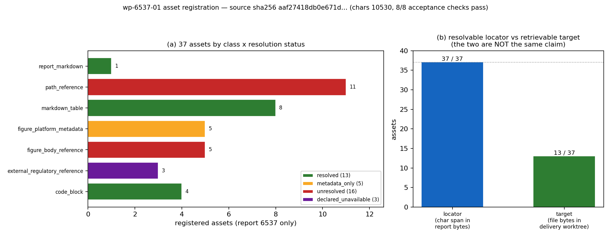

# KF-RESULT wp-6537-01

**报告 id**：6537 ｜ **工作包**：wp-6537-01（task_type=`01-asset-registration`，lane C） ｜ **mission**：15590 ｜ **源**：`tensor://reports/6537`（field=`markdown`）

**一句话结论**：report 6537 的 markdown 字节与契约 `source_hash` 逐位一致（sha256 `aaf27418db0e671d671f7cafa2aecf6d68e235f593384832f3fb46cf152d1f71`，10530 字符 / 15951 字节），本工序登记了 37 个可定位资产（8 张表、4 个代码块、5 条图元数据 + 5 条正文图引用、11 条路径引用、3 条外部法规引用），未做任何抽取（claims 为空数组），未对任何条目标 verified；8/8 项验收自检通过。

## ① 本工序做了什么

只做一件事：**登记** report_id=6537 的源资产，不做抽取、不做报告类型分类（契约 `objective.register_assets: true` / `objective.classify_report_type: false`）。具体：

1. **身份确认**：经平台接口取回 6537 的 `markdown` 字段，现场计算 sha256 与字符/字节数，与契约 `input.source_hash` / `chars: 10530` 逐位比对——一致才继续（不一致则脚本直接 `SystemExit`，不写入任何产物）。
2. **可解析资产枚举**：把 markdown 结构化成可定位单元——8 张表格、4 个围栏代码块、5 条正文图引用；5 条来自平台记录 `figures` 的图元数据；11 条路径引用（源文件/产物/测试目录，含大括号聚合写法展开）；3 条外部法规引用。
3. **可解析性分级**（不是证据分级，证据由平台门计算）：`resolved` 13（源 markdown 自身 + 8 张表 + 4 个代码块）、`metadata_only` 5（figure 元数据可读、图字节端点 404）、`unresolved` 16（正文图路径与代码/产物路径不在本工作树）、`declared_unavailable` 3（EUR-Lex / 附件 II / MEPC.364(79) 外部原文，报告自述离线不可核）。
4. **不越界**：全文只读 report 6537；不读不写其它 report_id；不改上游产物；不给任何条目打 verified。

## ② 怎么做的（步骤 / 工具 / 关键设置）

| 步 | 动作 | 工具/接口 | 关键设置 |
|---|---|---|---|
| 1 | 取源 | `GET /api/v1/tensor/reports/6537`（Bearer 登录 `/auth/login`） | 只取 `markdown` 字段；响应里的其它 report 字段不落盘 |
| 2 | 定身份 | `hashlib.sha256(markdown.encode('utf-8'))` | 硬断言 == 契约哈希且 `len(md)==10530`，否则退出 |
| 3 | 落快照 | `docs/kf/wp-6537-01/source_6537.md` | 字节原样写入，供离线复跑与二次哈希 |
| 4 | 造定位符 | 行块→字符串，`md.index(quote)` 得 char span，向上扩行直到 `md.count(quote)==1` | 每条形如 `md[start:end]==quote 且 count==1`，否则不出该资产 |
| 5 | 图元数据 + 图字节探测 | `GET .../reports/6537/figures/<name>` ×5 | 结果**原样记录**（本次 5/5 → HTTP 404），不复制图像、不推断内容 |
| 6 | 路径解析 | 在交付工作树内 `Path(REPO)/p` 存在性检查（越界路径显式拒绝） | 不存在 → `unresolved` + 原因，绝不猜测地址 |
| 7 | 独立复核 | `build_asset_manifest_6537.py verify` | 8 项验收逐条重算，与 build 步骤解耦 |
| 8 | 回归测试 | `pytest tests/test_kf_asset_manifest_6537.py`（13 用例，含 live 哈希复核） | 离线用快照，联网再对一次真字节 |

复现（一键）：

```bash
python3 scripts/kf/build_asset_manifest_6537.py build result verify \
  && python3 scripts/kf/figure_6537.py \
  && python3 -m pytest tests/test_kf_asset_manifest_6537.py -q
```

## ③ 产出物清单（文件名 → 要点）

| 文件 | 字节 | sha256（前 16） | 要点 |
|---|---|---|---|
| `docs/kf/wp-6537-01/asset_manifest.json` | 53350 | `5afa3314a56cda00` | 交付物本体：37 资产 + provenance + counts + integrity + limitations |
| `docs/kf/wp-6537-01/kf_result.json` | 59378 | `546f3b32c2d864e1` | kf_result.v1 信封；`outputs['asset_manifest.json']` 内嵌 manifest 全文 |
| `docs/kf/wp-6537-01/verification.json` | 1702 | `527496a9ea9297fd` | 8 项验收独立复核结果（all_pass=True） |
| `docs/kf/wp-6537-01/source_6537.md` | 15951 | `aaf27418db0e671d` | 源字节快照（sha256 与契约同） |
| `docs/kf/wp-6537-01/fig_asset_inventory.png` | 118784 | `8449590f6b8b9006` | 图1 资产清单（图 a 类别×状态；图 b 定位符 vs 目标） |
| `scripts/kf/build_asset_manifest_6537.py` | 31514 | `a475a7f7d0e3fd55` | build / result / verify 三段可复跑 |
| `tests/test_kf_asset_manifest_6537.py` | 7801 | `a3ec2c3ac22fa2e1` | 13 用例：身份/单报告边界/哈希/定位符/计数/分辨率词表/信封 |

资产类别分布（机器读出）：`code_block`=4 · `external_regulatory_reference`=3 · `figure_body_reference`=5 · `figure_platform_metadata`=5 · `markdown_table`=8 · `path_reference`=11 · `report_markdown`=1。

## ④ 证据定位表（字段/claim → 原文逐字片段）

| 字段 / claim | 原文逐字片段（或明确的不可定位说明） | 位置 |
|---|---|---|
| source_hash / source_chars（源资产身份） | 平台字节现场计算 sha256(utf8(markdown))；原文中不存在该哈希字面量，故不填引文——不可在原文定位的数字一律不外挂引文 | platform_api: GET /tensor/reports/6537 |
| report 标题（源文本首行） | `FuelEU Maritime 全生命周期碳强度合规引擎（IN39-N04）` | markdown line 1 |
| §4 结果图存在且为相对路径引用 | `` | markdown line 167（另 4 行同式） |
| 表格结构存在（表 #1 表头） | `\| 项目 \| 取值 \|` | markdown line 24（同式定位法适用于全部 8 张表） |
| 公式代码块存在（块 #1） | `GHGI = Σ_j E_j·GI_j / Σ_j E_j   [gCO2e/MJ]，  GI_j = WtT_j + TtW_j` | markdown line 16 |
| 附录产物清单（路径引用的来源行） | 「产物：`artifacts/fueleu_in39n04/{case_report.json, run_case.py, gen_report.py, fig_*.png}`」 | markdown line 220 |
| 报告自述法规数值的核实状态 | 「`external_verification = WITHHELD`（离线环境无法访问 EUR-Lex 原文复核，见第 5 节）」 | markdown line 9 |
| 报告自述判据①只是内部一致性闸 | `**因此判据①是内部一致性闸**` | markdown line 189 |

全部 37 个资产的逐条定位符（char span + 行号 + 唯一性）见 `asset_manifest.json` 的 `assets[].locator`；本节只列抽查面，不重复列全部引文。

## ⑤ 注意点与局限

1. **定位符可解析 ≠ 目标可解析**。本工序证明的是「原文里确实有这段字节」，不是「被引用的代码/图/法规原文真实存在且正确」。11 条路径引用目标不在本工作树（属 ship-performance-platform / mission 5552），5 条图引用同理。
2. **平台 figure 元数据可读、图字节不可取**：5 条 figure 元数据全部登记，但 `GET /tensor/reports/6537/figures/<name>` 实测 5/5 返回 404（探测记录原样写在 `figure_probes`）。因此只登记元数据（`metadata_only`），不复制、不描述图像内容。
3. **法规数值一律未升级**：报告自述 `external_verification = WITHHELD`，本工序保持该状态，`declared_unavailable` 只是「本地取不到外部原文」的记录，不等于数值错，也不等于数值对。
4. **glob 引用不展开**：`artifacts/fueleu_in39n04/fig_*.png` 按名登记（`glob: true`），未展开匹配集、未推断文件个数。
5. **短名别名折叠**：正文里 `fuel_path.py` 与附录 `backend/modules/fueleu/{...,fuel_path,...}.py` 是同一目标，按 canonical 路径合并为一条并记录 `cited_at_lines` / `cited_as` / `aliases_folded`，避免同一目标被登记成多条资产。
6. **claims 为空是刻意的**：契约 `no_forced_claim_generation: true`；零条 claim 是合法完整结果，不是失败。
7. **产物位置**：`artifacts/` 被 `.gitignore` 忽略且 push 门会滤掉，故全部落 `docs/kf/wp-6537-01/`。
8. **本单自查出的一个真缺陷（已修）**：首版 manifest 把围栏代码块的定位引文连 ``` 分隔符一起取，写进 result 信封后 ` ``` ` 出现在 JSON 字符串里，任何按围栏切块的抽取器都会截断——即使 JSON 本身合法。修法：代码块只引内层行（不含围栏），并在 build 里加硬断言「任何 quote 不得含 ```」。首版报告 14674 带着这个缺陷，本报告为修正后的重发版（不修改 14674，它留作痕）。

## ⑥ 自检：逐条对照 acceptance

| # | acceptance 项 | 判定 | 证据（机器读出） |
|---|---|---|---|
| 1 | valid_json（manifest 可解析） | ✅ PASS | json.loads OK on asset_manifest.json |
| 2 | schema_pass（结构门：必需键 + 包身份） | ✅ PASS | missing_top=[] missing_provenance=[] |
| 3 | source_locator_resolvable（定位符可在原文解析） | ✅ PASS | checked 37 locators against source_6537.md; unresolvable=[] |
| 4 | source_hash_matches（哈希与契约一致） | ✅ PASS | snapshot=aaf27418db0e671d671f7cafa2aecf6d68e235f593384832f3fb46cf152d1f71 declared=aaf27418db0e671d671f7cafa2aecf6d68e235f593384832f3fb46cf152d1f71 contract=aaf27418db0e671d671f7cafa2aecf6d68e235f593384832f3fb46cf152d1f71 chars=10530/10530 |
| 5 | no_duplicate_ids（资产 id 唯一） | ✅ PASS | assets=37 unique=37 |
| 6 | all_claims_have_evidence_or_explicit_unresolved_status | ✅ PASS | claims=0 violating=0 (empty array: vacuously satisfied, contract allows it) |
| 7 | do_not_mark_claims_as_verified（附加自检） | ✅ PASS | no claim carries status=verified |
| 8 | counts_consistent（附加自检：计数自洽） | ✅ PASS | counts.assets=37 by_resolution_sum=37 by_class_sum=37 |

**未做/未跑（不当成通过）**：

- 未做抽取、未做报告类型分类、未做任何证据升级——按契约不做，不是遗漏。
- `verify` 用本地快照做定位符复核（可离线复跑）；live 重取哈希的守卫在 `emit_result()` 与 pytest 的 `test_live_source_hash_still_matches_contract` 里各做一次。
- 没有核对 EUR-Lex 原文（离线）；这属于外部核实，留给平台门或联网节点。

## 图1 资产清单（fig_asset_inventory.png）



图1 (a) 报告 6537 的 37 个登记资产按类别×解析状态堆叠；(b) 两种不同的「可解析」——定位符在本报告字节内可解析 37/37，目标文件在交付工作树内可取回 13/37（同一批资产，口径不同，不可混算）。数据全部读自 `asset_manifest.json` 与 `verification.json`。

## ⑦ 结果信封（markdown 中唯一的 json 代码块，原样提交）

```json
{
 "package_id": "wp-6537-01",
 "task_type": "01-asset-registration",
 "report_id": "6537",
 "provenance": {
  "source_uri": "tensor://reports/6537",
  "source_field": "markdown",
  "source_hash": "sha256:aaf27418db0e671d671f7cafa2aecf6d68e235f593384832f3fb46cf152d1f71",
  "hash_algo": "sha256",
  "hashed_bytes": "markdown encoded as utf-8",
  "source_chars": 10530,
  "source_bytes_utf8": 15951,
  "fetched_via": "GET /api/v1/tensor/reports/6537",
  "producer": "scripts/kf/build_asset_manifest_6537.py",
  "emitted_at": "2026-11-12T01:30:43.865301+00:00",
  "contract_version": "1.0",
  "notes": "registration only; claims=[] intentionally; no claim marked verified"
 },
 "outputs": {
  "asset_manifest.json": {
   "schema": "asset_manifest.v1",
   "manifest_version": "1.0",
   "package_id": "wp-6537-01",
   "task_type": "01-asset-registration",
   "report_id": "6537",
   "provenance": {
    "source_uri": "tensor://reports/6537",
    "source_field": "markdown",
    "source_hash": "sha256:aaf27418db0e671d671f7cafa2aecf6d68e235f593384832f3fb46cf152d1f71",
    "hash_alg": "sha256",
    "hashed_bytes": "markdown encoded as utf-8",
    "source_chars": 10530,
    "source_bytes_utf8": 15951,
    "source_snapshot": "docs/kf/wp-6537-01/source_6537.md",
    "fetched_via": "GET /api/v1/tensor/reports/6537",
    "contract_source_hash": "sha256:aaf27418db0e671d671f7cafa2aecf6d68e235f593384832f3fb46cf152d1f71",
    "contract_chars": 10530,
    "hash_matches_contract": true,
    "title": "FuelEU Maritime 全生命周期碳强度合规引擎（IN39-N04）：WtT/WtW 双 GWP 口径、甲烷逃逸敏感性与联营最优组合",
    "scenario_key": "fueleu_carbon_intensity_in39n04",
    "platform_tags": [
     "FuelEU",
     "碳强度",
     "全生命周期",
     "甲烷逃逸",
     "GWP20",
     "pooling",
     "MILP",
     "绿色航行",
     "IN39-N04"
    ],
    "generator": "scripts/kf/build_asset_manifest_6537.py",
    "generated_at": "2026-11-12T01:30:43.437897+00:00",
    "lane": "C"
   },
   "counts": {
    "assets": 37,
    "by_class": {
     "report_markdown": 1,
     "figure_platform_metadata": 5,
     "figure_body_reference": 5,
     "markdown_table": 8,
     "code_block": 4,
     "path_reference": 11,
     "external_regulatory_reference": 3
    },
    "by_resolution": {
     "resolved": 13,
     "metadata_only": 5,
     "unresolved": 16,
     "declared_unavailable": 3
    },
    "tables": 8,
    "code_blocks": 4,
    "platform_figures": 5,
    "body_figure_references": 5,
    "distinct_referenced_paths": 11
   },
   "figure_probes": [
    {
     "name": "fig_compliance_margin.png",
     "status": 404,
     "detail": "Not Found"
    },
    {
     "name": "fig_energy_chain.png",
     "status": 404,
     "detail": "Not Found"
    },
    {
     "name": "fig_intensity_stack.png",
     "status": 404,
     "detail": "Not Found"
    },
    {
     "name": "fig_pooling.png",
     "status": 404,
     "detail": "Not Found"
    },
    {
     "name": "fig_slip_sensitivity.png",
     "status": 404,
     "detail": "Not Found"
    }
   ],
   "assets": [
    {
     "asset_id": "A01",
     "asset_class": "report_markdown",
     "label": "report 6537 markdown（本次登记的唯一源资产）",
     "in_report_section": "document",
     "locator": {
      "scheme": "report_field",
      "method": "document",
      "field": "markdown",
      "start_char": 0,
      "end_char": 10530,
      "start_line": 1,
      "end_line": 221,
      "quote": "# FuelEU Maritime 全生命周期碳强度合规引擎（IN39-N04）",
      "unique": true,
      "verified": true
     },
     "resolution": {
      "status": "resolved",
      "scope": "platform_api",
      "via": "GET /api/v1/tensor/reports/6537 -> markdown"
     },
     "resolution_check": {
      "check": "sha256(utf8(markdown)) == provenance.source_hash",
      "result": "resolved"
     },
     "source_hash": "sha256:aaf27418db0e671d671f7cafa2aecf6d68e235f593384832f3fb46cf152d1f71",
     "chars": 10530,
     "bytes_utf8": 15951,
     "note": "chars/bytes/sha256 由本次抓取的字节现场计算；与契约 source_hash 逐位一致。"
    },
    {
     "asset_id": "A02",
     "asset_class": "figure_platform_metadata",
     "label": "fig_compliance_margin.png",
     "in_report_section": "record.figures[0]",
     "locator": {
      "scheme": "report_field",
      "method": "document",
      "field": "figures",
      "index": 0,
      "quote": "图3 六船 GI vs 台阶式限值（裕度）与逐年罚金",
      "unique": true,
      "start_char": 0,
      "end_char": 10530,
      "start_line": 0,
      "end_line": 0,
      "verified": true
     },
     "resolution": {
      "status": "metadata_only",
      "scope": "platform_api",
      "via": "GET /tensor/reports/6537 -> figures[0]",
      "bytes_endpoint": {
       "status": 404,
       "detail": "Not Found"
      }
     },
     "resolution_check": {
      "check": "GET /tensor/reports/6537/figures/fig_compliance_margin.png -> 200",
      "result": "absent"
     },
     "note": "figure 元数据（name/caption）在报告记录中可解析；但图字节端点返回 HTTP 404，故只登记元数据，不复制、不推断图像内容。"
    },
    {
     "asset_id": "A03",
     "asset_class": "figure_platform_metadata",
     "label": "fig_energy_chain.png",
     "in_report_section": "record.figures[1]",
     "locator": {
      "scheme": "report_field",
      "method": "document",
      "field": "figures",
      "index": 1,
      "quote": "图5 逐航段 TtW CO2：本引擎 vs IN23-N07（年度相对偏差 4.9e-16）",
      "unique": true,
      "start_char": 0,
      "end_char": 10530,
      "start_line": 0,
      "end_line": 0,
      "verified": true
     },
     "resolution": {
      "status": "metadata_only",
      "scope": "platform_api",
      "via": "GET /tensor/reports/6537 -> figures[1]",
      "bytes_endpoint": {
       "status": 404,
       "detail": "Not Found"
      }
     },
     "resolution_check": {
      "check": "GET /tensor/reports/6537/figures/fig_energy_chain.png -> 200",
      "result": "absent"
     },
     "note": "figure 元数据（name/caption）在报告记录中可解析；但图字节端点返回 HTTP 404，故只登记元数据，不复制、不推断图像内容。"
    },
    {
     "asset_id": "A04",
     "asset_class": "figure_platform_metadata",
     "label": "fig_intensity_stack.png",
     "in_report_section": "record.figures[2]",
     "locator": {
      "scheme": "report_field",
      "method": "document",
      "field": "figures",
      "index": 2,
      "quote": "图1 12 条燃料路径 WtT/TtW 堆叠（GWP100）+ GWP20 标记 + 2025/2035/2050 限值线",
      "unique": true,
      "start_char": 0,
      "end_char": 10530,
      "start_line": 0,
      "end_line": 0,
      "verified": true
     },
     "resolution": {
      "status": "metadata_only",
      "scope": "platform_api",
      "via": "GET /tensor/reports/6537 -> figures[2]",
      "bytes_endpoint": {
       "status": 404,
       "detail": "Not Found"
      }
     },
     "resolution_check": {
      "check": "GET /tensor/reports/6537/figures/fig_intensity_stack.png -> 200",
      "result": "absent"
     },
     "note": "figure 元数据（name/caption）在报告记录中可解析；但图字节端点返回 HTTP 404，故只登记元数据，不复制、不推断图像内容。"
    },
    {
     "asset_id": "A05",
     "asset_class": "figure_platform_metadata",
     "label": "fig_pooling.png",
     "in_report_section": "record.figures[3]",
     "locator": {
      "scheme": "report_field",
      "method": "document",
      "field": "figures",
      "index": 3,
      "quote": "图4 联营罚金节省与 MILP/线性松弛/离散枚举对账",
      "unique": true,
      "start_char": 0,
      "end_char": 10530,
      "start_line": 0,
      "end_line": 0,
      "verified": true
     },
     "resolution": {
      "status": "metadata_only",
      "scope": "platform_api",
      "via": "GET /tensor/reports/6537 -> figures[3]",
      "bytes_endpoint": {
       "status": 404,
       "detail": "Not Found"
      }
     },
     "resolution_check": {
      "check": "GET /tensor/reports/6537/figures/fig_pooling.png -> 200",
      "result": "absent"
     },
     "note": "figure 元数据（name/caption）在报告记录中可解析；但图字节端点返回 HTTP 404，故只登记元数据，不复制、不推断图像内容。"
    },
    {
     "asset_id": "A06",
     "asset_class": "figure_platform_metadata",
     "label": "fig_slip_sensitivity.png",
     "in_report_section": "record.figures[4]",
     "locator": {
      "scheme": "report_field",
      "method": "document",
      "field": "figures",
      "index": 4,
      "quote": "图2 甲烷逃逸 0.1%–4% 敏感性（GWP100/GWP20），Otto 与 VLSFO 持平于 slip≈2.30%",
      "unique": true,
      "start_char": 0,
      "end_char": 10530,
      "start_line": 0,
      "end_line": 0,
      "verified": true
     },
     "resolution": {
      "status": "metadata_only",
      "scope": "platform_api",
      "via": "GET /tensor/reports/6537 -> figures[4]",
      "bytes_endpoint": {
       "status": 404,
       "detail": "Not Found"
      }
     },
     "resolution_check": {
      "check": "GET /tensor/reports/6537/figures/fig_slip_sensitivity.png -> 200",
      "result": "absent"
     },
     "note": "figure 元数据（name/caption）在报告记录中可解析；但图字节端点返回 HTTP 404，故只登记元数据，不复制、不推断图像内容。"
    },
    {
     "asset_id": "A101",
     "asset_class": "figure_body_reference",
     "label": "../../artifacts/fueleu_in39n04/fig_intensity_stack.png",
     "in_report_section": "§4 结果图 (line 167)",
     "locator": {
      "scheme": "char_span",
      "method": "char_span",
      "start_char": 7326,
      "end_char": 7408,
      "start_line": 167,
      "end_line": 167,
      "quote": "",
      "unique": true,
      "verified": true
     },
     "resolution": {
      "status": "unresolved",
      "scope": "delivery_worktree",
      "reason": "正文以相对路径 ../../artifacts/fueleu_in39n04/ 引用图文件；该目录属于产出该报告的仓库（ship-performance-platform, mission 5552），不在本工作包的工作树内。",
      "local_check": {
       "status": "unresolved",
       "scope": "delivery_worktree",
       "reason": "path not present in the TensorKnowledge delivery worktree"
      }
     },
     "resolution_check": {
      "check": "Path(worktree)/artifacts/fueleu_in39n04/fig_intensity_stack.png exists",
      "result": "unresolved"
     },
     "note": "与同名的 figure_platform_metadata 资产配对；本条目只证明正文引用了它。"
    },
    {
     "asset_id": "A102",
     "asset_class": "figure_body_reference",
     "label": "../../artifacts/fueleu_in39n04/fig_slip_sensitivity.png",
     "in_report_section": "§4 结果图 (line 171)",
     "locator": {
      "scheme": "char_span",
      "method": "char_span",
      "start_char": 7548,
      "end_char": 7632,
      "start_line": 171,
      "end_line": 171,
      "quote": "",
      "unique": true,
      "verified": true
     },
     "resolution": {
      "status": "unresolved",
      "scope": "delivery_worktree",
      "reason": "正文以相对路径 ../../artifacts/fueleu_in39n04/ 引用图文件；该目录属于产出该报告的仓库（ship-performance-platform, mission 5552），不在本工作包的工作树内。",
      "local_check": {
       "status": "unresolved",
       "scope": "delivery_worktree",
       "reason": "path not present in the TensorKnowledge delivery worktree"
      }
     },
     "resolution_check": {
      "check": "Path(worktree)/artifacts/fueleu_in39n04/fig_slip_sensitivity.png exists",
      "result": "unresolved"
     },
     "note": "与同名的 figure_platform_metadata 资产配对；本条目只证明正文引用了它。"
    },
    {
     "asset_id": "A103",
     "asset_class": "figure_body_reference",
     "label": "../../artifacts/fueleu_in39n04/fig_compliance_margin.png",
     "in_report_section": "§4 结果图 (line 175)",
     "locator": {
      "scheme": "char_span",
      "method": "char_span",
      "start_char": 7725,
      "end_char": 7811,
      "start_line": 175,
      "end_line": 175,
      "quote": "",
      "unique": true,
      "verified": true
     },
     "resolution": {
      "status": "unresolved",
      "scope": "delivery_worktree",
      "reason": "正文以相对路径 ../../artifacts/fueleu_in39n04/ 引用图文件；该目录属于产出该报告的仓库（ship-performance-platform, mission 5552），不在本工作包的工作树内。",
      "local_check": {
       "status": "unresolved",
       "scope": "delivery_worktree",
       "reason": "path not present in the TensorKnowledge delivery worktree"
      }
     },
     "resolution_check": {
      "check": "Path(worktree)/artifacts/fueleu_in39n04/fig_compliance_margin.png exists",
      "result": "unresolved"
     },
     "note": "与同名的 figure_platform_metadata 资产配对；本条目只证明正文引用了它。"
    },
    {
     "asset_id": "A104",
     "asset_class": "figure_body_reference",
     "label": "../../artifacts/fueleu_in39n04/fig_pooling.png",
     "in_report_section": "§4 结果图 (line 179)",
     "locator": {
      "scheme": "char_span",
      "method": "char_span",
      "start_char": 7857,
      "end_char": 7923,
      "start_line": 179,
      "end_line": 179,
      "quote": "",
      "unique": true,
      "verified": true
     },
     "resolution": {
      "status": "unresolved",
      "scope": "delivery_worktree",
      "reason": "正文以相对路径 ../../artifacts/fueleu_in39n04/ 引用图文件；该目录属于产出该报告的仓库（ship-performance-platform, mission 5552），不在本工作包的工作树内。",
      "local_check": {
       "status": "unresolved",
       "scope": "delivery_worktree",
       "reason": "path not present in the TensorKnowledge delivery worktree"
      }
     },
     "resolution_check": {
      "check": "Path(worktree)/artifacts/fueleu_in39n04/fig_pooling.png exists",
      "result": "unresolved"
     },
     "note": "与同名的 figure_platform_metadata 资产配对；本条目只证明正文引用了它。"
    },
    {
     "asset_id": "A105",
     "asset_class": "figure_body_reference",
     "label": "../../artifacts/fueleu_in39n04/fig_energy_chain.png",
     "in_report_section": "§4 结果图 (line 183)",
     "locator": {
      "scheme": "char_span",
      "method": "char_span",
      "start_char": 7982,
      "end_char": 8058,
      "start_line": 183,
      "end_line": 183,
      "quote": "",
      "unique": true,
      "verified": true
     },
     "resolution": {
      "status": "unresolved",
      "scope": "delivery_worktree",
      "reason": "正文以相对路径 ../../artifacts/fueleu_in39n04/ 引用图文件；该目录属于产出该报告的仓库（ship-performance-platform, mission 5552），不在本工作包的工作树内。",
      "local_check": {
       "status": "unresolved",
       "scope": "delivery_worktree",
       "reason": "path not present in the TensorKnowledge delivery worktree"
      }
     },
     "resolution_check": {
      "check": "Path(worktree)/artifacts/fueleu_in39n04/fig_energy_chain.png exists",
      "result": "unresolved"
     },
     "note": "与同名的 figure_platform_metadata 资产配对；本条目只证明正文引用了它。"
    },
    {
     "asset_id": "A201",
     "asset_class": "markdown_table",
     "label": "table #1 (lines 24-32, 9 行)",
     "in_report_section": "line 24",
     "locator": {
      "scheme": "char_span",
      "method": "char_span",
      "start_char": 1239,
      "end_char": 1537,
      "start_line": 24,
      "end_line": 32,
      "quote": "| 项目 | 取值 |\n|---|---|\n| 船型 | 82,000 DWT 散货船（Lpp 292 m / B 45 m / T 13 m / Cb 0.62） |\n| 主机 | MCR 13,000 kW，辅机 350 kW，SFOC 曲线见 IN23-N07 |\n| 年度剖面 | 12 航段（4200/4200/3800/900 nm 循环 3 次），共 39,300 nm |\n| 年航行时间 | 3,114.6 h |\n| 年度能量（HFO 基准） | 145.23 TJ |\n| 年度燃油 | 3,585.9 t HFO |\n| 年度 TtW CO2 | 11,166.4 t |",
      "unique": true,
      "verified": true
     },
     "resolution": {
      "status": "resolved",
      "scope": "report_markdown"
     },
     "resolution_check": {
      "check": "md[start_char:end_char] == quote 且 md.count(quote)==1",
      "result": "resolved"
     },
     "note": "仅登记表格的字节范围；单元格内容不在本工序抽取（不做 claims）。"
    },
    {
     "asset_id": "A202",
     "asset_class": "markdown_table",
     "label": "table #2 (lines 36-49, 14 行)",
     "in_report_section": "line 36",
     "locator": {
      "scheme": "char_span",
      "method": "char_span",
      "start_char": 1587,
      "end_char": 2629,
      "start_line": 36,
      "end_line": 49,
      "quote": "| 燃料 | 族 | LHV [MJ/kg] | CF [gCO2/g] | slip [%] | WtT@100 | TtW@100 | WtW@100 | WtW@20 |\n|---|---|---|---|---|---|---|---|---|\n| `hfo` | fossil | 40.5 | 3.114 | 0.00 | 13.50 | 77.05 | 90.55 | 90.55 |\n| `vlsfo` | fossil | 41.0 | 3.151 | 0.00 | 13.20 | 77.02 | 90.22 | 90.22 |\n| `mgo` | fossil | 42.7 | 3.206 | 0.00 | 14.40 | 75.25 | 89.65 | 89.65 |\n| `lng_otto` | fossil | 48.0 | 2.750 | 3.10 | 18.48 | 76.70 | 95.18 | 134.71 |\n| `lng_diesel` | fossil | 48.0 | 2.750 | 0.20 | 18.48 | 58.70 | 77.18 | 85.11 |\n| `fame` | bio | 37.2 | 2.830 | 0.00 | -33.08 | 76.29 | 43.22 | 43.22 |\n| `hvo` | bio | 44.0 | 3.100 | 0.00 | -44.45 | 70.67 | 26.22 | 26.22 |\n| `meoh_green` | e-fuel | 19.9 | 1.375 | 0.00 | -56.67 | 69.34 | 12.67 | 12.67 |\n| `meoh_grey` | fossil | 19.9 | 1.375 | 0.00 | 27.50 | 69.34 | 96.84 | 96.84 |\n| `nh3_green` | e-fuel | 18.6 | 0.000 | 0.00 | 12.00 | 1.36 | 13.37 | 13.37 |\n| `nh3_grey` | fossil | 18.6 | 0.000 | 0.00 | 90.00 | 1.36 | 91.36 | 91.36 |\n| `h2_green` | e-fuel | 120.0 | 0.000 | 0.00 | 12.83 | 0.00 | 12.83 | 12.83 |",
      "unique": true,
      "verified": true
     },
     "resolution": {
      "status": "resolved",
      "scope": "report_markdown"
     },
     "resolution_check": {
      "check": "md[start_char:end_char] == quote 且 md.count(quote)==1",
      "result": "resolved"
     },
     "note": "仅登记表格的字节范围；单元格内容不在本工序抽取（不做 claims）。"
    },
    {
     "asset_id": "A203",
     "asset_class": "markdown_table",
     "label": "table #3 (lines 93-101, 9 行)",
     "in_report_section": "line 93",
     "locator": {
      "scheme": "char_span",
      "method": "char_span",
      "start_char": 4042,
      "end_char": 4571,
      "start_line": 93,
      "end_line": 101,
      "quote": "| # | 判据 | 结果 | 阈值 | 判定 |\n|---|---|---|---|---|\n| ① | 附件 II 默认 WtT 复现 | 12/12 条通过，最大相对偏差 0.260% | ≤1% | PASS |\n| ② | WtW = WtT + TtW 加和 | 最大残差 0.0e+00（24 个燃料×口径组合） | ≤1e-9 | PASS |\n| ③ | 单位换算/量纲 | 7/7 项断言 | 全通过 | PASS |\n| ④ | slip 单调 + GWP20 增幅更大 | 增幅比 2.7550（解析 82.1/29.8=2.7550） | >1 且严格单调 | PASS |\n| ⑤ | 与 IN23-N07 年度 TtW CO2 一致 | 相对偏差 4.9e-16（11166.378 vs 11166.378 t） | ≤0.5% | PASS |\n| ⑥ | pooling MILP vs 暴力枚举 | 相对偏差 0.0e+00，罚金节省 8,785,338 EUR ≥ 0 | ≤1e-6 | PASS |\n| + | 化学计量独立闸（非循环） | 12/12 条，最大相对偏差 0.248% | ≤1% | PASS |",
      "unique": true,
      "verified": true
     },
     "resolution": {
      "status": "resolved",
      "scope": "report_markdown"
     },
     "resolution_check": {
      "check": "md[start_char:end_char] == quote 且 md.count(quote)==1",
      "result": "resolved"
     },
     "note": "仅登记表格的字节范围；单元格内容不在本工序抽取（不做 claims）。"
    },
    {
     "asset_id": "A204",
     "asset_class": "markdown_table",
     "label": "table #4 (lines 107-117, 11 行)",
     "in_report_section": "line 107",
     "locator": {
      "scheme": "char_span",
      "method": "char_span",
      "start_char": 4697,
      "end_char": 5181,
      "start_line": 107,
      "end_line": 117,
      "quote": "| slip [%] | CH4 [g/MJ] | WtW@GWP100 | WtW@GWP20 | 相对 0 逃逸的超额 [tCO2e/PJ] |\n|---|---|---|---|---|\n| 0.10 | 0.0208 | 76.55 | 83.40 | 621 |\n| 0.50 | 0.1042 | 79.04 | 90.24 | 3,104 |\n| 1.00 | 0.2083 | 82.14 | 98.79 | 6,208 |\n| 1.50 | 0.3125 | 85.25 | 107.34 | 9,312 |\n| 2.00 | 0.4167 | 88.35 | 115.89 | 12,417 |\n| 2.50 | 0.5208 | 91.45 | 124.45 | 15,521 |\n| 3.10 | 0.6458 | 95.18 | 134.71 | 19,246 |\n| 3.50 | 0.7292 | 97.66 | 141.55 | 21,729 |\n| 4.00 | 0.8333 | 100.77 | 150.10 | 24,833 |",
      "unique": true,
      "verified": true
     },
     "resolution": {
      "status": "resolved",
      "scope": "report_markdown"
     },
     "resolution_check": {
      "check": "md[start_char:end_char] == quote 且 md.count(quote)==1",
      "result": "resolved"
     },
     "note": "仅登记表格的字节范围；单元格内容不在本工序抽取（不做 claims）。"
    },
    {
     "asset_id": "A205",
     "asset_class": "markdown_table",
     "label": "table #5 (lines 123-130, 8 行)",
     "in_report_section": "line 123",
     "locator": {
      "scheme": "char_span",
      "method": "char_span",
      "start_char": 5423,
      "end_char": 6048,
      "start_line": 123,
      "end_line": 130,
      "quote": "| 船 / 当前燃料 | GI | 2025 | 2030 | 2035 | 2040 | 2045 | 2050 |\n|---|---|---|---|---|---|---|---|\n| BC-82k / HFO | 90.55 | 113,388 | 453,432 | 1,176,028 | 2,578,712 | 5,214,059 | 6,744,261 |\n| BC-82k / VLSFO | 90.22 | 82,126 | 422,171 | 1,144,766 | 2,547,450 | 5,182,797 | 6,712,999 |\n| BC-82k / MGO | 89.65 | 28,813 | 368,857 | 1,091,453 | 2,494,137 | 5,129,484 | 6,659,686 |\n| LNGC-174k / LNG-Otto | 95.18 | 544,842 | 884,887 | 1,607,482 | 3,010,167 | 5,645,514 | 7,175,715 |\n| LNGC-174k / LNG-Diesel | 77.18 | 0 | 0 | 0 | 1,331,189 | 3,966,536 | 5,496,738 |\n| BC-82k / FAME(B20) | 43.22 | 0 | 0 | 0 | 0 | 839,899 | 2,446,610 |",
      "unique": true,
      "verified": true
     },
     "resolution": {
      "status": "resolved",
      "scope": "report_markdown"
     },
     "resolution_check": {
      "check": "md[start_char:end_char] == quote 且 md.count(quote)==1",
      "result": "resolved"
     },
     "note": "仅登记表格的字节范围；单元格内容不在本工序抽取（不做 claims）。"
    },
    {
     "asset_id": "A206",
     "asset_class": "markdown_table",
     "label": "table #6 (lines 136-144, 9 行)",
     "in_report_section": "line 136",
     "locator": {
      "scheme": "char_span",
      "method": "char_span",
      "start_char": 6150,
      "end_char": 6395,
      "start_line": 136,
      "end_line": 144,
      "quote": "| 口径 | 数值 |\n|---|---|\n| 各船独立履约罚金之和 | 4,830,794 EUR |\n| 全部入池（不改燃料）罚金 | 535,433 EUR |\n| 纯联营罚金节省 | 4,295,361 EUR |\n| MILP 最优总成本（燃料+罚金） | 11,436,662 EUR |\n| 离散枚举最优（对账） | 11,436,662 EUR |\n| 线性松弛下界（允许掺混） | 11,417,182 EUR |\n| 相对基线的总节省 | 8,785,338 EUR |",
      "unique": true,
      "verified": true
     },
     "resolution": {
      "status": "resolved",
      "scope": "report_markdown"
     },
     "resolution_check": {
      "check": "md[start_char:end_char] == quote 且 md.count(quote)==1",
      "result": "resolved"
     },
     "note": "仅登记表格的字节范围；单元格内容不在本工序抽取（不做 claims）。"
    },
    {
     "asset_id": "A207",
     "asset_class": "markdown_table",
     "label": "table #7 (lines 150-163, 14 行)",
     "in_report_section": "line 150",
     "locator": {
      "scheme": "char_span",
      "method": "char_span",
      "start_char": 6611,
      "end_char": 7314,
      "start_line": 150,
      "end_line": 163,
      "quote": "| 燃料 | 年燃油 [t] | 年能量 [TJ] | 年 TtW CO2 [t] | 年 TtW GHG [tCO2e] |\n|---|---|---|---|---|\n| `hfo` | 3,585.9 | 145.23 | 11,166.4 | 11,190.2 |\n| `vlsfo` | 3,585.9 | 147.02 | 11,299.1 | 11,323.1 |\n| `mgo` | 3,585.9 | 153.12 | 11,496.3 | 11,521.4 |\n| `lng_otto` | 3,585.9 | 172.12 | 9,861.1 | 13,201.9 |\n| `lng_diesel` | 3,585.9 | 172.12 | 9,861.1 | 10,103.0 |\n| `fame` | 3,765.2 | 140.06 | 10,655.4 | 10,686.0 |\n| `hvo` | 3,585.9 | 157.78 | 11,116.2 | 11,150.6 |\n| `meoh_green` | 3,657.6 | 72.79 | 5,029.2 | 5,047.1 |\n| `meoh_grey` | 3,657.6 | 72.79 | 5,029.2 | 5,047.1 |\n| `nh3_green` | 3,872.7 | 72.03 | 0.0 | 98.3 |\n| `nh3_grey` | 3,872.7 | 72.03 | 0.0 | 98.3 |\n| `h2_green` | 3,585.9 | 430.30 | 0.0 | 0.0 |",
      "unique": true,
      "verified": true
     },
     "resolution": {
      "status": "resolved",
      "scope": "report_markdown"
     },
     "resolution_check": {
      "check": "md[start_char:end_char] == quote 且 md.count(quote)==1",
      "result": "resolved"
     },
     "note": "仅登记表格的字节范围；单元格内容不在本工序抽取（不做 claims）。"
    },
    {
     "asset_id": "A208",
     "asset_class": "markdown_table",
     "label": "table #8 (lines 199-206, 8 行)",
     "in_report_section": "line 199",
     "locator": {
      "scheme": "char_span",
      "method": "char_span",
      "start_char": 9288,
      "end_char": 9698,
      "start_line": 199,
      "end_line": 206,
      "quote": "| 关键量 | 基准 | 偏差 | 是否 <3% |\n|---|---|---|---|\n| WtT（12 条燃料） | 附件 II 转录锚 | 最大 0.260% | 是（≤1% 判据） |\n| CF（化学计量 ⇒ TtW CO2） | 法规默认 CF（MEPC.364(79) 同族） | 最大 0.248% | 是 |\n| 年度 TtW CO2 | IN23-N07 `simulate_voyage` | 4.9e-16（数值噪声级） | 是 |\n| pooling 最优成本 | 离散暴力枚举（4096 组合） | 0.0e+00 | 是 |\n| 甲烷逃逸斜率 | 解析 dWtW/dslip = 1000/LHV·GWP | <1e-12（差分 vs 解析） | 是 |\n| VLSFO WtW vs 法规参考值 91.16 | 91.16 gCO2e/MJ（2020 船队平均） | 1.03% | 是 |",
      "unique": true,
      "verified": true
     },
     "resolution": {
      "status": "resolved",
      "scope": "report_markdown"
     },
     "resolution_check": {
      "check": "md[start_char:end_char] == quote 且 md.count(quote)==1",
      "result": "resolved"
     },
     "note": "仅登记表格的字节范围；单元格内容不在本工序抽取（不做 claims）。"
    },
    {
     "asset_id": "A301",
     "asset_class": "code_block",
     "label": "fenced block #1 (lines 15-18)",
     "in_report_section": "line 15",
     "locator": {
      "scheme": "char_span",
      "method": "char_span",
      "start_char": 907,
      "end_char": 1003,
      "start_line": 16,
      "end_line": 17,
      "quote": "GHGI = Σ_j E_j·GI_j / Σ_j E_j   [gCO2e/MJ]，  GI_j = WtT_j + TtW_j\nGHGI ≤ 91.16 × (1 − 减排率(year))",
      "unique": true,
      "verified": true
     },
     "resolution": {
      "status": "resolved",
      "scope": "report_markdown"
     },
     "resolution_check": {
      "check": "md[start_char:end_char] == quote 且 md.count(quote)==1",
      "result": "resolved"
     },
     "note": "代码块按出现顺序编号；内容未解释、未改写。"
    },
    {
     "asset_id": "A302",
     "asset_class": "code_block",
     "label": "fenced block #2 (lines 55-62)",
     "in_report_section": "line 55",
     "locator": {
      "scheme": "char_span",
      "method": "char_span",
      "start_char": 2687,
      "end_char": 2972,
      "start_line": 56,
      "end_line": 61,
      "quote": "TtW = CF·1000/LHV            （燃烧 CO2，REAL：化学计量 + 含碳因子）\n    + slip·1000/LHV·GWP_CH4  （甲烷逃逸，slip 为燃料质量分数）\n    + n2o·GWP_N2O            （燃烧 N2O，声明输入）\nWtT = Σ_k c_k                （开采 / 液化 / 转化 / 输配 / 合成等分项）\n    + m_fug·GWP_CH4          （上游逸散甲烷）\n    − uptake·CF·1000/LHV     （生质/可再生碳吸收记负项）",
      "unique": true,
      "verified": true
     },
     "resolution": {
      "status": "resolved",
      "scope": "report_markdown"
     },
     "resolution_check": {
      "check": "md[start_char:end_char] == quote 且 md.count(quote)==1",
      "result": "resolved"
     },
     "note": "代码块按出现顺序编号；内容未解释、未改写。"
    },
    {
     "asset_id": "A303",
     "asset_class": "code_block",
     "label": "fenced block #3 (lines 72-76)",
     "in_report_section": "line 72",
     "locator": {
      "scheme": "char_span",
      "method": "char_span",
      "start_char": 3354,
      "end_char": 3509,
      "start_line": 73,
      "end_line": 75,
      "quote": "ΔGI  = GI − GI_L ;  GHG_excess = E_tot·max(0, ΔGI)\ntVLSFO_eq = GHG_excess / 3.73756e6  g   （91.16 gCO2e/MJ × 41.0 MJ/kg）\npenalty   = 2400 EUR/t × tVLSFO_eq",
      "unique": true,
      "verified": true
     },
     "resolution": {
      "status": "resolved",
      "scope": "report_markdown"
     },
     "resolution_check": {
      "check": "md[start_char:end_char] == quote 且 md.count(quote)==1",
      "result": "resolved"
     },
     "note": "代码块按出现顺序编号；内容未解释、未改写。"
    },
    {
     "asset_id": "A304",
     "asset_class": "code_block",
     "label": "fenced block #4 (lines 214-218)",
     "in_report_section": "line 214",
     "locator": {
      "scheme": "char_span",
      "method": "char_span",
      "start_char": 10115,
      "end_char": 10316,
      "start_line": 215,
      "end_line": 217,
      "quote": "python -m pytest backend/modules/fueleu/tests -q          # 64 个用例\npython artifacts/fueleu_in39n04/run_case.py               # JSON + 5 图\npython artifacts/fueleu_in39n04/gen_report.py             # 本报告",
      "unique": true,
      "verified": true
     },
     "resolution": {
      "status": "resolved",
      "scope": "report_markdown"
     },
     "resolution_check": {
      "check": "md[start_char:end_char] == quote 且 md.count(quote)==1",
      "result": "resolved"
     },
     "note": "代码块按出现顺序编号；内容未解释、未改写。"
    },
    {
     "asset_id": "A401",
     "asset_class": "path_reference",
     "label": "artifacts/fueleu_in39n04/case_report.json",
     "in_report_section": "line 3",
     "locator": {
      "scheme": "char_span",
      "method": "char_span",
      "start_char": 42,
      "end_char": 159,
      "start_line": 3,
      "end_line": 3,
      "quote": "> 模块：`backend/modules/fueleu`（领域目录新建）· 分支 `agent/m5552` · 判据与产物路径全部程序化写入 `artifacts/fueleu_in39n04/case_report.json`。",
      "unique": true,
      "verified": true
     },
     "cited_at_lines": [
      3,
      103,
      220
     ],
     "cited_as": [
      "artifacts/fueleu_in39n04/case_report.json",
      "artifacts/fueleu_in39n04/{case_report.json, run_case.py, gen_report.py, fig_*.png}"
     ],
     "aliases_folded": [
      "artifacts/fueleu_in39n04/{case_report.json, run_case.py, gen_report.py, fig_*.png}"
     ],
     "resolution": {
      "status": "unresolved",
      "scope": "delivery_worktree",
      "local_check": {
       "status": "unresolved",
       "scope": "delivery_worktree",
       "reason": "path not present in the TensorKnowledge delivery worktree"
      }
     },
     "resolution_check": {
      "check": "Path(REPO)/artifacts/fueleu_in39n04/case_report.json exists in TensorKnowledge worktree",
      "result": "unresolved"
     },
     "note": "报告内以路径形式提及（含行 3,103,220）；目标文件不在本工作树（属 ship-performance-platform / mission 5552），故登记为未解析，不推断其内容。"
    },
    {
     "asset_id": "A402",
     "asset_class": "path_reference",
     "label": "artifacts/fueleu_in39n04/fig_*.png",
     "in_report_section": "line 220",
     "locator": {
      "scheme": "char_span",
      "method": "char_span",
      "start_char": 10322,
      "end_char": 10529,
      "start_line": 220,
      "end_line": 220,
      "quote": "产物：`artifacts/fueleu_in39n04/{case_report.json, run_case.py, gen_report.py, fig_*.png}`；代码：`backend/modules/fueleu/{fuel_path,regulation,energy,compliance,pooling,api}.py`；测试：`backend/modules/fueleu/tests/`。",
      "unique": true,
      "verified": true
     },
     "cited_at_lines": [
      220
     ],
     "cited_as": [
      "artifacts/fueleu_in39n04/{case_report.json, run_case.py, gen_report.py, fig_*.png}"
     ],
     "aliases_folded": [
      "artifacts/fueleu_in39n04/{case_report.json, run_case.py, gen_report.py, fig_*.png}"
     ],
     "resolution": {
      "status": "unresolved",
      "scope": "delivery_worktree",
      "local_check": {
       "status": "unresolved",
       "scope": "delivery_worktree",
       "reason": "glob 模式按名登记，不对应单一文件；未展开、未推断匹配集"
      }
     },
     "resolution_check": {
      "check": "Path(REPO)/artifacts/fueleu_in39n04/fig_*.png exists in TensorKnowledge worktree",
      "result": "unresolved"
     },
     "note": "报告内以路径形式提及（含行 220）；目标文件不在本工作树（属 ship-performance-platform / mission 5552），故登记为未解析，不推断其内容。",
     "glob": true
    },
    {
     "asset_id": "A403",
     "asset_class": "path_reference",
     "label": "artifacts/fueleu_in39n04/gen_report.py",
     "in_report_section": "line 87",
     "locator": {
      "scheme": "char_span",
      "method": "char_span",
      "start_char": 3912,
      "end_char": 4013,
      "start_line": 87,
      "end_line": 87,
      "quote": "- 报告：`artifacts/fueleu_in39n04/run_case.py` 一键产出 JSON + 5 图；本文件由 `gen_report.py` 从同一 JSON 程序化生成（零手抄）。",
      "unique": true,
      "verified": true
     },
     "cited_at_lines": [
      87,
      220
     ],
     "cited_as": [
      "artifacts/fueleu_in39n04/{case_report.json, run_case.py, gen_report.py, fig_*.png}",
      "gen_report.py"
     ],
     "aliases_folded": [
      "artifacts/fueleu_in39n04/{case_report.json, run_case.py, gen_report.py, fig_*.png}",
      "gen_report.py"
     ],
     "resolution": {
      "status": "unresolved",
      "scope": "delivery_worktree",
      "local_check": {
       "status": "unresolved",
       "scope": "delivery_worktree",
       "reason": "path not present in the TensorKnowledge delivery worktree"
      }
     },
     "resolution_check": {
      "check": "Path(REPO)/artifacts/fueleu_in39n04/gen_report.py exists in TensorKnowledge worktree",
      "result": "unresolved"
     },
     "note": "报告内以路径形式提及（含行 87,220）；目标文件不在本工作树（属 ship-performance-platform / mission 5552），故登记为未解析，不推断其内容。"
    },
    {
     "asset_id": "A404",
     "asset_class": "path_reference",
     "label": "artifacts/fueleu_in39n04/run_case.py",
     "in_report_section": "line 87",
     "locator": {
      "scheme": "char_span",
      "method": "char_span",
      "start_char": 3912,
      "end_char": 4013,
      "start_line": 87,
      "end_line": 87,
      "quote": "- 报告：`artifacts/fueleu_in39n04/run_case.py` 一键产出 JSON + 5 图；本文件由 `gen_report.py` 从同一 JSON 程序化生成（零手抄）。",
      "unique": true,
      "verified": true
     },
     "cited_at_lines": [
      87,
      220
     ],
     "cited_as": [
      "artifacts/fueleu_in39n04/run_case.py",
      "artifacts/fueleu_in39n04/{case_report.json, run_case.py, gen_report.py, fig_*.png}"
     ],
     "aliases_folded": [
      "artifacts/fueleu_in39n04/{case_report.json, run_case.py, gen_report.py, fig_*.png}"
     ],
     "resolution": {
      "status": "unresolved",
      "scope": "delivery_worktree",
      "local_check": {
       "status": "unresolved",
       "scope": "delivery_worktree",
       "reason": "path not present in the TensorKnowledge delivery worktree"
      }
     },
     "resolution_check": {
      "check": "Path(REPO)/artifacts/fueleu_in39n04/run_case.py exists in TensorKnowledge worktree",
      "result": "unresolved"
     },
     "note": "报告内以路径形式提及（含行 87,220）；目标文件不在本工作树（属 ship-performance-platform / mission 5552），故登记为未解析，不推断其内容。"
    },
    {
     "asset_id": "A405",
     "asset_class": "path_reference",
     "label": "backend/modules/fueleu/api.py",
     "in_report_section": "line 220",
     "locator": {
      "scheme": "char_span",
      "method": "char_span",
      "start_char": 10322,
      "end_char": 10529,
      "start_line": 220,
      "end_line": 220,
      "quote": "产物：`artifacts/fueleu_in39n04/{case_report.json, run_case.py, gen_report.py, fig_*.png}`；代码：`backend/modules/fueleu/{fuel_path,regulation,energy,compliance,pooling,api}.py`；测试：`backend/modules/fueleu/tests/`。",
      "unique": true,
      "verified": true
     },
     "cited_at_lines": [
      220
     ],
     "cited_as": [
      "backend/modules/fueleu/{fuel_path,regulation,energy,compliance,pooling,api}.py"
     ],
     "aliases_folded": [
      "backend/modules/fueleu/{fuel_path,regulation,energy,compliance,pooling,api}.py"
     ],
     "resolution": {
      "status": "unresolved",
      "scope": "delivery_worktree",
      "local_check": {
       "status": "unresolved",
       "scope": "delivery_worktree",
       "reason": "path not present in the TensorKnowledge delivery worktree"
      }
     },
     "resolution_check": {
      "check": "Path(REPO)/backend/modules/fueleu/api.py exists in TensorKnowledge worktree",
      "result": "unresolved"
     },
     "note": "报告内以路径形式提及（含行 220）；目标文件不在本工作树（属 ship-performance-platform / mission 5552），故登记为未解析，不推断其内容。"
    },
    {
     "asset_id": "A406",
     "asset_class": "path_reference",
     "label": "backend/modules/fueleu/compliance.py",
     "in_report_section": "line 70",
     "locator": {
      "scheme": "char_span",
      "method": "char_span",
      "start_char": 3300,
      "end_char": 3348,
      "start_line": 70,
      "end_line": 70,
      "quote": "### 2.3 合规与罚金（`compliance.py` + `regulation.py`）",
      "unique": true,
      "verified": true
     },
     "cited_at_lines": [
      70,
      220
     ],
     "cited_as": [
      "backend/modules/fueleu/{fuel_path,regulation,energy,compliance,pooling,api}.py",
      "compliance.py"
     ],
     "aliases_folded": [
      "backend/modules/fueleu/{fuel_path,regulation,energy,compliance,pooling,api}.py",
      "compliance.py"
     ],
     "resolution": {
      "status": "unresolved",
      "scope": "delivery_worktree",
      "local_check": {
       "status": "unresolved",
       "scope": "delivery_worktree",
       "reason": "path not present in the TensorKnowledge delivery worktree"
      }
     },
     "resolution_check": {
      "check": "Path(REPO)/backend/modules/fueleu/compliance.py exists in TensorKnowledge worktree",
      "result": "unresolved"
     },
     "note": "报告内以路径形式提及（含行 70,220）；目标文件不在本工作树（属 ship-performance-platform / mission 5552），故登记为未解析，不推断其内容。"
    },
    {
     "asset_id": "A407",
     "asset_class": "path_reference",
     "label": "backend/modules/fueleu/energy.py",
     "in_report_section": "line 66",
     "locator": {
      "scheme": "char_span",
      "method": "char_span",
      "start_char": 3067,
      "end_char": 3103,
      "start_line": 66,
      "end_line": 66,
      "quote": "### 2.2 能量链（`energy.py`，复用 IN23-N07）",
      "unique": true,
      "verified": true
     },
     "cited_at_lines": [
      66,
      220
     ],
     "cited_as": [
      "backend/modules/fueleu/{fuel_path,regulation,energy,compliance,pooling,api}.py",
      "energy.py"
     ],
     "aliases_folded": [
      "backend/modules/fueleu/{fuel_path,regulation,energy,compliance,pooling,api}.py",
      "energy.py"
     ],
     "resolution": {
      "status": "unresolved",
      "scope": "delivery_worktree",
      "local_check": {
       "status": "unresolved",
       "scope": "delivery_worktree",
       "reason": "path not present in the TensorKnowledge delivery worktree"
      }
     },
     "resolution_check": {
      "check": "Path(REPO)/backend/modules/fueleu/energy.py exists in TensorKnowledge worktree",
      "result": "unresolved"
     },
     "note": "报告内以路径形式提及（含行 66,220）；目标文件不在本工作树（属 ship-performance-platform / mission 5552），故登记为未解析，不推断其内容。"
    },
    {
     "asset_id": "A408",
     "asset_class": "path_reference",
     "label": "backend/modules/fueleu/fuel_path.py",
     "in_report_section": "line 53",
     "locator": {
      "scheme": "char_span",
      "method": "char_span",
      "start_char": 2651,
      "end_char": 2681,
      "start_line": 53,
      "end_line": 53,
      "quote": "### 2.1 燃料路径模型（`fuel_path.py`）",
      "unique": true,
      "verified": true
     },
     "cited_at_lines": [
      53,
      220
     ],
     "cited_as": [
      "backend/modules/fueleu/{fuel_path,regulation,energy,compliance,pooling,api}.py",
      "fuel_path.py"
     ],
     "aliases_folded": [
      "backend/modules/fueleu/{fuel_path,regulation,energy,compliance,pooling,api}.py",
      "fuel_path.py"
     ],
     "resolution": {
      "status": "unresolved",
      "scope": "delivery_worktree",
      "local_check": {
       "status": "unresolved",
       "scope": "delivery_worktree",
       "reason": "path not present in the TensorKnowledge delivery worktree"
      }
     },
     "resolution_check": {
      "check": "Path(REPO)/backend/modules/fueleu/fuel_path.py exists in TensorKnowledge worktree",
      "result": "unresolved"
     },
     "note": "报告内以路径形式提及（含行 53,220）；目标文件不在本工作树（属 ship-performance-platform / mission 5552），故登记为未解析，不推断其内容。"
    },
    {
     "asset_id": "A409",
     "asset_class": "path_reference",
     "label": "backend/modules/fueleu/pooling.py",
     "in_report_section": "line 78",
     "locator": {
      "scheme": "char_span",
      "method": "char_span",
      "start_char": 3515,
      "end_char": 3541,
      "start_line": 78,
      "end_line": 78,
      "quote": "### 2.4 联营优化（`pooling.py`）",
      "unique": true,
      "verified": true
     },
     "cited_at_lines": [
      78,
      220
     ],
     "cited_as": [
      "backend/modules/fueleu/{fuel_path,regulation,energy,compliance,pooling,api}.py",
      "pooling.py"
     ],
     "aliases_folded": [
      "backend/modules/fueleu/{fuel_path,regulation,energy,compliance,pooling,api}.py",
      "pooling.py"
     ],
     "resolution": {
      "status": "unresolved",
      "scope": "delivery_worktree",
      "local_check": {
       "status": "unresolved",
       "scope": "delivery_worktree",
       "reason": "path not present in the TensorKnowledge delivery worktree"
      }
     },
     "resolution_check": {
      "check": "Path(REPO)/backend/modules/fueleu/pooling.py exists in TensorKnowledge worktree",
      "result": "unresolved"
     },
     "note": "报告内以路径形式提及（含行 78,220）；目标文件不在本工作树（属 ship-performance-platform / mission 5552），故登记为未解析，不推断其内容。"
    },
    {
     "asset_id": "A410",
     "asset_class": "path_reference",
     "label": "backend/modules/fueleu/regulation.py",
     "in_report_section": "line 70",
     "locator": {
      "scheme": "char_span",
      "method": "char_span",
      "start_char": 3300,
      "end_char": 3348,
      "start_line": 70,
      "end_line": 70,
      "quote": "### 2.3 合规与罚金（`compliance.py` + `regulation.py`）",
      "unique": true,
      "verified": true
     },
     "cited_at_lines": [
      70,
      189,
      194,
      220
     ],
     "cited_as": [
      "backend/modules/fueleu/{fuel_path,regulation,energy,compliance,pooling,api}.py",
      "regulation.py"
     ],
     "aliases_folded": [
      "backend/modules/fueleu/{fuel_path,regulation,energy,compliance,pooling,api}.py",
      "regulation.py"
     ],
     "resolution": {
      "status": "unresolved",
      "scope": "delivery_worktree",
      "local_check": {
       "status": "unresolved",
       "scope": "delivery_worktree",
       "reason": "path not present in the TensorKnowledge delivery worktree"
      }
     },
     "resolution_check": {
      "check": "Path(REPO)/backend/modules/fueleu/regulation.py exists in TensorKnowledge worktree",
      "result": "unresolved"
     },
     "note": "报告内以路径形式提及（含行 70,189,194,220）；目标文件不在本工作树（属 ship-performance-platform / mission 5552），故登记为未解析，不推断其内容。"
    },
    {
     "asset_id": "A411",
     "asset_class": "path_reference",
     "label": "backend/modules/fueleu/tests/",
     "in_report_section": "line 220",
     "locator": {
      "scheme": "char_span",
      "method": "char_span",
      "start_char": 10322,
      "end_char": 10529,
      "start_line": 220,
      "end_line": 220,
      "quote": "产物：`artifacts/fueleu_in39n04/{case_report.json, run_case.py, gen_report.py, fig_*.png}`；代码：`backend/modules/fueleu/{fuel_path,regulation,energy,compliance,pooling,api}.py`；测试：`backend/modules/fueleu/tests/`。",
      "unique": true,
      "verified": true
     },
     "cited_at_lines": [
      220
     ],
     "cited_as": [
      "backend/modules/fueleu/tests/"
     ],
     "aliases_folded": [],
     "resolution": {
      "status": "unresolved",
      "scope": "delivery_worktree",
      "local_check": {
       "status": "unresolved",
       "scope": "delivery_worktree",
       "reason": "path not present in the TensorKnowledge delivery worktree"
      }
     },
     "resolution_check": {
      "check": "Path(REPO)/backend/modules/fueleu/tests/ exists in TensorKnowledge worktree",
      "result": "unresolved"
     },
     "note": "报告内以路径形式提及（含行 220）；目标文件不在本工作树（属 ship-performance-platform / mission 5552），故登记为未解析，不推断其内容。"
    },
    {
     "asset_id": "A501",
     "asset_class": "external_regulatory_reference",
     "label": "EUR-Lex 原文（FuelEU Maritime 法规全文/附件 II）",
     "in_report_section": "line 9",
     "locator": {
      "scheme": "char_span",
      "method": "char_span",
      "start_char": 619,
      "end_char": 835,
      "start_line": 9,
      "end_line": 9,
      "quote": "**证据分级声明（先于数字）**：TtW 与全部算术/单位/加和为 REAL（化学计量 + 定义式，任何人可用论文附录常数复算）；WtT 分量为**声明输入**（公开 LCA 量级，逐条带来源，不是拟合量）；法规默认值（附件 II WtT 锚、91.16 参考值、限值台阶、罚金单价）为**转录值**，`external_verification = WITHHELD`（离线环境无法访问 EUR-Lex 原文复核，见第 5 节）。",
      "unique": true,
      "verified": true
     },
     "resolution": {
      "status": "declared_unavailable",
      "scope": "offline",
      "reason": "报告自述离线环境无法访问 EUR-Lex 原文，external_verification 标 WITHHELD"
     },
     "resolution_check": {
      "check": "外部原文是否可在本地取得",
      "result": "absent"
     },
     "note": "登记而非核对：本工作包不把任何法规数值提升为已核实；核实由平台门负责。"
    },
    {
     "asset_id": "A502",
     "asset_class": "external_regulatory_reference",
     "label": "附件 II 默认 WtT 锚（12 条燃料）",
     "in_report_section": "line 189",
     "locator": {
      "scheme": "char_span",
      "method": "char_span",
      "start_char": 8148,
      "end_char": 8405,
      "start_line": 189,
      "end_line": 189,
      "quote": "1. **法规数值是转录值（WITHHELD）**：`regulation.py` 中的 91.16 参考值、六级减排台阶、2400 EUR/t 罚金单价与附件 II 的 12 条 WtT 锚，均按公开资料转录；本工作环境无外网，无法访问 EUR-Lex 原文做逐字核对。**因此判据①是内部一致性闸**（引擎的分项分解 vs 仓库内锚），不是外部合规验证。真正独立的物理验证由化学计量闸承担：由 CH4/CH3OH/NH3/H2 分子式与油品含碳质量分数独立推出的 CF，与法规 CF 的相对偏差 ≤0.25%。",
      "unique": true,
      "verified": true
     },
     "resolution": {
      "status": "declared_unavailable",
      "scope": "offline",
      "reason": "报告自述离线环境无法访问 EUR-Lex 原文，external_verification 标 WITHHELD"
     },
     "resolution_check": {
      "check": "外部原文是否可在本地取得",
      "result": "absent"
     },
     "note": "登记而非核对：本工作包不把任何法规数值提升为已核实；核实由平台门负责。"
    },
    {
     "asset_id": "A503",
     "asset_class": "external_regulatory_reference",
     "label": "MEPC.364(79) 同族默认 CF",
     "in_report_section": "line 202",
     "locator": {
      "scheme": "char_span",
      "method": "char_span",
      "start_char": 9385,
      "end_char": 9450,
      "start_line": 202,
      "end_line": 202,
      "quote": "| CF（化学计量 ⇒ TtW CO2） | 法规默认 CF（MEPC.364(79) 同族） | 最大 0.248% | 是 |",
      "unique": true,
      "verified": true
     },
     "resolution": {
      "status": "declared_unavailable",
      "scope": "offline",
      "reason": "报告自述离线环境无法访问 EUR-Lex 原文，external_verification 标 WITHHELD"
     },
     "resolution_check": {
      "check": "外部原文是否可在本地取得",
      "result": "absent"
     },
     "note": "登记而非核对：本工作包不把任何法规数值提升为已核实；核实由平台门负责。"
    }
   ],
   "claims": [],
   "integrity": {
    "quote_uniqueness": "all locators verified md[start:end]==quote and md.count(quote)==1 at build time",
    "unresolved_locators": [],
    "hash_recomputed_locally": "aaf27418db0e671d671f7cafa2aecf6d68e235f593384832f3fb46cf152d1f71",
    "hash_matches_contract": true,
    "claims_empty_is_intentional": true,
    "no_verified_marks": true,
    "report_scope": "report_id=6537 only; no other report id read or written"
   },
   "limitations": [
    "仅登记，不抽取：objective.register_assets=true / classify_report_type=false，claims 为空数组是契约允许的完整结果。",
    "定位符可解析 ≠ 目标可解析：figure_body_reference / path_reference 的 locator 指向正文引用行，目标文件不在本工作树。",
    "法规数值一律未核实：报告自述 external_verification=WITHHELD，本工序不升级任何证据等级。",
    "平台 figures 元数据可解析，但图字节端点探测结果见 figure_probes，未复制图像、未推断图像内容。",
    "产物落 docs/kf/wp-6537-01/（.gitignore 忽略 artifacts/**，push 门会滤掉 artifacts 下的文件）。"
   ],
   "repro_cmd": "python3 scripts/kf/build_asset_manifest_6537.py build result verify && python3 -m pytest tests/test_kf_asset_manifest_6537.py -q"
  }
 }
}
```

---

**honest 声明**：本单交付的是「可定位资产清单」，不是「已核实知识」。16 条 unresolved / 3 条 declared_unavailable 均如实记录原因，没有为了好看把它们改写成 resolved，也没有为凑数量造 claim。
