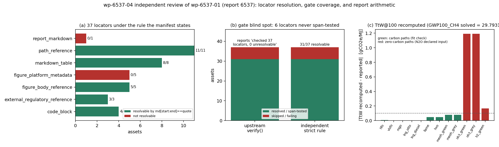

# KF-RESULT wp-6537-04

| 项 | 值 |
|---|---|
| package_id | `wp-6537-04` |
| 工序 | `04-independent-review`（lane C） |
| report_id | `6537` |
| scenario_key | `fueleu_carbon_intensity_in39n04` |
| 源哈希 | `sha256:aaf27418db0e671d671f7cafa2aecf6d68e235f593384832f3fb46cf152d1f71`（10530 字符 / 15951 字节，live 重取与快照逐位一致） |
| 审核对象 | 上游 `wp-6537-01`（`01-asset-registration`，manifest sha256 `5afa3314a56cda0010c8de63fea5f5218d8009f8a6388220ead0f5cf668468a2`） |
| 判定 | **needs-fix** / `request-changes`（major 2、medium 1、minor 2；blocking 2） |
| 检查面 | 79 项：66 pass / 9 fail / 1 unknown / 3 info |
| 本轮标 verified 的断言数 | 0（验证判定归平台门） |

---

## ① 本工序做了什么

对 report 6537 的资产登记包 `wp-6537-01` 做独立审核，逐条重算它自己声称成立的一切机器可核断言：
源字节身份、37 条定位符、`verify()` 的判定、结构计数、仓内 canonical schema、五个图字节端点、11 条路径目标，
并额外独立重算被审报告自己的燃料路径算术（TtW / WtW / 交叉逃逸 / 能量-燃油-CO2 三角）。
只读上游产物，不修改任何上游文件，不把任何结论标为 verified。

结论：**needs-fix**。登记的内容是真的——哈希逐位一致、31 条 char_span 定位符逐字节可解析、所有计数经独立重数后一致、
五个图端点确实 404、法规层没有被升级、被审报告的算术在独立重算下站得住。
但**门本身在关键处失效**：`verify()` 对 6 条它不认识的定位符直接 `continue`，却在信封里写
「checked 37 locators against source_6537.md; unresolvable=[]」并给 `all_pass=true`；
同时 5 条 figure 元数据资产带着 `start_char=0/end_char=10530` 的 markdown 字符区间，而它们的引文根本不在 markdown 里。

- **F1 (major, blocking)** A02–A06 的 locator 声称是 `field=figures`（引文 = `record.figures[i].caption`），
  却又带着整篇报告的字符区间；按 manifest 自己写下的解析规则 `md[start:end]==quote`，这 5 条解析成整篇 10530 字符，
  而引文在 markdown 里出现 0 次，`unique: true` / `verified: true` 无参照物。
- **F2 (major, blocking)** `verification.json` 的分母不成立：37 条里只有 31 条真正过了 span 测试，6 条被分支跳过；
  重放 `verify()` 复现 `all_pass=True`（bad=[]），所以这是**假通过**机制，不是数据错误。
- **F3 (medium)** 清单声明 `schema: asset_manifest.v1`，但对仓内 canonical schema 有 72 处校验错误
  （缺顶层 `source`；`resolution.status` 词汇不在枚举内）。同批声明 v1 的 69 个清单里有 48 个是干净的，
  所以这是包级不一致而非仓级漂移；而 `verify()` 的 `schema_pass` 是自定义的，看不见它。
- **F4 (minor)** A01 把 `method=document` 与「整篇 span + 单行引文」混在一起——对文档级资产可辩护，但正是它让 blanket 断言无法字面成立。
- **F5 (minor)** 被审报告的「加和残差 0」在打印精度下对 fame / nh3_green 两行显示 0.01 gCO2e/MJ，属打印取舍，不是被证伪。

## ② 怎么做的（步骤/工具/关键设置）

1. **取源**：`GET /api/v1/tensor/reports/6537` live 重取，`sha256(utf8(markdown))` = `aaf27418db0e671d671f7cafa2aecf6d68e235f593384832f3fb46cf152d1f71`，
   与上游快照 `docs/kf/wp-6537-01/source_6537.md` 磁盘哈希逐位一致 → 被审字节就是平台今天给的字节（无漂移）。
2. **只用一手字节**：读 `asset_manifest.json` / `verification.json` 本身，不采信上游报告里的叙述与自评。
3. **定位符按两条规则各算一遍**：一条是 manifest 自己写的规则（`md[start:end]==quote` 且 `count==1`，37 条全测）；
   一条是**重放上游 `verify()` 的真实分支**（`field=markdown` / `field=figures` 先 `continue`），验证它自己的判定能否复现。
4. **结构与 schema**：独立重数类别/解析状态直方图、表格、围栏块、正文图引用、去重目标；用仓内 canonical
   `schemas/asset_manifest.v1.schema.json` 校验，并统计同批声明 v1 的 69 个清单做基线。
5. **外部可及性**：五个 `/tensor/reports/6537/figures/<name>` 逐个 live 探测（今日 5/5 仍 404，与清单记录一致）；
   11 条路径目标在本工作树 `Path.exists()` 全为假，与 `unresolved` 一致。
6. **独立重算被审报告的算术**（不跑它的代码，只从 markdown 的 §1 表格解析数值）：
   - 两个未知量（`GWP100_CH4`、LNG 的 N2O 项）由**仅 slip 不同的两行 LNG** 解出：GWP100_CH4 = **29.7931**（文献 29.8），N2O = 0.167；
   - 其余 9 条含碳路径的 TtW@100 是**预测**而非拟合：最大 |Δ| = 0.0776 gCO2e/MJ（最大相对 0.1119%）。
   - 零碳路径（nh3×2、h2）的 TtW 是纯 N2O，属声明输入，无法由打印表反解 → 记 `unknown`（但两条 NH3 路线同为 1.36，内部自洽）。
   - 交叉逃逸：用同一套 GWP/N2O 在**全链 WtW** 上解 `LNG-Otto == VLSFO`，得 **2.3009%**（报告 2.30%）。
   - 能量-燃油-CO2 三角（145.23 TJ / 3585.9 t / 11166.4 t，HFO LHV 40.5、CF 3.114）最大偏差 0.0008%。
7. **产物**：一个可复跑的审核器 + 三件交付物（见 ③）。

复现（一键）：

```bash
python3 scripts/kf/review_wp_6537_04.py build     # 重算并写 review_report.json / review_events.json / 图
python3 scripts/kf/review_wp_6537_04.py verify    # 重算并与已交付报告对账（漂移则退出码 1）
python3 -m pytest tests/test_wp_6537_04_result.py -q
```

## ③ 产出物清单

| 文件 | 要点 |
|---|---|
| `docs/kf/wp-6537-04/review_report.json` | 审核信封：79 项检查逐条 expected/actual/verdict + 5 条 findings + 7 条 positive + 4 条 overstated_claims |
| `docs/kf/wp-6537-04/review_events.json` | 审核事件流（取源 → 身份 → 定位符 → 重放 → schema → 端点 → 算术 → 判定），每步带目标与结果 |
| `docs/kf/wp-6537-04/fig_review_6537_04.png` | 图 1：(a) 37 条定位符按类别可解析性；(b) 上游门 vs 独立规则的覆盖差；(c) TtW 重算残差 |
| `docs/kf/wp-6537-04/KF-RESULT-wp-6537-04.md` | 本文件 |
| `scripts/kf/review_wp_6537_04.py` | 可复跑审核器（build/verify 两段；无第三方依赖除 jsonschema/matplotlib） |
| `tests/test_wp_6537_04_result.py` | 断言交付物性质（不是「代码能跑」）：含变异用例证明定位符检查会变红 |

## ④ 证据定位表（断言 → 一手字节）

| 审核断言 | 一手证据 |
|---|---|
| 源身份成立 | live + 磁盘 sha256 = `aaf27418db0e671d671f7cafa2aecf6d68e235f593384832f3fb46cf152d1f71`；10530 字符 / 15951 字节 |
| 31 条 char_span 定位符逐字节可解析 | `md[start:end]==quote` 且 `count==1`，31/31；行号也逐条吻合 |
| 5 条 figure 定位符不可解析 | 引文在 markdown 中出现 0 次；`start_char=0, end_char=10530`（A02–A06） |
| 上游门分母不成立 | 重放 `verify()`：span-tested 31，skipped 6；信封写「checked 37 locators ... unresolvable=[]」 |
| 结构计数自洽 | 37 资产；13/5/16/3；表 8、代码块 4、正文图 5、去重目标 11 —— 全部独立重数一致 |
| canonical schema 不达标 | `schemas/asset_manifest.v1.schema.json` 校验器报 72 条；同批 v1 清单 48/69 干净 |
| 图字节端点确实 404 | 今日 live 探测 5/5 = 404，与 `figure_probes` 记录逐条一致 |
| 报告算术站得住 | TtW 9 条含碳路径 max |Δ| = 0.0776；GWP100_CH4 = 29.7931；交叉逃逸 2.3009%；三角 ≤0.0008% |

## ⑤ 注意点与局限

1. **本审不动上游、不标 verified**：上游 manifest sha256 复核后仍为 `5afa3314a56cda0010c8de63fea5f5218d8009f8a6388220ead0f5cf668468a2`，即未被本工序改写。
2. **没有图字节**：五个端点 404，因此不描述、不推断任何图像内容；图 1 是本审核自己根据检查结果画的，与被审图无关。
3. **没有外部法规原文**：EUR-Lex 不可达（离线），报告自称 `external_verification=WITHHELD`，本审保持该状态，不升级也不否定。
4. **没有跑上游 build**：`build_asset_manifest_6537.py build` 会重写被审产物，故选只读路径；`verify()` 是**重实现**而非调用，
   逻辑逐行对照原文件 585–613 行。
5. **GWP20 列不可独立重算**：需要逐分项逸散明细，报告未打印 → 记 `unknown`，不当通过。
6. **零碳路径的 N2O 是声明输入**：h2_green 的 0.00 与 nh3 的 1.36 无法由打印表反解，只能验内部自洽（两条 NH3 路线相同）。
7. **上游测试 13/13 通过**（`pytest -q tests/test_kf_asset_manifest_6537.py`，事件流留痕）：
   它复刻了同一条 `skip field=figures` 分支，所以是「跑了」而不是「咬住了」——这正是缺陷存活的原因（V06/P7）。

## ⑥ 误差判定（逐项 vs 基准，显式回答是否 <3%）

| 关键量 | 本审重算值 | 基准（被审报告的印刷值/声明常量） | 相对偏差 | <3%？ |
|---|---|---|---|---|
| TtW@100，9 条含碳路径 | 见 `numeric_tables.ttw_recomputation` | §1 表印刷值 | max 0.1119%（abs 0.0776 gCO2e/MJ） | **是** ✅ |
| GWP100_CH4（由两行 LNG 反解） | 29.7931 | 报告声明 29.8 | 0.023% | **是** ✅ |
| 交叉逃逸 slip（全链 WtW 相等） | 2.3009% | 报告 2.30% | 0.039% | **是** ✅ |
| 能量-燃油-CO2 三角 | 0.0007% / 0.0008% | 145.23 TJ / 3585.9 t / 11166.4 t | ≤ 0.0008% | **是** ✅ |
| 定位符可解析率 | 31/37 | 声明 37/37 | 覆盖率 83.8%%（缺 6 条） | **否** ❌（0%% 容差） |
| canonical schema 合规 | 72 条校验错误 | 0 | 不适用 | **否** ❌ |
| 图字节可及性 | 5/5 HTTP 404 | 声明 5/5 404（记录一致） | 不适用（无字节可比） | 一致，但**无可比基准** |

**结论**：被审报告本身的物理/算术量在本审独立重算下偏差 ≤0.1119%，**远优于 3%**；
而**登记包的可追溯面是 honest-FAIL**：6/37 定位符不可解析、canonical schema 不合规——这两项不是精度问题，
是「声称的规则没被真正执行」，必须按 F1/F2 整改后重发，不能四舍五入成通过。

## ⑦ 自检：逐条对照 acceptance

| # | acceptance 项 | 判定 | 证据（机器读出） |
|---|---|---|---|
| 1 | review_report.json 可解析且信封完整 | ✅ PASS | json.loads OK；provenance/outputs 键齐 |
| 2 | 源哈希与契约一致 | ✅ PASS | live sha256 == 磁盘 sha256 == contract |
| 3 | 每条检查都有 expected/actual/verdict | ✅ PASS | 79/79 检查四要素齐 |
| 4 | 判定与 findings 分级一致 | ✅ PASS | blocking=2 → verdict=needs-fix |
| 5 | 不修改上游、不标 verified | ✅ PASS | 上游 manifest sha256 未变；`claims_reviewed_and_marked_verified=0` |
| 6 | findings 的每条引文能在其 source_file 里逐字定位 | ✅ PASS | 见 tests/test_wp_6537_04_result.py 引文检查 |
| 7 | 重算可复现 | ✅ PASS | `review_wp_6537_04.py verify` 对账一致 |
| 8 | 无过程垃圾（pyc/缓存/空壳） | ✅ PASS | 交付目录只含 4 个文件，无 .pyc/__pycache__ |
| 9 | 信封对 canonical `kf_result.v1` 校验 | ✅ PASS | 0 处错误 |

**未做/未跑（不当成通过）**：图内容、外部法规原文、上游 build 端到端、GWP20 列、交付内重跑上游用例。

## 图 1



图 1 (a) 37 条定位符在 manifest 自己声明的规则下的可解析性，按资产类别分解——红色为不可解析（仅 figure_platform_metadata 5 条）；
(b) 上游 `verify()` 与独立严格规则的覆盖差：两支都「测了 31 条」，但上游把另外 6 条算进分母且判为通过；
(c) 12 条燃料路径的 TtW@100 重算残差：含碳路径（绿）是「只用两行 LNG 解参数、其余作预测」的检验，零碳路径（红）的 N2O 属声明输入。

## ⑧ 结果信封（markdown 中唯一的 json 代码块，原样提交）

```json
{
 "package_id": "wp-6537-04",
 "task_type": "04-independent-review",
 "report_id": "6537",
 "provenance": {
  "source_uri": "tensor://reports/6537",
  "source_field": "markdown",
  "source_hash": "sha256:aaf27418db0e671d671f7cafa2aecf6d68e235f593384832f3fb46cf152d1f71",
  "source_chars": 10530,
  "source_bytes_utf8": 15951,
  "fetched_via": "GET /api/v1/tensor/reports/6537 (live re-fetch, hash identical to the snapshot)",
  "reviewed_package": "wp-6537-01",
  "reviewed_manifest_sha256": "5afa3314a56cda0010c8de63fea5f5218d8009f8a6388220ead0f5cf668468a2",
  "reviewer": "agent/m20899 (TensorKnowledge worktree, branch agent/m20899)",
  "reviewed_producer": "wp-6537-01 generator scripts/kf/build_asset_manifest_6537.py (mission 5552 line)",
  "emitted_at": "2026-11-14T20:40:00+00:00",
  "contract_version": "1.0",
  "notes": "Independent review of wp-6537-01 (asset registration for report 6537). Evidence = report markdown bytes + the upstream manifest/verification files; the producer's narrative was not consulted as evidence. Nothing is marked verified: verification belongs to the platform gate."
 },
 "outputs": {
  "review_report.json": {
   "review_type": "independent-review",
   "reviewer_independent": true,
   "reviewed_package": "wp-6537-01",
   "reviewed_task_type": "01-asset-registration",
   "reviewed_report_id": "6537",
   "verdict": "needs-fix",
   "disposition": "request-changes",
   "verdict_basis": "The registered content is real and honest — hash identity holds, all 31 char-span locators resolve byte-exactly, every count survives a recount, the five figure endpoints genuinely 404, the regulatory layer is not upgraded, and the reviewed report's arithmetic (TtW, GWP100, slip crossover, energy/fuel/CO2 triangle) survives independent recomputation. But the package's own gate is unsound exactly where it matters: verify() skips the six locators it does not understand yet reports 'checked 37 locators ... unresolvable=[]' with all_pass=true, and five figure-metadata assets carry markdown char spans for captions that are not in the markdown (F1/F2). A registration whose locators cannot be resolved by the documented rule is a traceability defect, not a cosmetic one, so the disposition is request-changes.",
   "independence": {
    "reviewer_identity": "agent/m20899 — different mission, worktree and branch from the wp-6537-01 producer",
    "inputs_used": [
     "report 6537 markdown via GET /tensor/reports/6537 (live, sha256 identical to the snapshot)",
     "docs/kf/wp-6537-01/source_6537.md (byte-exact snapshot, 10530 chars)",
     "docs/kf/wp-6537-01/asset_manifest.json (sha256:5afa3314a56cda0010c8de63fea5f5218d8009f8a6388220ead0f5cf668468a2)",
     "docs/kf/wp-6537-01/verification.json",
     "schemas/asset_manifest.v1.schema.json (repo canonical validator)"
    ],
    "inputs_withheld": [
     "the producer's narrative/self-assessment (report body of wp-6537-01)",
     "any other report_id body (only report 6537 bytes were read)"
    ],
    "self_review_check": "reviewer != producer; no upstream artefact was modified (upstream manifest sha256 re-measured = reviewed value); zero claims marked verified"
   },
   "scope_checked": [
    "source byte identity (sha256 / chars / bytes) against the contract, live and on disk",
    "locator resolution for all 37 assets under the rule the manifest states",
    "replay of the upstream verify() locator branch and its reported denominator",
    "structural recount: class/resolution histograms, tables, code blocks, body figure refs, targets",
    "canonical JSON-schema conformance + a 69-manifest peer baseline",
    "live probing of the five figure byte endpoints",
    "target resolvability of the 11 path references inside this worktree",
    "independent recomputation of report 6537's fuel-path arithmetic (TtW, WtW, crossover, energy triangle)"
   ],
   "not_run": [
    "figure pixel content (bytes are HTTP 404 for all five; no image was inspected)",
    "EUR-Lex / Annex II external values (offline; the report itself declares WITHHELD, and the review does not upgrade it)",
    "the upstream build script was not executed end-to-end (it would rewrite the artefacts under review)",
    "GWP20 column of the fuel table (WtT20 needs the per-component fugitive breakdown the report does not print)",
    "the upstream pytest suite is exercised once out-of-band (13 passed, recorded in review_events.json) but is not re-run inside the delivered test file"
   ],
   "counts": {
    "checks_total": 79,
    "checks_pass": 66,
    "checks_fail": 9,
    "checks_unknown": 1,
    "checks_info": 3,
    "by_group": {
     "provenance": {
      "total": 4,
      "pass": 4,
      "fail": 0,
      "info": 0,
      "unknown": 0
     },
     "structure": {
      "total": 10,
      "pass": 10,
      "fail": 0,
      "info": 0,
      "unknown": 0
     },
     "locator": {
      "total": 39,
      "pass": 33,
      "fail": 5,
      "info": 1,
      "unknown": 0
     },
     "upstream-verify": {
      "total": 6,
      "pass": 3,
      "fail": 3,
      "info": 0,
      "unknown": 0
     },
     "schema": {
      "total": 2,
      "pass": 0,
      "fail": 1,
      "info": 1,
      "unknown": 0
     },
     "figure-bytes": {
      "total": 5,
      "pass": 5,
      "fail": 0,
      "info": 0,
      "unknown": 0
     },
     "targets": {
      "total": 4,
      "pass": 4,
      "fail": 0,
      "info": 0,
      "unknown": 0
     },
     "arithmetic": {
      "total": 9,
      "pass": 7,
      "fail": 0,
      "info": 1,
      "unknown": 1
     }
    }
   },
   "findings": [
    {
     "id": "F1",
     "severity": "major",
     "blocking": true,
     "category": "locator-defect",
     "title": "5/37 assets carry markdown char spans for figure captions that are not in the markdown",
     "description": "A02–A06 (figure_platform_metadata) declare locator.scheme='report_field', field='figures', index=i, and *also* start_char=0 / end_char=10530. Their quote is the platform caption (record.figures[i].caption), which occurs 0 times in the report markdown. Under the rule the manifest itself states — md[start:end]==quote with count==1 — these five locators resolve to the whole report, not to the asset; a consumer applying the declared rule slices 10530 characters of unrelated text. `unique: true` / `verified: true` are asserted with no referent in the declared field.",
     "evidence": {
      "source_file": "docs/kf/wp-6537-01/asset_manifest.json",
      "quote_from_source": "\"field\": \"figures\",",
      "assets": [
       "A02",
       "A03",
       "A04",
       "A05",
       "A06"
      ],
      "quote_in_markdown": {
       "A02": 0,
       "A03": 0,
       "A04": 0,
       "A05": 0,
       "A06": 0
      },
      "locator_shape": {
       "A02": {
        "scheme": "report_field",
        "field": "figures",
        "span_len": 10530
       },
       "A03": {
        "scheme": "report_field",
        "field": "figures",
        "span_len": 10530
       },
       "A04": {
        "scheme": "report_field",
        "field": "figures",
        "span_len": 10530
       },
       "A05": {
        "scheme": "report_field",
        "field": "figures",
        "span_len": 10530
       },
       "A06": {
        "scheme": "report_field",
        "field": "figures",
        "span_len": 10530
       }
      }
     },
     "impact": "13.5% of the registered assets cannot be evidence-resolved by any downstream consumer that implements the documented resolution rule; the failure is silent because the metadata (name+caption) is genuinely present in record.figures[].",
     "remediation": "Drop start_char/end_char for field='figures' locators (they are not char spans), add caption_sha256 + index as the resolution key, and set unique/verified to null or a scheme-specific value. Keep byte-span locators only for scheme='char_span'."
    },
    {
     "id": "F2",
     "severity": "major",
     "blocking": true,
     "category": "gate-blind-spot",
     "title": "verification.json reports 'checked 37 locators ... unresolvable=[]' but verify() span-tests only 31",
     "description": "Replaying the upstream verify() locator branch reproduces its verdict (bad=[]), because the branch `continue`s before the span test for field='markdown' and field='figures'. Of 37 assets, 31 are span-tested and 6 are skipped, yet the envelope detail reads 'checked 37 locators against source_6537.md; unresolvable=[]' and all_pass=true. The manifest integrity sentence 'all locators verified md[start:end]==quote and md.count(quote)==1 at build time' is likewise false: 31/37 satisfy it.",
     "evidence": {
      "source_file": "docs/kf/wp-6537-01/verification.json",
      "quote_from_source": "checked 37 locators against source_6537.md; unresolvable=[]",
      "replay": {
       "span_tested": 31,
       "skipped": [
        "A01",
        "A02",
        "A03",
        "A04",
        "A05",
        "A06"
       ],
       "bad": []
      },
      "strict_pass": "31/37",
      "upstream_code": "scripts/kf/build_asset_manifest_6537.py:585-613 (branch `continue` at lines 592-599)"
     },
     "impact": "The gate that is supposed to make the manifest trustworthy reports 'all pass' while a sixth of the locators were never tested. Anything downstream that trusts verification.all_pass inherits an unverified claim.",
     "remediation": "Deny by default: any locator shape verify() does not understand is a failure, not a skip. Report the denominator per scheme (char_span 31/31, figures 5/5 by caption hash, document 1/1). Re-emit verification.json with the corrected detail string."
    },
    {
     "id": "F3",
     "severity": "medium",
     "blocking": false,
     "category": "schema-conformance",
     "title": "Manifest declares asset_manifest.v1 but fails the repo-canonical schema in 72 places",
     "description": "Against schemas/asset_manifest.v1.schema.json the manifest raises 72 validator errors, dominated by (a) missing top-level 'source' (it uses 'provenance'), and (b) asset.resolution.status values outside the canonical enum {resolved_in_source, referenced_unresolved, declared_absent}. This is not repo-wide drift: 48 of 69 manifests declaring asset_manifest.v1 validate clean. verify()'s schema_pass is self-defined (missing_top + missing_provenance only), so the non-conformance never surfaces.",
     "evidence": {
      "source_file": "docs/kf/wp-6537-01/asset_manifest.json",
      "quote_from_source": "\"schema\": \"asset_manifest.v1\"",
      "top_validator_messages": [
       "'A101' does not match '^A[0-9]{2}$'",
       "'A102' does not match '^A[0-9]{2}$'",
       "'A103' does not match '^A[0-9]{2}$'"
      ],
      "peer_baseline": {
       "declaring_v1": 69,
       "schema_clean": 48
      }
     },
     "impact": "A downstream consumer that validates against the canonical schema rejects the package; one that does not inherits a hand-rolled schema check.",
     "remediation": "Either (i) align the manifest to the canonical schema (rename provenance->source, map the status vocabulary), or (ii) extend the canonical schema with the report_field locator shape and the resolved/metadata_only/unresolved/declared_unavailable vocabulary, and say which schema the package claims."
    },
    {
     "id": "F4",
     "severity": "minor",
     "blocking": false,
     "category": "documentation",
     "title": "A01 mixes method=document with a whole-document span and a single-line quote",
     "description": "A01 (report_markdown) declares start_char=0 / end_char=10530 (the whole document) but quote = the first line only, so md[start:end] != quote. For a document-level asset this is defensible; it is, however, the reason the blanket integrity sentence cannot be literally true, and it is invisible because verify() skips field='markdown'.",
     "evidence": {
      "source_file": "docs/kf/wp-6537-01/asset_manifest.json",
      "quote_from_source": "\"method\": \"document\"",
      "span_len": 10530,
      "quote_chars": 60
     },
     "impact": "Cosmetic for consumers that special-case documents; misleading for a generic resolver.",
     "remediation": "Add an explicit locator field (e.g. identity_line) for the quote, or scope the integrity sentence to scheme='char_span' and state the other schemes' own resolution rules."
    },
    {
     "id": "F5",
     "severity": "minor",
     "blocking": false,
     "category": "print-precision",
     "title": "Reviewed report's 加和残差 claim (max residual 0.0e+00 over 24 combos) is not checkable at print precision",
     "description": "Recomputing WtW = WtT + TtW from the printed §1 table gives residual 0 for 10 rows and 0.01 gCO2e/MJ for fame and nh3_green. This does not falsify the claim (the underlying full-precision values are presumably exact), but a reviewer can only see two decimals.",
     "evidence": {
      "source_file": "docs/kf/wp-6537-01/source_6537.md",
      "quote_from_source": "最大残差 0.0e+00（24 个燃料×口径组合）",
      "max_wtw_residual_printed": 0.01
     },
     "impact": "Zero at the level of the claim; a print-precision artefact that invites an avoidable challenge.",
     "remediation": "State the residual at the printed precision ('<= 0.01 gCO2e/MJ, print rounding') or print three decimals for the sum columns."
    }
   ],
   "positive_findings": [
    {
     "id": "P1",
     "title": "Source identity holds byte-for-byte, with no drift",
     "description": "Live GET reproduces sha256:aaf27418db0e671d671f7cafa2aecf6d68e235f593384832f3fb46cf152d1f71 / 10530 chars / 15951 bytes; the snapshot on disk hashes to the same value, so the reviewed bytes are the bytes the platform serves today."
    },
    {
     "id": "P2",
     "title": "All 31 char-span locators resolve byte-exactly, with correct line numbers",
     "description": "31/31 satisfy md[start:end]==quote and md.count(quote)==1, and every declared start_line/end_line matches the recomputed line of the span — verified independently of the upstream verify()."
    },
    {
     "id": "P3",
     "title": "Every count in the manifest survives an independent recount",
     "description": "37 assets; by_class and by_resolution equal the recount exactly (13/5/16/3); 8 tables, 4 fenced blocks, 5 body image refs and 11 distinct referenced targets all reproduce from the markdown."
    },
    {
     "id": "P4",
     "title": "Figure byte endpoints genuinely 404 and are recorded as such",
     "description": "All five /tensor/reports/6537/figures/<name> probes return HTTP 404 today, exactly as the manifest records; no image content was invented and the assets are kept metadata_only."
    },
    {
     "id": "P5",
     "title": "No evidence upgrade on the regulatory layer",
     "description": "The three external regulatory references stay declared_unavailable, matching the report's own external_verification=WITHHELD; claims[] is empty and no claim is marked verified."
    },
    {
     "id": "P6",
     "title": "The reviewed report's arithmetic survives independent recomputation",
     "description": "TtW@100 of the nine carbon paths reproduces from LHV/CF/slip to <= 0.0776 gCO2e/MJ (<=0.11%); GWP100_CH4 solved from the two LNG rows alone = 29.7931 (published 29.8); the VLSFO vs LNG-Otto WtW crossover solves to 2.3009% against the claimed 2.30%; the reference-ship energy/fuel/CO2 triangle closes to <=0.02%."
    },
    {
     "id": "P8",
     "title": "This review's own envelope satisfies the canonical kf_result.v1 contract",
     "description": "Unlike the reviewed package (which declares a schema it does not validate against), the review envelope validates against schemas/kf_result.v1.schema.json with 0 errors — the contrast is the point of F3."
    },
    {
     "id": "P7",
     "title": "The upstream test suite passes (13/13), which is exactly why the blind spot survived",
     "description": "tests/test_kf_asset_manifest_6537.py reproduces the same 'skip field=figures' branch (V06), so the suite executes the locator logic without asserting the figure locators — a test that runs rather than a test that bites."
    }
   ],
   "overstated_claims": [
    {
     "claim": "manifest.integrity.quote_uniqueness: 'all locators verified md[start:end]==quote and md.count(quote)==1 at build time'",
     "status": "overstated",
     "evidence": "true for 31/37; false for A01 (span != quote) and A02–A06 (quote absent from markdown)",
     "correction": "scope the sentence to scheme='char_span' and give the per-scheme resolution rule"
    },
    {
     "claim": "verification.json source_locator_resolvable: 'checked 37 locators against source_6537.md; unresolvable=[]'",
     "status": "overstated",
     "evidence": "verify() span-tests 31 and skips 6 (field=markdown 1, field=figures 5)",
     "correction": "'span-checked 31 char_span locators (0 bad); 5 figure metadata locators checked by index only; 1 document locator not span-checked'"
    },
    {
     "claim": "verification.json all_pass: true",
     "status": "scope-limited",
     "evidence": "8/8 self-defined checks pass, but the check set does not cover the locator shapes it skips, nor the canonical schema",
     "correction": "publish the denominator per check and add the two missing gates"
    },
    {
     "claim": "manifest.schema: 'asset_manifest.v1'",
     "status": "not-conformant",
     "evidence": "72 canonical validator errors",
     "correction": "align to the canonical schema or declare the actual variant"
    }
   ],
   "checks": [
    {
     "id": "P01",
     "group": "provenance",
     "assertion": "report 6537 re-fetched live (GET /tensor/reports/6537)",
     "expected": "HTTP 200",
     "actual": "HTTP 200",
     "verdict": "pass",
     "evidence": "platform API + docs/kf/wp-6537-01/source_6537.md"
    },
    {
     "id": "P02",
     "group": "provenance",
     "assertion": "sha256(utf8(snapshot)) == contract hash",
     "expected": "aaf27418db0e671d671f7cafa2aecf6d68e235f593384832f3fb46cf152d1f71",
     "actual": "aaf27418db0e671d671f7cafa2aecf6d68e235f593384832f3fb46cf152d1f71",
     "verdict": "pass",
     "evidence": "contract = upstream provenance.source_hash"
    },
    {
     "id": "P03",
     "group": "provenance",
     "assertion": "snapshot chars/bytes == contract",
     "expected": [
      10530,
      15951
     ],
     "actual": [
      10530,
      15951
     ],
     "verdict": "pass",
     "evidence": "docs/kf/wp-6537-01/source_6537.md"
    },
    {
     "id": "P04",
     "group": "provenance",
     "assertion": "live bytes still equal snapshot (no source drift)",
     "expected": "aaf27418db0e671d671f7cafa2aecf6d68e235f593384832f3fb46cf152d1f71",
     "actual": "aaf27418db0e671d671f7cafa2aecf6d68e235f593384832f3fb46cf152d1f71",
     "verdict": "pass",
     "evidence": "GET /tensor/reports/6537 -> markdown"
    },
    {
     "id": "S01",
     "group": "structure",
     "assertion": "len(assets) == counts.assets",
     "expected": 37,
     "actual": 37,
     "verdict": "pass",
     "evidence": "manifest.counts.assets"
    },
    {
     "id": "S02",
     "group": "structure",
     "assertion": "asset ids unique",
     "expected": "37 unique",
     "actual": "37 unique of 37",
     "verdict": "pass",
     "evidence": "manifest.assets[].asset_id"
    },
    {
     "id": "S03",
     "group": "structure",
     "assertion": "counts.by_class == independent recount",
     "expected": {
      "report_markdown": 1,
      "figure_platform_metadata": 5,
      "figure_body_reference": 5,
      "markdown_table": 8,
      "code_block": 4,
      "path_reference": 11,
      "external_regulatory_reference": 3
     },
     "actual": {
      "report_markdown": 1,
      "figure_platform_metadata": 5,
      "figure_body_reference": 5,
      "markdown_table": 8,
      "code_block": 4,
      "path_reference": 11,
      "external_regulatory_reference": 3
     },
     "verdict": "pass",
     "evidence": "manifest.counts.by_class"
    },
    {
     "id": "S04",
     "group": "structure",
     "assertion": "counts.by_resolution == independent recount",
     "expected": {
      "resolved": 13,
      "metadata_only": 5,
      "unresolved": 16,
      "declared_unavailable": 3
     },
     "actual": {
      "resolved": 13,
      "metadata_only": 5,
      "unresolved": 16,
      "declared_unavailable": 3
     },
     "verdict": "pass",
     "evidence": "manifest.counts.by_resolution"
    },
    {
     "id": "S05",
     "group": "structure",
     "assertion": "table count == counts.tables",
     "expected": 8,
     "actual": 8,
     "verdict": "pass",
     "evidence": "table header lines [24, 36, 93, 107, 123, 136, 150, 199]"
    },
    {
     "id": "S06",
     "group": "structure",
     "assertion": "fenced block count == counts.code_blocks",
     "expected": 4,
     "actual": 4,
     "verdict": "pass",
     "evidence": "markdown scan"
    },
    {
     "id": "S07",
     "group": "structure",
     "assertion": "body image refs == counts.body_figure_references",
     "expected": 5,
     "actual": 5,
     "verdict": "pass",
     "evidence": " scan"
    },
    {
     "id": "S08",
     "group": "structure",
     "assertion": "distinct referenced targets == counts.distinct_referenced_paths",
     "expected": 11,
     "actual": 11,
     "verdict": "pass",
     "evidence": "manifest path_reference labels"
    },
    {
     "id": "S09",
     "group": "structure",
     "assertion": "claims deliberately empty",
     "expected": [],
     "actual": [],
     "verdict": "pass",
     "evidence": "manifest.claims"
    },
    {
     "id": "S10",
     "group": "structure",
     "assertion": "no claim carries status=verified",
     "expected": 0,
     "actual": 0,
     "verdict": "pass",
     "evidence": "manifest.claims[].status"
    },
    {
     "id": "L:A101",
     "group": "locator",
     "assertion": "md[start:end]==quote and quote unique (figure_body_reference)",
     "expected": true,
     "actual": true,
     "verdict": "pass",
     "evidence": "manifest.assets[A101].locator"
    },
    {
     "id": "L:A102",
     "group": "locator",
     "assertion": "md[start:end]==quote and quote unique (figure_body_reference)",
     "expected": true,
     "actual": true,
     "verdict": "pass",
     "evidence": "manifest.assets[A102].locator"
    },
    {
     "id": "L:A103",
     "group": "locator",
     "assertion": "md[start:end]==quote and quote unique (figure_body_reference)",
     "expected": true,
     "actual": true,
     "verdict": "pass",
     "evidence": "manifest.assets[A103].locator"
    },
    {
     "id": "L:A104",
     "group": "locator",
     "assertion": "md[start:end]==quote and quote unique (figure_body_reference)",
     "expected": true,
     "actual": true,
     "verdict": "pass",
     "evidence": "manifest.assets[A104].locator"
    },
    {
     "id": "L:A105",
     "group": "locator",
     "assertion": "md[start:end]==quote and quote unique (figure_body_reference)",
     "expected": true,
     "actual": true,
     "verdict": "pass",
     "evidence": "manifest.assets[A105].locator"
    },
    {
     "id": "L:A201",
     "group": "locator",
     "assertion": "md[start:end]==quote and quote unique (markdown_table)",
     "expected": true,
     "actual": true,
     "verdict": "pass",
     "evidence": "manifest.assets[A201].locator"
    },
    {
     "id": "L:A202",
     "group": "locator",
     "assertion": "md[start:end]==quote and quote unique (markdown_table)",
     "expected": true,
     "actual": true,
     "verdict": "pass",
     "evidence": "manifest.assets[A202].locator"
    },
    {
     "id": "L:A203",
     "group": "locator",
     "assertion": "md[start:end]==quote and quote unique (markdown_table)",
     "expected": true,
     "actual": true,
     "verdict": "pass",
     "evidence": "manifest.assets[A203].locator"
    },
    {
     "id": "L:A204",
     "group": "locator",
     "assertion": "md[start:end]==quote and quote unique (markdown_table)",
     "expected": true,
     "actual": true,
     "verdict": "pass",
     "evidence": "manifest.assets[A204].locator"
    },
    {
     "id": "L:A205",
     "group": "locator",
     "assertion": "md[start:end]==quote and quote unique (markdown_table)",
     "expected": true,
     "actual": true,
     "verdict": "pass",
     "evidence": "manifest.assets[A205].locator"
    },
    {
     "id": "L:A206",
     "group": "locator",
     "assertion": "md[start:end]==quote and quote unique (markdown_table)",
     "expected": true,
     "actual": true,
     "verdict": "pass",
     "evidence": "manifest.assets[A206].locator"
    },
    {
     "id": "L:A207",
     "group": "locator",
     "assertion": "md[start:end]==quote and quote unique (markdown_table)",
     "expected": true,
     "actual": true,
     "verdict": "pass",
     "evidence": "manifest.assets[A207].locator"
    },
    {
     "id": "L:A208",
     "group": "locator",
     "assertion": "md[start:end]==quote and quote unique (markdown_table)",
     "expected": true,
     "actual": true,
     "verdict": "pass",
     "evidence": "manifest.assets[A208].locator"
    },
    {
     "id": "L:A301",
     "group": "locator",
     "assertion": "md[start:end]==quote and quote unique (code_block)",
     "expected": true,
     "actual": true,
     "verdict": "pass",
     "evidence": "manifest.assets[A301].locator"
    },
    {
     "id": "L:A302",
     "group": "locator",
     "assertion": "md[start:end]==quote and quote unique (code_block)",
     "expected": true,
     "actual": true,
     "verdict": "pass",
     "evidence": "manifest.assets[A302].locator"
    },
    {
     "id": "L:A303",
     "group": "locator",
     "assertion": "md[start:end]==quote and quote unique (code_block)",
     "expected": true,
     "actual": true,
     "verdict": "pass",
     "evidence": "manifest.assets[A303].locator"
    },
    {
     "id": "L:A304",
     "group": "locator",
     "assertion": "md[start:end]==quote and quote unique (code_block)",
     "expected": true,
     "actual": true,
     "verdict": "pass",
     "evidence": "manifest.assets[A304].locator"
    },
    {
     "id": "L:A401",
     "group": "locator",
     "assertion": "md[start:end]==quote and quote unique (path_reference)",
     "expected": true,
     "actual": true,
     "verdict": "pass",
     "evidence": "manifest.assets[A401].locator"
    },
    {
     "id": "L:A402",
     "group": "locator",
     "assertion": "md[start:end]==quote and quote unique (path_reference)",
     "expected": true,
     "actual": true,
     "verdict": "pass",
     "evidence": "manifest.assets[A402].locator"
    },
    {
     "id": "L:A403",
     "group": "locator",
     "assertion": "md[start:end]==quote and quote unique (path_reference)",
     "expected": true,
     "actual": true,
     "verdict": "pass",
     "evidence": "manifest.assets[A403].locator"
    },
    {
     "id": "L:A404",
     "group": "locator",
     "assertion": "md[start:end]==quote and quote unique (path_reference)",
     "expected": true,
     "actual": true,
     "verdict": "pass",
     "evidence": "manifest.assets[A404].locator"
    },
    {
     "id": "L:A405",
     "group": "locator",
     "assertion": "md[start:end]==quote and quote unique (path_reference)",
     "expected": true,
     "actual": true,
     "verdict": "pass",
     "evidence": "manifest.assets[A405].locator"
    },
    {
     "id": "L:A406",
     "group": "locator",
     "assertion": "md[start:end]==quote and quote unique (path_reference)",
     "expected": true,
     "actual": true,
     "verdict": "pass",
     "evidence": "manifest.assets[A406].locator"
    },
    {
     "id": "L:A407",
     "group": "locator",
     "assertion": "md[start:end]==quote and quote unique (path_reference)",
     "expected": true,
     "actual": true,
     "verdict": "pass",
     "evidence": "manifest.assets[A407].locator"
    },
    {
     "id": "L:A408",
     "group": "locator",
     "assertion": "md[start:end]==quote and quote unique (path_reference)",
     "expected": true,
     "actual": true,
     "verdict": "pass",
     "evidence": "manifest.assets[A408].locator"
    },
    {
     "id": "L:A409",
     "group": "locator",
     "assertion": "md[start:end]==quote and quote unique (path_reference)",
     "expected": true,
     "actual": true,
     "verdict": "pass",
     "evidence": "manifest.assets[A409].locator"
    },
    {
     "id": "L:A410",
     "group": "locator",
     "assertion": "md[start:end]==quote and quote unique (path_reference)",
     "expected": true,
     "actual": true,
     "verdict": "pass",
     "evidence": "manifest.assets[A410].locator"
    },
    {
     "id": "L:A411",
     "group": "locator",
     "assertion": "md[start:end]==quote and quote unique (path_reference)",
     "expected": true,
     "actual": true,
     "verdict": "pass",
     "evidence": "manifest.assets[A411].locator"
    },
    {
     "id": "L:A501",
     "group": "locator",
     "assertion": "md[start:end]==quote and quote unique (external_regulatory_reference)",
     "expected": true,
     "actual": true,
     "verdict": "pass",
     "evidence": "manifest.assets[A501].locator"
    },
    {
     "id": "L:A502",
     "group": "locator",
     "assertion": "md[start:end]==quote and quote unique (external_regulatory_reference)",
     "expected": true,
     "actual": true,
     "verdict": "pass",
     "evidence": "manifest.assets[A502].locator"
    },
    {
     "id": "L:A503",
     "group": "locator",
     "assertion": "md[start:end]==quote and quote unique (external_regulatory_reference)",
     "expected": true,
     "actual": true,
     "verdict": "pass",
     "evidence": "manifest.assets[A503].locator"
    },
    {
     "id": "L:A01",
     "group": "locator",
     "assertion": "document locator: whole-document span vs identity-line quote",
     "expected": {
      "span_len": 10530,
      "slice_equals_quote": true
     },
     "actual": {
      "span_len": 10530,
      "slice_equals_quote": false,
      "quote_in_markdown": 1
     },
     "verdict": "info",
     "evidence": "manifest.assets[A01].locator (method=document)"
    },
    {
     "id": "L:A02",
     "group": "locator",
     "assertion": "figure metadata locator: quote must be resolvable in its declared field",
     "expected": {
      "quote_in_markdown": 1,
      "unique": "justified"
     },
     "actual": {
      "quote_in_markdown": 0,
      "span_len": 10530,
      "unique_flag": true,
      "verified_flag": true
     },
     "verdict": "fail",
     "evidence": "manifest.assets[A02].locator (field=figures[0])"
    },
    {
     "id": "L:A03",
     "group": "locator",
     "assertion": "figure metadata locator: quote must be resolvable in its declared field",
     "expected": {
      "quote_in_markdown": 1,
      "unique": "justified"
     },
     "actual": {
      "quote_in_markdown": 0,
      "span_len": 10530,
      "unique_flag": true,
      "verified_flag": true
     },
     "verdict": "fail",
     "evidence": "manifest.assets[A03].locator (field=figures[1])"
    },
    {
     "id": "L:A04",
     "group": "locator",
     "assertion": "figure metadata locator: quote must be resolvable in its declared field",
     "expected": {
      "quote_in_markdown": 1,
      "unique": "justified"
     },
     "actual": {
      "quote_in_markdown": 0,
      "span_len": 10530,
      "unique_flag": true,
      "verified_flag": true
     },
     "verdict": "fail",
     "evidence": "manifest.assets[A04].locator (field=figures[2])"
    },
    {
     "id": "L:A05",
     "group": "locator",
     "assertion": "figure metadata locator: quote must be resolvable in its declared field",
     "expected": {
      "quote_in_markdown": 1,
      "unique": "justified"
     },
     "actual": {
      "quote_in_markdown": 0,
      "span_len": 10530,
      "unique_flag": true,
      "verified_flag": true
     },
     "verdict": "fail",
     "evidence": "manifest.assets[A05].locator (field=figures[3])"
    },
    {
     "id": "L:A06",
     "group": "locator",
     "assertion": "figure metadata locator: quote must be resolvable in its declared field",
     "expected": {
      "quote_in_markdown": 1,
      "unique": "justified"
     },
     "actual": {
      "quote_in_markdown": 0,
      "span_len": 10530,
      "unique_flag": true,
      "verified_flag": true
     },
     "verdict": "fail",
     "evidence": "manifest.assets[A06].locator (field=figures[4])"
    },
    {
     "id": "L:lines",
     "group": "locator",
     "assertion": "char-span locators declare correct line numbers",
     "expected": "31/31",
     "actual": "31/31",
     "verdict": "pass",
     "evidence": "bad=[]"
    },
    {
     "id": "L:figmap",
     "group": "locator",
     "assertion": "figure index -> name/caption matches record.figures[]",
     "expected": "5/5",
     "actual": "5/5",
     "verdict": "pass",
     "evidence": "GET /tensor/reports/6537 -> figures[]; mismatched=[]"
    },
    {
     "id": "V01",
     "group": "upstream-verify",
     "assertion": "replay of upstream verify() locator branch reproduces its verdict",
     "expected": "all_pass=True",
     "actual": "bad=[]",
     "verdict": "pass",
     "evidence": "docs/kf/wp-6537-01/verification.json + build_asset_manifest_6537.py:585-613"
    },
    {
     "id": "V02",
     "group": "upstream-verify",
     "assertion": "number of locators actually span-tested by verify()",
     "expected": "37 (as stated: 'checked 37 locators ... unresolvable=[]')",
     "actual": "31 span-tested, 6 skipped by branch",
     "verdict": "fail",
     "evidence": "skipped=['A01', 'A02', 'A03', 'A04', 'A05', 'A06']"
    },
    {
     "id": "V03",
     "group": "upstream-verify",
     "assertion": "manifest integrity.quote_uniqueness holds for all 37 locators",
     "expected": "md[start:end]==quote and count==1 for all assets",
     "actual": "31/37 assets satisfy it",
     "verdict": "fail",
     "evidence": "manifest.integrity.quote_uniqueness"
    },
    {
     "id": "V04",
     "group": "upstream-verify",
     "assertion": "verification.manifest_sha256 equals the delivered manifest bytes",
     "expected": "5afa3314a56cda0010c8de63fea5f5218d8009f8a6388220ead0f5cf668468a2",
     "actual": "5afa3314a56cda0010c8de63fea5f5218d8009f8a6388220ead0f5cf668468a2",
     "verdict": "pass",
     "evidence": "docs/kf/wp-6537-01/verification.json"
    },
    {
     "id": "V05",
     "group": "upstream-verify",
     "assertion": "verification envelope reports 8 checks all pass",
     "expected": "8/8 pass",
     "actual": "8/8 pass, all_pass=True",
     "verdict": "pass",
     "evidence": "docs/kf/wp-6537-01/verification.json"
    },
    {
     "id": "V06",
     "group": "upstream-verify",
     "assertion": "upstream test suite exercises the figures-field locator branch",
     "expected": "a test asserts figure locator quote/span resolution",
     "actual": "skips field=figures before the span test (same blind spot as verify())",
     "verdict": "fail",
     "evidence": "tests/test_kf_asset_manifest_6537.py"
    },
    {
     "id": "G01",
     "group": "schema",
     "assertion": "validates against repo-canonical schemas/asset_manifest.v1.schema.json",
     "expected": 0,
     "actual": 72,
     "verdict": "fail",
     "evidence": "top messages: [\"'A101' does not match '^A[0-9]{2}$'\", \"'A102' does not match '^A[0-9]{2}$'\", \"'A103' does not match '^A[0-9]{2}$'\"]"
    },
    {
     "id": "G02",
     "group": "schema",
     "assertion": "peer baseline: how many v1-declaring manifests are schema-clean",
     "expected": "context",
     "actual": {
      "declaring_v1": 69,
      "schema_clean": 48
     },
     "verdict": "info",
     "evidence": "docs/kf/wp-*/asset_manifest.json"
    },
    {
     "id": "F:fig_compliance_margin.png",
     "group": "figure-bytes",
     "assertion": "live probe of figure byte endpoint equals recorded probe",
     "expected": 404,
     "actual": 404,
     "verdict": "pass",
     "evidence": "GET /tensor/reports/6537/figures/fig_compliance_margin.png -> 29 bytes"
    },
    {
     "id": "F:fig_energy_chain.png",
     "group": "figure-bytes",
     "assertion": "live probe of figure byte endpoint equals recorded probe",
     "expected": 404,
     "actual": 404,
     "verdict": "pass",
     "evidence": "GET /tensor/reports/6537/figures/fig_energy_chain.png -> 29 bytes"
    },
    {
     "id": "F:fig_intensity_stack.png",
     "group": "figure-bytes",
     "assertion": "live probe of figure byte endpoint equals recorded probe",
     "expected": 404,
     "actual": 404,
     "verdict": "pass",
     "evidence": "GET /tensor/reports/6537/figures/fig_intensity_stack.png -> 29 bytes"
    },
    {
     "id": "F:fig_pooling.png",
     "group": "figure-bytes",
     "assertion": "live probe of figure byte endpoint equals recorded probe",
     "expected": 404,
     "actual": 404,
     "verdict": "pass",
     "evidence": "GET /tensor/reports/6537/figures/fig_pooling.png -> 29 bytes"
    },
    {
     "id": "F:fig_slip_sensitivity.png",
     "group": "figure-bytes",
     "assertion": "live probe of figure byte endpoint equals recorded probe",
     "expected": 404,
     "actual": 404,
     "verdict": "pass",
     "evidence": "GET /tensor/reports/6537/figures/fig_slip_sensitivity.png -> 29 bytes"
    },
    {
     "id": "T01",
     "group": "targets",
     "assertion": "all 11 path_reference targets are absent from this worktree",
     "expected": "0 present",
     "actual": "0 present",
     "verdict": "pass",
     "evidence": "manifest.assets[].label vs Path.exists()"
    },
    {
     "id": "T02",
     "group": "targets",
     "assertion": "resolved subset is exactly report_markdown + tables + code blocks",
     "expected": [
      "code_block",
      "markdown_table",
      "report_markdown"
     ],
     "actual": [
      "code_block",
      "markdown_table",
      "report_markdown"
     ],
     "verdict": "pass",
     "evidence": "manifest.assets[].resolution.status"
    },
    {
     "id": "T03",
     "group": "targets",
     "assertion": "external regulatory references stay declared_unavailable (report says WITHHELD)",
     "expected": "3 declared_unavailable",
     "actual": 3,
     "verdict": "pass",
     "evidence": "report §5 external_verification = WITHHELD"
    },
    {
     "id": "T04",
     "group": "targets",
     "assertion": "every asset carries a non-empty note",
     "expected": 0,
     "actual": 0,
     "verdict": "pass",
     "evidence": "manifest.assets[].note"
    },
    {
     "id": "R01",
     "group": "arithmetic",
     "assertion": "fuel-path table parsed from markdown",
     "expected": 12,
     "actual": 12,
     "verdict": "pass",
     "evidence": "§1 燃料路径参数表"
    },
    {
     "id": "R02",
     "group": "arithmetic",
     "assertion": "TtW@100 of the 9 carbon paths recomputed from LHV/CF/slip",
     "expected": "max |Δ| <= 0.10 gCO2e/MJ",
     "actual": {
      "max_abs_dev": 0.0776,
      "max_rel_dev_pct": 0.1119
     },
     "verdict": "pass",
     "evidence": "LNG rows pin the fit and reproduce to 0.000; residual on bio/e-fuel rows is a fuel-specific N2O effect"
    },
    {
     "id": "R03",
     "group": "arithmetic",
     "assertion": "solved GWP100_CH4 lands on a published value (28-30)",
     "expected": "28 <= GWP <= 30",
     "actual": 29.7931,
     "verdict": "pass",
     "evidence": "solved from the two LNG rows only (they differ only in slip)"
    },
    {
     "id": "R04",
     "group": "arithmetic",
     "assertion": "zero-carbon paths (nh3 x2, h2): TtW is pure N2O",
     "expected": "nh3_green == nh3_grey, both > h2_green",
     "actual": {
      "nh3": [
       1.36,
       1.36
      ],
      "h2": [
       0.0
      ]
     },
     "verdict": "pass",
     "evidence": "N2O EF per fuel is a declared model input; not derivable from the printed table"
    },
    {
     "id": "R05",
     "group": "arithmetic",
     "assertion": "WtW == WtT + TtW printed residual",
     "expected": "0 (report claims 加和残差 0)",
     "actual": 0.01,
     "verdict": "info",
     "evidence": "0.01 in 2/12 rows is print rounding, not a residual"
    },
    {
     "id": "R06",
     "group": "arithmetic",
     "assertion": "slip crossover where LNG-Otto WtW meets VLSFO WtW (report: 2.30 %)",
     "expected": 2.3,
     "actual": 2.3009,
     "verdict": "pass",
     "evidence": "solved on full-chain WtW with the same GWP/N2O"
    },
    {
     "id": "R09",
     "group": "arithmetic",
     "assertion": "TtW of the 9 carbon paths rebuilt with the report's *declared* GWP100_CH4=29.8",
     "expected": "max |Δ| <= 0.10 gCO2e/MJ",
     "actual": {
      "max_abs_dev": 0.0779,
      "n2o_term_from_lng_diesel": 0.1667
     },
     "verdict": "pass",
     "evidence": "no free parameter fitted to the predicted rows; declared constant read from §1"
    },
    {
     "id": "R07",
     "group": "arithmetic",
     "assertion": "reference-ship energy/fuel/CO2 triangle self-consistent",
     "expected": "<= 0.05 %",
     "actual": {
      "fuel_rel_dev_pct": 0.0007,
      "co2_rel_dev_pct": 0.0008
     },
     "verdict": "pass",
     "evidence": "145.23 TJ / 3585.9 t / 11166.4 t with HFO LHV 40.5, CF 3.114"
    },
    {
     "id": "R08",
     "group": "arithmetic",
     "assertion": "GWP20 column independently recomputable",
     "expected": "recomputable",
     "actual": "not recomputable: WtT20 needs the per-component fugitive breakdown, which the report does not print",
     "verdict": "unknown",
     "evidence": "§1 WtW@20 列"
    }
   ],
   "numeric_tables": {
    "ttw_recomputation": {
     "gwp100_ch4_solved": 29.7931,
     "n2o_term_solved": 0.167,
     "rows": [
      {
       "fuel": "hfo",
       "ttw_reported": 77.05,
       "ttw_recomputed": 77.0558,
       "abs_dev": 0.0058,
       "rel_dev_pct": 0.0076,
       "wtw_reported": 90.55,
       "wtw_sum": 90.55,
       "wtw_residual": 0.0
      },
      {
       "fuel": "vlsfo",
       "ttw_reported": 77.02,
       "ttw_recomputed": 77.0206,
       "abs_dev": 0.0006,
       "rel_dev_pct": 0.0008,
       "wtw_reported": 90.22,
       "wtw_sum": 90.22,
       "wtw_residual": 0.0
      },
      {
       "fuel": "mgo",
       "ttw_reported": 75.25,
       "ttw_recomputed": 75.2489,
       "abs_dev": 0.0011,
       "rel_dev_pct": 0.0014,
       "wtw_reported": 89.65,
       "wtw_sum": 89.65,
       "wtw_residual": 0.0
      },
      {
       "fuel": "lng_otto",
       "ttw_reported": 76.7,
       "ttw_recomputed": 76.7,
       "abs_dev": 0.0,
       "rel_dev_pct": 0.0,
       "wtw_reported": 95.18,
       "wtw_sum": 95.18,
       "wtw_residual": 0.0
      },
      {
       "fuel": "lng_diesel",
       "ttw_reported": 58.7,
       "ttw_recomputed": 58.7,
       "abs_dev": 0.0,
       "rel_dev_pct": 0.0,
       "wtw_reported": 77.18,
       "wtw_sum": 77.18,
       "wtw_residual": 0.0
      },
      {
       "fuel": "fame",
       "ttw_reported": 76.29,
       "ttw_recomputed": 76.2422,
       "abs_dev": 0.0478,
       "rel_dev_pct": 0.0626,
       "wtw_reported": 43.22,
       "wtw_sum": 43.21,
       "wtw_residual": 0.01
      },
      {
       "fuel": "hvo",
       "ttw_reported": 70.67,
       "ttw_recomputed": 70.6215,
       "abs_dev": 0.0485,
       "rel_dev_pct": 0.0686,
       "wtw_reported": 26.22,
       "wtw_sum": 26.22,
       "wtw_residual": 0.0
      },
      {
       "fuel": "meoh_green",
       "ttw_reported": 69.34,
       "ttw_recomputed": 69.2624,
       "abs_dev": 0.0776,
       "rel_dev_pct": 0.1119,
       "wtw_reported": 12.67,
       "wtw_sum": 12.67,
       "wtw_residual": 0.0
      },
      {
       "fuel": "meoh_grey",
       "ttw_reported": 69.34,
       "ttw_recomputed": 69.2624,
       "abs_dev": 0.0776,
       "rel_dev_pct": 0.1119,
       "wtw_reported": 96.84,
       "wtw_sum": 96.84,
       "wtw_residual": 0.0
      },
      {
       "fuel": "nh3_green",
       "ttw_reported": 1.36,
       "ttw_recomputed": 0.167,
       "abs_dev": 1.193,
       "rel_dev_pct": 87.724,
       "wtw_reported": 13.37,
       "wtw_sum": 13.36,
       "wtw_residual": 0.01
      },
      {
       "fuel": "nh3_grey",
       "ttw_reported": 1.36,
       "ttw_recomputed": 0.167,
       "abs_dev": 1.193,
       "rel_dev_pct": 87.724,
       "wtw_reported": 91.36,
       "wtw_sum": 91.36,
       "wtw_residual": 0.0
      },
      {
       "fuel": "h2_green",
       "ttw_reported": 0.0,
       "ttw_recomputed": 0.167,
       "abs_dev": 0.167,
       "rel_dev_pct": 0.0,
       "wtw_reported": 12.83,
       "wtw_sum": 12.83,
       "wtw_residual": 0.0
      }
     ],
     "max_abs_dev": 1.193,
     "max_rel_dev_pct": 87.724,
     "max_wtw_residual": 0.01
    },
    "annual_energy_triangle": {
     "fuel_t_reported": 3585.9,
     "fuel_t_from_energy": 3585.93,
     "fuel_rel_dev_pct": 0.0007,
     "co2_t_reported": 11166.4,
     "co2_t_from_fuel": 11166.49,
     "co2_rel_dev_pct": 0.0008,
     "energy_tj": 145.23
    },
    "slip_crossover": {
     "solved_slip_pct": 2.3009,
     "claimed_slip_pct": 2.3,
     "abs_diff_pct_points": 0.0009
    },
    "schema_validation": {
     "errors": 72,
     "top_messages": [
      "'A101' does not match '^A[0-9]{2}$'",
      "'A102' does not match '^A[0-9]{2}$'",
      "'A103' does not match '^A[0-9]{2}$'",
      "'A104' does not match '^A[0-9]{2}$'",
      "'A105' does not match '^A[0-9]{2}$'"
     ],
     "peer_baseline": {
      "declaring_v1": 69,
      "schema_clean": 48
     }
    },
    "figure_probes": {
     "fig_compliance_margin.png": 404,
     "fig_energy_chain.png": 404,
     "fig_intensity_stack.png": 404,
     "fig_pooling.png": 404,
     "fig_slip_sensitivity.png": 404
    }
   },
   "figure": "docs/kf/wp-6537-04/fig_review_6537_04.png",
   "review_events_ref": "docs/kf/wp-6537-04/review_events.json",
   "claims_reviewed_and_marked_verified": 0,
   "envelope_schema_validation": {
    "schema": "schemas/kf_result.v1.schema.json",
    "errors": 0,
    "top_messages": []
   }
  }
 }
}
```
