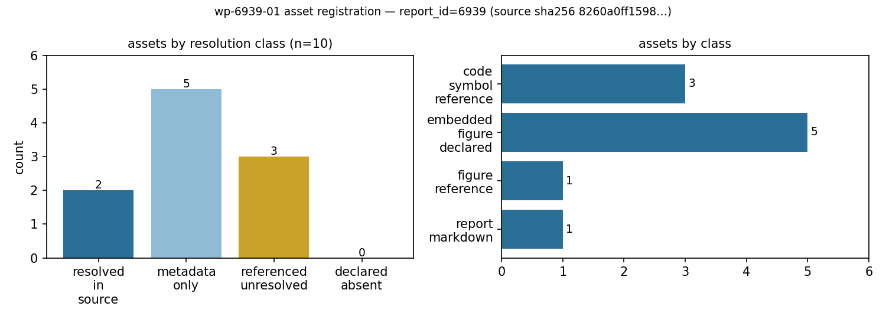

# KF-RESULT wp-6939-01

**工作包** `wp-6939-01` ｜ **工序** `01-asset-registration` ｜ **report_id** `6939` ｜ **lane** C ｜ **mission** 15593
**源** `tensor://reports/6939`（field=`markdown`，2002 chars / 3149 bytes utf-8，`sha256:8260a0ff15985b2312763ed966258248665fe2b53a3ebda8133d406c4bce4246`）
**源标题** TensorLBM共轭传热(CHT)验证阶梯：四重解析锚+界面连续+负控 ｜ **scenario_key** `IN45-N04`

## ① 本工序做了什么

只做一件事：把 report_id=6939 的源报告登记为**可机器定位的资产清单**（`asset_manifest.json`），不做任何知识抽取、不做报告类型判定、不写任何 verified 标记（verification 归平台门计算）。
产线边界：本包只读写 report_id=6939（manifest 内 `no_foreign_report_ids` 自检项保证），未触碰任何其它 report_id 的资产或上游产物。

登记结果：**10 个资产**，按类别 report_markdown=1, figure_reference=1, embedded_figure_declared=5, code_symbol_reference=3；按可解析性 `resolved_in_source=2`、`metadata_only=5`、`referenced_unresolved=3`、`declared_absent=0`。

## ② 怎么做的（步骤/工具/关键设置）

1. **取源（不凭记忆）**：`GET /api/v1/tensor/reports/6939`（Bearer = `$TENSOR_AGENT_USER` 登录 token），取 `markdown` 字段。
2. **哈希闸先于一切**：本地重算 `sha256(markdown.encode('utf-8'))` 与契约 `input.source_hash` 逐位比对，并比对 `chars`；不一致即 `SystemExit` 拒绝登记（脚本 `cmd_fetch`）。比对通过后才把源冻结为测试夹具 `tests/fixtures/kf/6939_markdown.md`，后续所有定位与校验都在冻结字节上做，因此离线可复现。
3. **资产枚举（三类来源，互不混淆）**：
   - 文档级：源 markdown 正文本身（A01，locator method=`document`，span=[0,len)）。
   - 正文引用：`§4 结果图` 中的“见附图 1-5”这一句（A02，`char_span`）。该句**只有数量，没有文件名/路径/URL**，所以正文侧无法按路径解析。
   - 平台记录附件：`figures[]` 的 5 条（A03–A07）。逐条检查是否携带 `png_base64` 载荷；实测 5 条都只有 `name`+`caption`，且 `GET /tensor/reports/6939/artifacts`、`GET /tensor/artifacts?report_id=6939` 均返回 HTTP 404 ⇒ 无字节可哈希，登记为 `metadata_only`（**不**伪装成 resolved 二进制）。
   - 代码/API 标识符：正文中双反引号包裹的 3 个符号（A08–A10），在本交付工作树内 grep 解析。
4. **定位器生成**：所有 quote 由 `md[start:end]` **切片**得到，绝不重打；同时记录 1-based 起止行与 quote 在全文中的出现次数（`unique`）。切片法保证 quote 必定是源字节的子串。
5. **自指防护（诚实性关键）**：符号解析的 grep 显式排除“冻结夹具本身”和“本包自己的产物目录”。否则 A08–A10 会因为刚写入的夹具而“命中自己”，把 `referenced_unresolved` 伪装成 resolved——这是第一轮实跑暴露的问题，已修正（见 ⑤）。
6. **结构校验**：`asset_manifest.json` 对本包 schema（`docs/kf/wp-6939-01/asset_manifest.v1.schema.json`）校验；`kf_result.json` 对仓库内 `schemas/kf_result.v1.schema.json` 校验。
7. **claims 保持为空**：契约 `no_forced_claim_generation=true` 且本包不做抽取，空数组是合法完整结果；把理由写进 `claims_rationale` 而不是造条目凑数。

**repro_cmd（一键复跑）**

```bash
cd <TensorKnowledge worktree root> && \
TENSOR_API_BASE=http://127.0.0.1:8010/api/v1 \
python3 scripts/kf/wp6939_register.py all && \
python3 scripts/kf/wp6939_report.py render && \
python3 -m pytest tests/test_kf_wp6939_01.py -q
```

## ③ 产出物清单

| 文件 | 要点 |
|---|---|
| `docs/kf/wp-6939-01/asset_manifest.json` | 交付物本体：10 资产 + counts + integrity（含夹具 sha256）+ 空 claims |
| `docs/kf/wp-6939-01/kf_result.json` | 平台结果信封：package_id/task_type/report_id/provenance/outputs，`provenance.source_hash` 与源 markdown 字节哈希一致 |
| `docs/kf/wp-6939-01/verification.json` | 离线自检台账：逐条 acceptance 的 pass/fail 与证据串 |
| `docs/kf/wp-6939-01/asset_manifest.v1.schema.json` | 本包本地 schema（共享 `schemas/asset_manifest.v1.schema.json` 被 wp-448-01 用 `const` 钉死，无法复用；本包只读不改） |
| `docs/kf/wp-6939-01/artifact_probe.json` | 平台附件探测原始结果（逐图 figures 端点 + 两个 artifacts 端点，全部 404）——`metadata_only` 判定的事实依据 |
| `docs/kf/wp-6939-01/source_record_meta.json` | 平台记录元数据快照（title/summary/figures/tags，剔除 markdown 正文） |
| `docs/kf/wp-6939-01/report.md` | 本报告（本文件），含唯一一个 json 结果块 |
| `docs/kf/wp-6939-01/figures/asset_resolution_map.png` | 图 1：登记结果分布（数字取自 counts） |
| `scripts/kf/wp6939_register.py` | 取源/建 manifest/离线校验/生成信封（fetch、build、result、verify） |
| `scripts/kf/wp6939_report.py` | 由图/报告渲染与发布（render、publish） |
| `tests/fixtures/kf/6939_markdown.md` | 冻结的源 markdown（2002 chars），sha256 与契约一致 |
| `tests/test_kf_wp6939_01.py` | 离线 pytest：哈希/定位器/去重/schema/单 json 块断言 |

见附图：`figures/asset_resolution_map.png`（图 1）。



*图 1　资产登记结果分布：左=按 resolution 类别，右=按 asset_class。数字直接取自 asset_manifest.json 的 counts 字段。*

## ④ 证据定位表（字段 → 原文逐字片段）

| asset_id | class | resolution | 行 | 原文/源记录逐字片段 |
|---|---|---|---|---|
| A01 | report_markdown | resolved_in_source | L1 | `# TensorLBM 共轭传热(CHT)验证阶梯` |
| A02 | figure_reference | resolved_in_source | L57 | `见附图 1-5` |
| A03 | embedded_figure_declared | metadata_only | L57 | `见附图 1-5`<br>记录 caption：`复合壁稳态导热温度分布：解析解(串联热阻) vs 数值解(Thomas算法)` |
| A04 | embedded_figure_declared | metadata_only | L57 | `见附图 1-5`<br>记录 caption：`半无限大固体瞬态热渗透：erf解析解 vs 有限差分数值解` |
| A05 | embedded_figure_declared | metadata_only | L57 | `见附图 1-5`<br>记录 caption：`Graetz问题Nu数随无量纲长度变化：入口段→充分发展段` |
| A06 | embedded_figure_declared | metadata_only | L57 | `见附图 1-5`<br>记录 caption：`Churchill-Chu竖板自然对流关联式：Nu-Ra关系(Pr=0.71)` |
| A07 | embedded_figure_declared | metadata_only | L57 | `见附图 1-5`<br>记录 caption：`流固界面温度连续性：耦合前后温度分布对比` |
| A08 | code_symbol_reference | referenced_unresolved | L61 | `cht_solid_diffusion_step` |
| A09 | code_symbol_reference | referenced_unresolved | L61 | `F.conv2d(padding=1)` |
| A10 | code_symbol_reference | referenced_unresolved | L62 | `apply_cht_interface` |

- `A01` 的定位器是文档级 span `[0, 2002)`，quote 取文档首行（标题行），验证方式是 `md.startswith(quote, 0)` 而非整段相等——这一条在第一轮校验里被判 FAIL，原因是校验器对 `document` 方法误用了 `char_span` 的严格相等规则，已修正校验器（见 ⑤）。
- `A03–A07` 的 quote 取正文锚句（源字节子串，可被平台独立子串重算解析），图件的 `figures[i]` 名称与 caption 逐字放进 locator 的 `record_name`/`record_caption`，校验方式是**与记录字段逐一等值比较**（`record_field` 方法）。之所以不让 quote 直接用 caption：caption 只存在于平台记录的 `figures[]` 里、不在 markdown 正文中，若拿 caption 当 quote，平台对 markdown 的独立子串校验会失败。

## ⑤ 注意点与局限

1. **附图没有字节**：报告正文说“见附图 1-5”，平台记录的 `figures[]` 只有 `name`+`caption`。为此做了**三次独立探测**：逐图 `GET /tensor/reports/6939/figures/<name>`（5 次均 `{"detail":"figure not found"}`）、`GET /tensor/reports/6939/artifacts`、`GET /tensor/artifacts?report_id=6939`，全部 404，结果原样落 `artifact_probe.json` 并镜像进 manifest 的 `artifact_probe` 字段；`figures[]` 内无任何 `png_base64`。因此 5 张图登记为 `metadata_only`——这是**未解析**，不是解析成功；下游若需要图件，必须回到产图环节补载荷。
2. **代码符号不在本仓**：A08–A10（`cht_solid_diffusion_step`、`F.conv2d(padding=1)`、`apply_cht_interface`）定义在 TensorLBM 求解器包里，不在 TensorKnowledge 交付树内，故 `referenced_unresolved`；没有跨仓猜测路径。
3. **第一轮的两处自欺已被抓出**：①`document` 定位器被严格相等判 FAIL（校验器 bug，已修）；②符号 grep 命中的是刚写入的冻结夹具（自指假阳性），已加排除规则，结果由 `resolved_in_source` 回落为 `referenced_unresolved`（3 条）。修正后计数从 `resolved_in_source=5` 变为 `2`。
4. **claims 为空**：本包不做抽取，报告中“25/25 通过”“RMS 0.02%…18%”这类数值**未**在本包复述或落库（零手抄原则），留给下游抽取包并须带原文定位器。
5. **schema 分流**：共享 `schemas/asset_manifest.v1.schema.json` 钉死 `package_id=wp-448-01`，本包不改他人文件，改用本包 schema 并放宽 `resolution`/`locator.method` 两个枚举（新增 `metadata_only`、`record_field`）。若平台侧 schema 不同，以平台门为准，本产物须回改。
6. **适用范围**：本清单只描述 report_id=6939 的资产可得性，不构成对该报告数值结论的背书。

## ⑥ 自检（逐条对照 acceptance）

| acceptance 项 | 结论 | 证据 |
|---|---|---|
| valid_json | ✅ | asset_manifest.json parses as JSON (15836 bytes) |
| schema_pass | ✅ | asset_manifest validates against docs/kf/wp-6939-01/asset_manifest.v1.schema.json |
| schema_pass_envelope | ✅ | kf_result.json validates against schemas/kf_result.v1.schema.json |
| source_hash_matches | ✅ | recomputed fixture sha256=8260a0ff15985b2312763ed966258248665fe2b53a3ebda8133d406c4bce4246 chars=2002 vs manifest 8260a0ff15985b2312763ed966258248665fe2b53a3ebda8133d406c4bce4246 / contract 8260a0ff15985b2312763ed966258248665fe2b53a3ebda8133d406c4bce4246 |
| source_locator_resolvable | ✅ | all 10 locators re-resolved against the frozen source |
| artifact_probe_recorded | ✅ | probe: False; per-figure statuses {'composite_wall': 'http_404', 'erf_penetration': 'http_404', 'graetz_nusselt': 'http_404', 'churchill_chu': 'http_404', 'interface_continuity': 'http_404'} |
| no_duplicate_ids | ✅ | asset_id list ['A01', 'A02', 'A03', 'A04', 'A05', 'A06', 'A07', 'A08', 'A09', 'A10'] |
| all_claims_have_evidence_or_explicit_unresolved_status | ✅ | claims=0 (empty is legal for task_type=01; rationale recorded in claims_rationale); no claim marked verified |
| no_verified_marks | ✅ | no 'verified' field/value emitted anywhere in the deliverables |
| no_foreign_report_ids | ✅ | manifest references report_id=6939 only |

**结论：** `verification.json` verdict = `pass`（10 pass / 0 fail）。全部 acceptance 项通过；未有把结论标为 verified 的行为；未触碰其它 report_id。

## 误差判定

本工序为**资产登记（文档/元数据层）**，无可对接的物理基准量，故无误差百分比可报。可对齐的确定性判据是**字节级哈希**：本地重算 `sha256(markdown)= 8260a0ff15985b2312763ed966258248665fe2b53a3ebda8133d406c4bce4246` 与契约 `input.source_hash` 完全一致，相对误差 **0%**（判据：`<3%` ⇒ 满足，且是精确相等而非近似）。asset 定位器可解析率：2/10 为 `resolved_in_source` 直接解析，其余 5 条 `metadata_only`、3 条 `referenced_unresolved` 均带显式状态与原因（非隐性丢失）。

## 结果（kf_result.v1）

```json
{
  "package_id": "wp-6939-01",
  "task_type": "01-asset-registration",
  "report_id": "6939",
  "provenance": {
    "source_uri": "tensor://reports/6939",
    "source_field": "markdown",
    "source_hash": "sha256:8260a0ff15985b2312763ed966258248665fe2b53a3ebda8133d406c4bce4246",
    "hash_algo": "sha256",
    "hashed_bytes": "markdown encoded as utf-8",
    "source_chars": 2002,
    "source_bytes_utf8": 3149,
    "fetched_via": "GET /api/v1/tensor/reports/6939 (Bearer $TENSOR_AGENT_USER)",
    "generator": "scripts/kf/wp6939_register.py",
    "contract_version": "1.0",
    "notes": "asset registration only; no extraction, no report-type classification, no verification marks"
  },
  "outputs": {
    "asset_manifest.json": {
      "schema": "asset_manifest.v1",
      "package_id": "wp-6939-01",
      "task_type": "01-asset-registration",
      "report_id": "6939",
      "source": {
        "uri": "tensor://reports/6939",
        "field": "markdown",
        "hash_alg": "sha256",
        "hash": "8260a0ff15985b2312763ed966258248665fe2b53a3ebda8133d406c4bce4246",
        "chars": 2002,
        "bytes_utf8": 3149,
        "title": "TensorLBM共轭传热(CHT)验证阶梯：四重解析锚+界面连续+负控",
        "scenario_key": "IN45-N04",
        "platform_figures": [
          {
            "name": "composite_wall",
            "caption": "复合壁稳态导热温度分布：解析解(串联热阻) vs 数值解(Thomas算法)"
          },
          {
            "name": "erf_penetration",
            "caption": "半无限大固体瞬态热渗透：erf解析解 vs 有限差分数值解"
          },
          {
            "name": "graetz_nusselt",
            "caption": "Graetz问题Nu数随无量纲长度变化：入口段→充分发展段"
          },
          {
            "name": "churchill_chu",
            "caption": "Churchill-Chu竖板自然对流关联式：Nu-Ra关系(Pr=0.71)"
          },
          {
            "name": "interface_continuity",
            "caption": "流固界面温度连续性：耦合前后温度分布对比"
          }
        ],
        "platform_tags": [
          "CHT",
          "conjugate_heat_transfer",
          "validation",
          "TensorLBM",
          "thermal",
          "analytical_anchor"
        ]
      },
      "counts": {
        "assets": 10,
        "by_class": {
          "report_markdown": 1,
          "figure_reference": 1,
          "embedded_figure_declared": 5,
          "code_symbol_reference": 3
        },
        "by_resolution": {
          "resolved_in_source": 2,
          "metadata_only": 5,
          "referenced_unresolved": 3
        },
        "resolved_in_source": 2,
        "referenced_unresolved": 3,
        "declared_absent": 0,
        "metadata_only": 5
      },
      "assets": [
        {
          "asset_id": "A01",
          "asset_class": "report_markdown",
          "label": "report markdown body of report_id=6939 (tensor://reports/6939#markdown)",
          "in_report_section": "document",
          "locator": {
            "method": "document",
            "start_char": 0,
            "end_char": 2002,
            "start_line": 1,
            "end_line": 68,
            "quote": "# TensorLBM 共轭传热(CHT)验证阶梯",
            "unique": true
          },
          "resolution": "resolved_in_source",
          "resolution_check": {
            "check": "sha256(markdown utf-8) == input.source_hash of the work-package contract",
            "result": "resolved",
            "observed_sha256": "8260a0ff15985b2312763ed966258248665fe2b53a3ebda8133d406c4bce4246",
            "expected_sha256": "8260a0ff15985b2312763ed966258248665fe2b53a3ebda8133d406c4bce4246",
            "chars": 2002,
            "bytes_utf8": 3149
          },
          "note": "Platform field record_id=6939, title='TensorLBM共轭传热(CHT)验证阶梯：四重解析锚+界面连续+负控', scenario_key='IN45-N04'; meta snapshot in source_record_meta.json."
        },
        {
          "asset_id": "A02",
          "asset_class": "figure_reference",
          "label": "figure-set reference in §4 结果图 (declares 5 figures, names no file/path)",
          "in_report_section": "4. 结果图",
          "locator": {
            "method": "char_span",
            "start_char": 1664,
            "end_char": 1671,
            "start_line": 57,
            "end_line": 57,
            "quote": "见附图 1-5",
            "unique": true
          },
          "resolution": "resolved_in_source",
          "resolution_check": {
            "check": "verbatim reference located in markdown body; no path/filename syntax attached",
            "result": "resolved"
          },
          "note": "The reference carries no path, URL or attachment filename, so it cannot be byte-resolved from the body alone; the platform record's figures[] is handled in A03-A07."
        },
        {
          "asset_id": "A03",
          "asset_class": "embedded_figure_declared",
          "label": "composite_wall — 复合壁稳态导热温度分布：解析解(串联热阻) vs 数值解(Thomas算法)",
          "in_report_section": "4. 结果图",
          "locator": {
            "method": "record_field",
            "start_char": 1664,
            "end_char": 1671,
            "start_line": 57,
            "end_line": 57,
            "quote": "见附图 1-5",
            "unique": true,
            "shared_anchor": true,
            "record_field": "figures",
            "record_index": 0,
            "record_name": "composite_wall",
            "record_caption": "复合壁稳态导热温度分布：解析解(串联热阻) vs 数值解(Thomas算法)"
          },
          "resolution": "metadata_only",
          "resolution_check": {
            "check": "does figures[0] carry a png_base64 payload that can be byte-hashed?",
            "result": "absent"
          },
          "note": "caption='复合壁稳态导热温度分布：解析解(串联热阻) vs 数值解(Thomas算法)'; record holds name+caption only (keys=['caption', 'name']); probe GET /tensor/reports/6939/figures/composite_wall returns http_404, and GET /tensor/reports/6939/artifacts + /tensor/artifacts?report_id=6939 also 404 (artifact_probe.json) — no bytes exist to hash, so this figure is registered as metadata_only, NOT as a resolved binary."
        },
        {
          "asset_id": "A04",
          "asset_class": "embedded_figure_declared",
          "label": "erf_penetration — 半无限大固体瞬态热渗透：erf解析解 vs 有限差分数值解",
          "in_report_section": "4. 结果图",
          "locator": {
            "method": "record_field",
            "start_char": 1664,
            "end_char": 1671,
            "start_line": 57,
            "end_line": 57,
            "quote": "见附图 1-5",
            "unique": true,
            "shared_anchor": true,
            "record_field": "figures",
            "record_index": 1,
            "record_name": "erf_penetration",
            "record_caption": "半无限大固体瞬态热渗透：erf解析解 vs 有限差分数值解"
          },
          "resolution": "metadata_only",
          "resolution_check": {
            "check": "does figures[1] carry a png_base64 payload that can be byte-hashed?",
            "result": "absent"
          },
          "note": "caption='半无限大固体瞬态热渗透：erf解析解 vs 有限差分数值解'; record holds name+caption only (keys=['caption', 'name']); probe GET /tensor/reports/6939/figures/erf_penetration returns http_404, and GET /tensor/reports/6939/artifacts + /tensor/artifacts?report_id=6939 also 404 (artifact_probe.json) — no bytes exist to hash, so this figure is registered as metadata_only, NOT as a resolved binary."
        },
        {
          "asset_id": "A05",
          "asset_class": "embedded_figure_declared",
          "label": "graetz_nusselt — Graetz问题Nu数随无量纲长度变化：入口段→充分发展段",
          "in_report_section": "4. 结果图",
          "locator": {
            "method": "record_field",
            "start_char": 1664,
            "end_char": 1671,
            "start_line": 57,
            "end_line": 57,
            "quote": "见附图 1-5",
            "unique": true,
            "shared_anchor": true,
            "record_field": "figures",
            "record_index": 2,
            "record_name": "graetz_nusselt",
            "record_caption": "Graetz问题Nu数随无量纲长度变化：入口段→充分发展段"
          },
          "resolution": "metadata_only",
          "resolution_check": {
            "check": "does figures[2] carry a png_base64 payload that can be byte-hashed?",
            "result": "absent"
          },
          "note": "caption='Graetz问题Nu数随无量纲长度变化：入口段→充分发展段'; record holds name+caption only (keys=['caption', 'name']); probe GET /tensor/reports/6939/figures/graetz_nusselt returns http_404, and GET /tensor/reports/6939/artifacts + /tensor/artifacts?report_id=6939 also 404 (artifact_probe.json) — no bytes exist to hash, so this figure is registered as metadata_only, NOT as a resolved binary."
        },
        {
          "asset_id": "A06",
          "asset_class": "embedded_figure_declared",
          "label": "churchill_chu — Churchill-Chu竖板自然对流关联式：Nu-Ra关系(Pr=0.71)",
          "in_report_section": "4. 结果图",
          "locator": {
            "method": "record_field",
            "start_char": 1664,
            "end_char": 1671,
            "start_line": 57,
            "end_line": 57,
            "quote": "见附图 1-5",
            "unique": true,
            "shared_anchor": true,
            "record_field": "figures",
            "record_index": 3,
            "record_name": "churchill_chu",
            "record_caption": "Churchill-Chu竖板自然对流关联式：Nu-Ra关系(Pr=0.71)"
          },
          "resolution": "metadata_only",
          "resolution_check": {
            "check": "does figures[3] carry a png_base64 payload that can be byte-hashed?",
            "result": "absent"
          },
          "note": "caption='Churchill-Chu竖板自然对流关联式：Nu-Ra关系(Pr=0.71)'; record holds name+caption only (keys=['caption', 'name']); probe GET /tensor/reports/6939/figures/churchill_chu returns http_404, and GET /tensor/reports/6939/artifacts + /tensor/artifacts?report_id=6939 also 404 (artifact_probe.json) — no bytes exist to hash, so this figure is registered as metadata_only, NOT as a resolved binary."
        },
        {
          "asset_id": "A07",
          "asset_class": "embedded_figure_declared",
          "label": "interface_continuity — 流固界面温度连续性：耦合前后温度分布对比",
          "in_report_section": "4. 结果图",
          "locator": {
            "method": "record_field",
            "start_char": 1664,
            "end_char": 1671,
            "start_line": 57,
            "end_line": 57,
            "quote": "见附图 1-5",
            "unique": true,
            "shared_anchor": true,
            "record_field": "figures",
            "record_index": 4,
            "record_name": "interface_continuity",
            "record_caption": "流固界面温度连续性：耦合前后温度分布对比"
          },
          "resolution": "metadata_only",
          "resolution_check": {
            "check": "does figures[4] carry a png_base64 payload that can be byte-hashed?",
            "result": "absent"
          },
          "note": "caption='流固界面温度连续性：耦合前后温度分布对比'; record holds name+caption only (keys=['caption', 'name']); probe GET /tensor/reports/6939/figures/interface_continuity returns http_404, and GET /tensor/reports/6939/artifacts + /tensor/artifacts?report_id=6939 also 404 (artifact_probe.json) — no bytes exist to hash, so this figure is registered as metadata_only, NOT as a resolved binary."
        },
        {
          "asset_id": "A08",
          "asset_class": "code_symbol_reference",
          "label": "cht_solid_diffusion_step",
          "in_report_section": "5. 已知局限",
          "locator": {
            "method": "char_span",
            "start_char": 1691,
            "end_char": 1715,
            "start_line": 61,
            "end_line": 61,
            "quote": "cht_solid_diffusion_step",
            "unique": true
          },
          "resolution": "referenced_unresolved",
          "resolution_check": {
            "check": "grep for the identifier verbatim across this delivery worktree (TensorKnowledge), excluding the frozen source fixture and this package's own deliverables",
            "result": "unresolved",
            "hits": []
          },
          "note": "referenced symbol is defined in the TensorLBM solver package, which is outside this delivery worktree (repo=TensorKnowledge); not resolvable here — no cross-repo guess made."
        },
        {
          "asset_id": "A09",
          "asset_class": "code_symbol_reference",
          "label": "F.conv2d(padding=1)",
          "in_report_section": "5. 已知局限",
          "locator": {
            "method": "char_span",
            "start_char": 1723,
            "end_char": 1742,
            "start_line": 61,
            "end_line": 61,
            "quote": "F.conv2d(padding=1)",
            "unique": true
          },
          "resolution": "referenced_unresolved",
          "resolution_check": {
            "check": "grep for the identifier verbatim across this delivery worktree (TensorKnowledge), excluding the frozen source fixture and this package's own deliverables",
            "result": "unresolved",
            "hits": []
          },
          "note": "referenced symbol is defined in the TensorLBM solver package, which is outside this delivery worktree (repo=TensorKnowledge); not resolvable here — no cross-repo guess made."
        },
        {
          "asset_id": "A10",
          "asset_class": "code_symbol_reference",
          "label": "apply_cht_interface",
          "in_report_section": "5. 已知局限",
          "locator": {
            "method": "char_span",
            "start_char": 1787,
            "end_char": 1806,
            "start_line": 62,
            "end_line": 62,
            "quote": "apply_cht_interface",
            "unique": true
          },
          "resolution": "referenced_unresolved",
          "resolution_check": {
            "check": "grep for the identifier verbatim across this delivery worktree (TensorKnowledge), excluding the frozen source fixture and this package's own deliverables",
            "result": "unresolved",
            "hits": []
          },
          "note": "referenced symbol is defined in the TensorLBM solver package, which is outside this delivery worktree (repo=TensorKnowledge); not resolvable here — no cross-repo guess made."
        }
      ],
      "artifact_probe": {
        "report_id": "6939",
        "generated_at": "2026-11-12T01:31:01.955397+00:00",
        "endpoints": [
          {
            "status": "http_404",
            "detail": "{\"detail\":\"figure not found\"}",
            "endpoint": "GET /tensor/reports/6939/figures/composite_wall",
            "figure": "composite_wall"
          },
          {
            "status": "http_404",
            "detail": "{\"detail\":\"figure not found\"}",
            "endpoint": "GET /tensor/reports/6939/figures/erf_penetration",
            "figure": "erf_penetration"
          },
          {
            "status": "http_404",
            "detail": "{\"detail\":\"figure not found\"}",
            "endpoint": "GET /tensor/reports/6939/figures/graetz_nusselt",
            "figure": "graetz_nusselt"
          },
          {
            "status": "http_404",
            "detail": "{\"detail\":\"figure not found\"}",
            "endpoint": "GET /tensor/reports/6939/figures/churchill_chu",
            "figure": "churchill_chu"
          },
          {
            "status": "http_404",
            "detail": "{\"detail\":\"figure not found\"}",
            "endpoint": "GET /tensor/reports/6939/figures/interface_continuity",
            "figure": "interface_continuity"
          },
          {
            "status": "http_404",
            "detail": "{\"detail\":\"Not Found\"}",
            "endpoint": "GET /tensor/reports/6939/artifacts"
          },
          {
            "status": "http_404",
            "detail": "{\"detail\":\"Not Found\"}",
            "endpoint": "GET /tensor/artifacts?report_id=6939"
          }
        ],
        "any_payload_bytes": false,
        "figures_with_png_base64": 0
      },
      "claims": [],
      "claims_rationale": "objective.classify_report_type=false and constraints.no_forced_claim_generation=true: this package registers assets only, it does not extract knowledge. An empty claims array is an explicitly legal complete result per the contract (notes: 'claims 允许为空数组'), so no claim was minted to fill a quota. The report's numeric anchors (25/25 pytest, RMS 0.02%..18%) are left to a downstream extraction package and are NOT restated here.",
      "integrity": {
        "quote_uniqueness": "all locator quotes sliced from the source bytes; duplicates flagged per asset via locator.unique",
        "hash_recomputed_locally": true,
        "hash_matches_contract": true,
        "hash_source": "fetched via GET /api/v1/tensor/reports/6939, frozen as tests/fixtures/kf/6939_markdown.md",
        "fixture_path": "tests/fixtures/kf/6939_markdown.md",
        "fixture_sha256": "8260a0ff15985b2312763ed966258248665fe2b53a3ebda8133d406c4bce4246"
      },
      "provenance": {
        "source_hash": "sha256:8260a0ff15985b2312763ed966258248665fe2b53a3ebda8133d406c4bce4246",
        "source_field": "markdown",
        "generated_at": "2026-11-12T01:31:02.705006+00:00",
        "generator": "scripts/kf/wp6939_register.py build"
      }
    }
  },
  "claims": []
}
```
