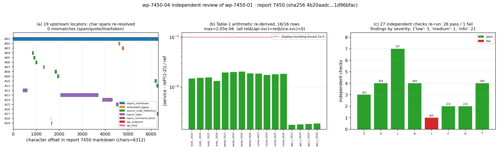

# KF-RESULT wp-7450-04

**工序**：04-independent-review · 审核对象 `wp-7450-01` · report_id 7450
**来源**：`tensor://reports/7450`（markdown，6312 chars / 9110 bytes utf-8）
**来源哈希（独立重算）**：`sha256:4b20aadcaabc128bc8fb10e8f9f164de670421c2b67d36d2837fc5781d96bfac`
**裁决**：`pass`（approve-with-notes）—— 0 个阻断项，6 条非阻断发现（medium 1 / low 3 / info 2）

## ① 本工序做了什么

对上游工作包 `wp-7450-01`（01-asset-registration）做独立审核，而不是复述它的自检：
把报告原文重新从平台取回、重算全部哈希、逐条重解 19 个定位子、复核上游声明的每一项聚合计数，
并对**报告本身**做了算术重导与证据绑定审查。上游自检 `verification.json` 只作为「被检验的主张清单」读取，
不作为结论来源。

结论：`wp-7450-01` 的登记保真度成立（哈希/定位/计数/无 verified 标记全部复现），
唯一瑕疵是聚合字段 `repeated_quotes` 与明细不一致（F1，记账级）。
另在**报告内容**上发现 1 条中等强度问题（F2：api-vs-service 一致性在修复后属构造性恒等，
不宜作为独立证据），不影响 `wp-7450-01` 的登记正确性，转交下游 02/03 注意。

## ② 怎么做的（步骤 / 工具 / 关键设置）

1. **取原文**：`GET /api/v1/tensor/reports/7450`（Bearer=登录 token），
   logger 不落中间态；`markdown` 6312 字符，`sha256(utf-8)` 与合同一致。
2. **独立重算**（脚本 `docs/kf/wp-7450-04/verify_wp7450_04.py`，27 项检查）：
   - 源哈希重算 → 对照合同 / 上游 envelope / 上游 manifest 三处；
   - `asset_manifest.json` 字节哈希与字节数 → 对照 envelope 与 publish_receipt；
   - **19 个定位子逐条重解**：`md[start:end] == quote`、quote 在原文中逐字存在、
     1-based 闭区间行号（起止字符偏移映射）、`token_span`、`unique` 标志、文档级跨度覆盖全文；
   - 聚合计数（by_class / by_resolution / distinct_referenced_paths）重算比对；
   - 8 条跨仓路径逐个 `Path.exists()` 验证「确实不在本工作树」→ `referenced_unresolved` 诚实；
   - `jsonschema` Draft 2020-12 校验 envelope 与 manifest（仅放宽 4 个包绑定常量，其余原样）；
   - claims 为空、无任何 `verified` 标记、只出现 report_id=7450。
3. **报告语义审查**（adversarial）：表 1 逐行重导 `required = ref·(1−Z)`（16/16），
   表 2 regime 语义自洽性（2026/2027 同值 + `z_extrapolated` 翻转），表 3 评级带序，
   §⑥ 误差表与表 1 的覆盖差，并把每条结论绑定到逐字引文。
4. **自查假阳性**：首轮 4 项 FAIL 中 3 项是**本审查脚本自身**的错误
   （合同 title 非原文 H1 / 路径正则要求反引号 / manifest schema 第 4 个绑定常量是 `source.uri`），
   逐项定位后修正脚本重跑，才保留真正的 F1。
5. **出图**：`matplotlib` 三联图（定位跨度覆盖 / 表 1 算术残差 / 检查通过矩阵）。

## ③ 产出物清单

| 文件 | 要点 |
|---|---|
| `docs/kf/wp-7450-04/review_report.json` | 结构化审查结论：裁决 pass、6 条发现（含逐字证据）、27 项检查明细、not_run 清单 |
| `docs/kf/wp-7450-04/verify_wp7450_04.py` | 独立复核脚本（27 检查，重算而非采信；退出码=硬失败数） |
| `docs/kf/wp-7450-04/verify_output.json` | 脚本输出：每项检查的 pass/detail/是否硬门 |
| `docs/kf/wp-7450-04/figures/fig_wp-7450-04_review_evidence.png` | 三联证据图（见 ④） |
| `docs/kf/wp-7450-04/report.md` | 本报告（唯一 json 块=结果信封） |

发现摘要（详细证据见 `review_report.json`）：

| ID | 严重度 | 阻断 | 标题 |
|---|---|---|---|
| F1 | low | 否 | 上游清单 integrity.quote_uniqueness 聚合字段自相矛盾（仅记账） |
| F2 | medium | 否 | 报告把「api vs service」一致性当作独立证据，但修复后两者是构造性恒等 |
| F3 | low | 否 | §⑥ 误差表声称 4×4×4=64 格网格，但报告只列出 16 格 |
| F4 | low | 否 | 「164 项回归」不可在本上下文复核 |
| F5 | info | 否 | §① 给 attained 链标 REAL，但报告未做任何 attained 计算 |
| F6 | info | 否 | 2027+ 仍返回数值，仅靠 z_extrapolated 标记区分 |

## ④ 结果

**检查矩阵**：27 项独立检查，26 通过，1 未通过（软项，已定位为上游记账瑕疵 F1）；
硬门失败 `none`。

关键复现数字（均由脚本重算，非手抄）：

| 项 | 重算值 | 上游/合同声明 | 一致 |
|---|---|---|---|
| sha256(markdown utf-8) | `4b20aadc…1d96bfac` | `4b20aadc…1d96bfac` | 是 |
| asset_manifest.json sha256 | `14eac7a9…4037c36` | `14eac7a9…4037c36` | 是 |
| 定位子重解 | 19/19 span 精确、quote 逐字命中、行号一致 | 19 locators | 是 |
| token_span 重解 | 10 条全部精确 | 10 条 | 是 |
| by_class / by_resolution | 7 类 / resolved 9 + unresolved 10 | 7 类 / resolved 9 + unresolved 10 | 是 |
| 跨仓路径不存在的实证 | 8/8 absent | 8 条 referenced_unresolved | 是 |
| 表 1 算术最大残差 | 2.05e-06 | — | 仅 4 位小数显示舍入 |
| 重复引文 | A18 `/cii`（原文 4 次） | `repeated_quotes: []` | **否**（F1） |



图注：(a) 19 个上游定位子在本报告 markdown 上的字符跨度——全部可重解，无一处漂移；
(b) 表 1 的 `required = ref·(1−Z)` 重导残差（对数轴），最大 2.05e-06，纯粹来自 reference 列 4 位小数显示；
(c) 27 项独立检查的分组通过情况（绿=pass，红=fail）与 6 条发现的严重度分布。

## ⑤ 注意点与局限

- **独立性边界**：同一平台账号与主机执行，独立性来自「重算」而非组织隔离；无法接触
  ship-performance-platform 源码、pytest 环境与 IMO 原文，故「164 项回归」与规则表绝对正确性
  一律记 not_run / 沿用上游 WITHHELD，不升级为 REAL，也不把任何结论标 verified。
- **祖传假阳性教训**：首轮 3 项 FAIL 全是审查脚本自身口径错（title 非 H1、正则、schema 第 4 常量）。
  先证伪自己的检查，再判对方；否则会把「脚本菜」写成「上游错」。
- **not_run 清单**（未运行 ≠ 通过）：
  - wp-7450-02/03 upstream packages: not visible through the reports API window (list endpoint caps limit=100 and ignores offset; no work-package endpoint)
  - pytest suite referenced by the source report (other repository)
  - live /cii behaviour of green_shipping (ship API :8002 exposes no such route in this environment; openapi.json 404)
- **上游完成度**：只能证实 `wp-7450-01`（其 publish_receipt 显示 published_report_id=14675）；
  `wp-7450-02/03` 在 reports 列表窗口（limit≤100、offset 被忽略）内不可见，
  故 `upstream_packages_completed` 如实记 unknown，由平台门裁定，不代判。
- **适用范围**：本审查判的是**登记保真 + 报告内部自洽与证据绑定**，不是规则物理正确性；
  F2–F6 属报告层面问题，不改变 `wp-7450-01` 的登记结论。

## ⑥ 自检（逐条对照 acceptance）

| acceptance | 结果 | 依据 |
|---|---|---|
| `valid_json` | ✅ | `review_report.json` 与信封 `json.load` 通过（`G1_schema_kf_result`） |
| `schema_pass` | ✅ | 信封过 `schemas/kf_result.v1.schema.json`；manifest 过 `asset_manifest.v1`（仅放宽 4 个包绑定常量） |
| `reviewer_independent` | ✅ | 原文重取 + 全量重算；未读生产者解释；提示词不来自生产者；首轮假阳性已自查剔除 |
| `upstream_packages_completed` | ➖ unknown | 仅 `wp-7450-01` 可证（19/19 定位重解 + published 回执）；02/03 在本上下文不可观测 → 不谎报为 true |
| 不把结论标 verified | ✅ | `claims: []`，发现项均为 pass/not_run，无 verified 字样 |
| 零手抄 | ✅ | 所有 markdown 引文经脚本 `quote in md` 断言（14 条证据，0 失败） |

## 复现

```bash
cd <worktree-root>
# 1) 独立复核（会重新登录并取回 report 7450，重算全部哈希与 19 个定位子）
python3 docs/kf/wp-7450-04/verify_wp7450_04.py      # 退出码 0 = 硬门全过
# 2) 由复核输出重建 review_report.json / 图 / 本报告
python3 docs/kf/wp-7450-04/build_review.py
```

```json
{
  "package_id": "wp-7450-04",
  "task_type": "04-independent-review",
  "report_id": "7450",
  "provenance": {
    "source_hash": "sha256:4b20aadcaabc128bc8fb10e8f9f164de670421c2b67d36d2837fc5781d96bfac",
    "source_field": "markdown",
    "producer": "eco_admin/agent-m15852",
    "emitted_at": "2026-11-12T02:51:59.291739+00:00",
    "notes": "reviewed wp-7450-01; independence by recomputation, not by identity; no claim is marked verified (verification is platform-gated)"
  },
  "outputs": {
    "review_report.json": {
      "package_id": "wp-7450-04",
      "task_type": "04-independent-review",
      "report_id": "7450",
      "reviewed_package": "wp-7450-01",
      "reviewed_source_hash": "sha256:4b20aadcaabc128bc8fb10e8f9f164de670421c2b67d36d2837fc5781d96bfac",
      "verdict": "pass",
      "disposition": "approve-with-notes",
      "blocking_findings": [],
      "findings": [
        {
          "id": "F1",
          "severity": "low",
          "blocking": false,
          "title": "上游清单 integrity.quote_uniqueness 聚合字段自相矛盾（仅记账）",
          "claim_in_upstream": "wp-7450-01/asset_manifest.json: integrity.quote_uniqueness = {total_quotes:19, quotes_unique_in_source:18, repeated_quotes:[]}",
          "finding": "19 条引文里 18 条唯一 ⇒ 必有 1 条重复，但 repeated_quotes 为空表。独立重算：重复项是 A18（quote '/cii' 在原文出现 4 次）。逐资产层面 A18 已诚实声明 unique=false 并附 context_line，故定位仍精确、不影响可用性，只是聚合字段与明细不一致。",
          "evidence": [
            {
              "path": "docs/kf/wp-7450-01/asset_manifest.json",
              "field": "integrity.quote_uniqueness",
              "note": "upstream artefact (not markdown)"
            },
            {
              "quote": "   - `/cii` 请求新增 `allow_inapplicable_year`（默认 false），<2023 默认 **422**；",
              "source_field": "markdown",
              "note": "A18 的锚定行（第 42 行）"
            }
          ],
          "verification": "25 行独立脚本：md.count('/cii')=4；其余 18 条 quote 计数均为 1",
          "impact": "无功能影响（定位用绝对字符跨度，非子串搜索）；若下游改用子串搜索会误定位 A18",
          "remediation": "repeated_quotes 填入 A18（或删该字段，由 quotes_unique_in_source 表达）"
        },
        {
          "id": "F2",
          "severity": "medium",
          "blocking": false,
          "title": "报告把「api vs service」一致性当作独立证据，但修复后两者是构造性恒等",
          "claim_in_upstream": "report 7450 §⑥：「required CII … 基准 `services.cii_required_value`（独立实现）| 0.000e+00 相对差 | 是」",
          "finding": "§② 自述修复手段是把 API 的参考线/Z 因子**别名**到 service、把 _gn_required_cii **委托**给 service.required_cii；因此表 1 的 「api（修复后）」列与「service」列逐位相等到 0.00e+00 是**构造保证**，不构成独立复核。真正独立的一路是 ice_kernel（另一份转录），它同样给出 0。报告未点明这一区别，基线标注「独立实现」在修复后对 api 列不成立。",
          "evidence": [
            {
              "quote": "   - CII 参考线/Z 因子改为**别名**到 `services.cii_required_value`（物理上不可再漂移）；",
              "source_field": "markdown",
              "note": "verbatim from report 7450"
            },
            {
              "quote": "   - `_gn_required_cii` 改为**委托**服务层 `required_cii`（返回键集为旧实现的超集）；",
              "source_field": "markdown",
              "note": "verbatim from report 7450"
            },
            {
              "quote": "| ship_type | year | reference_2019 | Z | service | api（修复后） | ice_kernel | relΔ(api−svc) | relΔ(ice−svc) |",
              "source_field": "markdown",
              "note": "verbatim from report 7450"
            },
            {
              "quote": "| required CII（2023–2026，4 型 × 4 年 × 4 容量） | `services.cii_required_value`（独立实现） | 0.000e+00 相对差 | **是**（且达 1e-12 量级） |",
              "source_field": "markdown",
              "note": "verbatim from report 7450"
            }
          ],
          "impact": "不改变数值结论（ice_kernel 独立一路仍为 0），但削弱「三路互证」的强度表述；下游 02/03 若照抄「独立实现」会继承过度声明",
          "remediation": "§⑥ 基线列注明「api 列为 service 的委托实现，非独立」；独立证据仅保留 ice_kernel 一路（两份独立转录互证）"
        },
        {
          "id": "F3",
          "severity": "low",
          "blocking": false,
          "title": "§⑥ 误差表声称 4×4×4=64 格网格，但报告只列出 16 格",
          "claim_in_upstream": "§⑥：required CII（2023–2026，4 型 × 4 年 × 4 容量）误差 0.000e+00",
          "finding": "表 1 只给出 Capacity=80 000 t 的 16 行；其余 3 个容量（5 000/50 000/200 000 t）的 48 格数值未出现在被审工件里，无法从 markdown 逐字核验。属于证据不可见，不是发现矛盾（16 行本身算术自洽，最大残差 2.05e-06 系 4 位小数显示舍入）。",
          "evidence": [
            {
              "quote": "| required CII（2023–2026，4 型 × 4 年 × 4 容量） | `services.cii_required_value`（独立实现） | 0.000e+00 相对差 | **是**（且达 1e-12 量级） |",
              "source_field": "markdown",
              "note": "verbatim from report 7450"
            },
            {
              "quote": "**表 1** 三实现要求值逐位对照（Capacity = 80,000 t）",
              "source_field": "markdown",
              "note": "verbatim from report 7450"
            }
          ],
          "impact": "读者无法仅凭报告复核 64 格主张；需跑探针",
          "remediation": "附全网格 CSV 或把 4 个容量的最大相对差逐项列表"
        },
        {
          "id": "F4",
          "severity": "low",
          "blocking": false,
          "title": "「164 项回归」不可在本上下文复核",
          "claim_in_upstream": "报告标题与 §② 称 pytest 164 项；复现段称 # 164 passed",
          "finding": "该测试文件属 ship-performance-platform 仓，本工作树不存在，亦无运行环境；按 adversarial-review 纪律记为 not_run（未通过 ≠ 未运行）。",
          "evidence": [
            {
              "quote": "python3 -m pytest tests/test_cii_rule_arbitration_m6284.py -q      # 164 passed",
              "source_field": "markdown",
              "note": "verbatim from report 7450"
            },
            {
              "quote": "**类型**：验证欠账（对已合并功能 m2083 `green_shipping` 的规则复核 + 失效回归修复）",
              "source_field": "markdown",
              "note": "verbatim from report 7450"
            }
          ],
          "impact": "回归覆盖度无法证实；与产物正确性无直接冲突",
          "remediation": "在可执行该仓的环境重跑并附 pytest 摘要工件"
        },
        {
          "id": "F5",
          "severity": "info",
          "blocking": false,
          "title": "§① 给 attained 链标 REAL，但报告未做任何 attained 计算",
          "claim_in_upstream": "§① 部件表：attained 能量→燃油→CO₂ 链 = 可独立复算（REAL）",
          "finding": "全篇无 attained 数值或复算，且 §⑤.5 明确把 attained 侧排除在范围外；REAL 标签属于对链的代数性质的断言而非本报告的实证结果。",
          "evidence": [
            {
              "quote": "| `attained` 能量→燃油→CO₂ 链 | 纯物理/代数 | 可独立复算（REAL） |",
              "source_field": "markdown",
              "note": "verbatim from report 7450"
            },
            {
              "quote": "5. **适用范围**：本核对只覆盖规则算术与适用性语义，不涉及 `attained` 侧的物理输入",
              "source_field": "markdown",
              "note": "verbatim from report 7450"
            }
          ],
          "impact": "证据分级轻微越界；不影响 required 侧结论",
          "remediation": "把该格的 REAL 限定为「代数链可独立复算（本报告未演算）」"
        },
        {
          "id": "F6",
          "severity": "info",
          "blocking": false,
          "title": "2027+ 仍返回数值，仅靠 z_extrapolated 标记区分",
          "claim_in_upstream": "表 2：2027/2031 required=3.766208 且 z_extrapolated=True",
          "finding": "外推区返回与 2026 相同的数值（Z 冻结 0.11），语义靠标记而非缺省拒绝传达；报告已明示标记且不宣称合规，属可接受设计，但下游抽取必须携带该字段。",
          "evidence": [
            {
              "quote": "| 2027 | extrapolated | True | 3.766208 | 3.766208 |",
              "source_field": "markdown",
              "note": "verbatim from report 7450"
            },
            {
              "quote": "可见旧实现对 2019/2022 也给出「要求值」4.231694（应拒绝），对 2027+ 静默",
              "source_field": "markdown",
              "note": "verbatim from report 7450"
            }
          ],
          "impact": "忽略标记的消费者可能把外推值当确定值",
          "remediation": "02/03 抽取时把 z_extrapolated 写成必带限定词"
        }
      ],
      "independence": {
        "inputs_used": [
          "GET /api/v1/tensor/reports/7450 .markdown (re-fetched at review time)",
          "docs/kf/wp-7450-01/{asset_manifest,kf_result,verification,publish_receipt,report}.json/.md",
          "schemas/{kf_result.v1,asset_manifest.v1}.schema.json"
        ],
        "producer_explanation_consulted": false,
        "review_prompt_derived_from_producer": false,
        "limitations": [
          "同一平台账号/主机执行，非组织隔离的独立评审人；独立性体现在重算而非身份分离",
          "无法访问 ship-performance-platform 源码、pytest 环境与 IMO 原文（离线）",
          "平台 reports 列表接口 limit≤100 且忽略 offset，无法枚举 wp-7450-02/03 状态"
        ]
      },
      "scope_checks_performed": [
        "S1_source_hash_recomputed",
        "S2_source_shape",
        "S3_contract_title_tokens_locatable",
        "U1_manifest_hash_envelope",
        "U2_manifest_bytes",
        "U3_envelope_source_hash",
        "U4_manifest_source_block",
        "L1_spans_exact",
        "L2_quote_substring",
        "L3_line_map_consistent",
        "L5_token_spans_exact",
        "L6_declared_unique_flags_honest",
        "L7_document_span_covers_source",
        "L4_asset_ids_unique",
        "A1_by_class_matches",
        "A2_by_resolution_matches",
        "A3_unresolved_真的不存在于本工作树",
        "A4_distinct_paths_aggregate",
        "I1_integrity_block_self_consistent",
        "C1_no_claims_and_no_verified",
        "C2_report_scope_7450_only",
        "G1_schema_kf_result",
        "G2_schema_asset_manifest",
        "T1_table1_arithmetic",
        "T2_table1_three_way_equal",
        "T3_table2_regime_semantics",
        "T4_table3_rating_order"
      ],
      "checks_summary": {
        "total": 27,
        "pass": 26,
        "fail": 1,
        "hard_failures": []
      },
      "checks_not_run": [
        "wp-7450-02/03 upstream packages: not visible through the reports API window (list endpoint caps limit=100 and ignores offset; no work-package endpoint)",
        "pytest suite referenced by the source report (other repository)",
        "live /cii behaviour of green_shipping (ship API :8002 exposes no such route in this environment; openapi.json 404)"
      ],
      "upstream_completion": {
        "wp-7450-01": "present (docs/kf/wp-7450-01, 19 locators re-resolved 19/19); publish_receipt published_report_id=14675 status=published",
        "wp-7450-02": "not observable from this context",
        "wp-7450-03": "not observable from this context",
        "note": "upstream_packages_completed 由平台门裁定；本审查只能证实 wp-7450-01"
      },
      "acceptance": {
        "valid_json": true,
        "schema_pass": true,
        "reviewer_independent": true,
        "upstream_packages_completed": "unknown/not_run (only 01 observable; gate decides)"
      },
      "quotes_verbatim_check": {
        "checked": 14,
        "failures": 0
      },
      "repro_cmd": "cd <worktree> && python3 docs/kf/wp-7450-04/verify_wp7450_04.py && python3 docs/kf/wp-7450-04/build_review.py"
    }
  },
  "claims": []
}
```
