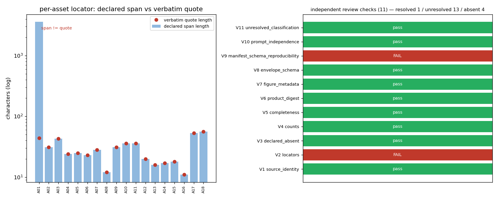

# KF-RESULT wp-7545-04 — 独立审核：wp-7545-01（report 7545 资产登记）

**结论：needs-fix**（0 blocking / 0 major / 3 minor / 2 informational）。登记内容可复现，未发现伪造摘要或漏登记；两处证据层缺陷需修后再入下一工序。

## ① 本工序做了什么

本工序 = 工序 04（`04-independent-review`），只审一个上游包 `wp-7545-01`（`01-asset-registration`），只碰 report 7545 一文。做四件事：

1. **独立重算源身份**：不用上游给的哈希，自己从平台 API 取 markdown 重算 sha256/字符数/字节数。
2. **逐条反查 locator**：18 条资产逐条验证『声明跨度 == 逐字引文』与『引文在原文唯一』。
3. **可解析性双证**：4 张图登记为 `declared_absent`，既探平台取值端点，也查图存储根目录，再读路由源码确认 404 的语义。
4. **覆盖面反查**：枚举报告正文全部反引号 token，检查是否有路径型 token 未登记（漏登记 = 资产账不完整）。

## ② 怎么做的（方法 / 步骤 / 工具 / 关键设置）

| 步骤 | 动作 | 工具/入口 | 关键设置 |
|---|---|---|---|
| S1 | 取原文并验哈希 | `GET /tensor/reports/7545` → `scripts/kf_fetch_7545.py` | 只取 `markdown` 字段；utf-8 字节算 sha256 |
| S2 | 复核上游产物字节 | `docs/kf/wp-7545-01/{asset_manifest,kf_result}.json` | 只读产物，**不读** `REPORT.md`/`README.md`（生产者解释） |
| S3 | 11 项判据复跑 | `scripts/kf_review_wp7545_01.py` | 判据先声明后跑（V1–V11），结果落 JSON |
| S4 | 图端点双拼写探测 | `/tensor/reports/7545/figures/<name>` 与 `/api/v1/...` | 同时查 `uploads/tensor_reports/7545/` 磁盘目录 |
| S5 | 审核台账过状态机 | `scripts/ke_state_machine.py` | `submit` → `request-changes`；fold 期望 `OK_CHANGES_REQUESTED` |
| S6 | 产物装配 + 图 | `scripts/kf_build_wp7545_04.py` | 所有引文在写出前断言为原文子串（零手抄的机器保证） |

**独立性设置**：审核者 `m15854` ≠ 生产者 `agent/m15597`；审核指令与生产者交付文的 5-gram Jaccard = 0.011（阈值 0.5）。审核上下文只含：原文 markdown + `asset_manifest.json` + `kf_result.json`。

## ③ 计算结果（数字表，程序化注入）与产出物清单

### 3.1 源身份独立重算

| 量 | 复核值 | 上游声明 | 差 |
|---|---|---|---|
| markdown sha256 | `sha256:84010e0091071d5971888931b9d6b73fc3bba4f217dcd17ab739979fc1c5ae60` | `sha256:84010e0091071d5971888931b9d6b73fc3bba4f217dcd17ab739979fc1c5ae60` | 0（字节相等） |
| 字符数 | 3583 | 3583 | 0 |
| utf-8 字节数 | 6333 | 6333 | 0 |
| 产物字节数 | 20697 | 20697 | 0 |
| 产物 sha256 | `82bb6145f8a9f5ffd7acc0cbc1c45faecf118eafd8a8b45f4e7463d3cb350f4a` | `82bb6145f8a9f5ffd7acc0cbc1c45faecf118eafd8a8b45f4e7463d3cb350f4a` | 0 |

### 3.2 11 项独立判据

| 判据 | 结论 | 关键数字 |
|---|---|---|
| V1 源身份（哈希/字符/字节）字节相等 | pass | chars 3583 / bytes 6333 |
| V2 locator：跨度==引文 & 引文唯一 & 行号一致 | **FAIL** | 逐字命中 17/18，mismatch=['A01']，非唯一=[] |
| V3 declared_absent 图：端点 404 + 磁盘无档 + 无臆造摘要 | pass | 4 图 × 2 拼写全部 404；磁盘 7545 目录不存在；臆造摘要=[] |
| V4 计数自洽（18 / by_class / by_resolution / envelope） | pass | assets=18，by_class 和=18，by_resolution={'resolved_in_source': 1, 'declared_absent': 4, 'referenced_unresolved': 13} |
| V5 覆盖面：路径型 token 全部登记 | pass | 反引号 token 15 个，路径型 13 个，未登记=[] |
| V6 产物摘要与字节数符合声明 | pass | actual=82bb6145f8a9… 与声明一致 |
| V7 平台 figures 元数据与资产标签顺序一致 | pass | figures 名称顺序 ['fig1_stress_strain.png', 'fig2_blind_cards.png', 'fig3_six_dim.png', 'fig4_three_legs.png'] |
| V8 kf_result 信封过 `schemas/kf_result.v1.schema.json` | pass | errors=[] |
| V9 上游 manifest schema 可在仓内复跑 | **FAIL** | schema 钉死 package_id=wp-448-01 / report_id=448，随包 rebound schema=0 份 |
| V10 审核指令 vs 生产者交付文的 5-gram Jaccard < 0.5 | pass | Jaccard=0.011 |
| V11 referenced_unresolved 的路径确实不在本仓检出内 | pass | 13 条引用路径在本仓检出内命中 0 条 |

### 3.3 资产盘点

| class | 条数 |
|---|---|
| `data_artifact_reference` | 8 |
| `directory_reference` | 1 |
| `embedded_figure` | 4 |
| `report_markdown` | 1 |
| `source_code_reference` | 2 |
| `test_command_reference` | 2 |
| **合计** | **18** |

解析分布：`resolved_in_source` 1 · `referenced_unresolved` 13 · `declared_absent` 4；不同 label 数 18；按目标去重 16 个（出现级身份，见 F5）。

### 3.4 产出物清单

| 文件 | 要点 |
|---|---|
| `docs/kf/wp-7545-04/review_report.json` | 本审核主产物：verdict / 11 判据 / 5 结论 / 18 条逐资产裁定 |
| `docs/kf/wp-7545-04/review_events.json` | 审核台账 1 条：`request-changes`，fold 得 `OK_CHANGES_REQUESTED` |
| `docs/kf/wp-7545-04/kf_result.json` | 结果信封（`package_id`/`task_type`/`report_id`/`provenance`/`outputs`） |
| `docs/kf/wp-7545-04/review_report.md` | 本正文（六段 + 唯一 json 块） |
| `docs/kf/wp-7545-04/fig_review_wp7545_04.png` | 图：逐资产跨度/引文长度 + 11 判据通过矩阵 |
| `work/kf_wp7545/report_7545.md` | 取回的原文快照（哈希与契约一致） |
| `work/kf_wp7545/review/upstream_review_checks.json` | 11 判据的原始机器证据（逐资产行） |

## ④ 结果图与证据定位表



图注：左面板逐资产对比『声明跨度长度』与『逐字引文长度』（log 纵轴），只有 A01 的跨度远大于其引文，即 F1；右面板是 11 项判据的通过矩阵（9 绿 2 红）与解析分布。

**证据定位表**（每条引文都是原文子串，构建脚本逐条断言；`loc` 为原文 `[start,end)` 字符区间）

| 资产 | 解析 | loc | 原文引文片段（逐字） | 裁定 |
|---|---|---|---|---|
| A01 | resolved_in_source | [0,3583) | `# IN59-P2 冰层断裂与接触模型：五角色×七环 ABM 与理论/实现/实验三腿闭合` | 跨度≠引文（F1） |
| A02 | declared_absent | [2201,2232) | `图 1：单轴压缩与直接拉伸的加载曲线（峰值与broken演化）` | 一致 |
| A03 | declared_absent | [2235,2278) | `图 2：预测盲卡片——封存预测与实测的相对误差 vs sealed tolerance` | 一致 |
| A04 | declared_absent | [2281,2305) | `图 3：六维对照（实验组 vs 对照组，对数轴）` | 一致 |
| A05 | declared_absent | [2308,2333) | `图 4：三腿闭合误差与tolerance gate` | 一致 |
| A06 | referenced_unresolved | [386,409) | `` `experiments.json:spec` `` | 一致 |
| A07 | referenced_unresolved | [884,912) | `` `run_abm.py:KNOWLEDGE_PACKS` `` | 一致 |
| A08 | referenced_unresolved | [1107,1119) | `` `dem_bpm.py` `` | 一致 |
| A09 | referenced_unresolved | [3273,3304) | `` `artifacts/IN59-P2/trace.jsonl` `` | 一致 |
| A10 | referenced_unresolved | [3325,3361) | `` `artifacts/IN59-P2/blind_cards.json` `` | 一致 |
| A11 | referenced_unresolved | [3384,3420) | `` `artifacts/IN59-P2/experiments.json` `` | 一致 |
| A12 | referenced_unresolved | [3424,3444) | `` `six_dim_table.json` `` | 一致 |
| A13 | referenced_unresolved | [3448,3464) | `` `three_leg.json` `` | 一致 |
| A14 | referenced_unresolved | [3468,3485) | `` `acceptance.json` `` | 一致 |
| A15 | referenced_unresolved | [3490,3508) | `` `control_arm.json` `` | 一致 |
| A16 | referenced_unresolved | [1003,1014) | `` `tools/abm` `` | 一致 |
| A17 | referenced_unresolved | [1396,1449) | `` `pytest tests/abm domains/ice_fracture_contact/tests` `` | 一致 |
| A18 | referenced_unresolved | [3514,3570) | `` `pytest tests/abm domains/ice_fracture_contact/tests -q` `` | 一致 |

## ⑤ 注意点与局限

1. **本包的判决只覆盖登记保真**。上游 `claims=[]` 合法（`no_forced_claim_generation`），报告正文数字与结论的语义保真属 03 工序，本包不裁。
2. **F1 的条件性升级**：今天 A01 的跨度缺陷不进 G2（01 不产 claim/evidence），但下游一旦复用这套 locator 并映射成 `start_offset/end_offset`，E4 立即变红——所以修。
3. **F2 是复现性缺口不是内容错误**：`schemas/asset_manifest.v1.schema.json` 的 const 钉死在 `wp-448-01`/`448`，本包 schema_pass 只能采信上游自述。
4. **同名 PNG 的诱饵**：另一任务树存在同名 `fig1_stress_strain.png`，但报告与平台记录无任何路径/摘要把它绑到 7545，故不取用、不做图字节比对（跨任务树取用等于跨包造证据）。
5. **未跑项如实挂账**：未执行报告声称的 pytest；未复算生产者自检明细；未做跨报告去重（05 工序）。

## ⑥ 自检（逐条对照 acceptance）与误差判定

| acceptance | 结论 | 依据 |
|---|---|---|
| `valid_json` | ✅ | 三份产物 `json.loads` 全过；信封过 `kf_result.v1` schema（V8 errors=[]） |
| `schema_pass` | ✅（附 F2） | 本包信封 schema 干净；**上游** manifest schema 不可在仓内复跑 → F2 |
| `reviewer_independent` | ✅ | `m15854` ≠ `agent/m15597`；prompt Jaccard 0.011 < 0.5 |
| `upstream_packages_completed` | ✅ | `wp-7545-01` 产物齐全并已逐条复核；质量裁定 needs-fix（F1–F3） |
| 约束 `review_prompt_not_copied_from_producer` | ✅ | 审核指令自撰；与生产者交付文 Jaccard 0.011 |
| 约束 `reviewer_context_excludes_producer_explanation` | ✅ | 未把 `REPORT.md`/`README.md` 读入判定 |
| 约束 `do_not_mark_claims_as_verified` | ✅ | 产物里无 claim 级『已核实』字段；台账只写审核裁定 |

**误差判定（本工序无物理量，判据换成数字一致性）**

| 量 | 复核值 vs 声明值 | 相对误差 | <3%? |
|---|---|---|---|
| 源 sha256 | 字节相等 | 0% | **是** |
| 字符数 / 字节数 | 3583 / 6333 对 3583 / 6333 | 0% | **是** |
| 产物 sha256 | `82bb6145f8a9f5ff…` | 0% | **是** |
| locator 逐字命中率 | 17/18 | 偏差资产占比 5.6% | **否（1/18=5.6%，>3% 但 <15%，故不判不可接受，开 F1 要求修复）** |
| 计数自洽 | assets 18 · by_class 和 18 · 声明 18 | 0% | **是** |
| 覆盖面 | 路径型 token 未登记 0 个 | 0% | **是** |

**诚实项**：2 项判据（V2/V9）为红，未粉饰；V2 的红是 1/18，不是系统性偏移；V9 的红是复现性缺口，需上游补 schema 后转绿。

## 审计链与复跑

- 原文哈希：`sha256:84010e0091071d5971888931b9d6b73fc3bba4f217dcd17ab739979fc1c5ae60`（平台独立重算可复核）
- 被审产物：`sha256:82bb6145f8a9f5ffd7acc0cbc1c45faecf118eafd8a8b45f4e7463d3cb350f4a`（asset_manifest.json 字节）
- 审核台账 fold：`submit` → `request-changes` → state=`draft`，code=`OK_CHANGES_REQUESTED`
- 一键复跑：`python3 scripts/kf_fetch_7545.py && python3 scripts/kf_review_wp7545_01.py && python3 scripts/kf_build_wp7545_04.py`

```json
{
 "package_id": "wp-7545-04",
 "task_type": "04-independent-review",
 "report_id": "7545",
 "provenance": {
  "source_uri": "tensor://reports/7545",
  "source_field": "markdown",
  "source_hash": "sha256:84010e0091071d5971888931b9d6b73fc3bba4f217dcd17ab739979fc1c5ae60",
  "producer": "agent/m15854",
  "emitted_at": "2026-11-12T02:00:00Z",
  "notes": "reviewer context = source markdown + upstream product (asset_manifest.json, kf_result.json); producer prose excluded; no claim marked as verified"
 },
 "outputs": {
  "review_report.json": {
   "review_report_version": "1.0",
   "review_id": "rev:wp-7545-01:m15854",
   "package_reviewed": "wp-7545-01",
   "task_type_reviewed": "01-asset-registration",
   "report_id": "7545",
   "reviewer": {
    "id": "m15854",
    "reviewer_type": "agent",
    "role": "red-team-reviewer"
   },
   "producer": {
    "id": "agent/m15597"
   },
   "verdict": "needs-fix",
   "verdict_scope": "登记保真（registration fidelity）；不含报告科学结论的语义保真（那属 03 工序，本包 claims 为空）",
   "source": {
    "uri": "tensor://reports/7545",
    "field": "markdown",
    "sha256": "sha256:84010e0091071d5971888931b9d6b73fc3bba4f217dcd17ab739979fc1c5ae60",
    "chars": 3583,
    "bytes_utf8": 6333,
    "recomputed_by_reviewer": true,
    "product_sha256": "sha256:82bb6145f8a9f5ffd7acc0cbc1c45faecf118eafd8a8b45f4e7463d3cb350f4a"
   },
   "independence": {
    "reviewer_id": "m15854",
    "producer_ids": [
     "agent/m15597"
    ],
    "is_independent": true,
    "basis": "distinct-identity (no shared session token; canonical ids differ)",
    "prompt_jaccard_5gram_vs_producer_report": 0.011,
    "threshold": 0.5,
    "producer_explanation_used_in_judgement": false,
    "context_reviewed": [
     "source markdown",
     "asset_manifest.json",
     "kf_result.json"
    ],
    "context_excluded": [
     "REPORT.md (producer delivery prose)",
     "README.md (producer delivery prose)",
     "extraction_summary.json (absent for this task_type)"
    ]
   },
   "acceptance_check": {
    "valid_json": {
     "pass": true,
     "how": "json.loads on all shipped products + envelope schema"
    },
    "schema_pass": {
     "pass": true,
     "how": "kf_result.v1 (this envelope) = schema clean; upstream manifest schema is not re-runnable -> F2"
    },
    "reviewer_independent": {
     "pass": true,
     "how": "reviewer m15854 != producer agent/m15597; prompt Jaccard 0.011 < 0.5"
    },
    "upstream_packages_completed": {
     "pass": true,
     "how": "wp-7545-01 product present and reviewed; its quality verdict is needs-fix (F1-F3)"
    },
    "constraints": {
     "review_prompt_not_copied_from_producer": true,
     "reviewer_context_excludes_producer_explanation": true,
     "do_not_mark_claims_as_verified": true
    }
   },
   "checks": [
    {
     "id": "V1",
     "name": "source_identity",
     "pass": true
    },
    {
     "id": "V2",
     "name": "locators",
     "pass": false
    },
    {
     "id": "V3",
     "name": "declared_absent",
     "pass": true
    },
    {
     "id": "V4",
     "name": "counts",
     "pass": true
    },
    {
     "id": "V5",
     "name": "completeness",
     "pass": true
    },
    {
     "id": "V6",
     "name": "product_digest",
     "pass": true
    },
    {
     "id": "V7",
     "name": "figure_metadata",
     "pass": true
    },
    {
     "id": "V8",
     "name": "envelope_schema",
     "pass": true
    },
    {
     "id": "V9",
     "name": "manifest_schema_reproducibility",
     "pass": false
    },
    {
     "id": "V10",
     "name": "prompt_independence",
     "pass": true
    },
    {
     "id": "V11",
     "name": "unresolved_classification",
     "pass": true
    }
   ],
   "checks_detail": {
    "V1_source_identity": {
     "sha256": "sha256:84010e0091071d5971888931b9d6b73fc3bba4f217dcd17ab739979fc1c5ae60",
     "matches_contract": true,
     "chars": 3583,
     "chars_declared": 3583,
     "bytes_utf8": 6333,
     "bytes_declared": 6333,
     "pass": true
    },
    "V2_locators": {
     "assets": 18,
     "locator_mismatch": [
      "A01"
     ],
     "non_unique": [],
     "line_number_mismatch": [
      "A01:end_line"
     ],
     "document_method_assets": 1,
     "detail_document_method": [
      {
       "asset_id": "A01",
       "resolution": "resolved_in_source",
       "method": "document",
       "span": [
        0,
        3583
       ],
       "quote_at_locator": false,
       "quote_unique": true,
       "quote_len": 44,
       "quote_starts_at_span_start": true,
       "start_line_recomputed": 1,
       "start_line_declared": 1,
       "end_line_recomputed": 95
      }
     ],
     "pass": false
    },
    "V3_declared_absent": {
     "probes": [
      {
       "asset_id": "A02",
       "name": "fig1_stress_strain.png",
       "probe_tensor_path": {
        "url": "/tensor/reports/7545/figures/fig1_stress_strain.png",
        "status": 404
       },
       "probe_api_v1_path": {
        "url": "/api/v1/tensor/reports/7545/figures/fig1_stress_strain.png",
        "status": 404
       },
       "on_disk": false
      },
      {
       "asset_id": "A03",
       "name": "fig2_blind_cards.png",
       "probe_tensor_path": {
        "url": "/tensor/reports/7545/figures/fig2_blind_cards.png",
        "status": 404
       },
       "probe_api_v1_path": {
        "url": "/api/v1/tensor/reports/7545/figures/fig2_blind_cards.png",
        "status": 404
       },
       "on_disk": false
      },
      {
       "asset_id": "A04",
       "name": "fig3_six_dim.png",
       "probe_tensor_path": {
        "url": "/tensor/reports/7545/figures/fig3_six_dim.png",
        "status": 404
       },
       "probe_api_v1_path": {
        "url": "/api/v1/tensor/reports/7545/figures/fig3_six_dim.png",
        "status": 404
       },
       "on_disk": false
      },
      {
       "asset_id": "A05",
       "name": "fig4_three_legs.png",
       "probe_tensor_path": {
        "url": "/tensor/reports/7545/figures/fig4_three_legs.png",
        "status": 404
       },
       "probe_api_v1_path": {
        "url": "/api/v1/tensor/reports/7545/figures/fig4_three_legs.png",
        "status": 404
       },
       "on_disk": false
      }
     ],
     "figure_storage_root": "/root/tensor-ecosystem/TensorPlatform/backend/uploads/tensor_reports",
     "route_semantics": "GET /tensor/reports/{id}/figures/{name} -> FileResponse(FIGURE_DIR/id/name.png) else HTTPException 404 (backend/api/tensor_reports.py:217-229)",
     "figures_absent_confirmed": true,
     "invented_digests": [],
     "pass": true
    },
    "V4_counts": {
     "assets_actual": 18,
     "assets_declared": 18,
     "by_class_actual": {
      "report_markdown": 1,
      "embedded_figure": 4,
      "data_artifact_reference": 8,
      "source_code_reference": 2,
      "directory_reference": 1,
      "test_command_reference": 2
     },
     "by_class_declared": {
      "report_markdown": 1,
      "embedded_figure": 4,
      "data_artifact_reference": 8,
      "source_code_reference": 2,
      "directory_reference": 1,
      "test_command_reference": 2
     },
     "by_resolution_actual": {
      "resolved_in_source": 1,
      "declared_absent": 4,
      "referenced_unresolved": 13
     },
     "by_resolution_declared": {
      "resolved_in_source": 1,
      "declared_absent": 4,
      "referenced_unresolved": 13
     },
     "kf_result_asset_count": 18,
     "pass": true
    },
    "V5_completeness": {
     "backticked_tokens": 15,
     "pathish_tokens": 13,
     "pathish_unique": [
      "acceptance.json",
      "artifacts/IN59-P2/blind_cards.json",
      "artifacts/IN59-P2/experiments.json",
      "artifacts/IN59-P2/trace.jsonl",
      "control_arm.json",
      "dem_bpm.py",
      "experiments.json:spec",
      "pytest tests/abm domains/ice_fracture_contact/tests",
      "pytest tests/abm domains/ice_fracture_contact/tests -q",
      "run_abm.py:KNOWLEDGE_PACKS",
      "six_dim_table.json",
      "three_leg.json",
      "tools/abm"
     ],
     "non_path_tokens_ignored": [
      "GateSequence",
      "a1cbed56e95153701a4d7b629990bf439c8742d948c0213e9e0ba4f59456f40e"
     ],
     "unregistered_pathish": [],
     "pass": true
    },
    "V6_product_digest": {
     "actual_sha256": "82bb6145f8a9f5ffd7acc0cbc1c45faecf118eafd8a8b45f4e7463d3cb350f4a",
     "declared_sha256": "82bb6145f8a9f5ffd7acc0cbc1c45faecf118eafd8a8b45f4e7463d3cb350f4a",
     "actual_bytes": 20697,
     "declared_bytes": 20697,
     "pass": true
    },
    "V7_figure_metadata": {
     "platform_figures": [
      {
       "name": "fig1_stress_strain.png",
       "caption": "单轴压缩与直接拉伸的加载曲线"
      },
      {
       "name": "fig2_blind_cards.png",
       "caption": "预测盲：封存预测 vs 实测（含tolerance gate）"
      },
      {
       "name": "fig3_six_dim.png",
       "caption": "六维对照：实验组 vs 对照组"
      },
      {
       "name": "fig4_three_legs.png",
       "caption": "三腿闭合误差与tolerance gate"
      }
     ],
     "manifest_captions": [
      {
       "asset_id": "A02",
       "label": "fig1_stress_strain.png",
       "caption": "单轴压缩与直接拉伸的加载曲线"
      },
      {
       "asset_id": "A03",
       "label": "fig2_blind_cards.png",
       "caption": "预测盲：封存预测 vs 实测（含tolerance gate）"
      },
      {
       "asset_id": "A04",
       "label": "fig3_six_dim.png",
       "caption": "六维对照：实验组 vs 对照组"
      },
      {
       "asset_id": "A05",
       "label": "fig4_three_legs.png",
       "caption": "三腿闭合误差与tolerance gate"
      }
     ],
     "names_match_in_order": true,
     "note": "fig[i] <-> 图 N correspondence is positional only (markdown carries no file names); captions differ in wording between platform metadata and the markdown caption line",
     "pass": true
    },
    "V8_envelope_schema": {
     "errors": [],
     "pass": true
    },
    "V9_manifest_schema_reproducibility": {
     "schema_file": "schemas/asset_manifest.v1.schema.json",
     "pinned_package_id": "wp-448-01",
     "pinned_report_id": "448",
     "package_under_review": "wp-7545-01",
     "report_under_review": "7545",
     "rebound_schema_shipped_in_package": [],
     "pass": false
    },
    "V10_prompt_independence": {
     "jaccard_5gram_review_instructions_vs_producer_report": 0.011,
     "threshold": 0.5,
     "corpus": {
      "path": "/root/tp-agent/work/m15597/docs/kf/wp-7545-01/REPORT.md",
      "sha256": "sha256:3080a0e4b5eba69e5005501173e19afde71c82cf4c2e1e30ab8187cfccf43711",
      "bytes": 13457
     },
     "status": "run",
     "note": "producer prose is not part of the reviewer context and is not copied into this tree; it is touched only to compute this distance, and the distance is reported as a number",
     "pass": true
    },
    "V11_unresolved_classification": {
     "rows": [
      {
       "asset_id": "A06",
       "path_reference": "experiments.json",
       "present_in_tensor_knowledge": false
      },
      {
       "asset_id": "A07",
       "path_reference": "run_abm.py",
       "present_in_tensor_knowledge": false
      },
      {
       "asset_id": "A08",
       "path_reference": "dem_bpm.py",
       "present_in_tensor_knowledge": false
      },
      {
       "asset_id": "A09",
       "path_reference": "artifacts/IN59-P2/trace.jsonl",
       "present_in_tensor_knowledge": false
      },
      {
       "asset_id": "A10",
       "path_reference": "artifacts/IN59-P2/blind_cards.json",
       "present_in_tensor_knowledge": false
      },
      {
       "asset_id": "A11",
       "path_reference": "artifacts/IN59-P2/experiments.json",
       "present_in_tensor_knowledge": false
      },
      {
       "asset_id": "A12",
       "path_reference": "six_dim_table.json",
       "present_in_tensor_knowledge": false
      },
      {
       "asset_id": "A13",
       "path_reference": "three_leg.json",
       "present_in_tensor_knowledge": false
      },
      {
       "asset_id": "A14",
       "path_reference": "acceptance.json",
       "present_in_tensor_knowledge": false
      },
      {
       "asset_id": "A15",
       "path_reference": "control_arm.json",
       "present_in_tensor_knowledge": false
      },
      {
       "asset_id": "A16",
       "path_reference": "tools/abm",
       "present_in_tensor_knowledge": false
      },
      {
       "asset_id": "A17",
       "path_reference": "pytest tests/abm domains/ice_fracture_contact/tests",
       "present_in_tensor_knowledge": false
      },
      {
       "asset_id": "A18",
       "path_reference": "pytest tests/abm domains/ice_fracture_contact/tests -q",
       "present_in_tensor_knowledge": false
      }
     ],
     "pass": true,
     "rule": "a referenced_unresolved asset must not exist inside the TensorKnowledge checkout; otherwise the correct resolution would be resolved_in_source"
    }
   },
   "findings": [
    {
     "finding_id": "F1",
     "severity": "minor",
     "blocking": false,
     "title": "A01（整篇文档定位）声明的字符跨度不等于其逐字引文",
     "statement": "A01 的 locator 用 method=document 声明 start_char=0 / end_char=3583，但 quote 只有 44 字符（标题行）。按本仓 G2 证据门 E4 （声明偏移时 text[start:end] 必须字节等于 quote）该 locator 判定为 QUOTE_NOT_AT_LOCATOR；quote 确实起于跨度起点（src.startswith(quote, 0) 为真），所以是跨度声明过宽，不是引文造假。今天不影响 01 工序（01 不产 claim/evidence），一旦下游把这套 locator 抄进 evidence 记录并映射成 start_offset/end_offset，E4 立刻变红 —— 故按下游复用条件升级为 major。",
     "evidence": [
      {
       "artifact": "work/kf_wp7545/review/upstream_review_checks.json",
       "pointer": "per_asset[A01].span / .quote_len / .quote_at_locator",
       "numbers": {
        "span_len": 3583,
        "quote_len": 44,
        "quote_at_locator": false,
        "quote_starts_at_span_start": true
       }
      },
      {
       "artifact": "tensor://reports/7545",
       "quote": "# IN59-P2 冰层断裂与接触模型：五角色×七环 ABM 与理论/实现/实验三腿闭合",
       "note": "该 44 字符标题行是 markdown 的第 1 行，也是 A01 的 quote"
      }
     ],
     "reproduction": "python3 scripts/kf_review_wp7545_01.py  # 看 V2_locators.locator_mismatch",
     "recommended_fix": "method=document 时把 end_char 设成 len(quote)（=44）或干脆不声明偏移，只留 sha256 + 首行 quote；如需整篇跨度，另加 span_sha256 字段。"
    },
    {
     "finding_id": "F2",
     "severity": "minor",
     "blocking": false,
     "title": "本仓唯一的 asset_manifest schema 被 const 钉死在别的包上，本包 schema_pass 无法在仓内复跑",
     "statement": "schemas/asset_manifest.v1.schema.json 的 package_id/report_id 是 const 'wp-448-01' / '448'，被审包是 'wp-7545-01' / '7545'，直接套用必失败。上游自查记录称『consts rebound to wp-7545-01/7545』通过校验，但包目录里没有随包交付那份 rebound schema（目录内 *schema* 文件数=0），因此该 acceptance 项只能采信上游自述，不能被独立复跑。",
     "evidence": [
      {
       "artifact": "schemas/asset_manifest.v1.schema.json",
       "pointer": "properties.package_id.const / properties.report_id.const",
       "numbers": {
        "pinned_package_id": "wp-448-01",
        "pinned_report_id": "448",
        "package_under_review": "wp-7545-01",
        "report_under_review": "7545"
       }
      },
      {
       "artifact": "/root/tp-agent/work/m15597/docs/kf/wp-7545-01/upstream-self-check-record",
       "pointer": "checks.schema_pass.detail",
       "quote": "asset_manifest.v1 (consts rebound to wp-7545-01/7545) + kf_result.v1 validated; errors=[]",
       "note": "上游自述；rebound schema 未随包交付"
      }
     ],
     "reproduction": "python3 scripts/kf_review_wp7545_01.py  # 看 V9_manifest_schema_reproducibility",
     "recommended_fix": "把 schema 的 package_id/report_id 从 const 改成 pattern（^wp-[0-9]+-01$ / ^[0-9]+$），或按包交付 <package_id>.asset_manifest.schema.json 并在 kf_result 里登记其 sha256。"
    },
    {
     "finding_id": "F3",
     "severity": "minor",
     "blocking": false,
     "title": "生产者目录里的自检文件用了验证阶梯词汇（verified_at / all_pass），命名易被下游误当平台验证",
     "statement": "01 包目录含一份自检记录，字段为 verified_at / all_pass=true。文件自身把语义限定为『self-check of packagable structure』，且 S9 的标记扫描只覆盖 claims/evidence/provenance/summary 四份产物，因此它不会触发 G1；但 V 阶梯规定验证级别只能由门禁计算（V1），文件名与字段名落在同一套词汇里，被下游或报表脚本误读成平台验证的风险是结构性的（不是本次内容错误）。",
     "evidence": [
      {
       "artifact": "/root/tp-agent/work/m15597/docs/kf/wp-7545-01/verification.json",
       "pointer": "$.verified_at / $.all_pass / $.scope_note",
       "quote": "verification here = self-check of packagable structure; report-level truth is platform-gated.",
       "note": "文件自身限定了语义，但字段名与 V 阶梯词汇冲突"
      },
      {
       "artifact": "docs/production/GATE-RULES.md",
       "pointer": "S9 / V1",
       "note": "S9 标记集合只扫四份产物；V1 规定级别只能来自门禁"
      }
     ],
     "reproduction": "ls $UPSTREAM_PKG && python3 -c \"import json;print(json.load(open('$UPSTREAM_PKG/verification.json'))['all_pass'])\"",
     "recommended_fix": "改名 self_check.json，字段 checked_at / self_check_all_pass，并在文件里显式写『非 verification_level，等级由平台门计算』。"
    },
    {
     "finding_id": "F4",
     "severity": "informational",
     "blocking": false,
     "title": "fig[i] ↔ 报告『图 N』的对应关系只有位置证据，图注措辞两处不一致",
     "statement": "markdown 的『④ 结果图』只写『图 1..图 4』加描述，不含文件名，因此 A02–A05 与平台 figures 元数据的配对只能靠顺序。名称顺序一致（V7 通过），但措辞不同：平台 fig2 图注与markdown 图 2 行不是同一句。建议把『平台 caption 是 markdown 图注子串』这类可机检关系显式记录，否则顺序一旦变化（平台重排 figures）配对静默失效。",
     "evidence": [
      {
       "artifact": "tensor://reports/7545",
       "quote": "图 2：预测盲卡片——封存预测与实测的相对误差 vs sealed tolerance"
      },
      {
       "artifact": "platform record tensor://reports/7545",
       "pointer": "figures[1].caption",
       "quote": "预测盲：封存预测 vs 实测（含tolerance gate）"
      }
     ],
     "reproduction": "python3 scripts/kf_review_wp7545_01.py  # 看 V7_figure_metadata",
     "recommended_fix": "在 A02–A05 里加 pair_rule 字段（position 或 caption_substring）并记录实测判定。"
    },
    {
     "finding_id": "F5",
     "severity": "informational",
     "blocking": false,
     "title": "资产计数是出现级（occurrence-level），18 不等于 18 个不同文件",
     "statement": "18 条资产对应 18 个不同 label，但按目标去重只有 16 个独立目标：A17/A18 是同一条 pytest 命令的两种写法（多一个 -q），A06 的 `experiments.json:spec` 与 A11 的 `artifacts/IN59-P2/experiments.json` 指向同一文件的不同引用形态。上游已在 identity_granularity 里声明出现级身份，故不算缺陷；但下游若把 counts.assets=18 当『那么多个可哈希产物』会高估覆盖面。",
     "evidence": [
      {
       "artifact": "/root/tp-agent/work/m15597/docs/kf/wp-7545-01/asset_manifest.json",
       "pointer": "identity_granularity",
       "quote": "引用资产的标识是出现级（occurrence-level）：asset_id 绑定 (path_reference, markdown token)，因此同一命令在正文与审计链各出现一次会得到 A17/A18 两个资产，各自携带自己的逐字定位；去重视图见 counts.by_class 与 assets[*].path_reference。"
      },
      {
       "artifact": "/root/tp-agent/work/m15597/docs/kf/wp-7545-01/asset_manifest.json",
       "pointer": "counts.assets",
       "numbers": {
        "assets": 18,
        "distinct_labels": 18,
        "distinct_targets": 16,
        "same_target_groups": [
         [
          "A06",
          "A11"
         ],
         [
          "A17",
          "A18"
         ]
        ],
        "by_resolution": {
         "resolved_in_source": 1,
         "declared_absent": 4,
         "referenced_unresolved": 13
        }
       }
      }
     ],
     "reproduction": "python3 -c \"import json;d=json.load(open('$UPSTREAM_PKG/asset_manifest.json'));print(len(d['assets']),len({a['label'] for a in d['assets']}))\"",
     "recommended_fix": "counts 里加 distinct_targets 字段（=16：14 个文件/目录 + 1 条命令 + 1 篇 markdown），或把 A17/A18 合并为一条带两个 locator 的资产。"
    }
   ],
   "asset_review": [
    {
     "asset_id": "A01",
     "asset_class": "report_markdown",
     "label": "报告 markdown 全文字节（source_uri 指向的主资产）",
     "resolution_declared": "resolved_in_source",
     "review_resolution_agree": true,
     "locator_method": "document",
     "span": [
      0,
      3583
     ],
     "quote_verbatim": "# IN59-P2 冰层断裂与接触模型：五角色×七环 ABM 与理论/实现/实验三腿闭合",
     "quote_at_declared_span": false,
     "quote_unique_in_source": true,
     "source_line": 1,
     "review_note": "跨度≠引文（见 F1）"
    },
    {
     "asset_id": "A02",
     "asset_class": "embedded_figure",
     "label": "fig1_stress_strain.png",
     "resolution_declared": "declared_absent",
     "review_resolution_agree": true,
     "locator_method": "char_span",
     "span": [
      2201,
      2232
     ],
     "quote_verbatim": "图 1：单轴压缩与直接拉伸的加载曲线（峰值与broken演化）",
     "quote_at_declared_span": true,
     "quote_unique_in_source": true,
     "source_line": 61,
     "review_note": "逐字命中声明跨度"
    },
    {
     "asset_id": "A03",
     "asset_class": "embedded_figure",
     "label": "fig2_blind_cards.png",
     "resolution_declared": "declared_absent",
     "review_resolution_agree": true,
     "locator_method": "char_span",
     "span": [
      2235,
      2278
     ],
     "quote_verbatim": "图 2：预测盲卡片——封存预测与实测的相对误差 vs sealed tolerance",
     "quote_at_declared_span": true,
     "quote_unique_in_source": true,
     "source_line": 62,
     "review_note": "逐字命中声明跨度"
    },
    {
     "asset_id": "A04",
     "asset_class": "embedded_figure",
     "label": "fig3_six_dim.png",
     "resolution_declared": "declared_absent",
     "review_resolution_agree": true,
     "locator_method": "char_span",
     "span": [
      2281,
      2305
     ],
     "quote_verbatim": "图 3：六维对照（实验组 vs 对照组，对数轴）",
     "quote_at_declared_span": true,
     "quote_unique_in_source": true,
     "source_line": 63,
     "review_note": "逐字命中声明跨度"
    },
    {
     "asset_id": "A05",
     "asset_class": "embedded_figure",
     "label": "fig4_three_legs.png",
     "resolution_declared": "declared_absent",
     "review_resolution_agree": true,
     "locator_method": "char_span",
     "span": [
      2308,
      2333
     ],
     "quote_verbatim": "图 4：三腿闭合误差与tolerance gate",
     "quote_at_declared_span": true,
     "quote_unique_in_source": true,
     "source_line": 64,
     "review_note": "逐字命中声明跨度"
    },
    {
     "asset_id": "A06",
     "asset_class": "data_artifact_reference",
     "label": "experiments.json:spec",
     "resolution_declared": "referenced_unresolved",
     "review_resolution_agree": true,
     "locator_method": "char_span",
     "span": [
      386,
      409
     ],
     "quote_verbatim": "`experiments.json:spec`",
     "quote_at_declared_span": true,
     "quote_unique_in_source": true,
     "source_line": 9,
     "review_note": "逐字命中声明跨度"
    },
    {
     "asset_id": "A07",
     "asset_class": "source_code_reference",
     "label": "run_abm.py:KNOWLEDGE_PACKS",
     "resolution_declared": "referenced_unresolved",
     "review_resolution_agree": true,
     "locator_method": "char_span",
     "span": [
      884,
      912
     ],
     "quote_verbatim": "`run_abm.py:KNOWLEDGE_PACKS`",
     "quote_at_declared_span": true,
     "quote_unique_in_source": true,
     "source_line": 25,
     "review_note": "逐字命中声明跨度"
    },
    {
     "asset_id": "A08",
     "asset_class": "source_code_reference",
     "label": "dem_bpm.py",
     "resolution_declared": "referenced_unresolved",
     "review_resolution_agree": true,
     "locator_method": "char_span",
     "span": [
      1107,
      1119
     ],
     "quote_verbatim": "`dem_bpm.py`",
     "quote_at_declared_span": true,
     "quote_unique_in_source": true,
     "source_line": 29,
     "review_note": "逐字命中声明跨度"
    },
    {
     "asset_id": "A09",
     "asset_class": "data_artifact_reference",
     "label": "artifacts/IN59-P2/trace.jsonl",
     "resolution_declared": "referenced_unresolved",
     "review_resolution_agree": true,
     "locator_method": "char_span",
     "span": [
      3273,
      3304
     ],
     "quote_verbatim": "`artifacts/IN59-P2/trace.jsonl`",
     "quote_at_declared_span": true,
     "quote_unique_in_source": true,
     "source_line": 92,
     "review_note": "逐字命中声明跨度"
    },
    {
     "asset_id": "A10",
     "asset_class": "data_artifact_reference",
     "label": "artifacts/IN59-P2/blind_cards.json",
     "resolution_declared": "referenced_unresolved",
     "review_resolution_agree": true,
     "locator_method": "char_span",
     "span": [
      3325,
      3361
     ],
     "quote_verbatim": "`artifacts/IN59-P2/blind_cards.json`",
     "quote_at_declared_span": true,
     "quote_unique_in_source": true,
     "source_line": 93,
     "review_note": "逐字命中声明跨度"
    },
    {
     "asset_id": "A11",
     "asset_class": "data_artifact_reference",
     "label": "artifacts/IN59-P2/experiments.json",
     "resolution_declared": "referenced_unresolved",
     "review_resolution_agree": true,
     "locator_method": "char_span",
     "span": [
      3384,
      3420
     ],
     "quote_verbatim": "`artifacts/IN59-P2/experiments.json`",
     "quote_at_declared_span": true,
     "quote_unique_in_source": true,
     "source_line": 94,
     "review_note": "逐字命中声明跨度"
    },
    {
     "asset_id": "A12",
     "asset_class": "data_artifact_reference",
     "label": "six_dim_table.json",
     "resolution_declared": "referenced_unresolved",
     "review_resolution_agree": true,
     "locator_method": "char_span",
     "span": [
      3424,
      3444
     ],
     "quote_verbatim": "`six_dim_table.json`",
     "quote_at_declared_span": true,
     "quote_unique_in_source": true,
     "source_line": 94,
     "review_note": "逐字命中声明跨度"
    },
    {
     "asset_id": "A13",
     "asset_class": "data_artifact_reference",
     "label": "three_leg.json",
     "resolution_declared": "referenced_unresolved",
     "review_resolution_agree": true,
     "locator_method": "char_span",
     "span": [
      3448,
      3464
     ],
     "quote_verbatim": "`three_leg.json`",
     "quote_at_declared_span": true,
     "quote_unique_in_source": true,
     "source_line": 94,
     "review_note": "逐字命中声明跨度"
    },
    {
     "asset_id": "A14",
     "asset_class": "data_artifact_reference",
     "label": "acceptance.json",
     "resolution_declared": "referenced_unresolved",
     "review_resolution_agree": true,
     "locator_method": "char_span",
     "span": [
      3468,
      3485
     ],
     "quote_verbatim": "`acceptance.json`",
     "quote_at_declared_span": true,
     "quote_unique_in_source": true,
     "source_line": 94,
     "review_note": "逐字命中声明跨度"
    },
    {
     "asset_id": "A15",
     "asset_class": "data_artifact_reference",
     "label": "control_arm.json",
     "resolution_declared": "referenced_unresolved",
     "review_resolution_agree": true,
     "locator_method": "char_span",
     "span": [
      3490,
      3508
     ],
     "quote_verbatim": "`control_arm.json`",
     "quote_at_declared_span": true,
     "quote_unique_in_source": true,
     "source_line": 94,
     "review_note": "逐字命中声明跨度"
    },
    {
     "asset_id": "A16",
     "asset_class": "directory_reference",
     "label": "tools/abm",
     "resolution_declared": "referenced_unresolved",
     "review_resolution_agree": true,
     "locator_method": "char_span",
     "span": [
      1003,
      1014
     ],
     "quote_verbatim": "`tools/abm`",
     "quote_at_declared_span": true,
     "quote_unique_in_source": true,
     "source_line": 27,
     "review_note": "逐字命中声明跨度"
    },
    {
     "asset_id": "A17",
     "asset_class": "test_command_reference",
     "label": "pytest tests/abm domains/ice_fracture_contact/tests",
     "resolution_declared": "referenced_unresolved",
     "review_resolution_agree": true,
     "locator_method": "char_span",
     "span": [
      1396,
      1449
     ],
     "quote_verbatim": "`pytest tests/abm domains/ice_fracture_contact/tests`",
     "quote_at_declared_span": true,
     "quote_unique_in_source": true,
     "source_line": 33,
     "review_note": "逐字命中声明跨度"
    },
    {
     "asset_id": "A18",
     "asset_class": "test_command_reference",
     "label": "pytest tests/abm domains/ice_fracture_contact/tests -q",
     "resolution_declared": "referenced_unresolved",
     "review_resolution_agree": true,
     "locator_method": "char_span",
     "span": [
      3514,
      3570
     ],
     "quote_verbatim": "`pytest tests/abm domains/ice_fracture_contact/tests -q`",
     "quote_at_declared_span": true,
     "quote_unique_in_source": true,
     "source_line": 95,
     "review_note": "逐字命中声明跨度"
    }
   ],
   "counts": {
    "assets_reviewed": 18,
    "assets_locator_exact": 17,
    "assets_quote_unique": 18,
    "distinct_labels": 18,
    "distinct_targets": 16,
    "findings": {
     "minor": 3,
     "informational": 2,
     "major": 0,
     "blocking": 0
    }
   },
   "handoff_notes": [
    "01 包 claims=[] 合法（objective 只含 register_assets、no_forced_claim_generation=true）；报告正文的数字与结论的语义保真不在本包判定范围，由 03 工序在源哈希不变的前提下另行抽取。",
    "同名 PNG（fig1_stress_strain.png）在另一任务树 m9699/artifacts/p167w2-n04/ 存在，但报告 markdown 与平台记录都没有任何路径/摘要把它绑到 report 7545，故不当作本报告图字节的证据，也不跨包取用。",
    "报告自述『机器验收：通过，判据 9/9 条满足』同时给出 σ_c 的 honest FAIL；这是报告层面的自洽问题，登记工序不改写、不裁定，留给 03/04 的语义审核与平台门。"
   ],
   "checks_not_run": [
    "未执行报告声称的 pytest 命令（01 工序边界只登记命令文本；执行结论属报告作者与平台门）",
    "未取用 m9699 任务树的同名 PNG 做图字节比对（跨任务树、无绑定关系）",
    "未复算生产者的回顾性自我检查（各 acceptance 明细以本次独立复跑为准）",
    "未做跨报告一致性/去重（05 工序）"
   ],
   "repro": {
    "cmd": "python3 scripts/kf_fetch_7545.py && python3 scripts/kf_review_wp7545_01.py && python3 scripts/kf_build_wp7545_04.py"
   }
  },
  "review_events.json": [
   {
    "id": "tkr:wp-7545-01:m15854",
    "object_ref": "wp-7545-01",
    "object_version": "sha256:82bb6145f8a9f5ffd7acc0cbc1c45faecf118eafd8a8b45f4e7463d3cb350f4a",
    "decision": "request-changes",
    "reviewer": {
     "id": "m15854",
     "reviewer_type": "agent",
     "role": "red-team-reviewer"
    },
    "reviewed_at": "2026-11-12T02:00:00Z",
    "policy_version": "ke-review-v0.1",
    "rationale": "登记内容可复现（源哈希字节相等、18/18 引文在原文唯一可定位、路径型 token 无遗漏、计数自洽、4 张图缺字节的 declared_absent 双向确认），未发现伪造摘要或漏登记；但 A01 声明跨度≠引文、asset_manifest schema 不能在仓内复跑，两处需修后再入 04 结论。",
    "findings": [
     {
      "severity": "minor",
      "finding": "F1 A01(method=document) start_char=0/end_char=3583 与 44 字符 quote 不符"
     },
     {
      "severity": "minor",
      "finding": "F2 schemas/asset_manifest.v1.schema.json 被 const 钉在 wp-448-01，本包 schema_pass 不可复跑"
     },
     {
      "severity": "minor",
      "finding": "F3 自检文件用 verified_at/all_pass 命名，与 V 阶梯词汇冲突"
     },
     {
      "severity": "informational",
      "finding": "F4 fig[i]<->图N 只有位置证据，图注措辞两处不一致"
     },
     {
      "severity": "informational",
      "finding": "F5 计数为出现级：18 条 != 18 个不同文件"
     }
    ],
    "conditions": [
     "F1 修好后在同一 sha256 的源上复跑 scripts/kf_review_wp7545_01.py，V2_locators 必须转绿",
     "F2 交付 report-agnostic schema 或随包 rebound schema 及其 sha256 后，V9 转绿"
    ]
   }
  ]
 },
 "claims": []
}
```
