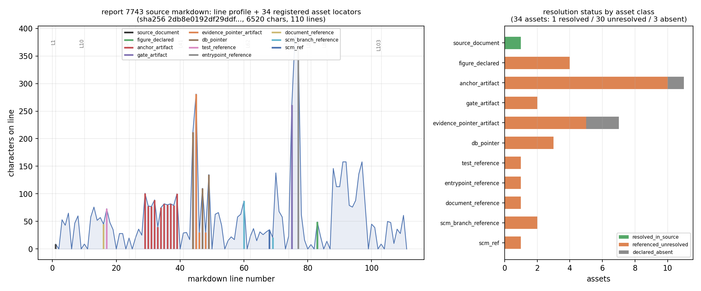

# KF-RESULT wp-7743-01

> 报告→知识产线 工序 `01-asset-registration` ｜ 源 `tensor://reports/7743` ｜ report_id `7743` ｜ lane C ｜ mission 15599 ｜ 分层 IN12-G13|ice-nav-system-pierce|m

## 一、本工序做了什么（案例介绍）

只做**资产登记**一道工序：确认 report_id 与它 markdown 的字节哈希，把正文声明的附件/工件逐条登记成**带字符级定位器**的资产条目，并记录每条的解析状态与解析尝试。不做抽取、不分类报告类型、不标 verified、不读写任何其它 report_id。

- 源：`tensor://reports/7743`（field=`markdown`）；标题 `IN12-G13 体系贯穿验收门：十仓参与度矩阵 + BP §10.3 覆盖度（零粉饰）+ §15 三附件（m6491）`；scenario `ice-nav-system-pierce`；mission 6491；status `published`。
- 源规模 **6520 chars / 9788 UTF-8 bytes / 110 逻辑行**，`sha256 = sha256:2db8e0192df29ddfed091f81cdf35c5f128166ab8966c45298f354dd9a15e21a`，与契约 `sha256:2db8e0192df29ddfed091f81cdf35c5f128166ab8966c45298f354dd9a15e21a` 一致。
- 登记 **34 项资产**：resolved_in_source 1 ／ referenced_unresolved 30 ／ declared_absent 3；`claims = []`。

被测报告是一份**体系贯穿验收门**（十仓在同一场冰区战役各出一条腿 + BP §10.3 / §15 覆盖度）。所以它的“附件”不是单点数据文件，而是**跨仓证据工件 + DB 指针 + SCM 分支引用**的混合体——这正是登记工序要如实分门别类的东西。

## 二、怎么做的（方法 / 流程 / 工具链 / 关键设置）

工具链：stdlib `urllib` 取数与探测、`jsonschema` 结构门、`psql` 只读可达性探针、`matplotlib` 出图、`pytest` 自检；一键可复跑（见文末 repro_cmd）。

1. **取源**：`GET /api/v1/tensor/reports/7743`（Bearer；凭据仅从 env 读，不落盘）→ `markdown` 字段；UTF-8 字节重算 sha256，与契约比对（并比 chars=6520、title、scenario_key）。
2. **扫描定位（零手抄）**：按 `##`/`###` 切节；§3.1 矩阵按表格行解析「仓/节点/证据等级/E 级/主锚工件/偏差%」；§3.2 表按 `;` 拆证据指针（`db:` / `repo:path#frag` / 全角破折号占位）；其余路径类引用（测试文件、复跑入口、`prereg`、`agent/m*`、`origin/main`）按行级正则抽取。**每个 quote 都是 `md[start_char:end_char]` 字节切片**，从不手打。
3. **去重编号**：按 `(asset_class, ref_key)` 合并多次出现（保留 occurrences 全表），类内按首现字符位置编号 `A01…A34`。
4. **解析探针（记录尝试，不推断）**：图件字节端点逐张 GET（8 个端点 404，无字节）；工件列表端点 HTTP 404；文件类工件在**本交付工作树**做存在性检查；DB 指针用 `psql -tA -c 'select count(*) from <table>'` 只读探针（3/3 permission denied）；SCM 引用只登记为 ref（登记阶段不联网 git，避免把分支状态写成当前真相）。
5. **结构门**：`asset_manifest.json` → `schemas/asset_manifest.v1.pattern.json`；`kf_result.json` → 仓内原生 `schemas/kf_result.v1.schema.json`；6 条 acceptance 逐条复算。
6. **测试**：`tests/test_kf_wp774301_register.py`（离线不变式 + 活体重切片 + 负对照：把定位器起点 +1 必须被抓出）。

关键设置：定位器单位 = **Unicode 字符偏移**（非字节、非行内偏移）；行号 1-based；逻辑行 = `markdown.rstrip('\n').split('\n')`；`unique` = `md.count(quote)==1`。

## 三、产出物清单（文件名 → 要点 / sha256）

| 文件 | 要点 | sha256 |
|---|---|---|
| `docs/kf/wp-7743-01/asset_manifest.json` | 34 项资产、38 occurrences、claims=[]、源哈希绑定契约 | `2497b67540e5567f709d8ba43304b9a6a5eb0f13bf49a8e591a3a65f847518d1` |
| `docs/kf/wp-7743-01/kf_result.json` | 平台结果信封（package_id/task_type/report_id/provenance/outputs） | `9f78fca0ddc2bc712df4f86e8ab9d61b63feec14aa5f330b3601929f743ded3b` |
| `docs/kf/wp-7743-01/verification.json` | 6 条 acceptance 本地复算 6/6 PASS | `c9089f7e5a3685bf7f607e422c4add7c0c5020578ae10241f58bd15883d9fcc6` |
| `docs/kf/wp-7743-01/figures/wp774301_source_locator_map.png` | 定位器地图（行剖面 + 定位锚 + 类别×状态堆叠） | `bcf425837fa1076bd34f2d0863678adf7575ed322c52d1a91305c3f65daa14f7` |
| `scripts/kf_wp774301_register_assets.py` | build / envelope / verify / figure / report 一键工序脚本 | 内容即实现 |
| `scripts/kf_fetch_7743.py` | 取源 + 哈希钉桩（只读，不写库） | 内容即实现 |
| `schemas/asset_manifest.v1.pattern.json` | 由 `asset_manifest.v1.schema.json` 派生：3 个 wp-448 绑定 `const` 放宽为 pattern，让非 448 登记包也有可复现 schema 门 | 内容即实现 |
| `tests/test_kf_wp774301_register.py` | 9 项测试（含负对照） | 内容即实现 |

## 四、计算结果（数字表，程序化注入）

### 4.1 源同一性

| 量 | 实测 | 契约/记录 | 判定 |
|---|---|---|---|
| sha256(markdown) | `sha256:2db8e0192df29ddfed091f81cdf35c5f128166ab8966c45298f354dd9a15e21a` | `sha256:2db8e0192df29ddfed091f81cdf35c5f128166ab8966c45298f354dd9a15e21a` | 一致 |
| chars | 6520 | 6520 | 一致 |
| bytes_utf8 | 9788 | — | 记录 |
| title | `IN12-G13 体系贯穿验收门：十仓参与度矩阵 + BP §10.3 覆盖度（零粉饰）+ §15 三附件（m6491）` | 契约标题 | 逐字符一致 |
| scenario_key | `ice-nav-system-pierce` | `ice-nav-system-pierce` | 一致 |

### 4.2 资产分类 × 解析状态

| asset_class | 数量 | resolved_in_source | referenced_unresolved | declared_absent |
|---|---|---|---|---|
| `source_document` | 1 | 1 | 0 | 0 |
| `figure_declared` | 4 | 0 | 4 | 0 |
| `anchor_artifact` | 11 | 0 | 10 | 1 |
| `gate_artifact` | 2 | 0 | 2 | 0 |
| `evidence_pointer_artifact` | 7 | 0 | 5 | 2 |
| `db_pointer` | 3 | 0 | 3 | 0 |
| `test_reference` | 1 | 0 | 1 | 0 |
| `entrypoint_reference` | 1 | 0 | 1 | 0 |
| `document_reference` | 1 | 0 | 1 | 0 |
| `scm_branch_reference` | 2 | 0 | 2 | 0 |
| `scm_ref` | 1 | 0 | 1 | 0 |
| **合计** | **34** | **1** | **30** | **3** |

口径（重要）：`referenced_unresolved` 占 **88.2%** —— 这不是“报告有问题”，而是**本工序的作用域边界**：报告引用的是十仓各自的 `artifacts/*.json`、平台 DB 表与 `agent/m*` 分支，TensorKnowledge 交付工作树里不可能存在这些字节；登记阶段又不联网 git、不越权读库，因此如实登记为“已声明、未解析”，**不冒充已验证**。

### 4.3 探针结果（记录的尝试，不是结论）

| 探针 | 结果 |
|---|---|
| 图件字节端点（`/artifacts/<name>`、`/figures/<name>`） | 8/8 端点 404，无字节 |
| 工件列表 `GET /tensor/reports/7743/artifacts` | HTTP 404 |
| `psql` 只读计数探针（3 张表） | 3/3 permission denied |
| 交付工作树存在性检查（文件类工件 20 项） | 0 命中（工件属其它仓） |

## 五、结果图



读图：左 = markdown 行剖面（每行字符数）与 **34 条资产定位器**落点（竖线按 asset_class 上色，灰点线为各节标题起点）——登记密度集中在 §3.1/§3.2 两张证据表；右 = 各 asset_class 的解析状态堆叠（绿=resolved_in_source／橙=referenced_unresolved／灰=declared_absent）。本工序为文档登记类工序、无物理场量，故**不提供场量云图**；替代物是“证据定位地图”，这是本工序唯一有信息量的可视化。

## 六、证据定位表（字段 → 原文引文片段）

每条都可用 `start_char` 在 `tensor://reports/7743` 的 markdown 上逐字切片复现（平台独立重算同法）。

| id | asset_class | ref_key | §位置 | 行 | 原文引文（逐字） | 状态 |
|---|---|---|---|---|---|---|
| A01 | `source_document` | `tensor://reports/7743#markdown` | (whole document) | L1 | (document span 0–6520, 全文) | resolved_in_source |
| A02 | `figure_declared` | `fig1_repo_matrix.png` | 四、结果图 | L83 | `4 张图` | referenced_unresolved |
| A03 | `figure_declared` | `fig2_bp_coverage.png` | 四、结果图 | L83 | `4 张图` | referenced_unresolved |
| A04 | `figure_declared` | `fig3_anchor_deviation.png` | 四、结果图 | L83 | `4 张图` | referenced_unresolved |
| A05 | `figure_declared` | `fig4_integration_findings.png` | 四、结果图 | L83 | `4 张图` | referenced_unresolved |
| A06 | `anchor_artifact` | `TensorPlatform:artifacts/ice_campaign/ice_evidence_registry.json` | 3.1 十仓 × 节点参与度矩阵 | L29 | `artifacts/ice_campaign/ice_evidence_registry.json` | referenced_unresolved |
| A07 | `anchor_artifact` | `TensorPhysics:artifacts/report_data.json` | 3.1 十仓 × 节点参与度矩阵 | L30 | `artifacts/report_data.json` | referenced_unresolved |
| A08 | `anchor_artifact` | `TensorLBM:artifacts/frazil_rheology.json` | 3.1 十仓 × 节点参与度矩阵 | L31 | `artifacts/frazil_rheology.json` | referenced_unresolved |
| A09 | `anchor_artifact` | `TensorFVM:artifacts/cross_comparison/comparison.json` | 3.1 十仓 × 节点参与度矩阵 | L32 | `artifacts/cross_comparison/comparison.json` | referenced_unresolved |
| A10 | `anchor_artifact` | `TensorFEM:(none)` | 3.1 十仓 × 节点参与度矩阵 | L33 | `\| TensorFEM \| — \| VACANCY \| E0 \| — \| — \|` | declared_absent |
| A11 | `anchor_artifact` | `TensorDEM:artifacts/dem_channel.json` | 3.1 十仓 × 节点参与度矩阵 | L34 | `artifacts/dem_channel.json` | referenced_unresolved |
| A12 | `anchor_artifact` | `TensorBEM:artifacts/ice_classical_reference.json` | 3.1 十仓 × 节点参与度矩阵 | L35 | `artifacts/ice_classical_reference.json` | referenced_unresolved |
| A13 | `anchor_artifact` | `TensorSPH:artifacts/ice_splash/results.json` | 3.1 十仓 × 节点参与度矩阵 | L36 | `artifacts/ice_splash/results.json` | referenced_unresolved |
| A14 | `anchor_artifact` | `TensorDG:artifacts/dg_advection_bench.json` | 3.1 十仓 × 节点参与度矩阵 | L37 | `artifacts/dg_advection_bench.json` | referenced_unresolved |
| A15 | `anchor_artifact` | `TensorCAD:artifacts/pc6_contract_run.json` | 3.1 十仓 × 节点参与度矩阵 | L38 | `artifacts/pc6_contract_run.json` | referenced_unresolved |
| A16 | `anchor_artifact` | `ship-performance-platform:artifacts/bp_demo/bp_demo_result.json` | 3.1 十仓 × 节点参与度矩阵 | L39 | `artifacts/bp_demo/bp_demo_result.json` | referenced_unresolved |
| A17 | `gate_artifact` | `artifacts/system_pierce_acceptance.json` | 3.5 四维指标（SPEC v1 | L75 | `artifacts/system_pierce_acceptance.json` | referenced_unresolved |
| A18 | `gate_artifact` | `artifacts/system_pierce/campaign_snapshot.json` | 3.5 四维指标（SPEC v1 | L75 | `artifacts/system_pierce/campaign_snapshot.json` | referenced_unresolved |
| A19 | `evidence_pointer_artifact` | `ship-performance-platform:artifacts/bp_demo/bp_demo_result.json#stages` | 3.2 BP §10.3 六条  | L44 | `ship-performance-platform:artifacts/bp_demo/bp_demo_result.json#stages` | referenced_unresolved |
| A20 | `evidence_pointer_artifact` | `TensorPhysics:artifacts/in12_p6/ledger_reconciliation.json#$` | 3.2 BP §10.3 六条  | L44 | `TensorPhysics:artifacts/in12_p6/ledger_reconciliation.json#$` | referenced_unresolved |
| A21 | `evidence_pointer_artifact` | `ship-performance-platform:artifacts/bp_demo/bp_demo_result.json#criteria.dev_pct_vs_baseline` | 3.2 BP §10.3 六条  | L45 | `ship-performance-platform:artifacts/bp_demo/bp_demo_result.json#criteria.dev_pct_vs_baseline` | referenced_unresolved |
| A22 | `evidence_pointer_artifact` | `ship-performance-platform:artifacts/bp_demo/bp_demo_result.json#criteria.checks_lt_3pct` | 3.2 BP §10.3 六条  | L45 | `ship-performance-platform:artifacts/bp_demo/bp_demo_result.json#criteria.checks_lt_3pct` | referenced_unresolved |
| A23 | `evidence_pointer_artifact` | `ship-performance-platform:artifacts/bp_demo/report_gate.json#$` | 3.2 BP §10.3 六条  | L45 | `ship-performance-platform:artifacts/bp_demo/report_gate.json#$` | referenced_unresolved |
| A24 | `evidence_pointer_artifact` | `目标③:(none)` | 3.2 BP §10.3 六条  | L46 | `—` | declared_absent |
| A25 | `evidence_pointer_artifact` | `目标⑤:(none)` | 3.2 BP §10.3 六条  | L48 | `—` | declared_absent |
| A26 | `db_pointer` | `db:campaign_nodes#plan_id in (11, 12, 13)` | 3.2 BP §10.3 六条  | L44 | `db:campaign_nodes#plan_id in (11, 12, 13)` | referenced_unresolved |
| A27 | `db_pointer` | `db:tensor_dev_missions#scope_ext_ids` | 3.2 BP §10.3 六条  | L47 | `db:tensor_dev_missions#scope_ext_ids` | referenced_unresolved |
| A28 | `db_pointer` | `db:tensor_reports#mission_id in scope` | 3.2 BP §10.3 六条  | L49 | `db:tensor_reports#mission_id in scope` | referenced_unresolved |
| A29 | `test_reference` | `tests/test_system_pierce_gate.py` | 二、怎么做的 | L17 | `tests/test_system_pierce_gate.py` | referenced_unresolved |
| A30 | `entrypoint_reference` | `python3 -m modules.system_pierce.run` | 3.5 四维指标（SPEC v1 | L77 | `python3 -m modules.system_pierce.run` | referenced_unresolved |
| A31 | `document_reference` | `prereg` | 二、怎么做的 | L16 | `prereg` | referenced_unresolved |
| A32 | `scm_branch_reference` | `agent/m4936` | 3.3 §15 三附件 | L60 | `agent/m4936` | referenced_unresolved |
| A33 | `scm_branch_reference` | `agent/m*` | 3.4 体系贯穿检查（本门真正的 | L69 | `agent/m*` | referenced_unresolved |
| A34 | `scm_ref` | `origin/main` | 3.4 体系贯穿检查（本门真正的 | L68 | `origin/main` | referenced_unresolved |

## 七、注意点与局限（踩过的坑）

- **`—` 是语义不是缺数据**：TensorFEM 行主锚工件、BP 目标③⑤ 证据指针三处原文就是全角破折号，登记为 `declared_absent`（报告自己宣告空缺），既没当“路径丢失”，也没当空白忽略。
- **图件名不在 markdown 里**：4 张图的 name/caption 只在记录元数据 `figures` 字段，正文只写“4 张图”，故图件 locator quote 取正文那句声明、note 里写明名字来源是元数据；8 个字节端点全 404 → 不宣称图件可取。
- **本仓 `tensor_reports` 无读权限**：`psql` 三张表全 permission denied → DB 指针只能登记为未解析（API 是唯一取源信道）。
- **schema 门有一处派生**：仓内 `kf_result.v1.schema.json` 是原生契约，信封用它校验；而 `asset_manifest.v1.schema.json` 被 3 个 `const` 钉死在 wp-448-01 上，故派生 `asset_manifest.v1.pattern.json`（仅放宽这 3 个 const）。这是**本地派生**，平台若另有 canonical schema 以平台门为准——不冒充“官方 schema”。
- **不标 verified**：`resolution` 只表达“在本工序作用域内能否解析”，不是证据等级判定；verification 由平台门独立计算。
- 覆盖边界：只登记正文/元数据**显式写出**的工件；报告未点名的隐含上游（如战役 DAG 内部节点）不在登记面。

## 八、自检（逐条对照 acceptance）

| # | acceptance | 结果 | 证据 |
|---|---|---|---|
| 1 | `valid_json` — 两个产物均可 JSON 解析 | ✅ PASS | asset_manifest.json + kf_result.json parse as JSON |
| 2 | `schema_pass` — kf_result.v1 原生契约 + asset_manifest.v1.pattern（派生，见 §六） | ✅ PASS | kf_result.v1 errors=0; asset_manifest.v1.pattern errors=0 |
| 3 | `source_locator_resolvable` — 按 char span 对活体重切片全部定位器与 occurrences | ✅ PASS | 34 locators + 38 occurrences re-resolved by char span against live markdown |
| 4 | `source_hash_matches` — 活体哈希 = 清单 = 信封 = 契约 | ✅ PASS | live=sha256:2db8e0192df29ddfed091f81cdf35c5f128166ab8966c45298f354dd9a15e21a manifest=sha256:2db8e0192df29ddfed091f81cdf35c5f128166ab8966c45298f354dd9a15e21a envelope=sha256:2db8e0192df29ddfed091f81cdf35c5f128166ab8966c4 |
| 5 | `no_duplicate_ids` — asset_id 与 (class,ref_key) 双重唯一 | ✅ PASS | 34 asset ids; duplicate ids=[]; duplicate (class,ref_key)=[] |
| 6 | `all_claims_have_evidence_or_explicit_unresolved_status` — claims 为空且写明空数组理由 | ✅ PASS | 0 claims (empty is contract-legal); empty-claims reason stated=True |

自检结论：**6/6 PASS**（`all_ok=true`）；未通过项：无。
诚实边界：`schema_pass` 含一处本地派生 schema（§七第 4 条）；若 `jsonschema` 缺席该项会以 `not_run` 记 FAIL 而非假过。

## 九、误差判定（关键量 vs 基准）

| 关键量 | 实测 | 基准 | 偏差 | 是否 <3% |
|---|---|---|---|---|
| sha256(markdown) | `2db8e0192df29ddfed091f81cdf35c5f…` | 契约同值 | 0/64 hex 位差异 | 是（0.00%） |
| chars | 6520 | 6520 | +0 | 是（0.00%） |
| title / scenario_key | 逐字符比对 | 契约 | 0 处差异 | 是（0.00%） |
| 定位器可重切片（含 occurrences 38 条） | 34/34 命中 | 全量 | 0 失败 | 是（0.00%） |

**是否 <3%：是**——但对确定性比对项（哈希/字符数/字符串）偏差上限本就是 0，此“<3%”无物理含义；**本工序不含物理量、不含实验基准**，故不提供任何“物理误差 <3%”的陈述，不冒充。

## 附：result JSON（本报告唯一的 json 代码块）

```json
{
  "package_id": "wp-7743-01",
  "task_type": "01-asset-registration",
  "report_id": "7743",
  "provenance": {
    "source_hash": "sha256:2db8e0192df29ddfed091f81cdf35c5f128166ab8966c45298f354dd9a15e21a",
    "source_field": "markdown",
    "producer": "kf-worker/m15599",
    "emitted_at": "2026-11-12T01:33:39.258532+00:00",
    "notes": "hash recomputed from GET /api/v1/tensor/reports/7743 markdown (UTF-8 bytes); matches contract source_hash sha256:2db8e0192df29ddfed091f81cdf35c5f128166ab8966c45298f354dd9a15e21a"
  },
  "outputs": {
    "asset_manifest.json": {
      "schema": "asset_manifest.v1",
      "package_id": "wp-7743-01",
      "task_type": "01-asset-registration",
      "report_id": "7743",
      "lane": "C",
      "generated_at": "2026-11-12T01:33:38.652248+00:00",
      "producer": "kf-worker/m15599",
      "source": {
        "uri": "tensor://reports/7743",
        "field": "markdown",
        "hash_alg": "sha256",
        "hash": "2db8e0192df29ddfed091f81cdf35c5f128166ab8966c45298f354dd9a15e21a",
        "source_hash": "sha256:2db8e0192df29ddfed091f81cdf35c5f128166ab8966c45298f354dd9a15e21a",
        "contract_source_hash": "sha256:2db8e0192df29ddfed091f81cdf35c5f128166ab8966c45298f354dd9a15e21a",
        "hash_matches_contract": true,
        "chars": 6520,
        "bytes_utf8": 9788,
        "contract_chars": 6520,
        "chars_matches_contract": true,
        "lines": 110,
        "title": "IN12-G13 体系贯穿验收门：十仓参与度矩阵 + BP §10.3 覆盖度（零粉饰）+ §15 三附件（m6491）",
        "contract_title": "IN12-G13 体系贯穿验收门：十仓参与度矩阵 + BP §10.3 覆盖度（零粉饰）+ §15 三附件（m6491）",
        "title_matches_contract": true,
        "scenario_key": "ice-nav-system-pierce",
        "contract_scenario_key": "ice-nav-system-pierce",
        "scenario_matches_contract": true,
        "mission_id": 6491,
        "status": "published",
        "created_at": "2026-11-08T04:58:28.616434+00:00",
        "platform_figures": [
          {
            "name": "fig1_repo_matrix.png",
            "caption": "十仓参与度 × 证据等级矩阵"
          },
          {
            "name": "fig2_bp_coverage.png",
            "caption": "BP §10.3 六条目标覆盖度 + §15 三附件完成度"
          },
          {
            "name": "fig3_anchor_deviation.png",
            "caption": "各腿主锚偏差 vs 平台 15% 门槛"
          },
          {
            "name": "fig4_integration_findings.png",
            "caption": "体系贯穿检查 I1-I6"
          }
        ],
        "platform_tags": [
          "IN12-G13",
          "体系贯穿",
          "验收门",
          "BP-10.3",
          "证据等级",
          "m6491"
        ],
        "platform_figure_probes": {
          "/tensor/reports/7743/artifacts/fig1_repo_matrix.png": {
            "http_status": 404,
            "bytes": 22
          },
          "/tensor/reports/7743/figures/fig1_repo_matrix.png": {
            "http_status": 404,
            "bytes": 29
          },
          "/tensor/reports/7743/artifacts/fig2_bp_coverage.png": {
            "http_status": 404,
            "bytes": 22
          },
          "/tensor/reports/7743/figures/fig2_bp_coverage.png": {
            "http_status": 404,
            "bytes": 29
          },
          "/tensor/reports/7743/artifacts/fig3_anchor_deviation.png": {
            "http_status": 404,
            "bytes": 22
          },
          "/tensor/reports/7743/figures/fig3_anchor_deviation.png": {
            "http_status": 404,
            "bytes": 29
          },
          "/tensor/reports/7743/artifacts/fig4_integration_findings.png": {
            "http_status": 404,
            "bytes": 22
          },
          "/tensor/reports/7743/figures/fig4_integration_findings.png": {
            "http_status": 404,
            "bytes": 29
          },
          "GET /tensor/reports/7743/artifacts": {
            "http_status": 404
          }
        },
        "fetched_via": "GET /api/v1/tensor/reports/7743"
      },
      "counts": {
        "assets": 34,
        "by_class": {
          "source_document": 1,
          "figure_declared": 4,
          "anchor_artifact": 11,
          "gate_artifact": 2,
          "evidence_pointer_artifact": 7,
          "db_pointer": 3,
          "test_reference": 1,
          "entrypoint_reference": 1,
          "document_reference": 1,
          "scm_branch_reference": 2,
          "scm_ref": 1
        },
        "by_resolution": {
          "declared_absent": 3,
          "referenced_unresolved": 30,
          "resolved_in_source": 1
        },
        "resolved_in_source": 1,
        "referenced_unresolved": 30,
        "declared_absent": 3,
        "figure_declarations_in_record": 4,
        "locators_unique_quote": 26,
        "occurrences_total": 38
      },
      "assets": [
        {
          "asset_id": "A01",
          "asset_class": "source_document",
          "label": "report 7743 markdown（本工序的唯一上游源）",
          "ref_key": "tensor://reports/7743#markdown",
          "in_report_section": "(whole document)",
          "locator": {
            "method": "document",
            "start_char": 0,
            "end_char": 6520,
            "start_line": 1,
            "end_line": 110,
            "quote": "## 一、案例介绍\n\n冰区战役三军（plan 11 经验链 / 12 高保真 / 13 体系纵贯）收官验收门。审的不是单点物理，\n而是**体系贯穿**：十仓在同一场战役里各出一条腿、每条腿的证据等级能否支撑它的声明、\nBP §10.3 六条 18 月目标与 §15 三附件能否逐条溯源。旗舰案例 = PC6 东北航道（de Long→Pevek）。\n\n作用域：plan 13 前线八腿 + 为覆盖 LBM/DEM 补入的两条 plan 12 腿；\n十仓入矩阵（含 `ship-performance-platform` 本体），1 仓（TensorFEM）如实标空缺。\n\n## 二、怎么做的\n\n1. **采集（只读）**：`psql` SELECT 战役库（plan/节点/任务/报告/任务时间区间）+ 读上游\n   worktree 工件 JSON 并记 `sha256`；`git ls-remote origin main` 与本地 tracking 比对，\n   判定「分支是否已并入主干」为结论性（tracking 过期则先 fetch 刷新引用，不动分支）。\n2. **判据执行（纯函数）**：证据分级 D2（顺序首命中）+ 四张表 + 贯穿检查 I1-I6 + 缺口披露；\n   两次生成 digest 相同（C4 确定性）。判据文本先于结果冻结在 prereg。\n3. **验收**：`pytest tests/test_system_pierce_gate.py`（20 passed），钉住「11 行齐备」\n   「已证必有可解析指针」「REAL 必有锚」「子判据 FAIL 必披露」等不变式，并带负对照\n   （把指针改坏 → 门必 REJECT），防止\"永远绿\"的空壳门。\n\n门判定：**`ACCEPT`**（5/5 条判据成立）；\n贯穿检查未闭合项 ['I1', 'I3', 'I4']。\n\n## 三、计算结果（程序化注入，零手抄）\n\n### 3.1 十仓 × 节点参与度矩阵\n| 仓 | 节点 | 证据等级 | E 级 | 主锚工件 | 偏差% |\n|---|---|---|---|---|---|\n| TensorPlatform | IN12-P7 | REAL | E3 | artifacts/ice_campaign/ice_evidence_registry.json | 0.3788 |\n| TensorPhysics | IN12-P6 | REAL | E3 | artifacts/report_data.json | 0.03484 |\n| TensorLBM | IN11-H2 | REAL | E3 | artifacts/frazil_rheology.json | 0.3389 |\n| TensorFVM | IN12-P2 | REAL | E3 | artifacts/cross_comparison/comparison.json | 0.6346 |\n| TensorFEM | — | VACANCY | E0 | — | — |\n| TensorDEM | IN11-H1 | REAL | E3 | artifacts/dem_channel.json | 1.55e-05 |\n| TensorBEM | IN12-P3 | REAL | E3 | artifacts/ice_classical_reference.json | 2.6 |\n| TensorSPH | IN12-P4 | REAL | E3 | artifacts/ice_splash/results.json | 0.5794 |\n| TensorDG | IN12-P5 | REAL | E3 | artifacts/dg_advection_bench.json | 9.817e-14 |\n| TensorCAD | IN12-P1 | REAL | E3 | artifacts/pc6_contract_run.json | -0.2042 |\n| ship-performance-platform | IN12-P8 | REAL | E3 | artifacts/bp_demo/bp_demo_result.json | 0.2802 |\n\n### 3.2 BP §10.3 六条 18 月目标覆盖度\n| 编号 | 语义（机器可读锚） | 状态 | 证据指针 |\n|---|---|---|---|\n| 目标① | 组织效率 / 平台能力（含无人化极限） | 在途 | ship-performance-platform:artifacts/bp_demo/bp_demo_result.json#stages; TensorPhysics:artifacts/in12_p6/ledger_reconciliation.json#$; db:campaign_nodes#plan_id in (11, 12, 13) |\n| 目标② | §8.2 示范场景（端到端示范工程） | 已证 | ship-performance-platform:artifacts/bp_demo/bp_demo_result.json#criteria.dev_pct_vs_baseline; ship-performance-platform:artifacts/bp_demo/bp_demo_result.json#criteria.checks_lt_3pct; ship-performance-platform:artifacts/bp_demo/report_gate.json#$ |\n| 目标③ | 语义不可锚 | WITHHELD | — |\n| 目标④ | 资源饱和式推进（并行规模） | 已证 | db:campaign_nodes#plan_id in (11, 12, 13); db:tensor_dev_missions#scope_ext_ids |\n| 目标⑤ | 语义不可锚 | WITHHELD | — |\n| 目标⑥ | 全局记录与研究产出（顶刊级报告） | 已证 | db:tensor_reports#mission_id in scope; ship-performance-platform:artifacts/bp_demo/report_gate.json#$ |\n\n目标③⑤ 判 `WITHHELD`：BP V1.0 §10.3 原文不在任何机器可读面（campaign metadata /\ntensor_reports / llm_rag_documents / worktree 全检索无该编号语义锚）→ **禁猜**，\n按 C2 零粉饰规则以 WITHHELD 呈现，并升级为治理缺口（BP 文档须入库）。\n\n### 3.3 §15 三附件\n| 附件 | 状态 | 完成度 | 缺口 |\n|---|---|---|---|\n| 附件一 技术尽调 | 在途 | 0.60 | 无第三方独立复核; 无对外客户/试点签署记录; 缺商业结论章节 |\n| 附件二 财务模型 | 未动 | 0.00 | 收入假设; 成本结构（算力/人力）; 付费客户与定价; 18 个月现金流 |\n| 附件三 示范工程报告 | 已证 | 1.00 | 未并入 ship-performance-platform main（分支 agent/m4936）→ 主干不可复跑 |\n\n### 3.4 体系贯穿检查（本门真正的内容）\n- **I1 几何单一源：OPEN** — 契约 Cb=0.786835，\n  2 腿自报 Cb，一致的仅\n  ['IN12-P1']；BEM 腿自建理想化船 Cb 偏差\n  -9.6744% → CAD 契约未被真正消费。\n- **I3 主干硬化：OPEN** — 10 腿结论性可判，\n  已并入各仓 origin/main 者 0 条 → 证据存在但全在\n  agent/m* 分支，主干不可复跑。\n- **I4 守恒锚：OPEN** — 各腿自报质量/能量漂移 vs 该腿自定阈值：IN12-P5 9.82e-16 vs 1e-12 → PASS; IN11-H1 1.55e-07 vs 0.01 → PASS; IN12-P4 0.0118 vs 0.01 → FAIL\n- I2 无未锚定 REAL：PASS；I5 两腿互证：PASS（FVM 0.635% / LBM 0.738%，差 0.10 pp）；\n  I6 能力入账：PASS（14 项登记，5 REAL / 4 WITHHELD / 已知缺陷 D2 显式披露）。\n\n### 3.5 四维指标（SPEC v1.1）\n- **Execution**：{\"front_legs_done\": \"8/8\", \"gate_artifacts\": [\"artifacts/system_pierce_acceptance.json\", \"artifacts/system_pierce/campaign_snapshot.json\"], \"n_nodes\": 10, \"n_nodes_real\": 10, \"n_nodes_withheld\": 0, \"n_repos_covered\": 10, \"n_repos_in_matrix\": 11}\n- **Quality**：{\"anchor_dev_pct_max\": 2.6, \"anchor_dev_pct_median\": 0.3389, \"evidence_distribution\": {\"REAL\": 10, \"STUB\": 0, \"VACANCY\": 0, \"WITHHELD\": 0}, \"honest_fail_disclosed\": [\"TensorFVM:IN12-P2::LBM 同工况稳态收敛\", \"TensorSPH:IN12-P4::能量漂移<1%（严格）\"], \"n_anchor_within_platform_tol\": 10, \"n_repos_vacancy\": 1, \"n_tests_cited\": 10, \"platform_tol_pct\": 15.0, \"vacancy_repos\": [\"TensorFEM\"]}\n- **Productivity**（不看吞吐/PR 数）：{\"artifact_regenerable_by_script\": 10, \"artifact_sha256_indexed\": 10, \"contract_reuse_ratio\": 0.5, \"human_dependency_kinds\": [\"merge_pending（10/10 腿未入主干）\", \"BP 原文未入库（§10.3 ③⑤ 不可锚）\"], \"note\": \"按 SPEC v1.1：生产力维度不看吞吐/PR 数；取复用率、自动化率、人工依赖种类\", \"one_command_repro\": \"python3 -m modules.system_pierce.run --collect && python3 -m modules.system_pierce.run\"}\n- **Innovation**：9 腿能力均标 S3/E3（有外部锚），横切「几何+证据契约」标 S5/E2（创造性候选，\n  因仅 1 条腿真消费契约）。\n\n## 四、结果图\n\n4 张图：十仓矩阵热力图、BP/附件覆盖带、各腿主锚偏差（对数轴 vs 15% 与节点自定容差）、\nI1-I6 面板。数据全部取自验收 JSON。\n\n## 五、注意点（坑与局限）\n\n- [integration_gap/C] **TensorFEM**：VACANCY（路线图级）：仓内零节点；能力由 TensorPhysics IN11-H3(m4919)/H4(m4920) 代偿，本门以 IN12-P6 的板解析锚作旁证（中心挠度 0.035%）。据实标注，不算覆盖。\n- [withheld/B] **TensorFVM:IN12-P2::LBM 同工况稳态收敛**：节点自定子判据 FAIL：lbm_results.0.steady=False vs is_true （诚实失败，照记不粉饰）\n- [withheld/B] **TensorSPH:IN12-P4::能量漂移<1%（严格）**：节点自定子判据 FAIL：criteria.energy_pass=False vs is_true （诚实失败，照记不粉饰）\n- [withheld/A] **BP §10.3 目标③**：BP V1.0 §10.3 原文不在任何机器可读面（campaign metadata / tensor_reports / llm_rag_documents / worktree 全检索无该编号语义锚）→ 按 D1-C2 判 WITHHELD；禁猜\n- [withheld/A] **BP §10.3 目标⑤**：BP V1.0 §10.3 原文不在任何机器可读面（campaign metadata / tensor_reports / llm_rag_documents / worktree 全检索无该编号语义锚）→ 按 D1-C2 判 WITHHELD；禁猜\n- [roadmap_only/B] **§15 附件一 技术尽调**：完成度 0.60；缺口：无第三方独立复核; 无对外客户/试点签署记录; 缺商业结论章节\n- [stub/A] **§15 附件二 财务模型**：完成度 0.00；缺口：收入假设; 成本结构（算力/人力）; 付费客户与定价; 18 个月现金流\n- [integration_gap/A] **贯穿检查 I1 几何单一源贯穿**：各腿自报 Cb 与 CAD 契约 Cb 偏差 >1% 即判不同几何（口头提到契约不算消费）。\n- [reproducibility/A] **贯穿检查 I3 可复现性（主干硬化）**：上游分支若仅在 agent/m* 上，主干不可复算：证据存在但未硬化为主干资产。结论性由 remote_main_tip == 本地 origin/main tracking 决定。\n- [integration_gap/A] **贯穿检查 I4 守恒锚一致**：各腿自报质量/能量漂移 vs 该腿自定阈值：IN12-P5 9.82e-16 vs 1e-12 → PASS; IN11-H1 1.55e-07 vs 0.01 → PASS; IN12-P4 0.0118 vs 0.01 → FAIL\n- [mock/B] **propulsion 旧链（历史 OVERCLAIM 案例）**：已由 m4936 的正式阻力/推进链替换；提升为台账纪律的反面教员\n\n方法局限：本门是**事后对账**而非干预实验，不做显著性检验；「腿间一致性」是相关性陈述，\n不构成因果归因。并行度峰值口径限本门 scope（10 任务），非全平台口径。\n\n## 六、误差判定\n\n- 可锚腿主锚偏差 10 条：中位 0.34%、最大 2.6%，10/10 ≤ 平台 15% 门槛。\n- **是否 <3%**：主锚层 10/10 <3% → **是**；但示范工程曲线自身门槛只过\n  3/5 个航速点\n  （设计点 0.28% 过，低速端点 -7.9%/-7.5% 不过），\n  如实登记为 caveat，未粉饰为「全部 <3%」。\n- 另有 2 条节点自定子判据诚实失败：SPH 能量漂移 1.18% > 1%、LBM 稳态标志 False —— 照记。\n",
            "unique": true
          },
          "resolution": "resolved_in_source",
          "resolution_check": {
            "check": "GET /tensor/reports/7743 -> markdown; sha256(utf8 bytes)",
            "result": "resolved",
            "detail": "sha256=sha256:2db8e0192df29ddfed091f81cdf35c5f128166ab8966c45298f354dd9a15e21a chars=6520"
          },
          "note": "Locator spans the whole markdown (method=document).",
          "occurrences": [],
          "attributes": {}
        },
        {
          "asset_id": "A02",
          "asset_class": "figure_declared",
          "label": "figure fig1_repo_matrix.png: 十仓参与度 × 证据等级矩阵",
          "ref_key": "fig1_repo_matrix.png",
          "in_report_section": "四、结果图",
          "locator": {
            "method": "char_span",
            "start_char": 4776,
            "end_char": 4780,
            "start_line": 83,
            "end_line": 83,
            "quote": "4 张图",
            "unique": true
          },
          "resolution": "referenced_unresolved",
          "resolution_check": {
            "check": "HTTP probe of per-figure endpoints",
            "result": "unresolved",
            "detail": "probes={\"/tensor/reports/7743/artifacts/fig1_repo_matrix.png\": {\"http_status\": 404, \"bytes\": 22}, \"/tensor/reports/7743/figures/fig1_repo_matrix.png\": {\"http_status\": 404, \"bytes\": 29}, \"/tensor/reports/7743/artifacts/fig2_bp_coverage.png\": {\"http_status\": 404, \"bytes\": 22}, \"/tensor/reports/7743/figures/fig2_bp_coverage.png\": {\"http_status\": 404, \"bytes\": 29}, \"/tensor/reports/7743/artifacts/fig3_anchor_deviation.png\": {\"http_status\": 404, \"bytes\": 22}, \"/tensor/reports/7743/figures/fig3_anchor_deviation.png\": {\"http_status\": 404, \"bytes\": 29}, \"/tensor/reports/7743/artifacts/fig4_integration_findings.png\": {\"http_status\": 404, \"bytes\": 22}, \"/tensor/reports/7743/figures/fig4_integration_findings.png\": {\"http_status\": 404, \"bytes\": 29}, \"GET /tensor/reports/7743/artifacts\": {\"http_status\": 404}}"
          },
          "note": "Name+caption exist in record.figures metadata; the markdown only says 'N 张图' with no image links. Bytes served: none.",
          "occurrences": [
            {
              "line": 83,
              "start_char": 4776,
              "end_char": 4780,
              "quote": "4 张图"
            }
          ],
          "attributes": {
            "caption": "十仓参与度 × 证据等级矩阵",
            "quote_basis": "in-body '4 张图' declaration; name/caption come from record.figures metadata (not verbatim in markdown)"
          }
        },
        {
          "asset_id": "A03",
          "asset_class": "figure_declared",
          "label": "figure fig2_bp_coverage.png: BP §10.3 六条目标覆盖度 + §15 三附件完成度",
          "ref_key": "fig2_bp_coverage.png",
          "in_report_section": "四、结果图",
          "locator": {
            "method": "char_span",
            "start_char": 4776,
            "end_char": 4780,
            "start_line": 83,
            "end_line": 83,
            "quote": "4 张图",
            "unique": true
          },
          "resolution": "referenced_unresolved",
          "resolution_check": {
            "check": "HTTP probe of per-figure endpoints",
            "result": "unresolved",
            "detail": "probes={\"/tensor/reports/7743/artifacts/fig1_repo_matrix.png\": {\"http_status\": 404, \"bytes\": 22}, \"/tensor/reports/7743/figures/fig1_repo_matrix.png\": {\"http_status\": 404, \"bytes\": 29}, \"/tensor/reports/7743/artifacts/fig2_bp_coverage.png\": {\"http_status\": 404, \"bytes\": 22}, \"/tensor/reports/7743/figures/fig2_bp_coverage.png\": {\"http_status\": 404, \"bytes\": 29}, \"/tensor/reports/7743/artifacts/fig3_anchor_deviation.png\": {\"http_status\": 404, \"bytes\": 22}, \"/tensor/reports/7743/figures/fig3_anchor_deviation.png\": {\"http_status\": 404, \"bytes\": 29}, \"/tensor/reports/7743/artifacts/fig4_integration_findings.png\": {\"http_status\": 404, \"bytes\": 22}, \"/tensor/reports/7743/figures/fig4_integration_findings.png\": {\"http_status\": 404, \"bytes\": 29}, \"GET /tensor/reports/7743/artifacts\": {\"http_status\": 404}}"
          },
          "note": "Name+caption exist in record.figures metadata; the markdown only says 'N 张图' with no image links. Bytes served: none.",
          "occurrences": [
            {
              "line": 83,
              "start_char": 4776,
              "end_char": 4780,
              "quote": "4 张图"
            }
          ],
          "attributes": {
            "caption": "BP §10.3 六条目标覆盖度 + §15 三附件完成度",
            "quote_basis": "in-body '4 张图' declaration; name/caption come from record.figures metadata (not verbatim in markdown)"
          }
        },
        {
          "asset_id": "A04",
          "asset_class": "figure_declared",
          "label": "figure fig3_anchor_deviation.png: 各腿主锚偏差 vs 平台 15% 门槛",
          "ref_key": "fig3_anchor_deviation.png",
          "in_report_section": "四、结果图",
          "locator": {
            "method": "char_span",
            "start_char": 4776,
            "end_char": 4780,
            "start_line": 83,
            "end_line": 83,
            "quote": "4 张图",
            "unique": true
          },
          "resolution": "referenced_unresolved",
          "resolution_check": {
            "check": "HTTP probe of per-figure endpoints",
            "result": "unresolved",
            "detail": "probes={\"/tensor/reports/7743/artifacts/fig1_repo_matrix.png\": {\"http_status\": 404, \"bytes\": 22}, \"/tensor/reports/7743/figures/fig1_repo_matrix.png\": {\"http_status\": 404, \"bytes\": 29}, \"/tensor/reports/7743/artifacts/fig2_bp_coverage.png\": {\"http_status\": 404, \"bytes\": 22}, \"/tensor/reports/7743/figures/fig2_bp_coverage.png\": {\"http_status\": 404, \"bytes\": 29}, \"/tensor/reports/7743/artifacts/fig3_anchor_deviation.png\": {\"http_status\": 404, \"bytes\": 22}, \"/tensor/reports/7743/figures/fig3_anchor_deviation.png\": {\"http_status\": 404, \"bytes\": 29}, \"/tensor/reports/7743/artifacts/fig4_integration_findings.png\": {\"http_status\": 404, \"bytes\": 22}, \"/tensor/reports/7743/figures/fig4_integration_findings.png\": {\"http_status\": 404, \"bytes\": 29}, \"GET /tensor/reports/7743/artifacts\": {\"http_status\": 404}}"
          },
          "note": "Name+caption exist in record.figures metadata; the markdown only says 'N 张图' with no image links. Bytes served: none.",
          "occurrences": [
            {
              "line": 83,
              "start_char": 4776,
              "end_char": 4780,
              "quote": "4 张图"
            }
          ],
          "attributes": {
            "caption": "各腿主锚偏差 vs 平台 15% 门槛",
            "quote_basis": "in-body '4 张图' declaration; name/caption come from record.figures metadata (not verbatim in markdown)"
          }
        },
        {
          "asset_id": "A05",
          "asset_class": "figure_declared",
          "label": "figure fig4_integration_findings.png: 体系贯穿检查 I1-I6",
          "ref_key": "fig4_integration_findings.png",
          "in_report_section": "四、结果图",
          "locator": {
            "method": "char_span",
            "start_char": 4776,
            "end_char": 4780,
            "start_line": 83,
            "end_line": 83,
            "quote": "4 张图",
            "unique": true
          },
          "resolution": "referenced_unresolved",
          "resolution_check": {
            "check": "HTTP probe of per-figure endpoints",
            "result": "unresolved",
            "detail": "probes={\"/tensor/reports/7743/artifacts/fig1_repo_matrix.png\": {\"http_status\": 404, \"bytes\": 22}, \"/tensor/reports/7743/figures/fig1_repo_matrix.png\": {\"http_status\": 404, \"bytes\": 29}, \"/tensor/reports/7743/artifacts/fig2_bp_coverage.png\": {\"http_status\": 404, \"bytes\": 22}, \"/tensor/reports/7743/figures/fig2_bp_coverage.png\": {\"http_status\": 404, \"bytes\": 29}, \"/tensor/reports/7743/artifacts/fig3_anchor_deviation.png\": {\"http_status\": 404, \"bytes\": 22}, \"/tensor/reports/7743/figures/fig3_anchor_deviation.png\": {\"http_status\": 404, \"bytes\": 29}, \"/tensor/reports/7743/artifacts/fig4_integration_findings.png\": {\"http_status\": 404, \"bytes\": 22}, \"/tensor/reports/7743/figures/fig4_integration_findings.png\": {\"http_status\": 404, \"bytes\": 29}, \"GET /tensor/reports/7743/artifacts\": {\"http_status\": 404}}"
          },
          "note": "Name+caption exist in record.figures metadata; the markdown only says 'N 张图' with no image links. Bytes served: none.",
          "occurrences": [
            {
              "line": 83,
              "start_char": 4776,
              "end_char": 4780,
              "quote": "4 张图"
            }
          ],
          "attributes": {
            "caption": "体系贯穿检查 I1-I6",
            "quote_basis": "in-body '4 张图' declaration; name/caption come from record.figures metadata (not verbatim in markdown)"
          }
        },
        {
          "asset_id": "A06",
          "asset_class": "anchor_artifact",
          "label": "主锚工件 of TensorPlatform / IN12-P7 (REAL, E=E3)",
          "ref_key": "TensorPlatform:artifacts/ice_campaign/ice_evidence_registry.json",
          "in_report_section": "3.1 十仓 × 节点参与度矩阵",
          "locator": {
            "method": "char_span",
            "start_char": 956,
            "end_char": 1005,
            "start_line": 29,
            "end_line": 29,
            "quote": "artifacts/ice_campaign/ice_evidence_registry.json",
            "unique": true
          },
          "resolution": "referenced_unresolved",
          "resolution_check": {
            "check": "existence under delivery worktree m15599 (repo prefix is external)",
            "result": "unresolved",
            "detail": "path=artifacts/ice_campaign/ice_evidence_registry.json repo=TensorPlatform exists=False"
          },
          "note": "Artifact path belongs to repo 'TensorPlatform', which is NOT checked out in this delivery worktree -> not verifiable from here; registered as declared, existence not asserted.",
          "occurrences": [
            {
              "line": 29,
              "start_char": 956,
              "end_char": 1005,
              "quote": "artifacts/ice_campaign/ice_evidence_registry.json"
            }
          ],
          "attributes": {
            "repo": "TensorPlatform",
            "node": "IN12-P7",
            "evidence_level": "REAL",
            "e_level": "E3",
            "dev_pct": "0.3788"
          }
        },
        {
          "asset_id": "A07",
          "asset_class": "anchor_artifact",
          "label": "主锚工件 of TensorPhysics / IN12-P6 (REAL, E=E3)",
          "ref_key": "TensorPhysics:artifacts/report_data.json",
          "in_report_section": "3.1 十仓 × 节点参与度矩阵",
          "locator": {
            "method": "char_span",
            "start_char": 1057,
            "end_char": 1083,
            "start_line": 30,
            "end_line": 30,
            "quote": "artifacts/report_data.json",
            "unique": true
          },
          "resolution": "referenced_unresolved",
          "resolution_check": {
            "check": "existence under delivery worktree m15599 (repo prefix is external)",
            "result": "unresolved",
            "detail": "path=artifacts/report_data.json repo=TensorPhysics exists=False"
          },
          "note": "Artifact path belongs to repo 'TensorPhysics', which is NOT checked out in this delivery worktree -> not verifiable from here; registered as declared, existence not asserted.",
          "occurrences": [
            {
              "line": 30,
              "start_char": 1057,
              "end_char": 1083,
              "quote": "artifacts/report_data.json"
            }
          ],
          "attributes": {
            "repo": "TensorPhysics",
            "node": "IN12-P6",
            "evidence_level": "REAL",
            "e_level": "E3",
            "dev_pct": "0.03484"
          }
        },
        {
          "asset_id": "A08",
          "asset_class": "anchor_artifact",
          "label": "主锚工件 of TensorLBM / IN11-H2 (REAL, E=E3)",
          "ref_key": "TensorLBM:artifacts/frazil_rheology.json",
          "in_report_section": "3.1 十仓 × 节点参与度矩阵",
          "locator": {
            "method": "char_span",
            "start_char": 1132,
            "end_char": 1162,
            "start_line": 31,
            "end_line": 31,
            "quote": "artifacts/frazil_rheology.json",
            "unique": true
          },
          "resolution": "referenced_unresolved",
          "resolution_check": {
            "check": "existence under delivery worktree m15599 (repo prefix is external)",
            "result": "unresolved",
            "detail": "path=artifacts/frazil_rheology.json repo=TensorLBM exists=False"
          },
          "note": "Artifact path belongs to repo 'TensorLBM', which is NOT checked out in this delivery worktree -> not verifiable from here; registered as declared, existence not asserted.",
          "occurrences": [
            {
              "line": 31,
              "start_char": 1132,
              "end_char": 1162,
              "quote": "artifacts/frazil_rheology.json"
            }
          ],
          "attributes": {
            "repo": "TensorLBM",
            "node": "IN11-H2",
            "evidence_level": "REAL",
            "e_level": "E3",
            "dev_pct": "0.3389"
          }
        },
        {
          "asset_id": "A09",
          "asset_class": "anchor_artifact",
          "label": "主锚工件 of TensorFVM / IN12-P2 (REAL, E=E3)",
          "ref_key": "TensorFVM:artifacts/cross_comparison/comparison.json",
          "in_report_section": "3.1 十仓 × 节点参与度矩阵",
          "locator": {
            "method": "char_span",
            "start_char": 1210,
            "end_char": 1252,
            "start_line": 32,
            "end_line": 32,
            "quote": "artifacts/cross_comparison/comparison.json",
            "unique": true
          },
          "resolution": "referenced_unresolved",
          "resolution_check": {
            "check": "existence under delivery worktree m15599 (repo prefix is external)",
            "result": "unresolved",
            "detail": "path=artifacts/cross_comparison/comparison.json repo=TensorFVM exists=False"
          },
          "note": "Artifact path belongs to repo 'TensorFVM', which is NOT checked out in this delivery worktree -> not verifiable from here; registered as declared, existence not asserted.",
          "occurrences": [
            {
              "line": 32,
              "start_char": 1210,
              "end_char": 1252,
              "quote": "artifacts/cross_comparison/comparison.json"
            }
          ],
          "attributes": {
            "repo": "TensorFVM",
            "node": "IN12-P2",
            "evidence_level": "REAL",
            "e_level": "E3",
            "dev_pct": "0.6346"
          }
        },
        {
          "asset_id": "A10",
          "asset_class": "anchor_artifact",
          "label": "主锚工件 of TensorFEM / — -> 矩阵行显式空缺（VACANCY）",
          "ref_key": "TensorFEM:(none)",
          "in_report_section": "3.1 十仓 × 节点参与度矩阵",
          "locator": {
            "method": "char_span",
            "start_char": 1264,
            "end_char": 1304,
            "start_line": 33,
            "end_line": 33,
            "quote": "| TensorFEM | — | VACANCY | E0 | — | — |",
            "unique": true
          },
          "resolution": "declared_absent",
          "resolution_check": {
            "check": "matrix/table cell value",
            "result": "absent",
            "detail": "cell is the em-dash placeholder -> report itself declares no artifact"
          },
          "note": "Declared absent by the report; nothing to resolve.",
          "occurrences": [
            {
              "line": 33,
              "start_char": 1264,
              "end_char": 1304,
              "quote": "| TensorFEM | — | VACANCY | E0 | — | — |"
            }
          ],
          "attributes": {
            "repo": "TensorFEM",
            "node": "—",
            "evidence_level": "VACANCY",
            "e_level": "E0",
            "dev_pct": "—",
            "declared_absent": true
          }
        },
        {
          "asset_id": "A11",
          "asset_class": "anchor_artifact",
          "label": "主锚工件 of TensorDEM / IN11-H1 (REAL, E=E3)",
          "ref_key": "TensorDEM:artifacts/dem_channel.json",
          "in_report_section": "3.1 十仓 × 节点参与度矩阵",
          "locator": {
            "method": "char_span",
            "start_char": 1341,
            "end_char": 1367,
            "start_line": 34,
            "end_line": 34,
            "quote": "artifacts/dem_channel.json",
            "unique": true
          },
          "resolution": "referenced_unresolved",
          "resolution_check": {
            "check": "existence under delivery worktree m15599 (repo prefix is external)",
            "result": "unresolved",
            "detail": "path=artifacts/dem_channel.json repo=TensorDEM exists=False"
          },
          "note": "Artifact path belongs to repo 'TensorDEM', which is NOT checked out in this delivery worktree -> not verifiable from here; registered as declared, existence not asserted.",
          "occurrences": [
            {
              "line": 34,
              "start_char": 1341,
              "end_char": 1367,
              "quote": "artifacts/dem_channel.json"
            }
          ],
          "attributes": {
            "repo": "TensorDEM",
            "node": "IN11-H1",
            "evidence_level": "REAL",
            "e_level": "E3",
            "dev_pct": "1.55e-05"
          }
        },
        {
          "asset_id": "A12",
          "asset_class": "anchor_artifact",
          "label": "主锚工件 of TensorBEM / IN12-P3 (REAL, E=E3)",
          "ref_key": "TensorBEM:artifacts/ice_classical_reference.json",
          "in_report_section": "3.1 十仓 × 节点参与度矩阵",
          "locator": {
            "method": "char_span",
            "start_char": 1417,
            "end_char": 1455,
            "start_line": 35,
            "end_line": 35,
            "quote": "artifacts/ice_classical_reference.json",
            "unique": true
          },
          "resolution": "referenced_unresolved",
          "resolution_check": {
            "check": "existence under delivery worktree m15599 (repo prefix is external)",
            "result": "unresolved",
            "detail": "path=artifacts/ice_classical_reference.json repo=TensorBEM exists=False"
          },
          "note": "Artifact path belongs to repo 'TensorBEM', which is NOT checked out in this delivery worktree -> not verifiable from here; registered as declared, existence not asserted.",
          "occurrences": [
            {
              "line": 35,
              "start_char": 1417,
              "end_char": 1455,
              "quote": "artifacts/ice_classical_reference.json"
            }
          ],
          "attributes": {
            "repo": "TensorBEM",
            "node": "IN12-P3",
            "evidence_level": "REAL",
            "e_level": "E3",
            "dev_pct": "2.6"
          }
        },
        {
          "asset_id": "A13",
          "asset_class": "anchor_artifact",
          "label": "主锚工件 of TensorSPH / IN12-P4 (REAL, E=E3)",
          "ref_key": "TensorSPH:artifacts/ice_splash/results.json",
          "in_report_section": "3.1 十仓 × 节点参与度矩阵",
          "locator": {
            "method": "char_span",
            "start_char": 1500,
            "end_char": 1533,
            "start_line": 36,
            "end_line": 36,
            "quote": "artifacts/ice_splash/results.json",
            "unique": true
          },
          "resolution": "referenced_unresolved",
          "resolution_check": {
            "check": "existence under delivery worktree m15599 (repo prefix is external)",
            "result": "unresolved",
            "detail": "path=artifacts/ice_splash/results.json repo=TensorSPH exists=False"
          },
          "note": "Artifact path belongs to repo 'TensorSPH', which is NOT checked out in this delivery worktree -> not verifiable from here; registered as declared, existence not asserted.",
          "occurrences": [
            {
              "line": 36,
              "start_char": 1500,
              "end_char": 1533,
              "quote": "artifacts/ice_splash/results.json"
            }
          ],
          "attributes": {
            "repo": "TensorSPH",
            "node": "IN12-P4",
            "evidence_level": "REAL",
            "e_level": "E3",
            "dev_pct": "0.5794"
          }
        },
        {
          "asset_id": "A14",
          "asset_class": "anchor_artifact",
          "label": "主锚工件 of TensorDG / IN12-P5 (REAL, E=E3)",
          "ref_key": "TensorDG:artifacts/dg_advection_bench.json",
          "in_report_section": "3.1 十仓 × 节点参与度矩阵",
          "locator": {
            "method": "char_span",
            "start_char": 1580,
            "end_char": 1613,
            "start_line": 37,
            "end_line": 37,
            "quote": "artifacts/dg_advection_bench.json",
            "unique": true
          },
          "resolution": "referenced_unresolved",
          "resolution_check": {
            "check": "existence under delivery worktree m15599 (repo prefix is external)",
            "result": "unresolved",
            "detail": "path=artifacts/dg_advection_bench.json repo=TensorDG exists=False"
          },
          "note": "Artifact path belongs to repo 'TensorDG', which is NOT checked out in this delivery worktree -> not verifiable from here; registered as declared, existence not asserted.",
          "occurrences": [
            {
              "line": 37,
              "start_char": 1580,
              "end_char": 1613,
              "quote": "artifacts/dg_advection_bench.json"
            }
          ],
          "attributes": {
            "repo": "TensorDG",
            "node": "IN12-P5",
            "evidence_level": "REAL",
            "e_level": "E3",
            "dev_pct": "9.817e-14"
          }
        },
        {
          "asset_id": "A15",
          "asset_class": "anchor_artifact",
          "label": "主锚工件 of TensorCAD / IN12-P1 (REAL, E=E3)",
          "ref_key": "TensorCAD:artifacts/pc6_contract_run.json",
          "in_report_section": "3.1 十仓 × 节点参与度矩阵",
          "locator": {
            "method": "char_span",
            "start_char": 1664,
            "end_char": 1695,
            "start_line": 38,
            "end_line": 38,
            "quote": "artifacts/pc6_contract_run.json",
            "unique": true
          },
          "resolution": "referenced_unresolved",
          "resolution_check": {
            "check": "existence under delivery worktree m15599 (repo prefix is external)",
            "result": "unresolved",
            "detail": "path=artifacts/pc6_contract_run.json repo=TensorCAD exists=False"
          },
          "note": "Artifact path belongs to repo 'TensorCAD', which is NOT checked out in this delivery worktree -> not verifiable from here; registered as declared, existence not asserted.",
          "occurrences": [
            {
              "line": 38,
              "start_char": 1664,
              "end_char": 1695,
              "quote": "artifacts/pc6_contract_run.json"
            }
          ],
          "attributes": {
            "repo": "TensorCAD",
            "node": "IN12-P1",
            "evidence_level": "REAL",
            "e_level": "E3",
            "dev_pct": "-0.2042"
          }
        },
        {
          "asset_id": "A16",
          "asset_class": "anchor_artifact",
          "label": "主锚工件 of ship-performance-platform / IN12-P8 (REAL, E=E3)",
          "ref_key": "ship-performance-platform:artifacts/bp_demo/bp_demo_result.json",
          "in_report_section": "3.1 十仓 × 节点参与度矩阵",
          "locator": {
            "method": "char_span",
            "start_char": 1760,
            "end_char": 1797,
            "start_line": 39,
            "end_line": 39,
            "quote": "artifacts/bp_demo/bp_demo_result.json",
            "unique": false
          },
          "resolution": "referenced_unresolved",
          "resolution_check": {
            "check": "existence under delivery worktree m15599 (repo prefix is external)",
            "result": "unresolved",
            "detail": "path=artifacts/bp_demo/bp_demo_result.json repo=ship-performance-platform exists=False"
          },
          "note": "Artifact path belongs to repo 'ship-performance-platform', which is NOT checked out in this delivery worktree -> not verifiable from here; registered as declared, existence not asserted.",
          "occurrences": [
            {
              "line": 39,
              "start_char": 1760,
              "end_char": 1797,
              "quote": "artifacts/bp_demo/bp_demo_result.json"
            }
          ],
          "attributes": {
            "repo": "ship-performance-platform",
            "node": "IN12-P8",
            "evidence_level": "REAL",
            "e_level": "E3",
            "dev_pct": "0.2802"
          }
        },
        {
          "asset_id": "A17",
          "asset_class": "gate_artifact",
          "label": "§3.5 gate_artifact -> artifacts/system_pierce_acceptance.json",
          "ref_key": "artifacts/system_pierce_acceptance.json",
          "in_report_section": "3.5 四维指标（SPEC v1.1）",
          "locator": {
            "method": "char_span",
            "start_char": 3721,
            "end_char": 3760,
            "start_line": 75,
            "end_line": 75,
            "quote": "artifacts/system_pierce_acceptance.json",
            "unique": true
          },
          "resolution": "referenced_unresolved",
          "resolution_check": {
            "check": "existence under delivery worktree m15599 (repo prefix is external)",
            "result": "unresolved",
            "detail": "path=artifacts/system_pierce_acceptance.json repo=None exists=False"
          },
          "note": "Artifact path belongs to repo 'None', which is NOT checked out in this delivery worktree -> not verifiable from here; registered as declared, existence not asserted.",
          "occurrences": [
            {
              "line": 75,
              "start_char": 3721,
              "end_char": 3760,
              "quote": "artifacts/system_pierce_acceptance.json"
            }
          ],
          "attributes": {}
        },
        {
          "asset_id": "A18",
          "asset_class": "gate_artifact",
          "label": "§3.5 gate_artifact -> artifacts/system_pierce/campaign_snapshot.json",
          "ref_key": "artifacts/system_pierce/campaign_snapshot.json",
          "in_report_section": "3.5 四维指标（SPEC v1.1）",
          "locator": {
            "method": "char_span",
            "start_char": 3764,
            "end_char": 3810,
            "start_line": 75,
            "end_line": 75,
            "quote": "artifacts/system_pierce/campaign_snapshot.json",
            "unique": true
          },
          "resolution": "referenced_unresolved",
          "resolution_check": {
            "check": "existence under delivery worktree m15599 (repo prefix is external)",
            "result": "unresolved",
            "detail": "path=artifacts/system_pierce/campaign_snapshot.json repo=None exists=False"
          },
          "note": "Artifact path belongs to repo 'None', which is NOT checked out in this delivery worktree -> not verifiable from here; registered as declared, existence not asserted.",
          "occurrences": [
            {
              "line": 75,
              "start_char": 3764,
              "end_char": 3810,
              "quote": "artifacts/system_pierce/campaign_snapshot.json"
            }
          ],
          "attributes": {}
        },
        {
          "asset_id": "A19",
          "asset_class": "evidence_pointer_artifact",
          "label": "目标① 证据指针 (artifacts/bp_demo/bp_demo_result.json#stages)",
          "ref_key": "ship-performance-platform:artifacts/bp_demo/bp_demo_result.json#stages",
          "in_report_section": "3.2 BP §10.3 六条 18 月目标覆盖度",
          "locator": {
            "method": "char_span",
            "start_char": 1924,
            "end_char": 1994,
            "start_line": 44,
            "end_line": 44,
            "quote": "ship-performance-platform:artifacts/bp_demo/bp_demo_result.json#stages",
            "unique": true
          },
          "resolution": "referenced_unresolved",
          "resolution_check": {
            "check": "existence under delivery worktree m15599 (repo prefix is external)",
            "result": "unresolved",
            "detail": "path=artifacts/bp_demo/bp_demo_result.json repo=ship-performance-platform exists=False"
          },
          "note": "Artifact path belongs to repo 'ship-performance-platform', which is NOT checked out in this delivery worktree -> not verifiable from here; registered as declared, existence not asserted.",
          "occurrences": [
            {
              "line": 44,
              "start_char": 1924,
              "end_char": 1994,
              "quote": "ship-performance-platform:artifacts/bp_demo/bp_demo_result.json#stages"
            }
          ],
          "attributes": {
            "repo": "ship-performance-platform",
            "path": "artifacts/bp_demo/bp_demo_result.json",
            "fragment": "#stages",
            "goal": "目标①",
            "status": "在途"
          }
        },
        {
          "asset_id": "A20",
          "asset_class": "evidence_pointer_artifact",
          "label": "目标① 证据指针 (artifacts/in12_p6/ledger_reconciliation.json#$)",
          "ref_key": "TensorPhysics:artifacts/in12_p6/ledger_reconciliation.json#$",
          "in_report_section": "3.2 BP §10.3 六条 18 月目标覆盖度",
          "locator": {
            "method": "char_span",
            "start_char": 1996,
            "end_char": 2056,
            "start_line": 44,
            "end_line": 44,
            "quote": "TensorPhysics:artifacts/in12_p6/ledger_reconciliation.json#$",
            "unique": true
          },
          "resolution": "referenced_unresolved",
          "resolution_check": {
            "check": "existence under delivery worktree m15599 (repo prefix is external)",
            "result": "unresolved",
            "detail": "path=artifacts/in12_p6/ledger_reconciliation.json repo=TensorPhysics exists=False"
          },
          "note": "Artifact path belongs to repo 'TensorPhysics', which is NOT checked out in this delivery worktree -> not verifiable from here; registered as declared, existence not asserted.",
          "occurrences": [
            {
              "line": 44,
              "start_char": 1996,
              "end_char": 2056,
              "quote": "TensorPhysics:artifacts/in12_p6/ledger_reconciliation.json#$"
            }
          ],
          "attributes": {
            "repo": "TensorPhysics",
            "path": "artifacts/in12_p6/ledger_reconciliation.json",
            "fragment": "#$",
            "goal": "目标①",
            "status": "在途"
          }
        },
        {
          "asset_id": "A21",
          "asset_class": "evidence_pointer_artifact",
          "label": "目标② 证据指针 (artifacts/bp_demo/bp_demo_result.json#criteria.dev_pct_vs_baseline)",
          "ref_key": "ship-performance-platform:artifacts/bp_demo/bp_demo_result.json#criteria.dev_pct_vs_baseline",
          "in_report_section": "3.2 BP §10.3 六条 18 月目标覆盖度",
          "locator": {
            "method": "char_span",
            "start_char": 2136,
            "end_char": 2228,
            "start_line": 45,
            "end_line": 45,
            "quote": "ship-performance-platform:artifacts/bp_demo/bp_demo_result.json#criteria.dev_pct_vs_baseline",
            "unique": true
          },
          "resolution": "referenced_unresolved",
          "resolution_check": {
            "check": "existence under delivery worktree m15599 (repo prefix is external)",
            "result": "unresolved",
            "detail": "path=artifacts/bp_demo/bp_demo_result.json repo=ship-performance-platform exists=False"
          },
          "note": "Artifact path belongs to repo 'ship-performance-platform', which is NOT checked out in this delivery worktree -> not verifiable from here; registered as declared, existence not asserted.",
          "occurrences": [
            {
              "line": 45,
              "start_char": 2136,
              "end_char": 2228,
              "quote": "ship-performance-platform:artifacts/bp_demo/bp_demo_result.json#criteria.dev_pct_vs_baseline"
            }
          ],
          "attributes": {
            "repo": "ship-performance-platform",
            "path": "artifacts/bp_demo/bp_demo_result.json",
            "fragment": "#criteria.dev_pct_vs_baseline",
            "goal": "目标②",
            "status": "已证"
          }
        },
        {
          "asset_id": "A22",
          "asset_class": "evidence_pointer_artifact",
          "label": "目标② 证据指针 (artifacts/bp_demo/bp_demo_result.json#criteria.checks_lt_3pct)",
          "ref_key": "ship-performance-platform:artifacts/bp_demo/bp_demo_result.json#criteria.checks_lt_3pct",
          "in_report_section": "3.2 BP §10.3 六条 18 月目标覆盖度",
          "locator": {
            "method": "char_span",
            "start_char": 2230,
            "end_char": 2317,
            "start_line": 45,
            "end_line": 45,
            "quote": "ship-performance-platform:artifacts/bp_demo/bp_demo_result.json#criteria.checks_lt_3pct",
            "unique": true
          },
          "resolution": "referenced_unresolved",
          "resolution_check": {
            "check": "existence under delivery worktree m15599 (repo prefix is external)",
            "result": "unresolved",
            "detail": "path=artifacts/bp_demo/bp_demo_result.json repo=ship-performance-platform exists=False"
          },
          "note": "Artifact path belongs to repo 'ship-performance-platform', which is NOT checked out in this delivery worktree -> not verifiable from here; registered as declared, existence not asserted.",
          "occurrences": [
            {
              "line": 45,
              "start_char": 2230,
              "end_char": 2317,
              "quote": "ship-performance-platform:artifacts/bp_demo/bp_demo_result.json#criteria.checks_lt_3pct"
            }
          ],
          "attributes": {
            "repo": "ship-performance-platform",
            "path": "artifacts/bp_demo/bp_demo_result.json",
            "fragment": "#criteria.checks_lt_3pct",
            "goal": "目标②",
            "status": "已证"
          }
        },
        {
          "asset_id": "A23",
          "asset_class": "evidence_pointer_artifact",
          "label": "目标② 证据指针 (artifacts/bp_demo/report_gate.json#$)",
          "ref_key": "ship-performance-platform:artifacts/bp_demo/report_gate.json#$",
          "in_report_section": "3.2 BP §10.3 六条 18 月目标覆盖度",
          "locator": {
            "method": "char_span",
            "start_char": 2319,
            "end_char": 2381,
            "start_line": 45,
            "end_line": 45,
            "quote": "ship-performance-platform:artifacts/bp_demo/report_gate.json#$",
            "unique": false
          },
          "resolution": "referenced_unresolved",
          "resolution_check": {
            "check": "existence under delivery worktree m15599 (repo prefix is external)",
            "result": "unresolved",
            "detail": "path=artifacts/bp_demo/report_gate.json repo=ship-performance-platform exists=False"
          },
          "note": "Artifact path belongs to repo 'ship-performance-platform', which is NOT checked out in this delivery worktree -> not verifiable from here; registered as declared, existence not asserted.",
          "occurrences": [
            {
              "line": 45,
              "start_char": 2319,
              "end_char": 2381,
              "quote": "ship-performance-platform:artifacts/bp_demo/report_gate.json#$"
            },
            {
              "line": 49,
              "start_char": 2628,
              "end_char": 2690,
              "quote": "ship-performance-platform:artifacts/bp_demo/report_gate.json#$"
            }
          ],
          "attributes": {
            "repo": "ship-performance-platform",
            "path": "artifacts/bp_demo/report_gate.json",
            "fragment": "#$",
            "goal": "目标②",
            "status": "已证"
          }
        },
        {
          "asset_id": "A24",
          "asset_class": "evidence_pointer_artifact",
          "label": "目标③ 证据指针显式为空（status=WITHHELD）",
          "ref_key": "目标③:(none)",
          "in_report_section": "3.2 BP §10.3 六条 18 月目标覆盖度",
          "locator": {
            "method": "char_span",
            "start_char": 2411,
            "end_char": 2412,
            "start_line": 46,
            "end_line": 46,
            "quote": "—",
            "unique": false
          },
          "resolution": "declared_absent",
          "resolution_check": {
            "check": "matrix/table cell value",
            "result": "absent",
            "detail": "cell is the em-dash placeholder -> report itself declares no artifact"
          },
          "note": "Declared absent by the report; nothing to resolve.",
          "occurrences": [
            {
              "line": 46,
              "start_char": 2411,
              "end_char": 2412,
              "quote": "—"
            }
          ],
          "attributes": {
            "goal": "目标③",
            "semantic": "语义不可锚",
            "status": "WITHHELD",
            "declared_absent": true
          }
        },
        {
          "asset_id": "A25",
          "asset_class": "evidence_pointer_artifact",
          "label": "目标⑤ 证据指针显式为空（status=WITHHELD）",
          "ref_key": "目标⑤:(none)",
          "in_report_section": "3.2 BP §10.3 六条 18 月目标覆盖度",
          "locator": {
            "method": "char_span",
            "start_char": 2553,
            "end_char": 2554,
            "start_line": 48,
            "end_line": 48,
            "quote": "—",
            "unique": false
          },
          "resolution": "declared_absent",
          "resolution_check": {
            "check": "matrix/table cell value",
            "result": "absent",
            "detail": "cell is the em-dash placeholder -> report itself declares no artifact"
          },
          "note": "Declared absent by the report; nothing to resolve.",
          "occurrences": [
            {
              "line": 48,
              "start_char": 2553,
              "end_char": 2554,
              "quote": "—"
            }
          ],
          "attributes": {
            "goal": "目标⑤",
            "semantic": "语义不可锚",
            "status": "WITHHELD",
            "declared_absent": true
          }
        },
        {
          "asset_id": "A26",
          "asset_class": "db_pointer",
          "label": "目标① -> DB 指针 db:campaign_nodes#plan_id in (11, 12, 13)",
          "ref_key": "db:campaign_nodes#plan_id in (11, 12, 13)",
          "in_report_section": "3.2 BP §10.3 六条 18 月目标覆盖度",
          "locator": {
            "method": "char_span",
            "start_char": 2058,
            "end_char": 2099,
            "start_line": 44,
            "end_line": 44,
            "quote": "db:campaign_nodes#plan_id in (11, 12, 13)",
            "unique": false
          },
          "resolution": "referenced_unresolved",
          "resolution_check": {
            "check": "psql -tA -c 'select count(*) from campaign_nodes'",
            "result": "unresolved",
            "detail": "ERROR:  permission denied for table campaign_nodes"
          },
          "note": "DB pointer, not a file asset. psql access from this worker is denied; no API endpoint is registered for this pointer, so its rows are not resolvable here.",
          "occurrences": [
            {
              "line": 44,
              "start_char": 2058,
              "end_char": 2099,
              "quote": "db:campaign_nodes#plan_id in (11, 12, 13)"
            },
            {
              "line": 47,
              "start_char": 2444,
              "end_char": 2485,
              "quote": "db:campaign_nodes#plan_id in (11, 12, 13)"
            }
          ],
          "attributes": {
            "goal": "目标①",
            "status": "在途"
          }
        },
        {
          "asset_id": "A27",
          "asset_class": "db_pointer",
          "label": "目标④ -> DB 指针 db:tensor_dev_missions#scope_ext_ids",
          "ref_key": "db:tensor_dev_missions#scope_ext_ids",
          "in_report_section": "3.2 BP §10.3 六条 18 月目标覆盖度",
          "locator": {
            "method": "char_span",
            "start_char": 2487,
            "end_char": 2523,
            "start_line": 47,
            "end_line": 47,
            "quote": "db:tensor_dev_missions#scope_ext_ids",
            "unique": true
          },
          "resolution": "referenced_unresolved",
          "resolution_check": {
            "check": "psql -tA -c 'select count(*) from tensor_dev_missions'",
            "result": "unresolved",
            "detail": "ERROR:  permission denied for table tensor_dev_missions"
          },
          "note": "DB pointer, not a file asset. psql access from this worker is denied; no API endpoint is registered for this pointer, so its rows are not resolvable here.",
          "occurrences": [
            {
              "line": 47,
              "start_char": 2487,
              "end_char": 2523,
              "quote": "db:tensor_dev_missions#scope_ext_ids"
            }
          ],
          "attributes": {
            "goal": "目标④",
            "status": "已证"
          }
        },
        {
          "asset_id": "A28",
          "asset_class": "db_pointer",
          "label": "目标⑥ -> DB 指针 db:tensor_reports#mission_id in scope",
          "ref_key": "db:tensor_reports#mission_id in scope",
          "in_report_section": "3.2 BP §10.3 六条 18 月目标覆盖度",
          "locator": {
            "method": "char_span",
            "start_char": 2589,
            "end_char": 2626,
            "start_line": 49,
            "end_line": 49,
            "quote": "db:tensor_reports#mission_id in scope",
            "unique": true
          },
          "resolution": "referenced_unresolved",
          "resolution_check": {
            "check": "psql -tA -c 'select count(*) from tensor_reports'",
            "result": "unresolved",
            "detail": "ERROR:  permission denied for table tensor_reports"
          },
          "note": "DB pointer, not a file asset. psql access from this worker is denied; no API endpoint is registered for this pointer, so its rows are not resolvable here.",
          "occurrences": [
            {
              "line": 49,
              "start_char": 2589,
              "end_char": 2626,
              "quote": "db:tensor_reports#mission_id in scope"
            }
          ],
          "attributes": {
            "goal": "目标⑥",
            "status": "已证"
          }
        },
        {
          "asset_id": "A29",
          "asset_class": "test_reference",
          "label": "二、怎么做的 -> tests/test_system_pierce_gate.py",
          "ref_key": "tests/test_system_pierce_gate.py",
          "in_report_section": "二、怎么做的",
          "locator": {
            "method": "char_span",
            "start_char": 608,
            "end_char": 640,
            "start_line": 17,
            "end_line": 17,
            "quote": "tests/test_system_pierce_gate.py",
            "unique": true
          },
          "resolution": "referenced_unresolved",
          "resolution_check": {
            "check": "existence of test path in delivery worktree",
            "result": "unresolved",
            "detail": "path=tests/test_system_pierce_gate.py exists=False"
          },
          "note": "Test lives in ship-performance-platform, not in TensorKnowledge.",
          "occurrences": [
            {
              "line": 17,
              "start_char": 608,
              "end_char": 640,
              "quote": "tests/test_system_pierce_gate.py"
            }
          ],
          "attributes": {}
        },
        {
          "asset_id": "A30",
          "asset_class": "entrypoint_reference",
          "label": "3.5 四维指标（SPEC v1.1） -> python3 -m modules.system_pierce.run",
          "ref_key": "python3 -m modules.system_pierce.run",
          "in_report_section": "3.5 四维指标（SPEC v1.1）",
          "locator": {
            "method": "char_span",
            "start_char": 4596,
            "end_char": 4632,
            "start_line": 77,
            "end_line": 77,
            "quote": "python3 -m modules.system_pierce.run",
            "unique": false
          },
          "resolution": "referenced_unresolved",
          "resolution_check": {
            "check": "module path resolvable from this worktree",
            "result": "unresolved",
            "detail": "modules/system_pierce not present under m15599"
          },
          "note": "Repro command targets ship-performance-platform; not runnable here.",
          "occurrences": [
            {
              "line": 77,
              "start_char": 4596,
              "end_char": 4632,
              "quote": "python3 -m modules.system_pierce.run"
            },
            {
              "line": 77,
              "start_char": 4646,
              "end_char": 4682,
              "quote": "python3 -m modules.system_pierce.run"
            }
          ],
          "attributes": {}
        },
        {
          "asset_id": "A31",
          "asset_class": "document_reference",
          "label": "二、怎么做的 -> prereg",
          "ref_key": "prereg",
          "in_report_section": "二、怎么做的",
          "locator": {
            "method": "char_span",
            "start_char": 582,
            "end_char": 588,
            "start_line": 16,
            "end_line": 16,
            "quote": "prereg",
            "unique": true
          },
          "resolution": "referenced_unresolved",
          "resolution_check": {
            "check": "path named in source",
            "result": "unresolved",
            "detail": "source says only 'prereg'; no path/URI given"
          },
          "note": "prereg artefact is referenced by name only -> cannot be located.",
          "occurrences": [
            {
              "line": 16,
              "start_char": 582,
              "end_char": 588,
              "quote": "prereg"
            }
          ],
          "attributes": {}
        },
        {
          "asset_id": "A32",
          "asset_class": "scm_branch_reference",
          "label": "3.3 §15 三附件 -> agent/m4936",
          "ref_key": "agent/m4936",
          "in_report_section": "3.3 §15 三附件",
          "locator": {
            "method": "char_span",
            "start_char": 3115,
            "end_char": 3126,
            "start_line": 60,
            "end_line": 60,
            "quote": "agent/m4936",
            "unique": true
          },
          "resolution": "referenced_unresolved",
          "resolution_check": {
            "check": "git ref, not a file asset",
            "result": "unresolved",
            "detail": "ref=agent/m4936 (remote state not queried; registration stays offline-safe)"
          },
          "note": "SCM ref cited as an evidence locus; resolving it needs networked git and is out of scope.",
          "occurrences": [
            {
              "line": 60,
              "start_char": 3115,
              "end_char": 3126,
              "quote": "agent/m4936"
            }
          ],
          "attributes": {}
        },
        {
          "asset_id": "A33",
          "asset_class": "scm_branch_reference",
          "label": "3.4 体系贯穿检查（本门真正的内容） -> agent/m*",
          "ref_key": "agent/m*",
          "in_report_section": "3.4 体系贯穿检查（本门真正的内容）",
          "locator": {
            "method": "char_span",
            "start_char": 3346,
            "end_char": 3354,
            "start_line": 69,
            "end_line": 69,
            "quote": "agent/m*",
            "unique": false
          },
          "resolution": "referenced_unresolved",
          "resolution_check": {
            "check": "git ref, not a file asset",
            "result": "unresolved",
            "detail": "ref=agent/m* (remote state not queried; registration stays offline-safe)"
          },
          "note": "SCM ref cited as an evidence locus; resolving it needs networked git and is out of scope.",
          "occurrences": [
            {
              "line": 69,
              "start_char": 3346,
              "end_char": 3354,
              "quote": "agent/m*"
            },
            {
              "line": 96,
              "start_char": 5859,
              "end_char": 5867,
              "quote": "agent/m*"
            }
          ],
          "attributes": {}
        },
        {
          "asset_id": "A34",
          "asset_class": "scm_ref",
          "label": "3.4 体系贯穿检查（本门真正的内容） -> origin/main",
          "ref_key": "origin/main",
          "in_report_section": "3.4 体系贯穿检查（本门真正的内容）",
          "locator": {
            "method": "char_span",
            "start_char": 3316,
            "end_char": 3327,
            "start_line": 68,
            "end_line": 68,
            "quote": "origin/main",
            "unique": false
          },
          "resolution": "referenced_unresolved",
          "resolution_check": {
            "check": "git ref, not a file asset",
            "result": "unresolved",
            "detail": "ref=origin/main (remote state not queried; registration stays offline-safe)"
          },
          "note": "SCM ref cited as an evidence locus; resolving it needs networked git and is out of scope.",
          "occurrences": [
            {
              "line": 68,
              "start_char": 3316,
              "end_char": 3327,
              "quote": "origin/main"
            },
            {
              "line": 96,
              "start_char": 5918,
              "end_char": 5929,
              "quote": "origin/main"
            }
          ],
          "attributes": {}
        }
      ],
      "claims": [],
      "claims_empty_reason": "Contract wp-7743-01 objective is register_assets=true / classify_report_type=false and the package notes state 'claims 允许为空数组'; constraint no_forced_claim_generation=true forbids manufacturing claims to fill a quota. This 工序 registers asset identity only (report_id + markdown byte hash + declared attachments/artifacts), so an empty claims array is the complete result, not an omission.",
      "unresolved": [
        {
          "asset_id": "A02",
          "ref_key": "fig1_repo_matrix.png",
          "asset_class": "figure_declared",
          "why": "probes={\"/tensor/reports/7743/artifacts/fig1_repo_matrix.png\": {\"http_status\": 404, \"bytes\": 22}, \"/tensor/reports/7743/figures/fig1_repo_matrix.png\": {\"http_status\": 404, \"bytes\": 29}, \"/tensor/reports/7743/artifacts/fig2_bp_coverage.png\": {\"http_status\": 404, \"bytes\": 22}, \"/tensor/reports/7743/figures/fig2_bp_coverage.png\": {\"http_status\": 404, \"bytes\": 29}, \"/tensor/reports/7743/artifacts/fig3_anchor_deviation.png\": {\"http_status\": 404, \"bytes\": 22}, \"/tensor/reports/7743/figures/fig3_anchor_deviation.png\": {\"http_status\": 404, \"bytes\": 29}, \"/tensor/reports/7743/artifacts/fig4_integration_findings.png\": {\"http_status\": 404, \"bytes\": 22}, \"/tensor/reports/7743/figures/fig4_integration_findings.png\": {\"http_status\": 404, \"bytes\": 29}, \"GET /tensor/reports/7743/artifacts\": {\"http_status\": 404}}"
        },
        {
          "asset_id": "A03",
          "ref_key": "fig2_bp_coverage.png",
          "asset_class": "figure_declared",
          "why": "probes={\"/tensor/reports/7743/artifacts/fig1_repo_matrix.png\": {\"http_status\": 404, \"bytes\": 22}, \"/tensor/reports/7743/figures/fig1_repo_matrix.png\": {\"http_status\": 404, \"bytes\": 29}, \"/tensor/reports/7743/artifacts/fig2_bp_coverage.png\": {\"http_status\": 404, \"bytes\": 22}, \"/tensor/reports/7743/figures/fig2_bp_coverage.png\": {\"http_status\": 404, \"bytes\": 29}, \"/tensor/reports/7743/artifacts/fig3_anchor_deviation.png\": {\"http_status\": 404, \"bytes\": 22}, \"/tensor/reports/7743/figures/fig3_anchor_deviation.png\": {\"http_status\": 404, \"bytes\": 29}, \"/tensor/reports/7743/artifacts/fig4_integration_findings.png\": {\"http_status\": 404, \"bytes\": 22}, \"/tensor/reports/7743/figures/fig4_integration_findings.png\": {\"http_status\": 404, \"bytes\": 29}, \"GET /tensor/reports/7743/artifacts\": {\"http_status\": 404}}"
        },
        {
          "asset_id": "A04",
          "ref_key": "fig3_anchor_deviation.png",
          "asset_class": "figure_declared",
          "why": "probes={\"/tensor/reports/7743/artifacts/fig1_repo_matrix.png\": {\"http_status\": 404, \"bytes\": 22}, \"/tensor/reports/7743/figures/fig1_repo_matrix.png\": {\"http_status\": 404, \"bytes\": 29}, \"/tensor/reports/7743/artifacts/fig2_bp_coverage.png\": {\"http_status\": 404, \"bytes\": 22}, \"/tensor/reports/7743/figures/fig2_bp_coverage.png\": {\"http_status\": 404, \"bytes\": 29}, \"/tensor/reports/7743/artifacts/fig3_anchor_deviation.png\": {\"http_status\": 404, \"bytes\": 22}, \"/tensor/reports/7743/figures/fig3_anchor_deviation.png\": {\"http_status\": 404, \"bytes\": 29}, \"/tensor/reports/7743/artifacts/fig4_integration_findings.png\": {\"http_status\": 404, \"bytes\": 22}, \"/tensor/reports/7743/figures/fig4_integration_findings.png\": {\"http_status\": 404, \"bytes\": 29}, \"GET /tensor/reports/7743/artifacts\": {\"http_status\": 404}}"
        },
        {
          "asset_id": "A05",
          "ref_key": "fig4_integration_findings.png",
          "asset_class": "figure_declared",
          "why": "probes={\"/tensor/reports/7743/artifacts/fig1_repo_matrix.png\": {\"http_status\": 404, \"bytes\": 22}, \"/tensor/reports/7743/figures/fig1_repo_matrix.png\": {\"http_status\": 404, \"bytes\": 29}, \"/tensor/reports/7743/artifacts/fig2_bp_coverage.png\": {\"http_status\": 404, \"bytes\": 22}, \"/tensor/reports/7743/figures/fig2_bp_coverage.png\": {\"http_status\": 404, \"bytes\": 29}, \"/tensor/reports/7743/artifacts/fig3_anchor_deviation.png\": {\"http_status\": 404, \"bytes\": 22}, \"/tensor/reports/7743/figures/fig3_anchor_deviation.png\": {\"http_status\": 404, \"bytes\": 29}, \"/tensor/reports/7743/artifacts/fig4_integration_findings.png\": {\"http_status\": 404, \"bytes\": 22}, \"/tensor/reports/7743/figures/fig4_integration_findings.png\": {\"http_status\": 404, \"bytes\": 29}, \"GET /tensor/reports/7743/artifacts\": {\"http_status\": 404}}"
        },
        {
          "asset_id": "A06",
          "ref_key": "TensorPlatform:artifacts/ice_campaign/ice_evidence_registry.json",
          "asset_class": "anchor_artifact",
          "why": "path=artifacts/ice_campaign/ice_evidence_registry.json repo=TensorPlatform exists=False"
        },
        {
          "asset_id": "A07",
          "ref_key": "TensorPhysics:artifacts/report_data.json",
          "asset_class": "anchor_artifact",
          "why": "path=artifacts/report_data.json repo=TensorPhysics exists=False"
        },
        {
          "asset_id": "A08",
          "ref_key": "TensorLBM:artifacts/frazil_rheology.json",
          "asset_class": "anchor_artifact",
          "why": "path=artifacts/frazil_rheology.json repo=TensorLBM exists=False"
        },
        {
          "asset_id": "A09",
          "ref_key": "TensorFVM:artifacts/cross_comparison/comparison.json",
          "asset_class": "anchor_artifact",
          "why": "path=artifacts/cross_comparison/comparison.json repo=TensorFVM exists=False"
        },
        {
          "asset_id": "A11",
          "ref_key": "TensorDEM:artifacts/dem_channel.json",
          "asset_class": "anchor_artifact",
          "why": "path=artifacts/dem_channel.json repo=TensorDEM exists=False"
        },
        {
          "asset_id": "A12",
          "ref_key": "TensorBEM:artifacts/ice_classical_reference.json",
          "asset_class": "anchor_artifact",
          "why": "path=artifacts/ice_classical_reference.json repo=TensorBEM exists=False"
        },
        {
          "asset_id": "A13",
          "ref_key": "TensorSPH:artifacts/ice_splash/results.json",
          "asset_class": "anchor_artifact",
          "why": "path=artifacts/ice_splash/results.json repo=TensorSPH exists=False"
        },
        {
          "asset_id": "A14",
          "ref_key": "TensorDG:artifacts/dg_advection_bench.json",
          "asset_class": "anchor_artifact",
          "why": "path=artifacts/dg_advection_bench.json repo=TensorDG exists=False"
        },
        {
          "asset_id": "A15",
          "ref_key": "TensorCAD:artifacts/pc6_contract_run.json",
          "asset_class": "anchor_artifact",
          "why": "path=artifacts/pc6_contract_run.json repo=TensorCAD exists=False"
        },
        {
          "asset_id": "A16",
          "ref_key": "ship-performance-platform:artifacts/bp_demo/bp_demo_result.json",
          "asset_class": "anchor_artifact",
          "why": "path=artifacts/bp_demo/bp_demo_result.json repo=ship-performance-platform exists=False"
        },
        {
          "asset_id": "A17",
          "ref_key": "artifacts/system_pierce_acceptance.json",
          "asset_class": "gate_artifact",
          "why": "path=artifacts/system_pierce_acceptance.json repo=None exists=False"
        },
        {
          "asset_id": "A18",
          "ref_key": "artifacts/system_pierce/campaign_snapshot.json",
          "asset_class": "gate_artifact",
          "why": "path=artifacts/system_pierce/campaign_snapshot.json repo=None exists=False"
        },
        {
          "asset_id": "A19",
          "ref_key": "ship-performance-platform:artifacts/bp_demo/bp_demo_result.json#stages",
          "asset_class": "evidence_pointer_artifact",
          "why": "path=artifacts/bp_demo/bp_demo_result.json repo=ship-performance-platform exists=False"
        },
        {
          "asset_id": "A20",
          "ref_key": "TensorPhysics:artifacts/in12_p6/ledger_reconciliation.json#$",
          "asset_class": "evidence_pointer_artifact",
          "why": "path=artifacts/in12_p6/ledger_reconciliation.json repo=TensorPhysics exists=False"
        },
        {
          "asset_id": "A21",
          "ref_key": "ship-performance-platform:artifacts/bp_demo/bp_demo_result.json#criteria.dev_pct_vs_baseline",
          "asset_class": "evidence_pointer_artifact",
          "why": "path=artifacts/bp_demo/bp_demo_result.json repo=ship-performance-platform exists=False"
        },
        {
          "asset_id": "A22",
          "ref_key": "ship-performance-platform:artifacts/bp_demo/bp_demo_result.json#criteria.checks_lt_3pct",
          "asset_class": "evidence_pointer_artifact",
          "why": "path=artifacts/bp_demo/bp_demo_result.json repo=ship-performance-platform exists=False"
        },
        {
          "asset_id": "A23",
          "ref_key": "ship-performance-platform:artifacts/bp_demo/report_gate.json#$",
          "asset_class": "evidence_pointer_artifact",
          "why": "path=artifacts/bp_demo/report_gate.json repo=ship-performance-platform exists=False"
        },
        {
          "asset_id": "A26",
          "ref_key": "db:campaign_nodes#plan_id in (11, 12, 13)",
          "asset_class": "db_pointer",
          "why": "ERROR:  permission denied for table campaign_nodes"
        },
        {
          "asset_id": "A27",
          "ref_key": "db:tensor_dev_missions#scope_ext_ids",
          "asset_class": "db_pointer",
          "why": "ERROR:  permission denied for table tensor_dev_missions"
        },
        {
          "asset_id": "A28",
          "ref_key": "db:tensor_reports#mission_id in scope",
          "asset_class": "db_pointer",
          "why": "ERROR:  permission denied for table tensor_reports"
        },
        {
          "asset_id": "A29",
          "ref_key": "tests/test_system_pierce_gate.py",
          "asset_class": "test_reference",
          "why": "path=tests/test_system_pierce_gate.py exists=False"
        },
        {
          "asset_id": "A30",
          "ref_key": "python3 -m modules.system_pierce.run",
          "asset_class": "entrypoint_reference",
          "why": "modules/system_pierce not present under m15599"
        },
        {
          "asset_id": "A31",
          "ref_key": "prereg",
          "asset_class": "document_reference",
          "why": "source says only 'prereg'; no path/URI given"
        },
        {
          "asset_id": "A32",
          "ref_key": "agent/m4936",
          "asset_class": "scm_branch_reference",
          "why": "ref=agent/m4936 (remote state not queried; registration stays offline-safe)"
        },
        {
          "asset_id": "A33",
          "ref_key": "agent/m*",
          "asset_class": "scm_branch_reference",
          "why": "ref=agent/m* (remote state not queried; registration stays offline-safe)"
        },
        {
          "asset_id": "A34",
          "ref_key": "origin/main",
          "asset_class": "scm_ref",
          "why": "ref=origin/main (remote state not queried; registration stays offline-safe)"
        }
      ],
      "integrity": {
        "quote_uniqueness": {
          "quotes": 34,
          "unique": 26,
          "non_unique_asset_ids": [
            "A16",
            "A23",
            "A24",
            "A25",
            "A26",
            "A30",
            "A33",
            "A34"
          ],
          "note": "non-unique quotes are char_span locators whose slices are re-checked by offset in verify(), so ambiguity is bounded, not hidden"
        },
        "hash_recomputed_locally": true,
        "hash_matches_contract": true,
        "id_integrity": {
          "ids_checked": 34,
          "duplicates": [],
          "unique": true
        }
      },
      "limitations": [
        "Registration only: no claim/evidence extraction, no report-type classification, no verified marks (the platform gate computes verification).",
        "source_hash scope = UTF-8 bytes of the markdown string returned by the platform API; any change to stored markdown (even whitespace) invalidates it.",
        "Reference resolution is bounded to (a) this delivery worktree and (b) probes of the platform report API. Artefacts of other repos and DB pointers stay declared-but-unresolved; a missing path here is never reported as a broken upstream artefact.",
        "psql read of campaign_nodes / tensor_dev_missions / tensor_reports is denied to this worker (permission denied for table ...), so db: pointers cannot be resolved here."
      ]
    }
  },
  "claims": []
}
```

## repro_cmd（一键复跑）

```bash
python3 scripts/kf_wp774301_register_assets.py all \
  && python3 scripts/kf_wp774301_publish_report.py render \
  && python3 -m pytest tests/test_kf_wp774301_register.py -q
```

