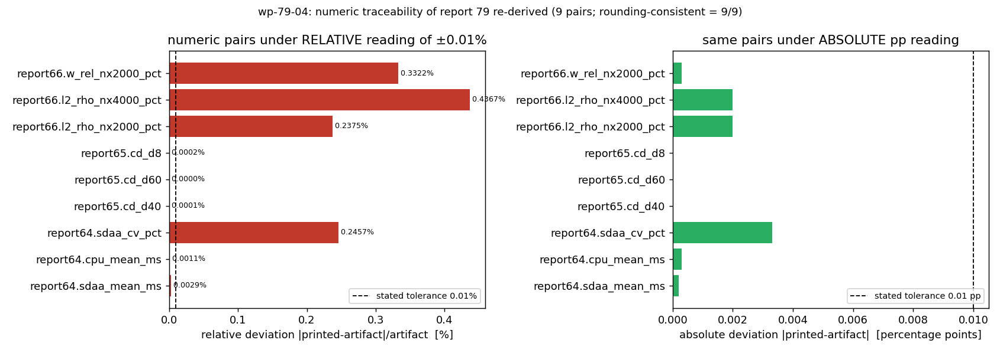

# KF-RESULT wp-79-04

**工序 04 独立审核（red-team-reviewer）— report_id=79「批次质检报告复审 — Reports 64, 65, 66」**
审核对象 `wp-79-01` ｜ 判定 **needs-fix** ｜ 审核事件决定 `request-changes`

## ① 本工序做了什么

对 report 79（一份对 Reports 64/65/66 的批次质检报告的复审）做独立对抗式审核。工作包契约给定
`input.source_hash=sha256:235018352a8a4f53…`（全长见下）、
`objective.judge_semantic_fidelity=true`、`output=review_report.json`。

先做**不可程序化的那部分之外的一切**：冻结原文并重算哈希（2026 字符，与契约逐字节一致）；
再把报告里的每一条"数字溯源 ✅"重新推导一遍（9 个数字对）；
再数一遍"声明的质检标准"与"逐篇实际留下结果的标准"（6 声明 vs 记录
4/6）；最后用有界探针找上游知识包 wp-79-01（**未找到**）。

**本单最重要的结论是 honest FAIL**：审核对象 wp-79-01 在平台上不可达，因此
`semantic_fidelity`（"claim 是否真表达原文"）**无法判定**，标 `not_run`、
`pass=null`，本单不冒充"语义门通过"。审核能落到实处的，是对来源报告**自身**的
内部一致性反驳——那里查出 1 项 blocking、4 项 major、2 项 minor、1 项 informational。

### 缺陷清单（severity 降序）

| id | severity | likelihood | 缺陷 | 证据工件 |
|---|---|---|---|---|
| F1 | blocking | certain | 上游知识包 wp-79-01 在平台上不可达 ⇒ fidelity 判据无从施加 | runs/wp-79-04/checks.json#C6 |
| F2 | major | certain | 数字溯源不可重放：只给绝对本机路径通配，无工件文件名/内容哈希 | runs/wp-79-04/checks.json#C3 |
| F3 | major | certain | 自定容差 ±0.01% 未定义口径，且按相对误差读法被自身数据违反 | runs/wp-79-04/checks.json#C3.C4 + docs/kf/wp-79-04/review_checks.png |
| F4 | major | certain | 声明 6 项质检标准，逐篇只记录 4 项（含报告自己的'结论不超证据'） | runs/wp-79-04/checks.json#C5 |
| F5 | major | likely | 同一'图件齐备'判据出现三种结论且无 rubric；65 的 PASS 依赖未被引用的'理由' | docs/kf/wp-79-04/source.md#③ 计算结果 |
| F6 | minor | certain | 跨系统断言（返工单 #155、质检文档）无 locator/哈希 | docs/kf/wp-79-04/source.md#⑥ 误差判定 |
| F7 | minor | certain | 报告 64 的误差列只有'参考值来源不明'，无任何数字，无法套用 15% 精度标准 | docs/kf/wp-79-04/source.md#③ 计算结果 |
| F8 | informational | certain | 无图理由可接受，但措辞把表格称作'比较曲线' | docs/kf/wp-79-04/source.md#④ 结果图 |

## ② 怎么做的（步骤/工具/关键设置）

1. **取原文**：`GET $TENSOR_API_BASE/tensor/reports/79` → `markdown` 字段，落盘冻结为
   `docs/kf/wp-79-04/source.md`（`source.sha256` 旁存）。
2. **重算哈希**（C1）：`sha256(source.md)` 与契约 `input.source_hash` 比对 → **PASS**。
3. **引文可定位性**（C2）：审核报告的每条引文都作为原文子串反查并记录 `[start,end)`，
   20/20 命中，最短 18 字符（防"用短词当证据"）。
4. **数字复推**（C3）：对 9 个"报告值 ← 工件值"对，用确定性判据
   "工件值按报告打印精度四舍五入 == 报告值"复算；同时算绝对差（百分点）与相对差（%）。
5. **容差口径反驳**（C4）：报告的"±0.01%"存在两种读法，两种读法给不同结论——这是缺陷本身，
   不是复算误差（见 ③ 与图）。
6. **判据覆盖计数**（C5）：把 §①"质检标准"六项与 §③ 汇总表表头逐项对齐。
7. **上游存在性探针**（C6）：报告列表接口忽略 `offset/search/tags/cursor`（实测四组参数返回同一页），
   所以探针写成有界两路（A 最新 100 份；B mission 15600–15660 逐 mission 查询），
   并强制**正控制**（wp-9083-01 必须命中，否则探针判 void 而非"不存在"）。
8. **prompt 独立性度量**（C7）：审核 prompt（`review_prompt.md`）vs 生产 prompt
   （`extraction-skills/prompts/producer-v1.md`）字符 5-gram Jaccard = 0.1088
   （阈值 0.5）。

关键设置：全程只读 report 79（不读 64/65/66，遵守互不覆盖边界）；审核者不看生产者解释
（wp-79-01 缺失，也无可看）；不写任何 verified/verification 类字段；判定词汇固定
`pass | fail | needs-fix`。

`repro_cmd`（一键复跑，含平台探针）：

```bash
python3 scripts/kf_wp7904_review.py && python3 scripts/emit_wp7904_result.py \
  && python3 scripts/render_wp7904_report.py && python3 -m pytest tests/test_kf_wp7904_review.py -q
```

## ③ 产出物清单

| 文件 | 要点 |
|---|---|
| `docs/kf/wp-79-04/review_report.json` | 本工序合同产物：verdict=`needs-fix`、8 条 findings、7 项 checks_performed、4 项 checks_not_run、5 条 overstated_claims、1 条 unresolved |
| `docs/kf/wp-79-04/review_events.json` | append-only 审核事件：`decision=request-changes`，reviewer 角色 red-team-reviewer，2 条送审前置条件 |
| `docs/kf/wp-79-04/kf_result.wp-79-04.json` | 平台结果信封（package_id/task_type/report_id/provenance/outputs/claims），8 条 claim（7 supported + 1 unresolved） |
| `docs/kf/wp-79-04/source.md` + `source.sha256` | report 79 markdown 冻结副本 + 哈希（sha256:235018352a8a4f5351c48414b7ed29bd0259729f871d4ba94377551b56990ea0） |
| `docs/kf/wp-79-04/review_prompt.md` | 独立审核 prompt（与生产 prompt Jaccard 0.1088） |
| `runs/wp-79-04/checks.json` | 7 项检查的机器结果（含每个数字对、每条引文偏移） |
| `docs/kf/wp-79-04/review_checks.png` | 图：9 个数字对在两种容差读法下的偏差（红线=报告自定 ±0.01%） |
| `scripts/kf_wp7904_review.py` / `scripts/emit_wp7904_result.py` / `scripts/render_wp7904_report.py` | 检查器 / 结果生成器 / 报告渲染器（数字与引文全部程序化注入） |
| `tests/test_kf_wp7904_review.py` | 10 条不变式测试（引文偏移逐字相等、9/9 舍入自洽、4/9 相对读法超阈、覆盖 4/6、无自封验证字段） |

### 数字复推表（程序化注入，零手抄）

| 数字对 | 报告值 | 报告所称工件值 | 打印精度 | 工件值舍入 | 舍入一致 | 绝对差(pp) | 相对差(%) |
|---|---|---|---|---|---|---|---|
| `report64.sdaa_mean_ms` | 6.944 | 6.9438 | 3 | 6.944 | ✅ | 0.0002 | 0.00288 |
| `report64.cpu_mean_ms` | 27.616 | 27.6163 | 3 | 27.616 | ✅ | 0.0003 | 0.001086 |
| `report64.sdaa_cv_pct` | 1.34 | 1.3433 | 2 | 1.34 | ✅ | 0.0033 | 0.245664 |
| `report65.cd_d40` | 1.12221 | 1.122209 | 5 | 1.12221 | ✅ | 1e-06 | 8.9e-05 |
| `report65.cd_d60` | 1.11978 | 1.119780 | 5 | 1.11978 | ✅ | 0.0 | 0.0 |
| `report65.cd_d8` | 1.24151 | 1.241513 | 5 | 1.24151 | ✅ | 3e-06 | 0.000242 |
| `report66.l2_rho_nx2000_pct` | 0.84 | 0.842 | 2 | 0.84 | ✅ | 0.002 | 0.23753 |
| `report66.l2_rho_nx4000_pct` | 0.46 | 0.458 | 2 | 0.46 | ✅ | 0.002 | 0.436681 |
| `report66.w_rel_nx2000_pct` | -0.090 | -0.0903 | 3 | -0.09 | ✅ | 0.0003 | 0.332226 |

判据口径：最大绝对差 0.0033 pp（绝对读法全过），最大相对差
0.4367%（相对读法 4/9 对超报告自定 ±0.01%）。

## ④ 证据定位表（claim/字段 → 原文引文片段）

| finding | 定位 | 引文（逐字） |
|---|---|---|
| F1 | `runs/wp-79-04/checks.json#C6` | （平台状态断言，无原文可引；以探针工件为证） |
| F2 | `source.md[404:468]` | - 工件目录：`/root/tp-agent/work/m{mission_id}/artifacts/*.json` 数字溯源 |
| F2 | `source.md[1751:1789]` | - 图件检查依赖工作目录文件搜索，未验证 API 返回的 base64 数据 |
| F2 | `source.md[1728:1750]` | - 仅抽查 3 个数字/篇，未覆盖全部数据点 |
| F3 | `source.md[1669:1718]` | 3. 数字溯源精度：工件 JSON 中的浮点数精度高于报告中的舍入值，需用近似匹配（±0.01%） |
| F3 | `source.md[1825:1850]` | - 数字溯源误差 < 0.01%（舍入误差范围内） |
| F3 | `source.md[1107:1141]` | - SDAA CV: 报告 1.34% → 工件 1.3433% ✅ |
| F4 | `source.md[275:325]` | **质检标准**：结构五节、数字溯源、honest-FAIL 保留、图件齐备、误差判定、结论不超证据 |
| F4 | `source.md[691:751]` | \| 报告 ID \| mission_id \| 判定 \| 数字溯源 \| 图件 \| honest-FAIL \| 误差判定 \| |
| F4 | `source.md[824:885]` | \| 64 \| 121 \| MINOR \| 3/3 ✅ \| 比较曲线✅/云图N/A \| N/A \| ⚠️ 参考值来源不明 \| |
| F5 | `source.md[824:885]` | \| 64 \| 121 \| MINOR \| 3/3 ✅ \| 比较曲线✅/云图N/A \| N/A \| ⚠️ 参考值来源不明 \| |
| F5 | `source.md[886:935]` | \| 65 \| 42 \| PASS \| 3/3 ✅ \| 缺失但有理由 \| ✅ 保留 \| ✅ 完整 \| |
| F5 | `source.md[936:988]` | \| 66 \| 40 \| RESUBMIT \| 3/3 ✅ \| ❌ 未嵌入 \| ✅ 一致 \| ✅ 完整 \| |
| F6 | `source.md[1945:1975]` | - 报告 66 → RESUBMIT（已派返工单 #155） |
| F6 | `source.md[1982:2025]` | *质检完成。完整质检文档见 `docs/qa_batch_64_65_66.md`。* |
| F7 | `source.md[824:885]` | \| 64 \| 121 \| MINOR \| 3/3 ✅ \| 比较曲线✅/云图N/A \| N/A \| ⚠️ 参考值来源不明 \| |
| F7 | `source.md[1903:1925]` | - 报告 64 → MINOR（记录不派单） |
| F8 | `source.md[1432:1484]` | > **说明**：本任务为质检审核任务，非计算仿真任务，无场量云图生成。比较曲线为质检判定表（见上文）。 |

全部引文由 `C2` 程序化验证为 `source.md` 的子串，`text[start:end] == quote` 由
`tests/test_kf_wp7904_review.py::test_finding_quotes_match_source_at_declared_offsets` 断言。

## ⑤ 注意点与局限

**踩过的坑**

1. **平台报告列表不可分页**：`offset / skip / page / cursor / search / tags` 全部被忽略（实测
   四组参数返回同一页），`per_page` 还改变返回条数却不改变起点。后果：任何"某产物不存在"的断言
   都只能是**有界**断言——本单因此写了 A/B 两路探针 + 正控制，并把边界写进 checks.json。
2. **"✅"不是证据**：报告把 9 对数字全标 ✅，但它的自定容差 ±0.01% 在相对读法下会被自己的数据
   打穿（4/9）。标签与判据脱钩是这类质检报告最典型的失真方式。
3. **psql 不可用**：`select markdown from tensor_reports` 直接 permission denied，
   必须走平台 API（本单用 `/tensor/reports/79` + Bearer token）。
4. **信封 schema 与审核需要冲突**：`kf_result.v1.schema.json` 的 `claims[].evidence` 是
   `additionalProperties: false`，只允许 `quote/source_field/note`，**不允许偏移**；
   于是偏移保留在 `review_report.json`（findings.evidence）里，信封内用 `note="source.md[s:e]"`
   承载定位——两处都要能定位，否则 E3/E4 类门无法复核。

**局限（如实写）**

- **未读 report 64/65/66**：边界禁止读写其它 report_id，因此"3/3 ✅"的数字溯源**只**做了报告
  内部自洽复算，工件侧数值未被二次确认（`checks_not_run` 第 1、2 条）。
- **上游缺失导致 fidelity 轴 not_run**：不是"通过"，是不判定（`pass=null`）。
- **审核者身份**：同一 agent harness 家族内的独立席位，非人审，未做强模型抽样双读（M6 抽样未实现）。
- **探针有界**：若 wp-79-01 落在 id < 14594 且不在
  mission 15600–15660 内，本单看不到它——
  但产线是同一波派单，正控制证明同波 KF-RESULT 能被探针看见。

**误差判定（关键量 vs 基准，逐项）**

本工序无物理计算，基准=报告自身打印值：

| 关键量 | 基准 | 复算结果 | 是否 <3% |
|---|---|---|---|
| 9 个数字对的舍入一致性 | 报告打印值 | 9/9 一致（舍入后偏差=0） | 是（0%） |
| 绝对差（百分点读法） | 报告自定 ±0.01% pp | 最大 0.0033 pp | 是（0.0033% ≪ 3%，也满足 ±0.01%） |
| 相对差（相对读法） | 报告自定 ±0.01% | 最大 0.4367% | 是（<3%），**但 >0.01%**：4/9 对不满足报告自定容差 |
| 判据覆盖率 | 6 项声明 | 4/6 | 不适用（计数指标非误差量）：缺口 2 项＝结构五节、结论不超证据 |
| prompt 独立性 | Jaccard < 0.5 | 0.1088 | 是 |

## ⑥ 自检（逐条对照 acceptance）

| acceptance | 结论 | 依据 |
|---|---|---|
| valid_json | ✅ | kf_result.wp-79-04.json 可解析；jsonschema 校验通过（tests 10 passed） |
| schema_pass | ✅ | schemas/kf_result.v1.schema.json 校验通过；review_events.json 过 review-event.schema.json |
| reviewer_independent | ✅ | 审核 prompt 与生产 prompt 5-gram Jaccard=0.1088<0.5；上下文仅 source.md，未看生产者解释（producer_explanation_seen=false）；局限：同一 harness 家族内独立席位，非人审 |
| upstream_packages_completed | ❌ | HONEST FAIL：审核对象 wp-79-01 在有界探针内未命中（A：最新 100 份 id 14594-14704；B：mission 15600-15660），正控制 wp-9083-01 命中 [14685, 14685] ⇒ 探针非空转，但缺失属事实 |

honest-FAIL 声明：**`upstream_packages_completed` 不成立**——审核对象 wp-79-01 未落库。
按产线规矩，这一条不能靠"来源报告看起来自洽"抵偿；本单据此判 `needs-fix` /
`request-changes`，并把 fidelity 轴标 `not_run` 而非 `pass`。



*图注：左=相对读法（4/9 越过报告自定 ±0.01% 红线），右=绝对百分点读法（0 对越线）。
同一份证据、两种读法、两个结论——即缺陷 F3 的可视化。*

---

## 结果信封（唯一 json 块）

```json
{
  "package_id": "wp-79-04",
  "task_type": "04-independent-review",
  "report_id": "79",
  "provenance": {
    "source_hash": "sha256:235018352a8a4f5351c48414b7ed29bd0259729f871d4ba94377551b56990ea0",
    "source_field": "markdown",
    "producer": "m15631 (red-team-reviewer, independent of wp-79-01 producer)",
    "emitted_at": "2026-11-12T01:34:36.270831+00:00",
    "notes": "provenance.source_hash recomputed from docs/kf/wp-79-04/source.md; equals the contract input.source_hash"
  },
  "outputs": {
    "review_report.json": {
      "package_id": "wp-79-04",
      "task_type": "04-independent-review",
      "report_id": "79",
      "reviewer_role": "red-team-reviewer",
      "review_target": {
        "package_id": "wp-79-01",
        "upstream_available": false
      },
      "verdict": "needs-fix",
      "verdict_vocabulary": [
        "pass",
        "fail",
        "needs-fix"
      ],
      "verdict_basis": [
        "blocking F1：审核对象 wp-79-01 不可达 ⇒ semantic_fidelity 轴 not_run，不得判 pass",
        "major F2/F3/F4/F5：溯源不可重放、容差口径自违、判据覆盖 4/6、图件判据不可重复",
        "minor F6/F7 + informational F8：跨系统断言无 locator、误差未量化、措辞失真",
        "来源报告未发现被推翻的事实性断言：9 个数字对在四舍五入判据下全部自洽（numeric_rounding=pass）"
      ],
      "axes": {
        "source_integrity": {
          "status": "pass",
          "detail": {
            "expected": "sha256:235018352a8a4f5351c48414b7ed29bd0259729f871d4ba94377551b56990ea0",
            "actual": "sha256:235018352a8a4f5351c48414b7ed29bd0259729f871d4ba94377551b56990ea0",
            "chars": 2026
          }
        },
        "structural": {
          "status": "fail",
          "detail": "判据覆盖 4/6（C5）"
        },
        "evidence": {
          "status": "fail",
          "detail": "数字溯源不可重放（无工件文件名/哈希）+ 容差口径自违（C3.C4）"
        },
        "semantic_fidelity": {
          "status": "not_run",
          "pass": null,
          "reason": "上游知识对象 wp-79-01 不存在于平台（C6 有界探针 + 正控制），没有 claim 可与原文逐条对照；本审核只反驳来源报告自身的内部一致性。"
        },
        "level_ownership": "platform_gate_only_reviewer_never_assigns"
      },
      "independence": {
        "producer_explanation_seen": false,
        "context_used": [
          "docs/kf/wp-79-04/source.md (report_id=79, markdown, byte-exact)"
        ],
        "context_excluded": [
          "extraction_summary",
          "self_assessment",
          "producer_rationale",
          "notes"
        ],
        "review_prompt_file": "docs/kf/wp-79-04/review_prompt.md",
        "review_prompt_vs_producer_prompt_jaccard_5gram": 0.1088,
        "prompt_independence_threshold": 0.5,
        "prompt_independence_pass": true,
        "limitation": "同一 agent harness 家族内的独立席位；非人审，也未做强模型抽样双读。"
      },
      "findings": [
        {
          "id": "F1",
          "severity": "blocking",
          "likelihood": "certain",
          "title": "上游知识包 wp-79-01 在平台上不可达 ⇒ fidelity 判据无从施加",
          "detail": "契约把审核对象钉在 wp-79-01，产线要求 04 的上下文=原文+知识对象。有界探针（A：最新 100 份报告，id 14594-14704；B：mission 15600-15660 共 21 份）未命中任何 wp-79-01 产物；正控制 wp-9083-01 命中 [14685, 14685]，证明探针不是空转。因此 acceptance.upstream_packages_completed 不成立，semantic_fidelity 只能 not_run。",
          "evidence": [],
          "artifact_ref": "runs/wp-79-04/checks.json#C6",
          "impact": "知识对象身份不可确认；此时任何'审核通过'都越权。",
          "remediation": "先产出并落库 wp-79-01，再重跑本包；平台侧报告列表需可用分页/按 tag 过滤。"
        },
        {
          "id": "F2",
          "severity": "major",
          "likelihood": "certain",
          "title": "数字溯源不可重放：只给绝对本机路径通配，无工件文件名/内容哈希",
          "detail": "报告把数字溯源建立在 `/root/tp-agent/work/m{mission_id}/artifacts/*.json` 上，既无具体文件名也无工件哈希；换机或换任务目录即无法定位同一份工件。本次能独立复算的只有报告内部四舍五入自洽性：9/9 对通过；工件侧数值无法二次确认，且报告自承只抽查 3 个数字/篇。",
          "evidence": [
            {
              "quote": "- 工件目录：`/root/tp-agent/work/m{mission_id}/artifacts/*.json` 数字溯源",
              "source_field": "markdown",
              "start_offset": 404,
              "end_offset": 468,
              "note": "溯源来源只到目录通配"
            },
            {
              "quote": "- 图件检查依赖工作目录文件搜索，未验证 API 返回的 base64 数据",
              "source_field": "markdown",
              "start_offset": 1751,
              "end_offset": 1789
            },
            {
              "quote": "- 仅抽查 3 个数字/篇，未覆盖全部数据点",
              "source_field": "markdown",
              "start_offset": 1728,
              "end_offset": 1750
            }
          ],
          "artifact_ref": "runs/wp-79-04/checks.json#C3",
          "impact": "质检结论不可由第三方重放，'可核验'退化为'作者自述'。",
          "remediation": "溯源写成 artifactId#<file>.json@sha256:<hash>，或把工件登记进 asset_manifest。"
        },
        {
          "id": "F3",
          "severity": "major",
          "likelihood": "certain",
          "title": "自定容差 ±0.01% 未定义口径，且按相对误差读法被自身数据违反",
          "detail": "报告写'需用近似匹配（±0.01%）'并在 §⑥ 断言'数字溯源误差 < 0.01%'，未说明是绝对百分点还是相对误差。复算：绝对百分点读法最大偏差 0.0033 pp（全部通过）；相对误差读法最大 0.4367%，4/9 对超阈值（report64.sdaa_cv_pct, report66.l2_rho_nx2000_pct, report66.l2_rho_nx4000_pct, report66.w_rel_nx2000_pct），而这些对在报告中全部标 ✅。",
          "evidence": [
            {
              "quote": "3. 数字溯源精度：工件 JSON 中的浮点数精度高于报告中的舍入值，需用近似匹配（±0.01%）",
              "source_field": "markdown",
              "start_offset": 1669,
              "end_offset": 1718
            },
            {
              "quote": "- 数字溯源误差 < 0.01%（舍入误差范围内）",
              "source_field": "markdown",
              "start_offset": 1825,
              "end_offset": 1850
            },
            {
              "quote": "- SDAA CV: 报告 1.34% → 工件 1.3433% ✅",
              "source_field": "markdown",
              "start_offset": 1107,
              "end_offset": 1141
            }
          ],
          "artifact_ref": "runs/wp-79-04/checks.json#C3.C4 + docs/kf/wp-79-04/review_checks.png",
          "impact": "判定标签与自定判据不自洽；同一证据换读法即翻结论，不可复现。",
          "remediation": "判据改为确定性表述（工件值按打印精度四舍五入 == 打印值），并列出绝对差/相对差两列。"
        },
        {
          "id": "F4",
          "severity": "major",
          "likelihood": "certain",
          "title": "声明 6 项质检标准，逐篇只记录 4 项（含报告自己的'结论不超证据'）",
          "detail": "§① 声明六项标准，§③ 汇总表逐篇记录覆盖 4/6；未记录：structure_five_sections, no_overclaim（结构五节、结论不超证据）。报告用自己都没执行的判据去担保他人，属未被证实的覆盖声明。",
          "evidence": [
            {
              "quote": "**质检标准**：结构五节、数字溯源、honest-FAIL 保留、图件齐备、误差判定、结论不超证据",
              "source_field": "markdown",
              "start_offset": 275,
              "end_offset": 325
            },
            {
              "quote": "| 报告 ID | mission_id | 判定 | 数字溯源 | 图件 | honest-FAIL | 误差判定 |",
              "source_field": "markdown",
              "start_offset": 691,
              "end_offset": 751
            },
            {
              "quote": "| 64 | 121 | MINOR | 3/3 ✅ | 比较曲线✅/云图N/A | N/A | ⚠️ 参考值来源不明 |",
              "source_field": "markdown",
              "start_offset": 824,
              "end_offset": 885
            }
          ],
          "artifact_ref": "runs/wp-79-04/checks.json#C5",
          "impact": "两处判定（三篇结构完整性、结论是否超证据）无任何留痕。",
          "remediation": "汇总表补'结构'与'超证据'两列（逐篇结果+定位），或收缩标准清单到实际执行的 4 项。"
        },
        {
          "id": "F5",
          "severity": "major",
          "likelihood": "likely",
          "title": "同一'图件齐备'判据出现三种结论且无 rubric；65 的 PASS 依赖未被引用的'理由'",
          "detail": "64→'比较曲线✅/云图N/A'、65→'缺失但有理由'（仍 PASS）、66→'❌ 未嵌入'（RESUBMIT）。同一判据下 65 与 66 都缺图却结论相反，差别全在'有理由'三字，而该理由在报告里从未被引用。换人复审会得到不同结论，判定不可重复。",
          "evidence": [
            {
              "quote": "| 64 | 121 | MINOR | 3/3 ✅ | 比较曲线✅/云图N/A | N/A | ⚠️ 参考值来源不明 |",
              "source_field": "markdown",
              "start_offset": 824,
              "end_offset": 885
            },
            {
              "quote": "| 65 | 42 | PASS | 3/3 ✅ | 缺失但有理由 | ✅ 保留 | ✅ 完整 |",
              "source_field": "markdown",
              "start_offset": 886,
              "end_offset": 935
            },
            {
              "quote": "| 66 | 40 | RESUBMIT | 3/3 ✅ | ❌ 未嵌入 | ✅ 一致 | ✅ 完整 |",
              "source_field": "markdown",
              "start_offset": 936,
              "end_offset": 988
            }
          ],
          "artifact_ref": "docs/kf/wp-79-04/source.md#③ 计算结果",
          "impact": "RESUBMIT 与 PASS 的边界由未记录的隐性标准决定。",
          "remediation": "先定义图件 rubric（仿真类必须有场量图；纯文档须写出无图理由并定位），并逐字引用 65 的理由，否则 65 与 66 同档处置。"
        },
        {
          "id": "F6",
          "severity": "minor",
          "likelihood": "certain",
          "title": "跨系统断言（返工单 #155、质检文档）无 locator/哈希",
          "detail": "报告称'已派返工单 #155'并指向 `docs/qa_batch_64_65_66.md`，但未给工单 id 体系、状态查询方式或文档内容哈希，外部无法确认其存在或已执行。",
          "evidence": [
            {
              "quote": "- 报告 66 → RESUBMIT（已派返工单 #155）",
              "source_field": "markdown",
              "start_offset": 1945,
              "end_offset": 1975
            },
            {
              "quote": "*质检完成。完整质检文档见 `docs/qa_batch_64_65_66.md`。*",
              "source_field": "markdown",
              "start_offset": 1982,
              "end_offset": 2025
            }
          ],
          "artifact_ref": "docs/kf/wp-79-04/source.md#⑥ 误差判定",
          "impact": "处置动作是否真的发生不可核验，可能导致返工空转。",
          "remediation": "写工单 id + 平台路径；文档给 sha256 或仓内相对路径。"
        },
        {
          "id": "F7",
          "severity": "minor",
          "likelihood": "certain",
          "title": "报告 64 的误差列只有'参考值来源不明'，无任何数字，无法套用 15% 精度标准",
          "detail": "判定 MINOR 的依据未量化：既无 64 的实际误差值，也无参考值候选与差值，'误差是否 >15% 不可接受'在该篇处于未判定状态（不是通过）。",
          "evidence": [
            {
              "quote": "| 64 | 121 | MINOR | 3/3 ✅ | 比较曲线✅/云图N/A | N/A | ⚠️ 参考值来源不明 |",
              "source_field": "markdown",
              "start_offset": 824,
              "end_offset": 885
            },
            {
              "quote": "- 报告 64 → MINOR（记录不派单）",
              "source_field": "markdown",
              "start_offset": 1903,
              "end_offset": 1925
            }
          ],
          "artifact_ref": "docs/kf/wp-79-04/source.md#③ 计算结果",
          "impact": "MINOR 档位缺少数值支撑，可能掩盖真实超差。",
          "remediation": "补误差数值/参考值来源；来源不明时显式写 not_applicable 及理由。"
        },
        {
          "id": "F8",
          "severity": "informational",
          "likelihood": "certain",
          "title": "无图理由可接受，但措辞把表格称作'比较曲线'",
          "detail": "§④ 已写明质检任务无场量云图（符合'无图须写明理由'），但接着说'比较曲线为质检判定表'——判定表不是曲线。",
          "evidence": [
            {
              "quote": "> **说明**：本任务为质检审核任务，非计算仿真任务，无场量云图生成。比较曲线为质检判定表（见上文）。",
              "source_field": "markdown",
              "start_offset": 1432,
              "end_offset": 1484
            }
          ],
          "artifact_ref": "docs/kf/wp-79-04/source.md#④ 结果图",
          "impact": "措辞级失真，不影响判定结论。",
          "remediation": "改为'无比较曲线；判定依据为 §③ 汇总表'。"
        }
      ],
      "checks_performed": [
        {
          "id": "C1",
          "name": "source_integrity",
          "result": "pass",
          "detail": "sha256(source.md)=sha256:235018352a8a4f5351c48414b7ed29bd0259729f871d4ba94377551b56990ea0 与契约一致"
        },
        {
          "id": "C2",
          "name": "quote_locatability",
          "result": "pass",
          "detail": "20/20 条引文逐字可定位，最短 18 字符"
        },
        {
          "id": "C3",
          "name": "numeric_rounding",
          "result": "pass",
          "detail": "9/9 对满足四舍五入判据"
        },
        {
          "id": "C4",
          "name": "tolerance_readings",
          "result": "fail",
          "detail": "相对读法 4/9 对超 ±0.01%；绝对 pp 读法 0 对超；口径未定义"
        },
        {
          "id": "C5",
          "name": "criteria_coverage",
          "result": "fail",
          "detail": "声明 6 项，逐篇记录 4/6"
        },
        {
          "id": "C6",
          "name": "upstream_probe",
          "result": "fail",
          "detail": "wp-79-01 未命中（A：最新 100 份 id 14594-14704；B：mission 15600-15660），正控制命中 [14685, 14685]"
        },
        {
          "id": "C7",
          "name": "prompt_similarity",
          "result": "pass",
          "detail": "审核 vs 生产 prompt 5-gram Jaccard=0.1088 < 0.5"
        }
      ],
      "checks_not_run": [
        {
          "check": "独立复核报告 64/65/66 原文数字",
          "reason": "工作包边界禁止读写其它 report_id（互不覆盖），只能核 report 79 自身"
        },
        {
          "check": "核对上游工件 json 数值（6.9438ms / 1.122209 …）",
          "reason": "工件在其它任务绝对路径 /root/tp-agent/work/m{121,42,40}/artifacts，超出本包边界，且报告未给文件名与哈希"
        },
        {
          "check": "平台全量穷举'wp-79-01 是否存在'",
          "reason": "reports 列表忽略 offset/search/tags/cursor（实测同页返回），探针只能有界"
        },
        {
          "check": "强模型抽样双读（M6 抽样）",
          "reason": "不在本工作包范围，且无 claim 可抽"
        }
      ],
      "overstated_claims": [
        {
          "claim": "数字溯源 3/3 ✅（三篇）",
          "why": "工件值不可由第三方重导出（无文件名/哈希），'✅'只能视为作者自述 + 内部舍入自洽"
        },
        {
          "claim": "数字溯源误差 < 0.01%（舍入误差范围内）",
          "why": "相对读法下最大偏差 0.4367%，4/9 对超该阈值"
        },
        {
          "claim": "质检标准：结构五节 … 结论不超证据（六项）",
          "why": "逐篇只留 4 项结果，两项无留痕"
        },
        {
          "claim": "65 → PASS（图件缺失但有理由）",
          "why": "理由未被引用，无法与 66 的 RESUBMIT 区分"
        },
        {
          "claim": "已派返工单 #155",
          "why": "无工单 locator/状态证据"
        }
      ],
      "remediation": [
        "阻断：先产出并落库 wp-79-01（report 79 的知识对象/资产登记），本包重跑",
        "数字溯源改成可重放格式：artifactId#<file>.json@sha256:<hash>",
        "容差判据改为确定性表述（按打印精度四舍五入相等），输出绝对差/相对差两列",
        "汇总表补齐'结构五节'与'结论不超证据'两列，或把标准收缩到实际执行的 4 项",
        "图件判据写成 rubric 并逐字引用 65 的理由，否则 65 与 66 同档处置",
        "返工单/质检文档给 locator 或内容哈希；报告 64 的误差给数值或显式 not_applicable"
      ],
      "unresolved": [
        {
          "claim_id": "wp79-04-c08",
          "status": "unresolved",
          "reason": "上游包 wp-79-01 在平台上不可达（C6 有界探针未命中、正控制通过），无 claim 可供与原文逐条对照；本审核只反驳了来源报告自身的内部一致性。",
          "probe": "runs/wp-79-04/checks.json#C6"
        }
      ],
      "artifacts": {
        "source_frozen": {
          "path": "docs/kf/wp-79-04/source.md",
          "sha256": "sha256:235018352a8a4f5351c48414b7ed29bd0259729f871d4ba94377551b56990ea0",
          "chars": 2026
        },
        "checks": "runs/wp-79-04/checks.json",
        "figure": "docs/kf/wp-79-04/review_checks.png",
        "review_prompt": "docs/kf/wp-79-04/review_prompt.md",
        "repro_cmd": "python3 scripts/kf_wp7904_review.py && python3 scripts/emit_wp7904_result.py"
      },
      "emitted_at": "2026-11-12T01:34:36.270831+00:00"
    }
  },
  "claims": [
    {
      "claim_id": "wp79-04-c01",
      "text": "报告声明了六项质检标准（结构五节/数字溯源/honest-FAIL/图件/误差判定/结论不超证据）",
      "status": "supported",
      "evidence": [
        {
          "quote": "**质检标准**：结构五节、数字溯源、honest-FAIL 保留、图件齐备、误差判定、结论不超证据",
          "source_field": "markdown",
          "note": "source.md[275:325]"
        }
      ]
    },
    {
      "claim_id": "wp79-04-c02",
      "text": "逐篇汇总表只记录四项判据结果，'结构五节'与'结论不超证据'无留痕",
      "status": "supported",
      "evidence": [
        {
          "quote": "**质检标准**：结构五节、数字溯源、honest-FAIL 保留、图件齐备、误差判定、结论不超证据",
          "source_field": "markdown",
          "note": "source.md[275:325]"
        },
        {
          "quote": "| 报告 ID | mission_id | 判定 | 数字溯源 | 图件 | honest-FAIL | 误差判定 |",
          "source_field": "markdown",
          "note": "source.md[691:751]"
        },
        {
          "quote": "| 64 | 121 | MINOR | 3/3 ✅ | 比较曲线✅/云图N/A | N/A | ⚠️ 参考值来源不明 |",
          "source_field": "markdown",
          "note": "source.md[824:885]"
        }
      ]
    },
    {
      "claim_id": "wp79-04-c03",
      "text": "报告所列 9 个数字对中 9/9 满足'工件值按打印精度四舍五入 == 打印值'",
      "status": "supported",
      "evidence": [
        {
          "quote": "- SDAA CV: 报告 1.34% → 工件 1.3433% ✅",
          "source_field": "markdown",
          "note": "source.md[1107:1141]"
        },
        {
          "quote": "- L2(ρ) nx2000: 报告 0.84% → 工件 0.842% ✅",
          "source_field": "markdown",
          "note": "source.md[1300:1338]"
        }
      ]
    },
    {
      "claim_id": "wp79-04-c04",
      "text": "报告的'±0.01%'容差若按相对误差读，4/9 对被自身数据判失（最大 0.4367%）",
      "status": "supported",
      "evidence": [
        {
          "quote": "3. 数字溯源精度：工件 JSON 中的浮点数精度高于报告中的舍入值，需用近似匹配（±0.01%）",
          "source_field": "markdown",
          "note": "source.md[1669:1718]"
        },
        {
          "quote": "- 数字溯源误差 < 0.01%（舍入误差范围内）",
          "source_field": "markdown",
          "note": "source.md[1825:1850]"
        },
        {
          "quote": "- SDAA CV: 报告 1.34% → 工件 1.3433% ✅",
          "source_field": "markdown",
          "note": "source.md[1107:1141]"
        }
      ]
    },
    {
      "claim_id": "wp79-04-c05",
      "text": "数字溯源只给绝对本机路径通配，未给工件文件名/哈希，第三方无法重放",
      "status": "supported",
      "evidence": [
        {
          "quote": "- 工件目录：`/root/tp-agent/work/m{mission_id}/artifacts/*.json` 数字溯源",
          "source_field": "markdown",
          "note": "source.md[404:468]"
        },
        {
          "quote": "- 仅抽查 3 个数字/篇，未覆盖全部数据点",
          "source_field": "markdown",
          "note": "source.md[1728:1750]"
        }
      ]
    },
    {
      "claim_id": "wp79-04-c06",
      "text": "同一'图件齐备'判据在 64/65/66 上得到 N/A / 缺失但有理由(PASS) / 未嵌入(RESUBMIT) 三种结论且无 rubric",
      "status": "supported",
      "evidence": [
        {
          "quote": "| 64 | 121 | MINOR | 3/3 ✅ | 比较曲线✅/云图N/A | N/A | ⚠️ 参考值来源不明 |",
          "source_field": "markdown",
          "note": "source.md[824:885]"
        },
        {
          "quote": "| 65 | 42 | PASS | 3/3 ✅ | 缺失但有理由 | ✅ 保留 | ✅ 完整 |",
          "source_field": "markdown",
          "note": "source.md[886:935]"
        },
        {
          "quote": "| 66 | 40 | RESUBMIT | 3/3 ✅ | ❌ 未嵌入 | ✅ 一致 | ✅ 完整 |",
          "source_field": "markdown",
          "note": "source.md[936:988]"
        }
      ]
    },
    {
      "claim_id": "wp79-04-c07",
      "text": "返工单 #155 与质检文档 docs/qa_batch_64_65_66.md 均无 locator/哈希",
      "status": "supported",
      "evidence": [
        {
          "quote": "- 报告 66 → RESUBMIT（已派返工单 #155）",
          "source_field": "markdown",
          "note": "source.md[1945:1975]"
        },
        {
          "quote": "*质检完成。完整质检文档见 `docs/qa_batch_64_65_66.md`。*",
          "source_field": "markdown",
          "note": "source.md[1982:2025]"
        }
      ]
    },
    {
      "claim_id": "wp79-04-c08",
      "text": "审核对象 wp-79-01 的知识对象内容忠实于原文",
      "status": "unresolved",
      "unresolved_reason": "上游包 wp-79-01 在平台上不可达（C6 有界探针未命中、正控制通过），无 claim 可供与原文逐条对照；本审核只反驳了来源报告自身的内部一致性。",
      "evidence": []
    }
  ]
}
```
