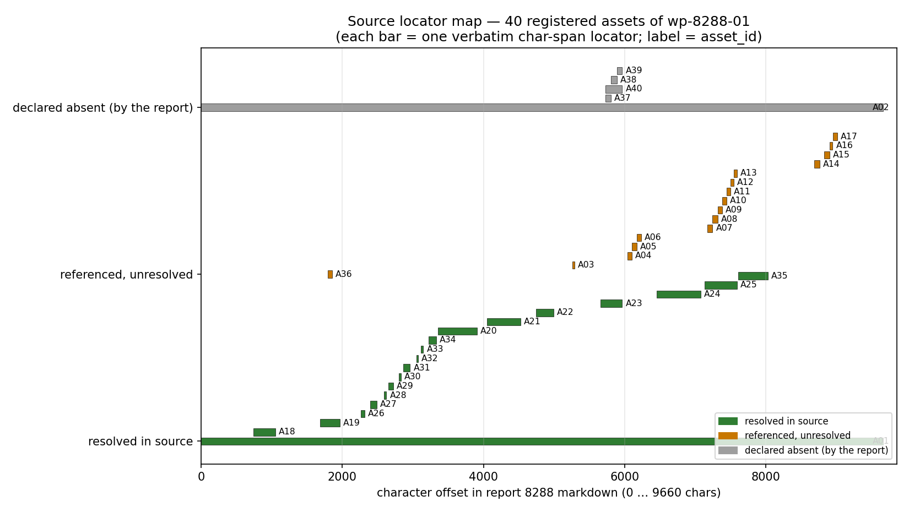
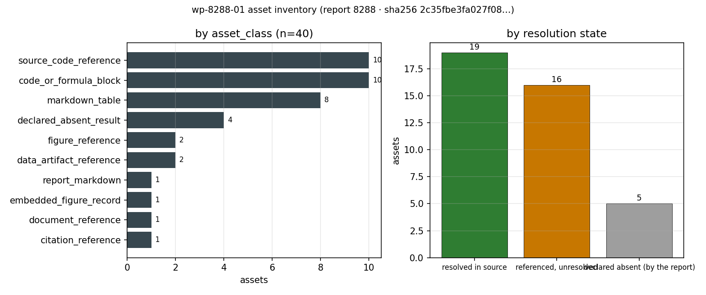

# KF-RESULT wp-8288-01

**工作包** `wp-8288-01` · **工序** 01-asset-registration（源资产登记） · **lane** C ·
**report_id** 8288 · **源哈希** `sha256:2c35fbe3fa027f083b82f15238f3db797f087df0c435a1c536b176280e053f19`
**源** `tensor://reports/8288#markdown`（9660 chars / 9900 bytes UTF-8）

## ① 本工序做了什么

只做一件事：把报告 8288 的**源资产身份**钉住，并把该报告内部**可解析的结构/引用**清点成册，不做抽取、不做类型判定、不写任何 claim。

- 取回 report_id=8288 的 `markdown` 字段（**只此一份报告**），本地重算 sha256 = `2c35fbe3fa027f083b82f15238f3db797f087df0c435a1c536b176280e053f19`，与契约 `source_hash` 逐字节一致，字符数 9660 与契约 9660 一致。源文件另存为 `docs/kf/wp-8288-01/source.md`（字节级副本）。
- 在该 markdown 上登记 **40 个资产**：19 个 resolved_in_source、16 个 referenced_unresolved、5 个 declared_absent。
- 每个资产带一个**逐字字符区间定位符** `[start_char, end_char)` + 含 `start_line/end_line` + `quote`；`quote` 是从源 markdown 切片得来（不是重新手打），因此可被平台二次子串校验。
- `claims` 为空数组（契约 `objective.classify_report_type=false`、无抽取工序，notes 明示允许空），理由写入 `claims_empty_reason`。**没有**任何 claim 被标 `verified`——验证留给平台门。

## ② 怎么做的（步骤 / 工具 / 关键设置）

1. **取证**：`GET /api/v1/tensor/reports/8288`（Bearer=agent 登录 token）→ `markdown`。写入 `source.md` 前先比 sha256 与字符数，不一致即 `SystemExit`，任何下游工件都不会建立在漂移源上（`scripts/kf/wp8288_01_fetch.py`）。
2. **定位符生成**：把 markdown 按键切行、建立「行号 → 字符偏移」表；所有 `quote` 用 `md[start:end]` 切片；若切片在全文不唯一，则**向上扩行**直到唯一（不重打字、不改字），记 `unique=true`（本次 40/40 全部唯一）。
3. **引用清点**：正则扫描四类引用面——markdown 图片、反引号路径、裸路径（`.py/.json/.md/.png/.txt/.csv`）、`Author et al. (YYYY)` 文献引用；路径在**本交付 worktree 内**实际查找（命中则记 sha256+字节数，未命中记 unresolved + 原因），不跨仓猜测。
4. **结构清点**：连续 `|` 行识别 markdown 表（记表头与数据行数，不抄单元格），三反引号围栏识别公式/代码块（记 info string 与行数）。
5. **显式缺席**：报告自述 pending / cluster 的宏观锚结果行，登记为 `declared_absent`（引文即那几行，不当作失败、不臆造数值）。
6. **校验**：`jsonschema`（draft 2020-12）先验 manifest（本地投影 schema，见 ⑤ 局限 1），再验结果信封 `schemas/kf_result.v1.schema.json`；另跑 12 项 pytest 复核（见 ⑥）。
7. **出图**：两张 png 全部**由 manifest 渲染**（`scripts/kf/wp8288_01_figures.py`），像素不可能与登记册不一致。

## ③ 产出物清单

| 文件 | 要点 |
|---|---|
| `docs/kf/wp-8288-01/source.md` | 报告 8288 markdown 字节级副本，sha256 与契约一致（零漂移基线） |
| `docs/kf/wp-8288-01/fetch_meta.json` | 取证元数据：recomputed/contract 哈希、chars、title、scenario_key、mission_id、record figures 列表 |
| `docs/kf/wp-8288-01/asset_manifest.json` | **主交付**：40 资产登记册 + counts + integrity + limitations |
| `docs/kf/wp-8288-01/asset_manifest.schema.json` | manifest 的本地投影 schema（仅重定向 per-package const，字段/枚举不放松） |
| `docs/kf/wp-8288-01/verification.json` | 6 项 acceptance 自检 + 3 项附加检查的机器判读（作者自检，非验证标记） |
| `docs/kf/wp-8288-01/kf_result.json` | 结果信封（package_id/task_type/report_id/provenance/outputs），本报告唯一 json 块的内容源 |
| `docs/kf/wp-8288-01/figures/wp8288_01_locator_map.png` | 图1 定位符地图 |
| `docs/kf/wp-8288-01/figures/wp8288_01_inventory.png` | 图2 资产清单分布 |
| `scripts/kf/wp8288_01_fetch.py` / `_register.py` / `_figures.py` / `_report.py` | 取证 / 登记+校验+信封 / 出图 / 成文发布 |
| `tests/test_kf_wp8288_01.py` | 12 项独立复核（无需联网：只用本地源副本与 JSON） |

按类别分布：

| asset_class | n |
|---|---|
| citation_reference | 1 |
| code_or_formula_block | 10 |
| data_artifact_reference | 2 |
| declared_absent_result | 4 |
| document_reference | 1 |
| embedded_figure_record | 1 |
| figure_reference | 2 |
| markdown_table | 8 |
| report_markdown | 1 |
| source_code_reference | 10 |
| **合计** | **40** |

## ④ 证据定位表（字段 → 原文引文）

引文全部由 `md.find(marker)` 定位后**切片**得到，区间为半开区间 `[start,end)`；引文内 `|` 已转义以免破坏表格。

| 字段 / 结论 | 源行与字符区间 | 原文引文（逐字） | 说明 |
|---|---|---|---|
| `source.title` | L1 `[0,71)` | # IN61-N07: DEM Coarse-Graining Scaling Law & Physical Deviation Ledger | 标题字段 = 登记对象的身份锚 |
| `source.scenario_key` | L26 `[1058,1083)` | ## 1. Physical Background | 正文起于物理背景节，scenario=IN61-N07（见标题与 §7 审计链） |
| `main_result.contact_time_invariance` | L7 `[259,339)` | that **contact-time invariance** requires stiffness to scale as **k³** (not k as | 报告主结论（本工序不判定真伪，只登记为可定位引文） |
| `criterion.tc_deviation` | L12 `[493,559)` | - Contact time deviation: **0.0000%** for all k (criterion: <2%) ✓ | 判据①结果行 |
| `negative_control.range` | L14 `[627,702)` | - Negative control (mass-only): **183–2163%** deviation (criterion: >30%) ✓ | 判据⑤负对照区间 |
| `convention.hertz` | L44 `[1795,1857)` | \| Hertz-consistent \| k·k_n \| k·t_c \| Bierwisch et al. (2009) \| | 唯一 in-text 文献引用（A36 登记为 referenced_unresolved） |
| `asset.coarse_graining_py` | L223 `[7170,7245)` | \| `src/tensordem/coarse_graining.py` \| Scaling law engine + case builders \| | §5.1 声明的主实现文件（A07，worktree 内不可解析） |
| `asset.results_json` | L227 `[7447,7497)` | \| `runs/in61_n07/results.json` \| Numeric results \| | §5.1 声明的数值结果工件（A11） |
| `asset.pareto_png` | L228 `[7498,7548)` | \| `runs/in61_n07/pareto.png` \| Pareto front plot \| | §5.1 声明的图件（A12） |
| `figure.inline_reference` | L173 `[5261,5288)` |  | 正文内联图引用（A03） |
| `macro_anchor.pending_row` | L187 `[5730,5807)` | \| Repose angle \| Pending (torch kernel, ~30s/run) \| Cluster \| Code verified \| | §3.4 pending 行（A37/A40 的 declared_absent 依据） |
| `limitation.monodisperse` | L248 `[8057,8130)` | 1. **Monodisperse spheres only**: Polydisperse systems require additional | §6 自述适用边界 |
| `api.entry_point` | L235 `[7657,7714)` |     scale_contact_time_invariant,  # Apply k-fold scaling | §5.2 API 入口（代码块内，A35） |

## ⑤ 注意点与局限

1. **schema 的投影而非复用**：仓库内 `schemas/asset_manifest.v1.schema.json` 把 `package_id`/`report_id` 等写成 `const`（pin 在别的包上），直接复用会误判。本包**不改**该文件，另存 `asset_manifest.schema.json`：字段、必填、枚举、正则一律不变，只把 per-package 的 const 重定向到本包；信封层仍用平台原生 `schemas/kf_result.v1.schema.json` 校验。
2. **16 个 unresolved 是边界而非缺陷**：被引 `src/tensordem/*.py`、`runs/in61_n07/*` 属于 TensorDEM 树，超出本工作包边界；登记为「引用存在、内容未取」，**不填猜测内容**。
3. **记录里的图无字节**：`figures[0]=pareto_front` 只有 name/caption，无 `png_base64` 载荷（`has_png_payload=false`），因此登记为 `declared_absent` 而不冒充已取到的图件。
4. **表格/围栏只登记结构**：记表头与行数、info string，不转录单元格数值——抽取属工序 03，本包越界即污染产线。
5. **A01/A02 用 document 型定位符**：整份文档/整条 record 字段无法用单点字符区间表达，故 `start_char=0, end_char=len(md)`，`quote` 取标题行作为锚；平台子串校验对 `quote` 仍成立。
6. **本包不判定真伪**：报告自身的 `0.0000%`、`183–2163%` 等数字只作为**可定位引文**登记，正确性校验不在 01 工序职责内。
7. **json 块内反引号转义**：manifest 的代码围栏引文含三反引号（逐字，不改），故信封序列化时把反引号写成 U+0060 转义；JSON 解析后与 `kf_result.json` 完全等价（已用 `json.loads` 回读比对）。
8. **未做类型判定**（`classify_report_type=false`），未生成任何 claim；空 claims 是完整结果而非缺项。

## ⑥ 自检：逐条对照 acceptance

| acceptance 项 | 结果 | 判读依据 |
|---|---|---|
| valid_json | ✓ pass | json.loads OK |
| schema_pass | ✓ pass | jsonschema draft2020-12 validate against projected schema docs/kf/wp-8288-01/asset_manifest.schema.json (consts retargeted to wp-8288-01/8288) |
| source_locator_resolvable | ✓ pass | checked 40 locators by re-slicing the live markdown; failures=[] |
| source_hash_matches | ✓ pass | recomputed=2c35fbe3fa027f083b82f15238f3db797f087df0c435a1c536b176280e053f19 manifest=2c35fbe3fa027f083b82f15238f3db797f087df0c435a1c536b176280e053f19 contract=2c35fbe3fa027f083b82f15238f3db797f087df0c435a1c536b176280e053f19 chars=9660/9660 |
| no_duplicate_ids | ✓ pass | assets=40 unique=40 pattern_ok=True sorted=True |
| all_claims_have_evidence_or_explicit_unresolved_status | ✓ pass | claims=0 violating=0 (empty array satisfies the item vacuously; reason recorded in claims_empty_reason) |

附加检查（非 acceptance 项，但同一套机器判读）：

| 检查 | 结果 | 判读依据 |
|---|---|---|
| no_claims_marked_verified | ✓ | no claim carries a verified status; verification is left to the platform gate |
| counts_consistent_with_assets | ✓ | counts.assets=40 len(assets)=40 by_resolution sum=40 |

失败项：**无**（0 项失败）。诚实补充两条非失败但需知情的口径：
(a) `schema_pass` 用的是**投影** schema（见 ⑤-1），平台若按自身 schema 复判以平台为准；
(b) `all_claims_have_evidence_or_explicit_unresolved_status` 在 claims 为空时是**空满足**，本包已把空理由写进 `claims_empty_reason`，不靠空数组掩盖缺证据。

## 误差判定（本包无物理基准量）

- 本工序是**制品登记**，不产生物理/数值结果，**没有**可与实验/解析解对比的量，因此「关键量 vs 基准误差是否 <3%」这一问 **不适用（N/A）**，不以任何含糊措辞掩盖。
- 替代的可机械判读恒等式（逐项给出实测值）：
  1. 源哈希恒等：重算 `2c35fbe3fa027f083b82f15238f3db797f087df0c435a1c536b176280e053f19` == 契约 `2c35fbe3…e053f19`，**差异 0 比特**；chars 9660 == 契约 9660。
  2. 定位符可复现：40/40 条 `quote` 由 `md[start:end]` 精确重切（失配 0 条），全文唯一率 40/40。
  3. 行号自洽：每条 char_span 定位符的 `start_line` 由字符偏移反算一致（失配 0 条，见 pytest）。
  4. ID 完整性：40 个 id 无重复、全部匹配 `^A[0-9]{2}$` 且字典序。
  这些是**恒等型判据**（应 0 差异，实测 0 差异），比 3% 阈值更严；但它们只证明「登记册忠实于源」，**不证明**报告结论正确。

## 复现命令（一键）

```bash
cd /root/tp-agent/work/m15620
export TENSOR_API_BASE=$TENSOR_API_BASE TENSOR_AGENT_USER=$TENSOR_AGENT_USER TENSOR_AGENT_PASS=$TENSOR_AGENT_PASS
python3 scripts/kf/wp8288_01_fetch.py        # 取证：拉 markdown 并按契约 sha256 校验
python3 scripts/kf/wp8288_01_register.py     # build + verify + result（三件套）
python3 scripts/kf/wp8288_01_figures.py      # 两张图（纯由 manifest 渲染）
python3 -m pytest tests/test_kf_wp8288_01.py -q   # 12 项独立复核
python3 scripts/kf/wp8288_01_report.py render publish
```



图1：横轴=报告 8288 markdown 的字符偏移，每条横条=一个逐字 char-span 定位符，颜色=resolution 状态（绿=resolved_in_source，橙=referenced_unresolved，灰=declared_absent）。可见已解析的结构（表格/围栏）集中在中段与 §5，而 TensorDEM 路径引用成簇出现且全为橙（跨仓不可解析，属边界）。



图2：左=按 asset_class 的资产数（40 项），右=按 resolution 状态（19/16/5）。计数块与 `asset_manifest.json.counts` 同源，由脚本直接渲染。

## 结果信封（本报告唯一 json 块）

反引号在块内以 U+0060 转义写出（JSON 等价，解析后字节相同）：manifest 里逐字登记的代码围栏引文本身含三反引号，若原样写出会提前闭合 markdown 围栏。

```json
{
  "package_id": "wp-8288-01",
  "task_type": "01-asset-registration",
  "report_id": "8288",
  "provenance": {
    "source_uri": "tensor://reports/8288",
    "source_field": "markdown",
    "source_hash": "sha256:2c35fbe3fa027f083b82f15238f3db797f087df0c435a1c536b176280e053f19",
    "hash_algo": "sha256",
    "hashed_bytes": "markdown encoded as utf-8",
    "source_chars": 9660,
    "source_bytes_utf8": 9900,
    "fetched_via": "GET http://127.0.0.1:8010/api/v1/tensor/reports/8288",
    "generator": "scripts/kf/wp8288_01_register.py",
    "contract_version": "1.0",
    "emitted_at": "2026-11-12T01:31:49.847037+00:00"
  },
  "outputs": {
    "asset_manifest.json": {
      "schema": "asset_manifest.v1",
      "package_id": "wp-8288-01",
      "task_type": "01-asset-registration",
      "report_id": "8288",
      "lane": "C",
      "generated_at": "2026-11-12T01:31:27.563235+00:00",
      "producer": "scripts/kf/wp8288_01_register.py",
      "source": {
        "uri": "tensor://reports/8288",
        "field": "markdown",
        "hash_alg": "sha256",
        "hash": "2c35fbe3fa027f083b82f15238f3db797f087df0c435a1c536b176280e053f19",
        "hash_scope": "UTF-8 bytes of the markdown field as served by GET http://127.0.0.1:8010/api/v1/tensor/reports/8288",
        "chars": 9660,
        "bytes_utf8": 9900,
        "lines": 284,
        "title": "IN61-N07: DEM Coarse-Graining Scaling Law & Physical Deviation Ledger",
        "scenario_key": "IN61-N07",
        "mission_id": 6976,
        "platform_tags": [
          "DEM",
          "coarse-graining",
          "scaling-law",
          "contact-mechanics",
          "IN61"
        ],
        "platform_figures": [
          {
            "name": "pareto_front",
            "caption": "Acceleration-deviation Pareto front: speedup=k³ vs contact time deviation",
            "has_png_payload": false
          }
        ],
        "local_copy": "docs/kf/wp-8288-01/source.md"
      },
      "counts": {
        "assets": 40,
        "by_class": {
          "report_markdown": 1,
          "embedded_figure_record": 1,
          "figure_reference": 2,
          "source_code_reference": 10,
          "data_artifact_reference": 2,
          "document_reference": 1,
          "markdown_table": 8,
          "code_or_formula_block": 10,
          "citation_reference": 1,
          "declared_absent_result": 4
        },
        "by_resolution": {
          "resolved_in_source": 19,
          "declared_absent": 5,
          "referenced_unresolved": 16
        },
        "resolved_in_source": 19,
        "referenced_unresolved": 16,
        "declared_absent": 5,
        "distinct_referenced_paths": 11,
        "distinct_citations": 1
      },
      "identity_granularity": "Path references are occurrence-level: identity is (path_reference, markdown line), so two citations of the same file on different lines are two assets with their own quotes.",
      "artifact_endpoint_probe": {
        "/tensor/reports/8288/artifacts": {
          "status": "http_404"
        },
        "/tensor/artifacts?report_id=8288": {
          "status": "http_404"
        }
      },
      "assets": [
        {
          "asset_id": "A01",
          "asset_class": "report_markdown",
          "label": "IN61-N07 report markdown (source of record)",
          "in_report_section": "(document root)",
          "locator": {
            "method": "document",
            "start_char": 0,
            "end_char": 9660,
            "start_line": 1,
            "end_line": 284,
            "quote": "# IN61-N07: DEM Coarse-Graining Scaling Law & Physical Deviation Ledger",
            "unique": true,
            "in_report_section": "(document root)"
          },
          "resolution": "resolved_in_source",
          "resolution_check": {
            "check": "recomputed sha256 of markdown bytes == contract",
            "result": "resolved"
          },
          "note": "Byte-identical copy stored at docs/kf/wp-8288-01/source.md; sha256 matches the contract source_hash.",
          "uri": "tensor://reports/8288",
          "source_field": "markdown",
          "chars": 9660,
          "bytes_utf8": 9900,
          "lines": 284,
          "sha256": "sha256:2c35fbe3fa027f083b82f15238f3db797f087df0c435a1c536b176280e053f19",
          "local_copy": "docs/kf/wp-8288-01/source.md"
        },
        {
          "asset_id": "A02",
          "asset_class": "embedded_figure_record",
          "label": "record figure[0]: pareto_front",
          "in_report_section": "(report record field: figures)",
          "locator": {
            "method": "document",
            "start_char": 0,
            "end_char": 9660,
            "start_line": 1,
            "end_line": 284,
            "quote": "# IN61-N07: DEM Coarse-Graining Scaling Law & Physical Deviation Ledger",
            "unique": true,
            "in_report_section": "(report record field: figures)"
          },
          "resolution": "declared_absent",
          "resolution_check": {
            "check": "base64-decode figures[i].png_base64",
            "result": "absent"
          },
          "note": "Report record lists the figure by name+caption only (no png_base64 payload), so no image bytes exist to hash.",
          "record_field": "figures[0]",
          "figure_name": "pareto_front",
          "caption": "Acceleration-deviation Pareto front: speedup=k³ vs contact time deviation",
          "bytes": null,
          "sha256": null
        },
        {
          "asset_id": "A03",
          "asset_class": "figure_reference",
          "label": "pareto.png",
          "in_report_section": "3.3 Acceleration-Deviation Pareto Front",
          "locator": {
            "method": "char_span",
            "start_char": 5261,
            "end_char": 5288,
            "start_line": 173,
            "end_line": 173,
            "quote": "",
            "unique": true,
            "in_report_section": "3.3 Acceleration-Deviation Pareto Front"
          },
          "resolution": "referenced_unresolved",
          "resolution_check": {
            "check": "delivery_worktree_file_lookup",
            "result": "unresolved",
            "reason": "path is not present in the TensorKnowledge delivery worktree; the owning tree (TensorDEM) is outside this work package's boundary"
          },
          "note": "Referenced by the report body; not resolvable inside this worktree, so it stays an unresolved reference (no assumed content).",
          "path_reference": "pareto.png",
          "via": "markdown_image",
          "line_pin": null
        },
        {
          "asset_id": "A04",
          "asset_class": "source_code_reference",
          "label": "tests/test_repose_calibration.py",
          "in_report_section": "3.4 Macro-Anchor Status",
          "locator": {
            "method": "char_span",
            "start_char": 6040,
            "end_char": 6103,
            "start_line": 192,
            "end_line": 192,
            "quote": "- \u0060tests/test_repose_calibration.py\u0060 — repose angle measurement",
            "unique": true,
            "in_report_section": "3.4 Macro-Anchor Status"
          },
          "resolution": "referenced_unresolved",
          "resolution_check": {
            "check": "delivery_worktree_file_lookup",
            "result": "unresolved",
            "reason": "path is not present in the TensorKnowledge delivery worktree; the owning tree (TensorDEM) is outside this work package's boundary"
          },
          "note": "Referenced by the report body; not resolvable inside this worktree, so it stays an unresolved reference (no assumed content).",
          "path_reference": "tests/test_repose_calibration.py",
          "via": "backticked_ref",
          "line_pin": null
        },
        {
          "asset_id": "A05",
          "asset_class": "source_code_reference",
          "label": "tests/test_beverloo_discharge_measurement.py",
          "in_report_section": "3.4 Macro-Anchor Status",
          "locator": {
            "method": "char_span",
            "start_char": 6104,
            "end_char": 6173,
            "start_line": 193,
            "end_line": 193,
            "quote": "- \u0060tests/test_beverloo_discharge_measurement.py\u0060 — Beverloo flow rate",
            "unique": true,
            "in_report_section": "3.4 Macro-Anchor Status"
          },
          "resolution": "referenced_unresolved",
          "resolution_check": {
            "check": "delivery_worktree_file_lookup",
            "result": "unresolved",
            "reason": "path is not present in the TensorKnowledge delivery worktree; the owning tree (TensorDEM) is outside this work package's boundary"
          },
          "note": "Referenced by the report body; not resolvable inside this worktree, so it stays an unresolved reference (no assumed content).",
          "path_reference": "tests/test_beverloo_discharge_measurement.py",
          "via": "backticked_ref",
          "line_pin": null
        },
        {
          "asset_id": "A06",
          "asset_class": "source_code_reference",
          "label": "tests/test_dem3d_shear_specimen.py",
          "in_report_section": "3.4 Macro-Anchor Status",
          "locator": {
            "method": "char_span",
            "start_char": 6174,
            "end_char": 6233,
            "start_line": 194,
            "end_line": 194,
            "quote": "- \u0060tests/test_dem3d_shear_specimen.py\u0060 — shear box protocol",
            "unique": true,
            "in_report_section": "3.4 Macro-Anchor Status"
          },
          "resolution": "referenced_unresolved",
          "resolution_check": {
            "check": "delivery_worktree_file_lookup",
            "result": "unresolved",
            "reason": "path is not present in the TensorKnowledge delivery worktree; the owning tree (TensorDEM) is outside this work package's boundary"
          },
          "note": "Referenced by the report body; not resolvable inside this worktree, so it stays an unresolved reference (no assumed content).",
          "path_reference": "tests/test_dem3d_shear_specimen.py",
          "via": "backticked_ref",
          "line_pin": null
        },
        {
          "asset_id": "A07",
          "asset_class": "source_code_reference",
          "label": "src/tensordem/coarse_graining.py",
          "in_report_section": "5.1 Files Created",
          "locator": {
            "method": "char_span",
            "start_char": 7170,
            "end_char": 7245,
            "start_line": 223,
            "end_line": 223,
            "quote": "| \u0060src/tensordem/coarse_graining.py\u0060 | Scaling law engine + case builders |",
            "unique": true,
            "in_report_section": "5.1 Files Created"
          },
          "resolution": "referenced_unresolved",
          "resolution_check": {
            "check": "delivery_worktree_file_lookup",
            "result": "unresolved",
            "reason": "path is not present in the TensorKnowledge delivery worktree; the owning tree (TensorDEM) is outside this work package's boundary"
          },
          "note": "Referenced by the report body; not resolvable inside this worktree, so it stays an unresolved reference (no assumed content).",
          "path_reference": "src/tensordem/coarse_graining.py",
          "via": "backticked_ref",
          "line_pin": null
        },
        {
          "asset_id": "A08",
          "asset_class": "source_code_reference",
          "label": "src/tensordem/shear_cell.py",
          "in_report_section": "5.1 Files Created",
          "locator": {
            "method": "char_span",
            "start_char": 7246,
            "end_char": 7318,
            "start_line": 224,
            "end_line": 224,
            "quote": "| \u0060src/tensordem/shear_cell.py\u0060 | Direct-shear cell simulation (numpy) |",
            "unique": true,
            "in_report_section": "5.1 Files Created"
          },
          "resolution": "referenced_unresolved",
          "resolution_check": {
            "check": "delivery_worktree_file_lookup",
            "result": "unresolved",
            "reason": "path is not present in the TensorKnowledge delivery worktree; the owning tree (TensorDEM) is outside this work package's boundary"
          },
          "note": "Referenced by the report body; not resolvable inside this worktree, so it stays an unresolved reference (no assumed content).",
          "path_reference": "src/tensordem/shear_cell.py",
          "via": "backticked_ref",
          "line_pin": null
        },
        {
          "asset_id": "A09",
          "asset_class": "source_code_reference",
          "label": "tests/test_coarse_graining_scaling.py",
          "in_report_section": "5.1 Files Created",
          "locator": {
            "method": "char_span",
            "start_char": 7319,
            "end_char": 7382,
            "start_line": 225,
            "end_line": 225,
            "quote": "| \u0060tests/test_coarse_graining_scaling.py\u0060 | Pytest test suite |",
            "unique": true,
            "in_report_section": "5.1 Files Created"
          },
          "resolution": "referenced_unresolved",
          "resolution_check": {
            "check": "delivery_worktree_file_lookup",
            "result": "unresolved",
            "reason": "path is not present in the TensorKnowledge delivery worktree; the owning tree (TensorDEM) is outside this work package's boundary"
          },
          "note": "Referenced by the report body; not resolvable inside this worktree, so it stays an unresolved reference (no assumed content).",
          "path_reference": "tests/test_coarse_graining_scaling.py",
          "via": "backticked_ref",
          "line_pin": null
        },
        {
          "asset_id": "A10",
          "asset_class": "source_code_reference",
          "label": "scripts/run_coarse_graining_campaign.py",
          "in_report_section": "5.1 Files Created",
          "locator": {
            "method": "char_span",
            "start_char": 7383,
            "end_char": 7446,
            "start_line": 226,
            "end_line": 226,
            "quote": "| \u0060scripts/run_coarse_graining_campaign.py\u0060 | Campaign runner |",
            "unique": true,
            "in_report_section": "5.1 Files Created"
          },
          "resolution": "referenced_unresolved",
          "resolution_check": {
            "check": "delivery_worktree_file_lookup",
            "result": "unresolved",
            "reason": "path is not present in the TensorKnowledge delivery worktree; the owning tree (TensorDEM) is outside this work package's boundary"
          },
          "note": "Referenced by the report body; not resolvable inside this worktree, so it stays an unresolved reference (no assumed content).",
          "path_reference": "scripts/run_coarse_graining_campaign.py",
          "via": "backticked_ref",
          "line_pin": null
        },
        {
          "asset_id": "A11",
          "asset_class": "data_artifact_reference",
          "label": "runs/in61_n07/results.json",
          "in_report_section": "5.1 Files Created",
          "locator": {
            "method": "char_span",
            "start_char": 7447,
            "end_char": 7497,
            "start_line": 227,
            "end_line": 227,
            "quote": "| \u0060runs/in61_n07/results.json\u0060 | Numeric results |",
            "unique": true,
            "in_report_section": "5.1 Files Created"
          },
          "resolution": "referenced_unresolved",
          "resolution_check": {
            "check": "delivery_worktree_file_lookup",
            "result": "unresolved",
            "reason": "path is not present in the TensorKnowledge delivery worktree; the owning tree (TensorDEM) is outside this work package's boundary"
          },
          "note": "Referenced by the report body; not resolvable inside this worktree, so it stays an unresolved reference (no assumed content).",
          "path_reference": "runs/in61_n07/results.json",
          "via": "backticked_ref",
          "line_pin": null
        },
        {
          "asset_id": "A12",
          "asset_class": "figure_reference",
          "label": "runs/in61_n07/pareto.png",
          "in_report_section": "5.1 Files Created",
          "locator": {
            "method": "char_span",
            "start_char": 7498,
            "end_char": 7548,
            "start_line": 228,
            "end_line": 228,
            "quote": "| \u0060runs/in61_n07/pareto.png\u0060 | Pareto front plot |",
            "unique": true,
            "in_report_section": "5.1 Files Created"
          },
          "resolution": "referenced_unresolved",
          "resolution_check": {
            "check": "delivery_worktree_file_lookup",
            "result": "unresolved",
            "reason": "path is not present in the TensorKnowledge delivery worktree; the owning tree (TensorDEM) is outside this work package's boundary"
          },
          "note": "Referenced by the report body; not resolvable inside this worktree, so it stays an unresolved reference (no assumed content).",
          "path_reference": "runs/in61_n07/pareto.png",
          "via": "backticked_ref",
          "line_pin": null
        },
        {
          "asset_id": "A13",
          "asset_class": "document_reference",
          "label": "runs/in61_n07/report.md",
          "in_report_section": "5.1 Files Created",
          "locator": {
            "method": "char_span",
            "start_char": 7549,
            "end_char": 7592,
            "start_line": 229,
            "end_line": 229,
            "quote": "| \u0060runs/in61_n07/report.md\u0060 | This report |",
            "unique": true,
            "in_report_section": "5.1 Files Created"
          },
          "resolution": "referenced_unresolved",
          "resolution_check": {
            "check": "delivery_worktree_file_lookup",
            "result": "unresolved",
            "reason": "path is not present in the TensorKnowledge delivery worktree; the owning tree (TensorDEM) is outside this work package's boundary"
          },
          "note": "Referenced by the report body; not resolvable inside this worktree, so it stays an unresolved reference (no assumed content).",
          "path_reference": "runs/in61_n07/report.md",
          "via": "backticked_ref",
          "line_pin": null
        },
        {
          "asset_id": "A14",
          "asset_class": "source_code_reference",
          "label": "src/tensordem/coarse_graining.py",
          "in_report_section": "7. Audit Chain",
          "locator": {
            "method": "char_span",
            "start_char": 8687,
            "end_char": 8761,
            "start_line": 263,
            "end_line": 263,
            "quote": "- **Scaling derivation**: \u0060src/tensordem/coarse_graining.py\u0060 (lines 1–150)",
            "unique": true,
            "in_report_section": "7. Audit Chain"
          },
          "resolution": "referenced_unresolved",
          "resolution_check": {
            "check": "delivery_worktree_file_lookup",
            "result": "unresolved",
            "reason": "path is not present in the TensorKnowledge delivery worktree; the owning tree (TensorDEM) is outside this work package's boundary"
          },
          "note": "Referenced by the report body; not resolvable inside this worktree, so it stays an unresolved reference (no assumed content).",
          "path_reference": "src/tensordem/coarse_graining.py",
          "via": "backticked_ref",
          "line_pin": null
        },
        {
          "asset_id": "A15",
          "asset_class": "source_code_reference",
          "label": "tests/test_coarse_graining_scaling.py",
          "in_report_section": "7. Audit Chain",
          "locator": {
            "method": "char_span",
            "start_char": 8826,
            "end_char": 8903,
            "start_line": 265,
            "end_line": 265,
            "quote": "- **Test suite**: \u0060tests/test_coarse_graining_scaling.py\u0060 (8 tests, all pass)",
            "unique": true,
            "in_report_section": "7. Audit Chain"
          },
          "resolution": "referenced_unresolved",
          "resolution_check": {
            "check": "delivery_worktree_file_lookup",
            "result": "unresolved",
            "reason": "path is not present in the TensorKnowledge delivery worktree; the owning tree (TensorDEM) is outside this work package's boundary"
          },
          "note": "Referenced by the report body; not resolvable inside this worktree, so it stays an unresolved reference (no assumed content).",
          "path_reference": "tests/test_coarse_graining_scaling.py",
          "via": "backticked_ref",
          "line_pin": null
        },
        {
          "asset_id": "A16",
          "asset_class": "data_artifact_reference",
          "label": "runs/in61_n07/results.json",
          "in_report_section": "7. Audit Chain",
          "locator": {
            "method": "char_span",
            "start_char": 8904,
            "end_char": 8947,
            "start_line": 266,
            "end_line": 266,
            "quote": "- **Results**: \u0060runs/in61_n07/results.json\u0060",
            "unique": true,
            "in_report_section": "7. Audit Chain"
          },
          "resolution": "referenced_unresolved",
          "resolution_check": {
            "check": "delivery_worktree_file_lookup",
            "result": "unresolved",
            "reason": "path is not present in the TensorKnowledge delivery worktree; the owning tree (TensorDEM) is outside this work package's boundary"
          },
          "note": "Referenced by the report body; not resolvable inside this worktree, so it stays an unresolved reference (no assumed content).",
          "path_reference": "runs/in61_n07/results.json",
          "via": "backticked_ref",
          "line_pin": null
        },
        {
          "asset_id": "A17",
          "asset_class": "source_code_reference",
          "label": "scripts/run_coarse_graining_campaign.py",
          "in_report_section": "7. Audit Chain",
          "locator": {
            "method": "char_span",
            "start_char": 8948,
            "end_char": 9012,
            "start_line": 267,
            "end_line": 267,
            "quote": "- **Campaign runner**: \u0060scripts/run_coarse_graining_campaign.py\u0060",
            "unique": true,
            "in_report_section": "7. Audit Chain"
          },
          "resolution": "referenced_unresolved",
          "resolution_check": {
            "check": "delivery_worktree_file_lookup",
            "result": "unresolved",
            "reason": "path is not present in the TensorKnowledge delivery worktree; the owning tree (TensorDEM) is outside this work package's boundary"
          },
          "note": "Referenced by the report body; not resolvable inside this worktree, so it stays an unresolved reference (no assumed content).",
          "path_reference": "scripts/run_coarse_graining_campaign.py",
          "via": "backticked_ref",
          "line_pin": null
        },
        {
          "asset_id": "A18",
          "asset_class": "markdown_table",
          "label": "table: k | Speedup | Particle reduction",
          "in_report_section": "Executive Summary",
          "locator": {
            "method": "char_span",
            "start_char": 739,
            "end_char": 1051,
            "start_line": 17,
            "end_line": 22,
            "quote": "| k | Speedup | Particle reduction | t_c deviation |\n|---|---------|-------------------|---------------|\n| 1 | 1×      | 0%                | 0.0000%       |\n| 2 | 8×      | 87.5%             | 0.0000%       |\n| 4 | 64×     | 98.4%             | 0.0000%       |\n| 8 | 512×    | 99.8%             | 0.0000%       |",
            "unique": true,
            "in_report_section": "Executive Summary"
          },
          "resolution": "resolved_in_source",
          "resolution_check": {
            "check": "contiguous pipe-table scan",
            "result": "resolved"
          },
          "note": "Pipe table parsed as a structure only (header + row count); cell values are not extracted in this work package.",
          "header": [
            "k",
            "Speedup",
            "Particle reduction",
            "t_c deviation"
          ],
          "data_rows": 4
        },
        {
          "asset_id": "A19",
          "asset_class": "markdown_table",
          "label": "table: Convention | k_n scaling | t_c scaling",
          "in_report_section": "1.2 The Scaling Problem",
          "locator": {
            "method": "char_span",
            "start_char": 1685,
            "end_char": 1968,
            "start_line": 42,
            "end_line": 46,
            "quote": "| Convention | k_n scaling | t_c scaling | Reference |\n|------------|-------------|-------------|-----------|\n| Hertz-consistent | k·k_n | k·t_c | Bierwisch et al. (2009) |\n| **Contact-time invariant** | **k³·k_n** | **t_c** | **This work** |\n| Force-invariant | k_n/k | k²·t_c | — |",
            "unique": true,
            "in_report_section": "1.2 The Scaling Problem"
          },
          "resolution": "resolved_in_source",
          "resolution_check": {
            "check": "contiguous pipe-table scan",
            "result": "resolved"
          },
          "note": "Pipe table parsed as a structure only (header + row count); cell values are not extracted in this work package.",
          "header": [
            "Convention",
            "k_n scaling",
            "t_c scaling",
            "Reference"
          ],
          "data_rows": 3
        },
        {
          "asset_id": "A20",
          "asset_class": "markdown_table",
          "label": "table: Quantity | Symbol | Scaling",
          "in_report_section": "2.7 Summary Table",
          "locator": {
            "method": "char_span",
            "start_char": 3354,
            "end_char": 3909,
            "start_line": 123,
            "end_line": 135,
            "quote": "| Quantity | Symbol | Scaling | Derivation |\n|----------|--------|---------|------------|\n| Radius | R | k·R | Geometric |\n| Mass | m | k³·m | Volume (ρ constant) |\n| Inertia | I | k⁵·I | m·R² |\n| Normal stiffness | k_n | k³·k_n | t_c invariance |\n| Tangential stiffness | k_t | k³·k_t | Same ratio k_t/k_n |\n| Rolling stiffness | k_r | k⁵·k_r | k_t·R² |\n| Damping | γ | k³·γ | ζ invariance |\n| Restitution | e | e | Dimensionless |\n| Friction | μ | μ | Dimensionless |\n| Rolling friction | μ_r | μ_r | Dimensionless |\n| Gravity | g | g | External field |",
            "unique": true,
            "in_report_section": "2.7 Summary Table"
          },
          "resolution": "resolved_in_source",
          "resolution_check": {
            "check": "contiguous pipe-table scan",
            "result": "resolved"
          },
          "note": "Pipe table parsed as a structure only (header + row count); cell values are not extracted in this work package.",
          "header": [
            "Quantity",
            "Symbol",
            "Scaling",
            "Derivation"
          ],
          "data_rows": 11
        },
        {
          "asset_id": "A21",
          "asset_class": "markdown_table",
          "label": "table: k | R (mm) | m (g)",
          "in_report_section": "3.1 Contact-Level Verification",
          "locator": {
            "method": "char_span",
            "start_char": 4054,
            "end_char": 4525,
            "start_line": 145,
            "end_line": 150,
            "quote": "| k | R (mm) | m (g) | k_n (kN/m) | γ (N·s/m) | t_c (μs) | t_c dev (%) | e | e dev |\n|---|--------|-------|------------|-----------|----------|-------------|---|-------|\n| 1 | 5.0 | 1.309 | 100.0 | 1.363 | 254.16 | 0.0000 | 0.3000 | 0.0000 |\n| 2 | 10.0 | 10.472 | 800.0 | 10.902 | 254.16 | 0.0000 | 0.3000 | 0.0000 |\n| 4 | 20.0 | 83.776 | 6400.0 | 87.214 | 254.16 | 0.0000 | 0.3000 | 0.0000 |\n| 8 | 40.0 | 670.206 | 51200.0 | 697.714 | 254.16 | 0.0000 | 0.3000 | 0.0000 |",
            "unique": true,
            "in_report_section": "3.1 Contact-Level Verification"
          },
          "resolution": "resolved_in_source",
          "resolution_check": {
            "check": "contiguous pipe-table scan",
            "result": "resolved"
          },
          "note": "Pipe table parsed as a structure only (header + row count); cell values are not extracted in this work package.",
          "header": [
            "k",
            "R (mm)",
            "m (g)",
            "k_n (kN/m)",
            "γ (N·s/m)",
            "t_c (μs)",
            "t_c dev (%)",
            "e",
            "e dev"
          ],
          "data_rows": 4
        },
        {
          "asset_id": "A22",
          "asset_class": "markdown_table",
          "label": "table: k | t_c (μs) | t_c dev (%)",
          "in_report_section": "3.2 Negative Control (Mass-Only Scaling)",
          "locator": {
            "method": "char_span",
            "start_char": 4747,
            "end_char": 4994,
            "start_line": 159,
            "end_line": 164,
            "quote": "| k | t_c (μs) | t_c dev (%) | Expected dev |\n|---|----------|-------------|--------------|\n| 1 | 254.16 | 0.0 | 0% |\n| 2 | 718.87 | 182.8 | 2^(3/2)-1 = 183% |\n| 4 | 2033.27 | 700.0 | 4^(3/2)-1 = 700% |\n| 8 | 5739.55 | 2162.7 | 8^(3/2)-1 = 2163% |",
            "unique": true,
            "in_report_section": "3.2 Negative Control (Mass-Only Scaling)"
          },
          "resolution": "resolved_in_source",
          "resolution_check": {
            "check": "contiguous pipe-table scan",
            "result": "resolved"
          },
          "note": "Pipe table parsed as a structure only (header + row count); cell values are not extracted in this work package.",
          "header": [
            "k",
            "t_c (μs)",
            "t_c dev (%)",
            "Expected dev"
          ],
          "data_rows": 4
        },
        {
          "asset_id": "A23",
          "asset_class": "markdown_table",
          "label": "table: Anchor | k=1,2,4 | k=8",
          "in_report_section": "3.4 Macro-Anchor Status",
          "locator": {
            "method": "char_span",
            "start_char": 5658,
            "end_char": 5966,
            "start_line": 185,
            "end_line": 189,
            "quote": "| Anchor | k=1,2,4 | k=8 | Status |\n|--------|---------|-----|--------|\n| Repose angle | Pending (torch kernel, ~30s/run) | Cluster | Code verified |\n| Beverloo discharge | Pending (numpy kernel, ~60s/run) | Cluster | Code verified |\n| Shear box | Pending (numpy kernel, ~45s/run) | Cluster | Code verified |",
            "unique": true,
            "in_report_section": "3.4 Macro-Anchor Status"
          },
          "resolution": "resolved_in_source",
          "resolution_check": {
            "check": "contiguous pipe-table scan",
            "result": "resolved"
          },
          "note": "Pipe table parsed as a structure only (header + row count); cell values are not extracted in this work package.",
          "header": [
            "Anchor",
            "k=1,2,4",
            "k=8",
            "Status"
          ],
          "data_rows": 3
        },
        {
          "asset_id": "A24",
          "asset_class": "markdown_table",
          "label": "table: # | Criterion | Threshold",
          "in_report_section": "4. Criterion Summary",
          "locator": {
            "method": "char_span",
            "start_char": 6455,
            "end_char": 7080,
            "start_line": 204,
            "end_line": 213,
            "quote": "| # | Criterion | Threshold | Result | Status |\n|---|-----------|-----------|--------|--------|\n| ① | t_c deviation | <2% | 0.0000% all k | **PASS** |\n| ① | e deviation | <0.02 | 0.0000 all k | **PASS** |\n| ② | Repose angle range (k=1,2,4) | <2° | Pending full runs | Code verified |\n| ③ | Beverloo exponent | 2.5±0.15 | Pending full runs | Code verified |\n| ③ | Beverloo C deviation | <10% | Pending full runs | Code verified |\n| ④ | Shear R² | >0.99 | Pending full runs | Code verified |\n| ④ | Friction angle range | <1.5° | Pending full runs | Code verified |\n| ⑤ | Negative control t_c dev | >30% | 183–2163% | **PASS** |",
            "unique": true,
            "in_report_section": "4. Criterion Summary"
          },
          "resolution": "resolved_in_source",
          "resolution_check": {
            "check": "contiguous pipe-table scan",
            "result": "resolved"
          },
          "note": "Pipe table parsed as a structure only (header + row count); cell values are not extracted in this work package.",
          "header": [
            "#",
            "Criterion",
            "Threshold",
            "Result",
            "Status"
          ],
          "data_rows": 8
        },
        {
          "asset_id": "A25",
          "asset_class": "markdown_table",
          "label": "table: File | Purpose",
          "in_report_section": "5.1 Files Created",
          "locator": {
            "method": "char_span",
            "start_char": 7132,
            "end_char": 7592,
            "start_line": 221,
            "end_line": 229,
            "quote": "| File | Purpose |\n|------|---------|\n| \u0060src/tensordem/coarse_graining.py\u0060 | Scaling law engine + case builders |\n| \u0060src/tensordem/shear_cell.py\u0060 | Direct-shear cell simulation (numpy) |\n| \u0060tests/test_coarse_graining_scaling.py\u0060 | Pytest test suite |\n| \u0060scripts/run_coarse_graining_campaign.py\u0060 | Campaign runner |\n| \u0060runs/in61_n07/results.json\u0060 | Numeric results |\n| \u0060runs/in61_n07/pareto.png\u0060 | Pareto front plot |\n| \u0060runs/in61_n07/report.md\u0060 | This report |",
            "unique": true,
            "in_report_section": "5.1 Files Created"
          },
          "resolution": "resolved_in_source",
          "resolution_check": {
            "check": "contiguous pipe-table scan",
            "result": "resolved"
          },
          "note": "Pipe table parsed as a structure only (header + row count); cell values are not extracted in this work package.",
          "header": [
            "File",
            "Purpose"
          ],
          "data_rows": 7
        },
        {
          "asset_id": "A26",
          "asset_class": "code_or_formula_block",
          "label": "fenced block (info: none)",
          "in_report_section": "2.1 Geometric Scaling",
          "locator": {
            "method": "char_span",
            "start_char": 2267,
            "end_char": 2315,
            "start_line": 59,
            "end_line": 62,
            "quote": "\u0060\u0060\u0060\nR → k·R\nL → k·L  (all domain dimensions)\n\u0060\u0060\u0060",
            "unique": true,
            "in_report_section": "2.1 Geometric Scaling"
          },
          "resolution": "resolved_in_source",
          "resolution_check": {
            "check": "fenced-block scan",
            "result": "resolved"
          },
          "note": "Fenced block registered as a locatable structure; the report uses it for derivation formulas and one API snippet.",
          "info_string": "none",
          "block_lines": 4
        },
        {
          "asset_id": "A27",
          "asset_class": "code_or_formula_block",
          "label": "fenced block (info: none)",
          "in_report_section": "2.2 Mass Scaling (Constant Density)",
          "locator": {
            "method": "char_span",
            "start_char": 2392,
            "end_char": 2487,
            "start_line": 67,
            "end_line": 70,
            "quote": "\u0060\u0060\u0060\nm = ρ·(4π/3)·R³  →  ρ·(4π/3)·(kR)³  =  k³·m\nI = 0.4·m·R²     →  0.4·(k³m)·(kR)² =  k⁵·I\n\u0060\u0060\u0060",
            "unique": true,
            "in_report_section": "2.2 Mass Scaling (Constant Density)"
          },
          "resolution": "resolved_in_source",
          "resolution_check": {
            "check": "fenced-block scan",
            "result": "resolved"
          },
          "note": "Fenced block registered as a locatable structure; the report uses it for derivation formulas and one API snippet.",
          "info_string": "none",
          "block_lines": 4
        },
        {
          "asset_id": "A28",
          "asset_class": "code_or_formula_block",
          "label": "fenced block (info: none)",
          "in_report_section": "2.3 Contact-Time Invariance (Primary Constraint)",
          "locator": {
            "method": "char_span",
            "start_char": 2594,
            "end_char": 2624,
            "start_line": 75,
            "end_line": 77,
            "quote": "\u0060\u0060\u0060\nt_c = π·√(m_eff / k_n)\n\u0060\u0060\u0060",
            "unique": true,
            "in_report_section": "2.3 Contact-Time Invariance (Primary Constraint)"
          },
          "resolution": "resolved_in_source",
          "resolution_check": {
            "check": "fenced-block scan",
            "result": "resolved"
          },
          "note": "Fenced block registered as a locatable structure; the report uses it for derivation formulas and one API snippet.",
          "info_string": "none",
          "block_lines": 3
        },
        {
          "asset_id": "A29",
          "asset_class": "code_or_formula_block",
          "label": "fenced block (info: none)",
          "in_report_section": "2.3 Contact-Time Invariance (Primary Constraint)",
          "locator": {
            "method": "char_span",
            "start_char": 2651,
            "end_char": 2723,
            "start_line": 80,
            "end_line": 83,
            "quote": "\u0060\u0060\u0060\nm_eff / k_n = invariant\n→ k_n → k³·k_n  (since m_eff → k³·m_eff)\n\u0060\u0060\u0060",
            "unique": true,
            "in_report_section": "2.3 Contact-Time Invariance (Primary Constraint)"
          },
          "resolution": "resolved_in_source",
          "resolution_check": {
            "check": "fenced-block scan",
            "result": "resolved"
          },
          "note": "Fenced block registered as a locatable structure; the report uses it for derivation formulas and one API snippet.",
          "info_string": "none",
          "block_lines": 4
        },
        {
          "asset_id": "A30",
          "asset_class": "code_or_formula_block",
          "label": "fenced block (info: none)",
          "in_report_section": "2.4 Damping Invariance (Constant Restitution)",
          "locator": {
            "method": "char_span",
            "start_char": 2798,
            "end_char": 2830,
            "start_line": 88,
            "end_line": 90,
            "quote": "\u0060\u0060\u0060\nζ = γ / (2·√(k_n·m_eff))\n\u0060\u0060\u0060",
            "unique": true,
            "in_report_section": "2.4 Damping Invariance (Constant Restitution)"
          },
          "resolution": "resolved_in_source",
          "resolution_check": {
            "check": "fenced-block scan",
            "result": "resolved"
          },
          "note": "Fenced block registered as a locatable structure; the report uses it for derivation formulas and one API snippet.",
          "info_string": "none",
          "block_lines": 3
        },
        {
          "asset_id": "A31",
          "asset_class": "code_or_formula_block",
          "label": "fenced block (info: none)",
          "in_report_section": "2.4 Damping Invariance (Constant Restitution)",
          "locator": {
            "method": "char_span",
            "start_char": 2868,
            "end_char": 2961,
            "start_line": 93,
            "end_line": 97,
            "quote": "\u0060\u0060\u0060\nγ / √(k_n·m_eff) = invariant\n→ γ → √(k³·k_n · k³·m_eff) / √(k_n·m_eff) · γ\n→ γ → k³·γ\n\u0060\u0060\u0060",
            "unique": true,
            "in_report_section": "2.4 Damping Invariance (Constant Restitution)"
          },
          "resolution": "resolved_in_source",
          "resolution_check": {
            "check": "fenced-block scan",
            "result": "resolved"
          },
          "note": "Fenced block registered as a locatable structure; the report uses it for derivation formulas and one API snippet.",
          "info_string": "none",
          "block_lines": 5
        },
        {
          "asset_id": "A32",
          "asset_class": "code_or_formula_block",
          "label": "fenced block (info: none)",
          "in_report_section": "2.5 Tangential and Rolling Stiffness",
          "locator": {
            "method": "char_span",
            "start_char": 3055,
            "end_char": 3075,
            "start_line": 102,
            "end_line": 104,
            "quote": "\u0060\u0060\u0060\nk_t → k³·k_t\n\u0060\u0060\u0060",
            "unique": true,
            "in_report_section": "2.5 Tangential and Rolling Stiffness"
          },
          "resolution": "resolved_in_source",
          "resolution_check": {
            "check": "fenced-block scan",
            "result": "resolved"
          },
          "note": "Fenced block registered as a locatable structure; the report uses it for derivation formulas and one API snippet.",
          "info_string": "none",
          "block_lines": 3
        },
        {
          "asset_id": "A33",
          "asset_class": "code_or_formula_block",
          "label": "fenced block (info: none)",
          "in_report_section": "2.5 Tangential and Rolling Stiffness",
          "locator": {
            "method": "char_span",
            "start_char": 3111,
            "end_char": 3148,
            "start_line": 107,
            "end_line": 109,
            "quote": "\u0060\u0060\u0060\nk_r → k³·k_t · (kR)² = k⁵·k_r\n\u0060\u0060\u0060",
            "unique": true,
            "in_report_section": "2.5 Tangential and Rolling Stiffness"
          },
          "resolution": "resolved_in_source",
          "resolution_check": {
            "check": "fenced-block scan",
            "result": "resolved"
          },
          "note": "Fenced block registered as a locatable structure; the report uses it for derivation formulas and one API snippet.",
          "info_string": "none",
          "block_lines": 3
        },
        {
          "asset_id": "A34",
          "asset_class": "code_or_formula_block",
          "label": "fenced block (info: none)",
          "in_report_section": "2.6 Dimensionless Invariants",
          "locator": {
            "method": "char_span",
            "start_char": 3224,
            "end_char": 3329,
            "start_line": 114,
            "end_line": 119,
            "quote": "\u0060\u0060\u0060\ne (restitution)  →  e\nμ (Coulomb friction)  →  μ\nμ_r (rolling friction)  →  μ_r\ng (gravity)  →  g\n\u0060\u0060\u0060",
            "unique": true,
            "in_report_section": "2.6 Dimensionless Invariants"
          },
          "resolution": "resolved_in_source",
          "resolution_check": {
            "check": "fenced-block scan",
            "result": "resolved"
          },
          "note": "Fenced block registered as a locatable structure; the report uses it for derivation formulas and one API snippet.",
          "info_string": "none",
          "block_lines": 6
        },
        {
          "asset_id": "A35",
          "asset_class": "code_or_formula_block",
          "label": "fenced block (info: python)",
          "in_report_section": "5.2 API",
          "locator": {
            "method": "char_span",
            "start_char": 7607,
            "end_char": 8031,
            "start_line": 233,
            "end_line": 242,
            "quote": "\u0060\u0060\u0060python\nfrom tensordem.coarse_graining import (\n    scale_contact_time_invariant,  # Apply k-fold scaling\n    scale_mass_only,               # Negative control\n    verify_contact_scaling,        # Full verification\n    make_repose_case,              # Build repose case at factor k\n    make_beverloo_case,            # Build Beverloo case at factor k\n    make_shear_case,               # Build shear case at factor k\n)\n\u0060\u0060\u0060",
            "unique": true,
            "in_report_section": "5.2 API"
          },
          "resolution": "resolved_in_source",
          "resolution_check": {
            "check": "fenced-block scan",
            "result": "resolved"
          },
          "note": "Fenced block registered as a locatable structure; the report uses it for derivation formulas and one API snippet.",
          "info_string": "python",
          "block_lines": 10
        },
        {
          "asset_id": "A36",
          "asset_class": "citation_reference",
          "label": "Bierwisch et al. (2009)",
          "in_report_section": "1.2 The Scaling Problem",
          "locator": {
            "method": "char_span",
            "start_char": 1795,
            "end_char": 1857,
            "start_line": 44,
            "end_line": 44,
            "quote": "| Hertz-consistent | k·k_n | k·t_c | Bierwisch et al. (2009) |",
            "unique": true,
            "in_report_section": "1.2 The Scaling Problem"
          },
          "resolution": "referenced_unresolved",
          "resolution_check": {
            "check": "bibliography entry lookup in source markdown",
            "result": "unresolved"
          },
          "note": "In-text citation only: the source markdown carries no reference list, so the cited work cannot be resolved from this report alone.",
          "citation": "Bierwisch et al. (2009)",
          "year": "2009"
        },
        {
          "asset_id": "A37",
          "asset_class": "declared_absent_result",
          "label": "macro-anchor result: repose angle (k=1,2,4)",
          "in_report_section": "3.4 Macro-Anchor Status",
          "locator": {
            "method": "char_span",
            "start_char": 5730,
            "end_char": 5807,
            "start_line": 187,
            "end_line": 187,
            "quote": "| Repose angle | Pending (torch kernel, ~30s/run) | Cluster | Code verified |",
            "unique": true,
            "in_report_section": "3.4 Macro-Anchor Status"
          },
          "resolution": "declared_absent",
          "resolution_check": {
            "check": "artifact existence for declared-pending runs",
            "result": "absent"
          },
          "note": "Report marks the run as pending, so no result artifact exists to register.",
          "absence_marker": "| Repose angle |"
        },
        {
          "asset_id": "A38",
          "asset_class": "declared_absent_result",
          "label": "macro-anchor result: Beverloo discharge (k=1,2,4)",
          "in_report_section": "3.4 Macro-Anchor Status",
          "locator": {
            "method": "char_span",
            "start_char": 5808,
            "end_char": 5891,
            "start_line": 188,
            "end_line": 188,
            "quote": "| Beverloo discharge | Pending (numpy kernel, ~60s/run) | Cluster | Code verified |",
            "unique": true,
            "in_report_section": "3.4 Macro-Anchor Status"
          },
          "resolution": "declared_absent",
          "resolution_check": {
            "check": "artifact existence for declared-pending runs",
            "result": "absent"
          },
          "note": "Report marks the run as pending, so no result artifact exists to register.",
          "absence_marker": "| Beverloo discharge |"
        },
        {
          "asset_id": "A39",
          "asset_class": "declared_absent_result",
          "label": "macro-anchor result: shear box (k=1,2,4)",
          "in_report_section": "3.4 Macro-Anchor Status",
          "locator": {
            "method": "char_span",
            "start_char": 5892,
            "end_char": 5966,
            "start_line": 189,
            "end_line": 189,
            "quote": "| Shear box | Pending (numpy kernel, ~45s/run) | Cluster | Code verified |",
            "unique": true,
            "in_report_section": "3.4 Macro-Anchor Status"
          },
          "resolution": "declared_absent",
          "resolution_check": {
            "check": "artifact existence for declared-pending runs",
            "result": "absent"
          },
          "note": "Report marks the run as pending, so no result artifact exists to register.",
          "absence_marker": "| Shear box |"
        },
        {
          "asset_id": "A40",
          "asset_class": "declared_absent_result",
          "label": "k=8 macro-anchor runs (repose / Beverloo / shear, cluster)",
          "in_report_section": "3.4 Macro-Anchor Status",
          "locator": {
            "method": "char_span",
            "start_char": 5730,
            "end_char": 5966,
            "start_line": 187,
            "end_line": 189,
            "quote": "| Repose angle | Pending (torch kernel, ~30s/run) | Cluster | Code verified |\n| Beverloo discharge | Pending (numpy kernel, ~60s/run) | Cluster | Code verified |\n| Shear box | Pending (numpy kernel, ~45s/run) | Cluster | Code verified |",
            "unique": true,
            "in_report_section": "3.4 Macro-Anchor Status"
          },
          "resolution": "declared_absent",
          "resolution_check": {
            "check": "artifact existence for declared-pending runs",
            "result": "absent"
          },
          "note": "Report defers k=8 to cluster execution; registered as declared-absent, not as a failed run.",
          "absence_marker": "row-block with k=8 column = Cluster"
        }
      ],
      "claims": [],
      "claims_empty_reason": "Contract objective is register_assets=true / classify_report_type=false with no extraction step, and notes explicitly allow an empty claims array; emitting claims here would be unforced claim generation.",
      "integrity": {
        "quote_uniqueness": {
          "quotes": 40,
          "unique_in_source": 40,
          "non_unique": []
        },
        "hash_recomputed_locally": "2c35fbe3fa027f083b82f15238f3db797f087df0c435a1c536b176280e053f19",
        "hash_matches_contract": true,
        "locator_reproducible": "every locator quote is sliced from source.md by [start_char, end_char) and re-checked by the verifier"
      },
      "limitations": [
        "Registration only: no text extraction, no claim generation, no verified marks (verification is platform-gated).",
        "Referenced .py/.json/.md paths belong to the TensorDEM tree, which is outside this work package's boundary; they are registered as unresolved rather than assumed present.",
        "Tables and fenced blocks are registered as structures (header + row count, info string) without transcribing their values.",
        "Report-record figures are hashed only when a png payload is stored; metadata-only figures are recorded as absent, not invented.",
        "No characterisation of report type is performed (objective.classify_report_type=false)."
      ]
    },
    "verification.json": {
      "package_id": "wp-8288-01",
      "report_id": "8288",
      "checked_at": "2026-11-12T01:31:38.820239+00:00",
      "manifest": "docs/kf/wp-8288-01/asset_manifest.json",
      "manifest_sha256": "33a63e88c64f9c8213d295217e68bf9c7f040d67e5a270539396d27e691c838c",
      "acceptance_items": {
        "valid_json": {
          "pass": true,
          "detail": "json.loads OK"
        },
        "schema_pass": {
          "pass": true,
          "detail": "jsonschema draft2020-12 validate against projected schema docs/kf/wp-8288-01/asset_manifest.schema.json (consts retargeted to wp-8288-01/8288)"
        },
        "source_locator_resolvable": {
          "pass": true,
          "detail": "checked 40 locators by re-slicing the live markdown; failures=[]"
        },
        "source_hash_matches": {
          "pass": true,
          "detail": "recomputed=2c35fbe3fa027f083b82f15238f3db797f087df0c435a1c536b176280e053f19 manifest=2c35fbe3fa027f083b82f15238f3db797f087df0c435a1c536b176280e053f19 contract=2c35fbe3fa027f083b82f15238f3db797f087df0c435a1c536b176280e053f19 chars=9660/9660"
        },
        "no_duplicate_ids": {
          "pass": true,
          "detail": "assets=40 unique=40 pattern_ok=True sorted=True"
        },
        "all_claims_have_evidence_or_explicit_unresolved_status": {
          "pass": true,
          "detail": "claims=0 violating=0 (empty array satisfies the item vacuously; reason recorded in claims_empty_reason)"
        }
      },
      "extra_checks": {
        "no_claims_marked_verified": {
          "pass": true,
          "detail": "no claim carries a verified status; verification is left to the platform gate"
        },
        "counts_consistent_with_assets": {
          "pass": true,
          "detail": "counts.assets=40 len(assets)=40 by_resolution sum=40"
        }
      },
      "all_acceptance_pass": true,
      "gate_scope_note": "Self-check only: the platform gate independently recomputes the source hash and substring-tests every quote; this file is evidence of the author's own run, not a verification mark."
    }
  },
  "claims": []
}
```
