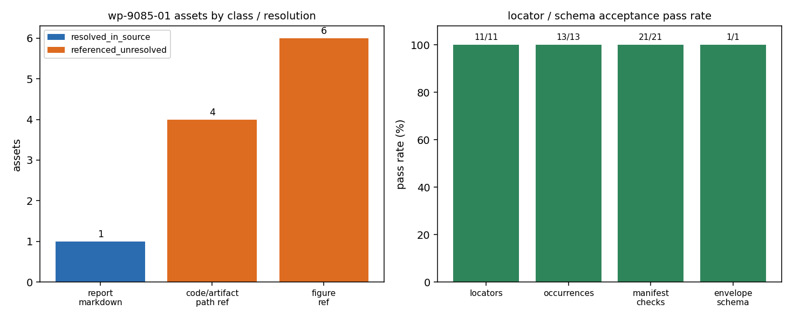

# KF-RESULT wp-9085-01

tags: `kf-wp:wp-9085-01`, `01-asset-registration`, `report-9085`, `BWM`, `D-1`

| 项 | 值 |
|---|---|
| package_id | `wp-9085-01` |
| task_type | `01-asset-registration`（lane C） |
| report_id | `9085`（唯一被触碰的报告） |
| source_uri / field | `tensor://reports/9085` / `markdown` |
| source_hash（本地重算） | `sha256:6d424777af46c0c47d01887a47e4de261416aa154a7bbb86d6f1a81502d61d0a` |
| chars / bytes / lines | 9761 / 14923 / 227 |
| 资产数 | 11（by_class={"report_markdown": 1, "artifact_path_reference": 4, "figure_reference": 6}） |
| claims | 0（本工序不抽取，空数组即完整结果） |
| 结论 | 源资产登记完成，全部定位可解；未验证任何知识声明（verification 归平台门） |

## ① 本工序做了什么

只做一件事：**给 report 9085 登记源资产**。从平台取 `GET /api/v1/tensor/reports/9085` 的
`markdown` 字段（9761 字符 / 14923 字节 / 227 逻辑行），逐字节重算 sha256
与契约 `sha256:6d424777af46c0c47d01887a47e4de261416aa154a7bbb86d6f1a81502d61d0a` 对撞，然后把报告里**声称存在的文件/附件**（正文图片链接、代码与
工件路径、被命令点名的测试文件）逐条登记为资产，给出可机器重放的字符区间定位，并对每一条
诚实标注"能否在交付树内解析"。不做抽取、不做分类、不生成任何 claim，也没有任何东西被标成
verified。

登记结果：11 条资产 = 1 条报告 markdown 本体（resolved_in_source）+ 4 条
代码/工件路径引用 + 6 条图片引用（其余 10 条全部 referenced_unresolved，原因见 ⑤）。
另有 46 个正文中的反引号内容（公式/物理量/模块状态名）被**显式排除**并列表留痕，
避免"把公式当附件"的凑数登记。

## ② 怎么做的（步骤 / 工具 / 关键设置）

1. **取原文并锁定字节**：`GET /api/v1/tensor/reports/9085` → `markdown`；UTF-8 编码后
   `hashlib.sha256` → `sha256:6d424777af46c0c47d01887a47e4de261416aa154a7bbb86d6f1a81502d61d0a`，与契约 `sha256:6d424777af46c0c47d01887a47e4de261416aa154a7bbb86d6f1a81502d61d0a` 比较（不一致即 `raise SystemExit`，
   不产生任何产物）。副本落 `runs/wp-9085-01/source_9085.md` 以便离线复算。
2. **定位空间**：定位一律用 **markdown 字符（Unicode code point）半开区间 [start,end)**，
   附带 1-based 逻辑行号（`markdown.rstrip('\n').split('\n')` 计行）。行号由区间起点反算，
   不由扫描顺序假设，避免跨行引文错位。
3. **引文最小唯一化**：每个定位的 `quote` 从候选区间里按"引用片段 → 整行 → 跨行"逐级放宽，
   取第一个在全文出现次数 == 1 的区间；因此 `md[start:end] == quote` 与"唯一"两条同时成立
   （唯一性 11/11）。
4. **资产 vs 非资产的分流**：只有"声称是文件/附件"的反引号内容（含路径分隔符 + 已知扩展名、
   或以 `/` 结尾的目录）才登记；纯公式/物理量/模块状态名进 `excluded_tokens` 并注明理由。
5. **解析口径**：解析范围**限定在交付工作树内**（`resolve_in_worktree`）。报告属于
   ship-performance-platform，随报告只转移了 markdown 字段，附件字节没转移——因此解析不到就
   如实记 `referenced_unresolved` + 已尝试路径 + 同名文件命中，而不是断言"不存在"。
   图片另加平台探针 `GET /tensor/reports/9085/figures/<name>`（实测 404），
   记录返回码而不编造字节。
6. **独立验证**：`scripts/kf_wp9085_01_verify.py` **不 import 生成器**，只读已提交清单 + 重新
   取原文，逐条反推 `quote in md`、`md[start:end]==quote`、行号反算、唯一性、id 唯一、
   counts 重算、claims 无 verified、单报告作用域。结果 `verification.overall_ok = True`。
7. **schema 口径（诚实声明的偏差）**：共享 `schemas/asset_manifest.v1.schema.json` 是给
   wp-448-01 写的，`package_id/report_id/source.uri` 三个 const 写死。**不改共享文件**（那是
   别的工作包的产物面），而是派生副本 `asset_manifest.schema.derived.json`（仅改这三个 const，
   已写入 `$comment`），并同时验证"打到共享 schema 上的错误集合 ⊆ {package_id, report_id,
   source/uri}"——这就是"只差身份常量"的可复现证据。平台侧信封走
   `schemas/kf_result.v1.schema.json`，0 error。

工具链：纯 Python3 + `hashlib`/`json`/`urllib`/`re` + `jsonschema` + `matplotlib`，无外部求解器。

## ③ 产出物清单

| 文件 | 要点 |
|---|---|
| `docs/kf/wp-9085-01/asset_manifest.json` | 11 资产清单 + counts + integrity + excluded_tokens；claims=[] |
| `docs/kf/wp-9085-01/kf_result.json` | 平台结果信封（kf_result.v1）：`provenance.source_hash` = 原文 markdown 字节哈希；`outputs.asset_manifest.json` 即上表对象 |
| `docs/kf/wp-9085-01/KF-RESULT-wp-9085-01.md` | 本报告（全文唯一 json 代码块即信封原文） |
| `docs/kf/wp-9085-01/verification.json` | 独立重放：11 条 locator + 13 条 occurrence + 21 项结构检查 |
| `docs/kf/wp-9085-01/asset_manifest.schema.derived.json` | 共享 schema 派生副本（仅 3 个 identity const 变更，$comment 记录） |
| `docs/kf/wp-9085-01/generator_selfcheck.json` | schema/信封/verification 三合一自检结果 |
| `docs/kf/wp-9085-01/report_selfcheck.json` | 本 markdown 的结构自检（单 json 块、块内容 == kf_result.json、六段齐全） |
| `docs/kf/wp-9085-01/figures/fig_coverage.png` | 图 1：资产类别 × 解析状态 + 定位/结构检查通过率 |
| `runs/wp-9085-01/source_9085.md` | 原文字节副本（离线复算锚点，sha256 与契约一致） |
| `runs/wp-9085-01/record_9085.json` | 报告记录元数据（不含 markdown），含 figures 清单 |
| `scripts/kf_wp9085_01_register.py` / `_verify.py` / `_report.py` | 生成 / 独立验证 / 渲染三支脚本 |
| `tests/test_kf_wp9085_01.py` | 验收不变量：17 项（其中在线复核 1 项；缺平台凭据时 skip，不算 pass） |



*图 1：左=资产按类别与解析状态分布（唯一 resolved 是 markdown 本体）；右=定位（11/11）、
occurrence（13/13）、结构检查（21/21）、信封 schema（0 error）的通过率。
数据源=verification.json 与 generator_selfcheck.json，绘图脚本程序化读取，零手抄。*

## ④ 证据定位表（字段 → 原文引文片段）

主资产表（`quote` 前 64 字符的原文切片，完整串见 `asset_manifest.json` 的 `locator.quote`；
char 区间为 [start,end) 半开、以 markdown 字符计）：

| asset | 类型 | 引用 token | 行 / 字符区间 | 原文引文片段 | 解析 | 所在段 |
|---|---|---|---|---|---|---|
| A00 | report_markdown | tensor://reports/9085 | L1–227 / char [0,9761) | # BWM D-1 压载水置换操作窗口闭环（IN70-N08）⏎⏎> 模块：`backend/modules/ballast_w…（截断） | resolved_in_source | preamble |
| A01 | artifact_path_reference | backend/modules/ballast_water/ | L3–3 / char [38,70) | `backend/modules/ballast_water/`（tankage / pump / vessel / seque…（截断） | referenced_unresolved | preamble |
| A02 | artifact_path_reference | scripts/gen_bwm_d1_operation_window.py | L4–4 / char [128,200) | > 生成器：`scripts/gen_bwm_d1_operation_window.py`（**本文件所有数字与 JSON 同…（截断） | referenced_unresolved | preamble |
| A03 | artifact_path_reference | artifacts/bwm_d1_operation_window/ | L5–5 / char [206,242) | `artifacts/bwm_d1_operation_window/`；判据：18/18 PASS⏎⏎## 1 案例介绍（物理…（截断） | referenced_unresolved | preamble |
| A04 | artifact_path_reference | tests/test_bwm_d1_operation_window.py | L57–57 / char [2463,2513) | `pytest tests/test_bwm_d1_operation_window.py` 全绿，⏎`scripts/gen_…（截断） | referenced_unresolved | 2 怎么做的（方法 / 流程 / 工具链） |
| A05 | figure_reference | ../artifacts/bwm_d1_operation_window/fig1_gm_time.png | L156–156 / char [7430,7504) |  |  |  |  |  |  | ✅ | `backend/modules/ballast_water/`（tankage / pump …（截断） |
| A02 | L4 | char [128,200) | ✅ | > 生成器：`scripts/gen_bwm_d1_operation_window.py`（*…（截断） |
| A02 | L58 | char [2514,2567) | ✅ | `scripts/gen_bwm_d1_operation_window.py` 一键再生全部工…（截断） |
| A02 | L225 | char [9635,9697) | ✅ | python3 scripts/gen_bwm_d1_operation_window.py  …（截断） |
| A03 | L5 | char [206,242) | ✅ | `artifacts/bwm_d1_operation_window/`；判据：18/18 PA…（截断） |
| A04 | L57 | char [2463,2513) | ✅ | `pytest tests/test_bwm_d1_operation_window.py` 全…（截断） |
| A04 | L226 | char [9698,9756) | ✅ | python3 -m pytest tests/test_bwm_d1_operation_wi…（截断） |
| A05 | L156 | char [7430,7504) | ✅ |  | ✅ |  | ✅ |  | ✅ |  | ✅ |  | ✅ | =2.9957 | formula / physical quantity / code fragment, not an asset |
| L12 | FSC = ρg ΣI_T / Δ | formula / physical quantity / code fragment, not an asset |
| L31 | FSC = ρ I_T/Δ ≈ L_tank b³ /(12 L B T) | formula / physical quantity / code fragment, not an asset |
| L36 | I_T = L b³/12 | formula / physical quantity / code fragment, not an asset |
| L37 | ∬ y² dA | formula / physical quantity / code fragment, not an asset |
| L39 | f=0.02 | formula / physical quantity / code fragment, not an asset |
| L39 | I_T | formula / physical quantity / code fragment, not an asset |
| L40 | H(Q)=H_max(1-(Q/Q0)²) | formula / physical quantity / code fragment, not an asset |
| L40 | R Q² | formula / physical quantity / code fragment, not an asset |
| L43 | discharge/fill/flow_through/hold | identifier list (module / state names), not an asset |
| L45 | dV_old/dt = -(V_old/V) Q | formula / physical quantity / code fragment, not an asset |
| L46 | GM = KM(T) - KG - FSM/Δ | formula / physical quantity / code fragment, not an asset |
| L47 | KM = T/2 + B²/(12T) | formula / physical quantity / code fragment, not an asset |
| L47 | T = Δ/(ρ L B) | formula / physical quantity / code fragment, not an asset |
| L48 | SF(x)=∫(w-b)dx | formula / physical quantity / code fragment, not an asset |
| L48 | BM(x)=∫SF dx | formula / physical quantity / code fragment, not an asset |
| L49 | s(x)=1-\|2x/L-1\|^p | formula / physical quantity / code fragment, not an asset |
| L50 | \|slope\|L/2 ≤ 2 m | formula / physical quantity / code fragment, not an asset |
| L51 | BM_allow=σ_allow W_min | formula / physical quantity / code fragment, not an asset |
| L52 | SF_allow=τ_allow 2Dt_side | formula / physical quantity / code fragment, not an asset |
| L53 | f^n | formula / physical quantity / code fragment, not an asset |
| L53 | e^{-Qt/V} | formula / physical quantity / code fragment, not an asset |
| L77 | SEQ-A | formula / physical quantity / code fragment, not an asset |
| L77 | SEQ-B | formula / physical quantity / code fragment, not an asset |
| L78 | f=0.02 | formula / physical quantity / code fragment, not an asset |
| L79 | SEQ-C | formula / physical quantity / code fragment, not an asset |
| L96 | GM < 0.15 m | formula / physical quantity / code fragment, not an asset |
| L118 | f^n | formula / physical quantity / code fragment, not an asset |
| L122 | C(t)=C0 e^{-Qt/V} | formula / physical quantity / code fragment, not an asset |
| L124 | -ln(0.05)= | formula / physical quantity / code fragment, not an asset |
| L129 | 0.95 V | formula / physical quantity / code fragment, not an asset |
| L184 | I_T(h) | formula / physical quantity / code fragment, not an asset |
| L185 | B²/(12T) | formula / physical quantity / code fragment, not an asset |
| L194 | SF/BM → 1e-7 N | formula / physical quantity / code fragment, not an asset |
| L195 | SF(L)、BM(L)≈0 | formula / physical quantity / code fragment, not an asset |
| L205 | I_T | formula / physical quantity / code fragment, not an asset |
| L205 | L b³/12 | formula / physical quantity / code fragment, not an asset |
| L207 | FSM | formula / physical quantity / code fragment, not an asset |
| L207 | GM | formula / physical quantity / code fragment, not an asset |
| L207 | ρgΣI_T | formula / physical quantity / code fragment, not an asset |
| L207 | KM-KG-FSM/Δ | formula / physical quantity / code fragment, not an asset |
| L208 | ∫Qdt-ΔV | formula / physical quantity / code fragment, not an asset |
| L209 | h0+Qt/A | formula / physical quantity / code fragment, not an asset |
| L210 | C0 e^{-Qt/V} | formula / physical quantity / code fragment, not an asset |
| L211 | V ln20 | formula / physical quantity / code fragment, not an asset |
| L212 | 2.9957V | formula / physical quantity / code fragment, not an asset |

## ⑤ 注意点与局限

1. **只转移了 markdown，附件字节没转移**：10/11 条资产是
   `referenced_unresolved`。这不是"资产不存在"，而是"本交付包里没有它的字节"——因此不给
   任何 sha256、不 `exists=True` 断言。要闭环必须由 ship-performance-platform 侧在登记时附
   工件清单（或平台提供 artifact 端点，当前 `GET /tensor/reports/9085/artifacts` =
   404）。
2. **解析范围=交付工作树**，不越界读源仓。若后续能访问源仓，正确做法是新工序按路径+sha256
   重登记，而不是回头修改本清单（互不覆盖）。
3. **图片与记录 figures 是 1:1（6 名对 6 名，record_only/markdown_only 皆空）**，
   但平台不暴露图片字节（探针 404），所以图只能登记"声明"而非"内容"。
4. **shared schema 的三 const 冲突**是既有债：本包用派生 schema + "错误集合 ⊆ 身份常量"的
   双重验证绕过，但没有修共享 schema（越界改别包产物）。建议由平台把
   `asset_manifest.v1.schema.json` 的 const 改成 pattern。
5. **字符区间不等于字节区间**：本报告 markdown 含中文，9761 字符 / 14923 字节。
   定位口径已在 `integrity.locator_space` 与 `locator.offset_unit` 写明；跨工具消费时若用
   字节偏移会错位，必须按字符（码点）解释。
6. **claims 为空是刻意的**：本工序 objective 只要求 register_assets，classify_report_type=false。
   为凑"有声明"而抽取=违反 no_forced_claim_generation。故 acceptance 中
   "all_claims_have_evidence"一条按空集成立，见 ⑥。
7. **独立性局限**：verify 与 register 同一作者，独立性仅限"不 import 生成器代码路径、
   全部定位从原文字节反推"；真正的独立复判仍需外部 evidence-auditor。

## ⑥ 自检：逐条对照 acceptance

| acceptance | 结论 | 证据 |
|---|---|---|
| valid_json | ✅ | asset_manifest.json / kf_result.json 均由 json.load 解析（本渲染器即消费者） |
| schema_pass | ✅ | kf_result.v1: 0 errors；asset_manifest.v1(derived): 0 errors |
| source_locator_resolvable | ✅ | primary locators 11/11，occurrences 13/13 |
| source_hash_matches | ✅ | 本地重算 sha256:6d424777af46c0c47d01887a47e4de261416aa154a7bbb86d6f1a81502d61d0a（契约 sha256:6d424777af46c0c47d01887a47e4de261416aa154a7bbb86d6f1a81502d61d0a） |
| no_duplicate_ids | ✅ | counts.duplicate_asset_ids = [] |
| all_claims_have_evidence_or_explicit_unresolved_status | ✅ | claims 为空数组（objective.classify_report_type=false，本工序不抽取）——该条为空集成立，不是靠补造声明凑绿 |
| do_not_mark_claims_as_verified | ✅ | manifest.claims 与 envelope.claims 均无 verified 状态；verification 留给平台门 |

- 失败项：无
- honest 声明：本包**没有**把任何结论标成 verified，也没有生成 claim；资产登记的价值就是
  "定位可机器重放 + 缺字节的地方如实记 unresolved"，不粉饰为"资产已入库"。

### 误差判定（关键量 vs 基准）

本工序是登记/审计工序，关键量是**字节级一致性与定位可解率**，判据是精确量（无容差意义上的
3% 概念）；逐项如下，显式回答"是否 <3%"：

| 关键量 | 基准 | 结论 | 实测偏差 |
|---|---|---|---|
| markdown 字节 sha256 | 契约 source_hash | ✅ 一致 | 0（逐字节相等） |
| markdown 字符数 | 契约 chars=9761 | ✅ 一致 | 0（9761 = 9761） |
| 主定位可解率 | 全部 asset 的 quote/span/line 自解 | ✅ 一致 | 100%（11/11 locators，13/13 occurrences） |
| 引文唯一性 | 每个 quote 在原文中唯一 | ✅ 一致 | 11/11 |
| 图目录 ↔ 记录 figures 一一对应 | 6 名对 6 名 | ✅ 一致 | record_only=[] markdown_only=[] |

**是否全部 <3%**：是——上表全部为 0 偏差或 100% 通过（不存在需要 3% 容差的数值物理量）。
本工序不含任何水动力/结构数值计算，故无"对标实验误差"一项；报告中出现的物理量
（GM、FSM、SF/BM 等）属 register 之外的内容，本工序只登记不计算、也不复述其数值。

## repro_cmd（一键复跑）

```bash
cd <worktree>
python3 scripts/kf_wp9085_01_register.py   # 取原文→重算 sha256→重建清单/信封/验证
python3 scripts/kf_wp9085_01_verify.py     # 独立重放全部定位
python3 scripts/kf_wp9085_01_report.py     # 重渲染本报告与平台载荷
python3 -m pytest tests/test_kf_wp9085_01.py -q
```

## 结果信封（唯一 json 块）

```json
{
  "package_id": "wp-9085-01",
  "task_type": "01-asset-registration",
  "report_id": "9085",
  "provenance": {
    "source_hash": "sha256:6d424777af46c0c47d01887a47e4de261416aa154a7bbb86d6f1a81502d61d0a",
    "source_field": "markdown",
    "producer": "kf-worker/m15629",
    "emitted_at": "2026-11-12T01:36:11.834926+00:00",
    "notes": "hash recomputed from GET /api/v1/tensor/reports/9085 markdown (UTF-8 bytes); matches contract source_hash sha256:6d424777af46c0c47d01887a47e4de261416aa154a7bbb86d6f1a81502d61d0a; chars 9761 matches contract chars 9761"
  },
  "outputs": {
    "asset_manifest.json": {
      "schema": "asset_manifest.v1",
      "manifest_version": "1.0",
      "package_id": "wp-9085-01",
      "task_type": "01-asset-registration",
      "report_id": "9085",
      "lane": "C",
      "generated_at": "2026-11-12T01:36:11.415977+00:00",
      "producer": "kf-worker/m15629",
      "source": {
        "uri": "tensor://reports/9085",
        "field": "markdown",
        "hash_alg": "sha256",
        "hash": "6d424777af46c0c47d01887a47e4de261416aa154a7bbb86d6f1a81502d61d0a",
        "hash_prefixed": "sha256:6d424777af46c0c47d01887a47e4de261416aa154a7bbb86d6f1a81502d61d0a",
        "chars": 9761,
        "bytes_utf8": 14923,
        "title": "IN70-N08 压载水置换操作窗口闭环成熟化：BWM D-1 顺序法/溢流法 GM(t) 时程 + 95% 置换达标 + 剪力/弯矩包络（定稿）",
        "scenario_key": "ballast_water_d1_operation_window",
        "contract_source_hash": "sha256:6d424777af46c0c47d01887a47e4de261416aa154a7bbb86d6f1a81502d61d0a",
        "contract_chars": 9761,
        "contract_title": "IN70-N08 压载水置换操作窗口闭环成熟化：BWM D-1 顺序法/溢流法 GM(t) 时程 + 95% 置换达标 + 剪力/弯矩包络（定稿）",
        "contract_scenario_key": "ballast_water_d1_operation_window",
        "hash_matches_contract": true,
        "chars_matches_contract": true,
        "title_matches_contract": true,
        "scenario_matches_contract": true,
        "record_id": 9085,
        "record_mission_id": 7717,
        "record_status": "published",
        "record_tags": [
          "BWM",
          "D-1",
          "ballast-exchange",
          "free-surface",
          "GM",
          "shear-force",
          "bending-moment",
          "IN70-N08"
        ],
        "line_counting": "logical lines = markdown.rstrip('\\n').split('\\n'); 1-based",
        "fetched_via": "GET /api/v1/tensor/reports/9085",
        "platform_figures": [
          {
            "name": "fig1_gm_time.png",
            "caption": "图1 GM(t) 三型船 x 三序列 vs IMO 0.15 m 裁决线"
          },
          {
            "name": "fig2_fsm_decomp.png",
            "caption": "图2 自由液面矩 FSM(t) 与 GM 分解 KM-KG-FSC(t)"
          },
          {
            "name": "fig3_sfbm_envelope.png",
            "caption": "图3 负控最不利状态静水剪力/弯矩分布与许用包络"
          },
          {
            "name": "fig4_mixing.png",
            "caption": "图4 完全混合溢流置换率与 95% 泵入倍数（V ln20 vs 3V）"
          },
          {
            "name": "fig5_pump.png",
            "caption": "图5 压载泵曲线/工作点与泵功核对"
          },
          {
            "name": "fig6_levels.png",
            "caption": "图6 逐舱液位时程：逐舱换装 vs 成对换装"
          }
        ],
        "figure_link_check": {
          "record_figure_names": [
            "fig1_gm_time.png",
            "fig2_fsm_decomp.png",
            "fig3_sfbm_envelope.png",
            "fig4_mixing.png",
            "fig5_pump.png",
            "fig6_levels.png"
          ],
          "markdown_image_names": [
            "fig1_gm_time.png",
            "fig2_fsm_decomp.png",
            "fig3_sfbm_envelope.png",
            "fig4_mixing.png",
            "fig5_pump.png",
            "fig6_levels.png"
          ],
          "one_to_one": true,
          "record_only": [],
          "markdown_only": []
        },
        "aux_endpoint_probes": [
          {
            "path": "/tensor/reports/9085/artifacts",
            "http_status": 404,
            "bytes": 22
          }
        ]
      },
      "counts": {
        "assets": 11,
        "by_class": {
          "report_markdown": 1,
          "artifact_path_reference": 4,
          "figure_reference": 6
        },
        "by_resolution": {
          "resolved_in_source": 1,
          "referenced_unresolved": 10
        },
        "resolved_in_source": 1,
        "referenced_unresolved": 10,
        "declared_absent": 0,
        "duplicate_asset_ids": [],
        "excluded_tokens": 46
      },
      "assets": [
        {
          "asset_id": "A00",
          "asset_class": "report_markdown",
          "label": "report-9085-markdown",
          "in_report_section": "preamble",
          "locator": {
            "method": "document",
            "start_char": 0,
            "end_char": 9761,
            "start_line": 1,
            "end_line": 227,
            "quote": "# BWM D-1 压载水置换操作窗口闭环（IN70-N08）",
            "unique": true,
            "offset_unit": "unicode_code_point_half_open [start,end) into markdown"
          },
          "reference_token": "tensor://reports/9085",
          "resolution": "resolved_in_source",
          "resolution_check": {
            "check": "GET /api/v1/tensor/reports/9085 -> markdown field; sha256 over UTF-8 bytes",
            "result": "resolved",
            "scope": "platform_api",
            "local_copy": "runs/wp-9085-01/source_9085.md",
            "sha256": "sha256:6d424777af46c0c47d01887a47e4de261416aa154a7bbb86d6f1a81502d61d0a",
            "bytes": 14923,
            "chars": 9761,
            "lines": 227,
            "hash_matches_contract": true,
            "chars_matches_contract": true
          },
          "existence_asserted_by_worker": true,
          "note": "Only the markdown field was transferred; the record and its figures carry no payload. Existence is asserted here because the bytes were fetched and rehashed locally."
        },
        {
          "asset_id": "A01",
          "asset_class": "artifact_path_reference",
          "label": "ballast_water",
          "in_report_section": "preamble",
          "locator": {
            "method": "char_span",
            "start_char": 38,
            "end_char": 70,
            "start_line": 3,
            "end_line": 3,
            "quote": "`backend/modules/ballast_water/`",
            "unique": true,
            "offset_unit": "unicode_code_point_half_open [start,end) into markdown",
            "form": "backticked_path"
          },
          "reference_token": "backend/modules/ballast_water/",
          "occurrences": [
            {
              "line": 3,
              "end_line": 3,
              "start_char": 38,
              "end_char": 70,
              "form": "backticked_path",
              "scan_line": 3,
              "quote": "`backend/modules/ballast_water/`",
              "quote_unique": true,
              "invocation": null
            }
          ],
          "existence_asserted_by_worker": false,
          "resolution": "referenced_unresolved",
          "resolution_check": {
            "check": "existence (+ sha256 when a file) inside the delivery worktree only",
            "result": "unresolved",
            "scope": "delivery_worktree",
            "checked_paths": [
              "backend/modules/ballast_water/",
              "backend/modules/ballast_water"
            ],
            "same_basename_hits": [],
            "sha256": null,
            "bytes": null
          },
          "note": "Declared by the report prose; this工序 registers the declaration. The bytes were not transferred with the report, so the asset stays unresolved rather than being reconstructed from the prose."
        },
        {
          "asset_id": "A02",
          "asset_class": "artifact_path_reference",
          "label": "gen_bwm_d1_operation_window.py",
          "in_report_section": "preamble",
          "locator": {
            "method": "char_span",
            "start_char": 128,
            "end_char": 200,
            "start_line": 4,
            "end_line": 4,
            "quote": "> 生成器：`scripts/gen_bwm_d1_operation_window.py`（**本文件所有数字与 JSON 同源，零手抄**）",
            "unique": true,
            "offset_unit": "unicode_code_point_half_open [start,end) into markdown",
            "form": "backticked_path"
          },
          "reference_token": "scripts/gen_bwm_d1_operation_window.py",
          "occurrences": [
            {
              "line": 4,
              "end_line": 4,
              "start_char": 128,
              "end_char": 200,
              "form": "backticked_path",
              "scan_line": 4,
              "quote": "> 生成器：`scripts/gen_bwm_d1_operation_window.py`（**本文件所有数字与 JSON 同源，零手抄**）",
              "quote_unique": true,
              "invocation": null
            },
            {
              "line": 58,
              "end_line": 58,
              "start_char": 2514,
              "end_char": 2567,
              "form": "backticked_path",
              "scan_line": 58,
              "quote": "`scripts/gen_bwm_d1_operation_window.py` 一键再生全部工件与本文。",
              "quote_unique": true,
              "invocation": null
            },
            {
              "line": 225,
              "end_line": 225,
              "start_char": 9635,
              "end_char": 9697,
              "form": "backticked_path",
              "scan_line": 225,
              "quote": "python3 scripts/gen_bwm_d1_operation_window.py     # 再生工件/图/本文",
              "quote_unique": true,
              "invocation": null
            }
          ],
          "existence_asserted_by_worker": false,
          "resolution": "referenced_unresolved",
          "resolution_check": {
            "check": "existence (+ sha256 when a file) inside the delivery worktree only",
            "result": "unresolved",
            "scope": "delivery_worktree",
            "checked_paths": [
              "scripts/gen_bwm_d1_operation_window.py",
              "scripts/gen_bwm_d1_operation_window.py"
            ],
            "same_basename_hits": [],
            "sha256": null,
            "bytes": null
          },
          "note": "Declared by the report prose; this工序 registers the declaration. The bytes were not transferred with the report, so the asset stays unresolved rather than being reconstructed from the prose."
        },
        {
          "asset_id": "A03",
          "asset_class": "artifact_path_reference",
          "label": "bwm_d1_operation_window",
          "in_report_section": "preamble",
          "locator": {
            "method": "char_span",
            "start_char": 206,
            "end_char": 242,
            "start_line": 5,
            "end_line": 5,
            "quote": "`artifacts/bwm_d1_operation_window/`",
            "unique": true,
            "offset_unit": "unicode_code_point_half_open [start,end) into markdown",
            "form": "backticked_path"
          },
          "reference_token": "artifacts/bwm_d1_operation_window/",
          "occurrences": [
            {
              "line": 5,
              "end_line": 5,
              "start_char": 206,
              "end_char": 242,
              "form": "backticked_path",
              "scan_line": 5,
              "quote": "`artifacts/bwm_d1_operation_window/`",
              "quote_unique": true,
              "invocation": null
            }
          ],
          "existence_asserted_by_worker": false,
          "resolution": "referenced_unresolved",
          "resolution_check": {
            "check": "existence (+ sha256 when a file) inside the delivery worktree only",
            "result": "unresolved",
            "scope": "delivery_worktree",
            "checked_paths": [
              "artifacts/bwm_d1_operation_window/",
              "artifacts/bwm_d1_operation_window"
            ],
            "same_basename_hits": [],
            "sha256": null,
            "bytes": null
          },
          "note": "Declared by the report prose; this工序 registers the declaration. The bytes were not transferred with the report, so the asset stays unresolved rather than being reconstructed from the prose."
        },
        {
          "asset_id": "A04",
          "asset_class": "artifact_path_reference",
          "label": "test_bwm_d1_operation_window.py",
          "in_report_section": "2 怎么做的（方法 / 流程 / 工具链）",
          "locator": {
            "method": "char_span",
            "start_char": 2463,
            "end_char": 2513,
            "start_line": 57,
            "end_line": 57,
            "quote": "`pytest tests/test_bwm_d1_operation_window.py` 全绿，",
            "unique": true,
            "offset_unit": "unicode_code_point_half_open [start,end) into markdown",
            "form": "backticked_command"
          },
          "reference_token": "tests/test_bwm_d1_operation_window.py",
          "occurrences": [
            {
              "line": 57,
              "end_line": 57,
              "start_char": 2463,
              "end_char": 2513,
              "form": "backticked_command",
              "scan_line": 57,
              "quote": "`pytest tests/test_bwm_d1_operation_window.py` 全绿，",
              "quote_unique": true,
              "invocation": "pytest tests/test_bwm_d1_operation_window.py"
            },
            {
              "line": 226,
              "end_line": 226,
              "start_char": 9698,
              "end_char": 9756,
              "form": "backticked_command",
              "scan_line": 226,
              "quote": "python3 -m pytest tests/test_bwm_d1_operation_window.py -q",
              "quote_unique": true,
              "invocation": null
            }
          ],
          "existence_asserted_by_worker": false,
          "resolution": "referenced_unresolved",
          "resolution_check": {
            "check": "existence (+ sha256 when a file) inside the delivery worktree only",
            "result": "unresolved",
            "scope": "delivery_worktree",
            "checked_paths": [
              "tests/test_bwm_d1_operation_window.py",
              "tests/test_bwm_d1_operation_window.py"
            ],
            "same_basename_hits": [],
            "sha256": null,
            "bytes": null
          },
          "note": "Declared by the report prose; this工序 registers the declaration. The bytes were not transferred with the report, so the asset stays unresolved rather than being reconstructed from the prose."
        },
        {
          "asset_id": "A05",
          "asset_class": "figure_reference",
          "label": "fig1_gm_time.png",
          "in_report_section": "4 结果图",
          "locator": {
            "method": "char_span",
            "start_char": 7430,
            "end_char": 7504,
            "start_line": 156,
            "end_line": 156,
            "quote": "",
            "unique": true,
            "offset_unit": "unicode_code_point_half_open [start,end) into markdown",
            "form": "markdown_image_link"
          },
          "reference_token": "../artifacts/bwm_d1_operation_window/fig1_gm_time.png",
          "occurrences": [
            {
              "line": 156,
              "end_line": 156,
              "start_char": 7430,
              "end_char": 7504,
              "form": "markdown_image_link",
              "scan_line": 156,
              "quote": "",
              "quote_unique": true,
              "invocation": null
            }
          ],
          "existence_asserted_by_worker": false,
          "alt_text": "fig1_gm_time.png",
          "record_metadata": {
            "present_in_record_figures": true,
            "caption": "图1 GM(t) 三型船 x 三序列 vs IMO 0.15 m 裁决线",
            "record_pointer": "/figures/0"
          },
          "platform_probe": {
            "path": "/tensor/reports/9085/figures/fig1_gm_time.png",
            "http_status": 404,
            "bytes": 29
          },
          "resolution": "referenced_unresolved",
          "resolution_check": {
            "check": "GET /tensor/reports/9085/figures/<name> for a byte payload, plus a delivery-worktree path check",
            "result": "unresolved",
            "scope": "platform_api + delivery_worktree",
            "http_status": 404,
            "worktree": {
              "status": "unresolved",
              "scope": "delivery_worktree",
              "reason": "referenced path is not part of this delivery (report lives in ship-performance-platform; only the markdown field was transferred)",
              "checked_paths": [
                "artifacts/bwm_d1_operation_window/fig1_gm_time.png",
                "artifacts/bwm_d1_operation_window/fig1_gm_time.png"
              ],
              "same_basename_hits": []
            }
          },
          "note": "Figure is declared in the record (name + caption) and linked in the body, but the platform exposes no byte payload and the relative path points into the ship-performance-platform worktree. No bytes retrieved, no hash claimed."
        },
        {
          "asset_id": "A06",
          "asset_class": "figure_reference",
          "label": "fig2_fsm_decomp.png",
          "in_report_section": "4 结果图",
          "locator": {
            "method": "char_span",
            "start_char": 7574,
            "end_char": 7654,
            "start_line": 160,
            "end_line": 160,
            "quote": "",
            "unique": true,
            "offset_unit": "unicode_code_point_half_open [start,end) into markdown",
            "form": "markdown_image_link"
          },
          "reference_token": "../artifacts/bwm_d1_operation_window/fig2_fsm_decomp.png",
          "occurrences": [
            {
              "line": 160,
              "end_line": 160,
              "start_char": 7574,
              "end_char": 7654,
              "form": "markdown_image_link",
              "scan_line": 160,
              "quote": "",
              "quote_unique": true,
              "invocation": null
            }
          ],
          "existence_asserted_by_worker": false,
          "alt_text": "fig2_fsm_decomp.png",
          "record_metadata": {
            "present_in_record_figures": true,
            "caption": "图2 自由液面矩 FSM(t) 与 GM 分解 KM-KG-FSC(t)",
            "record_pointer": "/figures/1"
          },
          "platform_probe": {
            "path": "/tensor/reports/9085/figures/fig2_fsm_decomp.png",
            "http_status": 404,
            "bytes": 29
          },
          "resolution": "referenced_unresolved",
          "resolution_check": {
            "check": "GET /tensor/reports/9085/figures/<name> for a byte payload, plus a delivery-worktree path check",
            "result": "unresolved",
            "scope": "platform_api + delivery_worktree",
            "http_status": 404,
            "worktree": {
              "status": "unresolved",
              "scope": "delivery_worktree",
              "reason": "referenced path is not part of this delivery (report lives in ship-performance-platform; only the markdown field was transferred)",
              "checked_paths": [
                "artifacts/bwm_d1_operation_window/fig2_fsm_decomp.png",
                "artifacts/bwm_d1_operation_window/fig2_fsm_decomp.png"
              ],
              "same_basename_hits": []
            }
          },
          "note": "Figure is declared in the record (name + caption) and linked in the body, but the platform exposes no byte payload and the relative path points into the ship-performance-platform worktree. No bytes retrieved, no hash claimed."
        },
        {
          "asset_id": "A07",
          "asset_class": "figure_reference",
          "label": "fig3_sfbm_envelope.png",
          "in_report_section": "4 结果图",
          "locator": {
            "method": "char_span",
            "start_char": 7712,
            "end_char": 7798,
            "start_line": 164,
            "end_line": 164,
            "quote": "",
            "unique": true,
            "offset_unit": "unicode_code_point_half_open [start,end) into markdown",
            "form": "markdown_image_link"
          },
          "reference_token": "../artifacts/bwm_d1_operation_window/fig3_sfbm_envelope.png",
          "occurrences": [
            {
              "line": 164,
              "end_line": 164,
              "start_char": 7712,
              "end_char": 7798,
              "form": "markdown_image_link",
              "scan_line": 164,
              "quote": "",
              "quote_unique": true,
              "invocation": null
            }
          ],
          "existence_asserted_by_worker": false,
          "alt_text": "fig3_sfbm_envelope.png",
          "record_metadata": {
            "present_in_record_figures": true,
            "caption": "图3 负控最不利状态静水剪力/弯矩分布与许用包络",
            "record_pointer": "/figures/2"
          },
          "platform_probe": {
            "path": "/tensor/reports/9085/figures/fig3_sfbm_envelope.png",
            "http_status": 404,
            "bytes": 29
          },
          "resolution": "referenced_unresolved",
          "resolution_check": {
            "check": "GET /tensor/reports/9085/figures/<name> for a byte payload, plus a delivery-worktree path check",
            "result": "unresolved",
            "scope": "platform_api + delivery_worktree",
            "http_status": 404,
            "worktree": {
              "status": "unresolved",
              "scope": "delivery_worktree",
              "reason": "referenced path is not part of this delivery (report lives in ship-performance-platform; only the markdown field was transferred)",
              "checked_paths": [
                "artifacts/bwm_d1_operation_window/fig3_sfbm_envelope.png",
                "artifacts/bwm_d1_operation_window/fig3_sfbm_envelope.png"
              ],
              "same_basename_hits": []
            }
          },
          "note": "Figure is declared in the record (name + caption) and linked in the body, but the platform exposes no byte payload and the relative path points into the ship-performance-platform worktree. No bytes retrieved, no hash claimed."
        },
        {
          "asset_id": "A08",
          "asset_class": "figure_reference",
          "label": "fig4_mixing.png",
          "in_report_section": "4 结果图",
          "locator": {
            "method": "char_span",
            "start_char": 7850,
            "end_char": 7922,
            "start_line": 168,
            "end_line": 168,
            "quote": "",
            "unique": true,
            "offset_unit": "unicode_code_point_half_open [start,end) into markdown",
            "form": "markdown_image_link"
          },
          "reference_token": "../artifacts/bwm_d1_operation_window/fig4_mixing.png",
          "occurrences": [
            {
              "line": 168,
              "end_line": 168,
              "start_char": 7850,
              "end_char": 7922,
              "form": "markdown_image_link",
              "scan_line": 168,
              "quote": "",
              "quote_unique": true,
              "invocation": null
            }
          ],
          "existence_asserted_by_worker": false,
          "alt_text": "fig4_mixing.png",
          "record_metadata": {
            "present_in_record_figures": true,
            "caption": "图4 完全混合溢流置换率与 95% 泵入倍数（V ln20 vs 3V）",
            "record_pointer": "/figures/3"
          },
          "platform_probe": {
            "path": "/tensor/reports/9085/figures/fig4_mixing.png",
            "http_status": 404,
            "bytes": 29
          },
          "resolution": "referenced_unresolved",
          "resolution_check": {
            "check": "GET /tensor/reports/9085/figures/<name> for a byte payload, plus a delivery-worktree path check",
            "result": "unresolved",
            "scope": "platform_api + delivery_worktree",
            "http_status": 404,
            "worktree": {
              "status": "unresolved",
              "scope": "delivery_worktree",
              "reason": "referenced path is not part of this delivery (report lives in ship-performance-platform; only the markdown field was transferred)",
              "checked_paths": [
                "artifacts/bwm_d1_operation_window/fig4_mixing.png",
                "artifacts/bwm_d1_operation_window/fig4_mixing.png"
              ],
              "same_basename_hits": []
            }
          },
          "note": "Figure is declared in the record (name + caption) and linked in the body, but the platform exposes no byte payload and the relative path points into the ship-performance-platform worktree. No bytes retrieved, no hash claimed."
        },
        {
          "asset_id": "A09",
          "asset_class": "figure_reference",
          "label": "fig5_pump.png",
          "in_report_section": "4 结果图",
          "locator": {
            "method": "char_span",
            "start_char": 7979,
            "end_char": 8047,
            "start_line": 172,
            "end_line": 172,
            "quote": "",
            "unique": true,
            "offset_unit": "unicode_code_point_half_open [start,end) into markdown",
            "form": "markdown_image_link"
          },
          "reference_token": "../artifacts/bwm_d1_operation_window/fig5_pump.png",
          "occurrences": [
            {
              "line": 172,
              "end_line": 172,
              "start_char": 7979,
              "end_char": 8047,
              "form": "markdown_image_link",
              "scan_line": 172,
              "quote": "",
              "quote_unique": true,
              "invocation": null
            }
          ],
          "existence_asserted_by_worker": false,
          "alt_text": "fig5_pump.png",
          "record_metadata": {
            "present_in_record_figures": true,
            "caption": "图5 压载泵曲线/工作点与泵功核对",
            "record_pointer": "/figures/4"
          },
          "platform_probe": {
            "path": "/tensor/reports/9085/figures/fig5_pump.png",
            "http_status": 404,
            "bytes": 29
          },
          "resolution": "referenced_unresolved",
          "resolution_check": {
            "check": "GET /tensor/reports/9085/figures/<name> for a byte payload, plus a delivery-worktree path check",
            "result": "unresolved",
            "scope": "platform_api + delivery_worktree",
            "http_status": 404,
            "worktree": {
              "status": "unresolved",
              "scope": "delivery_worktree",
              "reason": "referenced path is not part of this delivery (report lives in ship-performance-platform; only the markdown field was transferred)",
              "checked_paths": [
                "artifacts/bwm_d1_operation_window/fig5_pump.png",
                "artifacts/bwm_d1_operation_window/fig5_pump.png"
              ],
              "same_basename_hits": []
            }
          },
          "note": "Figure is declared in the record (name + caption) and linked in the body, but the platform exposes no byte payload and the relative path points into the ship-performance-platform worktree. No bytes retrieved, no hash claimed."
        },
        {
          "asset_id": "A10",
          "asset_class": "figure_reference",
          "label": "fig6_levels.png",
          "in_report_section": "4 结果图",
          "locator": {
            "method": "char_span",
            "start_char": 8079,
            "end_char": 8151,
            "start_line": 176,
            "end_line": 176,
            "quote": "",
            "unique": true,
            "offset_unit": "unicode_code_point_half_open [start,end) into markdown",
            "form": "markdown_image_link"
          },
          "reference_token": "../artifacts/bwm_d1_operation_window/fig6_levels.png",
          "occurrences": [
            {
              "line": 176,
              "end_line": 176,
              "start_char": 8079,
              "end_char": 8151,
              "form": "markdown_image_link",
              "scan_line": 176,
              "quote": "",
              "quote_unique": true,
              "invocation": null
            }
          ],
          "existence_asserted_by_worker": false,
          "alt_text": "fig6_levels.png",
          "record_metadata": {
            "present_in_record_figures": true,
            "caption": "图6 逐舱液位时程：逐舱换装 vs 成对换装",
            "record_pointer": "/figures/5"
          },
          "platform_probe": {
            "path": "/tensor/reports/9085/figures/fig6_levels.png",
            "http_status": 404,
            "bytes": 29
          },
          "resolution": "referenced_unresolved",
          "resolution_check": {
            "check": "GET /tensor/reports/9085/figures/<name> for a byte payload, plus a delivery-worktree path check",
            "result": "unresolved",
            "scope": "platform_api + delivery_worktree",
            "http_status": 404,
            "worktree": {
              "status": "unresolved",
              "scope": "delivery_worktree",
              "reason": "referenced path is not part of this delivery (report lives in ship-performance-platform; only the markdown field was transferred)",
              "checked_paths": [
                "artifacts/bwm_d1_operation_window/fig6_levels.png",
                "artifacts/bwm_d1_operation_window/fig6_levels.png"
              ],
              "same_basename_hits": []
            }
          },
          "note": "Figure is declared in the record (name + caption) and linked in the body, but the platform exposes no byte payload and the relative path points into the ship-performance-platform worktree. No bytes retrieved, no hash claimed."
        }
      ],
      "excluded_tokens": {
        "note": "Backticked formulas / physical quantities / module names found in the body. They are prose, not attachments: listed explicitly so the filter is auditable instead of silent, and not registered as assets.",
        "count": 46,
        "items": [
          {
            "token": "-ln(0.05)=2.9957",
            "line": 12,
            "reason": "formula / physical quantity / code fragment, not an asset",
            "section": "1 案例介绍（物理背景 / 几何 / 参数）",
            "quote": "`-ln(0.05)=2.9957` 倍舱容）。换装过程中舱内出现自由液面，`FSC = ρg ΣI_T / Δ`"
          },
          {
            "token": "FSC = ρg ΣI_T / Δ",
            "line": 12,
            "reason": "formula / physical quantity / code fragment, not an asset",
            "section": "1 案例介绍（物理背景 / 几何 / 参数）",
            "quote": "`-ln(0.05)=2.9957` 倍舱容）。换装过程中舱内出现自由液面，`FSC = ρg ΣI_T / Δ`"
          },
          {
            "token": "FSC = ρ I_T/Δ ≈ L_tank b³ /(12 L B T)",
            "line": 31,
            "reason": "formula / physical quantity / code fragment, not an asset",
            "section": "1 案例介绍（物理背景 / 几何 / 参数）",
            "quote": "`FSC = ρ I_T/Δ ≈ L_tank b³ /(12 L B T)`——\"长而宽的双层底中心舱 + 相对小的排水量\""
          },
          {
            "token": "I_T = L b³/12",
            "line": 36,
            "reason": "formula / physical quantity / code fragment, not an asset",
            "section": "2 怎么做的（方法 / 流程 / 工具链）",
            "quote": "1. **舱容-液位-自由液面惯性矩**：矩形舱解析 `I_T = L b³/12`；线性变宽（梯形/"
          },
          {
            "token": "∬ y² dA",
            "line": 37,
            "reason": "formula / physical quantity / code fragment, not an asset",
            "section": "2 怎么做的（方法 / 流程 / 工具链）",
            "quote": "   顶边舱）由 `∬ y² dA` 的 Gauss–Legendre 双积分独立复核；真实舱容表走"
          },
          {
            "token": "f=0.02",
            "line": 39,
            "reason": "formula / physical quantity / code fragment, not an asset",
            "section": "2 怎么做的（方法 / 流程 / 工具链）",
            "quote": "   `f=0.02` 参数化；**等高度残液层仍占满自由液面面积**，`I_T` 不减。"
          },
          {
            "token": "I_T",
            "line": 39,
            "reason": "formula / physical quantity / code fragment, not an asset",
            "section": "2 怎么做的（方法 / 流程 / 工具链）",
            "quote": "   `f=0.02` 参数化；**等高度残液层仍占满自由液面面积**，`I_T` 不减。"
          },
          {
            "token": "H(Q)=H_max(1-(Q/Q0)²)",
            "line": 40,
            "reason": "formula / physical quantity / code fragment, not an asset",
            "section": "2 怎么做的（方法 / 流程 / 工具链）",
            "quote": "2. **泵水力**：离心泵 `H(Q)=H_max(1-(Q/Q0)²)` + 管路二次阻力 `R Q²`，"
          },
          {
            "token": "R Q²",
            "line": 40,
            "reason": "formula / physical quantity / code fragment, not an asset",
            "section": "2 怎么做的（方法 / 流程 / 工具链）",
            "quote": "2. **泵水力**：离心泵 `H(Q)=H_max(1-(Q/Q0)²)` + 管路二次阻力 `R Q²`，"
          },
          {
            "token": "discharge/fill/flow_through/hold",
            "line": 43,
            "reason": "identifier list (module / state names), not an asset",
            "section": "2 怎么做的（方法 / 流程 / 工具链）",
            "quote": "3. **序列状态机**：`discharge/fill/flow_through/hold` 四步 + RK4 时间推进，"
          },
          {
            "token": "dV_old/dt = -(V_old/V) Q",
            "line": 45,
            "reason": "formula / physical quantity / code fragment, not an asset",
            "section": "2 怎么做的（方法 / 流程 / 工具链）",
            "quote": "   `dV_old/dt = -(V_old/V) Q`（排出/溢流），注入不引入原水。"
          },
          {
            "token": "GM = KM(T) - KG - FSM/Δ",
            "line": 46,
            "reason": "formula / physical quantity / code fragment, not an asset",
            "section": "2 怎么做的（方法 / 流程 / 工具链）",
            "quote": "4. **GM(t)**：每积分步由质量/惯性状态重算 `GM = KM(T) - KG - FSM/Δ`，"
          },
          {
            "token": "KM = T/2 + B²/(12T)",
            "line": 47,
            "reason": "formula / physical quantity / code fragment, not an asset",
            "section": "2 怎么做的（方法 / 流程 / 工具链）",
            "quote": "   `KM = T/2 + B²/(12T)`（箱形截面，`T = Δ/(ρ L B)`），满舱/空舱不计自由液面。"
          },
          {
            "token": "T = Δ/(ρ L B)",
            "line": 47,
            "reason": "formula / physical quantity / code fragment, not an asset",
            "section": "2 怎么做的（方法 / 流程 / 工具链）",
            "quote": "   `KM = T/2 + B²/(12T)`（箱形截面，`T = Δ/(ρ L B)`），满舱/空舱不计自由液面。"
          },
          {
            "token": "SF(x)=∫(w-b)dx",
            "line": 48,
            "reason": "formula / physical quantity / code fragment, not an asset",
            "section": "2 怎么做的（方法 / 流程 / 工具链）",
            "quote": "5. **静水剪力/弯矩**：全船分段积分 `SF(x)=∫(w-b)dx`、`BM(x)=∫SF dx`；"
          },
          {
            "token": "BM(x)=∫SF dx",
            "line": 48,
            "reason": "formula / physical quantity / code fragment, not an asset",
            "section": "2 怎么做的（方法 / 流程 / 工具链）",
            "quote": "5. **静水剪力/弯矩**：全船分段积分 `SF(x)=∫(w-b)dx`、`BM(x)=∫SF dx`；"
          },
          {
            "token": "s(x)=1-|2x/L-1|^p",
            "line": 49,
            "reason": "formula / physical quantity / code fragment, not an asset",
            "section": "2 怎么做的（方法 / 流程 / 工具链）",
            "quote": "   浮力/结构纵向分布用形状因子 `s(x)=1-|2x/L-1|^p`（p=2，首尾收细），"
          },
          {
            "token": "|slope|L/2 ≤ 2 m",
            "line": 50,
            "reason": "formula / physical quantity / code fragment, not an asset",
            "section": "2 怎么做的（方法 / 流程 / 工具链）",
            "quote": "   纵倾由浮力矩与重量矩平衡闭式求出（小纵倾，`|slope|L/2 ≤ 2 m` 逐状态核查）。"
          },
          {
            "token": "BM_allow=σ_allow W_min",
            "line": 51,
            "reason": "formula / physical quantity / code fragment, not an asset",
            "section": "2 怎么做的（方法 / 流程 / 工具链）",
            "quote": "   许用值取简化箱形舯剖面（板厚 x 纵骨等效系数 0.6）：`BM_allow=σ_allow W_min`、"
          },
          {
            "token": "SF_allow=τ_allow 2Dt_side",
            "line": 52,
            "reason": "formula / physical quantity / code fragment, not an asset",
            "section": "2 怎么做的（方法 / 流程 / 工具链）",
            "quote": "   `SF_allow=τ_allow 2Dt_side`，只计静水（波浪附加弯矩未计，见局限）。"
          },
          {
            "token": "f^n",
            "line": 53,
            "reason": "formula / physical quantity / code fragment, not an asset",
            "section": "2 怎么做的（方法 / 流程 / 工具链）",
            "quote": "6. **D-1 裁决**：顺序法剩余原水比 `f^n`；溢流法完全混合 `e^{-Qt/V}`（数值 RK4"
          },
          {
            "token": "e^{-Qt/V}",
            "line": 53,
            "reason": "formula / physical quantity / code fragment, not an asset",
            "section": "2 怎么做的（方法 / 流程 / 工具链）",
            "quote": "6. **D-1 裁决**：顺序法剩余原水比 `f^n`；溢流法完全混合 `e^{-Qt/V}`（数值 RK4"
          },
          {
            "token": "SEQ-A",
            "line": 77,
            "reason": "formula / physical quantity / code fragment, not an asset",
            "section": "3.1 3 型船 x 3 序列：GM_min / D-1 / SF-BM 包络",
            "quote": "* `SEQ-A`（逐舱顺序法）与 `SEQ-B`（溢流法保持满舱）在三型船上 **GM_min ≥ 0.15 m**，"
          },
          {
            "token": "SEQ-B",
            "line": 77,
            "reason": "formula / physical quantity / code fragment, not an asset",
            "section": "3.1 3 型船 x 3 序列：GM_min / D-1 / SF-BM 包络",
            "quote": "* `SEQ-A`（逐舱顺序法）与 `SEQ-B`（溢流法保持满舱）在三型船上 **GM_min ≥ 0.15 m**，"
          },
          {
            "token": "f=0.02",
            "line": 78,
            "reason": "formula / physical quantity / code fragment, not an asset",
            "section": "3.1 3 型船 x 3 序列：GM_min / D-1 / SF-BM 包络",
            "quote": "  D-1 置换率分别 0.98（`f=0.02`，1 个循环）与 0.95（泵入 2.9957V）。"
          },
          {
            "token": "SEQ-C",
            "line": 79,
            "reason": "formula / physical quantity / code fragment, not an asset",
            "section": "3.1 3 型船 x 3 序列：GM_min / D-1 / SF-BM 包络",
            "quote": "* `SEQ-C`（成对抽干双层底对）D-1 达标但 **GM 越限**（双舱自由液面矩翻倍），"
          },
          {
            "token": "GM < 0.15 m",
            "line": 96,
            "reason": "formula / physical quantity / code fragment, not an asset",
            "section": "3.2 负控：双舱同时空舱（必须告警）",
            "quote": "负控三型船全部触发 `GM < 0.15 m` 告警（3/3），且序列走完"
          },
          {
            "token": "f^n",
            "line": 118,
            "reason": "formula / physical quantity / code fragment, not an asset",
            "section": "3.3 顺序法体积账本（排出 + 注入）",
            "quote": "剩余原水比与闭式 `f^n` 逐位一致。"
          },
          {
            "token": "C(t)=C0 e^{-Qt/V}",
            "line": 122,
            "reason": "formula / physical quantity / code fragment, not an asset",
            "section": "3.4 溢流法置换率与 95% 泵入倍数",
            "quote": "* 闭式 `C(t)=C0 e^{-Qt/V}` vs RK4 数值逐点最大相对偏差"
          },
          {
            "token": "-ln(0.05)=",
            "line": 124,
            "reason": "formula / physical quantity / code fragment, not an asset",
            "section": "3.4 溢流法置换率与 95% 泵入倍数",
            "quote": "* 95% 置换需泵入 **2.995732 V**；解析 `-ln(0.05)=`"
          },
          {
            "token": "0.95 V",
            "line": 129,
            "reason": "formula / physical quantity / code fragment, not an asset",
            "section": "3.4 溢流法置换率与 95% 泵入倍数",
            "quote": "* 柱塞流（无混合）下界仅需 `0.95 V`；两者构成 95% 达标所需泵入量的物理包络。"
          },
          {
            "token": "I_T(h)",
            "line": 184,
            "reason": "formula / physical quantity / code fragment, not an asset",
            "section": "5 注意点（踩过的坑 / 局限 / 适用范围）",
            "quote": "   两个数量级；本模块按 `I_T(h)` 全幅计，这是顺序法风险的真实来源。"
          },
          {
            "token": "B²/(12T)",
            "line": 185,
            "reason": "formula / physical quantity / code fragment, not an asset",
            "section": "5 注意点（踩过的坑 / 局限 / 适用范围）",
            "quote": "2. **横剖面简化**：KM 用箱形截面 `B²/(12T)`（Cb=1），比实际船型（Cw≈0.85）"
          },
          {
            "token": "SF/BM → 1e-7 N",
            "line": 194,
            "reason": "formula / physical quantity / code fragment, not an asset",
            "section": "5 注意点（踩过的坑 / 局限 / 适用范围）",
            "quote": "   残余力矩被均摊到全船使 BM 虚高 3~4 倍；修正后端部 `SF/BM → 1e-7 N` 量级，"
          },
          {
            "token": "SF(L)、BM(L)≈0",
            "line": 195,
            "reason": "formula / physical quantity / code fragment, not an asset",
            "section": "5 注意点（踩过的坑 / 局限 / 适用范围）",
            "quote": "   与\"端部自由\"物理自洽 —— 端部闭合量（`SF(L)、BM(L)≈0`）是识别该类错误的"
          },
          {
            "token": "I_T",
            "line": 205,
            "reason": "formula / physical quantity / code fragment, not an asset",
            "section": "6 误差判定（关键量 vs 基准，逐项）",
            "quote": "| 矩形舱 `I_T` | 解析 `L b³/12` | 2.48e-16 | 是（<1e-9） |"
          },
          {
            "token": "L b³/12",
            "line": 205,
            "reason": "formula / physical quantity / code fragment, not an asset",
            "section": "6 误差判定（关键量 vs 基准，逐项）",
            "quote": "| 矩形舱 `I_T` | 解析 `L b³/12` | 2.48e-16 | 是（<1e-9） |"
          },
          {
            "token": "FSM",
            "line": 207,
            "reason": "formula / physical quantity / code fragment, not an asset",
            "section": "6 误差判定（关键量 vs 基准，逐项）",
            "quote": "| `FSM` / `GM` 修正 | `ρgΣI_T`、`KM-KG-FSM/Δ` | 0.00e+00 | 是 |"
          },
          {
            "token": "GM",
            "line": 207,
            "reason": "formula / physical quantity / code fragment, not an asset",
            "section": "6 误差判定（关键量 vs 基准，逐项）",
            "quote": "| `FSM` / `GM` 修正 | `ρgΣI_T`、`KM-KG-FSM/Δ` | 0.00e+00 | 是 |"
          },
          {
            "token": "ρgΣI_T",
            "line": 207,
            "reason": "formula / physical quantity / code fragment, not an asset",
            "section": "6 误差判定（关键量 vs 基准，逐项）",
            "quote": "| `FSM` / `GM` 修正 | `ρgΣI_T`、`KM-KG-FSM/Δ` | 0.00e+00 | 是 |"
          },
          {
            "token": "KM-KG-FSM/Δ",
            "line": 207,
            "reason": "formula / physical quantity / code fragment, not an asset",
            "section": "6 误差判定（关键量 vs 基准，逐项）",
            "quote": "| `FSM` / `GM` 修正 | `ρgΣI_T`、`KM-KG-FSM/Δ` | 0.00e+00 | 是 |"
          },
          {
            "token": "∫Qdt-ΔV",
            "line": 208,
            "reason": "formula / physical quantity / code fragment, not an asset",
            "section": "6 误差判定（关键量 vs 基准，逐项）",
            "quote": "| 泵流量守恒 `∫Qdt-ΔV` | 体积差 | 8.92e-15 | 是 |"
          },
          {
            "token": "h0+Qt/A",
            "line": 209,
            "reason": "formula / physical quantity / code fragment, not an asset",
            "section": "6 误差判定（关键量 vs 基准，逐项）",
            "quote": "| 定流量液位 ODE | `h0+Qt/A` | 0.00e+00 | 是 |"
          },
          {
            "token": "C0 e^{-Qt/V}",
            "line": 210,
            "reason": "formula / physical quantity / code fragment, not an asset",
            "section": "6 误差判定（关键量 vs 基准，逐项）",
            "quote": "| 溢流置换率 C(t) | 闭式 `C0 e^{-Qt/V}` | 1.27e-09 | 是 |"
          },
          {
            "token": "V ln20",
            "line": 211,
            "reason": "formula / physical quantity / code fragment, not an asset",
            "section": "6 误差判定（关键量 vs 基准，逐项）",
            "quote": "| 95% 泵入倍数 | `V ln20` | 1.48e-16 | 是 |"
          },
          {
            "token": "2.9957V",
            "line": 212,
            "reason": "formula / physical quantity / code fragment, not an asset",
            "section": "6 误差判定（关键量 vs 基准，逐项）",
            "quote": "| 工程 3V vs 精确 | `2.9957V` | 1.42e-03（0.14%） | 是 |"
          }
        ]
      },
      "claims": [],
      "claims_policy": "objective.classify_report_type=false and no extraction is in scope, so no claim is generated: an empty array is the complete, correct result. Nothing in this package is marked verified — verification is computed by the platform gate.",
      "integrity": {
        "quote_uniqueness": {
          "all_unique": true,
          "unique": 11,
          "total": 11,
          "duplicate_quotes": []
        },
        "hash_recomputed_locally": true,
        "hash_matches_contract": true,
        "hash_scope": "UTF-8 bytes of the markdown field as served by GET /api/v1/tensor/reports/9085",
        "locator_space": "unicode code points of the markdown string; half-open spans",
        "no_duplicate_asset_ids": true
      }
    }
  },
  "claims": []
}
```
