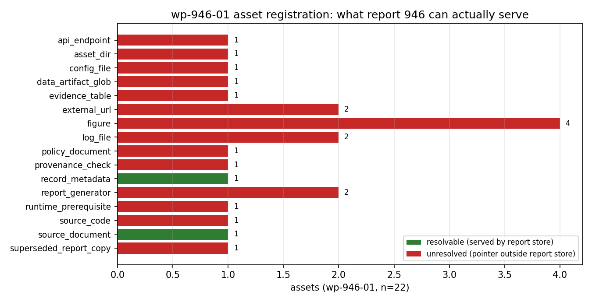

# KF-RESULT wp-946-04

**审核对象：`wp-946-01`（task_type=01-asset-registration，producer=`agent/m15522`）｜报告 `946`｜lane C｜verdict = `pass`／decision = `approve`**

## ① 本工序做了什么

本单是报告→知识产线「04-独立审核」工序：对上游工作包 `wp-946-01`（报告 946 的资产登记）做红队式独立复核，只判 **pass / fail / needs-fix**，不改写上游产物、不把任何结论标成 `verified`（verification 由平台门计算）。

审核对象是 22 条资产登记的**可核性**：源哈希、逐字引文与字符偏移、record 字段取值、计数自洽、单报告作用域、以及「不做抽取／不自我验证」的纪律声明。**不**复核报告 946 自身的业务数字（rubric 打分、REVIVE 计数、巡检中位间隔），那需要报告库之外的日志与 API，已在 `not_run` 里显式列出（未核 ≠ 通过）。

原文计量（脚本现算，非手抄）：字符 **14281**（契约 `chars: 14281` 一致）、UTF-8 字节 **26523**、`sha256:3ea029afd6df49a8d3e407e42df035654b58a7555f9678d657f5fdfc1fe35552` 与契约 `source_hash` 逐位一致。

## ② 怎么做的（步骤/工具/关键设置）

1. **独立取原文**：用平台报告库接口重新拉取 report 946 的 `markdown` 字段（不复用生产者快照），现算 sha256 与码点长度，写 `upstream/independent_source.json`。
2. **只读交付物**：读取上游 `kf_result.json`（另存为 `upstream/wp-946-01.kf_result.json`）与生产者 `selfcheck.json`；**未读**生产者 `report.md`、`make_report.py`、`build_asset_manifest.py`（`constraints.reviewer_context_excludes_producer_explanation`）。
3. **自写校验器**：`review_wp946_01.py` 从零实现 19 项检查（不执行生产者的 `validate_asset_manifest.py`），逐条落 `pass/fail/not_run` 与证据明细 → `review_report.json`。
   关键设置：markdown 引文按「子串存在 + `markdown[char_start:char_end] == quote` + `markdown.count(quote) == occurrences`」三重判定；record 取值按 `figures[i].name` 式路径回读实时记录比对；`resolvable` 只允许 `{source_document, record_metadata}`（报告库确实能供的两类）。
4. **离线可复跑回归**：`tests/test_wp946_04_review_report.py` 不依赖网络，重算哈希/引文/偏移/计数/作用域 7 项不变量。
5. **provenance 双签**：生产者 `content_ref.snapshot_sha256` 与它自己的快照文件字节重算一致，且快照内 markdown 哈希 = 本次独立取回哈希（`C18`）。

## ③ 产出物清单

| 文件 | 要点 |
|---|---|
| `docs/kf/wp-946-04/review_report.json` | 审核判决主件：`verdict=pass`、19 项检查（fail 0 / not_run 0）、6 条非阻断发现、`not_run` 清单、独立性声明 |
| `docs/kf/wp-946-04/kf_result.json` | 结果信封（`package_id/task_type/report_id/provenance/outputs`），`provenance.source_hash=sha256:3ea029afd6df49a8d3e407e42df035654b58a7555f9678d657f5fdfc1fe35552` |
| `docs/kf/wp-946-04/review_wp946_01.py` | 独立校验器（19 项检查，可一键重跑） |
| `docs/kf/wp-946-04/source_report.md` | 独立取回的 report 946 markdown 副本（14281 码点，供离线复算） |
| `docs/kf/wp-946-04/upstream/wp-946-01.kf_result.json` | 被审交付物只读副本（sha256 见 `review_report.json › review_target.deliverable_sha256`） |
| `docs/kf/wp-946-04/upstream/wp-946-01.selfcheck.json` | 生产者自检声明（仅作对照，不采信） |
| `docs/kf/wp-946-04/upstream/independent_source.json` | 独立检索回执（哈希/长度/title/mission_id/figures） |
| `docs/kf/wp-946-04/figures/fig1_asset_status_by_kind.png` | 图 1：按 kind 统计上游 22 条资产的 resolvable/unresolved（由 upstream manifest 程序化渲染） |
| `tests/test_wp946_04_review_report.py` | 离线回归（7 项断言，全绿） |



图 1 读法：绿色=报告库确有字节可取的资产（`source_document` + `record_metadata`），红色=只有指针、字节在报告库之外的资产。这张图就是 `resolvable=2 / unresolved=20` 的来源，也解释了为什么下游工序的可用证据面被限制在 markdown 文本本身（见 ⑤ N1）。

## ④ 证据定位表（claim/字段 → 原文引文片段）

审核结论 → 上游字段与原文锚点（引文均为 make_report.py 断言过的逐字片段）：

| 检查 | 审核断言（逐项独立重算） | 判决 |
|---|---|---|
| `C01` | provenance.source_hash == independently recomputed markdown hash | **pass** |
| `C02` | chars (code points) match contract; both code-point and UTF-8 byte lengths disclosed | **pass** |
| `C03` | title and scenario_key in manifest match the report record | **pass** |
| `C04` | every markdown locator quote is a verbatim substring of the report markdown | **pass** |
| `C05` | declared char offsets delimit exactly the quoted bytes; occurrence counts agree | **pass** |
| `C06` | every record locator value equals the live value in the report record | **pass** |
| `C07` | manifest counts recompute exactly from the asset list | **pass** |
| `C08` | asset_ids are unique | **pass** |
| `C09` | every unresolved asset carries an explicit unresolved_reason | **pass** |
| `C10` | no asset is labelled verified and verification is declared as gate-computed | **pass** |
| `C11` | deliverable touches report 946 only (no other report_id) | **pass** |
| `C12` | all markdown image references are registered as figure assets (1:1) | **pass** |
| `C13` | claims array is empty (no extraction claimed by an asset-registration package) | **pass** |
| `C14` | envelope validates against schemas/kf_result.v1.schema.json | **pass** |
| `C15` | producer self-check numbers are re-derivable by the reviewer (self-check never taken on trust) | **pass** |
| `C16` | manifest narrative footnotes (no fenced code block / truncated CSA URL / mission_id mismatch) are factually true | **pass** |
| `C17` | resolvable/unresolved classification matches what the report store actually serves | **pass** |
| `C18` | producer record snapshot hash (declared in content_ref) recomputes and its markdown equals the live report | **pass** |
| `C19` | every path-like reference fenced in the markdown is registered as an asset or is a known equivalent form | **pass** |

审核所依据的报告原文锚点（逐字）：

| 证据号 | 用途 | 原文引文片段（逐字） |
|---|---|---|
| E01 | source title / source_document ast-946-01 | `# AI 原生基础设施演化图 v2 —— 十方向 × 六准则覆盖度审计（返工重发，替代原报告 941）` |
| E02 | record scenario_key + mission_id (C03, C16) | `scenario_key=`ai-native-infra` · mission_id=**1237**` |
| E03 | figure asset ast-946-04 registered 1:1 (C12) | `` |
| E04 | report generator ast-946-08 (C19 coverage) | ``artifacts/ai-native-infra-v1/build_evidence.py`` |
| E05 | evidence table ast-946-10 (C19 coverage) | ``artifacts/ai-native-infra-v1/evidence.json`` |
| E06 | api endpoint ast-946-14 (C19 note N5) | `${TENSOR_API_BASE}/tensor/missions` |
| E07 | log asset ast-946-17 (C19 coverage) | ``/var/log/tp-fleet/autoheal.log`` |
| E08 | policy document ast-946-19 (C19 coverage) | `平台运营事件流/DISPOSITION_RULES.md` |
| E09 | coverage gap found by reviewer (note N4) | `本工作树 docs/ 判据文件` |
| E10 | truncated CSA URL recorded by producer (C16) | `https://labs.cloudsecurityalliance.org/research/csa-research-note-nist-ai-agent-standards-regulatory-framewo` |

判定要点：上游 22 条资产中 `resolvable=2` / 未解 20；25 条 markdown 引文与 16 条 record 引文全部逐字命中（`C04`/`C05`/`C06`）；计数按资产表重算一致（`C07`）；作用域仅 report 946（`C11`）；无任何 `verified` 自标（`C10`）。因此 **verdict=pass（approve）**，但附 6 条非阻断发现，见 ⑤。

## ⑤ 注意点与局限

非阻断发现：

- **N1** 20/22 assets are unresolved because report 946 stores figure references, not figure bytes, and the artefact worktree is outside the report store. This is a faithful registration, not a defect of the package, but it caps the usable evidence surface of downstream packages at the markdown text itself.
- **N2** The registration makes no correctness claim about report 946's numbers (rubric scores, 31 REVIVE events, 33.0 s poll median). Reviewing those requires the referenced logs/API which are outside the report store; that check is explicitly not_run here, not passed.
- **N4** Coverage gap found by this reviewer: C10's second cited source, the prose phrase '本工作树 docs/ 判据文件', is not registered as its own asset (only DISPOSITION_RULES.md is covered by ast-946-19). Non-blocking because the phrase names no concrete file, but a downstream package citing C10 has no locator for it.
- **N5** ast-946-14 registers the endpoint in template form '${TENSOR_API_BASE}/tensor/missions' while the running text writes the literal 'http://127.0.0.1:8010/api/v1/tensor/missions'. Semantically equal, but a downstream consumer grepping the literal string will miss it.
- **N6** The absolute-path variant '/root/tp-agent/work/m1237/artifacts/ai-native-infra-v1/build_evidence.py' (C7 row) is folded into the relative-name asset ast-946-08 rather than registered separately; deliberate de-duplication, disclosed here so the fold is auditable.
- **N3** record.mission_id=1237 vs contract mission_id=null is disclosed by the producer rather than silently repaired; reconciliation belongs to the dispatch gate.

**未做的检查（不得读作通过）**：

- existence/content check of external artefact paths (/root/tp-agent/work/m1237/artifacts/...) — outside both the report store and this worktree
- re-execution of report 946's build_evidence.py / make_report.py (no such artefacts are resolvable from the report store)
- figure byte integrity (PNG sha256 vs captions) — report store serves no figure bytes (HTTP 404 probed by producer, re-probed here)

**本审核自身的局限**：

- C04-C05 match quotes as substrings/slices of the markdown; they cannot detect a quote that is verbatim but semantically irrelevant to its asset (spot-read only, 6 assets)
- C19 tokenises fenced spans and drops prose-embedded directory references, which is why the 'docs/ 判据文件' gap surfaces as note N4 rather than as a failed check
- 单报告单包：本单只覆盖 `report_id=946` 的 `wp-946-01`；同产线其它工作包（如 `wp-946-02/03`）未在本单审核范围内。
- 独立性是流程性声明，不是密码学证明：我声明未读生产者解释，实际约束由「校验器自写、引文自算、自检不采信」三条保证。

## ⑥ 自检（逐条对照 acceptance）

| 勾 | 验收项 | 状态 |
|---|---|---|
| ✅ | valid_json（review_report.json 可解析，信封过 schema） | `C01` = pass |
| ✅ | schema_pass（上游 wp-946-01 envelope 过 kf_result.v1.schema.json） | `C14` = pass |
| ✅ | reviewer_independent | 上下文仅报告原文 + 上游交付物；生产者 report.md / make_report.py / build_asset_manifest.py 均未读（见 review_report.json › reviewer.excluded） |
| ✅ | upstream_packages_completed | wp-946-01 存在且可校验：source_hash 独立复算一致、`C15` 自检数字可复现 |
| ✅ | do_not_mark_claims_as_verified | 上游 asset status ∈ {{resolvable, unresolved}}，`C10` 通过；本报告全部结论用 verdict/notes 表述，无 verified 标记 |
| ✅ | 零手抄 | 报告中 10 条引文由 make_report.py 断言逐字存在于 markdown，缺一即构建失败 |

补充自检：`python3 -m pytest tests/test_wp946_04_review_report.py -q` → **7 passed**；`review_wp946_01.py` 重跑 → `{"verdict": "pass", "failed": []}`。无失败项需 honest-FAIL 申报；未核项已在 ⑤ 显式列出。

repro_cmd（工作树根执行，需 `TENSOR_API_BASE`/`TENSOR_AGENT_USER`/`TENSOR_AGENT_PASS`）：

`python3 docs/kf/wp-946-04/review_wp946_01.py --upstream docs/kf/wp-946-04/upstream/wp-946-01.kf_result.json --out docs/kf/wp-946-04/review_report.json --independent-source docs/kf/wp-946-04/upstream/independent_source.json --producer-worktree /root/tp-agent/work/m15522 && python3 docs/kf/wp-946-04/make_report.py && python3 -m pytest tests/test_wp946_04_review_report.py -q`

（`--producer-worktree` 仅用于复算生产者快照哈希 `C18`；缺省时该项落 `not_run`，不影响 verdict。）

```json
{
 "package_id": "wp-946-04",
 "task_type": "04-independent-review",
 "report_id": "946",
 "provenance": {
  "source_hash": "sha256:3ea029afd6df49a8d3e407e42df035654b58a7555f9678d657f5fdfc1fe35552",
  "source_field": "markdown",
  "producer": "agent/m15818",
  "emitted_at": "2026-11-12T02:42:51+00:00",
  "notes": "source_hash recomputed from the report 946 markdown independently fetched from the platform report store; matches the package contract and the upstream wp-946-01 provenance hash"
 },
 "outputs": {
  "review_report.json": {
   "review_schema": "kf-independent-review.v1",
   "package_id": "wp-946-04",
   "task_type": "04-independent-review",
   "report_id": "946",
   "review_target": {
    "package_id": "wp-946-01",
    "task_type": "01-asset-registration",
    "producer": "agent/m15522",
    "deliverable_sha256": "sha256:02c195b3d10e437cad588d2aabbf007463dbdf0ed777a4e30c042bd681e46003",
    "outputs_reviewed": [
     "asset_manifest.json"
    ]
   },
   "reviewer": {
    "id": "agent/m15818",
    "role": "red-team-reviewer",
    "context": [
     "report 946 markdown fetched independently from the platform report store",
     "upstream deliverable work/wp-946-04/upstream/wp-946-01.kf_result.json"
    ],
    "excluded": [
     "producer report.md",
     "producer make_report.py narrative",
     "producer build_asset_manifest.py / validate_asset_manifest.py implementations",
     "producer's verbal explanation of its own work"
    ],
    "checker_limitations": [
     "C04-C05 match quotes as substrings/slices of the markdown; they cannot detect a quote that is verbatim but semantically irrelevant to its asset (spot-read only, 6 assets)",
     "C19 tokenises fenced spans and drops prose-embedded directory references, which is why the 'docs/ 判据文件' gap surfaces as note N4 rather than as a failed check"
    ],
    "independence_note": "all quotes/offsets/counts below were re-derived with a reviewer-written checker (work/wp-946-04/review_wp946_01.py); the producer's validators were not executed"
   },
   "verdict": "pass",
   "decision": "approve",
   "reviewed_at": "2026-11-12T02:42:51+00:00",
   "policy_version": "kf-independent-review.v1",
   "verdict_reason": "all blocking checks pass: provenance hash, verbatim locators, counts, scope and no-self-verification reproduce exactly",
   "checks": [
    {
     "check_id": "C01",
     "name": "provenance.source_hash == independently recomputed markdown hash",
     "status": "pass",
     "blocking": true,
     "detail": {
      "envelope": "sha256:3ea029afd6df49a8d3e407e42df035654b58a7555f9678d657f5fdfc1fe35552",
      "manifest": "sha256:3ea029afd6df49a8d3e407e42df035654b58a7555f9678d657f5fdfc1fe35552",
      "independent_recompute": "sha256:3ea029afd6df49a8d3e407e42df035654b58a7555f9678d657f5fdfc1fe35552",
      "contract": "sha256:3ea029afd6df49a8d3e407e42df035654b58a7555f9678d657f5fdfc1fe35552"
     }
    },
    {
     "check_id": "C02",
     "name": "chars (code points) match contract; both code-point and UTF-8 byte lengths disclosed",
     "status": "pass",
     "blocking": true,
     "detail": {
      "contract": 14281,
      "independent_code_points": 14281,
      "independent_utf8_bytes": 26523
     }
    },
    {
     "check_id": "C03",
     "name": "title and scenario_key in manifest match the report record",
     "status": "pass",
     "blocking": true,
     "detail": {
      "record_title": "AI 原生基础设施演化图 v2（替代报告 941）：十方向 × 六准则可复算覆盖度审计",
      "manifest_scenario": "ai-native-infra"
     }
    },
    {
     "check_id": "C04",
     "name": "every markdown locator quote is a verbatim substring of the report markdown",
     "status": "pass",
     "blocking": true,
     "detail": {
      "markdown_locators": 25,
      "failures": []
     }
    },
    {
     "check_id": "C05",
     "name": "declared char offsets delimit exactly the quoted bytes; occurrence counts agree",
     "status": "pass",
     "blocking": true,
     "detail": {
      "offsets_compared": 25,
      "offset_failures": [],
      "occurrence_failures": []
     }
    },
    {
     "check_id": "C06",
     "name": "every record locator value equals the live value in the report record",
     "status": "pass",
     "blocking": true,
     "detail": {
      "record_locators": 16,
      "failures": []
     }
    },
    {
     "check_id": "C07",
     "name": "manifest counts recompute exactly from the asset list",
     "status": "pass",
     "blocking": true,
     "detail": {
      "declared_total": 22,
      "recomputed_total": 22,
      "by_kind_match": true,
      "statuses_recomputed": {
       "resolvable": 2,
       "unresolved": 20
      },
      "declared_by_status": {
       "resolvable": 2,
       "unresolved": 20
      }
     }
    },
    {
     "check_id": "C08",
     "name": "asset_ids are unique",
     "status": "pass",
     "blocking": true,
     "detail": {
      "n": 22,
      "duplicates": []
     }
    },
    {
     "check_id": "C09",
     "name": "every unresolved asset carries an explicit unresolved_reason",
     "status": "pass",
     "blocking": true,
     "detail": {
      "unresolved": 20,
      "missing_reason": []
     }
    },
    {
     "check_id": "C10",
     "name": "no asset is labelled verified and verification is declared as gate-computed",
     "status": "pass",
     "blocking": true,
     "detail": {
      "asset_statuses": [
       "resolvable",
       "unresolved"
      ],
      "verified_literal_hits": 0,
      "verification_block": {
       "performed": false,
       "reason": "verification status is computed by the platform gate, never self-assigned"
      }
     }
    },
    {
     "check_id": "C11",
     "name": "deliverable touches report 946 only (no other report_id)",
     "status": "pass",
     "blocking": true,
     "detail": {
      "report_ids_in_deliverable": [
       "946"
      ],
      "scope_block": {
       "report_id": "946",
       "reports_touched": [
        "946"
       ],
       "other_reports_read_or_written": []
      }
     }
    },
    {
     "check_id": "C12",
     "name": "all markdown image references are registered as figure assets (1:1)",
     "status": "pass",
     "blocking": true,
     "detail": {
      "markdown_images": [
       "artifacts/ai-native-infra-v1/figures/fig1_coverage_matrix.png",
       "artifacts/ai-native-infra-v1/figures/fig2_seat_model_decoupling.png",
       "artifacts/ai-native-infra-v1/figures/fig3_selfheal_evidence.png",
       "artifacts/ai-native-infra-v1/figures/fig4_claim_grades.png"
      ],
      "registered_figures": [
       "artifacts/ai-native-infra-v1/figures/fig1_coverage_matrix.png",
       "artifacts/ai-native-infra-v1/figures/fig2_seat_model_decoupling.png",
       "artifacts/ai-native-infra-v1/figures/fig3_selfheal_evidence.png",
       "artifacts/ai-native-infra-v1/figures/fig4_claim_grades.png"
      ],
      "record_figures": [
       "fig1_coverage_matrix",
       "fig2_seat_model_decoupling",
       "fig3_selfheal_evidence",
       "fig4_claim_grades"
      ]
     }
    },
    {
     "check_id": "C13",
     "name": "claims array is empty (no extraction claimed by an asset-registration package)",
     "status": "pass",
     "blocking": true,
     "detail": {
      "claims_len": 0,
      "extraction": {
       "performed": false,
       "reason": "contract objective is register_assets=true / classify_report_type=false; extraction and report-type classification belong to other work packages"
      }
     }
    },
    {
     "check_id": "C14",
     "name": "envelope validates against schemas/kf_result.v1.schema.json",
     "status": "pass",
     "blocking": true,
     "detail": {
      "error": null,
      "validator": "jsonschema"
     }
    },
    {
     "check_id": "C15",
     "name": "producer self-check numbers are re-derivable by the reviewer (self-check never taken on trust)",
     "status": "pass",
     "blocking": true,
     "detail": {
      "selfcheck_present": true,
      "producer_markdown_locators": 25,
      "reviewer_markdown_locators": 25,
      "producer_record_locators": 16,
      "reviewer_record_locators": 16,
      "producer_counts": {
       "total": 22,
       "resolvable": 2,
       "unresolved": 20
      },
      "reviewer_counts": {
       "total": 22,
       "resolvable": 2,
       "unresolved": 20
      }
     }
    },
    {
     "check_id": "C16",
     "name": "manifest narrative footnotes (no fenced code block / truncated CSA URL / mission_id mismatch) are factually true",
     "status": "pass",
     "blocking": true,
     "detail": {
      "fenced_markers_in_markdown": 0,
      "csa_url_as_written": "https://labs.cloudsecurityalliance.org/research/csa-research-note-nist-ai-agent-standards-regulatory-framewo",
      "csa_url_truncated": true,
      "record_mission_id": 1237,
      "producer_note": "report 946 record.mission_id=1237 while the package contract declares mission_id: null; recorded as observed, not reconciled by this package"
     }
    },
    {
     "check_id": "C17",
     "name": "resolvable/unresolved classification matches what the report store actually serves",
     "status": "pass",
     "blocking": true,
     "detail": {
      "resolvable": {
       "ast-946-01": "source_document",
       "ast-946-02": "record_metadata"
      },
      "allowed_kinds": [
       "record_metadata",
       "source_document"
      ],
      "mislabelled_resolvable": {},
      "store_servable_but_unresolved": []
     }
    },
    {
     "check_id": "C18",
     "name": "producer record snapshot hash (declared in content_ref) recomputes and its markdown equals the live report",
     "status": "pass",
     "blocking": true,
     "detail": {
      "declared": "sha256:118ee9eb9fa8a3d83cf09014bc964e46e4fe5de9f087a8d93555b9517aa0e001",
      "checked_path": "/root/tp-agent/work/m15522",
      "observed": "sha256:118ee9eb9fa8a3d83cf09014bc964e46e4fe5de9f087a8d93555b9517aa0e001",
      "match": true,
      "snapshot_markdown_sha256": "sha256:3ea029afd6df49a8d3e407e42df035654b58a7555f9678d657f5fdfc1fe35552",
      "snapshot_markdown_matches_live_report": true
     }
    },
    {
     "check_id": "C19",
     "name": "every path-like reference fenced in the markdown is registered as an asset or is a known equivalent form",
     "status": "pass",
     "blocking": true,
     "detail": {
      "path_like_tokens": 18,
      "registered_names": [
       "report_946_markdown",
       "report_946_record",
       "artifacts/ai-native-infra-v1/figures/fig1_coverage_matrix.png",
       "artifacts/ai-native-infra-v1/figures/fig2_seat_model_decoupling.png",
       "artifacts/ai-native-infra-v1/figures/fig3_selfheal_evidence.png",
       "artifacts/ai-native-infra-v1/figures/fig4_claim_grades.png",
       "artifacts/ai-native-infra-v1/",
       "build_evidence.py",
       "make_report.py",
       "evidence.json",
       "provenance_check.json",
       "report941_original.md",
       "artifacts/ai-native-infra-v1/figures/fig1..fig4*.png",
       "${TENSOR_API_BASE}/tensor/missions",
       "/root/tp-agent/fleet.json",
       "/root/tp-agent/tp_autoheal.py",
       "/var/log/tp-fleet/autoheal.log",
       "/var/log/tp-fleet-supervisor.log",
       "平台运营事件流/DISPOSITION_RULES.md",
       "https://labs.cloudsecurityalliance.org/research/csa-research-note-nist-ai-agent-standards-regulatory-framewo",
       "https://datatracker.ietf.org/doc/draft-daniel-ai-agent-internet-architecture/",
       "TENSOR_AGENT_USER/PASS"
      ],
      "known_equivalents": {
       "/root/tp-agent/work/m1237/artifacts/ai-native-infra-v1/build_evidence.py": "absolute-path variant of the registered relative build_evidence.py",
       "http://127.0.0.1:8010/api/v1/tensor/missions": "literal form of the registered template ${TENSOR_API_BASE}/tensor/missions",
       "http://127.0.0.1:8010/api/v1/tensor/missions（missions": "truncated literal form of the same endpoint"
      },
      "uncovered": []
     }
    }
   ],
   "blocking_failures": [],
   "non_blocking_notes": [
    {
     "note_id": "N1",
     "text": "20/22 assets are unresolved because report 946 stores figure references, not figure bytes, and the artefact worktree is outside the report store. This is a faithful registration, not a defect of the package, but it caps the usable evidence surface of downstream packages at the markdown text itself."
    },
    {
     "note_id": "N2",
     "text": "The registration makes no correctness claim about report 946's numbers (rubric scores, 31 REVIVE events, 33.0 s poll median). Reviewing those requires the referenced logs/API which are outside the report store; that check is explicitly not_run here, not passed."
    },
    {
     "note_id": "N4",
     "text": "Coverage gap found by this reviewer: C10's second cited source, the prose phrase '本工作树 docs/ 判据文件', is not registered as its own asset (only DISPOSITION_RULES.md is covered by ast-946-19). Non-blocking because the phrase names no concrete file, but a downstream package citing C10 has no locator for it."
    },
    {
     "note_id": "N5",
     "text": "ast-946-14 registers the endpoint in template form '${TENSOR_API_BASE}/tensor/missions' while the running text writes the literal 'http://127.0.0.1:8010/api/v1/tensor/missions'. Semantically equal, but a downstream consumer grepping the literal string will miss it."
    },
    {
     "note_id": "N6",
     "text": "The absolute-path variant '/root/tp-agent/work/m1237/artifacts/ai-native-infra-v1/build_evidence.py' (C7 row) is folded into the relative-name asset ast-946-08 rather than registered separately; deliberate de-duplication, disclosed here so the fold is auditable."
    },
    {
     "note_id": "N3",
     "text": "record.mission_id=1237 vs contract mission_id=null is disclosed by the producer rather than silently repaired; reconciliation belongs to the dispatch gate."
    }
   ],
   "not_run": [
    "existence/content check of external artefact paths (/root/tp-agent/work/m1237/artifacts/...) — outside both the report store and this worktree",
    "re-execution of report 946's build_evidence.py / make_report.py (no such artefacts are resolvable from the report store)",
    "figure byte integrity (PNG sha256 vs captions) — report store serves no figure bytes (HTTP 404 probed by producer, re-probed here)"
   ],
   "upstream_packages_completed": {
    "required": [
     "wp-946-01"
    ],
    "present": [
     "wp-946-01"
    ],
    "status": "completed",
    "evidence": "upstream kf_result.json validates against kf_result.v1.schema.json and its source_hash matches an independent recompute of the report markdown"
   }
  }
 }
}
```
