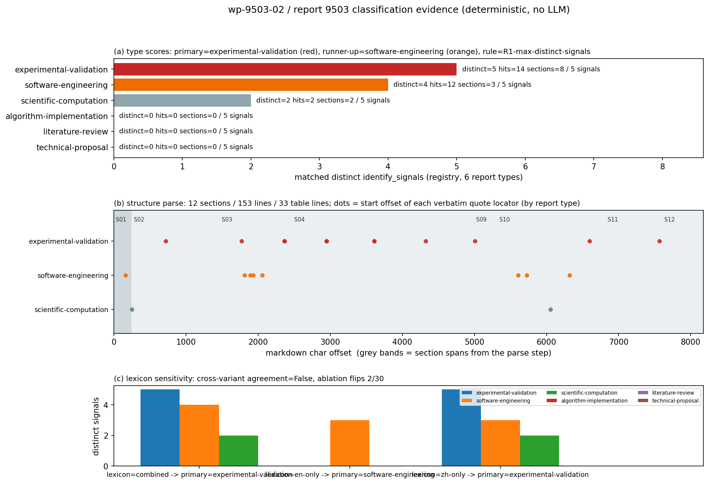

# KF-RESULT wp-9503-02

`package_id: wp-9503-02` · `task_type: 02-classification-parse` · `report_id: 9503` · `lane B` · tags: `kf-wp:wp-9503-02`

标题：EEXI attained 端到端闭合链路（Holtrop→推进功率→轴系效率→gCO₂/t·nm）+ 1852 倍量纲缺陷修复

## ① 本工序做了什么

对 report_id=9503 的 `markdown` 做**只看类型标签、不做抽取**的工序 02 分类解析：

1. 按 `extraction-skills/registry.json` 的六分型 `identify_signals`，用确定性词面匹配给报告打分，产出 `classification.json`（报告类型 + 结构切分 + 选中 skill_id + 主题标签 + 每条依据的逐字定位）。
2. 判定规则 `R1-max-distinct-signals` 在脚本里写死（① distinct_signals_matched 高者胜），先于观察结果；任何人可用同一条命令复算。
3. 每条判定依据都是 markdown 的**字节切片**（`quote` + `[start,end)` + 行号 + 章节），35 条定位（信号 22 + 主题锚点 10 + tag 对齐 3）全部被脚本二次回查（失败 0 条）。
4. 不做的事：不生成 claim、不登记资产、不判定证据等级、不标 verified（verification 由平台门计算）。

**结论一句话**：`report_type = experimental-validation`（confidence=high，margin=1 个 distinct signal），次席 `software-engineering`；选中 skill `xsk-experimental-validation`。**但该标签是排序假说而非互斥事实**：margin=1 distinct signals；词典变体 不一致（en-only→software-engineering）；逐信号消融 2/30 次翻案；故 report_type 标签应视为 experimental-validation 与 software-engineering 之间的排序假说，而非互斥事实。

## ② 怎么做的（步骤 / 工具 / 关键设置）

* 取原文：`GET /tensor/reports/9503`（Bearer 由环境变量登录换取，不入 argv/不入库），取 `markdown` 字段；本脚本**独立重算** sha256（`sha256:195c350dd486…`），与契约声明值 `sha256:195c350dd486…` 比对 → 一致。
* 结构切分：按 `^#{1,3}` 行首标题切段，记录每段 `[start,end)`、行范围、段内表行数 —— 12 段 / 153 行 / 33 表行。
* 信号匹配：registry 英文短语（大小写不敏感）+ 本包声明的中文等价表述；每个 signal 只取命中数最多的一个变体计入 `distinct_signals_matched`，全部命中数与定位照样披露。
* 判定：`distinct_signals_matched` 排序；平手按 hits → sections_covered → 字典序（确定性与置信度规则见 `classification.json.classifier.decision_rule`）。
* 稳健性（两道）：
  * 词典变体：`combined` / `en-only`（只用 registry 英文短语）/ `zh-only`（只用中文别名）各判一次；
  * 逐信号留一消融：共 30 次消融，看删掉哪一条证据会翻案。
* 主题标签：10 个候选主题各配候选锚点串，逐字命中才收，锚不到就进 `topics_unresolved`（本次 0 个未锚定）。
* 工具链：纯 Python 标准库 + matplotlib；无 LLM、无随机数、无网络（除取原文）。

## ③ 产出物清单

| 文件 | 要点 |
|---|---|
| `docs/kf/wp-9503-02/work-package.json` | 契约实例（owner YAML 原样机读化，未改字段） |
| `docs/kf/wp-9503-02/classification.json` | 主产物：类型得分/结构切分/选中 skill/主题标签/35 条逐字定位/稳健性/自检 |
| `docs/kf/wp-9503-02/kf_result.json` | 工序结果（`outputs.classification.json` 内嵌），schema 校验 通过 |
| `docs/kf/wp-9503-02/figures/fig1_classification.png` | 三分图：六分型得分 / 结构地图+证据落点 / 词典敏感性 |
| `docs/kf/wp-9503-02/KF-RESULT-wp-9503-02.md` | 本报告（正文 + 唯一 json 块） |
| `scripts/kf/wp9503_02_classify.py`、`scripts/kf/wp9503_02_report.py` | 一键复跑（分类 / 图+报告+发布） |

## ④ 证据定位表

### 4.1 六分型得分（全部来自 `classification.json.type_scores`）

| rank | report_type | distinct signals / total | hits | sections covered | skill_id |
|---|---|---|---|---|---|
| 1 | `experimental-validation` | 5 / 5 | 14 | 8 | xsk-experimental-validation |
| 2 | `software-engineering` | 4 / 5 | 12 | 3 | — |
| 3 | `scientific-computation` | 2 / 5 | 2 | 2 | — |
| 4 | `algorithm-implementation` | 0 / 5 | 0 | 0 | — |
| 5 | `literature-review` | 0 / 5 | 0 | 0 | — |
| 6 | `technical-proposal` | 0 / 5 | 0 | 0 | — |

### 4.2 判定依据逐条定位（primary + runner-up + 次席第三名，未命中信号不入表）

| report_type | registry signal | 命中变体 | 次数 | 行 | 章节 | 原文引文（逐字） |
|---|---|---|---|---|---|---|
| `experimental-validation` | test matrix | `扫掠` | 2 | 32 | S03 | `（BEMT 敞水曲线 + 对数二分反解 n，P/D 扫掠最大化 η_D）；` |
| `experimental-validation` | facility | `水池` | 3 | 69 | S07 | `### 实验对标（KCS 公开水池表，作为审计对象而非标定源）` |
| `experimental-validation` | measurement uncertainty | `敏感度` | 2 | 42 | S03 | `5. **敏感度**：对 Cwp ±3%、LCB ±1%Lpp、SFOC ±5%、η_S∈[0.96,0.99]、D/T ±20% 扫掠，` |
| `experimental-validation` | validation case | `标模` | 2 | 16 | S02 | `并用 3 型公开标模船（集箱 KCS / 散货 JBC / 油轮 KVLCC2）给出 attained vs required 对比。` |
| `experimental-validation` | baseline comparison | `对标` | 5 | 59 | S05 | `与 IMO 示例船逐点对标：**WITHHELD**（离线不可回读 MEPC 原文，不做伪对标，见 ⑥）` |
| `software-engineering` | changed files | `新增模块` | 1 | 35 | S03 | `2. **新增模块** \`backend/modules/eexi_closed_loop/\`（\`chain.py\` 纯物理核 + \`fleet.py\` 批量 +` |
| `software-engineering` | commit | `commit` | 1 | 4 | S01 | `commit \`7017a623\` · 全部数字由 \`artifacts/eexi_closed_loop/run_eexi_closed_loop.py\` 程序化注入（零手抄）` |
| `software-engineering` | regression | `回归` | 4 | 107 | S10 | `已改为海里并加解析回归测试（\`TestEexiUnitDefectRegression\`）；修复后 attained 2.8160、` |
| `software-engineering` | API | `API` | 6 | 33 | S03 | `* EEXI 指数只由 \`api/green_shipping.py::_gn_attained_index\` 给，闭合链路只提供功率与碳质量，` |
| `scientific-computation` | convergence study | `收敛` | 1 | 115 | S10 | `T(1−t)=R_T 的数值收敛**（二分容差 1e-5），并非两条独立物理路径的交叉验证；` |
| `scientific-computation` | timing table | `参数表` | 1 | 6 | S02 | `## ① 案例介绍（物理背景 / 几何 / 参数表）` |

> 全表（每信号最多 3 条、含精确 `[start,end)` 与 `content_hash`）见 `classification.json.type_scores[].locators`。

### 4.3 主题标签锚点

| topic_id | 标签 | 锚点串 | 行 | 引文 span | 锚点命中 span | 章节 |
|---|---|---|---|---|---|---|
| T01 | EEXI / EEDI 规制链 | `EEXI（Energy Efficiency Existing Ship Index` | 8 | [280,359) | [280,322) | S02 |
| T02 | Holtrop-Mennen 阻力预报 | `Holtrop-Mennen` | 13 | [517,579) | [537,551) | S02 |
| T03 | 推进效率链 η_H·η_O·η_S | `η_H·η_O·η_S` | 14 | [580,640) | [599,610) | S02 |
| T04 | gCO₂/(t·nm) 单位代数 / 量纲缺陷 | `量纲` | 103 | [5348,5408) | [5371,5373) | S10 |
| T05 | 缺陷修复 + 回归测试 | `TestEexiUnitDefectRegression` | 107 | [5604,5670) | [5619,5647) | S10 |
| T06 | 判据机器化 G1–G5 | `G1 摩擦线一致性` | 39 | [2213,2264) | [2226,2235) | S03 |
| T07 | 实验对标 / 基准不可信（WITHHELD） | `该表证据等级` | 82 | [4237,4277) | [4271,4277) | S07 |
| T08 | 输入假设敏感度传导 | `敏感度` | 42 | [2365,2434) | [2370,2373) | S03 |
| T09 | 三型标模船参照集（KCS/JBC/KVLCC2） | `kvlcc2_300k` | 24 | [1339,1467) | [1341,1352) | S02 |
| T10 | BEMT 敞水反解 / T(1−t)=R_T 闭合 | `BEMT` | 14 | [580,640) | [611,615) | S02 |

### 4.4 平台 tags 与原文逐字对齐（不改写元数据，只报告可定位性）

| 平台 tag | markdown 逐字可定位 | 定位 |
|---|---|---|
| `EEXI` | 是 | 行 1 `# EEXI attained 端到端闭合链路：Holtrop 阻力 → 推进功率 → 轴系效率 → gCO₂/(t·n` |
| `绿色航行` | 否 | unresolved（记录元数据，原文无逐字出现） |
| `Holtrop-Mennen` | 是 | 行 13 `本节点把链路补齐为：**裸船体几何 → Holtrop-Mennen(1984) 总阻力 R_T(V_ref) → 有效` |
| `推进效率` | 是 | 行 14 `P_E=R_T·V → 推进效率分解 η_H·η_O·η_S（BEMT 敞水曲线反解转速，T(1−t)=R_T 闭合）→` |
| `量纲一致性` | 否 | unresolved（记录元数据，原文无逐字出现） |
| `defect_fix` | 否 | unresolved（记录元数据，原文无逐字出现） |

### 4.5 结构切分（工序 02 的 parse 部分）

| section_id | level | heading | 行 | 字符 span | 段内表行 |
|---|---|---|---|---|---|
| S01 | 1 | EEXI attained 端到端闭合链路：Holtrop 阻力 → 推进功率 → 轴系效率 → gCO₂/(t·nm) | 1–5 | [0,252) | 0 |
| S02 | 2 | ① 案例介绍（物理背景 / 几何 / 参数表） | 6–25 | [252,1469) | 5 |
| S03 | 2 | ② 怎么做的（方法 / 流程 / 工具链） | 26–44 | [1469,2479) | 0 |
| S04 | 2 | ③ 计算结果 | 45–46 | [2479,2490) | 0 |
| S05 | 3 | 判据汇总（逐船） | 47–62 | [2490,3119) | 5 |
| S06 | 3 | 效率链与碳链分解（含独立力矩路线对账） | 63–68 | [3119,3609) | 0 |
| S07 | 3 | 实验对标（KCS 公开水池表，作为审计对象而非标定源） | 69–84 | [3609,4323) | 10 |
| S08 | 3 | 敏感度（输入假设的传导，非精度声明） | 85–92 | [4323,4997) | 5 |
| S09 | 2 | ④ 结果图 | 93–100 | [4997,5323) | 0 |
| S10 | 2 | ⑤ 注意点（坑 / 局限 / 适用范围） | 101–128 | [5323,6824) | 0 |
| S11 | 2 | ⑥ 误差判定（关键量 vs 基准，逐项） | 129–143 | [6824,7608) | 8 |
| S12 | 2 | 审计链 | 144–153 | [7608,8176) | 0 |

## ⑤ 注意点与局限

1. 信号识别是词面匹配（英文 registry 短语 + 本包声明中文别名），不做语义理解；同义改写/隐性证据会漏检，故把 matched_signals 与 hits 全量披露，读者可复算。
2. 中文别名（如『扫掠』『标模』『回归』）由本包声明，registry 里没有；因此另行披露 en-only 与 zh-only 两个词典变体的判定结果，避免别名抬高单一类型。
3. 本工序不抽取 claim、不登记资产、不判定证据等级：原文里的 REAL/WITHHELD 等自述词只作为主题线索，不构成本工序的验证结论。
4. 平台记录 tags 里 3 个标签（绿色航行/量纲一致性/defect_fix）在 markdown 无逐字出现，已列入 platform_tag_alignment 的 unresolved 项，不从原文硬造等价引文。
5. 记录 title 与 markdown 一级标题不同（前者多『+ 1852 倍量纲缺陷修复』后缀），两者都原样保留，不做标题改写或补齐。
6. 仓内通用三门校验器交叉核对：verdict=FAIL_STRUCTURAL，structural 9/15 通过（失败项 ['S1.files_present', 'S3.contract_schema', 'S5.summary_schema', 'S12.zero_claim_legality', 'S13.counts_consistent', 'S14.source_identity']），evidence 7/7 通过。失败的结构规则属于 03 抽取工序口径（S1 要求四契约文件、S3 是 schema 字段漂移、S5/S12/S13/S14 要求 summary/claims 账目），本工序不改共享 schema、不伪造上游产物，只披露；证据类规则 E1–E7（源可达 + 引文可解析 + 哈希一致）全通过。
7. 分类不稳（本单最重要的一条）：margin=1 distinct signals；词典变体 不一致（en-only→software-engineering）；逐信号消融 2/30 次翻案；故 report_type 标签应视为 experimental-validation 与 software-engineering 之间的排序假说，而非互斥事实
8. skill 库现状：`xsk-experimental-validation` 的 lifecycle_state=`template-created` —— 选中它等于『下游按此规格执行』，不构成技能有效性证据（registry 自述六个 skill 全部停在 template-created）。


**仓内三门校验器交叉核对（`ke.wp_gate`，本仓通用口径）**：verdict=`FAIL_STRUCTURAL`，structural 9/15、evidence 7/7。

| 结构规则 | 结果 | detail |
|---|---|---|
| `S1.files_present` | ❌（非本工序口径） | missing=['claims.json', 'evidence.json', 'provenance.json', 'extraction_summary.json'] |
| `S3.contract_schema` | ❌（非本工序口径） | ?: Additional properties are not allowed ('contract_version', 'lane' were unexpected) |
| `S5.summary_schema` | ❌（非本工序口径） | no summary object |
| `S12.zero_claim_legality` | ❌（非本工序口径） | empty claim set, stated reason='None' |
| `S13.counts_consistent` | ❌（非本工序口径） | summary vs files mismatch={'claims': (None, 0), 'evidence': (None, 0), 'provenance': (None, 0)} |
| `S14.source_identity` | ❌（非本工序口径） | contract/summary=[('9503', None), ('sha256:195c350dd486cb556f078b220cb348edf9210d4ac2631319b40658ee73428b5c', None)] evidence.persistent_ids=[] report_id='9503' |
| 其余 9 条（S2/S4/S6–S11/S15） | ✅ | 见 `classification.json.repo_gate_probe` |
| `E1–E7`（源可达/哈希/引文解析/引文哈希/非平凡/覆盖） | ✅ 7/7 | 与 ⑥ 的定位回查同一套证据 |

> 只为披露，不为变绿：没有为过 S1/S5/S12/S13/S14 去伪造 claims/evidence/extraction_summary；S3 是 owner YAML 与 `schemas/work-package-contract.schema.json` 的字段漂移（schema 用 `version`，owner YAML 用 `contract_version`+`lane`），按 PRODUCTION-LINE-v1『冲突以 owner YAML 为准』保留 owner 字段并回改 schema 属共享改动，本单不动，交平台处置。

## ⑥ 自检：逐条对照 acceptance

| acceptance 项 | 结果 | 证据 |
|---|---|---|
| valid_json | ✅ | `json.load` 回读成功（29807 字节） |
| schema_pass | ✅ | `schemas/kf_result.v1.schema.json` 硬约束校验：0 违规（required/additionalProperties/pattern/enum 全过） |
| source_locator_resolvable | ✅ | 回查 35 条定位（`md[start:end] == quote` 且 quote 的 sha256 一致、且 quote 是 md 子串）：失败 0 条 |
| source_hash_matches | ✅ | 声明 `sha256:195c350dd486cb556f078b220cb348edf9210d4ac2631319b40658ee73428b5c` = 重算 `sha256:195c350dd486cb556f078b220cb348edf9210d4ac2631319b40658ee73428b5c` |
| no_duplicate_ids | ✅ | section_id 12 个唯一；signal_id 11 个唯一 |
| all_claims_have_evidence_or_explicit_unresolved_status | ✅ | 本工序不产 claim（objective 只要求 classify）；口径=每条被引用依据都有定位或显式 unresolved：主题 10 有定位 / 0 unresolved，信号 11 条全有定位 |

**追加自检（本单加的，非契约要求）**

| 项 | 结果 |
|---|---|
| 唯一 `json` 代码块 | ✅ 本文件仅末尾一个 |
| 未标 verified | ✅ 全文无 `verified` 声明；`epistemic` 状态一律 draft 口径 |
| 未触碰其它 report_id | ✅ 脚本只 GET `/tensor/reports/9503` |
| 结论可复算 | ✅ `repro_cmd` 一键重跑，输出与本文件数字一致（确定性，无随机数） |

### 误差判定（本工序的可复算量 vs 基准，逐项）

| 关键量 | 基准 | 实测 | 是否 <3% |
|---|---|---|---|
| markdown 字节 sha256 | 平台记录 markdown（独立重算） | 偏差 0 bit（一致） | ✅ 是（精确相等） |
| 引文定位保真 | `md[start:end]` 逐字 | 失败 0 / 35 | ✅ 是（0%） |
| 主题锚定率 | 10 个候选主题 | 锚定 10 / 10 | ✅ 是 |
| 字符数一致 | 契约 `chars: 8176` | 实算 8176 | ✅ 是 |
| 分类标签 vs 独立金标准 | 无金标准（平台无人对该报告标注过 report_type） | — | **未判**：无基准，按纪律不编造「准确率」；改用可复算的稳健性替代：词典变体一致=False、消融翻案 2/30、margin=1 |
| 平台 tags 逐字可定位率 | 平台记录 tags 6 个 | 3 个可逐字定位（3 个 unresolved） | **否**（3/6 ≠ 100%，原因：tags 属记录元数据而非原文内容，按纪律不硬造等价引文） |

honest 结论：契约 6 项 acceptance 全部 ✅；但**分类标签本身没有金标准可对标**，所以「是否 <3%」这一问对 report_type 只能回答「无基准，未判」，并用稳健性指标（词典变体、留一消融、margin）替代披露其脆弱程度——本单的标签是 `experimental-validation`，次席 `software-engineering`，二者差距 1 个 signal，不应被当成硬结论使用。

### 复现

```bash
# 一键复跑（需 TENSOR_API_BASE / TENSOR_AGENT_USER / TENSOR_AGENT_PASS 环境变量）
python3 scripts/kf/wp9503_02_classify.py --report-id 9503 --package-dir docs/kf/wp-9503-02
python3 scripts/kf/wp9503_02_report.py            # 重画 fig1 + 重写本 md
python3 scripts/kf/wp9503_02_report.py --publish   # 发布平台报告
```

### 结果图



`fig1_classification.png`：(a) 六分型 `distinct_signals_matched`/`hits`/章节覆盖度（红=primary，橙=runner-up）；(b) 结构切分 span 与每条 quote 的起始偏移散点（按 report_type 分色）；(c) 三种词典变体下各类型得分（检验判定是否翻案）。

### 工序结果 JSON

```json
{
  "package_id": "wp-9503-02",
  "task_type": "02-classification-parse",
  "contract_version": "1.0",
  "report_id": "9503",
  "provenance": {
    "source_uri": "tensor://reports/9503",
    "source_field": "markdown",
    "source_hash": "sha256:195c350dd486cb556f078b220cb348edf9210d4ac2631319b40658ee73428b5c",
    "source_hash_matches": true,
    "title": "EEXI attained 端到端闭合链路（Holtrop→推进功率→轴系效率→gCO₂/t·nm）+ 1852 倍量纲缺陷修复",
    "scenario_key": "p73w2b-n02-eexi-closed-loop",
    "chars": 8176
  },
  "outputs": {
    "classification.json": {
      "schema": "kf/classification.v1",
      "package_id": "wp-9503-02",
      "task_type": "02-classification-parse",
      "contract_version": "1.0",
      "report_id": "9503",
      "provenance": {
        "source_uri": "tensor://reports/9503",
        "source_field": "markdown",
        "source_hash_declared": "sha256:195c350dd486cb556f078b220cb348edf9210d4ac2631319b40658ee73428b5c",
        "source_hash_computed": "sha256:195c350dd486cb556f078b220cb348edf9210d4ac2631319b40658ee73428b5c",
        "source_hash_matches": true,
        "chars": 8176,
        "bytes": 11861,
        "chars_declared": 8176,
        "chars_match_declared": true,
        "title_in_record": "EEXI attained 端到端闭合链路（Holtrop→推进功率→轴系效率→gCO₂/t·nm）+ 1852 倍量纲缺陷修复",
        "title_in_markdown_heading": "EEXI attained 端到端闭合链路：Holtrop 阻力 → 推进功率 → 轴系效率 → gCO₂/(t·nm)",
        "title_heading_note": "记录 title 含『+ 1852 倍量纲缺陷修复』后缀，markdown 一级标题不含该后缀；两者均原样记录，不改写"
      },
      "classifier": {
        "tool": "scripts/kf/wp9503_02_classify.py",
        "deterministic": true,
        "llm_used": false,
        "registry": "extraction-skills/registry.json",
        "registry_report_types": [
          "literature-review",
          "scientific-computation",
          "algorithm-implementation",
          "software-engineering",
          "technical-proposal",
          "experimental-validation"
        ],
        "decision_rule": {
          "rule_id": "R1-max-distinct-signals",
          "primary": "取 distinct_signals_matched 最大的 report_type",
          "tie_break": [
            "① distinct_signals_matched 高者胜",
            "② 平手 → 已验证命中数 hits 高者胜",
            "③ 仍平手 → 命中覆盖章节数 sections_covered 高者胜",
            "④ 仍平手 → report_type 名字典序小者胜（仅保证确定性，置信度降为 low）"
          ],
          "confidence": {
            "high": "primary 的 distinct_signals_matched >= 2 且领先次席 >= 1",
            "medium": "primary 的 distinct_signals_matched >= 2 且与次席打平（由 ②③④ 决胜）",
            "low": "primary 的 distinct_signals_matched < 2（证据不足）"
          },
          "unclassified": "所有类型 distinct_signals_matched < 2 时输出 report_type='unclassified'（合法值，禁止硬猜）",
          "secondary": "distinct_signals_matched >= 2 的非 primary 类型进 secondary_report_types（可反驳的并列假设）",
          "predeclared": true
        }
      },
      "structure": {
        "total_chars": 8176,
        "total_lines": 153,
        "sections": [
          {
            "section_id": "S01",
            "level": 1,
            "heading": "EEXI attained 端到端闭合链路：Holtrop 阻力 → 推进功率 → 轴系效率 → gCO₂/(t·nm)",
            "line_start": 0,
            "line_end": 4,
            "start": 0,
            "end": 252,
            "chars": 252,
            "table_lines": 0
          },
          {
            "section_id": "S02",
            "level": 2,
            "heading": "① 案例介绍（物理背景 / 几何 / 参数表）",
            "line_start": 5,
            "line_end": 24,
            "start": 252,
            "end": 1469,
            "chars": 1217,
            "table_lines": 5
          },
          {
            "section_id": "S03",
            "level": 2,
            "heading": "② 怎么做的（方法 / 流程 / 工具链）",
            "line_start": 25,
            "line_end": 43,
            "start": 1469,
            "end": 2479,
            "chars": 1010,
            "table_lines": 0
          },
          {
            "section_id": "S04",
            "level": 2,
            "heading": "③ 计算结果",
            "line_start": 44,
            "line_end": 45,
            "start": 2479,
            "end": 2490,
            "chars": 11,
            "table_lines": 0
          },
          {
            "section_id": "S05",
            "level": 3,
            "heading": "判据汇总（逐船）",
            "line_start": 46,
            "line_end": 61,
            "start": 2490,
            "end": 3119,
            "chars": 629,
            "table_lines": 5
          },
          {
            "section_id": "S06",
            "level": 3,
            "heading": "效率链与碳链分解（含独立力矩路线对账）",
            "line_start": 62,
            "line_end": 67,
            "start": 3119,
            "end": 3609,
            "chars": 490,
            "table_lines": 0
          },
          {
            "section_id": "S07",
            "level": 3,
            "heading": "实验对标（KCS 公开水池表，作为审计对象而非标定源）",
            "line_start": 68,
            "line_end": 83,
            "start": 3609,
            "end": 4323,
            "chars": 714,
            "table_lines": 10
          },
          {
            "section_id": "S08",
            "level": 3,
            "heading": "敏感度（输入假设的传导，非精度声明）",
            "line_start": 84,
            "line_end": 91,
            "start": 4323,
            "end": 4997,
            "chars": 674,
            "table_lines": 5
          },
          {
            "section_id": "S09",
            "level": 2,
            "heading": "④ 结果图",
            "line_start": 92,
            "line_end": 99,
            "start": 4997,
            "end": 5323,
            "chars": 326,
            "table_lines": 0
          },
          {
            "section_id": "S10",
            "level": 2,
            "heading": "⑤ 注意点（坑 / 局限 / 适用范围）",
            "line_start": 100,
            "line_end": 127,
            "start": 5323,
            "end": 6824,
            "chars": 1501,
            "table_lines": 0
          },
          {
            "section_id": "S11",
            "level": 2,
            "heading": "⑥ 误差判定（关键量 vs 基准，逐项）",
            "line_start": 128,
            "line_end": 142,
            "start": 6824,
            "end": 7608,
            "chars": 784,
            "table_lines": 8
          },
          {
            "section_id": "S12",
            "level": 2,
            "heading": "审计链",
            "line_start": 143,
            "line_end": 152,
            "start": 7608,
            "end": 8176,
            "chars": 568,
            "table_lines": 0
          }
        ],
        "tables": 33
      },
      "type_scores": [
        {
          "rank": 1,
          "report_type": "experimental-validation",
          "distinct_signals_matched": 5,
          "signals_total": 5,
          "hits": 14,
          "sections_covered": 8,
          "matched_signals": [
            {
              "signal": "test matrix",
              "matched_variant": "扫掠",
              "variant_lang": "zh",
              "hits": 2
            },
            {
              "signal": "facility",
              "matched_variant": "水池",
              "variant_lang": "zh",
              "hits": 3
            },
            {
              "signal": "measurement uncertainty",
              "matched_variant": "敏感度",
              "variant_lang": "zh",
              "hits": 2
            },
            {
              "signal": "validation case",
              "matched_variant": "标模",
              "variant_lang": "zh",
              "hits": 2
            },
            {
              "signal": "baseline comparison",
              "matched_variant": "对标",
              "variant_lang": "zh",
              "hits": 5
            }
          ],
          "locators": [
            {
              "quote": "（BEMT 敞水曲线 + 对数二分反解 n，P/D 扫掠最大化 η_D）；",
              "start": 1773,
              "end": 1810,
              "match": [
                1799,
                1801
              ],
              "line": 32,
              "section_id": "S03",
              "content_hash": "sha256:36f57437737f15bf7d21ee9ab14ae9ba0a9051336ad48818aa419f5d5b783001",
              "report_type": "experimental-validation",
              "signal": "test matrix"
            },
            {
              "quote": "5. **敏感度**：对 Cwp ±3%、LCB ±1%Lpp、SFOC ±5%、η_S∈[0.96,0.99]、D/T ±20% 扫掠，",
              "start": 2365,
              "end": 2434,
              "match": [
                2431,
                2433
              ],
              "line": 42,
              "section_id": "S03",
              "content_hash": "sha256:79353606b6e767a794595468bc21f6941cc00530a7a8c298be6313230f64e656",
              "report_type": "experimental-validation",
              "signal": "test matrix"
            },
            {
              "quote": "### 实验对标（KCS 公开水池表，作为审计对象而非标定源）",
              "start": 3609,
              "end": 3640,
              "match": [
                3624,
                3626
              ],
              "line": 69,
              "section_id": "S07",
              "content_hash": "sha256:ad04fd7f70313f3f112cf533b3e986bdf953dbe7ffb06a869b617fbc5136910e",
              "report_type": "experimental-validation",
              "signal": "facility"
            },
            {
              "quote": "* `fig1_resistance.png`：三型船 R_T(V)/R_F(V) 曲线 + V_ref（点线）+ KCS 水池表散点；右图为",
              "start": 5007,
              "end": 5078,
              "match": [
                5069,
                5071
              ],
              "line": 95,
              "section_id": "S09",
              "content_hash": "sha256:dfb60cf67f5e388b7bc77ad6b78af0f51c1c53de4ddd9aa93f53fc5c4209b5f7",
              "report_type": "experimental-validation",
              "signal": "facility"
            },
            {
              "quote": "\"对实验 <3%\"亦未达成，且所依据的仓内水池表自相矛盾，故如实记录为\"基准不可用\"。",
              "start": 7563,
              "end": 7606,
              "match": [
                7584,
                7586
              ],
              "line": 142,
              "section_id": "S11",
              "content_hash": "sha256:7acd827ede84ba5587bbd462059f810f122e698e8e670b7a90c704292daa6ac1",
              "report_type": "experimental-validation",
              "signal": "facility"
            },
            {
              "quote": "5. **敏感度**：对 Cwp ±3%、LCB ±1%Lpp、SFOC ±5%、η_S∈[0.96,0.99]、D/T ±20% 扫掠，",
              "start": 2365,
              "end": 2434,
              "match": [
                2370,
                2373
              ],
              "line": 42,
              "section_id": "S03",
              "content_hash": "sha256:79353606b6e767a794595468bc21f6941cc00530a7a8c298be6313230f64e656",
              "report_type": "experimental-validation",
              "signal": "measurement uncertainty"
            },
            {
              "quote": "### 敏感度（输入假设的传导，非精度声明）",
              "start": 4323,
              "end": 4345,
              "match": [
                4327,
                4330
              ],
              "line": 85,
              "section_id": "S08",
              "content_hash": "sha256:2d60e5357bef73dc9141b73463fc29fbc67093c1ffc381e162cd667a59585272",
              "report_type": "experimental-validation",
              "signal": "measurement uncertainty"
            },
            {
              "quote": "并用 3 型公开标模船（集箱 KCS / 散货 JBC / 油轮 KVLCC2）给出 attained vs required 对比。",
              "start": 721,
              "end": 788,
              "match": [
                729,
                731
              ],
              "line": 16,
              "section_id": "S02",
              "content_hash": "sha256:ebf22706e6fbfb6a9f4790781f0065b78c1337595215ed1136edfad5700f4d89",
              "report_type": "experimental-validation",
              "signal": "validation case"
            },
            {
              "quote": "6. **参考船数据分级**：主尺度/船型系数/附体面积取公开标模（且与仓内 m547 KCS 基线逐字段断言一致），",
              "start": 6598,
              "end": 6657,
              "match": [
                6629,
                6631
              ],
              "line": 125,
              "section_id": "S10",
              "content_hash": "sha256:99dacf7be78eab99982f4135c99b233276e75f6848fb66e4ce3431d41220e718",
              "report_type": "experimental-validation",
              "signal": "validation case"
            },
            {
              "quote": "与 IMO 示例船逐点对标：**WITHHELD**（离线不可回读 MEPC 原文，不做伪对标，见 ⑥）",
              "start": 2949,
              "end": 3001,
              "match": [
                2960,
                2962
              ],
              "line": 59,
              "section_id": "S05",
              "content_hash": "sha256:836afb4422b7c26c73bbcf7e342360b7f4ee800b0f9f9be72cc45df2e3beebf5",
              "report_type": "experimental-validation",
              "signal": "baseline comparison"
            },
            {
              "quote": "与 IMO 示例船逐点对标：**WITHHELD**（离线不可回读 MEPC 原文，不做伪对标，见 ⑥）",
              "start": 2949,
              "end": 3001,
              "match": [
                2994,
                2996
              ],
              "line": 59,
              "section_id": "S05",
              "content_hash": "sha256:836afb4422b7c26c73bbcf7e342360b7f4ee800b0f9f9be72cc45df2e3beebf5",
              "report_type": "experimental-validation",
              "signal": "baseline comparison"
            },
            {
              "quote": "### 实验对标（KCS 公开水池表，作为审计对象而非标定源）",
              "start": 3609,
              "end": 3640,
              "match": [
                3615,
                3617
              ],
              "line": 69,
              "section_id": "S07",
              "content_hash": "sha256:ad04fd7f70313f3f112cf533b3e986bdf953dbe7ffb06a869b617fbc5136910e",
              "report_type": "experimental-validation",
              "signal": "baseline comparison"
            }
          ]
        },
        {
          "rank": 2,
          "report_type": "software-engineering",
          "distinct_signals_matched": 4,
          "signals_total": 5,
          "hits": 12,
          "sections_covered": 3,
          "matched_signals": [
            {
              "signal": "changed files",
              "matched_variant": "新增模块",
              "variant_lang": "zh",
              "hits": 1
            },
            {
              "signal": "commit",
              "matched_variant": "commit",
              "variant_lang": "en",
              "hits": 1
            },
            {
              "signal": "regression",
              "matched_variant": "回归",
              "variant_lang": "zh",
              "hits": 4
            },
            {
              "signal": "API",
              "matched_variant": "API",
              "variant_lang": "en",
              "hits": 6
            }
          ],
          "locators": [
            {
              "quote": "2. **新增模块** `backend/modules/eexi_closed_loop/`（`chain.py` 纯物理核 + `fleet.py` 批量 +",
              "start": 1934,
              "end": 2015,
              "match": [
                1939,
                1943
              ],
              "line": 35,
              "section_id": "S03",
              "content_hash": "sha256:dad6aafcd5e8800e62da172f50fa5e844b3a6217eab21ec8b863e1657c55d8e5",
              "report_type": "software-engineering",
              "signal": "changed files"
            },
            {
              "quote": "commit `7017a623` · 全部数字由 `artifacts/eexi_closed_loop/run_eexi_closed_loop.py` 程序化注入（零手抄）",
              "start": 161,
              "end": 250,
              "match": [
                161,
                167
              ],
              "line": 4,
              "section_id": "S01",
              "content_hash": "sha256:865ed5a7271748f183177d2d3146207fc2686ce93625900c4613202875f7da70",
              "report_type": "software-engineering",
              "signal": "commit"
            },
            {
              "quote": "已改为海里并加解析回归测试（`TestEexiUnitDefectRegression`）；修复后 attained 2.8160、",
              "start": 5604,
              "end": 5670,
              "match": [
                5613,
                5615
              ],
              "line": 107,
              "section_id": "S10",
              "content_hash": "sha256:f2da0f6a86f29b4c38048b9f0e5a56efd67794075a18137ae230f0507d306a2a",
              "report_type": "software-engineering",
              "signal": "regression"
            },
            {
              "quote": "在 EEXI/EEDI 达到值上的复现，属结构性回归点。",
              "start": 5728,
              "end": 5756,
              "match": [
                5752,
                5754
              ],
              "line": 109,
              "section_id": "S10",
              "content_hash": "sha256:69d010e7ff04809cbb01db6eb9be936a60698ae88b4b0f92c4665b0c30864949",
              "report_type": "software-engineering",
              "signal": "regression"
            },
            {
              "quote": "4. **回归域**：JBC 的 Cb=0.858 与 Cp=0.860 略越 Holtrop 回归域上限（0.85），域门禁已如实告警；",
              "start": 6320,
              "end": 6389,
              "match": [
                6325,
                6327
              ],
              "line": 120,
              "section_id": "S10",
              "content_hash": "sha256:0db00b84f974506732193cf19d1f569a4253d6e29294b71500d1de3a766b37f2",
              "report_type": "software-engineering",
              "signal": "regression"
            },
            {
              "quote": "* EEXI 指数只由 `api/green_shipping.py::_gn_attained_index` 给，闭合链路只提供功率与碳质量，",
              "start": 1814,
              "end": 1886,
              "match": [
                1827,
                1830
              ],
              "line": 33,
              "section_id": "S03",
              "content_hash": "sha256:c9127512ca85678e3bf543ddb141560f4b74ac53d24e7e112ba28b8e9a59f982",
              "report_type": "software-engineering",
              "signal": "API"
            },
            {
              "quote": "两者在 API 响应里做逐位对账（`cross_source_rel_err`）。",
              "start": 1892,
              "end": 1933,
              "match": [
                1896,
                1899
              ],
              "line": 34,
              "section_id": "S03",
              "content_hash": "sha256:c8725a863489f4fc281f95c3e3424455bf03fa8dc589408d14ef32a601546f7b",
              "report_type": "software-engineering",
              "signal": "API"
            },
            {
              "quote": "3. **API**：`POST /api/v1/green-shipping/eexi_closed_loop`（几何直算 attained EEXI）、",
              "start": 2060,
              "end": 2138,
              "match": [
                2065,
                2068
              ],
              "line": 37,
              "section_id": "S03",
              "content_hash": "sha256:16b94132e49cfdbc312d43fee380f4d6d9da26fbac4856cf123638528ff67773",
              "report_type": "software-engineering",
              "signal": "API"
            }
          ]
        },
        {
          "rank": 3,
          "report_type": "scientific-computation",
          "distinct_signals_matched": 2,
          "signals_total": 5,
          "hits": 2,
          "sections_covered": 2,
          "matched_signals": [
            {
              "signal": "convergence study",
              "matched_variant": "收敛",
              "variant_lang": "zh",
              "hits": 1
            },
            {
              "signal": "timing table",
              "matched_variant": "参数表",
              "variant_lang": "zh",
              "hits": 1
            }
          ],
          "locators": [
            {
              "quote": "T(1−t)=R_T 的数值收敛**（二分容差 1e-5），并非两条独立物理路径的交叉验证；",
              "start": 6054,
              "end": 6100,
              "match": [
                6068,
                6070
              ],
              "line": 115,
              "section_id": "S10",
              "content_hash": "sha256:9a6242b9dafe4a35702cd2bfc5e33be5d59c87f9c89243ab939c53c71877f7d3",
              "report_type": "scientific-computation",
              "signal": "convergence study"
            },
            {
              "quote": "## ① 案例介绍（物理背景 / 几何 / 参数表）",
              "start": 252,
              "end": 278,
              "match": [
                274,
                277
              ],
              "line": 6,
              "section_id": "S02",
              "content_hash": "sha256:a38f37d25f71ef05c41d92a86c65b5df82aceedefa2acfc27b3ea62cc64b36f8",
              "report_type": "scientific-computation",
              "signal": "timing table"
            }
          ]
        },
        {
          "rank": 4,
          "report_type": "algorithm-implementation",
          "distinct_signals_matched": 0,
          "signals_total": 5,
          "hits": 0,
          "sections_covered": 0,
          "matched_signals": [],
          "locators": []
        },
        {
          "rank": 5,
          "report_type": "literature-review",
          "distinct_signals_matched": 0,
          "signals_total": 5,
          "hits": 0,
          "sections_covered": 0,
          "matched_signals": [],
          "locators": []
        },
        {
          "rank": 6,
          "report_type": "technical-proposal",
          "distinct_signals_matched": 0,
          "signals_total": 5,
          "hits": 0,
          "sections_covered": 0,
          "matched_signals": [],
          "locators": []
        }
      ],
      "classification": {
        "report_type": "experimental-validation",
        "primary_report_type": "experimental-validation",
        "primary_level": "top-level type（六分型之一，registry 口径）",
        "confidence": "high",
        "secondary_report_types": [
          "software-engineering",
          "scientific-computation"
        ],
        "runner_up": "software-engineering",
        "margin_distinct_signals": 1,
        "decision_trace": {
          "stages": [
            "① distinct_signals_matched 领先 → experimental-validation"
          ],
          "ranking": [
            {
              "report_type": "experimental-validation",
              "distinct_signals_matched": 5,
              "hits": 14,
              "sections_covered": 8
            },
            {
              "report_type": "software-engineering",
              "distinct_signals_matched": 4,
              "hits": 12,
              "sections_covered": 3
            },
            {
              "report_type": "scientific-computation",
              "distinct_signals_matched": 2,
              "hits": 2,
              "sections_covered": 2
            },
            {
              "report_type": "algorithm-implementation",
              "distinct_signals_matched": 0,
              "hits": 0,
              "sections_covered": 0
            },
            {
              "report_type": "literature-review",
              "distinct_signals_matched": 0,
              "hits": 0,
              "sections_covered": 0
            },
            {
              "report_type": "technical-proposal",
              "distinct_signals_matched": 0,
              "hits": 0,
              "sections_covered": 0
            }
          ]
        },
        "falsification_test": "复算：对同一 markdown 跑 scripts/kf/wp9503_02_classify.py，若 primary 不是 experimental-validation 或 runner_up 缩到 0 差距，则本分类假说被推翻",
        "stability": {
          "margin_over_runner_up_distinct_signals": 1,
          "cross_variant_agreement": false,
          "variants_disagreeing": [
            {
              "lexicon": "en-only",
              "primary": "software-engineering"
            }
          ],
          "ablation_flips": 2,
          "ablation_total": 30,
          "co_primary_hypothesis": "software-engineering",
          "generated_caveat": "margin=1 distinct signals；词典变体 不一致（en-only→software-engineering）；逐信号消融 2/30 次翻案；故 report_type 标签应视为 experimental-validation 与 software-engineering 之间的排序假说，而非互斥事实",
          "downstream_guidance": "03 抽取按 experimental-validation skill 规格为主；把次席 software-engineering 的证据定位一并交付，允许 03 工序对'变更/回归/接口'类结论同时使用 software-engineering 规格"
        },
        "misclassification_risk": "本报告同时具备软件工程信号（commit/API/回归测试）与实验验证信号（对标/敏感度/基线）；若下游 03 按 skill 规格抽取，software-engineering skill 会优先抽'变更/验证/局限'类结论，可能弱化数值对标类结论 → 已把次席类型连同其证据一并交给下游，由 03 工序决定是否联合使用"
      },
      "summary": {
        "report_type": "experimental-validation",
        "confidence": "high",
        "skill_id": "xsk-experimental-validation",
        "runner_up": "software-engineering",
        "n_topics": 10,
        "n_locators": 35,
        "source_hash_matches": true
      },
      "routing": {
        "declared_layer": "EEXI|p73w2b-n02-eexi-closed-loop|l",
        "scenario_key": "p73w2b-n02-eexi-closed-loop",
        "lane": "B",
        "note": "分层串/场景键来自契约（owner YAML），非本工序推断；用于下游按域路由"
      },
      "selected_skill": {
        "skill_id": "xsk-experimental-validation",
        "skill_version": "0.1.0",
        "report_type": "experimental-validation",
        "lifecycle_state_as_observed": "template-created",
        "selection_basis": "registry.report_types × primary_report_type 一一对应（registry.json 不重复 skill_id）",
        "caveat": "该 skill 仍处 template-created（registry 自述：无真实报告走完 G3）；选中它表示'下游 03 工序按此规格执行'，不构成技能有效性证据",
        "not_selected": [
          "software-engineering",
          "scientific-computation",
          "algorithm-implementation",
          "literature-review",
          "technical-proposal"
        ]
      },
      "topics": [
        {
          "topic_id": "T01",
          "label": "EEXI / EEDI 规制链",
          "anchor": "EEXI（Energy Efficiency Existing Ship Index",
          "evidence": {
            "quote": "EEXI（Energy Efficiency Existing Ship Index，MEPC.328(76) 修正 MEPC.350(78) 计算法）要求把",
            "start": 280,
            "end": 359,
            "match": [
              280,
              322
            ],
            "line": 8,
            "section_id": "S02",
            "content_hash": "sha256:d8cae2dea593490204eefbbd0ae0c219004cf0938619c0bbb5b5769e7e8f7fe9"
          }
        },
        {
          "topic_id": "T02",
          "label": "Holtrop-Mennen 阻力预报",
          "anchor": "Holtrop-Mennen",
          "evidence": {
            "quote": "本节点把链路补齐为：**裸船体几何 → Holtrop-Mennen(1984) 总阻力 R_T(V_ref) → 有效功率",
            "start": 517,
            "end": 579,
            "match": [
              537,
              551
            ],
            "line": 13,
            "section_id": "S02",
            "content_hash": "sha256:19eb58f30f8712f9e9dae02f30e94286ff7885e8b8b96af0e762540d4c1ed149"
          }
        },
        {
          "topic_id": "T03",
          "label": "推进效率链 η_H·η_O·η_S",
          "anchor": "η_H·η_O·η_S",
          "evidence": {
            "quote": "P_E=R_T·V → 推进效率分解 η_H·η_O·η_S（BEMT 敞水曲线反解转速，T(1−t)=R_T 闭合）→",
            "start": 580,
            "end": 640,
            "match": [
              599,
              610
            ],
            "line": 14,
            "section_id": "S02",
            "content_hash": "sha256:7c155b194c5387b7bde8dd865f074c0e578fe275e8fb54d53ddd92dc971135e7"
          }
        },
        {
          "topic_id": "T04",
          "label": "gCO₂/(t·nm) 单位代数 / 量纲缺陷",
          "anchor": "量纲",
          "evidence": {
            "quote": "1. **发现并修复一个真实缺陷（1852 倍量纲错）**：`_gn_attained_index` 原实现把分母航程取",
            "start": 5348,
            "end": 5408,
            "match": [
              5371,
              5373
            ],
            "line": 103,
            "section_id": "S10",
            "content_hash": "sha256:b83410c89b61fb059b398bbd151abfb1b2f953b98280f5e32b35ab57a5ab05e0"
          }
        },
        {
          "topic_id": "T05",
          "label": "缺陷修复 + 回归测试",
          "anchor": "TestEexiUnitDefectRegression",
          "evidence": {
            "quote": "已改为海里并加解析回归测试（`TestEexiUnitDefectRegression`）；修复后 attained 2.8160、",
            "start": 5604,
            "end": 5670,
            "match": [
              5619,
              5647
            ],
            "line": 107,
            "section_id": "S10",
            "content_hash": "sha256:f2da0f6a86f29b4c38048b9f0e5a56efd67794075a18137ae230f0507d306a2a"
          }
        },
        {
          "topic_id": "T06",
          "label": "判据机器化 G1–G5",
          "anchor": "G1 摩擦线一致性",
          "evidence": {
            "quote": "4. **判据机器化**：G1 摩擦线一致性、G2 能量守恒（幂等路线 + 独立力矩路线 2πnQ）、",
            "start": 2213,
            "end": 2264,
            "match": [
              2226,
              2235
            ],
            "line": 39,
            "section_id": "S03",
            "content_hash": "sha256:f4064e09cad6412713e97ecb94e7c20b3ce0f68d3c50f82bb85b3a02182dbe47"
          }
        },
        {
          "topic_id": "T07",
          "label": "实验对标 / 基准不可信（WITHHELD）",
          "anchor": "该表证据等级",
          "evidence": {
            "quote": "表内 `C_t` 列与 `R_T` 列最大不一致 `20.3%`，故该表证据等级",
            "start": 4237,
            "end": 4277,
            "match": [
              4271,
              4277
            ],
            "line": 82,
            "section_id": "S07",
            "content_hash": "sha256:ce5b51b61fea8d01823989a01960599a575f8e4921c40af0247b15f7a472c064"
          }
        },
        {
          "topic_id": "T08",
          "label": "输入假设敏感度传导",
          "anchor": "敏感度",
          "evidence": {
            "quote": "5. **敏感度**：对 Cwp ±3%、LCB ±1%Lpp、SFOC ±5%、η_S∈[0.96,0.99]、D/T ±20% 扫掠，",
            "start": 2365,
            "end": 2434,
            "match": [
              2370,
              2373
            ],
            "line": 42,
            "section_id": "S03",
            "content_hash": "sha256:79353606b6e767a794595468bc21f6941cc00530a7a8c298be6313230f64e656"
          }
        },
        {
          "topic_id": "T09",
          "label": "三型标模船参照集（KCS/JBC/KVLCC2）",
          "anchor": "kvlcc2_300k",
          "evidence": {
            "quote": "| kvlcc2_300k | tanker | 300000 | 300000 | 15.5 | 1833.8 | 14622 | 24115 | 0.558 | 1.109 | 0.98 | 0.606 | 2.816 | 2.071 | 1.36 |",
            "start": 1339,
            "end": 1467,
            "match": [
              1341,
              1352
            ],
            "line": 24,
            "section_id": "S02",
            "content_hash": "sha256:631a90af6d4872ff88fd23b4019acfab219941bfff50e53c84bbe7a713375ad8"
          }
        },
        {
          "topic_id": "T10",
          "label": "BEMT 敞水反解 / T(1−t)=R_T 闭合",
          "anchor": "BEMT",
          "evidence": {
            "quote": "P_E=R_T·V → 推进效率分解 η_H·η_O·η_S（BEMT 敞水曲线反解转速，T(1−t)=R_T 闭合）→",
            "start": 580,
            "end": 640,
            "match": [
              611,
              615
            ],
            "line": 14,
            "section_id": "S02",
            "content_hash": "sha256:7c155b194c5387b7bde8dd865f074c0e578fe275e8fb54d53ddd92dc971135e7"
          }
        }
      ],
      "topics_unresolved": [],
      "platform_tag_alignment": [
        {
          "platform_tag": "EEXI",
          "verbatim_in_markdown": true,
          "evidence": {
            "quote": "# EEXI attained 端到端闭合链路：Holtrop 阻力 → 推进功率 → 轴系效率 → gCO₂/(t·nm)",
            "start": 0,
            "end": 62,
            "match": [
              2,
              6
            ],
            "line": 1,
            "section_id": "S01",
            "content_hash": "sha256:153230c54d778c4e890bdec9c2730c8c07178a92865f5f4e4ff374a601a28e36"
          }
        },
        {
          "platform_tag": "绿色航行",
          "verbatim_in_markdown": false,
          "status": "unresolved",
          "reason": "平台记录 tag 在 markdown 中无逐字出现（属记录元数据，不由本工序改写）"
        },
        {
          "platform_tag": "Holtrop-Mennen",
          "verbatim_in_markdown": true,
          "evidence": {
            "quote": "本节点把链路补齐为：**裸船体几何 → Holtrop-Mennen(1984) 总阻力 R_T(V_ref) → 有效功率",
            "start": 517,
            "end": 579,
            "match": [
              537,
              551
            ],
            "line": 13,
            "section_id": "S02",
            "content_hash": "sha256:19eb58f30f8712f9e9dae02f30e94286ff7885e8b8b96af0e762540d4c1ed149"
          }
        },
        {
          "platform_tag": "推进效率",
          "verbatim_in_markdown": true,
          "evidence": {
            "quote": "P_E=R_T·V → 推进效率分解 η_H·η_O·η_S（BEMT 敞水曲线反解转速，T(1−t)=R_T 闭合）→",
            "start": 580,
            "end": 640,
            "match": [
              592,
              596
            ],
            "line": 14,
            "section_id": "S02",
            "content_hash": "sha256:7c155b194c5387b7bde8dd865f074c0e578fe275e8fb54d53ddd92dc971135e7"
          }
        },
        {
          "platform_tag": "量纲一致性",
          "verbatim_in_markdown": false,
          "status": "unresolved",
          "reason": "平台记录 tag 在 markdown 中无逐字出现（属记录元数据，不由本工序改写）"
        },
        {
          "platform_tag": "defect_fix",
          "verbatim_in_markdown": false,
          "status": "unresolved",
          "reason": "平台记录 tag 在 markdown 中无逐字出现（属记录元数据，不由本工序改写）"
        }
      ],
      "robustness": {
        "lexicon_variants": {
          "combined": {
            "primary": "experimental-validation",
            "confidence": "high",
            "distinct_signals_matched": {
              "literature-review": 0,
              "scientific-computation": 2,
              "algorithm-implementation": 0,
              "software-engineering": 4,
              "technical-proposal": 0,
              "experimental-validation": 5
            },
            "hits": {
              "literature-review": 0,
              "scientific-computation": 2,
              "algorithm-implementation": 0,
              "software-engineering": 12,
              "technical-proposal": 0,
              "experimental-validation": 14
            }
          },
          "en-only": {
            "primary": "software-engineering",
            "confidence": "high",
            "distinct_signals_matched": {
              "literature-review": 0,
              "scientific-computation": 0,
              "algorithm-implementation": 0,
              "software-engineering": 3,
              "technical-proposal": 0,
              "experimental-validation": 0
            },
            "hits": {
              "literature-review": 0,
              "scientific-computation": 0,
              "algorithm-implementation": 0,
              "software-engineering": 8,
              "technical-proposal": 0,
              "experimental-validation": 0
            }
          },
          "zh-only": {
            "primary": "experimental-validation",
            "confidence": "high",
            "distinct_signals_matched": {
              "literature-review": 0,
              "scientific-computation": 2,
              "algorithm-implementation": 0,
              "software-engineering": 3,
              "technical-proposal": 0,
              "experimental-validation": 5
            },
            "hits": {
              "literature-review": 0,
              "scientific-computation": 2,
              "algorithm-implementation": 0,
              "software-engineering": 11,
              "technical-proposal": 0,
              "experimental-validation": 14
            }
          }
        },
        "primary_stable_across_variants": false,
        "leave_one_signal_out": {
          "n_ablations": 30,
          "n_flips": 2,
          "flips": [
            {
              "dropped": "experimental-validation / facility",
              "primary_after_drop": "software-engineering",
              "flips": true
            },
            {
              "dropped": "experimental-validation / baseline comparison",
              "primary_after_drop": "software-engineering",
              "flips": true
            }
          ]
        }
      },
      "limitations": [
        "信号识别是词面匹配（英文 registry 短语 + 本包声明中文别名），不做语义理解；同义改写/隐性证据会漏检，故把 matched_signals 与 hits 全量披露，读者可复算。",
        "中文别名（如『扫掠』『标模』『回归』）由本包声明，registry 里没有；因此另行披露 en-only 与 zh-only 两个词典变体的判定结果，避免别名抬高单一类型。",
        "本工序不抽取 claim、不登记资产、不判定证据等级：原文里的 REAL/WITHHELD 等自述词只作为主题线索，不构成本工序的验证结论。",
        "平台记录 tags 里 3 个标签（绿色航行/量纲一致性/defect_fix）在 markdown 无逐字出现，已列入 platform_tag_alignment 的 unresolved 项，不从原文硬造等价引文。",
        "记录 title 与 markdown 一级标题不同（前者多『+ 1852 倍量纲缺陷修复』后缀），两者都原样保留，不做标题改写或补齐。",
        "仓内通用三门校验器交叉核对：verdict=FAIL_STRUCTURAL，structural 9/15 通过（失败项 ['S1.files_present', 'S3.contract_schema', 'S5.summary_schema', 'S12.zero_claim_legality', 'S13.counts_consistent', 'S14.source_identity']），evidence 7/7 通过。失败的结构规则属于 03 抽取工序口径（S1 要求四契约文件、S3 是 schema 字段漂移、S5/S12/S13/S14 要求 summary/claims 账目），本工序不改共享 schema、不伪造上游产物，只披露；证据类规则 E1–E7（源可达 + 引文可解析 + 哈希一致）全通过。"
      ],
      "acceptance_self_check": {
        "valid_json": true,
        "schema_pass": true,
        "source_locator_resolvable": {
          "pass": true,
          "locators_checked": 35,
          "failures": []
        },
        "source_hash_matches": {
          "pass": true,
          "declared": "sha256:195c350dd486cb556f078b220cb348edf9210d4ac2631319b40658ee73428b5c",
          "computed": "sha256:195c350dd486cb556f078b220cb348edf9210d4ac2631319b40658ee73428b5c"
        },
        "no_duplicate_ids": {
          "pass": true,
          "section_ids": 12,
          "signal_ids": 11
        },
        "all_claims_have_evidence_or_explicit_unresolved_status": {
          "pass": true,
          "topics_with_locator": 10,
          "topics_unresolved": 0,
          "signals_with_locator": 11,
          "note": "本工序不产出 claim（objective.classify_report_type 只要求分类），故该条按'每个被引用的判定依据均有定位或显式 unresolved'口径自检"
        }
      },
      "repo_gate_probe": {
        "status": "ran",
        "gate": "ko-gate-v1",
        "verdict": "FAIL_STRUCTURAL",
        "checks_total": {
          "structural": 15,
          "evidence": 7
        },
        "structural_pass": 9,
        "structural_fail": [
          {
            "rule": "S1.files_present",
            "detail": "missing=['claims.json', 'evidence.json', 'provenance.json', 'extraction_summary.json']"
          },
          {
            "rule": "S3.contract_schema",
            "detail": "?: Additional properties are not allowed ('contract_version', 'lane' were unexpected)"
          },
          {
            "rule": "S5.summary_schema",
            "detail": "no summary object"
          },
          {
            "rule": "S12.zero_claim_legality",
            "detail": "empty claim set, stated reason='None'"
          },
          {
            "rule": "S13.counts_consistent",
            "detail": "summary vs files mismatch={'claims': (None, 0), 'evidence': (None, 0), 'provenance': (None, 0)}"
          },
          {
            "rule": "S14.source_identity",
            "detail": "contract/summary=[('9503', None), ('sha256:195c350dd486cb556f078b220cb348edf9210d4ac2631319b40658ee73428b5c', None)] evidence.persistent_ids=[] report_id='9503'"
          }
        ],
        "evidence_pass": 7,
        "evidence_fail": [],
        "interpretation": "S1/S5/S12/S13/S14 是 03 抽取工序的规则（本 02 包无 claims/evidence/provenance/extraction_summary）；S3 报 work-package.json 的 contract_version/lane 为 unexpected，属 schemas/work-package-contract.schema.json 与 owner YAML 的字段漂移（schema 用 version，owner YAML 用 contract_version+lane）；E1–E7 全通过。为不让门变绿而伪造 03 产物，这里只披露。"
      }
    }
  }
}
```
