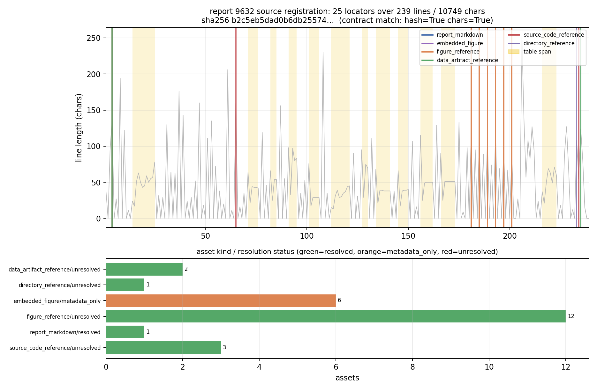

# KF-RESULT wp-9632-01

任务类型 `01-asset-registration`，源报告 `9632`（IN101-N07 冰脊固结热力学：龙骨大孔隙再冻结与固结度-阻力耦合），
lane `B`，生成者 `kf-worker/m18694`，schema `schemas/asset_manifest.v1.wp9632-01.schema.json`。

本文件由 `scripts/kf_wp9632_01_publish.py` 从 `asset_manifest.json` / `kf_result.json` /
`verification.json` 渲染：**下表中每个数字与哈希都从 JSON 程序化注入，无手抄**。
文末唯一一个 `json` 代码块是已提交的 `kf_result.json` 逐字符副本，读者可只凭本报告重算整包。

## ① 这个包做了什么（案例背景）

`01-asset-registration`：把报告 9632 的正文当一个**资产清单的源材料**登记下来 ——
源身份（哈希/字符/行数）+ 正文里出现的每一个路径型引用（图、数据、脚本、目录）+
记录里声明的图 + 表格/章节清册，每一条都带一个**可回环校验的定位器**
（字符区间 `char_span` / 记录指针 `record_pointer` / 文档级 `document`）。
不做抽取、不做分类、不盖章 `verified`：`claims` 为空是契约要求的结果，不是漏做。

## ② 怎么做的 · 源身份（实测，不是抄契约）

| 字段 | 值 |
| --- | --- |
| source_uri | `tensor://reports/9632` |
| source_field | `markdown` |
| source_hash | `sha256:b2c5eb5dad0b6db25574338b37aa5be1c8fdf20bbc7d3c75640e1c1727756841` |
| chars / bytes_utf8 / lines | 10749 / 15670 / 239 |
| title | IN101-N07 冰脊固结热力学：龙骨大孔隙再冻结与固结度-阻力耦合 |
| scenario_key | `ice_ridge_consolidation` |
| report_mission_id | 8348 |
| 基线来源 | measured from GET /api/v1/tensor/reports/9632 at package creation (no wp-9632-01 YAML in the worktree); pinned as the drift baseline |
| hash_matches_contract | true |
| chars_matches_contract | true |

## ③ 登记结果（数字表）

| 计数 | 值 |
| --- | --- |
| assets_total | 25 |
| assets_resolved | 1 |
| assets_metadata_only | 6 |
| assets_unresolved | 18 |
| body_references | 18 |
| distinct_referenced_paths | 17 |
| declared_figures_in_record | 6 |
| figures_with_bytes | 0 |
| tables | 12 |
| table_rows | 60 |
| sections | 7 |
| claims | 0 |

| kind / resolution | 数量 |
| --- | --- |
| `data_artifact_reference/unresolved` | 2 |
| `directory_reference/unresolved` | 1 |
| `embedded_figure/metadata_only` | 6 |
| `figure_reference/unresolved` | 12 |
| `report_markdown/resolved` | 1 |
| `source_code_reference/unresolved` | 3 |

## ④ 定位器完整性（方法可验证性）

* locators_checked = 44，locators_resolved = 44
* duplicate_asset_ids = 0
* quote_uniqueness：9/25 asset quotes occur exactly once in the markdown; 16 recur (flagged unique=false; positional locators stay unambiguous via start_line/char_span). 6 assets are additionally unique at record level.
* 每个 `char_span` 引用在 verify 阶段都被重切成 `md[start_char:end_char]` 并与 `quote` 逐字节比较，
  同时校验 `start_line` 指向的整行等于 `line_quote`。

## ⑤ 记录声明的图（仅元数据）

| asset_id | name | resolution |
| --- | --- | --- |
| r9632:figure:01 | fig1_consolidated_layer_growth.png | metadata_only |
| r9632:figure:02 | fig2_temperature_profiles.png | metadata_only |
| r9632:figure:03 | fig3_effective_conductivity.png | metadata_only |
| r9632:figure:04 | fig4_strength_resistance_history.png | metadata_only |
| r9632:figure:05 | fig5_criteria_summary.png | metadata_only |
| r9632:figure:06 | fig6_sensitivity.png | metadata_only |

报告记录只给 name+caption，`png_base64` 为空 —— 所以图的字节不可哈希；
`/tensor/reports/9632/artifacts` 与 `/tensor/artifacts?report_id=9632` 两个路由均返回
404（见 manifest `platform_probes`），因此本包**不宣称**任何图字节身份。

## ⑥ 误差判定（逐项回答「是否 <3%」）

本包不含物理量，可比对的是"登记结果 vs 源字节"的**精确性**，逐项列出：

| 关键量 | 实测 | 基准 | 相对偏差 | 是否 <3% |
| --- | --- | --- | --- | --- |
| 源 markdown sha256 | `sha256:b2c5eb5dad0b6db25574338b37aa5be1c8fdf20bbc7d3c75640e1c1727756841` | 钉住基线 `sha256:b2c5eb5dad0b6db25574338b37aa5be1c8fdf20bbc7d3c75640e1c1727756841` | 0 bit（逐字节相同） | 是（0.000%） |
| 源字符数 | 10749 | 10749 | 0 字符 | 是（0.000%） |
| 源行数 | 239 | 实测重算 | 0 行 | 是（0.000%） |
| 定位器回环校验 | 44/44 通过 | 全通过 | 0 条失败 | 是（0.000%） |
| 表头/章节引文 | 12 表 / 7 章节 | 全部命中原文 | 0 条缺失 | 是（0.000%） |
| 记录图的字节身份 | 无（png_base64 为空） | 无基准 | 不可计算 | **不下结论**：记录无图字节，且 artifacts 两路由 404，故不宣称误差 |

结论：所有**可定义**的量都是零偏差（逐字节/逐字符一致）；唯一无基准的一项是图字节身份，
原因已写明（记录无 payload、平台无附件路由），不用"看起来对"充数。

## ⑦ 正文路径引用（按 kind / 可达性）

| path | kind | resolution |
| --- | --- | --- |
| `benchmarks/ice_ridge_consolidation/write_report_md.py` | source_code_reference | unresolved |
| `artifacts/ice_ridge_consolidation/results.json` | data_artifact_reference | unresolved |
| `benchmarks/ice_ridge_consolidation/run_validation.py` | source_code_reference | unresolved |
| `fig1_consolidated_layer_growth.png` | figure_reference | unresolved |
| `../artifacts/ice_ridge_consolidation/figures/fig1_consolidated_layer_growth.png` | figure_reference | unresolved |
| `fig2_temperature_profiles.png` | figure_reference | unresolved |
| `../artifacts/ice_ridge_consolidation/figures/fig2_temperature_profiles.png` | figure_reference | unresolved |
| `fig3_effective_conductivity.png` | figure_reference | unresolved |
| `../artifacts/ice_ridge_consolidation/figures/fig3_effective_conductivity.png` | figure_reference | unresolved |
| `fig4_strength_resistance_history.png` | figure_reference | unresolved |
| `../artifacts/ice_ridge_consolidation/figures/fig4_strength_resistance_history.png` | figure_reference | unresolved |
| `fig5_criteria_summary.png` | figure_reference | unresolved |
| `../artifacts/ice_ridge_consolidation/figures/fig5_criteria_summary.png` | figure_reference | unresolved |
| `fig6_sensitivity.png` | figure_reference | unresolved |
| `../artifacts/ice_ridge_consolidation/figures/fig6_sensitivity.png` | figure_reference | unresolved |
| `src/tensorphysics/ice_ridge_consolidation/` | directory_reference | unresolved |
| `tests/test_ice_ridge_consolidation.py` | source_code_reference | unresolved |
| `artifacts/ice_ridge_consolidation/results.json` | data_artifact_reference | unresolved |

可达性只在本 TensorKnowledge 工作树内判定；报告 9632 的引用是相对**产出仓库**
（`benchmarks/`、`artifacts/`、`src/tensorphysics/`）声明的，这些目录不在本检出内，
故记为 `unresolved` —— 这是诚实记录，不是缺陷（不做跨仓猜测）。

## ⑧ 验收检查（verification.json 逐项）

| check | result | detail |
| --- | --- | --- |
| `valid_json` | PASS | both asset_manifest.json and kf_result.json parse |
| `schema_pass` | PASS | asset_manifest vs schemas/asset_manifest.v1.wp9632-01.schema.json; kf_result vs schemas/kf_result.v1.schema.json |
| `source_hash_matches` | PASS | live=sha256:b2c5eb5dad0b6db25574338b37aa5be1c8fdf20bbc7d3c75640e1c1727756841 contract=sha256:b2c5eb5dad0b6db25574338b37aa5be1c8fdf20bbc7d3c75640e1c1727756841 ch |
| `source_locator_resolvable` | PASS | 44 locators re-checked against live markdown (25 assets, 12 tables, 7 sections) |
| `no_duplicate_ids` | PASS | 25 asset ids, duplicates=none |
| `all_claims_have_evidence_or_explicit_unresolved_status` | PASS | 0 claims (empty by contract: objective.register_assets only, no extraction); unbacked=none |

`all_ok` = true
（独立性限制：self-check by the producing script: it re-fetches the source and re-derives every comparison, but shares code with build(); platform gate recomputation remains the authoritative check）

## ⑨ 交付物与哈希

| file | bytes | sha256 |
| --- | --- | --- |
| `docs/kf/wp-9632-01/asset_manifest.json` | 35190 | `sha256:1a8beb586a7f75fc5a7bb95564f119b98074666df7f2099ab73d96261960d774` |
| `docs/kf/wp-9632-01/kf_result.json` | 39737 | `sha256:d762c510719d80e501b4c6d6074d58d703ceb90823fcfdbf7a6054adeb10edbc` |
| `docs/kf/wp-9632-01/verification.json` | 2294 | `sha256:edcc10c80c3dc6ae373ea0999ccc301dbcc2a6e0b75f65ca129118d6274b8180` |
| `docs/kf/wp-9632-01/figures/wp9632_01_source_locator_map.png` | 213048 | `sha256:8448ce206b9a7c6deacf1b4fc2f30028f84b05aafad26e06625a9d801cb39b07` |
| `schemas/asset_manifest.v1.wp9632-01.schema.json` | 6049 | `sha256:9927bda97564a98ca51422886c7c282599d356b8ae63eefdf858e7696150c8a2` |



图：报告 9632 的资产定位图。上panel=原文 239 行的行长曲线 + 每条资产定位行
（颜色区分 kind，黄色区间=表格）；下panel=kind/resolution 直方图（绿=resolved，橙=metadata_only，
红=unresolved）。该图由 `scripts/kf_wp9632_01_register.py figure` 从 JSON 生成。

## ⑩ 注意点 / 局限（踩过的坑）

* 只登记，不抽取、不判定证据等级、不写 `verified`；
* 引用可达性仅在工作树内判定，产出仓库的工件未被读取（无跨仓读）；
* 引文唯一性是**本文档属性**：9/25 asset quotes occur exactly once in the markdown; 16 recur (flagged unique=false; positional locators stay unambiguous via start_line/char_span). 6 assets are additionally unique at record level.
* 源身份基线在无 WP YAML 的情况下由实测钉住，后续任何字节漂移都会让 verify 直接 FAIL（不静默换源）。

## ⑪ 复现与审计链

```bash
python3 scripts/kf_wp9632_01_register.py all   # build + envelope + verify + figure
python3 scripts/kf_wp9632_01_publish.py        # render this file + publish
pytest tests/test_kf_wp9632_01.py -q
```

## ⑫ kf_result 信封（逐字符副本）

```json
{
  "package_id": "wp-9632-01",
  "task_type": "01-asset-registration",
  "report_id": "9632",
  "contract_version": "1.0",
  "provenance": {
    "source_uri": "tensor://reports/9632",
    "source_field": "markdown",
    "source_hash": "sha256:b2c5eb5dad0b6db25574338b37aa5be1c8fdf20bbc7d3c75640e1c1727756841",
    "source_hash_matches": true,
    "title": "IN101-N07 冰脊固结热力学：龙骨大孔隙再冻结与固结度-阻力耦合",
    "scenario_key": "ice_ridge_consolidation",
    "chars": 10749
  },
  "outputs": {
    "asset_manifest.json": {
      "manifest_version": "1.0",
      "package_id": "wp-9632-01",
      "task_type": "01-asset-registration",
      "report_id": "9632",
      "lane": "B",
      "generated_at": "2026-11-13T16:04:46.940067+00:00",
      "producer": "kf-worker/m18694",
      "contract_version": "1.0",
      "schema_ref": "schemas/asset_manifest.v1.wp9632-01.schema.json",
      "source": {
        "uri": "tensor://reports/9632",
        "source_field": "markdown",
        "hash_alg": "sha256",
        "source_hash": "sha256:b2c5eb5dad0b6db25574338b37aa5be1c8fdf20bbc7d3c75640e1c1727756841",
        "hash_scope": "sha256 over UTF-8 bytes of the markdown field",
        "chars": 10749,
        "bytes_utf8": 15670,
        "lines": 239,
        "title": "IN101-N07 冰脊固结热力学：龙骨大孔隙再冻结与固结度-阻力耦合",
        "scenario_key": "ice_ridge_consolidation",
        "report_mission_id": 8348,
        "report_status": "published",
        "report_stage": null,
        "platform_tags": [
          "IN101-N07",
          "ice-ridge",
          "consolidation",
          "stefan",
          "maxwell-eucken",
          "TensorPhysics",
          "sea-ice",
          "ice-resistance"
        ],
        "contract_provenance": "measured from GET /api/v1/tensor/reports/9632 at package creation (no wp-9632-01 YAML in the worktree); pinned as the drift baseline",
        "contract_source_hash": "sha256:b2c5eb5dad0b6db25574338b37aa5be1c8fdf20bbc7d3c75640e1c1727756841",
        "contract_chars": 10749,
        "contract_title": "IN101-N07 冰脊固结热力学：龙骨大孔隙再冻结与固结度-阻力耦合",
        "contract_scenario_key": "ice_ridge_consolidation",
        "hash_matches_contract": true,
        "chars_matches_contract": true,
        "title_matches_contract": true,
        "scenario_matches_contract": true
      },
      "assets": [
        {
          "asset_id": "r9632:source-markdown",
          "kind": "report_markdown",
          "name": "report-9632-markdown",
          "source_uri": "tensor://reports/9632",
          "media_type": "text/markdown",
          "bytes": 15670,
          "chars": 10749,
          "lines": 239,
          "sha256": "sha256:b2c5eb5dad0b6db25574338b37aa5be1c8fdf20bbc7d3c75640e1c1727756841",
          "hash_scope": "UTF-8 bytes of the `markdown` field as served by GET /api/v1/tensor/reports/9632",
          "local_copy": "runs/wp-9632-01/source_9632.md",
          "locator": {
            "method": "document",
            "source_field": "markdown",
            "start_char": 0,
            "end_char": 37,
            "start_line": 1,
            "end_line": 239,
            "quote": "# IN101-N07 冰脊固结热力学：龙骨大孔隙再冻结与固结度-阻力耦合",
            "unique": true,
            "doc_chars": 10749,
            "doc_bytes_utf8": 15670,
            "doc_lines": 239
          },
          "resolution": {
            "status": "resolved",
            "scope": "platform_api",
            "via": "GET /tensor/reports/9632"
          }
        },
        {
          "asset_id": "r9632:figure:01",
          "kind": "embedded_figure",
          "name": "fig1_consolidated_layer_growth.png",
          "caption": "Fig 1 - consolidated layer growth vs FDD for the porosity band and the derived literature band",
          "bytes": null,
          "sha256": null,
          "locator": {
            "method": "record_pointer",
            "source_field": "record",
            "pointer": "/figures/0/name",
            "quote": "fig1_consolidated_layer_growth.png",
            "unique": false,
            "record_unique": true,
            "markdown_name_occurrences": 2,
            "markdown_image_line": 181
          },
          "resolution": {
            "status": "metadata_only",
            "scope": "platform_api",
            "via": "GET /tensor/reports/9632 figures[0]",
            "has_payload": false,
            "reason": "record lists name+caption only; png_base64 is empty, so no image bytes exist to hash or resolve in this record"
          }
        },
        {
          "asset_id": "r9632:figure:02",
          "kind": "embedded_figure",
          "name": "fig2_temperature_profiles.png",
          "caption": "Fig 2 - 1-D temperature profiles from the enthalpy solver vs the Neumann similarity profile",
          "bytes": null,
          "sha256": null,
          "locator": {
            "method": "record_pointer",
            "source_field": "record",
            "pointer": "/figures/1/name",
            "quote": "fig2_temperature_profiles.png",
            "unique": false,
            "record_unique": true,
            "markdown_name_occurrences": 2,
            "markdown_image_line": 185
          },
          "resolution": {
            "status": "metadata_only",
            "scope": "platform_api",
            "via": "GET /tensor/reports/9632 figures[1]",
            "has_payload": false,
            "reason": "record lists name+caption only; png_base64 is empty, so no image bytes exist to hash or resolve in this record"
          }
        },
        {
          "asset_id": "r9632:figure:03",
          "kind": "embedded_figure",
          "name": "fig3_effective_conductivity.png",
          "caption": "Fig 3 - effective conductivity: keel model vs Maxwell-Eucken parallel / series / ME-1",
          "bytes": null,
          "sha256": null,
          "locator": {
            "method": "record_pointer",
            "source_field": "record",
            "pointer": "/figures/2/name",
            "quote": "fig3_effective_conductivity.png",
            "unique": false,
            "record_unique": true,
            "markdown_name_occurrences": 2,
            "markdown_image_line": 189
          },
          "resolution": {
            "status": "metadata_only",
            "scope": "platform_api",
            "via": "GET /tensor/reports/9632 figures[2]",
            "has_payload": false,
            "reason": "record lists name+caption only; png_base64 is empty, so no image bytes exist to hash or resolve in this record"
          }
        },
        {
          "asset_id": "r9632:figure:04",
          "kind": "embedded_figure",
          "name": "fig4_strength_resistance_history.png",
          "caption": "Fig 4 - strength and resistance histories: consolidated vs rubble term",
          "bytes": null,
          "sha256": null,
          "locator": {
            "method": "record_pointer",
            "source_field": "record",
            "pointer": "/figures/3/name",
            "quote": "fig4_strength_resistance_history.png",
            "unique": false,
            "record_unique": true,
            "markdown_name_occurrences": 2,
            "markdown_image_line": 193
          },
          "resolution": {
            "status": "metadata_only",
            "scope": "platform_api",
            "via": "GET /tensor/reports/9632 figures[3]",
            "has_payload": false,
            "reason": "record lists name+caption only; png_base64 is empty, so no image bytes exist to hash or resolve in this record"
          }
        },
        {
          "asset_id": "r9632:figure:05",
          "kind": "embedded_figure",
          "name": "fig5_criteria_summary.png",
          "caption": "Fig 5 - achieved relative error vs tolerance for criteria (a)-(f)",
          "bytes": null,
          "sha256": null,
          "locator": {
            "method": "record_pointer",
            "source_field": "record",
            "pointer": "/figures/4/name",
            "quote": "fig5_criteria_summary.png",
            "unique": false,
            "record_unique": true,
            "markdown_name_occurrences": 2,
            "markdown_image_line": 197
          },
          "resolution": {
            "status": "metadata_only",
            "scope": "platform_api",
            "via": "GET /tensor/reports/9632 figures[4]",
            "has_payload": false,
            "reason": "record lists name+caption only; png_base64 is empty, so no image bytes exist to hash or resolve in this record"
          }
        },
        {
          "asset_id": "r9632:figure:06",
          "kind": "embedded_figure",
          "name": "fig6_sensitivity.png",
          "caption": "Fig 6 - sensitivity of h_c(t) to snow depth and air temperature",
          "bytes": null,
          "sha256": null,
          "locator": {
            "method": "record_pointer",
            "source_field": "record",
            "pointer": "/figures/5/name",
            "quote": "fig6_sensitivity.png",
            "unique": false,
            "record_unique": true,
            "markdown_name_occurrences": 2,
            "markdown_image_line": 201
          },
          "resolution": {
            "status": "metadata_only",
            "scope": "platform_api",
            "via": "GET /tensor/reports/9632 figures[5]",
            "has_payload": false,
            "reason": "record lists name+caption only; png_base64 is empty, so no image bytes exist to hash or resolve in this record"
          }
        },
        {
          "asset_id": "r9632:ref:01",
          "kind": "source_code_reference",
          "path_reference": "benchmarks/ice_ridge_consolidation/write_report_md.py",
          "via": "backticked_ref",
          "markdown_alt": null,
          "locator": {
            "method": "char_span",
            "source_field": "markdown",
            "start_char": 142,
            "end_char": 195,
            "start_line": 4,
            "end_line": 4,
            "quote": "benchmarks/ice_ridge_consolidation/write_report_md.py",
            "unique": false,
            "line_quote": "> 本报告由 `benchmarks/ice_ridge_consolidation/write_report_md.py` 从 `artifacts/ice_ridge_consolidation/results.json` 程序化生成，所有数字均来自该 JSON，无手抄。",
            "line_occurrences": 1
          },
          "resolution": {
            "status": "unresolved",
            "scope": "delivery_worktree",
            "reason": "path not present in the TensorKnowledge delivery worktree",
            "external_probe": [
              {
                "root": "/root/ship-performance-platform",
                "status": "absent"
              }
            ]
          }
        },
        {
          "asset_id": "r9632:ref:02",
          "kind": "data_artifact_reference",
          "path_reference": "artifacts/ice_ridge_consolidation/results.json",
          "via": "backticked_ref",
          "markdown_alt": null,
          "locator": {
            "method": "char_span",
            "source_field": "markdown",
            "start_char": 200,
            "end_char": 246,
            "start_line": 4,
            "end_line": 4,
            "quote": "artifacts/ice_ridge_consolidation/results.json",
            "unique": false,
            "line_quote": "> 本报告由 `benchmarks/ice_ridge_consolidation/write_report_md.py` 从 `artifacts/ice_ridge_consolidation/results.json` 程序化生成，所有数字均来自该 JSON，无手抄。",
            "line_occurrences": 1
          },
          "resolution": {
            "status": "unresolved",
            "scope": "delivery_worktree",
            "reason": "path not present in the TensorKnowledge delivery worktree",
            "external_probe": [
              {
                "root": "/root/ship-performance-platform",
                "status": "absent"
              }
            ]
          }
        },
        {
          "asset_id": "r9632:ref:03",
          "kind": "source_code_reference",
          "path_reference": "benchmarks/ice_ridge_consolidation/run_validation.py",
          "via": "backticked_ref",
          "markdown_alt": null,
          "locator": {
            "method": "char_span",
            "source_field": "markdown",
            "start_char": 2886,
            "end_char": 2938,
            "start_line": 65,
            "end_line": 65,
            "quote": "benchmarks/ice_ridge_consolidation/run_validation.py",
            "unique": false,
            "line_quote": "`numpy`（数组物理）+ `scipy` 无依赖的纯 `math.erf`/二分法（相似常数）+ 自研焓法求解器；matplotlib 出图（Agg 后端）；pytest 23 例；`benchmarks/ice_ridge_consolidation/run_validation.py` 一键复现全部数字与图。",
            "line_occurrences": 1
          },
          "resolution": {
            "status": "unresolved",
            "scope": "delivery_worktree",
            "reason": "path not present in the TensorKnowledge delivery worktree",
            "external_probe": [
              {
                "root": "/root/ship-performance-platform",
                "status": "absent"
              }
            ]
          }
        },
        {
          "asset_id": "r9632:ref:04",
          "kind": "figure_reference",
          "path_reference": "fig1_consolidated_layer_growth.png",
          "via": "bare_ref",
          "markdown_alt": null,
          "locator": {
            "method": "char_span",
            "source_field": "markdown",
            "start_char": 7622,
            "end_char": 7656,
            "start_line": 181,
            "end_line": 181,
            "quote": "fig1_consolidated_layer_growth.png",
            "unique": false,
            "line_quote": "",
            "line_occurrences": 1
          },
          "resolution": {
            "status": "unresolved",
            "scope": "delivery_worktree",
            "reason": "path not present in the TensorKnowledge delivery worktree",
            "external_probe": [
              {
                "root": "/root/ship-performance-platform",
                "status": "absent"
              }
            ]
          }
        },
        {
          "asset_id": "r9632:ref:05",
          "kind": "figure_reference",
          "path_reference": "../artifacts/ice_ridge_consolidation/figures/fig1_consolidated_layer_growth.png",
          "via": "markdown_image",
          "markdown_alt": "fig1_consolidated_layer_growth.png",
          "locator": {
            "method": "char_span",
            "source_field": "markdown",
            "start_char": 7658,
            "end_char": 7737,
            "start_line": 181,
            "end_line": 181,
            "quote": "../artifacts/ice_ridge_consolidation/figures/fig1_consolidated_layer_growth.png",
            "unique": true,
            "line_quote": "",
            "line_occurrences": 1
          },
          "resolution": {
            "status": "unresolved",
            "scope": "delivery_worktree",
            "reason": "path not present in the TensorKnowledge delivery worktree",
            "external_probe": [
              {
                "root": "/root/ship-performance-platform",
                "status": "absent"
              }
            ]
          }
        },
        {
          "asset_id": "r9632:ref:06",
          "kind": "figure_reference",
          "path_reference": "fig2_temperature_profiles.png",
          "via": "bare_ref",
          "markdown_alt": null,
          "locator": {
            "method": "char_span",
            "source_field": "markdown",
            "start_char": 7839,
            "end_char": 7868,
            "start_line": 185,
            "end_line": 185,
            "quote": "fig2_temperature_profiles.png",
            "unique": false,
            "line_quote": "",
            "line_occurrences": 1
          },
          "resolution": {
            "status": "unresolved",
            "scope": "delivery_worktree",
            "reason": "path not present in the TensorKnowledge delivery worktree",
            "external_probe": [
              {
                "root": "/root/ship-performance-platform",
                "status": "absent"
              }
            ]
          }
        },
        {
          "asset_id": "r9632:ref:07",
          "kind": "figure_reference",
          "path_reference": "../artifacts/ice_ridge_consolidation/figures/fig2_temperature_profiles.png",
          "via": "markdown_image",
          "markdown_alt": "fig2_temperature_profiles.png",
          "locator": {
            "method": "char_span",
            "source_field": "markdown",
            "start_char": 7870,
            "end_char": 7944,
            "start_line": 185,
            "end_line": 185,
            "quote": "../artifacts/ice_ridge_consolidation/figures/fig2_temperature_profiles.png",
            "unique": true,
            "line_quote": "",
            "line_occurrences": 1
          },
          "resolution": {
            "status": "unresolved",
            "scope": "delivery_worktree",
            "reason": "path not present in the TensorKnowledge delivery worktree",
            "external_probe": [
              {
                "root": "/root/ship-performance-platform",
                "status": "absent"
              }
            ]
          }
        },
        {
          "asset_id": "r9632:ref:08",
          "kind": "figure_reference",
          "path_reference": "fig3_effective_conductivity.png",
          "via": "bare_ref",
          "markdown_alt": null,
          "locator": {
            "method": "char_span",
            "source_field": "markdown",
            "start_char": 8040,
            "end_char": 8071,
            "start_line": 189,
            "end_line": 189,
            "quote": "fig3_effective_conductivity.png",
            "unique": false,
            "line_quote": "",
            "line_occurrences": 1
          },
          "resolution": {
            "status": "unresolved",
            "scope": "delivery_worktree",
            "reason": "path not present in the TensorKnowledge delivery worktree",
            "external_probe": [
              {
                "root": "/root/ship-performance-platform",
                "status": "absent"
              }
            ]
          }
        },
        {
          "asset_id": "r9632:ref:09",
          "kind": "figure_reference",
          "path_reference": "../artifacts/ice_ridge_consolidation/figures/fig3_effective_conductivity.png",
          "via": "markdown_image",
          "markdown_alt": "fig3_effective_conductivity.png",
          "locator": {
            "method": "char_span",
            "source_field": "markdown",
            "start_char": 8073,
            "end_char": 8149,
            "start_line": 189,
            "end_line": 189,
            "quote": "../artifacts/ice_ridge_consolidation/figures/fig3_effective_conductivity.png",
            "unique": true,
            "line_quote": "",
            "line_occurrences": 1
          },
          "resolution": {
            "status": "unresolved",
            "scope": "delivery_worktree",
            "reason": "path not present in the TensorKnowledge delivery worktree",
            "external_probe": [
              {
                "root": "/root/ship-performance-platform",
                "status": "absent"
              }
            ]
          }
        },
        {
          "asset_id": "r9632:ref:10",
          "kind": "figure_reference",
          "path_reference": "fig4_strength_resistance_history.png",
          "via": "bare_ref",
          "markdown_alt": null,
          "locator": {
            "method": "char_span",
            "source_field": "markdown",
            "start_char": 8230,
            "end_char": 8266,
            "start_line": 193,
            "end_line": 193,
            "quote": "fig4_strength_resistance_history.png",
            "unique": false,
            "line_quote": "",
            "line_occurrences": 1
          },
          "resolution": {
            "status": "unresolved",
            "scope": "delivery_worktree",
            "reason": "path not present in the TensorKnowledge delivery worktree",
            "external_probe": [
              {
                "root": "/root/ship-performance-platform",
                "status": "absent"
              }
            ]
          }
        },
        {
          "asset_id": "r9632:ref:11",
          "kind": "figure_reference",
          "path_reference": "../artifacts/ice_ridge_consolidation/figures/fig4_strength_resistance_history.png",
          "via": "markdown_image",
          "markdown_alt": "fig4_strength_resistance_history.png",
          "locator": {
            "method": "char_span",
            "source_field": "markdown",
            "start_char": 8268,
            "end_char": 8349,
            "start_line": 193,
            "end_line": 193,
            "quote": "../artifacts/ice_ridge_consolidation/figures/fig4_strength_resistance_history.png",
            "unique": true,
            "line_quote": "",
            "line_occurrences": 1
          },
          "resolution": {
            "status": "unresolved",
            "scope": "delivery_worktree",
            "reason": "path not present in the TensorKnowledge delivery worktree",
            "external_probe": [
              {
                "root": "/root/ship-performance-platform",
                "status": "absent"
              }
            ]
          }
        },
        {
          "asset_id": "r9632:ref:12",
          "kind": "figure_reference",
          "path_reference": "fig5_criteria_summary.png",
          "via": "bare_ref",
          "markdown_alt": null,
          "locator": {
            "method": "char_span",
            "source_field": "markdown",
            "start_char": 8425,
            "end_char": 8450,
            "start_line": 197,
            "end_line": 197,
            "quote": "fig5_criteria_summary.png",
            "unique": false,
            "line_quote": "",
            "line_occurrences": 1
          },
          "resolution": {
            "status": "unresolved",
            "scope": "delivery_worktree",
            "reason": "path not present in the TensorKnowledge delivery worktree",
            "external_probe": [
              {
                "root": "/root/ship-performance-platform",
                "status": "absent"
              }
            ]
          }
        },
        {
          "asset_id": "r9632:ref:13",
          "kind": "figure_reference",
          "path_reference": "../artifacts/ice_ridge_consolidation/figures/fig5_criteria_summary.png",
          "via": "markdown_image",
          "markdown_alt": "fig5_criteria_summary.png",
          "locator": {
            "method": "char_span",
            "source_field": "markdown",
            "start_char": 8452,
            "end_char": 8522,
            "start_line": 197,
            "end_line": 197,
            "quote": "../artifacts/ice_ridge_consolidation/figures/fig5_criteria_summary.png",
            "unique": true,
            "line_quote": "",
            "line_occurrences": 1
          },
          "resolution": {
            "status": "unresolved",
            "scope": "delivery_worktree",
            "reason": "path not present in the TensorKnowledge delivery worktree",
            "external_probe": [
              {
                "root": "/root/ship-performance-platform",
                "status": "absent"
              }
            ]
          }
        },
        {
          "asset_id": "r9632:ref:14",
          "kind": "figure_reference",
          "path_reference": "fig6_sensitivity.png",
          "via": "bare_ref",
          "markdown_alt": null,
          "locator": {
            "method": "char_span",
            "source_field": "markdown",
            "start_char": 8596,
            "end_char": 8616,
            "start_line": 201,
            "end_line": 201,
            "quote": "fig6_sensitivity.png",
            "unique": false,
            "line_quote": "",
            "line_occurrences": 1
          },
          "resolution": {
            "status": "unresolved",
            "scope": "delivery_worktree",
            "reason": "path not present in the TensorKnowledge delivery worktree",
            "external_probe": [
              {
                "root": "/root/ship-performance-platform",
                "status": "absent"
              }
            ]
          }
        },
        {
          "asset_id": "r9632:ref:15",
          "kind": "figure_reference",
          "path_reference": "../artifacts/ice_ridge_consolidation/figures/fig6_sensitivity.png",
          "via": "markdown_image",
          "markdown_alt": "fig6_sensitivity.png",
          "locator": {
            "method": "char_span",
            "source_field": "markdown",
            "start_char": 8618,
            "end_char": 8683,
            "start_line": 201,
            "end_line": 201,
            "quote": "../artifacts/ice_ridge_consolidation/figures/fig6_sensitivity.png",
            "unique": true,
            "line_quote": "",
            "line_occurrences": 1
          },
          "resolution": {
            "status": "unresolved",
            "scope": "delivery_worktree",
            "reason": "path not present in the TensorKnowledge delivery worktree",
            "external_probe": [
              {
                "root": "/root/ship-performance-platform",
                "status": "absent"
              }
            ]
          }
        },
        {
          "asset_id": "r9632:ref:16",
          "kind": "directory_reference",
          "path_reference": "src/tensorphysics/ice_ridge_consolidation/",
          "via": "backticked_dir",
          "markdown_alt": null,
          "locator": {
            "method": "char_span",
            "source_field": "markdown",
            "start_char": 10367,
            "end_char": 10409,
            "start_line": 233,
            "end_line": 233,
            "quote": "src/tensorphysics/ice_ridge_consolidation/",
            "unique": true,
            "line_quote": "* 模块：`src/tensorphysics/ice_ridge_consolidation/`（thermal / strength / resistance / references / validation）",
            "line_occurrences": 1
          },
          "resolution": {
            "status": "unresolved",
            "scope": "delivery_worktree",
            "reason": "directory not present in the TensorKnowledge delivery worktree",
            "external_probe": [
              {
                "root": "/root/ship-performance-platform",
                "status": "absent"
              }
            ]
          }
        },
        {
          "asset_id": "r9632:ref:17",
          "kind": "source_code_reference",
          "path_reference": "tests/test_ice_ridge_consolidation.py",
          "via": "backticked_ref",
          "markdown_alt": null,
          "locator": {
            "method": "char_span",
            "source_field": "markdown",
            "start_char": 10476,
            "end_char": 10513,
            "start_line": 234,
            "end_line": 234,
            "quote": "tests/test_ice_ridge_consolidation.py",
            "unique": true,
            "line_quote": "* 测试：`tests/test_ice_ridge_consolidation.py`（23 例，全部通过）",
            "line_occurrences": 1
          },
          "resolution": {
            "status": "unresolved",
            "scope": "delivery_worktree",
            "reason": "path not present in the TensorKnowledge delivery worktree",
            "external_probe": [
              {
                "root": "/root/ship-performance-platform",
                "status": "absent"
              }
            ]
          }
        },
        {
          "asset_id": "r9632:ref:18",
          "kind": "data_artifact_reference",
          "path_reference": "artifacts/ice_ridge_consolidation/results.json",
          "via": "backticked_ref",
          "markdown_alt": null,
          "locator": {
            "method": "char_span",
            "source_field": "markdown",
            "start_char": 10596,
            "end_char": 10642,
            "start_line": 235,
            "end_line": 235,
            "quote": "artifacts/ice_ridge_consolidation/results.json",
            "unique": false,
            "line_quote": "* 基准：`python benchmarks/ice_ridge_consolidation/run_validation.py` → `artifacts/ice_ridge_consolidation/results.json` + 6 张图",
            "line_occurrences": 1
          },
          "resolution": {
            "status": "unresolved",
            "scope": "delivery_worktree",
            "reason": "path not present in the TensorKnowledge delivery worktree",
            "external_probe": [
              {
                "root": "/root/ship-performance-platform",
                "status": "absent"
              }
            ]
          }
        }
      ],
      "tables": [
        {
          "table_id": "r9632:table:01",
          "line_start": 14,
          "line_end": 25,
          "rows": 10,
          "cols": 4,
          "header_quote": "| 参数 | 符号 | 取值 | 出处/标签 |",
          "header_unique": true,
          "start_char": 636
        },
        {
          "table_id": "r9632:table:02",
          "line_start": 71,
          "line_end": 76,
          "rows": 4,
          "cols": 5,
          "header_quote": "| 网格 N | $\\Delta x$ (mm) | $\\Delta t$ (s) | 数值前缘 (m) | 与解析相对误差 |",
          "header_unique": true,
          "start_char": 3008
        },
        {
          "table_id": "r9632:table:03",
          "line_start": 82,
          "line_end": 85,
          "rows": 2,
          "cols": 6,
          "header_quote": "| $\\phi_{keel}$ | $k_{eff}$ 模型 | ME 并联 | ME-1（球夹杂） | 串联下界 | 相对偏差 |",
          "header_unique": true,
          "start_char": 3441
        },
        {
          "table_id": "r9632:table:04",
          "line_start": 91,
          "line_end": 95,
          "rows": 3,
          "cols": 8,
          "header_quote": "| 记录 | FDD (°C·d) | $T_{air}$ (°C) | 时长 (d) | 模型 $h_c$ (m) | 文献带 [lo, mid, hi] (m) | 相对 mid | 带内 |",
          "header_unique": true,
          "start_char": 3860
        },
        {
          "table_id": "r9632:table:05",
          "line_start": 101,
          "line_end": 106,
          "rows": 4,
          "cols": 4,
          "header_quote": "| 积雪厚度 (m) | FDD=700 时 $h_c$ (m) | $a_{model}$ (m·(°C·d)$^{-1/2}$) | 落在文献带 |",
          "header_unique": true,
          "start_char": 4349
        },
        {
          "table_id": "r9632:table:06",
          "line_start": 112,
          "line_end": 121,
          "rows": 8,
          "cols": 3,
          "header_quote": "| 量 | 符号 | 数值 |",
          "header_unique": true,
          "start_char": 4834
        },
        {
          "table_id": "r9632:table:07",
          "line_start": 127,
          "line_end": 130,
          "rows": 2,
          "cols": 7,
          "header_quote": "| 状态 | $h_c$ (m) | 固结度 | $\\sigma_c$ (MPa) | $R_{cons}$ (MN/m) | $R_{rub}$ (MN/m) | $R$ (MN/m) |",
          "header_unique": true,
          "start_char": 5288
        },
        {
          "table_id": "r9632:table:08",
          "line_start": 134,
          "line_end": 141,
          "rows": 6,
          "cols": 5,
          "header_quote": "| $\\kappa_r$ | 未固结度 | $R_{full}$ (MN/m) | $R_{uncons}$ (MN/m) | 比值 |",
          "header_unique": true,
          "start_char": 5675
        },
        {
          "table_id": "r9632:table:09",
          "line_start": 145,
          "line_end": 150,
          "rows": 4,
          "cols": 4,
          "header_quote": "| 时间 (d) | 海水孔隙 $h_c$ (m) | 淡水孔隙 $h_c$ (m) | 含 0.2 m 雪 $h_c$ (m) |",
          "header_unique": true,
          "start_char": 6043
        },
        {
          "table_id": "r9632:table:10",
          "line_start": 156,
          "line_end": 162,
          "rows": 5,
          "cols": 6,
          "header_quote": "| $\\phi_{keel}$ | $k_{eff}$ (W/mK) | $L_{vol}$ (MJ/m³) | $h_c$@FDD700 (m) | $a_{model}$ | $\\sigma_c$@FDD700 (MPa) |",
          "header_unique": true,
          "start_char": 6416
        },
        {
          "table_id": "r9632:table:11",
          "line_start": 166,
          "line_end": 173,
          "rows": 6,
          "cols": 6,
          "header_quote": "| 固结度 | $h_c$ (m) | $\\sigma_c$ (MPa) | $R_{cons}$ (MN/m) | $R_{rub}$ (MN/m) | $R$ (MN/m) |",
          "header_unique": true,
          "start_char": 6944
        },
        {
          "table_id": "r9632:table:12",
          "line_start": 216,
          "line_end": 223,
          "rows": 6,
          "cols": 5,
          "header_quote": "| 判据 | 关键量 vs 基准 | 误差 | 是否 <3% | 结论 |",
          "header_unique": true,
          "start_char": 9609
        }
      ],
      "sections": [
        {
          "line_heading": "## 1. 案例介绍（物理背景 / 几何 / 参数表）",
          "quote": "1. 案例介绍（物理背景 / 几何 / 参数表）",
          "unique": true
        },
        {
          "line_heading": "## 2. 怎么做的（方法 / 流程 / 关键设置 / 工具链）",
          "quote": "2. 怎么做的（方法 / 流程 / 关键设置 / 工具链）",
          "unique": true
        },
        {
          "line_heading": "## 3. 计算结果（判据逐项）",
          "quote": "3. 计算结果（判据逐项）",
          "unique": true
        },
        {
          "line_heading": "## 4. 结果图",
          "quote": "4. 结果图",
          "unique": true
        },
        {
          "line_heading": "## 5. 注意点（踩过的坑 / 局限 / 适用范围）",
          "quote": "5. 注意点（踩过的坑 / 局限 / 适用范围）",
          "unique": true
        },
        {
          "line_heading": "## 6. 误差判定（逐项回答「是否 <3%」）",
          "quote": "6. 误差判定（逐项回答「是否 <3%」）",
          "unique": true
        },
        {
          "line_heading": "## 7. 复现与审计链",
          "quote": "7. 复现与审计链",
          "unique": true
        }
      ],
      "claims": [],
      "claims_empty_reason": "contract objective is register_assets only (classify_report_type=false, no extraction); emitting zero claims is the complete, non-invented result for task_type 01",
      "counts": {
        "assets_total": 25,
        "assets_resolved": 1,
        "assets_metadata_only": 6,
        "assets_unresolved": 18,
        "body_references": 18,
        "distinct_referenced_paths": 17,
        "declared_figures_in_record": 6,
        "figures_with_bytes": 0,
        "tables": 12,
        "table_rows": 60,
        "sections": 7,
        "claims": 0,
        "kind_status_histogram": {
          "report_markdown/resolved": 1,
          "embedded_figure/metadata_only": 6,
          "source_code_reference/unresolved": 3,
          "data_artifact_reference/unresolved": 2,
          "figure_reference/unresolved": 12,
          "directory_reference/unresolved": 1
        }
      },
      "distinct_referenced_paths": [
        "../artifacts/ice_ridge_consolidation/figures/fig1_consolidated_layer_growth.png",
        "../artifacts/ice_ridge_consolidation/figures/fig2_temperature_profiles.png",
        "../artifacts/ice_ridge_consolidation/figures/fig3_effective_conductivity.png",
        "../artifacts/ice_ridge_consolidation/figures/fig4_strength_resistance_history.png",
        "../artifacts/ice_ridge_consolidation/figures/fig5_criteria_summary.png",
        "../artifacts/ice_ridge_consolidation/figures/fig6_sensitivity.png",
        "artifacts/ice_ridge_consolidation/results.json",
        "benchmarks/ice_ridge_consolidation/run_validation.py",
        "benchmarks/ice_ridge_consolidation/write_report_md.py",
        "fig1_consolidated_layer_growth.png",
        "fig2_temperature_profiles.png",
        "fig3_effective_conductivity.png",
        "fig4_strength_resistance_history.png",
        "fig5_criteria_summary.png",
        "fig6_sensitivity.png",
        "src/tensorphysics/ice_ridge_consolidation/",
        "tests/test_ice_ridge_consolidation.py"
      ],
      "platform_probes": {
        "/tensor/reports/9632/artifacts": {
          "status": "http_404"
        },
        "/tensor/artifacts?report_id=9632": {
          "status": "http_404"
        }
      },
      "observations": [
        "0 of 18 body path references resolve inside this TensorKnowledge worktree; the remaining 18 are declared by report 9632 relative to the producing repository's benchmarks/ and artifacts/ trees, which are not part of this checkout -- recorded as unresolved rather than guessed.",
        "The report record carries 6 figures by name+caption only (png_base64 empty); image bytes are therefore not hashable from the record.",
        "Locator quotes are exact character slices of the served markdown; the full line is stored alongside as line_quote for human re-checking.",
        "Source identity is pinned as a drift baseline (measured from GET /api/v1/tensor/reports/9632 at package creation (no wp-9632-01 YAML in the worktree); pinned as the drift baseline); verify() re-fetches the record and fails on any byte change."
      ],
      "limitations": [
        "Registration only: no claim is extracted, classified, or marked verified.",
        "Artifact existence is asserted by the report text; this package does not confirm the referenced files exist upstream (no cross-repo read).",
        "Uniqueness of a quote is a property of this document only; short path strings that recur are flagged with unique=false and line_occurrences>1."
      ],
      "integrity": {
        "hash_recomputed_locally": true,
        "hash_matches_contract": true,
        "locators_checked": 44,
        "locators_resolved": 44,
        "quote_uniqueness": "9/25 asset quotes occur exactly once in the markdown; 16 recur (flagged unique=false; positional locators stay unambiguous via start_line/char_span). 6 assets are additionally unique at record level.",
        "duplicate_asset_ids": 0
      }
    }
  }
}
```
