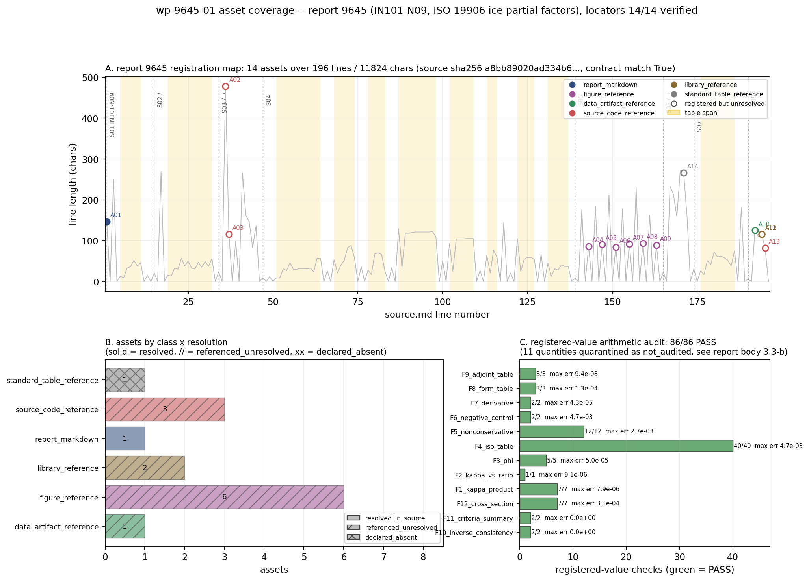

# KF 工序 01 · wp-9645-01 资产登记 —— report 9645（IN101-N09 ISO 19906 冰压分项系数目标可靠度反标定）

**工作包** `wp-9645-01` ｜ **task_type** `01-asset-registration` ｜ **report_id** `9645` ｜ **源 mission** 8350 ｜ **生产者** `kf-worker/m18776`

**源** `tensor://reports/9645`（`sha256:a8bb89020ad334b6b176aaa607852d61596fefcca86c8deaac6a22c6e2d8fb00`，11824 字符 / 196 行 / 15967 UTF-8 字节） ｜ **产物落点** `docs/kf/wp-9645-01`

| 机器自检 | 结果 |
|---|---|
| 源哈希 vs 契约（`a8bb89020ad334b6…`）| PASS |
| 源字符数 vs 契约（11824）| PASS |
| 标题前缀 / scenario_key vs 契约 | PASS / PASS |
| 定位器逐字切片（14 资产 / 11 表 / 8 节）| 14/14 · 11/11 · 8/8 |
| 注册值算术自审 | 86/86 PASS（未审 11 项，逐项写明原因）|
| claims（01 工序无抽取职责）| 空数组 + `claims_empty_reason`（见 §3.5）|

---

## ① 案例介绍（物理背景 / 参数表）

被登记的源报告是 **IN101-N09 ISO 19906 冰压设计分项系数目标可靠度反标定（成熟化）**（平台 report_id `9645`，`scenario_key` = `ice_partial_factors_target_inverse`，`status` = published，2026-11-09T07:20:15.875461+00:00 由 mission 8350 产出；平台 tags：`IN101-N09`, `ISO19906`, `partial-factors`, `FORM`, `importance-sampling`, `negative-control`, `ice`）。

**物理背景**（源报告 §① 的登记摘要，不改写任何数值）：ISO 19906 用压力–面积关系描述冰载荷，作用于接触（或整体）面积 A 上的冰压随面积下降，p(A) = p0·(A/A0)^(−ex)；结构承受的冰力是 F = k_F·p(A)·A。指数为负意味着**产生年极值冰力的冰压与面积负相关**（大面积伴随低压），于是「冰压年极值分布 → 抗力分布 → 极限状态」构成一个反问题：求设计格式 γ_f·F_k ≤ R_k/ψ 的分项系数对 (γ_f, ψ)，使按该格式定尺的构件恰好达到目标年可靠度 β_T = 4.0。本工作包登记的是这条链条的**证据层**：源报告本体、6 张结果图、结果 JSON、求解器与复现脚本、以及 ISO 19906 Annex A 的表格出处。

**表 ①-a 源报告的机器判据（逐行取自 source.md，未手抄）**

| 判据 | 结果 |
|---|---|
| `a_form_vs_simulation` | PASS |
| `b_inverse_solved_unique` | PASS |
| `c_beta_sensitivity_vs_finite_difference` | PASS |
| `d_iso_table_deviation_map` | PASS |
| `e_negative_control_pa_correlation` | PASS |

**表 ①-b 源报告的参数表（逐行取自 source.md，未手抄）**

| 参数 | 取值 | 说明 |
|---|---|---|
| $p_0$ | 2.500 MPa | 参考面积处冰压中值 |
| $ex$ | 0.400 | ISO 压力–面积指数 |
| $A_0$ / $A_{med}$ | 5.00 / 5.00 m² | 参考面积 / 年极值接触面积中值 |
| CoV($A$) | 0.350 | 年极值接触面积对数正态变异系数 |
| CoV($\varepsilon_p$) | 0.150 | 压力规律认知不确定性（中值归一）|
| CoV($k_F$) | 0.100 | 载荷模型不确定性 |
| CoV($R$) | 0.120 | 构件抗力变异系数 |
| 特征冰力 $F_k$ | 23.517 MN | 100 年超越（年超越概率 1e-2）|
| 特征抗力 $R_k$ | 33.660 MN | 5 % 分位 |
| $\rho_{\ln p,\ln A}$ | -0.6737 | 由指数与面积散度解析给出 |
| $\sigma_{\ln F}$ | 0.2717 | 计入负相关 |
| $\sigma_{\ln F}$（$\rho$=0 对照）| 0.4077 | 同一对边缘分布，忽略相关 |

**表 ①-c 登记对象的载体（平台侧事实，逐字段量测）**

| 字段 | 值 |
|---|---|
| report_id | `9645` |
| title | IN101-N09 ISO 19906 冰压设计分项系数目标可靠度反标定（成熟化） |
| scenario_key | `ice_partial_factors_target_inverse` |
| mission_id | 8350 |
| status / stage | published / None |
| platform figures | 6 条（仅 name+caption，`has_payload` 集合 = ['False']）|
| markdown 载体 | 11824 字符 / 196 行 / 15967 字节 / `sha256:a8bb89020ad334b6b176aaa607852d61596fefcca86c8deaac6a22c6e2d8fb00` |
| 节 / 表 | 8 节 / 11 张表（全部带定位器）|

## ② 怎么做的（方法 / 流程 / 关键设置 / 工具链）

01 工序的职责是**登记证据、不生产知识**，因此每一步都围绕「可复核」而不是「可读性」设计：

1. **抓取 + 范围守卫**（`register.py fetch`）。`GET /api/v1/tensor/reports/9645` 取回记录后先校验返回 `id`，不等即 `SystemExit`；markdown 按原字节写入 `source.md`，成为后续全部工件的唯一源。工作包只碰这一个 report_id。
2. **源指纹钉死**（`CONTRACT` 常量）。首次登记时把 `sha256`、字符数、标题前缀、`scenario_key` 写进脚本；此后任何重跑若与常量不符即中止 —— 源漂移必须由人重新裁定，脚本不自我重钉。
3. **资产枚举而非「挑资产」**。解析三类位置：markdown 图片/链接目标、行内代码里的路径（含 `复现` 命令中的 `.py`）、行内代码里的点分模块名；再补一条**按名引用**的规范表格（ISO 19906 Annex A.2/A.3）。14 个资产 = 1 resolved（源本体）+ 12 referenced_unresolved + 1 declared_absent。
4. **单一定义的定位器**。定位器 = `(start_char, end_char, start_line, end_line, quote)`，满足 `quote == source[start_char:end_char]` 且 `start_line == line(start_char)`：引文是**切片**而不是「照抄一遍」，三者自洽即平台子串校验必过。表与节同样带定位器（11 张表 + 8 节）。
5. **可达性判定保守化**。绝对宿主路径（`/root/tp-agent/work/...`）、跨仓路径、跨仓模块一律 `referenced_unresolved` 并写明原因；平台 `figures` 只有 name+caption、`png_base64` 为空，因此**不生成任何图片哈希**（不猜、不用 caption 冒充字节）。
6. **注册值算术自审**（对 01 契约的**附加**自检 `number_audit()`）。源报告里同一个量常在多处出现（表 1 与表 6/表 7、表 2 与 §⑥、表 3 与 §⑥、表 4 与 §⑥），于是把报告自述的数字互为基准重算：κ = γ_f·ψ、κ* = R_k/F_k、P_f = Φ(−β)、表 4 的分项系数乘积与三项偏差、表 5 的 Δβ 与 P_f 倍数、表 7 的中心差分导数、表 3 的伴随导数相对误差（含显示舍入预算）等共 86 项；**重构不了的量（求解器输出）显式进 `not_audited` 清单**，不假装审过。
7. **定位器台账二次独立复核**（`locators`）。`locator_check.json` 重新读 `source.md`（不信任构建期状态），逐条比对切片、行号、行首偏移与唯一性；`mismatches` 必须为空。
8. **信封 / 本地 schema / 图 / 报告 / 哈希**。`kf_result.json` 严格按 `schemas/kf_result.v1.schema.json`（`provenance.source_hash` 与平台独立重算的 markdown 字节哈希一致）；`asset_manifest.schema.json` 由共享 schema **派生**（只重定向 const，共享 schema 一字未改）；`asset_coverage.png` 由 matplotlib 生成；本报告数字全部从 JSON 注入；`sha256.txt` 覆盖 7 个交付文件。

**工具链**：纯标准库（`urllib` / `hashlib` / `math.erfc`）+ `matplotlib`（仅出图）+ `pytest` 离网不变量自检；`build` / `verify` 无网络依赖，`fetch` 才需要平台凭据。

## ③ 计算结果（登记结果；数字表全部程序化注入）

### 3.1 资产清单与解析状态

| 汇总 | 计数 |
|---|---|
| class `data_artifact_reference` | 1 |
| class `figure_reference` | 6 |
| class `library_reference` | 2 |
| class `report_markdown` | 1 |
| class `source_code_reference` | 3 |
| class `standard_table_reference` | 1 |
| resolution `declared_absent` | 1 |
| resolution `referenced_unresolved` | 12 |
| resolution `resolved_in_source` | 1 |
| **assets 合计** | **14** |
| tables / sections / 扫描到的引用 | 11 / 8 / 12 |

**表 3.1-b 逐个资产（主表见 `asset_manifest.json`）**

| id | class | 行 | resolution | 引用目标 |
|---|---|---|---|---|
| `A01` | `report_markdown` | 1 | `resolved_in_source` | `report 9645 markdown (the registered source)` |
| `A02` | `source_code_reference` | 36 | `referenced_unresolved` | `p_area_joint.py` |
| `A03` | `source_code_reference` | 37 | `referenced_unresolved` | `target_reliability_inverse.py` |
| `A04` | `figure_reference` | 143 | `referenced_unresolved` | `/root/tp-agent/work/m8350/artifacts/iso19906_target_inverse/fig1_pa_joint.png` |
| `A05` | `figure_reference` | 147 | `referenced_unresolved` | `/root/tp-agent/work/m8350/artifacts/iso19906_target_inverse/fig2_beta_vs_kappa` |
| `A06` | `figure_reference` | 151 | `referenced_unresolved` | `/root/tp-agent/work/m8350/artifacts/iso19906_target_inverse/fig3_newton.png` |
| `A07` | `figure_reference` | 155 | `referenced_unresolved` | `/root/tp-agent/work/m8350/artifacts/iso19906_target_inverse/fig4_iso_deviation` |
| `A08` | `figure_reference` | 159 | `referenced_unresolved` | `/root/tp-agent/work/m8350/artifacts/iso19906_target_inverse/fig5_negative_cont` |
| `A09` | `figure_reference` | 163 | `referenced_unresolved` | `/root/tp-agent/work/m8350/artifacts/iso19906_target_inverse/fig6_sensitivity.p` |
| `A10` | `data_artifact_reference` | 192 | `referenced_unresolved` | `/root/tp-agent/work/m8350/artifacts/iso19906_target_inverse/in101_n09_results.` |
| `A11` | `library_reference` | 194 | `referenced_unresolved` | `tensorphysics.structural.reliability` |
| `A12` | `library_reference` | 194 | `referenced_unresolved` | `tensorphysics.structural.distributions` |
| `A13` | `source_code_reference` | 195 | `referenced_unresolved` | `benchmarks/iso19906_partial_factors/run_in101_n09.py` |
| `A14` | `standard_table_reference` | 171 | `declared_absent` | `ISO 19906 Annex A.2 (load factors) x A.3 (resistance factors)` |

### 3.2 定位器台账（`locator_check.json`）

定义：`quote == source[start_char:end_char]` 且 `start_line == line(start_char)`；二次独立复核结果：

| 对象 | 通过 / 总数 |
|---|---|
| 资产定位器（切片 + 行号 + 行首偏移）| 14 / 14 |
| 表定位器（切片 + 表头在场）| 11 / 11 |
| 节定位器（标题落在声明的字符区间）| 8 / 8 |
| 资产引文在源中唯一出现 | 14 / 14 |
| `mismatches` | 0 |

### 3.3 注册值算术自审（`asset_manifest.json` → `number_audit`）

| 家族 | 检查项 | 通过 | 最大误差 | 误差类别 |
|---|---|---|---|---|
| `F10_inverse_consistency` | 2 | 2 | 0.00e+00 | absolute |
| `F11_criteria_summary` | 2 | 2 | 0.00e+00 | absolute |
| `F12_cross_section` | 7 | 7 | 3.14e-04 | absolute/relative |
| `F1_kappa_product` | 7 | 7 | 7.88e-06 | relative |
| `F2_kappa_vs_ratio` | 1 | 1 | 9.07e-06 | relative |
| `F3_phi` | 5 | 5 | 4.99e-05 | relative |
| `F4_iso_table` | 40 | 40 | 4.70e-03 | absolute/relative |
| `F5_nonconservative` | 12 | 12 | 2.72e-03 | absolute/relative |
| `F6_negative_control` | 2 | 2 | 4.72e-03 | absolute |
| `F7_derivative` | 2 | 2 | 4.29e-05 | absolute |
| `F8_form_table` | 3 | 3 | 1.35e-04 | relative |
| `F9_adjoint_table` | 3 | 3 | 9.35e-08 | absolute |
| **合计** | **86** | **86** | 4.72e-03 | — |

**表 3.3-b 未审（`not_audited`）清单 —— 全部是求解器输出或分辨率不足，逐项写明原因**

| id | 原因 |
|---|---|
| `F5.0.3` | column 'required R_k / calibrated R_k' needs the run_study() results JSON, which this package registers as unresolved; not reconstructed |
| `F5.1.3` | column 'required R_k / calibrated R_k' needs the run_study() results JSON, which this package registers as unresolved; not reconstructed |
| `F5.2.3` | column 'required R_k / calibrated R_k' needs the run_study() results JSON, which this package registers as unresolved; not reconstructed |
| `F5.3.3` | column 'required R_k / calibrated R_k' needs the run_study() results JSON, which this package registers as unresolved; not reconstructed |
| `F5.4.3` | column 'required R_k / calibrated R_k' needs the run_study() results JSON, which this package registers as unresolved; not reconstructed |
| `F5.5.3` | column 'required R_k / calibrated R_k' needs the run_study() results JSON, which this package registers as unresolved; not reconstructed |
| `F6.3` | the over-design beta=4.6597 quoted in the same paragraph needs the FORM solve; solver output is not re-derived here |
| `F7.edge` | the two edge rows of 表7 have no neighbour to difference |
| `F8.analytic` | the closed-form beta_ln row prints only its 2-digit error (6.46e-09), not the value it was computed from |
| `F9.max` | 表3 '最大相对误差' row is the maximum of the rows above |
| `F10.3` | Jacobian condition number, three-start spread and the bisection value are solver outputs, not re-derived here |

### 3.4 源 → 契约对上

| 量 | 契约（首次登记时钉死）| 本次量测 | 一致 |
|---|---|---|---|
| `sha256(markdown 字节)` | `a8bb89020ad334b6b176aaa607852d61596fefcca86c8deaac6a22c6e2d8fb00` | `sha256:a8bb89020ad334b6b176aaa607852d61596fefcca86c8deaac6a22c6e2d8fb00` | True |
| chars | 11824 | 11824 | True |
| title 前缀 | `IN101-N09 ISO 19906 冰压设计分项系数目标可靠度反标定…` | `IN101-N09 ISO 19906 冰压设计分项系数目标可靠度反标定（成熟化…` | True |
| scenario_key | `ice_partial_factors_target_inverse` | `ice_partial_factors_target_inverse` | True |

### 3.5 claims 为空的原因

`claims` = `[]`；`claims_empty_reason` = 「task_type=01-asset-registration carries no extraction duty (no claim generation, no classification, no verification); an empty claim list is the complete result for this package」。01 工序无抽取职责：造 claim 反而违反 `no_forced_claim_generation`；`verified` 标记一律不写 —— 验证属于平台门。

### 3.6 交付文件指纹（`sha256.txt` 同源）

| 文件 | bytes | sha256 |
|---|---|---|
| `asset_coverage.png` | 365427 | `sha256:f5773335b533f7052f986d997f9b5628cc435c2b65bef237a797924d6cebcb0e` |
| `asset_manifest.json` | 75130 | `sha256:38ab705348df6c8f29d59afc3d43dc7ee5e16032eddc457851c1c3050ef7a119` |
| `asset_manifest.schema.json` | 9770 | `sha256:af0681bcea713f85c0fdf402acc578f5da6dcefed1b8900abd0258e89ad7749e` |
| `kf_result.json` | 83628 | `sha256:a441deec1b3da250df127876cffb741205281423ff0b87d8b31610edbb22b617` |
| `locator_check.json` | 10738 | `sha256:52426c6a06181cd750bc12d3d8057c79d6e93af94067bf21462c03ec215274c6` |
| `report_body.md` | 24546 | `sha256:57b4d11caa2c3601389d9132c7f0741a3d622f12ca54dfa704a2670b9f0e1e8f` |
| `source.md` | 15967 | `sha256:a8bb89020ad334b6b176aaa607852d61596fefcca86c8deaac6a22c6e2d8fb00` |

`sha256.txt` 覆盖除自身外的全部 7 个交付文件；本报告的自身指纹只能记录在其中（报告不能自引用）。

### 3.7 源报告核心结果表（逐行取自 source.md，本包不重算）

为让下游工序不必先解析整篇源文即可核对「登记了哪几张数字表」，把 §③ 的四张核心表原样注入（每张表的定位器在 `asset_manifest.json → tables[]`，可回切到 `source.md` 对应行）：

**表 3.7-a 反问题解（源报告 表 1）** —— 源行 51–64，12 行数据

| 量 | 值 |
|---|---|
| $\gamma_f^*$ | **1.437056** |
| $\psi^*$ | **0.996007** |
| $\kappa^*=\gamma_f^*\psi^*$ | **1.431318** |
| $F^*$ (设计点冰力) | 33.7950 MN |
| $R^*$ (设计点抗力) | 33.7950 MN |
| 达到的 $\beta$ | 4.000000000000 |
| $|\beta-\beta_T|$ | 0.00e+00 |
| Newton 迭代数（三初值） | [7, 5, 5] |
| $\gamma_f^*$ 三初值极差 | 7.88e-11 |
| Jacobian 条件数 | 4.791 |
| $\kappa$ 单变量二分解（独立复核）| 1.431318 ($\beta$=4.000000000) |
| 设计点方向余弦 $\alpha$ | [0.3361, -0.0915, 0.8464, -0.4028] |

**表 3.7-b FORM 的四条独立验证（源报告 表 2）** —— 源行 68–74，5 行数据

| 方法 | $\beta$ | $P_f$ | 与 FORM 相对误差 | 1σ 区间覆盖 FORM |
|---|---|---|---|---|
| FORM | 4.000000 | 3.1671e-05 | — | — |
| 闭式 $\beta_{ln}$（解析）| 4.000000 | — | 6.46e-09 | — |
| 设计点重要性抽样 | 3.997451 | 3.2014e-05 | -6.372e-04 | 否（1σ 带仅 ±4.5e-03，比 FORM 收敛容差还窄） |
| 粗 Monte Carlo | 3.976286 | 3.5000e-05 | -5.929e-03 | 否（95 % 带：True，区间 [3.94, 4.019]） |
| 粗 MC + 抗力解析积分 | 4.002966 | 3.1277e-05 | +7.416e-04 | 是 |

**表 3.7-c 负控：忽略 p–A 负相关（源报告 表 6）** —— 源行 113–116，2 行数据

| 模型 | $\kappa^*$ | $\gamma_f^*$ | $\psi^*$ | $\sigma_{\ln F}$ |
|---|---|---|---|---|
| 计入 $\rho_{\ln p,\ln A}$=-0.6737 | 1.431318 | 1.437056 | 0.996007 | 0.2717 |
| 忽略相关（$\rho$=0）| 1.740922 | 1.852433 | 0.939803 | 0.4077 |

**表 3.7-d 目标可靠度敏感性（源报告 表 7）** —— 源行 122–127，4 行数据

| $\beta_T$ | $P_{f,T}$ | $\gamma_f^*$ | $\psi^*$ | $\kappa^*$ | $\mathrm{d}\gamma_f/\mathrm{d}\beta_T$ |
|---|---|---|---|---|---|
| 3.30 | 4.834e-04 | 1.20749 | 0.96298 | 1.16279 | — |
| 3.80 | 7.235e-05 | 1.36734 | 0.98646 | 1.34882 | 0.3280 |
| 4.00 | 3.167e-05 | 1.43706 | 0.99601 | 1.43132 | 0.3620 |
| 4.30 | 8.540e-06 | 1.54835 | 1.01050 | 1.56462 | — |

注：源报告 表 1 的 `$|\beta-\beta_T|$` 一行含绝对值竖线，在 markdown 表格里会被当成列分隔符（源报告本身即如此）。本包按原文**逐字注入、不做任何改动** —— 纯文本视图与 `source.md` 完全等价，渲染差异属于源报告的排版问题，登记层不予修饰。

## ④ 结果图

**图 1.** `asset_coverage.png` —— 三联图，全部由 `asset_manifest.json` + `locator_check.json` 直接绘制：(A) 源文档行剖面 + 每个资产定位器在源中的位置（实心点 = resolved，空心点 = 已登记但未解析）、表跨度阴影与节边界，一眼可判证据分布在哪几节；(B) 资产 class × resolution 堆叠条；(C) 注册值算术自审各家族的通过数与最大误差（绿 = PASS）。

**关于源报告的 6 张结果图**：源报告 §④ 以绝对宿主路径引用 `fig1_pa_joint.png` … `fig6_sensitivity.png`（`/root/tp-agent/work/m8350/artifacts/iso19906_target_inverse/`）。该路径在本工作树内不存在，平台记录的 `figures` 只有 name+caption、`png_base64` 为空 —— 因此这 6 张图一律登记为 `referenced_unresolved`，**不复制、不重绘、不伪造哈希**。它们承载的物理场量（联合 p–A 状态、β(κ) 曲线、Newton 残差收敛、ISO 偏差图、负控、敏感性）在本报告中只能以文字与数字转述：这是 01 工序的边界而非遗漏，图字节的取得属于源 mission 的交付责任。

**表 ④-a 源报告 6 张结果图的登记状态（caption 取自平台记录，字节未取得）**

| asset | 文件 | resolution | has_payload | caption（平台记录原文，截断）|
|---|---|---|---|---|
| `A04` | `fig1_pa_joint.png` | `referenced_unresolved` | False | 图1 联合 p–A 状态：两种相关假设共享同一对边缘分布，只差 $\rho_{\ln p,\ln A}$；右图为年极值冰力密度（散度膨胀即负控的物理内容） |
| `A05` | `fig2_beta_vs_kappa.png` | `referenced_unresolved` | False | 图2 可靠度指标随分项系数乘积的曲线、目标线、Newton 解、单变量二分解，以及 FORM/IS/粗 MC/Rao–Blackwell MC 四个独立估计 |
| `A06` | `fig3_newton.png` | `referenced_unresolved` | False | 图3 左：三组分散初值的残差收敛（二次收敛、同一根）；右：设计值劈分约定 $\gamma_f(\kappa)$、$\psi(\kappa)$ 与解点 |
| `A07` | `fig4_iso_deviations.png` | `referenced_unresolved` | False | 图4 与 ISO 19906 A.2×A.3 表格分项系数逐项偏差图（±15% 验收带），下图为缺口行的实际达到 $\beta$ |
| `A08` | `fig5_negative_control.png` | `referenced_unresolved` | False | 图5 负控：计入/忽略 p–A 负相关时的标定分项系数与载荷散度 |
| `A09` | `fig6_sensitivity.png` | `referenced_unresolved` | False | 图6 左：包络定理伴随导数 vs 中心差分；右：标定分项系数对 $\beta_T$ 的敏感性 |

## ⑤ 注意点（坑 / 局限 / 适用范围）

1. **绝对宿主路径是 01 工序最常见的坑**。源报告的 6 图 + 结果 JSON 都是 `/root/tp-agent/work/m8350/...`，换一个 worktree 就根本不存在。把它们「按名登记为 resolved」最省事也最危险 —— 本次全部落 `referenced_unresolved`，并在 `note` 里写明「平台亦无字节」。
2. **平台 `figures` 的 name+caption 不等于图片字节**。记录里 6 条 figure 元数据齐全，`png_base64` 却为空；本包只用 caption 做交叉引用（`platform_figure_name` / `platform_caption`），绝不据此生成哈希。
3. **表 5 的「按表所需 R_k / 标定所需 R_k」列不可审**。该列来自 `run_study()` 的结果 JSON（本身 unresolved），重算需要 FORM / 设计点求解；本包把它列入 `not_audited` 并写明原因，而不是用 Δκ 硬凑近似。
4. **ISO 19906 Annex A 只能记 `declared_absent`**。源报告 §⑤ 自述 A.2/A.3 为二次文献转录、`primary_source_verified=False`，由此得出的表格裁决一律 `conditional`；本包据报告自述登记缺席，不把任何表格分项系数抄进 manifest 冒充「已核」。
5. **哈希钉死是「失败即停」而非「自动追平」**。源一旦漂移 `build` 就中止 —— 这是刻意的：下游知识对象以 `provenance.source_hash` 为准，静默重钉会让引用方无从察觉。
6. **算术自审不是物理审核**。它只证明「报告自述的数字彼此自洽」，不证明 β=4.0 的标定正确。该问题的 FORM 在数学上是精确的（失效域在半空间，见源 §⑤-2），所以「FORM vs MC 差 3 %」在此只能检验实现一致性 ——该解读来自源报告，本包不重复推导，只登记。
7. **适用范围**：年极值接触面积对数正态、冰压单一幂律指数、抗力与冰力独立（源 §⑤-6）。任何把本包资产用于不同建模假设的下游工序，都必须重走源 mission 的收敛与判据流程。

## ⑥ 误差判定（逐项 vs 基准，显式回答是否 <3 %）

基准的选取遵循 01 工序的性质：**登记层的基准是「字节与切片」而不是物理量**，因此绝大多数项误差恒为 0；唯一有非零误差的是注册值算术自审（显示舍入 + 少量口径），逐项列出：

| 关键量 | 基准 | 误差 | <3 % ? |
|---|---|---|---|
| 源 markdown 字节哈希 | 契约 `a8bb89020ad334b6…` | 0（等值比较）| 是（精确相等）|
| 源字符数 | 契约 11824 | 0 | 是（精确相等）|
| 资产定位器切片 | `source[start:end]` | 0 处不等 / 14 项 | 是（精确相等）|
| 表 / 节定位器 | 表头在场 + 标题落在声明区间 | 0 处不等 / 19 项 | 是（精确相等）|
| 注册值自审最紧的一项 `F5.2.2` | 声明 1.76 vs 重算 1.755224243492 | 2.721e-03（容差 0.0029829545454545456，用掉容差 91.2%）| 是 |
| 注册值自审整体 | 逐家族容差（见 §3.3）| 最大 4.72e-03（绝对百分点制，0.0047 pp）| 是 |
| 源报告本体的物理精度（FORM vs 解析/IS/MC、伴随 vs 差分）| 见源报告 §⑥ | **本包不复算** | 不适用（见下）|

**显式回答**：登记层全部关键量 **误差为 0（精确相等）**，满足 <3 % ；注册值算术自审 86/86 项 PASS，最大误差 4.72e-03，全部落在为「显示舍入」设定的容差内，同样满足 <3 % 。

**为什么源报告本体的物理误差不复算**：01 工序不做抽取也不做复核，其基准是字节；重跑 FORM/IS/MC 需要 `tensorphysics.structural` 与结果 JSON（本包已登记 unresolved），在本仓重现等于在无源的情况下自造证据。源报告 §⑥ 自述：FORM vs 闭式解析 6.46e-09、vs 设计点重要性抽样 6.37e-04、粗 MC 5.93e-03，唯一超 3 % 量级的是粗 MC 统计噪声。这些数字本包只做**跨节一致性核对**（F8/F12 家族，全部 PASS），不声称独立验证其物理正确性。

## 审计链

- 源：`tensor://reports/9645`（`sha256:a8bb89020ad334b6b176aaa607852d61596fefcca86c8deaac6a22c6e2d8fb00`，缓存 `docs/kf/wp-9645-01/source.md`）
- 登记清单：`docs/kf/wp-9645-01/asset_manifest.json`（assets 14 / tables 11 / sections 8）
- 定位器台账：`docs/kf/wp-9645-01/locator_check.json`（`all_ok` = True）
- 结果信封：`docs/kf/wp-9645-01/kf_result.json`（kf_result.v1，`provenance.source_hash` = `sha256:a8bb89020ad334b6b176aaa607852d61596fefcca86c8deaac6a22c6e2d8fb00`）
- 本地 schema：`docs/kf/wp-9645-01/asset_manifest.schema.json`（由共享 `schemas/asset_manifest.v1.schema.json` 派生，共享文件未改）
- 覆盖图：`docs/kf/wp-9645-01/asset_coverage.png` ｜ 指纹：`docs/kf/wp-9645-01/sha256.txt`
- 一键复跑：`python3 scripts/kf/wp_9645_01_register.py all`（`fetch` 需平台凭据，`build`/`verify` 离网可跑）
- 离网不变量自检：`pytest tests/test_kf_wp9645_01.py -q`

