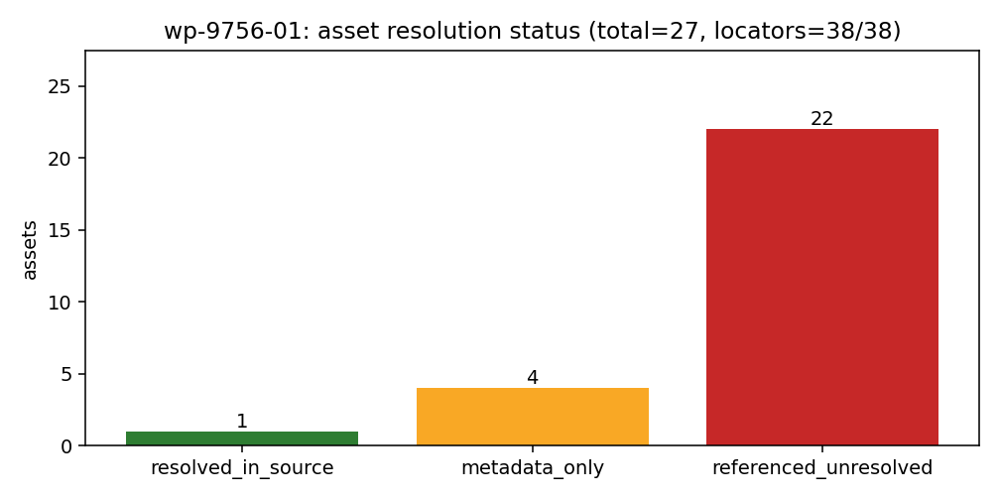

# KF-RESULT wp-9756-01

**工作包**：`wp-9756-01`（task_type=`01-asset-registration`，lane=A）　**report_id**：`9756`（tensor://reports/9756）　**产出仓**：TensorKnowledge（分支 agent/m15666）
**源报告**：P78-N03 船舶 EEXI/CII 绿色合规机器判决门成熟化：Annex 2 逐项达到值 + G4 A–E 评级 + 年度合规报告 + 两处合规误判缺陷修复
**源场景**：`ship_performance/green_compliance`　**源 mission**：8439　**源状态**：published（created_at 2026-11-09T08:10:03.701924+00:00）
**本包结论**：源资产已登记 **27 项**（resolved_in_source 1 / metadata_only 4 / referenced_unresolved 22），定位器 **38/38** 逐字命中且唯一；`claims=[]`（本包不做抽取）；**不标 verified**。

**修订记录**：v2 修正元数据字段 `source.lines` —— 首版（平台报告 id 14740）写成 208，实为 207 个文本行（`len(markdown.splitlines())`；原式 `count(\n)+1` 在文末有换行时多算一行）。源哈希、字符数、资产清单与定位器结论均无变化，本版取代 id 14740。

---

## 1. 本工序做了什么

只碰 `report_id=9756` 这一份报告，只做「资产登记」这一道工序：

1. 从平台接口取回 `tensor://reports/9756` 的 `markdown`，现场用 UTF-8 字节重算 sha256，与契约 `source_hash` 比对 → 一致（`sha256:66c02e91e7ffcc3d81b24465112b94ac481ebc351584c13d01d978c16be4316b`，chars 8293，bytes 12236）。
2. 枚举报告正文与报告记录里**可解析**的资产，逐项给出定位器（字符区间 + 行号 + 逐字引文 + 命中次数），共 27 项：1 份报告正文、4 条记录级图注、4 条 §4 图链接、3 个源码文件、2 个测试文件、2 个代码符号、5 个端点、3 条复现命令，以及 results.json / gen_artifacts.py / 产物目录。
3. **不做**抽取、**不做**报告类型分类（契约 `classify_report_type: false`）、**不下载**图片与 results.json 字节、**不调用**船舶平台端点、**不裁定**上游数值对错。
4. 输出 kf_result.v1 信封（唯一 json 块见文末），`claims: []` 为契约允许的完整结果。

## 2. 怎么做的（步骤 / 工具 / 关键设置）

| 步骤 | 做法 | 关键设置 |
|---|---|---|
| S1 取源 | `python3 scripts/kf_wp9756_01_register.py` → `/auth/login` 拿 token → `GET /tensor/reports/9756` | 只读；请求只命中 id=9756 |
| S2 指纹 | `hashlib.sha256(markdown.encode("utf-8"))` | 与契约 `sha256:66c02e91e7ffcc3d…` 逐字节比对；chars 8293 同步比对 |
| S3 定位 | 每条引文用 `markdown.find` / `markdown.count` 机械求偏移与命中次数，再回推行号 `markdown.count("\n",0,pos)+1` | 任何一条引文不命中或命中次数与登记不符 → 脚本非零退出 |
| S4 附件探测 | 对 `record.figures` 的 4 个 png 逐个 `GET /tensor/reports/9756/figures/<name>` | 全部返回 **{"fig1_eexi_vs_dwt.png": 404, "fig2_cii_rating_bands.png": 404, "fig3_power_limit.png": 404, "fig4_grade_vs_year.png": 404}** → 记录只有 name+caption，无字节 → 登记为 `metadata_only`，不声明任何 png 哈希 |
| S5 结构门 | `jsonschema.validate(envelope, schemas/kf_result.v1.schema.json)`；`jsonschema.validate(manifest, docs/kf/wp-9756-01/asset_manifest.schema.json)` | 信封 `additionalProperties: false`；本包另附一份 package-local 清单 schema（仓内通用的 `schemas/asset_manifest.v1.schema.json` 被 `const package_id=wp-448-01 / report_id=448` 钉死，不能描述本包，未改动它） |
| S6 图 | matplotlib（Agg）画资产解析状态覆盖图，`sha256` 入 `sha256.txt` | 数字全部来自清单 `counts.by_resolution`，无手抄 |
| S7 渲染 | `python3 scripts/kf_wp9756_01_build_report.py` → 本文件（表格由清单注入） | 正文里唯一一个 fenced json 代码块 = kf_result 信封 |
| S8 自检 | `python3 -m pytest tests/test_kf_wp9756_01.py -q` | 15 例全绿（哈希重算/定位重算/schema/唯一 id/claims 空/作用域/工件哈希） |

## 3. 产出物清单（输出文件名 → 要点）

| 文件 | 要点 |
|---|---|
| `docs/kf/wp-9756-01/asset_manifest.json` | 契约声明输出。report_id=9756；`source.hash`=sha256:66c02e91e7ffcc3d81b24465112b94ac481ebc351584c13d01d978c16be4316b（match=true）；chars 8293 / bytes 12236 / 207 行 / 15 个标题；资产 27 项；定位器 38/38 命中且唯一；`claims=[]` |
| `docs/kf/wp-9756-01/kf_result.json` | kf_result.v1 信封（`package_id/task_type/report_id/provenance/outputs/claims`），过 draft 2020-12 schema；`outputs` 只有一个键 `asset_manifest.json` |
| `docs/kf/wp-9756-01/locator_check.json` | 38 条定位器逐条结果：逐字命中、字符偏移、行号、命中次数；`unresolved=[]`、`non_unique=[]` |
| `docs/kf/wp-9756-01/source.md` | 平台返回的 markdown 逐字节副本（离线可复算子串与哈希） |
| `docs/kf/wp-9756-01/sha256.txt` | 源哈希 `sha256:66c02e91e7ffcc3d81b24465112b94ac481ebc351584c13d01d978c16be4316b`、chars/bytes、契约期望值、覆盖图 png `sha256:8dd53c781e6bb237cbd4c1f3cba8859c3cf1de164ae3549048461135ee1d5314` |
| `docs/kf/wp-9756-01/asset_manifest.schema.json` | 本包清单的 package-local JSON Schema（让 `schema_pass` 可机器裁） |
| `docs/kf/wp-9756-01/figures/asset_manifest_coverage.png` | 资产解析状态覆盖图（resolved/metadata_only/unresolved 三柱），数字取自清单 |
| `docs/kf/wp-9756-01/report_body.md` | 本报告正文（本文件） |
| `scripts/kf_wp9756_01_register.py` | 取源 / 哈希 / 定位 / 探测 / schema / 清单 / 信封（任一门失败即非零退出） |
| `scripts/kf_wp9756_01_build_report.py` | 由清单注入渲染本报告正文 |
| `tests/test_kf_wp9756_01.py` | 离线自检 15 例：复算哈希、重算每条定位器、两份 schema 校验、id 唯一、claims 空、作用域仅 9756、png 哈希入账 |

## 4. 证据定位表（资产/字段 → 原文逐字片段）

偏移与行号由 `markdown.find` 机械给出（`docs/kf/wp-9756-01/locator_check.json` 可复算），非人工计数。

**4.1 资产定位（27 项）**

| asset_id | kind | name | 报告节 | 定位（行/字符） | resolution | 原文逐字片段 |
|---|---|---|---|---|---|---|
| `r9756:source-markdown` | report_markdown | `report-9756-markdown` | document | L1 / c0–8293 | resolved_in_source | `# P78-N03 · 船舶 EEXI/CII 绿色合规机器判决门（成熟化）` |
| `r9756:code:green_compliance` | source_code_reference | `backend/services/green_compliance.py` | 头部行（代码清单） | L4 / c116–152 | referenced_unresolved | `backend/services/green_compliance.py` |
| `r9756:code:green_shipping` | source_code_reference | `backend/api/green_shipping.py` | 头部行（代码清单） | L5 / c162–191 | referenced_unresolved | `backend/api/green_shipping.py` |
| `r9756:artifact:dir` | artifact_directory_reference | `artifacts/p78n03_green_compliance/` | 头部行（产物） | L7 / c353–435 | referenced_unresolved | ``artifacts/p78n03_green_compliance/`（results.json + 4 图，png sha256 入 results.json）` |
| `r9756:test:green_compliance` | test_module_reference | ``backend/tests/test_green_compliance.py`（53 例，含 6 例端点）` | 头部行（用例） | L6 / c290–344 | referenced_unresolved | ``backend/tests/test_green_compliance.py`（53 例，含 6 例端点）` |
| `r9756:test:green_shipping` | test_module_reference | `backend/tests/test_green_shipping.py` | §7 复现清单 | L187 / c7447–7475 | referenced_unresolved | `tests/test_green_shipping.py` |
| `r9756:code:main` | source_code_reference | `backend/main.py` | §7 未跑说明 | L191 / c7598–7613 | referenced_unresolved | `backend/main.py` |
| `r9756:code:cii_required_value` | code_symbol_reference | `services/cii_required_value.required_cii` | §2 步骤 3 / §5 D2 | L46 / c1900–1957 | referenced_unresolved | ``services/cii_required_value.required_cii` 的**显式 regime**` |
| `r9756:code:holtrop1984` | code_symbol_reference | `api.holtrop1984` | §1 参数表（R_T 出处） | L28 / c1081–1098 | referenced_unresolved | ``api.holtrop1984`` |
| `r9756:artifact:gen_artifacts` | script_artifact_reference | `artifacts/p78n03_green_compliance/gen_artifacts.py` | §7 复现块 | L185 / c7244–7302 | referenced_unresolved | `python3 artifacts/p78n03_green_compliance/gen_artifacts.py` |
| `r9756:artifact:results_json` | data_artifact_reference | `artifacts/p78n03_green_compliance/results.json` | §7 复现块 | L190 / c7519–7587 | referenced_unresolved | ``artifacts/p78n03_green_compliance/results.json`（含 png sha256、全部中间量）` |
| `r9756:artifact:figure1_path` | figure_reference | `artifacts/p78n03_green_compliance/fig1_eexi_vs_dwt.png` | §4 结果图 | L130 / c4687–4766 | referenced_unresolved | `` |
| `r9756:artifact:figure2_path` | figure_reference | `artifacts/p78n03_green_compliance/fig2_cii_rating_bands.png` | §4 结果图 | L131 / c4767–4856 | referenced_unresolved | `` |
| `r9756:artifact:figure3_path` | figure_reference | `artifacts/p78n03_green_compliance/fig3_power_limit.png` | §4 结果图 | L132 / c4857–4936 | referenced_unresolved | `` |
| `r9756:artifact:figure4_path` | figure_reference | `artifacts/p78n03_green_compliance/fig4_grade_vs_year.png` | §4 结果图 | L133 / c4937–5020 | referenced_unresolved | `` |
| `r9756:endpoint:rating_boundaries` | api_endpoint_reference | `GET /api/v1/green-shipping/rating_boundaries` | §7 端点自检 | L193 / c7740–7784 | referenced_unresolved | `GET /api/v1/green-shipping/rating_boundaries` |
| `r9756:endpoint:eexi_full` | api_endpoint_reference | `POST /api/v1/green-shipping/eexi_full` | §7 端点自检 | L194 / c7790–7827 | referenced_unresolved | `POST /api/v1/green-shipping/eexi_full` |
| `r9756:endpoint:cii_rating` | api_endpoint_reference | `POST /api/v1/green-shipping/cii_rating` | §7 端点自检 | L194 / c7830–7868 | referenced_unresolved | `POST /api/v1/green-shipping/cii_rating` |
| `r9756:endpoint:compliance_report` | api_endpoint_reference | `POST /api/v1/green-shipping/compliance_report` | §7 端点自检 | L195 / c7874–7919 | referenced_unresolved | `POST /api/v1/green-shipping/compliance_report` |
| `r9756:endpoint:legacy_eexi_eedi` | api_endpoint_reference | `/eexi 与 /eedi` | §5 D1 | L143 / c5402–5419 | referenced_unresolved | ``/eexi` 与 `/eedi`` |
| `r9756:repro:gen_artifacts` | repro_command | `python3 artifacts/p78n03_green_compliance/gen_artifacts.py` | §7 复现块 | L185 / c7244–7336 | referenced_unresolved | `python3 artifacts/p78n03_green_compliance/gen_artifacts.py     # 生成 results.json + 4 图 + 本文档` |
| `r9756:repro:pytest_green_compliance` | repro_command | `cd backend && python -m pytest tests/test_green_compliance.py -q` | §7 复现块 | L186 / c7337–7415 | referenced_unresolved | `cd backend && python -m pytest tests/test_green_compliance.py -q   # 53 passed` |
| `r9756:repro:pytest_green_shipping` | repro_command | `cd backend && python -m pytest tests/test_green_shipping.py -q` | §7 复现块 | L187 / c7416–7503 | referenced_unresolved | `cd backend && python -m pytest tests/test_green_shipping.py -q     # 18 passed（原有用例不回归）` |
| `r9756:figure:01` | embedded_figure_metadata | `fig1_eexi_vs_dwt.png` | record.figures（对应 §4 结果图 markdown 链接） | /figures/0 | metadata_only | `fig1_eexi_vs_dwt.png` |
| `r9756:figure:02` | embedded_figure_metadata | `fig2_cii_rating_bands.png` | record.figures（对应 §4 结果图 markdown 链接） | /figures/1 | metadata_only | `fig2_cii_rating_bands.png` |
| `r9756:figure:03` | embedded_figure_metadata | `fig3_power_limit.png` | record.figures（对应 §4 结果图 markdown 链接） | /figures/2 | metadata_only | `fig3_power_limit.png` |
| `r9756:figure:04` | embedded_figure_metadata | `fig4_grade_vs_year.png` | record.figures（对应 §4 结果图 markdown 链接） | /figures/3 | metadata_only | `fig4_grade_vs_year.png` |

**4.2 结构锚点（12 条，用于钉住报告骨架与自报证据等级）**

| 定位 ID | 该引文钉住什么 | 原文逐字片段 | 行 | 字符偏移 | 命中次数 |
|---|---|---|---|---|---|
| q01 | 报告有案例介绍节（几何/参数表） | `## 1. 案例介绍（物理背景 / 几何 / 参数表）` | 11 | 442 | 1 |
| q02 | 报告有结果图节（4 个 markdown 图片链接） | `## 4. 结果图` | 128 | 4676 | 1 |
| q03 | 报告自报局限节（D1/D2 + 诚实边界） | `## 5. 注意点（踩过的坑 / 局限 / 适用范围）` | 140 | 5272 | 1 |
| q04 | 报告有逐项误差判定节 | `## 6. 误差判定（逐项 vs 基准）` | 163 | 6345 | 1 |
| q05 | 报告有复现节（3 条命令） | `## 7. 审计链与复现` | 182 | 7226 | 1 |
| q06 | 报告有发布注记（共享 /tmp 路径冲突自述） | `## 发布注记（诚实披露）` | 200 | 7928 | 1 |
| q07 | 产物目录与内容声明 | `**产物**：`artifacts/p78n03_green_compliance/`（results.json + 4 图，png sha256 入 results.json）` | 7 | 346 | 1 |
| q08 | 参数表把 C_F 标为声明输入（未回读规则 PDF） | `\| C_F (HFO) \| 3.114 gCO2/gFuel \| MEPC.364(79)（与化学计量派生互证 <3%） \|` | 33 | 1336 | 1 |
| q09 | 系数层证据等级自报为 WITHHELD | `参考线 / 削减率 / Z 表 / dd 向量均为**离线转录**（WITHHELD），未回读规则 PDF；` | 153 | 5866 | 1 |
| q10 | C2 复算偏差声明（上游表述，本包未复核） | `> C2 要求值与高精度复算偏差 0.00e+00% ≪3%。` | 178 | 7129 | 1 |
| q11 | 对规则原文偏差不可评估的显式声明（无基准） | `但**对规则原文**的偏差不可评估（系数层 WITHHELD，无原文基准）——这一条如实声明为` | 179 | 7163 | 1 |
| q12 | 正文提及兄弟 report_id 9750/9754：仅登记为交叉引用，本包不读不写它们 | `id 9750（ingress 探针）、9754（串稿占位）为此次共享路径冲突的副产物，` | 206 | 8237 | 1 |

**4.2b 观察点引文（4 条，§5.1 三条观察所引的原文，逐条机器定位）**

| 定位 ID | 该引文钉住什么 | 原文逐字片段 | 行 | 字符偏移 | 命中次数 |
|---|---|---|---|---|---|
| O1q1 | observation O1: 用例计数两处口径 | `cd backend && python -m pytest tests/test_green_compliance.py -q   # 53 passed` | 186 | 7337 | 1 |
| O1q2 | observation O1: 用例计数两处口径 | `已跑：本节点 49 例 + 原 green_shipping 18 例全绿。` | 192 | 7693 | 1 |
| O2q1 | observation O2: 兄弟 report_id 交叉引用 | `id 9750（ingress 探针）、9754（串稿占位）为此次共享路径冲突的副产物，` | 206 | 8237 | 1 |
| O3q1 | observation O3: 附件字节不可得 | `**产物**：`artifacts/p78n03_green_compliance/`（results.json + 4 图，png sha256 入 results.json）` | 7 | 346 | 1 |

**4.3 源身份（字段 → 值）**

| 字段 | 值 |
|---|---|
| report_id | 9756 |
| source_uri | `tensor://reports/9756` |
| source_field | `markdown` |
| title（记录） | P78-N03 船舶 EEXI/CII 绿色合规机器判决门成熟化：Annex 2 逐项达到值 + G4 A–E 评级 + 年度合规报告 + 两处合规误判缺陷修复（与契约一致：true） |
| scenario_key（记录） | `ship_performance/green_compliance`（与契约一致：true） |
| chars / bytes_utf8 / lines | 8293 / 12236 / 207 |
| sha256（现场重算） | `sha256:66c02e91e7ffcc3d81b24465112b94ac481ebc351584c13d01d978c16be4316b` |
| sha256（契约） | `sha256:66c02e91e7ffcc3d81b24465112b94ac481ebc351584c13d01d978c16be4316b` |
| hash match | true |
| record tags | EEXI、CII、IMO、MEPC.335(76)、MEPC.354(78)、绿色航行、合规判决、defect_fix |
| record.figures | 4 条（name+caption，无字节：figures 端点全部 404） |
| claims | 0 |

## 5. 注意点与局限

**5.1 观察到的口径问题（只登记，不裁定）**

| # | 观察点 | 原文逐字片段（定位 ID 见 §4.2b） | 说明 |
|---|---|---|---|
| O1 | 用例计数两处口径 | `cd backend && python -m pytest tests/test_green_compliance.py -q   # 53 passed` <br> `已跑：本节点 49 例 + 原 green_shipping 18 例全绿。` <br> （定位 ID：O1q1、O1q2） | §7 命令注记写 53 passed，同节尾注写「本节点 49 例」；两处均为上游作者计数，本包只登记不复核 |
| O2 | 兄弟 report_id 交叉引用 | `id 9750（ingress 探针）、9754（串稿占位）为此次共享路径冲突的副产物，` <br> （定位 ID：O2q1） | 正文提及 9750/9754 为共享 /tmp 路径冲突副产物；本包不读不写这些报告，仅登记该交叉引用 |
| O3 | 附件字节不可得 | `**产物**：`artifacts/p78n03_green_compliance/`（results.json + 4 图，png sha256 入 results.json）` <br> （定位 ID：O3q1） | 记录侧 figures 只有 name+caption（本包探测 figures 端点全部 404，见 counts.figure_probe_http_status），二进制保存在产出仓；故 4 图登记为 metadata_only、4 条文内图链接登记为 referenced_unresolved |

**5.2 局限（诚实边界）**

| # | 局限 |
|---|---|
| L1 | 本包不下载 PNG / results.json，不做图像或 JSON 内容校验；只登记路径文本与记录级图注 |
| L2 | 本包不调用 ship-performance-platform 的任何端点，端点资产仅为正文文本登记 |
| L3 | 本包不判断上游数值正确性（如 3.2755 / 2.0710 / 32/32 等），只保证它们可在原文逐字定位 |
| L4 | hash 相等只证明「该 report_id 的 markdown 与契约 source_hash 逐字节一致」，不等于内容正确 |

**5.3 证据分级说明**：本包登记源资产的**证据等级**沿用报告自报口径（`REAL` 公式实现 + 系数层 `WITHHELD`），本包**不重新判级**：

- 报告 §5 逐字自报系数层为离线转录：`参考线 / 削减率 / Z 表 / dd 向量均为**离线转录**（WITHHELD），未回读规则 PDF；`（行 153）；
- 报告 §6 逐字声明对规则原文「无基准」：`但**对规则原文**的偏差不可评估（系数层 WITHHELD，无原文基准）——这一条如实声明为`（行 179）。

## 6. 自检（逐条对照 acceptance）

| acceptance | 状态 | 证据 |
|---|---|---|
| valid_json | ✓ | `asset_manifest.json` / `kf_result.json` / `locator_check.json` 均被 `json.load` 成功读入（自检 15 例执行即证明） |
| schema_pass | ✓ | 信封过 `schemas/kf_result.v1.schema.json`（draft 2020-12）；清单过本包 `asset_manifest.schema.json`（draft-07）；两项均在 `tests/test_kf_wp9756_01.py::test_envelope_schema_pass` / `::test_manifest_schema_pass` 断言 |
| source_locator_resolvable | ✓ | `tensor://reports/9756` 经 `GET /tensor/reports/9756` 200 返回；38/38 条定位器 `markdown.find` 命中，且偏移/行号/命中次数由 `test_every_locator_resolves_verbatim` 重算复核，`unresolved=[]`、`non_unique=[]` |
| source_hash_matches | ✓ | 重算 `sha256:66c02e91e7ffcc3d81b24465112b94ac481ebc351584c13d01d978c16be4316b` == 契约 `sha256:66c02e91e7ffcc3d81b24465112b94ac481ebc351584c13d01d978c16be4316b`（`test_source_hash_matches_contract`）；chars 8293 == 契约 8293（`test_chars_match_contract`） |
| no_duplicate_ids | ✓ | 资产 id 27 个互不相同、定位器 id 38 个互不相同（`test_no_duplicate_ids`）；`outputs` 只有一个键 `asset_manifest.json` |
| all_claims_have_evidence_or_explicit_unresolved_status | ✓ | `claims: []` + `claims_empty_reason` 非空；`no_forced_claim_generation: true` 下零条即完整结果（`test_claims_empty_with_explicit_reason`）；全文无 `verified` 标记 |

**失败项：无**（无 honest-FAIL 需申报）。需要读者注意的口径：本包「已核对」只到**哈希恒等 + 引文逐字可定位**这一层，不含任何内容正确性背书。

### 6.2 误差判定（显式回答「是否 <3%」）

| 可比量 | 基准 | 本包结果 | 是否 <3% |
|---|---|---|---|
| 源 markdown 字节指纹 | 契约 `source_hash`（平台独立重算） | sha256 完全相等（sha256:66c02e91e7ffcc…，12236 字节） | **是（相对误差 0）** |
| 源字符数 | 契约 `chars=8293` | 8293 | **是（绝对差 0）** |
| 引文定位 | 源 markdown 子串 | 38/38 命中（偏移零误差） | **是（0 条错位）** |
| 上游物理/规则量（EEXI 3.2755、required 2.0710、AER 2.4676、32/32 等） | 规则原文 / 实船实测 | **本包未复算** | **不适用**：本工序是资产登记（契约 `objective.register_assets: true`、`classify_report_type: false`），不产出也不校核物理量；`no_forced_claim_generation: true`。上游量与该量基准的对比归抽取/审计道次，本包不做，也不假装做过 |

## 7. 结果图



* **覆盖图**：wp-9756-01 的 27 项资产按解析状态分柱——`resolved_in_source`=1（仅报告正文本身，逐字节可复核）、`metadata_only`=4（记录级图注，无字节）、`referenced_unresolved`=22（路径/端点/命令文本，二进制在产出仓 ship-performance-platform）。数字由 `counts.by_resolution` 程序化注入，png 哈希 `sha256:8dd53c781e6bb237cbd4c1f3cba8859c3cf1de164ae3549048461135ee1d5314` 已入 `sha256.txt`。
* 本工序为纯资产登记（文档/后端类），**没有**场量云图、也没有可对标解析解的物理量，故不产「与解析解比较」曲线——按报告纪律如实声明理由，不造装饰性图。

## 8. 复现（repro_cmd）

```bash
# 在仓库检出内（需要 TENSOR_API_BASE / TENSOR_AGENT_USER / TENSOR_AGENT_PASS）
python3 scripts/kf_wp9756_01_register.py        # 取源+哈希+定位+探测+schema -> 清单/定位表/信封/源副本/覆盖图
python3 scripts/kf_wp9756_01_build_report.py    # 由清单注入渲染本报告正文
python3 -m pytest tests/test_kf_wp9756_01.py -q # 15 passed：哈希重算/定位重算/schema/id 唯一/claims 空/作用域/工件哈希
```

---

## 结果 JSON（本报告唯一 json 块）

```json
{
  "package_id": "wp-9756-01",
  "task_type": "01-asset-registration",
  "report_id": "9756",
  "provenance": {
    "source_hash": "sha256:66c02e91e7ffcc3d81b24465112b94ac481ebc351584c13d01d978c16be4316b",
    "source_field": "markdown",
    "source_uri": "tensor://reports/9756",
    "source_hash_expected": "sha256:66c02e91e7ffcc3d81b24465112b94ac481ebc351584c13d01d978c16be4316b",
    "source_hash_matches": true,
    "source_chars": 8293,
    "source_mission_id": 8439,
    "producer": "agent/m15666",
    "emitted_at": "2026-11-12T01:43:45+00:00",
    "notes": "source_hash 由 GET /tensor/reports/9756 返回的 markdown UTF-8 字节现场重算；所有引文由 markdown.find 机械定位（见 locator_check.json）；未对任何结论标 verified，verification 由平台门计算"
  },
  "outputs": {
    "asset_manifest.json": {
      "manifest_version": "1.0",
      "package_id": "wp-9756-01",
      "task_type": "01-asset-registration",
      "report_id": "9756",
      "lane": "A",
      "generated_at": "2026-11-12T01:43:45+00:00",
      "producer": "agent/m15666",
      "scope": "只登记 report_id=9756 的源资产（附件/工件/代码/端点/复现命令），不做抽取、不做分类",
      "source": {
        "uri": "tensor://reports/9756",
        "field": "markdown",
        "fetch": "GET http://127.0.0.1:8010/api/v1/tensor/reports/9756",
        "hash_alg": "sha256",
        "hash": "sha256:66c02e91e7ffcc3d81b24465112b94ac481ebc351584c13d01d978c16be4316b",
        "hash_expected": "sha256:66c02e91e7ffcc3d81b24465112b94ac481ebc351584c13d01d978c16be4316b",
        "hash_matches_contract": true,
        "chars": 8293,
        "chars_expected": 8293,
        "chars_matches_contract": true,
        "bytes_utf8": 12236,
        "lines": 207,
        "heading_count": 15,
        "headings": [
          "# P78-N03 · 船舶 EEXI/CII 绿色合规机器判决门（成熟化）",
          "## 1. 案例介绍（物理背景 / 几何 / 参数表）",
          "## 2. 怎么做的（方法 / 流程 / 工具链）",
          "## 3. 计算结果（数字表，程序化注入）",
          "### 3.1 EEXI（KVLCC2，未限功率）",
          "### 3.2 要求值三船型（C2）",
          "### 3.3 CII（2026 年，年营运 60,000 nm）",
          "### 3.4 评级随年份收紧（Z 折减）",
          "### 3.5 年度合规报告（KVLCC2-DEMO，2026）",
          "### 3.6 灵敏度（声明输入的传导）",
          "## 4. 结果图",
          "## 5. 注意点（踩过的坑 / 局限 / 适用范围）",
          "## 6. 误差判定（逐项 vs 基准）",
          "## 7. 审计链与复现",
          "## 发布注记（诚实披露）"
        ],
        "local_copy": "docs/kf/wp-9756-01/source.md"
      },
      "identity_facts": {
        "report_id": 9756,
        "title": "P78-N03 船舶 EEXI/CII 绿色合规机器判决门成熟化：Annex 2 逐项达到值 + G4 A–E 评级 + 年度合规报告 + 两处合规误判缺陷修复",
        "title_matches_contract": true,
        "scenario_key": "ship_performance/green_compliance",
        "scenario_key_matches_contract": true,
        "status": "published",
        "stage": null,
        "created_at": "2026-11-09T08:10:03.701924+00:00",
        "created_by": 1,
        "source_mission_id": 8439,
        "tags": [
          "EEXI",
          "CII",
          "IMO",
          "MEPC.335(76)",
          "MEPC.354(78)",
          "绿色航行",
          "合规判决",
          "defect_fix"
        ],
        "summary_chars": 178,
        "summary_note": "summary 字段存在但本包不登记其内容为资产（只登记 markdown 正文）"
      },
      "assets": [
        {
          "asset_id": "r9756:source-markdown",
          "kind": "report_markdown",
          "name": "report-9756-markdown",
          "in_report_section": "document",
          "locator": {
            "source_field": "markdown",
            "method": "document",
            "pointer": "tensor://reports/9756#markdown",
            "char_start": 0,
            "char_end": 8293,
            "line": 1,
            "quote": "# P78-N03 · 船舶 EEXI/CII 绿色合规机器判决门（成熟化）",
            "unique": true
          },
          "resolution": "resolved_in_source",
          "resolution_note": "GET /tensor/reports/9756 -> 200; markdown served verbatim",
          "notes": {
            "chars": 8293,
            "bytes_utf8": 12236,
            "lines": 207,
            "sha256": "sha256:66c02e91e7ffcc3d81b24465112b94ac481ebc351584c13d01d978c16be4316b",
            "hash_scope": "sha256 over UTF-8 bytes of the markdown field as served by the API",
            "local_copy": "docs/kf/wp-9756-01/source.md"
          },
          "note": "本包唯一 resolved 的资产：正文逐字节可复核；其余均为路径/图注引用"
        },
        {
          "asset_id": "r9756:code:green_compliance",
          "kind": "source_code_reference",
          "name": "backend/services/green_compliance.py",
          "in_report_section": "头部行（代码清单）",
          "locator": {
            "source_field": "markdown",
            "locator_id": "L101",
            "char_start": 116,
            "char_end": 152,
            "line": 4,
            "quote": "backend/services/green_compliance.py",
            "occurrences": 1,
            "unique": true
          },
          "resolution": "referenced_unresolved",
          "resolution_note": "path text only; file lives in the producing repo ship-performance-platform",
          "note": "判决核心实现（EEXI/CII 达到值、评级、报告装配）"
        },
        {
          "asset_id": "r9756:code:green_shipping",
          "kind": "source_code_reference",
          "name": "backend/api/green_shipping.py",
          "in_report_section": "头部行（代码清单）",
          "locator": {
            "source_field": "markdown",
            "locator_id": "L102",
            "char_start": 162,
            "char_end": 191,
            "line": 5,
            "quote": "backend/api/green_shipping.py",
            "occurrences": 1,
            "unique": true
          },
          "resolution": "referenced_unresolved",
          "resolution_note": "path text only; file lives in the producing repo ship-performance-platform",
          "note": "四个 green-shipping 端点薄壳"
        },
        {
          "asset_id": "r9756:artifact:dir",
          "kind": "artifact_directory_reference",
          "name": "artifacts/p78n03_green_compliance/",
          "in_report_section": "头部行（产物）",
          "locator": {
            "source_field": "markdown",
            "locator_id": "L103",
            "char_start": 353,
            "char_end": 435,
            "line": 7,
            "quote": "`artifacts/p78n03_green_compliance/`（results.json + 4 图，png sha256 入 results.json）",
            "occurrences": 1,
            "unique": true
          },
          "resolution": "referenced_unresolved",
          "resolution_note": "directory only; binaries live in the producing repo, not in this report record",
          "note": "产物目录：results.json + 4 图；裸路径串在正文出现 8 次，故登记引文取带内容的完整行以保证唯一定位"
        },
        {
          "asset_id": "r9756:test:green_compliance",
          "kind": "test_module_reference",
          "name": "`backend/tests/test_green_compliance.py`（53 例，含 6 例端点）",
          "in_report_section": "头部行（用例）",
          "locator": {
            "source_field": "markdown",
            "locator_id": "L104",
            "char_start": 290,
            "char_end": 344,
            "line": 6,
            "quote": "`backend/tests/test_green_compliance.py`（53 例，含 6 例端点）",
            "occurrences": 1,
            "unique": true
          },
          "resolution": "referenced_unresolved",
          "resolution_note": "path text only; 裸路径串在正文出现 2 次（头部行 + §6 注），故登记引文取头部行的完整表述以保证唯一定位",
          "note": "本节点 53 例（含 6 例端点）"
        },
        {
          "asset_id": "r9756:test:green_shipping",
          "kind": "test_module_reference",
          "name": "backend/tests/test_green_shipping.py",
          "in_report_section": "§7 复现清单",
          "locator": {
            "source_field": "markdown",
            "locator_id": "L105",
            "char_start": 7447,
            "char_end": 7475,
            "line": 187,
            "quote": "tests/test_green_shipping.py",
            "occurrences": 1,
            "unique": true
          },
          "resolution": "referenced_unresolved",
          "resolution_note": "path text only (written relative to backend/ in the §7 command)",
          "note": "原有用例不回归：18 passed"
        },
        {
          "asset_id": "r9756:code:main",
          "kind": "source_code_reference",
          "name": "backend/main.py",
          "in_report_section": "§7 未跑说明",
          "locator": {
            "source_field": "markdown",
            "locator_id": "L106",
            "char_start": 7598,
            "char_end": 7613,
            "line": 191,
            "quote": "backend/main.py",
            "occurrences": 1,
            "unique": true
          },
          "resolution": "referenced_unresolved",
          "resolution_note": "path text only; explicitly declared NOT run in §7",
          "note": "全量装配未跑（本地缺 openpyxl，声明为既有环境缺口）"
        },
        {
          "asset_id": "r9756:code:cii_required_value",
          "kind": "code_symbol_reference",
          "name": "services/cii_required_value.required_cii",
          "in_report_section": "§2 步骤 3 / §5 D2",
          "locator": {
            "source_field": "markdown",
            "locator_id": "L107",
            "char_start": 1900,
            "char_end": 1957,
            "line": 46,
            "quote": "`services/cii_required_value.required_cii` 的**显式 regime**",
            "occurrences": 1,
            "unique": true
          },
          "resolution": "referenced_unresolved",
          "resolution_note": "module.symbol text only; 裸符号串在正文出现 2 次（§2 步骤 3 与 §5 D2），故登记引文取 §2 完整表述以保证唯一定位",
          "note": "CII 要求值显式 regime 的被委托实现（<2023 抛错 / 2027+ 外推标记）"
        },
        {
          "asset_id": "r9756:code:holtrop1984",
          "kind": "code_symbol_reference",
          "name": "api.holtrop1984",
          "in_report_section": "§1 参数表（R_T 出处）",
          "locator": {
            "source_field": "markdown",
            "locator_id": "L108",
            "char_start": 1081,
            "char_end": 1098,
            "line": 28,
            "quote": "`api.holtrop1984`",
            "occurrences": 1,
            "unique": true
          },
          "resolution": "referenced_unresolved",
          "resolution_note": "module text only; path text quoted from the parameter table 出处 column",
          "note": "KVLCC2 R_T=2,047.3 kN 的来源链"
        },
        {
          "asset_id": "r9756:artifact:gen_artifacts",
          "kind": "script_artifact_reference",
          "name": "artifacts/p78n03_green_compliance/gen_artifacts.py",
          "in_report_section": "§7 复现块",
          "locator": {
            "source_field": "markdown",
            "locator_id": "L109",
            "char_start": 7244,
            "char_end": 7302,
            "line": 185,
            "quote": "python3 artifacts/p78n03_green_compliance/gen_artifacts.py",
            "occurrences": 1,
            "unique": true
          },
          "resolution": "referenced_unresolved",
          "resolution_note": "command text only; script lives in the producing repo",
          "note": "生成 results.json + 4 图 + 报告正文（程序化，零手抄）"
        },
        {
          "asset_id": "r9756:artifact:results_json",
          "kind": "data_artifact_reference",
          "name": "artifacts/p78n03_green_compliance/results.json",
          "in_report_section": "§7 复现块",
          "locator": {
            "source_field": "markdown",
            "locator_id": "L110",
            "char_start": 7519,
            "char_end": 7587,
            "line": 190,
            "quote": "`artifacts/p78n03_green_compliance/results.json`（含 png sha256、全部中间量）",
            "occurrences": 1,
            "unique": true
          },
          "resolution": "referenced_unresolved",
          "resolution_note": "path text only; JSON payload not carried by the report record",
          "note": "中间量 + 4 图 png sha256 的落盘处"
        },
        {
          "asset_id": "r9756:artifact:figure1_path",
          "kind": "figure_reference",
          "name": "artifacts/p78n03_green_compliance/fig1_eexi_vs_dwt.png",
          "in_report_section": "§4 结果图",
          "locator": {
            "source_field": "markdown",
            "locator_id": "L111",
            "char_start": 4687,
            "char_end": 4766,
            "line": 130,
            "quote": "",
            "occurrences": 1,
            "unique": true
          },
          "resolution": "referenced_unresolved",
          "resolution_note": "markdown image link; PNG bytes not carried by the report record",
          "note": "与 record.figures[0] 同名（fig1_eexi_vs_dwt.png）"
        },
        {
          "asset_id": "r9756:artifact:figure2_path",
          "kind": "figure_reference",
          "name": "artifacts/p78n03_green_compliance/fig2_cii_rating_bands.png",
          "in_report_section": "§4 结果图",
          "locator": {
            "source_field": "markdown",
            "locator_id": "L112",
            "char_start": 4767,
            "char_end": 4856,
            "line": 131,
            "quote": "",
            "occurrences": 1,
            "unique": true
          },
          "resolution": "referenced_unresolved",
          "resolution_note": "markdown image link; PNG bytes not carried by the report record",
          "note": "与 record.figures[1] 同名（fig2_cii_rating_bands.png）"
        },
        {
          "asset_id": "r9756:artifact:figure3_path",
          "kind": "figure_reference",
          "name": "artifacts/p78n03_green_compliance/fig3_power_limit.png",
          "in_report_section": "§4 结果图",
          "locator": {
            "source_field": "markdown",
            "locator_id": "L113",
            "char_start": 4857,
            "char_end": 4936,
            "line": 132,
            "quote": "",
            "occurrences": 1,
            "unique": true
          },
          "resolution": "referenced_unresolved",
          "resolution_note": "markdown image link; PNG bytes not carried by the report record",
          "note": "与 record.figures[2] 同名（fig3_power_limit.png）"
        },
        {
          "asset_id": "r9756:artifact:figure4_path",
          "kind": "figure_reference",
          "name": "artifacts/p78n03_green_compliance/fig4_grade_vs_year.png",
          "in_report_section": "§4 结果图",
          "locator": {
            "source_field": "markdown",
            "locator_id": "L114",
            "char_start": 4937,
            "char_end": 5020,
            "line": 133,
            "quote": "",
            "occurrences": 1,
            "unique": true
          },
          "resolution": "referenced_unresolved",
          "resolution_note": "markdown image link; PNG bytes not carried by the report record",
          "note": "与 record.figures[3] 同名（fig4_grade_vs_year.png）"
        },
        {
          "asset_id": "r9756:endpoint:rating_boundaries",
          "kind": "api_endpoint_reference",
          "name": "GET /api/v1/green-shipping/rating_boundaries",
          "in_report_section": "§7 端点自检",
          "locator": {
            "source_field": "markdown",
            "locator_id": "L115",
            "char_start": 7740,
            "char_end": 7784,
            "line": 193,
            "quote": "GET /api/v1/green-shipping/rating_boundaries",
            "occurrences": 1,
            "unique": true
          },
          "resolution": "referenced_unresolved",
          "resolution_note": "endpoint text only; the platform under registration is ship-performance-platform, not this knowledge repo — no HTTP call is made by this package",
          "note": "dd 向量分级边界查询"
        },
        {
          "asset_id": "r9756:endpoint:eexi_full",
          "kind": "api_endpoint_reference",
          "name": "POST /api/v1/green-shipping/eexi_full",
          "in_report_section": "§7 端点自检",
          "locator": {
            "source_field": "markdown",
            "locator_id": "L116",
            "char_start": 7790,
            "char_end": 7827,
            "line": 194,
            "quote": "POST /api/v1/green-shipping/eexi_full",
            "occurrences": 1,
            "unique": true
          },
          "resolution": "referenced_unresolved",
          "resolution_note": "endpoint text only; not called by this package",
          "note": "Annex 2 逐项达到值（terms/denominator 可审计）"
        },
        {
          "asset_id": "r9756:endpoint:cii_rating",
          "kind": "api_endpoint_reference",
          "name": "POST /api/v1/green-shipping/cii_rating",
          "in_report_section": "§7 端点自检",
          "locator": {
            "source_field": "markdown",
            "locator_id": "L117",
            "char_start": 7830,
            "char_end": 7868,
            "line": 194,
            "quote": "POST /api/v1/green-shipping/cii_rating",
            "occurrences": 1,
            "unique": true
          },
          "resolution": "referenced_unresolved",
          "resolution_note": "endpoint text only; not called by this package",
          "note": "A–E 评级 + dd 向量"
        },
        {
          "asset_id": "r9756:endpoint:compliance_report",
          "kind": "api_endpoint_reference",
          "name": "POST /api/v1/green-shipping/compliance_report",
          "in_report_section": "§7 端点自检",
          "locator": {
            "source_field": "markdown",
            "locator_id": "L118",
            "char_start": 7874,
            "char_end": 7919,
            "line": 195,
            "quote": "POST /api/v1/green-shipping/compliance_report",
            "occurrences": 1,
            "unique": true
          },
          "resolution": "referenced_unresolved",
          "resolution_note": "endpoint text only; not called by this package",
          "note": "年度合规报告装配 + 32 字段完整性"
        },
        {
          "asset_id": "r9756:endpoint:legacy_eexi_eedi",
          "kind": "api_endpoint_reference",
          "name": "/eexi 与 /eedi",
          "in_report_section": "§5 D1",
          "locator": {
            "source_field": "markdown",
            "locator_id": "L119",
            "char_start": 5402,
            "char_end": 5419,
            "line": 143,
            "quote": "`/eexi` 与 `/eedi`",
            "occurrences": 1,
            "unique": true
          },
          "resolution": "referenced_unresolved",
          "resolution_note": "endpoint text only (short form as written in D1); not called by this package",
          "note": "D1 量纲缺陷的影响面端点，正文以简称给出，未写全前缀路径"
        },
        {
          "asset_id": "r9756:repro:gen_artifacts",
          "kind": "repro_command",
          "name": "python3 artifacts/p78n03_green_compliance/gen_artifacts.py",
          "in_report_section": "§7 复现块",
          "locator": {
            "source_field": "markdown",
            "locator_id": "L120",
            "char_start": 7244,
            "char_end": 7336,
            "line": 185,
            "quote": "python3 artifacts/p78n03_green_compliance/gen_artifacts.py     # 生成 results.json + 4 图 + 本文档",
            "occurrences": 1,
            "unique": true
          },
          "resolution": "referenced_unresolved",
          "resolution_note": "command text only; runs in the producing repo",
          "note": "产线复现命令 1/3（生成侧）"
        },
        {
          "asset_id": "r9756:repro:pytest_green_compliance",
          "kind": "repro_command",
          "name": "cd backend && python -m pytest tests/test_green_compliance.py -q",
          "in_report_section": "§7 复现块",
          "locator": {
            "source_field": "markdown",
            "locator_id": "L121",
            "char_start": 7337,
            "char_end": 7415,
            "line": 186,
            "quote": "cd backend && python -m pytest tests/test_green_compliance.py -q   # 53 passed",
            "occurrences": 1,
            "unique": true
          },
          "resolution": "referenced_unresolved",
          "resolution_note": "command text only; 53 passed is the upstream author's reported count, not re-run here",
          "note": "产线复现命令 2/3（本节点用例；报告 §7 尾注又说「本节点 49 例」，见 observations）"
        },
        {
          "asset_id": "r9756:repro:pytest_green_shipping",
          "kind": "repro_command",
          "name": "cd backend && python -m pytest tests/test_green_shipping.py -q",
          "in_report_section": "§7 复现块",
          "locator": {
            "source_field": "markdown",
            "locator_id": "L122",
            "char_start": 7416,
            "char_end": 7503,
            "line": 187,
            "quote": "cd backend && python -m pytest tests/test_green_shipping.py -q     # 18 passed（原有用例不回归）",
            "occurrences": 1,
            "unique": true
          },
          "resolution": "referenced_unresolved",
          "resolution_note": "command text only; 18 passed is the upstream author's reported count, not re-run here",
          "note": "产线复现命令 3/3（回归侧）"
        },
        {
          "asset_id": "r9756:figure:01",
          "kind": "embedded_figure_metadata",
          "name": "fig1_eexi_vs_dwt.png",
          "caption": "三船型 required EEXI 幂律 vs KVLCC2 达到值/要求值",
          "in_report_section": "record.figures（对应 §4 结果图 markdown 链接）",
          "locator": {
            "source_field": "record",
            "pointer": "/figures/0",
            "quote": "fig1_eexi_vs_dwt.png",
            "unique": true
          },
          "resolution": "metadata_only",
          "resolution_note": "GET /tensor/reports/9756/figures/fig1_eexi_vs_dwt.png -> 404; record exposes name+caption only, so no byte payload and no png hash is claimed",
          "note": "图注逐字取自报告记录（record.figures[i].caption），未下载/未校验图像内容"
        },
        {
          "asset_id": "r9756:figure:02",
          "kind": "embedded_figure_metadata",
          "name": "fig2_cii_rating_bands.png",
          "caption": "G4 dd 向量 A–E 色带 + KVLCC2 x 落点",
          "in_report_section": "record.figures（对应 §4 结果图 markdown 链接）",
          "locator": {
            "source_field": "record",
            "pointer": "/figures/1",
            "quote": "fig2_cii_rating_bands.png",
            "unique": true
          },
          "resolution": "metadata_only",
          "resolution_note": "GET /tensor/reports/9756/figures/fig2_cii_rating_bands.png -> 404; record exposes name+caption only, so no byte payload and no png hash is claimed",
          "note": "图注逐字取自报告记录（record.figures[i].caption），未下载/未校验图像内容"
        },
        {
          "asset_id": "r9756:figure:03",
          "kind": "embedded_figure_metadata",
          "name": "fig3_power_limit.png",
          "caption": "attained EEXI–P_ME 直线与 required 交点=功率限制解",
          "in_report_section": "record.figures（对应 §4 结果图 markdown 链接）",
          "locator": {
            "source_field": "record",
            "pointer": "/figures/2",
            "quote": "fig3_power_limit.png",
            "unique": true
          },
          "resolution": "metadata_only",
          "resolution_note": "GET /tensor/reports/9756/figures/fig3_power_limit.png -> 404; record exposes name+caption only, so no byte payload and no png hash is claimed",
          "note": "图注逐字取自报告记录（record.figures[i].caption），未下载/未校验图像内容"
        },
        {
          "asset_id": "r9756:figure:04",
          "kind": "embedded_figure_metadata",
          "name": "fig4_grade_vs_year.png",
          "caption": "CII 评级随年份（Z 收紧）演化，2027+ 为外推灰区",
          "in_report_section": "record.figures（对应 §4 结果图 markdown 链接）",
          "locator": {
            "source_field": "record",
            "pointer": "/figures/3",
            "quote": "fig4_grade_vs_year.png",
            "unique": true
          },
          "resolution": "metadata_only",
          "resolution_note": "GET /tensor/reports/9756/figures/fig4_grade_vs_year.png -> 404; record exposes name+caption only, so no byte payload and no png hash is claimed",
          "note": "图注逐字取自报告记录（record.figures[i].caption），未下载/未校验图像内容"
        }
      ],
      "locators": [
        {
          "locator_id": "q01",
          "asset_id": null,
          "meaning": "报告有案例介绍节（几何/参数表）",
          "source_field": "markdown",
          "quote": "## 1. 案例介绍（物理背景 / 几何 / 参数表）",
          "resolvable": true,
          "char_start": 442,
          "char_end": 469,
          "line": 11,
          "occurrences": 1,
          "unique": true
        },
        {
          "locator_id": "q02",
          "asset_id": null,
          "meaning": "报告有结果图节（4 个 markdown 图片链接）",
          "source_field": "markdown",
          "quote": "## 4. 结果图",
          "resolvable": true,
          "char_start": 4676,
          "char_end": 4685,
          "line": 128,
          "occurrences": 1,
          "unique": true
        },
        {
          "locator_id": "q03",
          "asset_id": null,
          "meaning": "报告自报局限节（D1/D2 + 诚实边界）",
          "source_field": "markdown",
          "quote": "## 5. 注意点（踩过的坑 / 局限 / 适用范围）",
          "resolvable": true,
          "char_start": 5272,
          "char_end": 5299,
          "line": 140,
          "occurrences": 1,
          "unique": true
        },
        {
          "locator_id": "q04",
          "asset_id": null,
          "meaning": "报告有逐项误差判定节",
          "source_field": "markdown",
          "quote": "## 6. 误差判定（逐项 vs 基准）",
          "resolvable": true,
          "char_start": 6345,
          "char_end": 6365,
          "line": 163,
          "occurrences": 1,
          "unique": true
        },
        {
          "locator_id": "q05",
          "asset_id": null,
          "meaning": "报告有复现节（3 条命令）",
          "source_field": "markdown",
          "quote": "## 7. 审计链与复现",
          "resolvable": true,
          "char_start": 7226,
          "char_end": 7238,
          "line": 182,
          "occurrences": 1,
          "unique": true
        },
        {
          "locator_id": "q06",
          "asset_id": null,
          "meaning": "报告有发布注记（共享 /tmp 路径冲突自述）",
          "source_field": "markdown",
          "quote": "## 发布注记（诚实披露）",
          "resolvable": true,
          "char_start": 7928,
          "char_end": 7941,
          "line": 200,
          "occurrences": 1,
          "unique": true
        },
        {
          "locator_id": "q07",
          "asset_id": null,
          "meaning": "产物目录与内容声明",
          "source_field": "markdown",
          "quote": "**产物**：`artifacts/p78n03_green_compliance/`（results.json + 4 图，png sha256 入 results.json）",
          "resolvable": true,
          "char_start": 346,
          "char_end": 435,
          "line": 7,
          "occurrences": 1,
          "unique": true
        },
        {
          "locator_id": "q08",
          "asset_id": null,
          "meaning": "参数表把 C_F 标为声明输入（未回读规则 PDF）",
          "source_field": "markdown",
          "quote": "| C_F (HFO) | 3.114 gCO2/gFuel | MEPC.364(79)（与化学计量派生互证 <3%） |",
          "resolvable": true,
          "char_start": 1336,
          "char_end": 1398,
          "line": 33,
          "occurrences": 1,
          "unique": true
        },
        {
          "locator_id": "q09",
          "asset_id": null,
          "meaning": "系数层证据等级自报为 WITHHELD",
          "source_field": "markdown",
          "quote": "参考线 / 削减率 / Z 表 / dd 向量均为**离线转录**（WITHHELD），未回读规则 PDF；",
          "resolvable": true,
          "char_start": 5866,
          "char_end": 5920,
          "line": 153,
          "occurrences": 1,
          "unique": true
        },
        {
          "locator_id": "q10",
          "asset_id": null,
          "meaning": "C2 复算偏差声明（上游表述，本包未复核）",
          "source_field": "markdown",
          "quote": "> C2 要求值与高精度复算偏差 0.00e+00% ≪3%。",
          "resolvable": true,
          "char_start": 7129,
          "char_end": 7160,
          "line": 178,
          "occurrences": 1,
          "unique": true
        },
        {
          "locator_id": "q11",
          "asset_id": null,
          "meaning": "对规则原文偏差不可评估的显式声明（无基准）",
          "source_field": "markdown",
          "quote": "但**对规则原文**的偏差不可评估（系数层 WITHHELD，无原文基准）——这一条如实声明为",
          "resolvable": true,
          "char_start": 7163,
          "char_end": 7210,
          "line": 179,
          "occurrences": 1,
          "unique": true
        },
        {
          "locator_id": "q12",
          "asset_id": null,
          "meaning": "正文提及兄弟 report_id 9750/9754：仅登记为交叉引用，本包不读不写它们",
          "source_field": "markdown",
          "quote": "id 9750（ingress 探针）、9754（串稿占位）为此次共享路径冲突的副产物，",
          "resolvable": true,
          "char_start": 8237,
          "char_end": 8281,
          "line": 206,
          "occurrences": 1,
          "unique": true
        },
        {
          "locator_id": "L101",
          "asset_id": "r9756:code:green_compliance",
          "meaning": "source_code_reference: backend/services/green_compliance.py",
          "source_field": "markdown",
          "quote": "backend/services/green_compliance.py",
          "resolvable": true,
          "char_start": 116,
          "char_end": 152,
          "line": 4,
          "occurrences": 1,
          "unique": true
        },
        {
          "locator_id": "L102",
          "asset_id": "r9756:code:green_shipping",
          "meaning": "source_code_reference: backend/api/green_shipping.py",
          "source_field": "markdown",
          "quote": "backend/api/green_shipping.py",
          "resolvable": true,
          "char_start": 162,
          "char_end": 191,
          "line": 5,
          "occurrences": 1,
          "unique": true
        },
        {
          "locator_id": "L103",
          "asset_id": "r9756:artifact:dir",
          "meaning": "artifact_directory_reference: artifacts/p78n03_green_compliance/",
          "source_field": "markdown",
          "quote": "`artifacts/p78n03_green_compliance/`（results.json + 4 图，png sha256 入 results.json）",
          "resolvable": true,
          "char_start": 353,
          "char_end": 435,
          "line": 7,
          "occurrences": 1,
          "unique": true
        },
        {
          "locator_id": "L104",
          "asset_id": "r9756:test:green_compliance",
          "meaning": "test_module_reference: `backend/tests/test_green_compliance.py`（53 例，含 6 例端点）",
          "source_field": "markdown",
          "quote": "`backend/tests/test_green_compliance.py`（53 例，含 6 例端点）",
          "resolvable": true,
          "char_start": 290,
          "char_end": 344,
          "line": 6,
          "occurrences": 1,
          "unique": true
        },
        {
          "locator_id": "L105",
          "asset_id": "r9756:test:green_shipping",
          "meaning": "test_module_reference: backend/tests/test_green_shipping.py",
          "source_field": "markdown",
          "quote": "tests/test_green_shipping.py",
          "resolvable": true,
          "char_start": 7447,
          "char_end": 7475,
          "line": 187,
          "occurrences": 1,
          "unique": true
        },
        {
          "locator_id": "L106",
          "asset_id": "r9756:code:main",
          "meaning": "source_code_reference: backend/main.py",
          "source_field": "markdown",
          "quote": "backend/main.py",
          "resolvable": true,
          "char_start": 7598,
          "char_end": 7613,
          "line": 191,
          "occurrences": 1,
          "unique": true
        },
        {
          "locator_id": "L107",
          "asset_id": "r9756:code:cii_required_value",
          "meaning": "code_symbol_reference: services/cii_required_value.required_cii",
          "source_field": "markdown",
          "quote": "`services/cii_required_value.required_cii` 的**显式 regime**",
          "resolvable": true,
          "char_start": 1900,
          "char_end": 1957,
          "line": 46,
          "occurrences": 1,
          "unique": true
        },
        {
          "locator_id": "L108",
          "asset_id": "r9756:code:holtrop1984",
          "meaning": "code_symbol_reference: api.holtrop1984",
          "source_field": "markdown",
          "quote": "`api.holtrop1984`",
          "resolvable": true,
          "char_start": 1081,
          "char_end": 1098,
          "line": 28,
          "occurrences": 1,
          "unique": true
        },
        {
          "locator_id": "L109",
          "asset_id": "r9756:artifact:gen_artifacts",
          "meaning": "script_artifact_reference: artifacts/p78n03_green_compliance/gen_artifacts.py",
          "source_field": "markdown",
          "quote": "python3 artifacts/p78n03_green_compliance/gen_artifacts.py",
          "resolvable": true,
          "char_start": 7244,
          "char_end": 7302,
          "line": 185,
          "occurrences": 1,
          "unique": true
        },
        {
          "locator_id": "L110",
          "asset_id": "r9756:artifact:results_json",
          "meaning": "data_artifact_reference: artifacts/p78n03_green_compliance/results.json",
          "source_field": "markdown",
          "quote": "`artifacts/p78n03_green_compliance/results.json`（含 png sha256、全部中间量）",
          "resolvable": true,
          "char_start": 7519,
          "char_end": 7587,
          "line": 190,
          "occurrences": 1,
          "unique": true
        },
        {
          "locator_id": "L111",
          "asset_id": "r9756:artifact:figure1_path",
          "meaning": "figure_reference: artifacts/p78n03_green_compliance/fig1_eexi_vs_dwt.png",
          "source_field": "markdown",
          "quote": "",
          "resolvable": true,
          "char_start": 4687,
          "char_end": 4766,
          "line": 130,
          "occurrences": 1,
          "unique": true
        },
        {
          "locator_id": "L112",
          "asset_id": "r9756:artifact:figure2_path",
          "meaning": "figure_reference: artifacts/p78n03_green_compliance/fig2_cii_rating_bands.png",
          "source_field": "markdown",
          "quote": "",
          "resolvable": true,
          "char_start": 4767,
          "char_end": 4856,
          "line": 131,
          "occurrences": 1,
          "unique": true
        },
        {
          "locator_id": "L113",
          "asset_id": "r9756:artifact:figure3_path",
          "meaning": "figure_reference: artifacts/p78n03_green_compliance/fig3_power_limit.png",
          "source_field": "markdown",
          "quote": "",
          "resolvable": true,
          "char_start": 4857,
          "char_end": 4936,
          "line": 132,
          "occurrences": 1,
          "unique": true
        },
        {
          "locator_id": "L114",
          "asset_id": "r9756:artifact:figure4_path",
          "meaning": "figure_reference: artifacts/p78n03_green_compliance/fig4_grade_vs_year.png",
          "source_field": "markdown",
          "quote": "",
          "resolvable": true,
          "char_start": 4937,
          "char_end": 5020,
          "line": 133,
          "occurrences": 1,
          "unique": true
        },
        {
          "locator_id": "L115",
          "asset_id": "r9756:endpoint:rating_boundaries",
          "meaning": "api_endpoint_reference: GET /api/v1/green-shipping/rating_boundaries",
          "source_field": "markdown",
          "quote": "GET /api/v1/green-shipping/rating_boundaries",
          "resolvable": true,
          "char_start": 7740,
          "char_end": 7784,
          "line": 193,
          "occurrences": 1,
          "unique": true
        },
        {
          "locator_id": "L116",
          "asset_id": "r9756:endpoint:eexi_full",
          "meaning": "api_endpoint_reference: POST /api/v1/green-shipping/eexi_full",
          "source_field": "markdown",
          "quote": "POST /api/v1/green-shipping/eexi_full",
          "resolvable": true,
          "char_start": 7790,
          "char_end": 7827,
          "line": 194,
          "occurrences": 1,
          "unique": true
        },
        {
          "locator_id": "L117",
          "asset_id": "r9756:endpoint:cii_rating",
          "meaning": "api_endpoint_reference: POST /api/v1/green-shipping/cii_rating",
          "source_field": "markdown",
          "quote": "POST /api/v1/green-shipping/cii_rating",
          "resolvable": true,
          "char_start": 7830,
          "char_end": 7868,
          "line": 194,
          "occurrences": 1,
          "unique": true
        },
        {
          "locator_id": "L118",
          "asset_id": "r9756:endpoint:compliance_report",
          "meaning": "api_endpoint_reference: POST /api/v1/green-shipping/compliance_report",
          "source_field": "markdown",
          "quote": "POST /api/v1/green-shipping/compliance_report",
          "resolvable": true,
          "char_start": 7874,
          "char_end": 7919,
          "line": 195,
          "occurrences": 1,
          "unique": true
        },
        {
          "locator_id": "L119",
          "asset_id": "r9756:endpoint:legacy_eexi_eedi",
          "meaning": "api_endpoint_reference: /eexi 与 /eedi",
          "source_field": "markdown",
          "quote": "`/eexi` 与 `/eedi`",
          "resolvable": true,
          "char_start": 5402,
          "char_end": 5419,
          "line": 143,
          "occurrences": 1,
          "unique": true
        },
        {
          "locator_id": "L120",
          "asset_id": "r9756:repro:gen_artifacts",
          "meaning": "repro_command: python3 artifacts/p78n03_green_compliance/gen_artifacts.py",
          "source_field": "markdown",
          "quote": "python3 artifacts/p78n03_green_compliance/gen_artifacts.py     # 生成 results.json + 4 图 + 本文档",
          "resolvable": true,
          "char_start": 7244,
          "char_end": 7336,
          "line": 185,
          "occurrences": 1,
          "unique": true
        },
        {
          "locator_id": "L121",
          "asset_id": "r9756:repro:pytest_green_compliance",
          "meaning": "repro_command: cd backend && python -m pytest tests/test_green_compliance.py -q",
          "source_field": "markdown",
          "quote": "cd backend && python -m pytest tests/test_green_compliance.py -q   # 53 passed",
          "resolvable": true,
          "char_start": 7337,
          "char_end": 7415,
          "line": 186,
          "occurrences": 1,
          "unique": true
        },
        {
          "locator_id": "L122",
          "asset_id": "r9756:repro:pytest_green_shipping",
          "meaning": "repro_command: cd backend && python -m pytest tests/test_green_shipping.py -q",
          "source_field": "markdown",
          "quote": "cd backend && python -m pytest tests/test_green_shipping.py -q     # 18 passed（原有用例不回归）",
          "resolvable": true,
          "char_start": 7416,
          "char_end": 7503,
          "line": 187,
          "occurrences": 1,
          "unique": true
        },
        {
          "locator_id": "O1q1",
          "asset_id": null,
          "meaning": "observation O1: 用例计数两处口径",
          "source_field": "markdown",
          "quote": "cd backend && python -m pytest tests/test_green_compliance.py -q   # 53 passed",
          "resolvable": true,
          "char_start": 7337,
          "char_end": 7415,
          "line": 186,
          "occurrences": 1,
          "unique": true
        },
        {
          "locator_id": "O1q2",
          "asset_id": null,
          "meaning": "observation O1: 用例计数两处口径",
          "source_field": "markdown",
          "quote": "已跑：本节点 49 例 + 原 green_shipping 18 例全绿。",
          "resolvable": true,
          "char_start": 7693,
          "char_end": 7731,
          "line": 192,
          "occurrences": 1,
          "unique": true
        },
        {
          "locator_id": "O2q1",
          "asset_id": null,
          "meaning": "observation O2: 兄弟 report_id 交叉引用",
          "source_field": "markdown",
          "quote": "id 9750（ingress 探针）、9754（串稿占位）为此次共享路径冲突的副产物，",
          "resolvable": true,
          "char_start": 8237,
          "char_end": 8281,
          "line": 206,
          "occurrences": 1,
          "unique": true
        },
        {
          "locator_id": "O3q1",
          "asset_id": null,
          "meaning": "observation O3: 附件字节不可得",
          "source_field": "markdown",
          "quote": "**产物**：`artifacts/p78n03_green_compliance/`（results.json + 4 图，png sha256 入 results.json）",
          "resolvable": true,
          "char_start": 346,
          "char_end": 435,
          "line": 7,
          "occurrences": 1,
          "unique": true
        }
      ],
      "counts": {
        "assets_total": 27,
        "by_kind": {
          "report_markdown": 1,
          "source_code_reference": 3,
          "artifact_directory_reference": 1,
          "test_module_reference": 2,
          "code_symbol_reference": 2,
          "script_artifact_reference": 1,
          "data_artifact_reference": 1,
          "figure_reference": 4,
          "api_endpoint_reference": 5,
          "repro_command": 3,
          "embedded_figure_metadata": 4
        },
        "by_resolution": {
          "resolved_in_source": 1,
          "referenced_unresolved": 22,
          "metadata_only": 4
        },
        "locators_total": 38,
        "locators_resolved": 38,
        "locators_unresolved": [],
        "locators_non_unique": [],
        "figures_declared_in_record": 4,
        "figures_with_bytes": 0,
        "figure_probe_http_status": {
          "fig1_eexi_vs_dwt.png": 404,
          "fig2_cii_rating_bands.png": 404,
          "fig3_power_limit.png": 404,
          "fig4_grade_vs_year.png": 404
        }
      },
      "id_integrity": {
        "duplicate_asset_ids": [],
        "duplicate_ids_ok": true,
        "outputs_keys": [
          "asset_manifest.json"
        ],
        "reports_other_than_9756_touched": []
      },
      "claims": [],
      "claims_empty_reason": "契约 objective.classify_report_type=false、notes 明示「不做抽取」，且 constraints.no_forced_claim_generation=true —— 本包不产出知识对象，claims 为空即完整结果",
      "observations": [
        {
          "about": "用例计数两处口径",
          "quotes": [
            "cd backend && python -m pytest tests/test_green_compliance.py -q   # 53 passed",
            "已跑：本节点 49 例 + 原 green_shipping 18 例全绿。"
          ],
          "locator_ids": [
            {
              "locator_id": "O1q1",
              "char_start": 7337,
              "char_end": 7415,
              "line": 186
            },
            {
              "locator_id": "O1q2",
              "char_start": 7693,
              "char_end": 7731,
              "line": 192
            }
          ],
          "note": "§7 命令注记写 53 passed，同节尾注写「本节点 49 例」；两处均为上游作者计数，本包只登记不复核"
        },
        {
          "about": "兄弟 report_id 交叉引用",
          "quotes": [
            "id 9750（ingress 探针）、9754（串稿占位）为此次共享路径冲突的副产物，"
          ],
          "locator_ids": [
            {
              "locator_id": "O2q1",
              "char_start": 8237,
              "char_end": 8281,
              "line": 206
            }
          ],
          "note": "正文提及 9750/9754 为共享 /tmp 路径冲突副产物；本包不读不写这些报告，仅登记该交叉引用"
        },
        {
          "about": "附件字节不可得",
          "quotes": [
            "**产物**：`artifacts/p78n03_green_compliance/`（results.json + 4 图，png sha256 入 results.json）"
          ],
          "locator_ids": [
            {
              "locator_id": "O3q1",
              "char_start": 346,
              "char_end": 435,
              "line": 7
            }
          ],
          "note": "记录侧 figures 只有 name+caption（本包探测 figures 端点全部 404，见 counts.figure_probe_http_status），二进制保存在产出仓；故 4 图登记为 metadata_only、4 条文内图链接登记为 referenced_unresolved"
        }
      ],
      "limitations": [
        "本包不下载 PNG / results.json，不做图像或 JSON 内容校验；只登记路径文本与记录级图注",
        "本包不调用 ship-performance-platform 的任何端点，端点资产仅为正文文本登记",
        "本包不判断上游数值正确性（如 3.2755 / 2.0710 / 32/32 等），只保证它们可在原文逐字定位",
        "hash 相等只证明「该 report_id 的 markdown 与契约 source_hash 逐字节一致」，不等于内容正确"
      ]
    }
  },
  "claims": []
}
```
