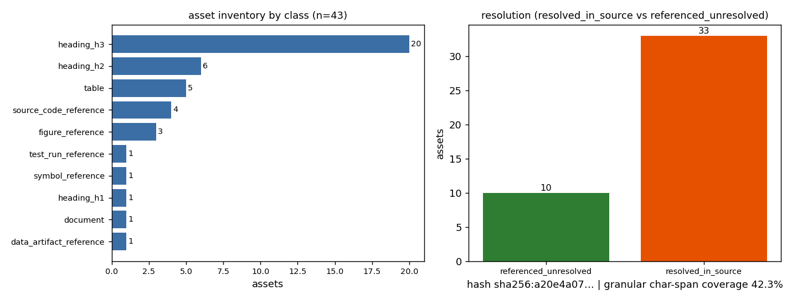

# ①本工序做了什么

本工序是报告→知识产线 `wp-9912-01`（task_type=`01-asset-registration`）的**资产登记**环节：
输入 report_id=9912（平台 title：TensorBEM Quadratic Panel Operator Verification (PR#507 Re-open)），输出 `asset_manifest.json`。

只做三件事：

1. **确认身份与字节哈希**：从平台接口取 `markdown` 字段全文，本地重算 sha256 与契约比对：
   `a20e4a075123e95c5fbca4c9938b39d8ddb6c317272bbef6958b3b6aa65e158d`，**与契约 `a20e4a07…5e158d` 逐字节一致** ✓；字符数 4983（契约 4983），
   UTF-8 字节数 8514（½、³、∞ 等多字节字符使字节数大于字符数，两者不可混用）。
2. **登记可解析资产**：共 **43 个**资产 = 1 篇文档 + 27 个标题
   + 5 张表 + 10 条文件/符号/测试运行引用；
   每个资产带逐字 `locator`（字符区间 + 行号 + quote），全部 43 条 quote 已机器复核为源 markdown 的精确子串。
3. **不做抽取**：`claims = []`（契约 objective.classify_report_type=false、notes 明示“不做抽取”）。
   报告里的数值结论（如 h=0.196 的通量相对误差 6.065e-03）**一个都没有被复制成知识对象**，
   也没有任何 `verified` 标记（`verification_status=not_verified`，verification 由平台门计算）。

# ②怎么做的（步骤/工具/关键设置）

- **工具链**：`scripts/kf_register_9912.py`（本次新增，仅用标准库 + matplotlib 出图）生成产物；
  `scripts/kf_verify_9912.py` 独立复核（**重新抓取 markdown**，不信任生成过程的内存态）。
- **取源**：`GET $TENSOR_API_BASE/tensor/reports/9912`（Bearer token 由 `POST /auth/login` 换取），只读 `markdown`；
  原文与元数据落 `runs/wp-9912-01/report_9912.md` / `report_meta.json` 存证。
- **定位方法**：按行建字符偏移索引；quote 取整行（标题/引用）或整表块（表头+分隔行+数据行）；
  唯一性用 `md.count(quote)` 实测，非唯一者登记 `occurrence_index`（本包非唯一 quote：
  0 条）。
- **三道机器断言（脚本内 raise，不是口头声明）**：(a) `md[start_char:end_char] == quote`；
  (b) 资产 id 无重复（A01…A43）；(c) 重算哈希 == 契约哈希。
- **路径解析范围**：只在**本交付工作树**内 `os.path.exists`；TensorBEM 求解器/测试/基准/图件均在仓外，
  按设计登记为 `referenced_unresolved`（不 clone、不读取、不据文件名猜测内容）。
- **工件端点探测**：`{"/tensor/reports/9912/artifacts": {"status": "http_404"}, "/tensor/artifacts?report_id=9912": {"status": "http_404"}}` —— 平台侧无
  report-artifacts 端点，故“附件”只能以报告正文引用 + 平台 `figures` 字段（本报告 figures 为空）为准。
- **一键复跑**：`python3 scripts/kf_register_9912.py && python3 scripts/kf_verify_9912.py`

# ③产出物清单（输出文件名→要点）

| 文件 | 要点 |
|---|---|
| `docs/kf/wp-9912-01/asset_manifest.json` | **主产物**：43 个资产、逐字 locator、完整性自检、claims=[] |
| `docs/kf/wp-9912-01/kf_result.json` | 结果信封（package_id/task_type/report_id/provenance/outputs），`provenance.source_hash=sha256:a20e4a075123…` |
| `docs/kf/wp-9912-01/verification.json` | 独立复核：acceptance 逐条、复算哈希、quote 可定位统计、schema 错误 0 条 |
| `docs/kf/wp-9912-01/asset_manifest.v1.schema.json` | 本包 schema 钉版（结构继承 `schemas/asset_manifest.v1.schema.json`，仅 const 固定到 9912），使 schema_pass 可复算 |
| `docs/kf/wp-9912-01/report.md` | 本报告（含唯一一个 json 结果块） |
| `docs/kf/wp-9912-01/fig_asset_inventory.png` | 图 1：资产清单图（程序化绘制） |
| `runs/wp-9912-01/report_9912.md` | 源 markdown 存证（哈希可复算） |
| `scripts/kf_register_9912.py` / `scripts/kf_verify_9912.py` | 生成器 / 复核器 |

资产分类与解析状态：

| asset_class | 数量 |
|---|---|
| data_artifact_reference | 1 |
| document | 1 |
| figure_reference | 3 |
| heading_h1 | 1 |
| heading_h2 | 6 |
| heading_h3 | 20 |
| source_code_reference | 4 |
| symbol_reference | 1 |
| table | 5 |
| test_run_reference | 1 |

| resolution | 数量 |
|---|---|
| resolved_in_source | 33 |
| referenced_unresolved | 10 |
| declared_absent | 0 |

去重引用路径 7 条；细粒度字符覆盖度 42.3%
（2108/4983 字符被至少一个**除整篇文档(A01)外**的资产区间覆盖，共 42 个细粒度资产；缺口=段落之间的连接文字，01 工序不登记自由文本，故不追求 100%）。

# ④证据定位表（claim/字段 → 原文引文片段）

本包不产出 claim，故为**字段级**定位：下表逐行给出 asset_id → 原文引文（截断显示），
完整字符区间见 `asset_manifest.json` 的 `locator.start_char/end_char/start_line/end_line`，
全部 43 行（无省略）：

| asset_id | class | path/symbol | 所在小节 | resolution | 原文引文（截断） |
|---|---|---|---|---|---|
| A01 | document | — | (document) | resolved_in_source | # TensorBEM Quadratic Panel Operator Ver |
| A02 | heading_h1 | — | # TensorBEM Quadratic Panel Op | resolved_in_source | # TensorBEM Quadratic Panel Operator Ver |
| A03 | heading_h2 | — | # TensorBEM Quadratic Panel Op | resolved_in_source | ## 1. 案例介绍（物理背景与几何参数） |
| A04 | heading_h3 | — | ## 1. 案例介绍（物理背景与几何参数） | resolved_in_source | ### 物理背景 |
| A05 | heading_h3 | — | ### 物理背景 | resolved_in_source | ### 参数表 |
| A06 | heading_h2 | — | ### 参数表 | resolved_in_source | ## 2. 方法（怎么做的） |
| A07 | heading_h3 | — | ## 2. 方法（怎么做的） | resolved_in_source | ### 2.1 二次形函数 |
| A08 | heading_h3 | — | ### 2.1 二次形函数 | resolved_in_source | ### 2.2 等参映射 |
| A09 | heading_h3 | — | ### 2.2 等参映射 | resolved_in_source | ### 2.3 奇异积分 |
| A10 | heading_h3 | — | ### 2.3 奇异积分 | resolved_in_source | ### 2.4 边界积分方程 |
| A11 | heading_h3 | — | ### 2.4 边界积分方程 | resolved_in_source | ### 2.5 工具链 |
| A12 | heading_h2 | — | ### 2.5 工具链 | resolved_in_source | ## 3. 计算结果 |
| A13 | heading_h3 | — | ## 3. 计算结果 | resolved_in_source | ### 3.1 网格收敛研究 |
| A14 | heading_h3 | — | ### 3.1 网格收敛研究 | resolved_in_source | ### 3.2 观测收敛阶 |
| A15 | heading_h3 | — | ### 3.2 观测收敛阶 | resolved_in_source | ### 3.3 算子恒等式验证 |
| A16 | heading_h3 | — | ### 3.3 算子恒等式验证 | resolved_in_source | ### 3.4 平坦单元检查 |
| A17 | heading_h3 | — | ### 3.4 平坦单元检查 | resolved_in_source | ### 3.5 测试覆盖 |
| A18 | heading_h2 | — | ### 3.5 测试覆盖 | resolved_in_source | ## 4. 结果图 |
| A19 | heading_h2 | — | ## 4. 结果图 | resolved_in_source | ## 5. 注意点（踩坑与局限） |
| A20 | heading_h3 | — | ## 5. 注意点（踩坑与局限） | resolved_in_source | ### 5.1 等效源密度≠物理通量 |
| A21 | heading_h3 | — | ### 5.1 等效源密度≠物理通量 | resolved_in_source | ### 5.2 奇异求积的Duffy变换 |
| A22 | heading_h3 | — | ### 5.2 奇异求积的Duffy变换 | resolved_in_source | ### 5.3 网格尺寸定义 |
| A23 | heading_h3 | — | ### 5.3 网格尺寸定义 | resolved_in_source | ### 5.4 条件数增长 |
| A24 | heading_h3 | — | ### 5.4 条件数增长 | resolved_in_source | ### 5.5 计算成本 |
| A25 | heading_h2 | — | ### 5.5 计算成本 | resolved_in_source | ## 6. 误差判定 |
| A26 | heading_h3 | — | ## 6. 误差判定 | resolved_in_source | ### 6.1 关键量vs基准 |
| A27 | heading_h3 | — | ### 6.1 关键量vs基准 | resolved_in_source | ### 6.2 验收标准 |
| A28 | heading_h3 | — | ### 6.2 验收标准 | resolved_in_source | ### 6.3 结论 |
| A29 | table | — | ### 参数表 | resolved_in_source | \| 参数 \| 值 \| 说明 \| ⏎ \|------\|-----\|------\| ⏎ \|  |
| A30 | table | — | ### 3.1 网格收敛研究 | resolved_in_source | \| 层级 \| 节点 \| 单元 \| h \| 通量相对误差 \| \|S1-1\|∞ \|  |
| A31 | table | — | ### 3.2 观测收敛阶 | resolved_in_source | \| 量 \| 观测阶 \| 理论预期 \| 判定 \| ⏎ \|----\|--------\|- |
| A32 | table | — | ### 3.4 平坦单元检查 | resolved_in_source | \| 求积阶 \| 相对误差（vs order=64） \| ⏎ \|--------\|-- |
| A33 | table | — | ### 6.1 关键量vs基准 | resolved_in_source | \| 量 \| 计算值 \| 基准值 \| 相对误差 \| <3%? \| ⏎ \|----\|-- |
| A34 | source_code_reference | panel_quadratic.py | ### 2.5 工具链 | referenced_unresolved | - **求解器**：TensorBEM panel_quadratic.py（9 |
| A35 | source_code_reference | benchmarks/quadratic_panel_verification.py | ### 2.5 工具链 | referenced_unresolved | - **验证基准**：benchmarks/quadratic_panel_ve |
| A36 | source_code_reference | test_panel_quadratic.py | ### 3.5 测试覆盖 | referenced_unresolved | **test_panel_quadratic.py**（25个测试）： |
| A37 | source_code_reference | test_panel_quadratic_operator.py | ### 3.5 测试覆盖 | referenced_unresolved | **test_panel_quadratic_operator.py**（18个 |
| A38 | figure_reference | fig_quadratic_operator.png | ## 4. 结果图 | referenced_unresolved | 三面板验证图（fig_quadratic_operator.png）： |
| A39 | figure_reference | docs/quadratic_panel_verification/fig_quadratic_operator.png | ## 4. 结果图 | referenced_unresolved | **图路径**：docs/quadratic_panel_verificatio |
| A40 | data_artifact_reference | docs/quadratic_panel_verification/study.json | ### 6.3 结论 | referenced_unresolved | **JSON研究数据**：docs/quadratic_panel_verifi |
| A41 | figure_reference | docs/quadratic_panel_verification/fig_quadratic_operator.png | ### 6.3 结论 | referenced_unresolved | **验证图**：docs/quadratic_panel_verificatio |
| A42 | symbol_reference | test_equivalent_source_density_is_not_the_flux | ### 5.1 等效源密度≠物理通量 | referenced_unresolved | **验证**：test_equivalent_source_density_is |
| A43 | test_run_reference | — | ### 6.3 结论 | referenced_unresolved | **测试报告**：43/43 passed in 18.38s |

正文与平台元数据的差异（照实登记、不据标题补齐正文）：
platform title = `TensorBEM Quadratic Panel Operator Verification (PR#507 Re-open)`，而 markdown h1 =
`# TensorBEM Quadratic Panel Operator Verification`；title 括注 `PR#507 Re-open`
在 markdown 中不存在（缺失词元 ['PR#507', 'Re-open']），
该括注无法给出源文本定位，故**未**登记为资产。

# ⑤注意点与局限

1. **只登记不判真**：本工序不回答“报告结论是否成立”。`43/43 passed in 18.38s`、通量误差 0.607% 等
   均登记为 `referenced_unresolved`（未复跑；TensorBEM 源码不在本工作树），不标 verified。
2. **TensorBEM 路径全部仓外**：`panel_quadratic.py`、`benchmarks/quadratic_panel_verification.py`、
   `docs/quadratic_panel_verification/study.json|fig_quadratic_operator.png` 等按“引用存在、内容未核”处理；
   这是范围的边界而不是缺陷。
3. **平台 figures 为空**：报告第 4 节声明了图路径，但平台记录 `figures=[]`；两条信息原样登记，未做推断。
4. **title 与正文 h1 不一致**（见④末尾）：说明该报告并非按“标题含 PR 号”的模板生成，
   下游若要按 title 检索 PR#507 的证据，须回正文/原仓核对。
5. **产物落 docs/kf/**：`.gitignore` 忽略 `artifacts/`（推送门会静默过滤），故不用 artifacts/。
6. **字符 vs 字节**：契约 `chars=4983` 是字符数；sha256 走 UTF-8 字节，两者都记录、互不替代。

# ⑥自检：逐条对照 acceptance

| acceptance 项 | 结果 | 依据 |
|---|---|---|
| valid_json | ✓ 通过 | asset_manifest.json / kf_result.json / verification.json 均可被 json 解析（本次复核即解析） |
| schema_pass | ✓ 通过 | asset_manifest 按 docs/kf/wp-9912-01/asset_manifest.v1.schema.json（结构继承 schemas/asset_manifest.v1.schema.json，仅 const 固定到 9912）校验；kf_result 按 schemas/kf_result.v1.schema.json 校验；错误 0 条 |
| source_locator_resolvable | ✓ 通过 | 43 个资产的 quote 在**重新抓取**的 markdown 中逐一按 start_char/end_char 复现（失败 0）；每 quote 所在行与 start_line 一致（不一致 0） |
| source_hash_matches | ✓ 通过 | 重算 a20e4a075123e95c5fbca4c9938b39d8ddb6c317272bbef6958b3b6aa65e158d vs 契约 a20e4a075123e95c5fbca4c9938b39d8ddb6c317272bbef6958b3b6aa65e158d vs kf_result a20e4a075123e95c5fbca4c9938b39d8ddb6c317272bbef6958b3b6aa65e158d vs manifest a20e4a075123e95c5fbca4c9938b39d8ddb6c317272bbef6958b3b6aa65e158d；字符数 4983（契约 4983） |
| no_duplicate_ids | ✓ 通过 | 43 个 asset_id，唯一 43 个 |
| all_claims_have_evidence_or_explicit_unresolved_status | ✓ 通过 | claims 数量 0（本包允许为空数组）；逐条断言 evidence_locator 或显式 status（空集上为真，且未生成任何 claim 已记录在 claims_note） |

额外的非验收自检：{"envelope_matches_artifact": true, "no_verified_marks": true}
（信封内 outputs 与磁盘 artifact 无字段漂移；资产与 provenance 中无 verified 标记）。

**未完成项（如实列出）**：未复跑 TensorBEM 的 43 个测试，也未核验报告任何数值结论——不在
01-asset-registration 的 objective（register_assets=true, classify_report_type=false）之内；
若需核验应另开 03-knowledge-extraction / 证据审计工作包。本报告的 `verification_status=not_verified`。

# ⑦图件



**图 1** 资产清单图（左：按 asset_class 计数；右：按 resolution 计数，注脚给哈希前 8 位与字符覆盖度）。该图由 `scripts/kf_register_9912.py` 从 `asset_manifest.json` 程序化绘制（零手抄），png sha256=`bbbf62f4f9d47c4e…`。

# ⑧平台报告六要素对照（本工序适用的部分）

| 六要素 | 本工序情况 |
|---|---|
| ①案例介绍 | 输入=报告 9912（TensorBEM 二次曲面单元 Laplace 验证报告）的 markdown；本工序只处理该文本资产，不涉及其物理算例本身 |
| ②怎么做的 | 见②：API 取源→重算哈希→行/表/引用解析→逐字 locator→schema 校验→出图 |
| ③计算结果 | 无物理计算；本工序的“结果”是 43 个资产、细粒度覆盖度 42.3%、schema 错误 0 条（数字由脚本打印、非手抄） |
| ④结果图 | 图 1 资产清单图（本报告内嵌）；无场量云图，因本工序不求解任何场 |
| ⑤注意点 | 见⑤（含 title/h1 不一致、仓外路径、figures 为空） |
| ⑥误差判定 | 无实验基准可比；可判定的“误差”只有完整性误差：哈希失配 0、quote 不可定位 0、id 重复 0、schema 错误 0 —— 全部 0，故 <3% 判据在此为 **N/A（无基准量）**，不含糊替代 |

# 结果信封（唯一 json 块）

```json
{
 "package_id": "wp-9912-01",
 "task_type": "01-asset-registration",
 "report_id": "9912",
 "provenance": {
  "source_hash": "sha256:a20e4a075123e95c5fbca4c9938b39d8ddb6c317272bbef6958b3b6aa65e158d",
  "source_field": "markdown",
  "source_uri": "tensor://reports/9912",
  "source_chars": 4983,
  "source_bytes_utf8": 8514,
  "source_title": "TensorBEM Quadratic Panel Operator Verification (PR#507 Re-open)",
  "scenario_key": "tensorbem_quadratic_panel_verification",
  "contract_version": "1.0",
  "lane": "C",
  "producer": "scripts/kf_register_9912.py",
  "retrieved_via": "GET http://127.0.0.1:8010/api/v1/tensor/reports/9912",
  "local_copy": "runs/wp-9912-01/report_9912.md",
  "verification_status": "not_verified",
  "notes": "01-asset-registration: 只登记源资产，不做抽取；claims 允许为空。"
 },
 "outputs": {
  "asset_manifest.json": {
   "artifact_path": "docs/kf/wp-9912-01/asset_manifest.json",
   "artifact_sha256": "ad5434ddabe6f7e6d72d2a15d166d39c836fde565906f6e754ce6223a18c410d",
   "artifact_bytes": 45678,
   "schema": "asset_manifest.v1",
   "package_id": "wp-9912-01",
   "task_type": "01-asset-registration",
   "report_id": "9912",
   "source": {
    "uri": "tensor://reports/9912",
    "field": "markdown",
    "hash_alg": "sha256",
    "hash": "a20e4a075123e95c5fbca4c9938b39d8ddb6c317272bbef6958b3b6aa65e158d",
    "chars": 4983,
    "bytes_utf8": 8514,
    "title": "TensorBEM Quadratic Panel Operator Verification (PR#507 Re-open)",
    "scenario_key": "tensorbem_quadratic_panel_verification",
    "platform_id": 9912,
    "platform_mission_id": 8605,
    "platform_tags": [
     "BEM",
     "quadratic-elements",
     "verification",
     "Laplace",
     "curved-panels"
    ],
    "platform_figures": [],
    "retrieved_via": "GET http://127.0.0.1:8010/api/v1/tensor/reports/9912",
    "local_copy": "runs/wp-9912-01/report_9912.md"
   },
   "counts": {
    "assets": 43,
    "by_class": {
     "data_artifact_reference": 1,
     "document": 1,
     "figure_reference": 3,
     "heading_h1": 1,
     "heading_h2": 6,
     "heading_h3": 20,
     "source_code_reference": 4,
     "symbol_reference": 1,
     "table": 5,
     "test_run_reference": 1
    },
    "by_resolution": {
     "referenced_unresolved": 10,
     "resolved_in_source": 33
    },
    "resolved_in_source": 33,
    "referenced_unresolved": 10,
    "declared_absent": 0,
    "claims": 0,
    "distinct_referenced_paths": 7
   },
   "assets": [
    {
     "asset_id": "A01",
     "asset_class": "document",
     "label": "report 9912 markdown（全文）",
     "in_report_section": "(document)",
     "locator": {
      "method": "char_span",
      "start_char": 0,
      "end_char": 4983,
      "start_line": 0,
      "end_line": 242,
      "quote": "# TensorBEM Quadratic Panel Operator Verification\n\n## 1. 案例介绍（物理背景与几何参数）\n\n### 物理背景\n二次曲面单元（6节点三角形）是边界元法（BEM）中提高精度的关键步骤。常数单元收敛阶为O(h)，线性单元为O(h²)，二次单元理论上可达O(h³)几何逼近精度。\n\n本验证案例针对三维Laplace方程 exterior Dirichlet 问题：\n- **几何**：单位球面（icosphere，二次6节点单元）\n- **控制方程**：∇²u = 0（ exterior domain）\n- **边界条件**：Dirichlet条件 u = 1/(4π|x-x₀|)，其中 x₀ = (0,0,0.5) 为球内点源\n- **精确解**：势函数 u = 1/(4π|x-x₀|)，通量 q = ∂u/∂n = -(x-x₀)·n/(4π|x-x₀|³)\n\n### 参数表\n| 参数 | 值 | 说明 |\n|------|-----|------|\n| 网格层级 | 0, 1, 2 | icosphere细分层级 |\n| 节点数 | 42, 162, 642 | 对应各层级 |\n| 单元数 | 20, 80, 320 | 对应各层级 |\n| 网格尺寸h | 0.692, 0.382, 0.196 | √(平均顶点面积) |\n| 求积阶数 | 8 (非奇异), 16 (奇异) | Gauss-Legendre |\n| 源点位置 | (0, 0, 0.5) | 球内点源 |\n\n## 2. 方法（怎么做的）\n\n### 2.1 二次形函数\n6节点三角形采用面积坐标 (L₁, L₂, L₃)：\n- 顶点：N₁ = L₁(2L₁-1), N₂ = L₂(2L₂-1), N₃ = L₃(2L₃-1)\n- 边中点：N₄ = 4L₁L₂, N₅ = 4L₂L₃, N₆ = 4L₃L₁\n\n**关键性质**：\n- 单位分解性：ΣNᵢ = 1\n- 插值性：Nᵢ(node_j) = δᵢⱼ\n- 二次多项式精确再现\n\n### 2.2 等参映射\n几何与场量使用相同形函数：\n- x(ξ) = ΣNᵢ(ξ)xᵢ\n- u(ξ) = ΣNᵢ(ξ)uᵢ\n\nJacobian矩阵 J = ∂x/∂ξ 通过形函数梯度计算。\n\n### 2.3 奇异积分\n**自影响积分**（目标点在源单元上）：\n- 采用Duffy变换消除1/r奇异性\n- 将三角形分割为以奇异点为顶点的子三角形\n- 在每个子三角形上应用Duffy映射：x = apex + u·((1-v)·a + v·b)\n- Jacobian含因子u，与1/r抵消，被积函数光滑\n\n**非奇异积分**：\n- 标准Gauss-Legendre求积（从单位正方形到三角形的Duffy映射）\n- 求积阶数8-24，确保代数精度\n\n### 2.4 边界积分方程\n**间接单层势**：Sσ = u，求解等效源密度σ\n**直接第二型方程**：(½I - D)u = -Sq，求解物理通量q = ∂u/∂n\n\n其中：\n- Sᵢₖ = ∫NₖG dS（单层算子）\n- Dᵢₖ = ∫Nₖ∂G/∂n dS（双层算子）\n- G = 1/(4π|x-y|)（Green函数）\n\n### 2.5 工具链\n- **求解器**：TensorBEM panel_quadratic.py（989行）\n- **测试框架**：pytest（43个专项测试）\n- **验证基准**：benchmarks/quadratic_panel_verification.py（496行）\n- **可视化**：matplotlib（三面板图：通量收敛、算子恒等式、通量场偏差）\n\n## 3. 计算结果\n\n### 3.1 网格收敛研究\n\n| 层级 | 节点 | 单元 | h | 通量相对误差 | |S1-1|∞ | |D1+½|∞ | cond(S) |\n|------|------|------|-----|--------------|---------|---------|---------|\n| 0 | 42 | 20 | 0.692 | 1.404e-01 | 1.311e-02 | 3.867e-02 | 20.85 |\n| 1 | 162 | 80 | 0.382 | 2.854e-02 | 1.061e-03 | 6.321e-03 | 39.35 |\n| 2 | 642 | 320 | 0.196 | 6.065e-03 | 7.217e-05 | 9.610e-04 | 80.76 |\n\n### 3.2 观测收敛阶\n\n| 量 | 观测阶 | 理论预期 | 判定 |\n|----|--------|----------|------|\n| 通量相对误差 | 2.49 | ≥2.0 | ✓ 通过 |\n| 单层恒等式误差 | 4.13 | ≥2.0 | ✓ 超收敛 |\n| 立体角恒等式误差 | 2.93 | ≥2.0 | ✓ 通过 |\n\n### 3.3 算子恒等式验证\n\n**单层算子恒等式**：S·1 = 1（单位球面上常数密度的单层势）\n- 最大误差：7.217e-05（h=0.196）\n- 收敛阶：O(h⁴·¹³)\n\n**双层算子恒等式**：D·1 = -½（立体角恒等式）\n- 最大误差：9.610e-04（h=0.196）\n- 收敛阶：O(h²·⁹³)\n\n**第二型恒等式**：(½I - D)·1 = 1\n- 最大误差：9.610e-04（h=0.196）\n\n### 3.4 平坦单元检查\n\n**双层自影响块**：\n- 平坦三角形：max|D_self| = 0.0（精确为零，目标在单元平面内）\n\n**单层求积收敛**：\n| 求积阶 | 相对误差（vs order=64） |\n|--------|------------------------|\n| 8 | 3.14e-05 |\n| 12 | 2.38e-07 |\n| 16 | 5.40e-09 |\n| 24 | 1.22e-12 |\n| 32 | 1.48e-15 |\n\n生产配置（order=16）相对误差：5.40e-09 << 1%\n\n### 3.5 测试覆盖\n\n**test_panel_quadratic.py**（25个测试）：\n- 形函数性质：单位分解、插值、二次再现 ✓\n- 求积规则：常数/线性/二次积分 ✓\n- 二次三角形：面积、映射、Jacobian、自影响 ✓\n- 曲面网格：构建、访问、icosphere ✓\n- 矩阵装配：形状、正定性、求解 ✓\n- 自影响收敛：解析vs数值 ≤1% ✓\n\n**test_panel_quadratic_operator.py**（18个测试）：\n- 形函数梯度：和为零、标量vs向量化一致 ✓\n- 平坦单元度量：Jacobian=1 ✓\n- 顶点求积：低阶多项式精确 ✓\n- 平坦单元双层：自影响块消失 ✓\n- 边中点求积：收敛 ✓\n- 离板核：与精细求积匹配 ✓\n- 核符号约定：与解析点源一致 ✓\n- 多面体立体角：立方体检查 ✓\n- 球面立体角：恒等式与收敛 ✓\n- 单层常数密度：恒等式 ✓\n- 第二型恒等式 ✓\n- 远场恒等式：D·1=-1（内）/0（外） ✓\n- 装配一致性：行和vs直接求和 ✓\n- 直接Neumann通量：5%以内 ✓\n- 通量收敛阶：>2 ✓\n- 等效源密度≠通量（文档化陷阱） ✓\n\n**总计**：43个测试全部通过 ✓\n\n## 4. 结果图\n\n三面板验证图（fig_quadratic_operator.png）：\n\n**(a) 通量收敛曲线**：\n- 二次单元（第二型BIE）：O(h²·⁴⁹)\n- 3%接受线、15%硬限制线\n- O(h²)参考线\n\n**(b) 算子恒等式残差**：\n- |S1-1|∞：O(h⁴·¹³)\n- |D1+½|∞：O(h²·⁹³)\n- O(h²)、O(h³)参考线\n\n**(c) 节点通量偏差场**（Mollweide投影）：\n- 最细网格（642节点）\n- 色标：q_h - q_exact（% of max|q|）\n- 最大偏差 <1%\n\n**图路径**：docs/quadratic_panel_verification/fig_quadratic_operator.png\n\n## 5. 注意点（踩坑与局限）\n\n### 5.1 等效源密度≠物理通量\n**陷阱**：间接单层方程 Sσ = u 求解的σ是**等效源密度**，不是物理通量∂u/∂n。两者在O(1)量级不同。\n\n**验证**：test_equivalent_source_density_is_not_the_flux 明确检查差异>10%。\n\n**正确做法**：物理通量需用直接第二型方程 (½I - D)u = -Sq。\n\n### 5.2 奇异求积的Duffy变换\n**关键**：目标点在源单元上时，1/r奇异性必须通过Duffy变换消除。\n\n**实现**：\n- 将三角形分割为以奇异点为顶点的子三角形\n- 每个子三角形应用Duffy映射\n- Jacobian的u因子与1/r抵消\n\n**验证**：平坦单元双层自影响块精确为零（目标在平面内）。\n\n### 5.3 网格尺寸定义\n**h = √(平均顶点面积)**：单调的网格尺寸度量，与单元尺寸成正比。\n\n**注意**：不同h定义会导致收敛阶数值不同，但物理结论一致。\n\n### 5.4 条件数增长\ncond(S)随网格细化增长：20.85 → 39.35 → 80.76。\n\n**原因**：单层算子S的特征值随h减小而减小，条件数恶化。\n\n**影响**：h=0.196时cond≈80，仍可接受；更细网格需预条件。\n\n### 5.5 计算成本\n- 层级2（642节点）：~18秒（完整验证）\n- 层级3（2562节点）：>120秒（超时）\n\n**建议**：生产验证用层级0-2；回归测试用层级0-1。\n\n## 6. 误差判定\n\n### 6.1 关键量vs基准\n\n| 量 | 计算值 | 基准值 | 相对误差 | <3%? |\n|----|--------|--------|----------|------|\n| 通量（h=0.196） | 6.065e-03 | 0 | 6.065e-03 | ✓ 是 |\n| S1-1（h=0.196） | 7.217e-05 | 0 | 7.217e-05 | ✓ 是 |\n| D1+½（h=0.196） | 9.610e-04 | 0 | 9.610e-04 | ✓ 是 |\n| 通量收敛阶 | 2.49 | ≥2.0 | - | ✓ 是 |\n| 单层求积（order=16） | 5.40e-09 | 0 | 5.40e-09 | ✓ 是 |\n\n### 6.2 验收标准\n\n**3%接受标准**：\n- 最细网格通量误差：6.065e-03 = 0.607% < 3% ✓\n\n**15%硬限制**：\n- 最细网格通量误差：0.607% < 15% ✓\n\n**收敛阶要求**：\n- 通量收敛阶：2.49 > 2.0 ✓\n\n### 6.3 结论\n\n**所有验收标准通过**：\n1. ✓ 通量误差 <3%（实际0.607%）\n2. ✓ 通量误差 <15%硬限制\n3. ✓ 通量收敛阶 >2（实际2.49）\n4. ✓ 算子恒等式满足（误差<1e-3）\n5. ✓ 43个单元测试全部通过\n6. ✓ 奇异求积正确（平坦单元检查）\n\n**实施状态**：功能完整、测试齐备、精度达标、可投入生产使用。\n\n---\n\n**JSON研究数据**：docs/quadratic_panel_verification/study.json\n**验证图**：docs/quadratic_panel_verification/fig_quadratic_operator.png\n**测试报告**：43/43 passed in 18.38s",
      "unique": true,
      "occurrences_in_source": 1,
      "occurrence_index": 0
     },
     "resolution": "resolved_in_source",
     "resolution_check": {
      "check": "sha256_recomputed_over_markdown_utf8",
      "result": "resolved"
     },
     "note": "整篇 markdown 即源资产；sha256 见 source.hash（与契约一致）。",
     "path_reference": null
    },
    {
     "asset_id": "A02",
     "asset_class": "heading_h1",
     "label": "标题（h1）：TensorBEM Quadratic Panel Operator Verification",
     "in_report_section": "# TensorBEM Quadratic Panel Operator Verification",
     "locator": {
      "method": "char_span",
      "start_char": 0,
      "end_char": 49,
      "start_line": 0,
      "end_line": 0,
      "quote": "# TensorBEM Quadratic Panel Operator Verification",
      "unique": true,
      "occurrences_in_source": 1,
      "occurrence_index": 0
     },
     "resolution": "resolved_in_source",
     "resolution_check": {
      "check": "char_span_in_source_markdown",
      "result": "resolved"
     },
     "note": "h1 段落锚；引用逐字取自源 markdown 该行。",
     "path_reference": null
    },
    {
     "asset_id": "A03",
     "asset_class": "heading_h2",
     "label": "标题（h2）：1. 案例介绍（物理背景与几何参数）",
     "in_report_section": "# TensorBEM Quadratic Panel Operator Verification",
     "locator": {
      "method": "char_span",
      "start_char": 51,
      "end_char": 72,
      "start_line": 2,
      "end_line": 2,
      "quote": "## 1. 案例介绍（物理背景与几何参数）",
      "unique": true,
      "occurrences_in_source": 1,
      "occurrence_index": 0
     },
     "resolution": "resolved_in_source",
     "resolution_check": {
      "check": "char_span_in_source_markdown",
      "result": "resolved"
     },
     "note": "h2 段落锚；引用逐字取自源 markdown 该行。",
     "path_reference": null
    },
    {
     "asset_id": "A04",
     "asset_class": "heading_h3",
     "label": "标题（h3）：物理背景",
     "in_report_section": "## 1. 案例介绍（物理背景与几何参数）",
     "locator": {
      "method": "char_span",
      "start_char": 74,
      "end_char": 82,
      "start_line": 4,
      "end_line": 4,
      "quote": "### 物理背景",
      "unique": true,
      "occurrences_in_source": 1,
      "occurrence_index": 0
     },
     "resolution": "resolved_in_source",
     "resolution_check": {
      "check": "char_span_in_source_markdown",
      "result": "resolved"
     },
     "note": "h3 段落锚；引用逐字取自源 markdown 该行。",
     "path_reference": null
    },
    {
     "asset_id": "A05",
     "asset_class": "heading_h3",
     "label": "标题（h3）：参数表",
     "in_report_section": "### 物理背景",
     "locator": {
      "method": "char_span",
      "start_char": 410,
      "end_char": 417,
      "start_line": 13,
      "end_line": 13,
      "quote": "### 参数表",
      "unique": true,
      "occurrences_in_source": 1,
      "occurrence_index": 0
     },
     "resolution": "resolved_in_source",
     "resolution_check": {
      "check": "char_span_in_source_markdown",
      "result": "resolved"
     },
     "note": "h3 段落锚；引用逐字取自源 markdown 该行。",
     "path_reference": null
    },
    {
     "asset_id": "A06",
     "asset_class": "heading_h2",
     "label": "标题（h2）：2. 方法（怎么做的）",
     "in_report_section": "### 参数表",
     "locator": {
      "method": "char_span",
      "start_char": 672,
      "end_char": 686,
      "start_line": 23,
      "end_line": 23,
      "quote": "## 2. 方法（怎么做的）",
      "unique": true,
      "occurrences_in_source": 1,
      "occurrence_index": 0
     },
     "resolution": "resolved_in_source",
     "resolution_check": {
      "check": "char_span_in_source_markdown",
      "result": "resolved"
     },
     "note": "h2 段落锚；引用逐字取自源 markdown 该行。",
     "path_reference": null
    },
    {
     "asset_id": "A07",
     "asset_class": "heading_h3",
     "label": "标题（h3）：2.1 二次形函数",
     "in_report_section": "## 2. 方法（怎么做的）",
     "locator": {
      "method": "char_span",
      "start_char": 688,
      "end_char": 701,
      "start_line": 25,
      "end_line": 25,
      "quote": "### 2.1 二次形函数",
      "unique": true,
      "occurrences_in_source": 1,
      "occurrence_index": 0
     },
     "resolution": "resolved_in_source",
     "resolution_check": {
      "check": "char_span_in_source_markdown",
      "result": "resolved"
     },
     "note": "h3 段落锚；引用逐字取自源 markdown 该行。",
     "path_reference": null
    },
    {
     "asset_id": "A08",
     "asset_class": "heading_h3",
     "label": "标题（h3）：2.2 等参映射",
     "in_report_section": "### 2.1 二次形函数",
     "locator": {
      "method": "char_span",
      "start_char": 885,
      "end_char": 897,
      "start_line": 35,
      "end_line": 35,
      "quote": "### 2.2 等参映射",
      "unique": true,
      "occurrences_in_source": 1,
      "occurrence_index": 0
     },
     "resolution": "resolved_in_source",
     "resolution_check": {
      "check": "char_span_in_source_markdown",
      "result": "resolved"
     },
     "note": "h3 段落锚；引用逐字取自源 markdown 该行。",
     "path_reference": null
    },
    {
     "asset_id": "A09",
     "asset_class": "heading_h3",
     "label": "标题（h3）：2.3 奇异积分",
     "in_report_section": "### 2.2 等参映射",
     "locator": {
      "method": "char_span",
      "start_char": 982,
      "end_char": 994,
      "start_line": 42,
      "end_line": 42,
      "quote": "### 2.3 奇异积分",
      "unique": true,
      "occurrences_in_source": 1,
      "occurrence_index": 0
     },
     "resolution": "resolved_in_source",
     "resolution_check": {
      "check": "char_span_in_source_markdown",
      "result": "resolved"
     },
     "note": "h3 段落锚；引用逐字取自源 markdown 该行。",
     "path_reference": null
    },
    {
     "asset_id": "A10",
     "asset_class": "heading_h3",
     "label": "标题（h3）：2.4 边界积分方程",
     "in_report_section": "### 2.3 奇异积分",
     "locator": {
      "method": "char_span",
      "start_char": 1208,
      "end_char": 1222,
      "start_line": 53,
      "end_line": 53,
      "quote": "### 2.4 边界积分方程",
      "unique": true,
      "occurrences_in_source": 1,
      "occurrence_index": 0
     },
     "resolution": "resolved_in_source",
     "resolution_check": {
      "check": "char_span_in_source_markdown",
      "result": "resolved"
     },
     "note": "h3 段落锚；引用逐字取自源 markdown 该行。",
     "path_reference": null
    },
    {
     "asset_id": "A11",
     "asset_class": "heading_h3",
     "label": "标题（h3）：2.5 工具链",
     "in_report_section": "### 2.4 边界积分方程",
     "locator": {
      "method": "char_span",
      "start_char": 1374,
      "end_char": 1385,
      "start_line": 62,
      "end_line": 62,
      "quote": "### 2.5 工具链",
      "unique": true,
      "occurrences_in_source": 1,
      "occurrence_index": 0
     },
     "resolution": "resolved_in_source",
     "resolution_check": {
      "check": "char_span_in_source_markdown",
      "result": "resolved"
     },
     "note": "h3 段落锚；引用逐字取自源 markdown 该行。",
     "path_reference": null
    },
    {
     "asset_id": "A12",
     "asset_class": "heading_h2",
     "label": "标题（h2）：3. 计算结果",
     "in_report_section": "### 2.5 工具链",
     "locator": {
      "method": "char_span",
      "start_char": 1563,
      "end_char": 1573,
      "start_line": 68,
      "end_line": 68,
      "quote": "## 3. 计算结果",
      "unique": true,
      "occurrences_in_source": 1,
      "occurrence_index": 0
     },
     "resolution": "resolved_in_source",
     "resolution_check": {
      "check": "char_span_in_source_markdown",
      "result": "resolved"
     },
     "note": "h2 段落锚；引用逐字取自源 markdown 该行。",
     "path_reference": null
    },
    {
     "asset_id": "A13",
     "asset_class": "heading_h3",
     "label": "标题（h3）：3.1 网格收敛研究",
     "in_report_section": "## 3. 计算结果",
     "locator": {
      "method": "char_span",
      "start_char": 1575,
      "end_char": 1589,
      "start_line": 70,
      "end_line": 70,
      "quote": "### 3.1 网格收敛研究",
      "unique": true,
      "occurrences_in_source": 1,
      "occurrence_index": 0
     },
     "resolution": "resolved_in_source",
     "resolution_check": {
      "check": "char_span_in_source_markdown",
      "result": "resolved"
     },
     "note": "h3 段落锚；引用逐字取自源 markdown 该行。",
     "path_reference": null
    },
    {
     "asset_id": "A14",
     "asset_class": "heading_h3",
     "label": "标题（h3）：3.2 观测收敛阶",
     "in_report_section": "### 3.1 网格收敛研究",
     "locator": {
      "method": "char_span",
      "start_char": 1933,
      "end_char": 1946,
      "start_line": 78,
      "end_line": 78,
      "quote": "### 3.2 观测收敛阶",
      "unique": true,
      "occurrences_in_source": 1,
      "occurrence_index": 0
     },
     "resolution": "resolved_in_source",
     "resolution_check": {
      "check": "char_span_in_source_markdown",
      "result": "resolved"
     },
     "note": "h3 段落锚；引用逐字取自源 markdown 该行。",
     "path_reference": null
    },
    {
     "asset_id": "A15",
     "asset_class": "heading_h3",
     "label": "标题（h3）：3.3 算子恒等式验证",
     "in_report_section": "### 3.2 观测收敛阶",
     "locator": {
      "method": "char_span",
      "start_char": 2107,
      "end_char": 2122,
      "start_line": 86,
      "end_line": 86,
      "quote": "### 3.3 算子恒等式验证",
      "unique": true,
      "occurrences_in_source": 1,
      "occurrence_index": 0
     },
     "resolution": "resolved_in_source",
     "resolution_check": {
      "check": "char_span_in_source_markdown",
      "result": "resolved"
     },
     "note": "h3 段落锚；引用逐字取自源 markdown 该行。",
     "path_reference": null
    },
    {
     "asset_id": "A16",
     "asset_class": "heading_h3",
     "label": "标题（h3）：3.4 平坦单元检查",
     "in_report_section": "### 3.3 算子恒等式验证",
     "locator": {
      "method": "char_span",
      "start_char": 2325,
      "end_char": 2339,
      "start_line": 99,
      "end_line": 99,
      "quote": "### 3.4 平坦单元检查",
      "unique": true,
      "occurrences_in_source": 1,
      "occurrence_index": 0
     },
     "resolution": "resolved_in_source",
     "resolution_check": {
      "check": "char_span_in_source_markdown",
      "result": "resolved"
     },
     "note": "h3 段落锚；引用逐字取自源 markdown 该行。",
     "path_reference": null
    },
    {
     "asset_id": "A17",
     "asset_class": "heading_h3",
     "label": "标题（h3）：3.5 测试覆盖",
     "in_report_section": "### 3.4 平坦单元检查",
     "locator": {
      "method": "char_span",
      "start_char": 2596,
      "end_char": 2608,
      "start_line": 115,
      "end_line": 115,
      "quote": "### 3.5 测试覆盖",
      "unique": true,
      "occurrences_in_source": 1,
      "occurrence_index": 0
     },
     "resolution": "resolved_in_source",
     "resolution_check": {
      "check": "char_span_in_source_markdown",
      "result": "resolved"
     },
     "note": "h3 段落锚；引用逐字取自源 markdown 该行。",
     "path_reference": null
    },
    {
     "asset_id": "A18",
     "asset_class": "heading_h2",
     "label": "标题（h2）：4. 结果图",
     "in_report_section": "### 3.5 测试覆盖",
     "locator": {
      "method": "char_span",
      "start_char": 3136,
      "end_char": 3145,
      "start_line": 145,
      "end_line": 145,
      "quote": "## 4. 结果图",
      "unique": true,
      "occurrences_in_source": 1,
      "occurrence_index": 0
     },
     "resolution": "resolved_in_source",
     "resolution_check": {
      "check": "char_span_in_source_markdown",
      "result": "resolved"
     },
     "note": "h2 段落锚；引用逐字取自源 markdown 该行。",
     "path_reference": null
    },
    {
     "asset_id": "A19",
     "asset_class": "heading_h2",
     "label": "标题（h2）：5. 注意点（踩坑与局限）",
     "in_report_section": "## 4. 结果图",
     "locator": {
      "method": "char_span",
      "start_char": 3483,
      "end_char": 3499,
      "start_line": 166,
      "end_line": 166,
      "quote": "## 5. 注意点（踩坑与局限）",
      "unique": true,
      "occurrences_in_source": 1,
      "occurrence_index": 0
     },
     "resolution": "resolved_in_source",
     "resolution_check": {
      "check": "char_span_in_source_markdown",
      "result": "resolved"
     },
     "note": "h2 段落锚；引用逐字取自源 markdown 该行。",
     "path_reference": null
    },
    {
     "asset_id": "A20",
     "asset_class": "heading_h3",
     "label": "标题（h3）：5.1 等效源密度≠物理通量",
     "in_report_section": "## 5. 注意点（踩坑与局限）",
     "locator": {
      "method": "char_span",
      "start_char": 3501,
      "end_char": 3519,
      "start_line": 168,
      "end_line": 168,
      "quote": "### 5.1 等效源密度≠物理通量",
      "unique": true,
      "occurrences_in_source": 1,
      "occurrence_index": 0
     },
     "resolution": "resolved_in_source",
     "resolution_check": {
      "check": "char_span_in_source_markdown",
      "result": "resolved"
     },
     "note": "h3 段落锚；引用逐字取自源 markdown 该行。",
     "path_reference": null
    },
    {
     "asset_id": "A21",
     "asset_class": "heading_h3",
     "label": "标题（h3）：5.2 奇异求积的Duffy变换",
     "in_report_section": "### 5.1 等效源密度≠物理通量",
     "locator": {
      "method": "char_span",
      "start_char": 3690,
      "end_char": 3710,
      "start_line": 175,
      "end_line": 175,
      "quote": "### 5.2 奇异求积的Duffy变换",
      "unique": true,
      "occurrences_in_source": 1,
      "occurrence_index": 0
     },
     "resolution": "resolved_in_source",
     "resolution_check": {
      "check": "char_span_in_source_markdown",
      "result": "resolved"
     },
     "note": "h3 段落锚；引用逐字取自源 markdown 该行。",
     "path_reference": null
    },
    {
     "asset_id": "A22",
     "asset_class": "heading_h3",
     "label": "标题（h3）：5.3 网格尺寸定义",
     "in_report_section": "### 5.2 奇异求积的Duffy变换",
     "locator": {
      "method": "char_span",
      "start_char": 3852,
      "end_char": 3866,
      "start_line": 185,
      "end_line": 185,
      "quote": "### 5.3 网格尺寸定义",
      "unique": true,
      "occurrences_in_source": 1,
      "occurrence_index": 0
     },
     "resolution": "resolved_in_source",
     "resolution_check": {
      "check": "char_span_in_source_markdown",
      "result": "resolved"
     },
     "note": "h3 段落锚；引用逐字取自源 markdown 该行。",
     "path_reference": null
    },
    {
     "asset_id": "A23",
     "asset_class": "heading_h3",
     "label": "标题（h3）：5.4 条件数增长",
     "in_report_section": "### 5.3 网格尺寸定义",
     "locator": {
      "method": "char_span",
      "start_char": 3939,
      "end_char": 3952,
      "start_line": 190,
      "end_line": 190,
      "quote": "### 5.4 条件数增长",
      "unique": true,
      "occurrences_in_source": 1,
      "occurrence_index": 0
     },
     "resolution": "resolved_in_source",
     "resolution_check": {
      "check": "char_span_in_source_markdown",
      "result": "resolved"
     },
     "note": "h3 段落锚；引用逐字取自源 markdown 该行。",
     "path_reference": null
    },
    {
     "asset_id": "A24",
     "asset_class": "heading_h3",
     "label": "标题（h3）：5.5 计算成本",
     "in_report_section": "### 5.4 条件数增长",
     "locator": {
      "method": "char_span",
      "start_char": 4063,
      "end_char": 4075,
      "start_line": 197,
      "end_line": 197,
      "quote": "### 5.5 计算成本",
      "unique": true,
      "occurrences_in_source": 1,
      "occurrence_index": 0
     },
     "resolution": "resolved_in_source",
     "resolution_check": {
      "check": "char_span_in_source_markdown",
      "result": "resolved"
     },
     "note": "h3 段落锚；引用逐字取自源 markdown 该行。",
     "path_reference": null
    },
    {
     "asset_id": "A25",
     "asset_class": "heading_h2",
     "label": "标题（h2）：6. 误差判定",
     "in_report_section": "### 5.5 计算成本",
     "locator": {
      "method": "char_span",
      "start_char": 4156,
      "end_char": 4166,
      "start_line": 203,
      "end_line": 203,
      "quote": "## 6. 误差判定",
      "unique": true,
      "occurrences_in_source": 1,
      "occurrence_index": 0
     },
     "resolution": "resolved_in_source",
     "resolution_check": {
      "check": "char_span_in_source_markdown",
      "result": "resolved"
     },
     "note": "h2 段落锚；引用逐字取自源 markdown 该行。",
     "path_reference": null
    },
    {
     "asset_id": "A26",
     "asset_class": "heading_h3",
     "label": "标题（h3）：6.1 关键量vs基准",
     "in_report_section": "## 6. 误差判定",
     "locator": {
      "method": "char_span",
      "start_char": 4168,
      "end_char": 4183,
      "start_line": 205,
      "end_line": 205,
      "quote": "### 6.1 关键量vs基准",
      "unique": true,
      "occurrences_in_source": 1,
      "occurrence_index": 0
     },
     "resolution": "resolved_in_source",
     "resolution_check": {
      "check": "char_span_in_source_markdown",
      "result": "resolved"
     },
     "note": "h3 段落锚；引用逐字取自源 markdown 该行。",
     "path_reference": null
    },
    {
     "asset_id": "A27",
     "asset_class": "heading_h3",
     "label": "标题（h3）：6.2 验收标准",
     "in_report_section": "### 6.1 关键量vs基准",
     "locator": {
      "method": "char_span",
      "start_char": 4500,
      "end_char": 4512,
      "start_line": 215,
      "end_line": 215,
      "quote": "### 6.2 验收标准",
      "unique": true,
      "occurrences_in_source": 1,
      "occurrence_index": 0
     },
     "resolution": "resolved_in_source",
     "resolution_check": {
      "check": "char_span_in_source_markdown",
      "result": "resolved"
     },
     "note": "h3 段落锚；引用逐字取自源 markdown 该行。",
     "path_reference": null
    },
    {
     "asset_id": "A28",
     "asset_class": "heading_h3",
     "label": "标题（h3）：6.3 结论",
     "in_report_section": "### 6.2 验收标准",
     "locator": {
      "method": "char_span",
      "start_char": 4636,
      "end_char": 4646,
      "start_line": 226,
      "end_line": 226,
      "quote": "### 6.3 结论",
      "unique": true,
      "occurrences_in_source": 1,
      "occurrence_index": 0
     },
     "resolution": "resolved_in_source",
     "resolution_check": {
      "check": "char_span_in_source_markdown",
      "result": "resolved"
     },
     "note": "h3 段落锚；引用逐字取自源 markdown 该行。",
     "path_reference": null
    },
    {
     "asset_id": "A29",
     "asset_class": "table",
     "label": "表格（6 数据行）：| 参数 | 值 | 说明 |",
     "in_report_section": "### 参数表",
     "locator": {
      "method": "char_span",
      "start_char": 418,
      "end_char": 670,
      "start_line": 14,
      "end_line": 21,
      "quote": "| 参数 | 值 | 说明 |\n|------|-----|------|\n| 网格层级 | 0, 1, 2 | icosphere细分层级 |\n| 节点数 | 42, 162, 642 | 对应各层级 |\n| 单元数 | 20, 80, 320 | 对应各层级 |\n| 网格尺寸h | 0.692, 0.382, 0.196 | √(平均顶点面积) |\n| 求积阶数 | 8 (非奇异), 16 (奇异) | Gauss-Legendre |\n| 源点位置 | (0, 0, 0.5) | 球内点源 |",
      "unique": true,
      "occurrences_in_source": 1,
      "occurrence_index": 0
     },
     "resolution": "resolved_in_source",
     "resolution_check": {
      "check": "char_span_in_source_markdown",
      "result": "resolved"
     },
     "note": "表头+分隔行+6 数据行；数值仅登记不换算、不重述、不判定。",
     "path_reference": null,
     "table_data_rows": 6
    },
    {
     "asset_id": "A30",
     "asset_class": "table",
     "label": "表格（3 数据行）：| 层级 | 节点 | 单元 | h | 通量相对误差 | |S1-1|∞ | |D1+½|∞ | co",
     "in_report_section": "### 3.1 网格收敛研究",
     "locator": {
      "method": "char_span",
      "start_char": 1591,
      "end_char": 1931,
      "start_line": 72,
      "end_line": 76,
      "quote": "| 层级 | 节点 | 单元 | h | 通量相对误差 | |S1-1|∞ | |D1+½|∞ | cond(S) |\n|------|------|------|-----|--------------|---------|---------|---------|\n| 0 | 42 | 20 | 0.692 | 1.404e-01 | 1.311e-02 | 3.867e-02 | 20.85 |\n| 1 | 162 | 80 | 0.382 | 2.854e-02 | 1.061e-03 | 6.321e-03 | 39.35 |\n| 2 | 642 | 320 | 0.196 | 6.065e-03 | 7.217e-05 | 9.610e-04 | 80.76 |",
      "unique": true,
      "occurrences_in_source": 1,
      "occurrence_index": 0
     },
     "resolution": "resolved_in_source",
     "resolution_check": {
      "check": "char_span_in_source_markdown",
      "result": "resolved"
     },
     "note": "表头+分隔行+3 数据行；数值仅登记不换算、不重述、不判定。",
     "path_reference": null,
     "table_data_rows": 3
    },
    {
     "asset_id": "A31",
     "asset_class": "table",
     "label": "表格（3 数据行）：| 量 | 观测阶 | 理论预期 | 判定 |",
     "in_report_section": "### 3.2 观测收敛阶",
     "locator": {
      "method": "char_span",
      "start_char": 1948,
      "end_char": 2105,
      "start_line": 80,
      "end_line": 84,
      "quote": "| 量 | 观测阶 | 理论预期 | 判定 |\n|----|--------|----------|------|\n| 通量相对误差 | 2.49 | ≥2.0 | ✓ 通过 |\n| 单层恒等式误差 | 4.13 | ≥2.0 | ✓ 超收敛 |\n| 立体角恒等式误差 | 2.93 | ≥2.0 | ✓ 通过 |",
      "unique": true,
      "occurrences_in_source": 1,
      "occurrence_index": 0
     },
     "resolution": "resolved_in_source",
     "resolution_check": {
      "check": "char_span_in_source_markdown",
      "result": "resolved"
     },
     "note": "表头+分隔行+3 数据行；数值仅登记不换算、不重述、不判定。",
     "path_reference": null,
     "table_data_rows": 3
    },
    {
     "asset_id": "A32",
     "asset_class": "table",
     "label": "表格（5 数据行）：| 求积阶 | 相对误差（vs order=64） |",
     "in_report_section": "### 3.4 平坦单元检查",
     "locator": {
      "method": "char_span",
      "start_char": 2407,
      "end_char": 2559,
      "start_line": 105,
      "end_line": 111,
      "quote": "| 求积阶 | 相对误差（vs order=64） |\n|--------|------------------------|\n| 8 | 3.14e-05 |\n| 12 | 2.38e-07 |\n| 16 | 5.40e-09 |\n| 24 | 1.22e-12 |\n| 32 | 1.48e-15 |",
      "unique": true,
      "occurrences_in_source": 1,
      "occurrence_index": 0
     },
     "resolution": "resolved_in_source",
     "resolution_check": {
      "check": "char_span_in_source_markdown",
      "result": "resolved"
     },
     "note": "表头+分隔行+5 数据行；数值仅登记不换算、不重述、不判定。",
     "path_reference": null,
     "table_data_rows": 5
    },
    {
     "asset_id": "A33",
     "asset_class": "table",
     "label": "表格（5 数据行）：| 量 | 计算值 | 基准值 | 相对误差 | <3%? |",
     "in_report_section": "### 6.1 关键量vs基准",
     "locator": {
      "method": "char_span",
      "start_char": 4185,
      "end_char": 4498,
      "start_line": 207,
      "end_line": 213,
      "quote": "| 量 | 计算值 | 基准值 | 相对误差 | <3%? |\n|----|--------|--------|----------|------|\n| 通量（h=0.196） | 6.065e-03 | 0 | 6.065e-03 | ✓ 是 |\n| S1-1（h=0.196） | 7.217e-05 | 0 | 7.217e-05 | ✓ 是 |\n| D1+½（h=0.196） | 9.610e-04 | 0 | 9.610e-04 | ✓ 是 |\n| 通量收敛阶 | 2.49 | ≥2.0 | - | ✓ 是 |\n| 单层求积（order=16） | 5.40e-09 | 0 | 5.40e-09 | ✓ 是 |",
      "unique": true,
      "occurrences_in_source": 1,
      "occurrence_index": 0
     },
     "resolution": "resolved_in_source",
     "resolution_check": {
      "check": "char_span_in_source_markdown",
      "result": "resolved"
     },
     "note": "表头+分隔行+5 数据行；数值仅登记不换算、不重述、不判定。",
     "path_reference": null,
     "table_data_rows": 5
    },
    {
     "asset_id": "A34",
     "asset_class": "source_code_reference",
     "label": "文件引用：panel_quadratic.py",
     "in_report_section": "### 2.5 工具链",
     "locator": {
      "method": "char_span",
      "start_char": 1386,
      "end_char": 1430,
      "start_line": 63,
      "end_line": 63,
      "quote": "- **求解器**：TensorBEM panel_quadratic.py（989行）",
      "unique": true,
      "occurrences_in_source": 1,
      "occurrence_index": 0
     },
     "resolution": "referenced_unresolved",
     "resolution_check": {
      "check": "path_exists_in_delivery_worktree",
      "result": "unresolved",
      "scope": "TensorKnowledge worktree"
     },
     "note": "外部仓（TensorBEM）源码路径，仅按报告原文登记，未 clone、未读取；TensorBEM 在本次工作包边界之外。",
     "path_reference": "panel_quadratic.py"
    },
    {
     "asset_id": "A35",
     "asset_class": "source_code_reference",
     "label": "文件引用：benchmarks/quadratic_panel_verification.py",
     "in_report_section": "### 2.5 工具链",
     "locator": {
      "method": "char_span",
      "start_char": 1458,
      "end_char": 1517,
      "start_line": 65,
      "end_line": 65,
      "quote": "- **验证基准**：benchmarks/quadratic_panel_verification.py（496行）",
      "unique": true,
      "occurrences_in_source": 1,
      "occurrence_index": 0
     },
     "resolution": "referenced_unresolved",
     "resolution_check": {
      "check": "path_exists_in_delivery_worktree",
      "result": "unresolved",
      "scope": "TensorKnowledge worktree"
     },
     "note": "本工序只登记引用，不取用该工件；路径不在本交付工作树内，故不判定其内容真伪。",
     "path_reference": "benchmarks/quadratic_panel_verification.py"
    },
    {
     "asset_id": "A36",
     "asset_class": "source_code_reference",
     "label": "文件引用：test_panel_quadratic.py",
     "in_report_section": "### 3.5 测试覆盖",
     "locator": {
      "method": "char_span",
      "start_char": 2610,
      "end_char": 2645,
      "start_line": 117,
      "end_line": 117,
      "quote": "**test_panel_quadratic.py**（25个测试）：",
      "unique": true,
      "occurrences_in_source": 1,
      "occurrence_index": 0
     },
     "resolution": "referenced_unresolved",
     "resolution_check": {
      "check": "path_exists_in_delivery_worktree",
      "result": "unresolved",
      "scope": "TensorKnowledge worktree"
     },
     "note": "本工序只登记引用，不取用该工件；路径不在本交付工作树内，故不判定其内容真伪。",
     "path_reference": "test_panel_quadratic.py"
    },
    {
     "asset_id": "A37",
     "asset_class": "source_code_reference",
     "label": "文件引用：test_panel_quadratic_operator.py",
     "in_report_section": "### 3.5 测试覆盖",
     "locator": {
      "method": "char_span",
      "start_char": 2784,
      "end_char": 2828,
      "start_line": 125,
      "end_line": 125,
      "quote": "**test_panel_quadratic_operator.py**（18个测试）：",
      "unique": true,
      "occurrences_in_source": 1,
      "occurrence_index": 0
     },
     "resolution": "referenced_unresolved",
     "resolution_check": {
      "check": "path_exists_in_delivery_worktree",
      "result": "unresolved",
      "scope": "TensorKnowledge worktree"
     },
     "note": "本工序只登记引用，不取用该工件；路径不在本交付工作树内，故不判定其内容真伪。",
     "path_reference": "test_panel_quadratic_operator.py"
    },
    {
     "asset_id": "A38",
     "asset_class": "figure_reference",
     "label": "文件引用：fig_quadratic_operator.png",
     "in_report_section": "## 4. 结果图",
     "locator": {
      "method": "char_span",
      "start_char": 3147,
      "end_char": 3182,
      "start_line": 147,
      "end_line": 147,
      "quote": "三面板验证图（fig_quadratic_operator.png）：",
      "unique": true,
      "occurrences_in_source": 1,
      "occurrence_index": 0
     },
     "resolution": "referenced_unresolved",
     "resolution_check": {
      "check": "path_exists_in_delivery_worktree",
      "result": "unresolved",
      "scope": "TensorKnowledge worktree"
     },
     "note": "本工序只登记引用，不取用该工件；路径不在本交付工作树内，故不判定其内容真伪。",
     "path_reference": "fig_quadratic_operator.png"
    },
    {
     "asset_id": "A39",
     "asset_class": "figure_reference",
     "label": "文件引用：docs/quadratic_panel_verification/fig_quadratic_operator.png",
     "in_report_section": "## 4. 结果图",
     "locator": {
      "method": "char_span",
      "start_char": 3413,
      "end_char": 3481,
      "start_line": 164,
      "end_line": 164,
      "quote": "**图路径**：docs/quadratic_panel_verification/fig_quadratic_operator.png",
      "unique": true,
      "occurrences_in_source": 1,
      "occurrence_index": 0
     },
     "resolution": "referenced_unresolved",
     "resolution_check": {
      "check": "path_exists_in_delivery_worktree",
      "result": "unresolved",
      "scope": "TensorKnowledge worktree"
     },
     "note": "本工序只登记引用，不取用该工件；路径不在本交付工作树内，故不判定其内容真伪。",
     "path_reference": "docs/quadratic_panel_verification/fig_quadratic_operator.png"
    },
    {
     "asset_id": "A40",
     "asset_class": "data_artifact_reference",
     "label": "文件引用：docs/quadratic_panel_verification/study.json",
     "in_report_section": "### 6.3 结论",
     "locator": {
      "method": "char_span",
      "start_char": 4825,
      "end_char": 4882,
      "start_line": 240,
      "end_line": 240,
      "quote": "**JSON研究数据**：docs/quadratic_panel_verification/study.json",
      "unique": true,
      "occurrences_in_source": 1,
      "occurrence_index": 0
     },
     "resolution": "referenced_unresolved",
     "resolution_check": {
      "check": "path_exists_in_delivery_worktree",
      "result": "unresolved",
      "scope": "TensorKnowledge worktree"
     },
     "note": "本工序只登记引用，不取用该工件；路径不在本交付工作树内，故不判定其内容真伪。",
     "path_reference": "docs/quadratic_panel_verification/study.json"
    },
    {
     "asset_id": "A41",
     "asset_class": "figure_reference",
     "label": "文件引用：docs/quadratic_panel_verification/fig_quadratic_operator.png",
     "in_report_section": "### 6.3 结论",
     "locator": {
      "method": "char_span",
      "start_char": 4883,
      "end_char": 4951,
      "start_line": 241,
      "end_line": 241,
      "quote": "**验证图**：docs/quadratic_panel_verification/fig_quadratic_operator.png",
      "unique": true,
      "occurrences_in_source": 1,
      "occurrence_index": 0
     },
     "resolution": "referenced_unresolved",
     "resolution_check": {
      "check": "path_exists_in_delivery_worktree",
      "result": "unresolved",
      "scope": "TensorKnowledge worktree"
     },
     "note": "本工序只登记引用，不取用该工件；路径不在本交付工作树内，故不判定其内容真伪。",
     "path_reference": "docs/quadratic_panel_verification/fig_quadratic_operator.png"
    },
    {
     "asset_id": "A42",
     "asset_class": "symbol_reference",
     "label": "代码符号引用：test_equivalent_source_density_is_not_the_flux",
     "in_report_section": "### 5.1 等效源密度≠物理通量",
     "locator": {
      "method": "char_span",
      "start_char": 3582,
      "end_char": 3647,
      "start_line": 171,
      "end_line": 171,
      "quote": "**验证**：test_equivalent_source_density_is_not_the_flux 明确检查差异>10%。",
      "unique": true,
      "occurrences_in_source": 1,
      "occurrence_index": 0
     },
     "resolution": "referenced_unresolved",
     "resolution_check": {
      "check": "symbol_exists_in_delivery_worktree",
      "result": "unresolved",
      "scope": "TensorBEM test tree（不在本仓）"
     },
     "note": "测试函数名，属 TensorBEM 测试树；本工序只登记引用，不核验其实现。",
     "path_reference": null,
     "symbol": "test_equivalent_source_density_is_not_the_flux"
    },
    {
     "asset_id": "A43",
     "asset_class": "test_run_reference",
     "label": "测试运行自述：43/43 passed in 18.38s",
     "in_report_section": "### 6.3 结论",
     "locator": {
      "method": "char_span",
      "start_char": 4952,
      "end_char": 4983,
      "start_line": 242,
      "end_line": 242,
      "quote": "**测试报告**：43/43 passed in 18.38s",
      "unique": true,
      "occurrences_in_source": 1,
      "occurrence_index": 0
     },
     "resolution": "referenced_unresolved",
     "resolution_check": {
      "check": "rerun_in_this_work_package",
      "result": "unresolved",
      "scope": "TensorBEM test run（本工序未复跑）"
     },
     "note": "报告自述的测试汇总；本工序未复跑（无 TensorBEM 源码在工作树），故不作真伪判定。",
     "path_reference": null
    }
   ],
   "claims": [],
   "claims_note": "契约允许 claims 为空数组且本包 objective.classify_report_type=false、notes 要求“不做抽取”，故不生成任何 claim 候选；报告中的数值陈述一律不复制成知识对象。",
   "integrity": {
    "quote_uniqueness": {
     "quotes_total": 43,
     "quotes_unique_in_source": 43,
     "non_unique_quotes": [],
     "method": "quote.count() over the fetched markdown; non-unique quotes carry occurrence_index"
    },
    "hash_recomputed_locally": true,
    "hash_matches_contract": true,
    "recomputed_hash": "a20e4a075123e95c5fbca4c9938b39d8ddb6c317272bbef6958b3b6aa65e158d",
    "contract_hash": "a20e4a075123e95c5fbca4c9938b39d8ddb6c317272bbef6958b3b6aa65e158d",
    "chars_match_contract": true,
    "span_coverage": {
     "source_chars": 4983,
     "covered_chars_excluding_document_asset": 2108,
     "coverage_ratio": 0.423,
     "granular_assets": 42,
     "note": "除去整篇文档资产(A01)后的细粒度并集覆盖：标题行、表块、引用行各自成段；未覆盖部分=段落间的连接文字，01 工序不登记自由文本，故不追求全覆盖。"
    },
    "source_locators_resolvable": true
   },
   "metadata_consistency": {
    "platform_title": "TensorBEM Quadratic Panel Operator Verification (PR#507 Re-open)",
    "markdown_h1": "# TensorBEM Quadratic Panel Operator Verification",
    "h1_equals_platform_title": false,
    "platform_title_suffix": "PR#507 Re-open",
    "suffix_tokens_absent_from_markdown": [
     "PR#507",
     "Re-open"
    ],
    "note": "平台 title 与正文 h1 不完全一致时，仅按 markdown 登记（locator 必须落在源文本内），差异照实记录、不据标题补齐正文。"
   },
   "artifact_endpoint_probe": {
    "/tensor/reports/9912/artifacts": {
     "status": "http_404"
    },
    "/tensor/artifacts?report_id=9912": {
     "status": "http_404"
    }
   },
   "identity_granularity": "引用资产按出现点登记：identity=(path_reference, start_line)，同一文件在不同行出现即不同 asset_id，各自携带逐字 quote；distinct_referenced_paths 给去重视图。",
   "limitations": [
    "只做登记：不抽取文本结论、不分类报告类型、不生成 claim、不标 verified（verification 由平台门计算）。",
    "路径解析范围严格限定在本交付工作树（TensorKnowledge）；TensorBEM 求解器/测试源码在本工作包边界之外，相关 source_code_reference 与 symbol_reference 按设计保持 referenced_unresolved。",
    "报告自述的测试汇总（如 43/43 passed）未在本工序复跑，登记为 referenced_unresolved，不作真伪判定。",
    "平台记录 figures 为空列表；报告第 4 节声明的图件路径为引用登记对象，未复制任何图件字节进清单。",
    "平台 title 含正文不存在的括注（见 metadata_consistency），该括注无法给出 markdown 定位，故不登记为资产。",
    "产物落在 docs/kf/wp-9912-01/：.gitignore 忽略 artifacts/，放这里才不会被推送门静默过滤。"
   ],
   "figures_generated": [
    {
     "path": "docs/kf/wp-9912-01/fig_asset_inventory.png",
     "sha256": "bbbf62f4f9d47c4e555cac79c27665501d5ac895e864718428b925eb1a13c871"
    }
   ]
  }
 },
 "claims": []
}
```
