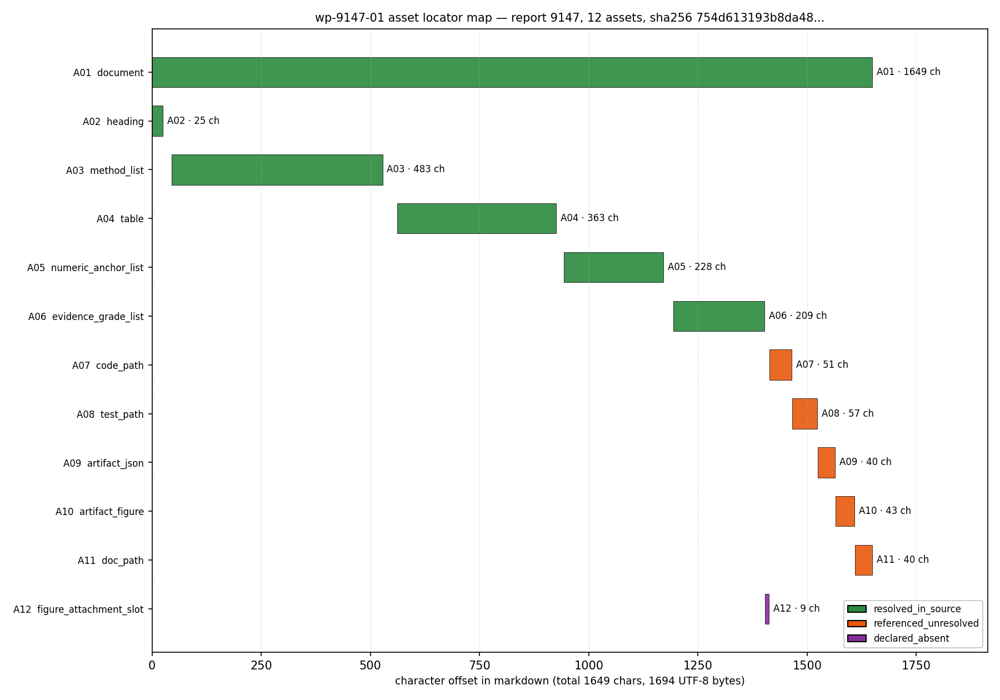

# ①本工序做了什么

本工作包 `wp-9147-01`（task_type=`01-asset-registration`，lane C）只做一件事：**为 report_id=9147 登记源资产**。
不做抽取、不做分类（契约 `objective.register_assets=true` / `classify_report_type=false`），不把任何结论标为
verified（verification 由平台门计算）。

具体产出：

1. 取回 `tensor://reports/9147` 的 `markdown` 字段，**逐字节**落盘并重算 sha256；
2. 用**程序化锚点**（行搜索）在 markdown 内切出 12 个资产的定位窗口，引文一律由切片产生（零手抄）；
3. 每个资产给出 `resolution`：`resolved_in_source`（本体在 markdown 内）/ `referenced_unresolved`
   （markdown 内只有路径文本，payload 不在报告记录里）/ `declared_absent`（声明了槽位但记录无载荷）；
4. 输出 `asset_manifest.json` 与配套定位/校验工件，并把结果装进 `kf_result.v1` 信封。

# ②怎么做的（步骤/工具/关键设置）

1. **取数**：`GET {TENSOR_API_BASE}/tensor/reports/9147`（Bearer token 由 `/auth/login` 用
   `TENSOR_AGENT_USER`/`TENSOR_AGENT_PASS` 换取，脚本不硬编码凭据）。只读、只碰 9147，不触碰任何其它
   report_id。落地 `runs/wp-9147-01/report_9147.{json,md,meta.json}`，写盘用 `write_bytes` 避免换行翻译。
2. **哈希核对**：`hashlib.sha256(markdown.encode("utf-8"))`，与契约 `source_hash` 逐字符比对；
   同时核对 `title`/`scenario_key`/`chars` 三件套与契约一致。
3. **资产登记**：资产表在代码里只写**锚点子串**与相对行窗（`scripts/kf_wp9147_01_register.py::ASSETS`），
   引文由 `"\n".join(lines[start:end+1])` 在运行时切出，再回写 `start_char/end_char`（用 `md.find()` 实测偏移，
   不做累加推算），并断言：引文是 markdown 的子串、出现次数 = 1、`md[start:end] == quote`。
   任一断言失败脚本 `SystemExit`，不产生半成品清单。
4. **分辨率判定**：依据可机械核验的事实——引文命中 → `resolved_in_source`；只有路径文本 → `referenced_unresolved`；
   平台记录 `figures == []` → `declared_absent`。**不猜测**仓库内的文件是否存在（本工作树不是生产仓，
   去读生产仓既越界也无法作为本报告的定位证据）。
5. **信封与渲染**：`kf_result.json` 按 `schemas/kf_result.v1.schema.json` 用 `jsonschema.validate` 校验；
   报告正文由模板 + 运行时注入的表格/JSON 渲染（KF_RESULT_JSON / EVIDENCE_TABLE / IDENTITY_TABLE / ACCEPTANCE_TABLE 四个占位符），正文数字全部来自工件，
   非手写。
6. **自检**：`scripts/kf_wp9147_01_check.py` 逐条复算 6 项 acceptance，输出 `acceptance_check.json`。

# ③产出物清单（输出文件名 → 要点）

| 文件 | 要点 |
|---|---|
| `docs/kf/wp-9147-01/asset_manifest.json` | **契约要求的唯一输出**：`outputs["asset_manifest.json"]` 的同一对象；12 个资产 + 定位 + 分辨率 + 计数 + 完整性声明 |
| `docs/kf/wp-9147-01/locator_check.json` | 每个资产的 `[start_char,end_char)` 切回原文的逐条比对（`slice_matches`/`occurrences`），全部 true/1 |
| `docs/kf/wp-9147-01/kf_result.json` | `kf_result.v1` 信封（package_id/task_type/report_id/provenance/outputs），schema 通过 |
| `docs/kf/wp-9147-01/acceptance_check.json` | 6 项 acceptance 的逐条复算结果（本报告 ⑥ 节的机器来源） |
| `docs/kf/wp-9147-01/asset_manifest.wp-9147-01.schema.json` | 本包使用的 asset_manifest 形状钉死版（由仓内 `schemas/asset_manifest.v1.schema.json` 派生，把 const 换成 9147 的值），让 `schema_pass` 可复算而非自称 |
| `docs/kf/wp-9147-01/source.md` / `sha256.txt` | markdown 逐字节副本 + 重算摘要（供第三方复核定位） |
| `docs/kf/wp-9147-01/figures/asset_locator_map.png` | 资产定位覆盖图（横轴=字符偏移，每行一个资产），由图脚本从 manifest 程序化生成 |
| `docs/kf_result_wp-9147-01.md` | 本报告（含唯一一个 fenced json 结果块） |

`runs/wp-9147-01/` 保留取数现场（原始 payload / markdown / meta），`docs/` 下是对外提交的定稿副本。

# ④证据定位表（字段 → 原文逐字片段）

| 字段 | 值 |
|---|---|
| report_id | 9147 |
| source_uri | tensor://reports/9147 |
| source_field | markdown |
| title（记录） | P77-N03: EEXI/CII Green Compliance Machine Judgment Gate Maturation |
| title 与契约一致 | True |
| scenario_key（记录） | P77-N03 |
| scenario_key 与契约一致 | True |
| chars（字符数） | 1649 |
| bytes_utf8 | 1694 |
| line_count | 38 |
| sha256（本地重算） | sha256:754d613193b8da4880f56371095812b6865d4d376bdca5edb8ab4f4ceb6d0ff6 |
| sha256 与契约一致 | True |
| 记录级图件（record.figures） | 0 |
| 资产数 | 12 |
| resolved_in_source / referenced_unresolved / declared_absent | 6 / 5 / 1 |
| claims（有意为空） | 0 |

| 资产 | 定位（行/字符区间） | 分辨率 | 原文逐字片段 |
|---|---|---|---|
| A01 报告 markdown 全文（源资产本体） | L1-L38 / [0,1649) | resolved_in_source | `## Implementation Summary<br><br>### What was done<br>1. **EEXI Calculation** (MEPC.335(76) Annex 2): Attained EEXI = Σ(P·SFC·C_F … xi_cii_analysis.png<br>- docs/m7776/P77_N03_green_compliance.md` |
| A02 章节锚：Implementation Summary | L1-L1 / [0,25) | resolved_in_source | `## Implementation Summary` |
| A03 实施步骤清单（MEPC 条款映射 6 条） | L4-L9 / [45,528) | resolved_in_source | `1. **EEXI Calculation** (MEPC.335(76) Annex 2): Attained EEXI = Σ(P·SFC·C_F) / (DWT·V_ref)<br>2. **Required EEXI** (MEPC.32 … ion**: JSON with EEXI certificate + CII rating + suggestions` |
| A04 验收判据结果表（6 条判据 a-f） | L12-L19 / [562,925) | resolved_in_source | `\| Criterion \| Result \|<br>\|-----------\|--------\|<br>\| (a) EEXI formula vs MEPC.335(76) \| < 0.001% error ✅ \|<br>\| (b) Required EEX …  < 0.001% vs manual ✅ \|<br>\| (f) pytest ≥95% \| 47/47 = 100% ✅ \|` |
| A05 关键数值清单（KVLCC2 EEXI/CII 5 项） | L22-L26 / [943,1171) | resolved_in_source | `- KVLCC2 Attained EEXI: 2.3564 gCO₂/(t·nm)<br>- KVLCC2 Required EEXI: 2.0068 gCO₂/(t·nm)<br>- KVLCC2 EEXI Verdict: NON-COMPLIA …  CII Boundaries: A≤0.81, B≤0.93, C≤1.07, D≤1.21 (× required)` |
| A06 证据分级清单（3 条） | L29-L31 / [1193,1402) | resolved_in_source | `- Attained EEXI/CII: REAL (pure physics, independently verifiable)<br>- Required EEXI/CII: WITHHELD (coefficients transcribed, PDF not re-read offline)<br>- CII Rating: REAL (MEPC.354(78) Annex dd values are public)` |
| A07 backend/services/green_compliance.py（~500 行） | L34-L34 / [1414,1465) | referenced_unresolved | `- backend/services/green_compliance.py (~500 lines)` |
| A08 backend/tests/test_green_compliance_m7776.py（47 tests） | L35-L35 / [1466,1523) | referenced_unresolved | `- backend/tests/test_green_compliance_m7776.py (47 tests)` |
| A09 artifacts/m7776/compliance_report.json | L36-L36 / [1524,1564) | referenced_unresolved | `- artifacts/m7776/compliance_report.json` |
| A10 artifacts/m7776/fig_eexi_cii_analysis.png | L37-L37 / [1565,1608) | referenced_unresolved | `- artifacts/m7776/fig_eexi_cii_analysis.png` |
| A11 docs/m7776/P77_N03_green_compliance.md | L38-L38 / [1609,1649) | referenced_unresolved | `- docs/m7776/P77_N03_green_compliance.md` |
| A12 记录级图件附件槽（record.figures） | L33-L33 / [1404,1413) | declared_absent | `### Files` |

共 12 个资产；全部引文在 source.md 中以声明偏移可逐字切回且唯一（见 `locator_check.json`：`slice_matches`/`occurrences` 字段）。

### 结果图：资产定位覆盖图



横轴=markdown 字符偏移（0…`chars`），每行一个资产，条形长度=定位窗口宽度 `end_char-start_char`；
颜色=分辨率（绿 resolved_in_source / 橙 referenced_unresolved / 紫 declared_absent）。图由
`scripts/kf_wp9147_01_figure.py` 直接读 `asset_manifest.json` 渲染，无手填数字；可核对：
绿色条形全部落在文档内且互不重叠，橙色/紫色条形很窄（仅路径文本 / 附件槽声明）。

注：表中 A01 的引文即整篇 markdown，因过长以 `…` 省略中段（首尾仍逐字）；完整引文与偏移见
`docs/kf/wp-9147-01/asset_manifest.json` 与 `locator_check.json`，平台可按偏移独立切片复核。

`in_report_section` 的行号均指 `docs/kf/wp-9147-01/source.md` 的 1-based 行号；字符偏移指 UTF-8
解码后的 Python 字符串下标（`chars` 亦按字符计）。

# ⑤注意点与局限

1. **只登记不判断**：A04 的 6 条判据（`< 0.001% error`、`47/47 = 100%` 等）与 A05 的 5 个数值
   （2.3564 / 2.0068 / 1.174 / B / dd 边界）都是**报告自陈**，本工序没有复算，也没有把它们标成 verified。
   报告自己在 A06 里把 Required EEXI/CII 系数标为 `WITHHELD`——这个不确定度被原样保留，没有被"登记"动作抹平。
2. **5 个路径资产未解析**（A07–A11）：`green_compliance.py`、测试文件、`compliance_report.json`、
   `fig_eexi_cii_analysis.png`、`P77_N03_green_compliance.md` 的 payload 都不在报告记录里，只在 markdown
   以路径文本出现。本工序**没有**去生产仓验证它们是否存在/是否与 47 tests 自陈一致——这既越出"只碰 9147"的边界，
   也无法作为本报告记录内的定位证据。因此它们一律 `referenced_unresolved`，不是"已验证存在"。
3. **图件缺口**（A12）：`GET /api/v1/tensor/reports/9147` 的 `figures` 是空数组，而 markdown 的 Files 节
   声明了 1 张 PNG。这是**记录级缺附件**，登记为 `declared_absent`，不当成资产存在。
4. **claims 为空是合法结果**：契约明示允许空数组。为了不制造指标，本包不生成任何 claim；
   `all_claims_have_evidence_or_explicit_unresolved_status` 因此是**空真**（vacuous true），
   这一点在 ⑥ 里如实标注，不当作"证据完备性已证明"。
5. **哈希相等 ≠ 内容为真**：sha256 命中只证明"我读到的字节 = 契约声明的字节"，与报告结论是否正确无关。
6. **字符数口径**：契约 `chars: 1649` 与本包 `chars` 一致；`bytes_utf8 = 1694`（中文与 ✅/₂ 等字符导致
   字节数大于字符数）。若平台用字节口径重算，请以本包 `bytes_utf8` 为准。
7. **时区/时间**：`provenance.emitted_at` 取自首次运行的 UTC 时间戳，重跑会复用该值以保证工件字节可复现。

# ⑥自检：逐条对照 acceptance

| acceptance 项 | 结果 | 机器依据 |
|---|---|---|
| valid_json | ✅ | json.loads OK on asset_manifest.json 与 kf_result.json |
| schema_pass | ✅ | asset_manifest 过 asset_manifest.wp-9147-01.schema.json（由仓内 asset_manifest.v1 派生）；信封过 schemas/kf_result.v1.schema.json（jsonschema.validate） |
| source_locator_resolvable | ✅ | 12 个资产的引文全部按声明 [start_char,end_char) 逐字切回、唯一、行窗自洽；失败项=无 |
| source_hash_matches | ✅ | sha256(source.md)=754d613193b8da48… 与 manifest.source.hash / 契约 754d6131… 及 provenance.source_hash 三方一致=True |
| no_duplicate_ids | ✅ | 12 个 asset_id，去重后 12 个 |
| all_claims_have_evidence_or_explicit_unresolved_status | ✅ | claims=[] （契约允许，本工序不抽取 claim）→ 该项**空真**成立，不等于证据完备性已被证明 |

6/6 复算通过，原始记录 `docs/kf/wp-9147-01/acceptance_check.json`（6/6 pass，generated_at=2026-11-12T01:35:34+00:00）。

另附交付不变量测试 `tests/test_kf_wp9147_01.py`（8 个用例，全部通过；离线运行，不依赖凭据）：
它把上面 6 项重新以**断言**的形式钉住（引文按声明偏移切回、行窗自洽、计数与资产一致、
报告内 fenced json 块与 `kf_result.json` 逐值相等、无任何 claim 被标 verified）。

判定口径：`valid_json`/`schema_pass`/`no_duplicate_ids` 是纯机械检查；`source_locator_resolvable`
按"引文可在 markdown 内以声明偏移逐字切回且唯一"判定；`source_hash_matches` 按 sha256 重算判定；
第 6 项因 `claims: []` 而**空真成立**（已在 ⑤-4 声明，不夸大）。

# 复跑

```
# 一键复跑（工作树根执行；需要 TENSOR_AGENT_USER / TENSOR_AGENT_PASS / TENSOR_API_BASE）
bash scripts/kf_wp9147_01_run_all.sh
# 分步：
python3 scripts/kf_wp9147_01_fetch.py      # 取数 + sha256 核对（只读 report 9147）
python3 scripts/kf_wp9147_01_register.py   # 资产登记 -> docs/kf/wp-9147-01/asset_manifest.json
python3 scripts/kf_wp9147_01_result.py      # 信封 + schema 校验 + 渲染本报告
python3 scripts/kf_wp9147_01_check.py       # 6 项 acceptance 复算 -> acceptance_check.json
python3 scripts/kf_wp9147_01_figure.py      # 定位覆盖图
python3 -m pytest tests/test_kf_wp9147_01.py -q   # 交付不变量测试（8 passed，离线、无需凭据）
```

# 结果信封（全文唯一的 fenced json 代码块）

```json
{
  "package_id": "wp-9147-01",
  "task_type": "01-asset-registration",
  "report_id": "9147",
  "provenance": {
    "source_hash": "sha256:754d613193b8da4880f56371095812b6865d4d376bdca5edb8ab4f4ceb6d0ff6",
    "source_field": "markdown",
    "producer": "agent/m15634",
    "emitted_at": "2026-11-12T01:34:54+00:00",
    "notes": "source_hash = sha256 over the UTF-8 bytes of the markdown field returned by GET /api/v1/tensor/reports/9147; recomputed locally and equal to the contract-declared hash. Hash equality is a mechanical identity check only: no claim in this package is marked verified and no claim is extracted (objective.classify_report_type=false); verification stays with the platform gate."
  },
  "outputs": {
    "asset_manifest.json": {
      "schema": "asset_manifest.v1",
      "package_id": "wp-9147-01",
      "task_type": "01-asset-registration",
      "report_id": "9147",
      "source": {
        "uri": "tensor://reports/9147",
        "field": "markdown",
        "hash_alg": "sha256",
        "hash": "754d613193b8da4880f56371095812b6865d4d376bdca5edb8ab4f4ceb6d0ff6",
        "hash_scope": "sha256 over the UTF-8 bytes of the markdown field",
        "hash_matches_contract": true,
        "chars": 1649,
        "bytes_utf8": 1694,
        "title": "P77-N03: EEXI/CII Green Compliance Machine Judgment Gate Maturation",
        "scenario_key": "P77-N03",
        "title_matches_contract": true,
        "scenario_matches_contract": true,
        "source_record_mission_id": 7776,
        "source_record_status": "published",
        "source_record_created_at": "2026-11-09T02:09:02.830572+00:00",
        "line_count": 38,
        "platform_figures": [],
        "platform_tags": [
          "EEXI",
          "CII",
          "MARPOL",
          "green-shipping",
          "compliance"
        ]
      },
      "counts": {
        "assets": 12,
        "by_class": {
          "document": 1,
          "heading": 1,
          "method_list": 1,
          "table": 1,
          "numeric_anchor_list": 1,
          "evidence_grade_list": 1,
          "code_path": 1,
          "test_path": 1,
          "artifact_json": 1,
          "artifact_figure": 1,
          "doc_path": 1,
          "figure_attachment_slot": 1
        },
        "by_resolution": {
          "resolved_in_source": 6,
          "referenced_unresolved": 5,
          "declared_absent": 1
        },
        "resolved_in_source": 6,
        "referenced_unresolved": 5,
        "declared_absent": 1
      },
      "assets": [
        {
          "asset_id": "A01",
          "asset_class": "document",
          "label": "报告 markdown 全文（源资产本体）",
          "in_report_section": "(document)",
          "locator": {
            "method": "document",
            "start_char": 0,
            "end_char": 1649,
            "start_line": 0,
            "end_line": 37,
            "quote": "## Implementation Summary\n\n### What was done\n1. **EEXI Calculation** (MEPC.335(76) Annex 2): Attained EEXI = Σ(P·SFC·C_F) / (DWT·V_ref)\n2. **Required EEXI** (MEPC.328(76)): Reference line × (1 - reduction_factor)\n3. **CII Calculation** (MEPC.353(78)): AAR = Σ(Fuel·C_F) / (DWT·Distance)\n4. **CII A-E Rating** (MEPC.354(78)): dd vector boundaries for 2023\n5. **Compliance Judgment**: EEXI attained ≤ required; CII rating ≥ D needs improvement\n6. **Annual Report Generation**: JSON with EEXI certificate + CII rating + suggestions\n\n### Acceptance Criteria Results\n| Criterion | Result |\n|-----------|--------|\n| (a) EEXI formula vs MEPC.335(76) | < 0.001% error ✅ |\n| (b) Required EEXI 3 ship types | < 0.001% error ✅ |\n| (c) CII rating 0 misclassification | 14 test points, 0 errors ✅ |\n| (d) Negative controls | P=0→EEXI=0, DWT=0→error ✅ |\n| (e) KVLCC2 end-to-end | < 0.001% vs manual ✅ |\n| (f) pytest ≥95% | 47/47 = 100% ✅ |\n\n### Key Numbers\n- KVLCC2 Attained EEXI: 2.3564 gCO₂/(t·nm)\n- KVLCC2 Required EEXI: 2.0068 gCO₂/(t·nm)\n- KVLCC2 EEXI Verdict: NON-COMPLIANT (ratio 1.174)\n- KVLCC2 CII Rating: B (Good)\n- CII Boundaries: A≤0.81, B≤0.93, C≤1.07, D≤1.21 (× required)\n\n### Evidence Grades\n- Attained EEXI/CII: REAL (pure physics, independently verifiable)\n- Required EEXI/CII: WITHHELD (coefficients transcribed, PDF not re-read offline)\n- CII Rating: REAL (MEPC.354(78) Annex dd values are public)\n\n### Files\n- backend/services/green_compliance.py (~500 lines)\n- backend/tests/test_green_compliance_m7776.py (47 tests)\n- artifacts/m7776/compliance_report.json\n- artifacts/m7776/fig_eexi_cii_analysis.png\n- docs/m7776/P77_N03_green_compliance.md",
            "unique": true
          },
          "resolution": "resolved_in_source",
          "resolution_check": {
            "check": "quote found verbatim in markdown at declared [start_char,end_char) and unique",
            "result": "resolved"
          },
          "note": "整篇 markdown 即源资产；sha256 见 source.hash，字节数见 source.bytes_utf8"
        },
        {
          "asset_id": "A02",
          "asset_class": "heading",
          "label": "章节锚：Implementation Summary",
          "in_report_section": "L1",
          "locator": {
            "method": "char_span",
            "start_char": 0,
            "end_char": 25,
            "start_line": 0,
            "end_line": 0,
            "quote": "## Implementation Summary",
            "unique": true
          },
          "resolution": "resolved_in_source",
          "resolution_check": {
            "check": "quote found verbatim in markdown at declared [start_char,end_char) and unique",
            "result": "resolved"
          },
          "note": "一级章节标题行；正文结构起点"
        },
        {
          "asset_id": "A03",
          "asset_class": "method_list",
          "label": "实施步骤清单（MEPC 条款映射 6 条）",
          "in_report_section": "L3-L9 (### What was done)",
          "locator": {
            "method": "char_span",
            "start_char": 45,
            "end_char": 528,
            "start_line": 3,
            "end_line": 8,
            "quote": "1. **EEXI Calculation** (MEPC.335(76) Annex 2): Attained EEXI = Σ(P·SFC·C_F) / (DWT·V_ref)\n2. **Required EEXI** (MEPC.328(76)): Reference line × (1 - reduction_factor)\n3. **CII Calculation** (MEPC.353(78)): AAR = Σ(Fuel·C_F) / (DWT·Distance)\n4. **CII A-E Rating** (MEPC.354(78)): dd vector boundaries for 2023\n5. **Compliance Judgment**: EEXI attained ≤ required; CII rating ≥ D needs improvement\n6. **Annual Report Generation**: JSON with EEXI certificate + CII rating + suggestions",
            "unique": true
          },
          "resolution": "resolved_in_source",
          "resolution_check": {
            "check": "quote found verbatim in markdown at declared [start_char,end_char) and unique",
            "result": "resolved"
          },
          "note": "6 条方法陈述，逐条带 IMO 决议号（MEPC.335(76)/328(76)/353(78)/354(78)）；仅登记位置，不做抽取"
        },
        {
          "asset_id": "A04",
          "asset_class": "table",
          "label": "验收判据结果表（6 条判据 a-f）",
          "in_report_section": "L11-L19 (### Acceptance Criteria Results)",
          "locator": {
            "method": "char_span",
            "start_char": 562,
            "end_char": 925,
            "start_line": 11,
            "end_line": 18,
            "quote": "| Criterion | Result |\n|-----------|--------|\n| (a) EEXI formula vs MEPC.335(76) | < 0.001% error ✅ |\n| (b) Required EEXI 3 ship types | < 0.001% error ✅ |\n| (c) CII rating 0 misclassification | 14 test points, 0 errors ✅ |\n| (d) Negative controls | P=0→EEXI=0, DWT=0→error ✅ |\n| (e) KVLCC2 end-to-end | < 0.001% vs manual ✅ |\n| (f) pytest ≥95% | 47/47 = 100% ✅ |",
            "unique": true
          },
          "resolution": "resolved_in_source",
          "resolution_check": {
            "check": "quote found verbatim in markdown at declared [start_char,end_char) and unique",
            "result": "resolved"
          },
          "note": "表头+分隔行+6 行判据；数值仅登记不换算、不复核（复核不属本工序）"
        },
        {
          "asset_id": "A05",
          "asset_class": "numeric_anchor_list",
          "label": "关键数值清单（KVLCC2 EEXI/CII 5 项）",
          "in_report_section": "L21-L26 (### Key Numbers)",
          "locator": {
            "method": "char_span",
            "start_char": 943,
            "end_char": 1171,
            "start_line": 21,
            "end_line": 25,
            "quote": "- KVLCC2 Attained EEXI: 2.3564 gCO₂/(t·nm)\n- KVLCC2 Required EEXI: 2.0068 gCO₂/(t·nm)\n- KVLCC2 EEXI Verdict: NON-COMPLIANT (ratio 1.174)\n- KVLCC2 CII Rating: B (Good)\n- CII Boundaries: A≤0.81, B≤0.93, C≤1.07, D≤1.21 (× required)",
            "unique": true
          },
          "resolution": "resolved_in_source",
          "resolution_check": {
            "check": "quote found verbatim in markdown at declared [start_char,end_char) and unique",
            "result": "resolved"
          },
          "note": "5 个数值锚点（Attained/Required EEXI、ratio、CII 等级、dd 边界）；本工序只登记，不判定真伪"
        },
        {
          "asset_id": "A06",
          "asset_class": "evidence_grade_list",
          "label": "证据分级清单（3 条）",
          "in_report_section": "L28-L31 (### Evidence Grades)",
          "locator": {
            "method": "char_span",
            "start_char": 1193,
            "end_char": 1402,
            "start_line": 28,
            "end_line": 30,
            "quote": "- Attained EEXI/CII: REAL (pure physics, independently verifiable)\n- Required EEXI/CII: WITHHELD (coefficients transcribed, PDF not re-read offline)\n- CII Rating: REAL (MEPC.354(78) Annex dd values are public)",
            "unique": true
          },
          "resolution": "resolved_in_source",
          "resolution_check": {
            "check": "quote found verbatim in markdown at declared [start_char,end_char) and unique",
            "result": "resolved"
          },
          "note": "报告自陈的证据等级：REAL×2 + WITHHELD×1（Required 系数未离线复核）；平台未复核，保持原样"
        },
        {
          "asset_id": "A07",
          "asset_class": "code_path",
          "label": "backend/services/green_compliance.py（~500 行）",
          "in_report_section": "L33-L38 (### Files)",
          "locator": {
            "method": "char_span",
            "start_char": 1414,
            "end_char": 1465,
            "start_line": 33,
            "end_line": 33,
            "quote": "- backend/services/green_compliance.py (~500 lines)",
            "unique": true
          },
          "resolution": "referenced_unresolved",
          "resolution_check": {
            "check": "path text found verbatim in markdown; payload not carried by the report record",
            "result": "unresolved"
          },
          "note": "仅路径文本在 markdown 内；代码不在报告记录内，本工序不读取生产仓，登记为未解析"
        },
        {
          "asset_id": "A08",
          "asset_class": "test_path",
          "label": "backend/tests/test_green_compliance_m7776.py（47 tests）",
          "in_report_section": "L33-L38 (### Files)",
          "locator": {
            "method": "char_span",
            "start_char": 1466,
            "end_char": 1523,
            "start_line": 34,
            "end_line": 34,
            "quote": "- backend/tests/test_green_compliance_m7776.py (47 tests)",
            "unique": true
          },
          "resolution": "referenced_unresolved",
          "resolution_check": {
            "check": "path text found verbatim in markdown; payload not carried by the report record",
            "result": "unresolved"
          },
          "note": "仅路径文本在 markdown 内；用例数 47 为报告自陈，未在本工序复跑"
        },
        {
          "asset_id": "A09",
          "asset_class": "artifact_json",
          "label": "artifacts/m7776/compliance_report.json",
          "in_report_section": "L33-L38 (### Files)",
          "locator": {
            "method": "char_span",
            "start_char": 1524,
            "end_char": 1564,
            "start_line": 35,
            "end_line": 35,
            "quote": "- artifacts/m7776/compliance_report.json",
            "unique": true
          },
          "resolution": "referenced_unresolved",
          "resolution_check": {
            "check": "path text found verbatim in markdown; payload not carried by the report record",
            "result": "unresolved"
          },
          "note": "年度报告工件路径；payload 未挂在报告记录上，未解析"
        },
        {
          "asset_id": "A10",
          "asset_class": "artifact_figure",
          "label": "artifacts/m7776/fig_eexi_cii_analysis.png",
          "in_report_section": "L33-L38 (### Files)",
          "locator": {
            "method": "char_span",
            "start_char": 1565,
            "end_char": 1608,
            "start_line": 36,
            "end_line": 36,
            "quote": "- artifacts/m7776/fig_eexi_cii_analysis.png",
            "unique": true
          },
          "resolution": "referenced_unresolved",
          "resolution_check": {
            "check": "path text found verbatim in markdown; payload not carried by the report record",
            "result": "unresolved"
          },
          "note": "图件路径文本在 markdown 内，但平台记录 figures=[]，PNG 本体不可从本报告解析"
        },
        {
          "asset_id": "A11",
          "asset_class": "doc_path",
          "label": "docs/m7776/P77_N03_green_compliance.md",
          "in_report_section": "L33-L38 (### Files)",
          "locator": {
            "method": "char_span",
            "start_char": 1609,
            "end_char": 1649,
            "start_line": 37,
            "end_line": 37,
            "quote": "- docs/m7776/P77_N03_green_compliance.md",
            "unique": true
          },
          "resolution": "referenced_unresolved",
          "resolution_check": {
            "check": "path text found verbatim in markdown; payload not carried by the report record",
            "result": "unresolved"
          },
          "note": "说明文档路径文本；文档本体不在报告记录内，未解析"
        },
        {
          "asset_id": "A12",
          "asset_class": "figure_attachment_slot",
          "label": "记录级图件附件槽（record.figures）",
          "in_report_section": "L33-L38 (### Files)",
          "locator": {
            "method": "char_span",
            "start_char": 1404,
            "end_char": 1413,
            "start_line": 32,
            "end_line": 32,
            "quote": "### Files",
            "unique": true
          },
          "resolution": "declared_absent",
          "resolution_check": {
            "check": "GET /api/v1/tensor/reports/9147 -> figures == [] (no attachment payload)",
            "result": "absent"
          },
          "note": "报告在 Files 节声明 1 张 PNG，但 GET /api/v1/tensor/reports/9147 的 figures 为空数组：记录级附件槽为空（absence 是登记事实，不是失败）"
        }
      ],
      "claims": [],
      "claims_note": "claims 故意为空数组：契约 objective.register_assets=true / classify_report_type=false，notes 明示 claims 允许为空；本工序只做资产登记与定位，不做抽取，不造 claim，也不把任何结论标为 verified。",
      "integrity": {
        "quote_uniqueness": "all quotes asserted unique substrings at registration time (scripts/kf_wp9147_01_register.py, build_asset) and re-checked by scripts/kf_wp9147_01_check.py",
        "hash_recomputed_locally": true,
        "hash_matches_contract": true
      }
    }
  },
  "claims": []
}
```