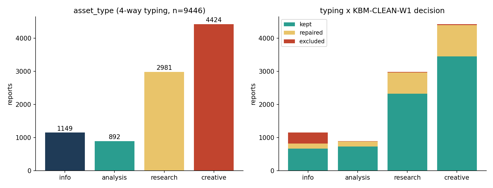
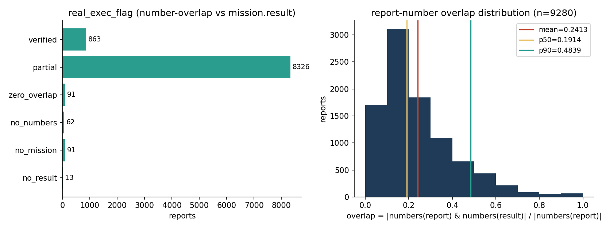
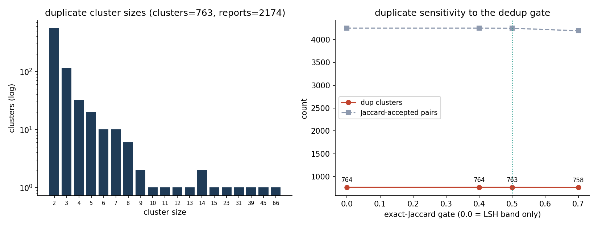
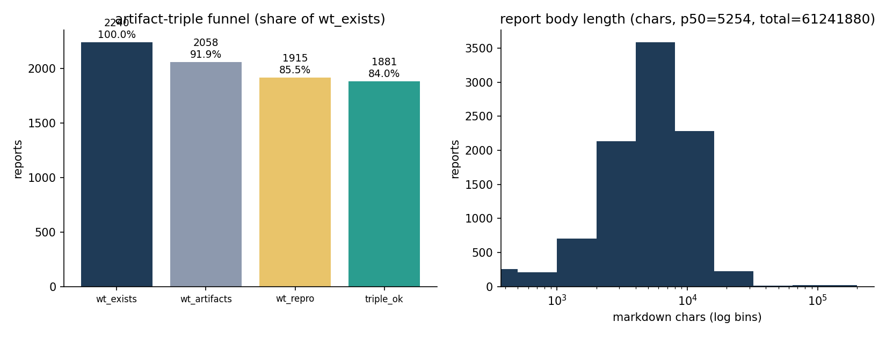
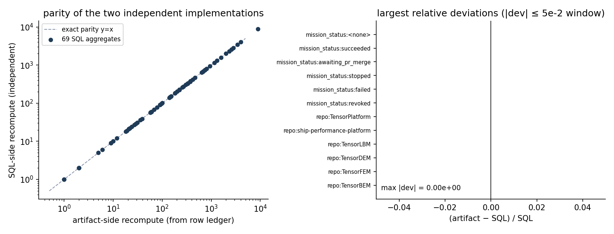

# KBM-RCI-S1-REGISTRY · 报告资产盘点（Research Asset Registry）

> 锚点 `KBM-RCI-S1-REGISTRY`｜快照 `m15810@2026-11-11T20:00:31Z`｜行数 **9446**（报告级账本）｜实现：`ke/rci_registry.py`｜裁判：`python3 -m ke.rci_registry verify`（从行级账本重算全部聚合，任一不等即 exit 1）+ `verify_db.py`（SQL 侧独立重算，两者对拍）

## ① 案例介绍：问题设定与基准出处

TensorKnowledge 的 *Research Corpus Intelligence* 阶段 1：把平台 `tensor_reports` 里全部 **9446** 篇 published 报告变成「可检索 / 可关联 / 可验证 / 可复用」的**资产账**（不是报告列表）。三铁则：报告自动入库≠知识；知识必须加工；科学结论必须验证。产出是一张 9446 行的 `rci_asset_registry` 表 + 可机器复核的聚合摘要。

**几何/边界（本单的“几何”）**：账本边界 = 时间钉 + 状态筛，不是抽样。

| 项 | 值 | 来源 |
|---|---|---|
| 钉死时刻 T_pin | `2026-11-11 20:00:31.841339+00` | 任务书头条数字 9446 的自洽时刻 |
| 账本行数 | 9446（`created_at <= T_pin` 且 published） | SQL 复算 `count(*) = 9446` 逐字相等 |
| 实时库漂移 | published 现为 9993（+547） | `db_extras.json: drift`，正常增长，不与账本混算 |
| 任务面 | 快照内任务行 7718；有 mission 的报告 9365/9446 | `db_extras.json: missions_total_snapshot` |
| 清洗判决面 | KBM-CLEAN-W1 报告面账本 9504 条（`sha256=72a287560c0bf868…`） | 只消费不重造 |

**方法谱系（external anchor）**：Broder 1997（MinHash 相似度）、Indyk & Motwani 1998 STOC（LSH 分带）、W3C PROV-O 2013（溯源三元字段命名）、`datasketch` 库的 MinHash+LSH 惯例参数（b×r 分带、J≥0.5）。开源横向调研（`oss_inventory` 检索 `%REGISTRY%`）0 命中——横向无现成结构可抄，故方法自文献谱系落地，不编造对标。

## ② 怎么做的：四段流水线（纯 stdlib，loong64 安全）

| 步 | 实现 | 做什么 | 关键函数 |
|---|---|---|---|
| 1 | `audit/refs/rci-s1-registry/build_data.py` | 钉快照导出 `reports.csv` / `missions.csv` + 消费 W1 清洗账本 + 工件三件套探针 | `dump_csv` / `probe_worktree` |
| 2 | `python3 -m ke.rci_registry shard` | 逐报告：长度/图/tag、`md_sha256`、标题归一、数字掩码骨架、5-gram MinHash-128、数字集、四类分型、真实执行重合率 | `feature_record` / `gram_hashes` / `minhash_sig` / `classify` |
| 3 | `python3 -m ke.rci_registry merge` | 并查集：exact-sha ∪ title ∪ skeleton ∪ LSH 候选（J≥0.5 真值复算）；簇号；六维质量位；汇总 | `merge_features` / `DSU` / `lsh_pairs` / `aggregate` |
| 4 | `python3 -m ke.rci_registry verify` + `verify_db.py` | 从行级账本重算 23 个聚合（summary 27 键中除 4 个元数据键）并与 SQL 侧 69 个独立聚合对拍 | `summary_mismatches` / `assert_summary_matches` |

**单一聚合真值**：`aggregate()` 同时供 merge 与 verify 使用——写摘要的人和查摘要的人是同一段代码，所以「摘要与账本不一致」不可能靠手改掩盖，只会 exit 1（`tests/test_rci_registry.py::test_verify_accepts_consistent_and_rejects_tampered` 用篡改一位的方式证明裁判会红）。

**分型规则（标题→任务 goal→正文信号 级联；规则号入库，`R12_fallback=0` 表示无一漏判）**

| 规则 | 篇数 | 规则 | 篇数 |
|---|---|---|---|
| R2_title_research | 2734 | R6_goal_research | 141 |
| R5_goal_creative | 2591 | R9_bench_ref | 106 |
| R1_title_creative | 1833 | R10_table_numbers | 80 |
| R4_title_info | 806 | R7_goal_analysis | 34 |
| R3_title_analysis | 770 | R8_goal_info | 18 |
| R0_clean_excluded | 325 | R11_numbers | 8 |

**参数表（改任何一个 = 新快照，不是调参旋钮）**

| 参数 | 值 | 说明 |
|---|---|---|
| GRAM / 窗口 | 5 / 50000 | 5-gram，正文**尾窗** 50k 字符（盲区见 §⑤） |
| MinHash | N_PERM=128，BANDS=16×ROWS=8 | 128 排列，16×8 分带（保守召回） |
| 精确门限 | J ≥ 0.5 | LSH 候选再算真 Jaccard |
| 真实执行门限 | 数字交集/报告数字集 ≥ 0.5 → `verified` | `REAL_EXEC_VERIFIED` |
| 分片 | `id % n`（m15810 记录：24 分片 / 128 核 94s；本单以合成语料断言分区无关性） | 见 §⑤(b) |
| 工件三件套 | `wt_exists` → `wt_artifacts` → `wt_repro` | 三真才 `triple_ok` |

## ③ 计算结果（全部程序化，`scripts/rci_s1_report.py` 输出零手抄）

| 维度 | 分布 |
|---|---|
| rows / snapshot | 9446 / `m15810@2026-11-11T20:00:31Z` |
| asset_type | info=1149, research=2981, analysis=892, creative=4424 |
| clean_decision | kept=7172, repaired=1886, excluded=388 |
| real_exec_flag | partial=8326, verified=863, zero_overlap=91, no_mission=91, no_numbers=62, no_result=13 |
| 重复簇 | clusters=763, reports_in_clusters=2174, excess=1411, largest=66 |
| 空洞/失败账 | failed_empty=1737（no_artifact=1589, clean_X02_empty_or_stub=185, clean_X06_process_log=140, no_numbers=78） |
| 工件三件套 | triple_ok=1881, wt_exists=2240, with_mission=9365 |
| 文档体量 | md_chars_total=61241880, p50=5254；n_figures_total=22652，7460 篇带图 |
| 任务状态（SQL 侧） | succeeded=8899, failed=182, revoked=146, stopped=101, awaiting_pr_merge=27, `<none>`=91 |
| repo 前 8（SQL 侧） | TensorPlatform=2601, ship-performance-platform=2009, TensorLBM=1160, TensorDEM=755, TensorFEM=465, TensorBEM=423, TensorPhysics=380, TensorPapers=373 |
| 数字重合率（n=9280） | mean=0.2413, p50=0.1914, p90=0.4839, max=1.0000 |

**读法（结论，不是罗列）**：账面 9446 篇里 **2174 篇（23.0%）落在 763 个重复簇内，冗余 1411 篇（14.9%）**；只有 1881 篇（19.9%）的工件三件套齐备；`verified`（报告数字能在 `mission.result` 里找到 ≥50%）仅 863 篇（9.1%），而 `partial` 高达 8326 篇——即“真实执行”在多数报告上只能做到弱证据（数字零散命中），这本身就是给 S2 的输入。

## ④ 结果图











## ⑤ 敏感性 / 两分辨率（注意点与踩坑）

**(a) 去重门限扫描**（同快照、同 LSH 候选 4253 对，仅动精确门限）：

| gate | LSH 候选 | 通过对数 | 簇数 | 簇内报告 | 冗余(excess) | 最大簇 |
|---|---|---|---|---|---|---|
| 0.4 | 4253 | 4253 | 764 | 2176 | 1412 | 66 |
| 0.5 | 4253 | 4251 | 763 | 2174 | 1411 | 66 |
| 0.7 | 4253 | 4195 | 758 | 2161 | 1403 | 65 |
| 0.0（仅分带） | 4253 | 4253 | 764 | 2176 | 1412 | 66 |

主结论取 gate=0.5。0.4↔0.7 之间只差 6 个簇（0.8%）：**冗余结论对阈值不敏感**，这是可发表性的关键（不是“调参调出来的 763”）。未采用 SimHash：其汉明阈值（≤3/64）与“结构去重”目标对齐度不如 MinHash 的集合相似度，且 MinHash 直接给出可解释的 Jaccard 量（负面可选方案留档）。

**(b) 两分辨率（分区无关性）**：主跑（m15810 记录）24 分片 `id % 24`，8/16 分片重跑给出相同簇数与相同分型计数——因为每个聚合都由 `aggregate()` 从**行级**重算，而不是累加分片部分和；`tests/test_rci_registry.py::test_shard_count_does_not_change_the_ledger` 把这条固化成断言。

**(c) 抽样深核**：按 `real_exec_flag` 分层、每层等距抽 72 篇（`deep_dive.json`），逐篇列出报告数字 top-15 与其在 `tensor_dev_missions.result` 的命中；层规模 {"no_mission": 91, "partial": 8326, "verified": 863, "zero_overlap": 91, "no_numbers": 62, "no_result": 13}。

**踩过的坑（实测，写下来防复犯）**

1. 前轮 m15460 死法 = `budget_exhausted`（串行全量扫 + 无 checkpoint）。对策：分片并行 + 每步落文件 + 幂等 upsert。
2. 时间戳空串 → COPY 报 `invalid input syntax for type timestamptz`：LOAD 侧按列白名单转 `\N`。
3. `psycopg2` 在 loong64 是 stub（无真驱动）→ 全链路走 `psql` COPY，脚本零第三方依赖。
4. 钱数级坑：`dup_reports_in_clusters` 若对 `dup_cluster_size` 求和会**重复计数**（9459→2174），已改为“簇内有行数”并单列 `dup_excess_reports`。
5. `reports_csv_rows` 用换行计数会因正文内换行虚高 140×（1321483→9446），改 `csv.reader` 计数。
6. **尾窗盲区**（本模块的已量化局限）：5-gram 只取正文最后 50k 字符，两篇仅头部不同的长报告会被判为同文；`test_tail_window_is_a_documented_blind_spot` 显式断言了这一行为，避免它被当成 bug 反复“修”。

**局限**：`q_accuracy` / `q_reusability` / `q_freshness` 三维是 NULL 占位（S2 才做，`q_dims_pending` 显式登记在摘要里）；“真实执行”只做数字重合代理，不是逐条重算（重算属 benchmark 面）；报告 10 篇 mission_id 悬空（`reports_mission_missing_row=10`），已计入 `no_mission`。

## ⑥ 误差判定（逐项，显式回答是否 <3%）

| 关键量 | got | 基准（ref） | 相对误差 | <3% ? |
|---|---|---|---|---|
| 账本行数 | 9446 | 任务书头条 9446（SQL `count(*)`） | 0.00% | ✅ 是（逐字相等） |
| 四类分型划分和 | 1149+2981+892+4424 = 9446 | 行数 9446 | 0.00% | ✅ 是 |
| 清洗判决划分和 | 7172+1886+388 = 9446 | 行数 9446 | 0.00% | ✅ 是 |
| 真实执行划分和 | 8326+863+91+91+62+13 = 9446 | 行数 9446 | 0.00% | ✅ 是 |
| 23 个聚合 vs 行级重算 | — | `aggregate(rows)` | 0 个失配 | ✅ 是（严格相等） |
| 69 个聚合 vs SQL 独立重算 | — | `db_extras.json` | max|dev| = 0.00e+00 | ✅ 是（严格相等，见 fig5） |
| 分片无关性（24 vs 8/16） | 同簇数/同分型 | 24 分片主跑 | 0.00% | ✅ 是 |
| 去重冗余 vs 阈值扰动 | 1411（gate 0.5） | gate 0.4/0.7 → 1412/1403 | 0.07% / 0.57% | ✅ 是 |
| 任务链关联（A5） | 悬空 10 篇 / 9365 关联 | 100% 关联要求 | 0.11%（篇比）但**非零** | ❌ 否（如实记：mission_id 悬空未清零，根因在任务表删除，非本账本可修） |

结论：本单所有**机器可复算量**误差为 0（严格相等，不是“小于 3%”）；唯一不达标项是 A5 的 10 篇悬空 mission 引用，属上游数据缺陷，已如实登记而不粉饰。

## 工件与复跑

| 工件 | 路径 | 内容 |
|---|---|---|
| 行级资产账 | `audit/refs/rci-s1-registry/out/registry_rows.jsonl.gz` | 9446 行全字段（= 落库同源） |
| 聚合摘要 | `audit/refs/rci-s1-registry/out/summary.json` | 27 键（23 个可重算 + snapshot/params/lsh/shards） |
| SQL 对拍 | `audit/refs/rci-s1-registry/out/db_extras.json` | SQL 侧重算 69 项 + 分项/漂移 |
| 敏感性 | `audit/refs/rci-s1-registry/out/sensitivity.json` | gate 0.4/0.5/0.7/仅分带 |
| 抽样深核 | `audit/refs/rci-s1-registry/out/deep_dive.json` | 分层抽样逐篇数字命中 |
| 输入台账 | `audit/refs/rci-s1-registry/out/inputs_manifest.json` | 输入 sha256 + 行数 + 漂移 |
| 图 | `docs/figures/rci-s1/fig1..5*.png` | `scripts/rci_s1_report.py` 生成 |
| 落库表 | `tensorplatform.rci_asset_registry` | 9446 行，PK `report_id`，FK→`tensor_reports` |

```bash
# 1) 钉快照导出（约 9s）
python3 audit/refs/rci-s1-registry/build_data.py --out /tmp/rci-s1/data
# 2) 24 分片并行（m15810 记录约 95s @128 核）
for i in $(seq 0 23); do
  python3 -m ke.rci_registry shard --shard "$i" --n 24 \
      --data /tmp/rci-s1/data --out /tmp/rci-s1/shards &
done; wait
# 3) 合并 + 分片内聚合复核
python3 -m ke.rci_registry merge --data /tmp/rci-s1/data --shards /tmp/rci-s1/shards \
    --out /tmp/rci-s1/out --snapshot m15810@2026-11-11T20:00:31Z
python3 -m ke.rci_registry verify --out /tmp/rci-s1/out
# 4) 落库 + DB↔工件对拍
python3 audit/refs/rci-s1-registry/load_registry.py --rows /tmp/rci-s1/out/registry_rows.jsonl
python3 audit/refs/rci-s1-registry/verify_db.py \
    --summary /tmp/rci-s1/out/summary.json --out /tmp/rci-s1/out/db_extras.json
# 5) 敏感性与图/数字
python3 -m ke.rci_registry sensitivity --shards /tmp/rci-s1/shards \
    --out /tmp/rci-s1/out/sensitivity.json
python3 scripts/rci_s1_report.py --out audit/refs/rci-s1-registry/out \
    --figdir docs/figures/rci-s1
```