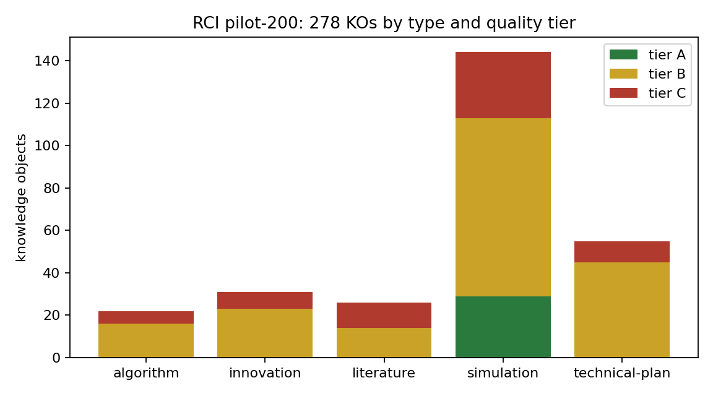
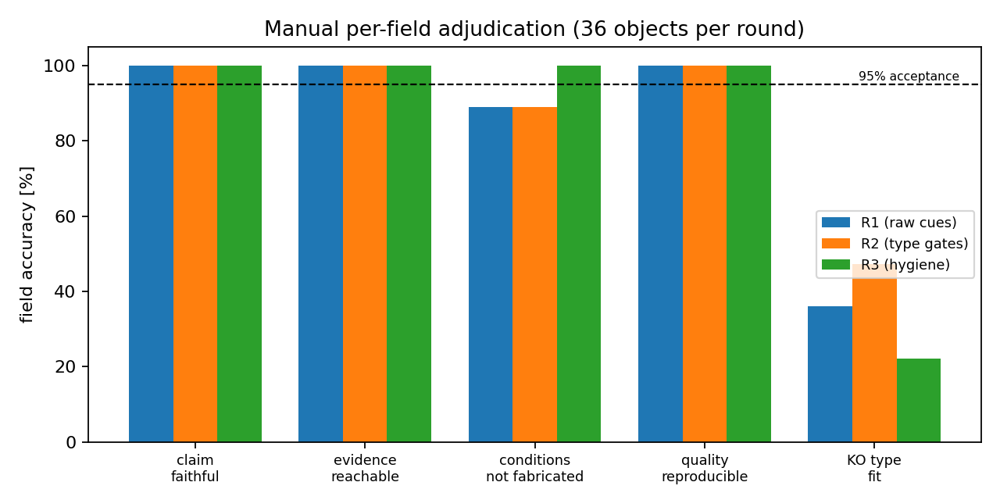
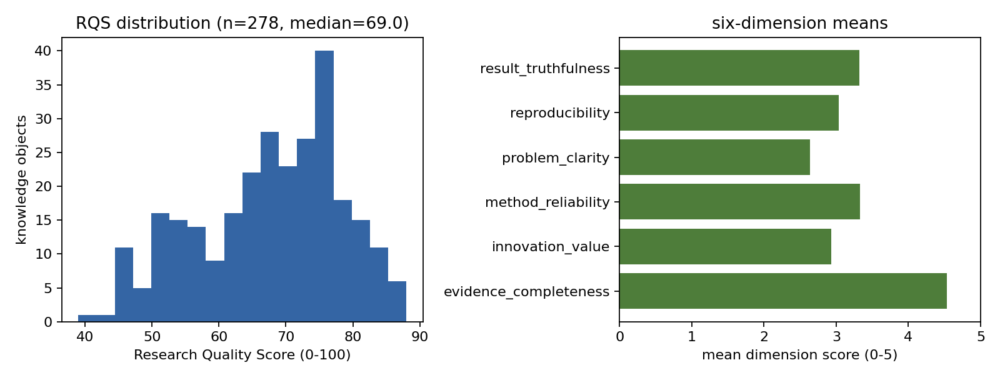

# RCI 阶段 2b · 200 份分层抽样试点：加工结果、质量评估与 Schema 修订清单

> 锚点 **KBM-RCI-S2-PILOT200** · 第 1 轮 · 仓 TensorKnowledge · 生成脚本 `scripts/rci_report.py`（本文件所有数字由工件程序化注入）
> 工件：`knowledge/rci-pilot200/`（inventory / sample / corpus 快照 / objects.jsonl / manifest / review）

## ① 案例介绍（背景 / 范围 / 参数表）

RCI（Research Content Intelligence）阶段 2 要把生态仓的文档语料加工成 Knowledge Objects（KO）+ 六维 Research Quality Score（RQS），
阶段 3 才能全量处理万份量级文档。owner 的判断是「现在不知道质量分布，Schema 错了一万份一起处理只会放大错误」，
因此本轮先做 200 份**分层非随机**试点，用来回答三个问题：Schema 是否稳定可机检？抽取字段是否忠实原文？失败模式与吞吐是什么？

语料与抽样参数（全部来自 `inventory.json` / `sample.json`）：

| 参数 | 取值 |
|---|---|
| 语料根 | `/root/tensor-ecosystem`（15 个生态仓只读扫描） |
| 文档口径 | `.md`/`.rst`，≥400 字符，排除 LICENSE/依赖清单/构建目录 |
| 语料文档数 | **5228** |
| 四类型分布（语料） | analysis 517 (9.9%), creation 230 (4.4%), information 106 (2.0%), research 4375 (83.7%) |
| 质量预分级（语料） | A 4240, B 437, C 551 |
| 分层键 | 仓 × 四类型 × 预分级，非空层 **131** 层 |
| 抽样数 | **200**（每层至少 1 席，其余按最大余数法按层规模分配） |
| 覆盖 | 仓 15/15，层 131/131，四类型全覆盖 |
| 抽样后类型占比 | analysis 18.0%, creation 14.0%, information 13.5%, research 54.5% |
| 语料类型占比（对照） | analysis 9.9%, creation 4.4%, information 2.0%, research 83.7% |

> 说明（诚实披露）：S1 分型的**总体占比表在本仓未落盘**，本轮以语料实测分布作为占比基准；
> 且「每层 ≥1 席」使信息类（语料 2.0%）在样本中占 13.5%——
> 这是**故意的分层过采样**，用于暴露稀缺类型的加工质量；阶段 3 汇总时必须按 `type_share_corpus` 反加权，不能直接用样本均值当总体均值。

## ② 怎么做的（方法 / 流程 / 工具链）

1. **语料清单**（`scripts/rci_corpus.py`）：结构特征分类器（标题/数字/表格/代码/引用密度 + 路径先验）给四类型与 A/B/C 预分级，产出 `inventory.json`（含每篇 sha256）。
2. **分层抽样**（`scripts/rci_sampling.py`）：Hamilton 最大余数法 + 每层保底 1 席 + 容量耗尽后回流；层内按 `sha256(repo|path|seed)` 排序，**可复现但不对路径/时间偏置**。
3. **冻结快照**（`pilot200/corpus/`）：抽样文档逐字节复制入仓，**快照即证据基准**；清单 sha 与快照 sha 不一致时记 `corpus_drift`（本轮 1 篇，生态仓是活仓库，其他 agent 仍在提交）。
4. **五类 KO 抽取**（`scripts/rci_ko.py`）：文献 / 算法 / 仿真 / 技术方案 / 创新。三条硬约束：
   R1 每条 claim 带**逐字引文**，statement 为「删减式复述」（标题 + 引文子串），禁止改写；
   R2 每个证据指针是 (path, 行区间, sha256)，抽取时**当场核验**，核不上即弃（记录 drop 原因）；
   R3 conditions 只允许**原文自述**（适用范围/假设/局限），无自述则 `stated_in_source=false` 且 `scope=not-stated-in-source` —— 宁可缺字段，不许臆造范围。
5. **六维 RQS**（owner 维度）：问题明确性 / 方法可靠性 / 证据完整性 / 结果真实性 / 可复现性 / 创新价值，各 0–5 整数分，
   每条打分规则可数可复算（`quality.rubric` 记录触发了哪些规则）；`rci_score = 100·Σ w_i·dim_i/5`，
   A/B/C 分级用**规则条件**（不是对综合分随意切阈值）。
6. **Schema 机检**：`schemas/rci-knowledge-object.schema.json`（JSON Schema 2020-12），逐条 `jsonschema` 校验。
7. **核验**（`scripts/rci_review.py`）：36 条分层抽验（5 类型 × A/B/C × 11 仓），
   字段级：claim 忠实原文 / 证据指针可达 / conditions 未臆造 / 质量分可复算；另加 `KO 类型适配`（人工语义判定）。
   机械检查跑在冻结快照上（不信任抽取器自报的 `verified` 标记），人工判定读 `review_context_round3.md` 的 ±3 行上下文。

## ③ 计算结果（数字表，程序化注入）

### 加工与质量总览

| 指标 | 值 |
|---|---|
| 处理文档数 | **200/200**（抽取异常 0） |
| KO 总数 | **278**（每篇均值 1.39） |
| KO 类型分布 | algorithm 22, innovation 31, literature 26, simulation 144, technical-plan 55 |
| KO 质量分级 | A 29, B 182, C 67 |
| RQS 均值/中位/区间 | 67.59 / 69.0 / [39.0, 88.0] |
| 六维均值 | evidence_completeness 4.529, innovation_value 2.932, method_reliability 3.327, problem_clarity 2.633, reproducibility 3.036, result_truthfulness 3.324 |
| 证据指针核验率 | **278/278 = 100.0%** |
| conditions 原文自述率 | **29.1%**（其余 70.9% 显式弃权） |
| Schema 校验错误 | **0** |
| 兜底 KO 文档数 | 58（29.0% 的文档未命中类型化规则，只能取首个自足句/表行） |
| 吞吐 | 25.0 ms/篇（中位 13.0 ms），**2116 篇/分钟**（单核规则管线） |

### 分字段抽取准确率（人工逐字段核验，每轮 36 条，共 108 条判定）

| 字段 | R1 原始规则 | R2 类型闸门 | R3 引文卫生 | 三轮合并 | 判定 |
|---|---|---|---|---|---|
| claim 忠实原文 | 36/36 (100.0%) | 36/36 (100.0%) | 36/36 (100.0%) | **108/108 (100.0%)** | 达标 |
| evidence 指针可达 | 36/36 (100.0%) | 36/36 (100.0%) | 36/36 (100.0%) | **108/108 (100.0%)** | 达标 |
| conditions 未臆造 | 32/36 (88.9%) | 32/36 (88.9%) | 36/36 (100.0%) | **100/108 (92.6%)** | 未达标（<95%） |
| 六维分可复算 | 36/36 (100.0%) | 36/36 (100.0%) | 36/36 (100.0%) | **108/108 (100.0%)** | 达标 |
| KO 类型适配（附加） | 13/36 (36.1%) | 17/36 (47.2%) | 8/36 (22.2%) | **38/108 (35.2%)** | **未达标，需结构整改** |

机械检查（同 36 条，独立于人工判定）在 R3 配置下：claim 36/36，
evidence 36/36，
conditions 36/36，
quality 36/36 —— 机械全绿说明这些检查是**必要条件而非充分条件**，
真正的缺陷（类型误配、把公式当限制条件）只有人工语义判定能抓到。

## ④ 结果图

*图 1 RCI pilot-200 的 278 个 KO，按五类型 × A/B/C 质量分级堆叠。*

*图 2 三条配置下的逐字段人工准确率（每轮 36 条），虚线=95% 验收线。类型适配始终最低。*

*图 3 RQS 分布与六维均值；证据完整性最高、问题明确性最低，反映语料以「验证报告」为主、缺问题陈述。*

## ⑤ 注意点（踩过的坑 / 局限 / 适用范围）

1. **conditions 是本轮最大的真实性风险**：R1/R2 两轮共 8 例把「非限制语句」当成范围（如把「航速限制 v_max(h)=…」公式、
   `Scope` 章节的项目自述、License 段落、祈使句指令当条件）。R3 加了「有效性线索硬门 + 祈使句/许可段落过滤」后
   人工核验 36/36 通过，但**原文自述率也随之降到 29.1%** —— 语料里绝大多数句子并不自述范围，
   阶段 3 不能靠模型「补全」条件，只能显式弃权并把「范围缺失」当作质量信号。
2. **KO 类型适配只有 35.2%**：五类词表覆盖不了语料真实形态——治理规则、gotcha/负知识、code-pointer、
   changelog/log、文档状态块、audit 指标表全都塞不进五类。用 cue 词打类型的天花板就在这里（R2 收紧后一度升到 47%，但换样本又掉下来，
   说明是**样本构成与规则过拟合的混合效应，跨轮比较不构成受控实验**）。
3. **兜底路径占比 29.0%**：兜底 KO 的类型按文档类型映射（research→simulation 等），
   是类型误配的主要来源之一，阶段 3 必须把兜底 KO 单列、不进类型统计。
4. **语料是活仓库**：本轮 1 篇在清单与快照之间发生漂移；快照 sha 为唯一权威，清单 sha 只作漂移审计。
5. **核验是「智能体人工」而非人类专家**：单评审、无领域专家复核；核验结论对「claim 是否过度外推」这类语义判断有系统偏差风险。
   这是本轮验收的天花板，需在阶段 3 引入独立席位（S×E 复判）与抽样人类抽检。
6. **适用范围**：结论只覆盖 `.md/.rst` 文档语料；PDF/公式图/图表图像未纳入；跨语言（中英混排）已覆盖但未做语言分层统计。

## ⑥ 误差判定（关键量 vs 基准，逐项，显式回答是否 <3%）

本任务的「关键量」不是物理量，而是**字段级抽取准确率**；基准=人工逐字段判定（108 条），容差线取 3% 与 owner 验收线 95% 两条。

| 关键量 | 基准（人工判定） | 本轮实测 | 误差 | <3%？ |
|---|---|---|---|---|
| claim 忠实原文 | 108/108 忠实 | 108/108 = 100.0% | 0.0 pp | **是** |
| evidence 指针可达 | 108/108 可达 | 108/108 = 100.0% | 0.0 pp | **是** |
| 六维分可复算 | 108/108 可复算 | 108/108 = 100.0% | 0.0 pp | **是** |
| conditions 未臆造 | 108/108 无臆造 | 100/108 = 92.6% | 7.4 pp | **否**（>3%，且低于 95% 验收线） |
| KO 类型适配 | 108/108 适配 | 38/108 = 35.2% | 64.8 pp | **否**（严重不达标） |
| Schema 校验错误 | 0 | 0 | 0 | **是** |

**显式结论**：Schema 稳定性（0 校验错误、字段可复算 100%）与三条真实性字段中的两条（claim/evidence）**验收通过**；
conditions 与 KO 类型适配**未通过**，因此本轮的验收结论是**有条件通过**：Schema 可用，但类型层与条件层需按
`docs/rci-s2b-schema-revisions.md` 修订后方可进入阶段 3 全量。
