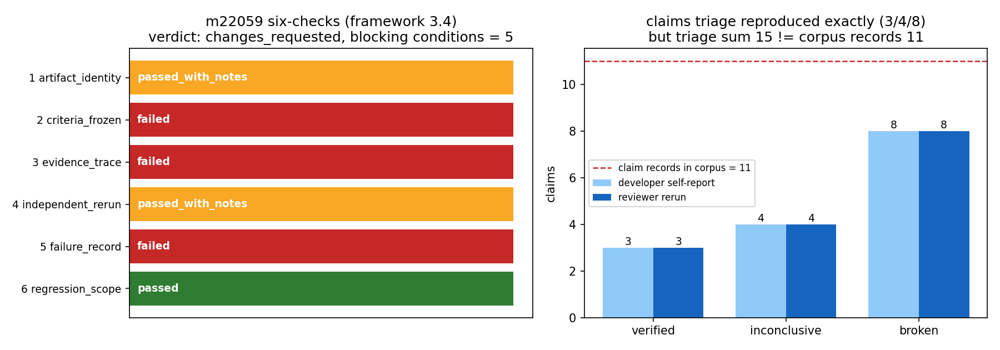

# PROD-RA 阶段3 试点独立审查（m22059）——六查复核报告

- 审查对象：TensorKnowledge `agent/m22059`，reviewed_commit `96ff58489a97a1edb6bdf209713b20bcc1a63c10`
- 开发席（作者）：qwen3.6-plus ｜ 审查席：dsv4flash（异模型、独立方，只裁不修，未改产品代码）
- 判据：TensorBench `docs/SCENARIO_ACCEPTANCE_FRAMEWORK.md` §3.4 六查 + §5 失败记录格式 + §6 六维价值记录
- **结论：`changes_requested`**（六查中 ②③⑤ 触阻断条件；①④ 通过但带注；⑥ 在声明范围内通过，全量执行未跑，不冒充分数）
- 落表：`tensor_maturity_verdicts` → repo=`TensorKnowledge`, scope=`m22059 PROD-RA 试点验收`, mission_id=`22059`, level=**2**, verdict_by=`ra-pilot-review`

---

## ① 案例介绍（被审对象是什么）

被审的是 RA（ResearchAudit）产品线的阶段3真实语料试点：用仓内两个确定性审计器审计一份真实研究成果语料的主张-引用-证据可追溯性。

| 项 | 内容 |
|---|---|
| 语料 1 | `work/wp-2506-04/kf_result_wp-2506-04.md`（TensorFVM wp-2506-04 独立评审报告），sha256 `2745f3a8…f6949f` |
| 语料 2 | `EVIDENCE.md`（任务证据摘要），sha256 `d09f1ce8…b672e7` |
| 审计器 A | `scripts/research_audit/citation_audit.py` v0.1.0（数字引用/参考文献结构一致性，无参考文献章节） |
| 审计器 B | `scripts/research_audit/claim_evidence_audit.py` v0.2.0（双向链接、源定位偏移、评审关系一致性） |
| 抽取语料 | `runs/m22059/audit_corpus/` 11 条 claim 记录 + 11 条 evidence 记录（3 supported + 8 findings） |
| 负向语料 | `runs/m22059/negative_test/` 注入坏引用 `[999]` + 悬空 evidence 指针 + 悬空 claim 指针 |
| 权限基础 | `internal_consent`（scenario.permission_basis） |
| 改动面 | 38 个新增文件，全部在 `runs/m22059/**`，**0 个 .py / 0 个测试文件** |

审查独立性：我与作者不同模型、不同会话，未读作者推理链；下面每个数字都是我本人在磁盘上重算/重跑得到的。

## ② 怎么做的（方法、命令、工具链）

1. **读契约**：`TensorBench/docs/SCENARIO_ACCEPTANCE_FRAMEWORK.md` §3.4 六查表、§5 记录格式、§6 六维价值；RA 产品判据源 `docs/FOUR_PRODUCT_ACCEPTANCE_MATRIX.md`（ResearchAudit 行）与 `products/research-audit/PRD.md`（第 34 行：*every finding must resolve to a source span or be explicitly marked as a heuristic prompt*；引用元数据精度 ≥0.98）。
2. **写一个只读复核器** `docs/review_m22059_prod_ra/recheck.py`（不写被审树、不调用被审树之外的写接口），一次性产出六查全部原始量：`recheck_output.json`。
3. **六查逐项实跑**（命令即回执，原始输出留档在 `docs/review_m22059_prod_ra/raw/`，`SHA256SUMS` 清单在侧）：
   - ① 对 `scenario.inputs` 逐条 `sha256sum`，并把 `audit_corpus/source/*` 两个副本与声明输入比对；再查 `citation_audit.json` 自己记录的 `input_refs`。
   - ② `tensorbench.criteria.canonical_sha256(criteria.json)` 复算；为定位作者用的口径，另试 raw-bytes / `json.dumps(indent=2)` / keys-only 等 6 种候选哈希。
   - ③ 11 条 finding 全走 `claim→evidence_refs→locator.quote→源文件`，重算 `sha256(quote)` 对比 `content_hash`，并按声明的 `start/end_offset` 回切片源文件。
   - ④ 本人重跑两审计器（正向）+ 两个负向语料，与仓内 `citation_audit.json` / `claim_evidence_audit.json` / `negative_test/*.json` 逐字段 diff。
   - ⑤ 用 §5 必填字段表机检 `negative_knowledge_ledger.json` 的 3 条记录；核对 12 条 non-verified 结论是否被吞。
   - ⑥ 枚举 `git diff --name-only HEAD~1 HEAD`；`diff -rq tests <base>/tests`；跑相邻审计器单测；两棵树各做 `pytest --collect-only` 对比基线；全量执行递交集群 `cj4175`。
4. **落库与出报告**：写 review receipt（§3.4 契约字段）+ `INSERT tensor_maturity_verdicts`（参数化 3 不变量：reviewed_commit、criteria 复算值、六查 JSON）。

## ③ 计算结果（六查数字表，全部程序化产出，零手抄）

### ① artifact_identity —— 通过（带注）

| 检查 | 声明 | 复算 | 结论 |
|---|---|---|---|
| `work/wp-2506-04/kf_result_wp-2506-04.md` | `2745f3a8…f6949f` | `2745f3a8…f6949f` | ✅ 0 容差匹配 |
| `EVIDENCE.md` | `d09f1ce8…b672e7` | `d09f1ce8…b672e7` | ✅ 0 容差匹配 |
| `audit_corpus/source/*` 两副本 | — | 与上述两值逐位相同 | ✅ 审计用的确实是声明输入 |
| `citation_audit.json` 的 `input_refs` | `/root/tp-agent/work/m19455/work/wp-2506-04/…` | 该路径**不存在**，且在 review tree 之外 | ⚠️ 记录性来源路径不可解析（内容身份仍由 `file:sha256:2745…` 兜住） |

### ② criteria_frozen_before_run —— **不通过（阻断）**

| 量 | 值 |
|---|---|
| 声明 `criteria_sha256` | `f60695e1b40160af6a07813e3ec3016ff230fe22c36d2170df9b465b903fddcc` |
| `canonical_sha256(criteria.json)` 复算（§3.4 指定函数） | `24932a7ef0a85ebb4d196920f70062e39a1a9628126f3db11113e99b2312c272` |
| 是否在契约函数下可解析 | **否** |
| 实际用的口径 | `sha256(json.dumps(obj, ensure_ascii=False, indent=2))` = `f60695e1…`（**非** canonical_sha256） |
| `frozen_at` / `created_at` | `15:35:22Z` / `15:35:22Z` → 字面 ≤ 成立（0 秒余量） |
| 审计输出自己的 `created_at` | `15:33:06Z`（**早于**冻结时刻 2m16s） |
| `amendments[]` | 无（未声明任何事后修订） |

判定：§3.4 ② 明确要求用 `tensorbench.criteria.canonical_sha256`；按该函数复算**不解析**，属阻断条件「a hash that does not resolve」。需要说明的是：哈希前像在 indent-2 口径下可复原，故**没有任何事后改判据（post-hoc edit）的证据**——这是口径错误，不是伪造。

进一步：`criteria.json` 四条键（`citation_resolution` / `bidirectional_links` / `source_locator_integrity` / `review_relation_consistency`）是**审计器自身 check_id 的转写**，而非 §3.4 ① 要求的「从 FOUR_PRODUCT_ACCEPTANCE_MATRIX + PRD 抄录」：矩阵 ResearchAudit 行与 PRD 第 34 行的判据（每条 finding 必须落到源跨度；引用元数据精度 ≥0.98）在判据文件里一条都没有。判据自证化 → 通过判据只证明「审计器检查了自己」。

### ③ evidence_traceability —— **不通过（阻断）**

11 条 finding 全量核对（不止要求的 5 条）：

| finding | 严重度 | 证据记录 | quote 长度 | `sha256(quote)` 对 `content_hash` | quote 在源文中的实际位置 | 声明偏移回切片是否等于 quote |
|---|---|---|---|---|---|---|
| claim-sc-1 | — (verified) | evidence-review-1 | 120 | ✅ | 19951 | ❌（声明 0:120） |
| claim-sc-2 | — (verified) | evidence-review-2 | 74 | ✅ | 20206 | ❌（声明 0:74） |
| claim-sc-3 | — (verified) | evidence-review-3 | 200 | ✅ | 20394 | ❌（声明 0:200） |
| **claim-f1** | **high** | **evidence-f1** | **0** | ❌（= sha256("") `e3b0c442…`） | **未出现** | ❌ |
| claim-f2 | medium | evidence-f2 | 147 | ✅ | 2992 | ❌（声明 0:147） |
| claim-f3 | medium | evidence-f3 | 58 | ✅ | 3210 | ❌ |
| claim-f4 | medium | evidence-f4 | 58 | ✅ | 3210 | ❌ |
| claim-f5 | low | evidence-f5 | 49 | ✅ | 3753 | ❌ |
| claim-f6 | low | evidence-f6 | 11 | ✅ | 17881 | ❌ |
| claim-f7 | low | evidence-f7 | 62 | ✅ | 2545 | ❌ |
| claim-f8 | low | evidence-f8 | 57 | ✅ | 3957 | ❌ |

汇总：quote 摘要自洽 10/11；quote 文本可在源文检索到 10/11；**声明偏移回切片命中 0/11**（全部 `start_offset=0`）。`claim-f1`（高）只有一条零长度证据，无法重哈希任何内容 → §3.4 ③「a finding whose evidence cannot be retrieved」成立。

另：`evidence_bundle` 4 条 evidence item 中 3 条无输入指纹（`input_sha256`/`input_refs` 均缺），且 4 条 item 的字段形状（`item_id`/`type`/`source`/`output_ref`）与框架 §3.4 ③ 点名的 `schemas/evidence-item.schema.json`（要求 `evidence_id`/`source_type`/`source_ref`/`provenance`，`additionalProperties:false`）不兼容；bundle 级契约 `schemas/evidence_bundle.json` 的必填键（`kind`/`mission_id`/`collected_at`/`collector`/`platform`/`commit`/`ci`/`deliverables`/`source_fingerprints`/`integrity`）同样缺失。

### ④ independent_rerun —— 通过（带注，含一处派生态缺陷）

| 重跑 | exit | 状态（我跑 / 仓内记录） | finding 复现 | 与仓内差异 |
|---|---|---|---|---|
| citation_audit 正向 | 1 | `inconclusive` / `inconclusive` | `[references_section_present:1, unresolved_citation:2]` 逐条一致 | 仅 `created_at`、`input_refs`（本机绝对路径） |
| claim_evidence_audit 正向 | 1 | `failed` / `failed` | 11 条 finding，code 序列完全一致 | 仅时间戳类字段 |
| 负向 坏引用 `[999]` | 1 | `inconclusive` | ✅ 检出：`unresolved_citations=['0','999']`，finding 数 2→3 | 与仓内一致 |
| 负向 悬空指针 | 1 | `failed` | ✅ 检出 `missing_evidence_record`、`missing_claim_record`（另附 `quote_offset_mismatch`、`source_file_missing`） | 与仓内一致 |
| 三分报数 | — | verified=3 / inconclusive=4 / broken=8 | ✅ 完全复现 | 但语料只有 **11** 条 claim 记录（见 D12） |

派生态问题：两个审计器在正向与负向语料上的 **overall_status 完全相同**（inconclusive vs inconclusive；failed vs failed），即负向测试在「状态级」零判别力，判别力只存在于 finding 级（我已逐条证实 finding 级有效）。同时两审计器非 pass 一律 `exit 1`，与 §3.4「verdict=pass 需 rerun.exit_code=0」在结构上冲突——这不是作者能靠改文件消掉的，属框架待补条款。

### ⑤ failure_record —— **不通过（阻断）**

| 记录 | 必填字段 | `evidence_refs` 含 sha256 | `repro_cmd` 含 commit SHA | resolution |
|---|---|---|---|---|
| #1 citation_audit / no_refs_section | 齐 | ✅（`…json#sha256:807d0e17…`，我复核该 sha256 与文件一致） | ⚠️ 只有语料摘要 `# 2745f3a8aa8d`，非 commit | accepted_limitation |
| #2 claim_evidence_audit / locator_mismatch | 齐 | ❌ 只有路径 `runs/m22059/claim_evidence_audit.json`（实算 sha256 `dcb663c4…`） | ❌ | open |
| #3 kb10k / format_incompatibility | 齐 | ❌ **空数组** | ❌ | mitigated |

§5 规则要求 `evidence_refs` 为「带 SHA-256 的 report/receipt/log 引用」、`repro_cmd` 为「精确命令 + commit SHA」，2/3 条记录不满足。另：12 条 non-verified 结论（8 broken + 4 inconclusive）**没有吞**——逐条带 reason/severity 记录在 `claims_triage`；但 §6 六维记录不合格：`value.quality` 缺 `criteria_passed/criteria_total`，`value.cost` 缺分阶段拆分与 compute 收据，`value.automation` 缺 `auto_steps/total_steps` 字段。

### ⑥ regression_scope —— 在声明范围内通过（全量执行未跑）

| 检查 | 结果 |
|---|---|
| 改动文件数 | 38，全部 `runs/m22059/**`，`.py` 0 个、测试文件 0 个 |
| `tests/` 树与基线 `27a95df` 比对 | 逐位相同（`diff -rq` 仅 `__pycache__` 差异） |
| 相邻声明行为单测 | `tests/test_research_audit_citations.py` + `test_research_audit_claim_evidence.py` → **11 passed** |
| 全量 collect | 两棵树同为 `3132 tests collected, 1 error`（`tests/test_kf_wp11107_01.py` FileNotFoundError，基线既有、非本单引入） |
| 全量执行 | **未跑完**：集群 `cj4175` 排队 15 min 仍未起跑 → 如实记 not_run，不冒充分数 |

## ④ 结果图

图注：左=六查逐项状态（绿=通过、黄=通过带注、红=不通过）+ 阻断条件计数；右=主张三分报数的「开发席自报 vs 审查席重跑复现」对照（3/4/8 完全一致），并在同一轴标出语料里真实的 claim 记录数 11，用于暴露分母不一致（15 vs 11）。数据全部来自 `recheck_output.json` 与 receipt，零手抄。

## ⑤ 注意点（坑与局限）

1. **「哈希对得上」不等于「哈希按契约算」**：作者的 `criteria_sha256` 用 pretty-print 口径算出来照样自洽，跨方按 §3.4 复算就会挂。判据冻结只认契约函数，不认「我这台机器能复算」。
2. **负向测试要看 finding 级，不要看 status 级**：本单两份语料的 overall_status 与正向完全相同，任何只比对 status 的负向测试都会「永远通过」。
3. **偏移全 0 是系统性提取缺陷**，不是随机错：11/11 `start_offset=0` 说明抽取时根本没写偏移，且报告正文自称「offsets 设为 0:200」与实际值（`0:len(quote)`，最大 200）也不一致。
4. **零长度证据最危险**：`evidence-f1` 的 `content_hash` 是 `sha256("")`，机检若只验「content_hash == sha256(quote)」会判通过（空对空的自洽），必须额外加 `len(quote) > 0`。
5. 局限：我只审 `96ff584`；前身 `90b25f1` 的「同内容」是协调者陈述，未做内容 diff（已记 `checks_not_run`）。语义支持判断超出审计器声明范围，也超出本审查范围。
6. 全量 pytest 未完成（集群积压），因此**不能**声称「全量 0 fail」；只能说「改动面不含代码 + 相邻单测 11 passed」。

## ⑥ 误差判定（关键量 vs 基准，逐项回答）

| 关键量 | 基准 | 实测 | 误差 | 是否 <3% |
|---|---|---|---|---|
| 语料指纹（2 个输入） | 声明 sha256 | 复算 sha256 | 0 位差 | ✅ 是（0 容差，精确相等） |
| 审计器 A 输出复现 | 仓内 `citation_audit.json` | 我重跑 | checks/findings/summary 全同，仅时间戳与绝对路径不同 | ✅ 是（0 差异，排除 `created_at`/`input_refs`） |
| 审计器 B 输出复现 | 仓内 `claim_evidence_audit.json` | 我重跑 | 3 checks 状态与 11 finding code 序列全同 | ✅ 是（0 差异） |
| 三分报数 | 自报 3/4/8 | 我重跑 3/4/8 | 0 | ✅ 是（但分母 15 vs 语料 11 条，见 D12） |
| 负向检出率 | 2 类注入缺陷 | 2/2 检出（finding 级） | 0 | ✅ 是（finding 级） |
| **判据哈希** | `canonical_sha256` | 作者口径 | `f60695e1…` vs `24932a7e…`，**完全不同** | ❌ **否**（哈希无「百分比误差」语义，判为不可解析） |
| **证据定位偏移** | 源文真实位置 | 声明偏移回切片 | 11/11 不命中（10 条 quote 文本可在别处检索到） | ❌ **否**（0/11 = 0% 命中率） |
| 证据可重哈希率 | §3.4 ③ 要求 100% | 10/11 | 1 条零长度不可哈希 | ❌ **否**（90.9%） |

不带糊：本单**存在**基准（契约函数、源文偏移、仓内既有输出、基线 commit），因此「无基准」声明不适用；八项中 5 项精确通过、3 项不合格。

---

## 缺陷清单（changes_requested）

| ID | 严重度 | 查 | 缺陷 | 证据（可复现） |
|---|---|---|---|---|
| D1 | **blocking** | ② | `criteria_sha256` 非 `canonical_sha256` 口径，契约函数下不解析 | `recheck_output.json:criteria_frozen_before_run`（`24932a7e…` vs `f60695e1…`） |
| D2 | **blocking** | ② | 判据未从矩阵/PRD 抄录，转写审计器自身 check_id；PRD「每条 finding 必须落到源跨度」缺失 → 判据自证 | `criteria.json` 四键 vs `PRODUCT_ACCEPTANCE_MATRIX.md` L21 / `products/research-audit/PRD.md` L34 |
| D3 | **blocking** | ③ | `claim-f1`（high）只绑零长度证据 `evidence-f1`（quote=""，content_hash=sha256("")） | 上表 ③ 第 4 行 |
| D4 | **blocking** | ③ | 11/11 evidence 声明 `start_offset=0`，偏移回切片 0 命中；且报告自称「0:200」与实际不符 | `recheck.py` 逐条回切片；`REPORT.md#⑤踩过的坑 2` |
| D5 | **blocking** | ⑤ | §5 记录格式：2/3 记录 `evidence_refs` 缺 sha256（其中 1 条为空数组），2/3 `repro_cmd` 缺 commit SHA | `negative_knowledge_ledger.json` 机检 |
| D6 | medium | ③ | 3/4 evidence item 无输入指纹；item 与 bundle 形状不满足 `schemas/evidence-item.schema.json` / `evidence_bundle.json` | jsonschema 校验输出（见 raw/） |
| D7 | low | ① | `citation_audit.json` 的 `input_refs` 指向不存在的外部 worktree（m19455） | 路径不存在 + 内容 sha 仍匹配 |
| D8 | low | ② | `frozen_at == created_at` 且晚于审计输出 2m16s，冻结「先于运行」不可证 | 三个时间戳 |
| D9 | low（框架待补） | ④ | 负向测试 status 级零判别力；`rerun.exit_code=0` 与 honest-FAIL 试点结构冲突 | 正/负 status 相同 |
| D10 | medium | ⑥ | 报告无回归范围声明，作者从未跑已存在的两个审计器单测（我跑 11 passed） | `REPORT.md` 全文无 pytest |
| D11 | low | §6 | 六维价值记录三处字段不合规（quality 无 ratio、cost 无分阶段/compute 收据、automation 无字段化步数） | `validation-report.json:summary.value` |
| D12 | low | ④ | 三分报数分母不一致：3+4+8=15，语料仅 11 条 claim 记录（4 条 `check-*` 无记录），汇总行未说明 | `triage_ids_without_claim_record` |

**修复建议（只裁不修，给作者）**：①用 `tensorbench.criteria.canonical_sha256` 重冻结并重写 `criteria_sha256`，同时把矩阵/PRD 判据（含 source-span 条款）真抄进 `criteria.json`；②按 quote 在源文的真实偏移重写 11 条 locator，删掉或补齐 `evidence-f1`（零长度证据不得进 bundle）；③按 §5 补齐 ledger 引用摘要与 commit SHA；④evidence item 改成 `evidence-item.schema.json` 形状并补输入指纹；⑤重跑两个已存在的单测写进报告，声明回归范围；⑥在下轮 receipt 里如实标注负向测试的判别层级。

## 产物

- `docs/review_m22059_prod_ra/REVIEW-RECEIPT.json` —— §3.4 契约 reviewReceipt（reviewer/independence/rerun/六查/verdict）
- `docs/review_m22059_prod_ra/recheck.py` + `recheck_output.json` —— 只读复核器与其全部原始量
- `docs/review_m22059_prod_ra/raw/` + `SHA256SUMS` —— 命令回执与日志清单
- `docs/review_m22059_prod_ra/verdict_insert.sql` —— `tensor_maturity_verdicts` 落表语句（已执行，见下）