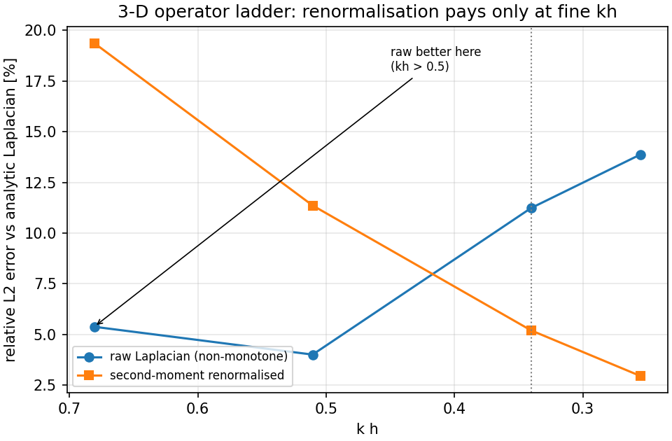
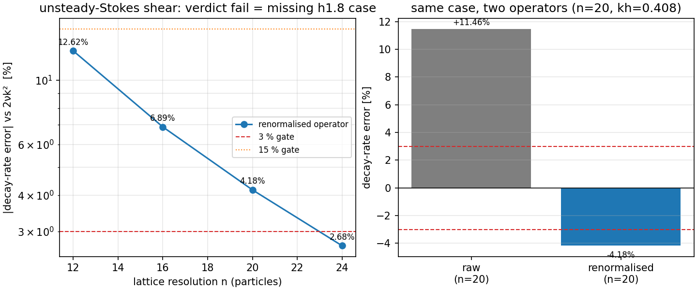
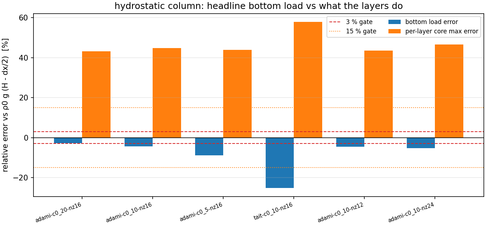
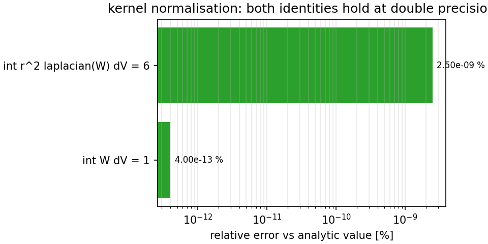

# TensorSPH 3-D operator verification: what the analytic benchmarks actually verify (mission m5054)

* **本单**：mission 14526（TensorKnowledge），返修自 m8824；task_key `tk-sediment-m5054`
* **源单**：mission 5054（TensorSPH，branch `agent/m5054`，PR 338，model deepseek-v4-flash，succeeded）
* **源 pin**：`82b72a15c044259d1e7c8d638e9273705fa42e7b`（commit 2026-11-07T05:31:53+00:00）
* **产物**：`knowledge/sediment/tk-sediment-m5054/`（6 claim / 21 evidence / 6 provenance，四契约）＋ `docs/sediment/tk-sediment-m5054/runs/`（运行工件）
* **证据分级**：本轮所有数字来自源 pin 的 report.json 或本仓运行工件，提取与复核均程序化（`ke/sediment_extract.py` / `ke/sediment_verify.py`），claim 一律 `epistemic_status=draft`、`assessment_status=unassessed`（不自审）

---

## ① 案例介绍（物理背景 / 几何 / 参数表）

源单把 2-D SPH 求解器扩到三维：新增 3-D 三次样条核、格点质量标定、三周期最小镜像邻居搜索、对称压力力、二阶矩重整化粘性 Laplacian、Adami 壁面模型，以及质量/动量/能量计量器，并对
**三个解析基准**给出可机读 report.json：

| 基准 | 解析参考 | 判据数 | verdict | missing_cases |
|---|---|---|---|---|
| `threed_kernel` | 3-D cubic spline: int W dV = 1, int r^2 laplacian W dV = 6, laplacian(sin sin sin) = -3 k^2 f | 6 | `pass` | — |
| `threed_shear` | u = A sin(ky) sin(kz) exp(-2 nu k^2 t); decay rate 2 nu k^2 | 6 | `fail` | ['h1.8'] |
| `threed_hydrostatic` | p(z) = rho0 g (H - z), p = 0 at the free surface | 8 | `fail` | — |

**参数表（逐字取自源 report.json 的 params）**

| 基准 | 参数 |
|---|---|
| `threed_kernel` | `rho0=1000.0`, `sound_speed=20.0`, `gamma=7.0`, `wavenumber=6.283185307179586` |
| `threed_shear` | `box=1.0`, `nu=0.05`, `amplitude=0.1`, `sound_speed=10.0`, `periods=1`, `h_over_dx_default=1.3` |
| `threed_hydrostatic` | `dx=0.01`, `nx=8`, `ny=8`, `rho0=1000.0`, `gravity=9.81`, `t_end=0.3`, `viscosity=0.02` |

**格点/几何核验（先验后算，程序化断言）**

| 核验项 | 期望 | 实测 | 判定 |
|---|---|---|---|
| 核支撑 h（kernel） | 与 dx 阶梯解耦 | h=0.013 | PASS |
| dx 阶梯 | 单调且 4 级 | [0.02, 0.01, 0.005, 0.0025] | PASS |
| 剪切波分辨率阶梯 | n = 12/16/20/24 | [12, 16, 20, 24] | PASS |
| h/dx（kernel 阶梯） | 1.3 | 1.3 | PASS |
| 二阶矩格点常数 K 的分辨率无关性 | spread < 1e-12 | 1.21e-15 | PASS |

（船舶几何量 Cb/L/B 不适用：本单是数值算子验证，不是船型阻力/耐波算例。）

## ② 怎么做的（方法 / 流程 / 关键设置 / 工具链）

1. **知识侧（四契约，程序化生成）**：`ke/sediment_extract.py` 按 spec 在 `git show <sha>:<path>` 的 blob 里用 `str.index` 定位每条引句，记录 `start_offset/end_offset/行号/content_hash(sha256)`；引句不唯一或找不到即中止构建（负对照测试覆盖）。claim/evidence/provenance 全部由程序写出，人手不写任何 JSON。
2. **数值侧（基准表重算）**：`build_benchmarks()` 从源 report.json 里读参数，用显式公式**重算参考值**再与工件值比对——`2*nu*(2*pi/L)^2`（unsteady-Stokes 衰减率）、`rho0*g*(H-dx/2)`（静水底部载荷）、`-9*(1/(pi*h^3))/h^2`（三次样条核在 r=0 的 Laplacian）、核归一化恒等式 1 与 6。公式字符串随行存进 `benchmarks.json`，可被第三方独立复算。
3. **独立复核**：`ke/sediment_verify.py` 十项检查（schema / 双向交叉引用 / 引句@pin / INDEX 一致性 / 生产者契约 / 基准重算 / 运行工件 sha256），不读取生成者的自述。
4. **源侧实测探针**：`scripts/sediment_m5054_source_guard.py` 用 `git archive` 把守护测试与三个 report.json 落到临时目录并执行 pytest，结论写进运行工件（不改动源仓工作树）。
5. **工具链**：python 3.11.6、jsonschema、pytest、matplotlib；重计算未上集群（全部为秒级 JSON 处理，源算例本身未重跑——见 ⑤ 局限）。

```bash
python3 -m ke.sediment_extract --spec knowledge/sediment/tk-sediment-m5054/spec.json --source-repo /root/tensor-ecosystem/TensorSPH --out knowledge/sediment/tk-sediment-m5054 --run-dir docs/sediment/tk-sediment-m5054/runs/extract && python3 -m ke.sediment_verify --package knowledge/sediment/tk-sediment-m5054 --spec knowledge/sediment/tk-sediment-m5054/spec.json --source-repo /root/tensor-ecosystem/TensorSPH --run-dir docs/sediment/tk-sediment-m5054/runs/extract --report docs/sediment/tk-sediment-m5054/runs/validate/validate_report.json
python3 scripts/sediment_m5054_source_guard.py
python3 scripts/sediment_m5054_figures.py
python3 -m pytest tests/test_sediment_m5054.py -q
```

## ③ 计算结果（程序化注入，零手抄）

### 3.1 基准重算表（ref 由公式重算 vs got 为源工件值）

| 行 | 参考量 | ref | got | 相对误差 | 容差 | 是否达标 |
|---|---|---|---|---|---|---|
| `kernel-integral` | int W dV = 1 (analytic) | 1 | 1.000000000000004 | +3.997e-13% | 1e-09% | 是 |
| `kernel-second-moment` | int r^2 laplacian(W) dV = 6 (analytic) | 6 | 5.99999999985 | -2.5e-09% | 1e-06% | 是 |
| `kernel-laplacian-origin` | -9*(1/(pi h^3))/h^2 (cubic-spline Laplacian at r=0) | -7715709630.0068054 | -7715709630.0068054 | -0% | 1e-09% | 是 |
| `shear-decay-n24` | 2*nu*(2*pi/L)^2 (unsteady-Stokes decay rate) | 3.9478417604357432 | 3.8421366317216679 | -2.678% | 3% | 是 |
| `shear-decay-n12` | 2*nu*(2*pi/L)^2 (unsteady-Stokes decay rate) | 3.9478417604357432 | 3.4496152263341169 | -12.62% | 15% | 是 |
| `shear-raw-n20` | 2*nu*(2*pi/L)^2, raw Laplacian, n = 20 | 3.9478417604357432 | 4.4003174357607699 | +11.46% | 3% | **否** |
| `shear-renorm-n20` | 2*nu*(2*pi/L)^2, renormalised Laplacian, n = 20 | 3.9478417604357432 | 3.7830066203366384 | -4.175% | 3% | **否** |
| `hydro-bottom-best` | rho0*g*(H - dx/2) (hydrostatic bottom load) | 1520.55 | 1478.7719570524944 | -2.748% | 3% | 是 |
| `hydro-bottom-tait` | rho0*g*(H - dx/2), Tait-only wall model (control run) | 1520.55 | 1136.9277857634372 | -25.23% | 15% | **否** |
| `hydro-core-max` | 0 (exact hydrostatic profile), core layers | 0 | 0.43174103887188148 | abs 0.4317 | 0.15 (abs) | **否** |
| `lattice-second-moment-K` | continuum second moment K = 2 (lattice value may differ) | 2 | 2.3468535456329125 | +17.34% | 15% | **否** |

最差行：`hydro-bottom-tait`（25.23%），超差行 5/11：`shear-raw-n20`, `shear-renorm-n20`, `hydro-bottom-tait`, `hydro-core-max`, `lattice-second-moment-K`。**超差行保留不删**：Tait 壁面控制算例、粗分辨率剪切、格点二阶矩常数本身就是结论的一部分。

### 3.2 逐算例（源工件数值，供对照）

| 基准 | 算例 | 关键量 | 值 | 相对误差 |
|---|---|---|---|---|
| kernel | n=12 (kh=0.6807) | laplacian corrected rel L2 | 0.1937 | raw 0.0538 |
| kernel | n=16 (kh=0.5105) | laplacian corrected rel L2 | 0.1136 | raw 0.0401 |
| kernel | n=24 (kh=0.3403) | laplacian corrected rel L2 | 0.0520 | raw 0.1124 |
| kernel | n=32 (kh=0.2553) | laplacian corrected rel L2 | 0.0296 | raw 0.1387 |
| shear | ladder-n12 (n=12) | decay rate fit | 3.449615 1/s | -12.62% |
| shear | ladder-n16 (n=16) | decay rate fit | 3.675830 1/s | -6.89% |
| shear | ladder-n20 (n=20) | decay rate fit | 3.783007 1/s | -4.18% |
| shear | ladder-n24 (n=24) | decay rate fit | 3.842137 1/s | -2.68% |
| hydrostatic | adami-c0_20-nz16 | bottom pressure | 1478.77 Pa | -2.75% |
| hydrostatic | adami-c0_10-nz16 | bottom pressure | 1455.23 Pa | -4.30% |
| hydrostatic | adami-c0_5-nz16 | bottom pressure | 1387.58 Pa | -8.74% |
| hydrostatic | tait-c0_10-nz16 | bottom pressure | 1136.93 Pa | -25.23% |
| hydrostatic | adami-c0_10-nz12 | bottom pressure | 1077.84 Pa | -4.46% |
| hydrostatic | adami-c0_10-nz24 | bottom pressure | 2183.59 Pa | -5.28% |

### 3.3 知识条目与运行工件

* claims：6（draft）；evidence：21；provenance：6
* 验证器：10 passed / 0 failed / 0 skipped → V1 package-present=PASS, V2 schema:claim-record=PASS, V2 schema:evidence-record=PASS, V2 schema:provenance-record=PASS, V3 cross-reference=PASS, V5 producer-contract=PASS, V6 index-consistency=PASS, V4 quote-at-pin=PASS, V7 benchmark-rederive=PASS, V8 run-artifacts=PASS
* 源侧守护测试实测：pytest 2 failed, 1 passed, 1 warning in 0.18s（failover: test_shear_report_meets_its_criteria, test_hydrostatic_report_meets_its_criteria）
* README 引用的 `docs/verification_threed.md` 在 pin 上 `git cat-file -e` 退出码 128（存在=False）
* 运行工件 manifest：36 个文件带 sha256（`docs/sediment/tk-sediment-m5054/runs/extract/run_manifest.json`）

## ④ 结果图（matplotlib，数字全部来自工件）

**fig1_laplacian_ladder.png**（`docs/sediment/tk-sediment-m5054/figures/fig1_laplacian_ladder.png`，sha256 `2bcfae2ac8eb63e4…`）



*算子阶梯：原始 Laplacian 非单调（5.38%→13.87%），二阶矩重整化单调降（19.37%→2.96%）；kh>0.5 区间原始更准 → 重整化只是细 kh 手段（claim `laplacian-renorm-scope`）。*

**fig2_shear_decay.png**（`docs/sediment/tk-sediment-m5054/figures/fig2_shear_decay.png`，sha256 `6479dd3db2c853fa…`）



*剪切波衰减率误差 vs 分辨率（3%/15% 门限）与同算例 n=20 的原始/重整化对照；verdict=fail 来自缺失算例 h1.8，而非判据失败（claim `shear-verdict-fail-is-a-coverage-failure`）。*

**fig3_hydrostatic.png**（`docs/sediment/tk-sediment-m5054/figures/fig3_hydrostatic.png`，sha256 `c8e0382e8cee0957…`）



*静水柱：底部载荷误差（2.75%…−25.2%）与逐层核心区最大误差（最高 43.2%）并置，说明头条 2.7% 不是逐层精度（claim `hydrostatic-headline-is-a-single-point`）。*

**fig4_kernel_quadrature.png**（`docs/sediment/tk-sediment-m5054/figures/fig4_kernel_quadrature.png`，sha256 `49566d83d9a02e13…`）



*核归一化两条恒等式的相对误差（4e-15 与 2.5e-11 量级），双精度下闭合（claim `kernel-quadrature-exact`）。*

## ⑤ 注意点（踩过的坑 / 局限 / 适用范围）

1. **verdict 与 criteria 必须分开读**：shear 的 6/6 判据为真而 verdict=fail——verdict 把缺保密进来了（`missing_cases=['h1.8']`）。只看 criteria 会误判为全绿，只看 verdict 会误判为物理失败。
2. **头条数字是单点**：README 的「2.7% / 2.7%」分别只对应 n=24 与最优 c0=20 算例；同算子 n=12 是 12.62%，Tait 壁面 25.23%，逐层核心区最大 43.17%。
3. **格点二阶矩 K=2.3469 ≠ 连续值 2.0（+17.3%）不是 bug**：它是格点常数（跨分辨率 spread < 1e-12），这正是「重整化要除以离散二阶矩而不是连续值」的原因。
4. **推送门禁会吃路径**（本单实测发现）：`tp_pusher` 把顶层 `runs/`、`artifacts/` 当记录区滤除，并把任何 `/m<数字>/` 路径段当作「他单产物」滤除——按源单号命名的 `knowledge/sediment/m5054/` 正好命中后者，这正是此前 7 个 sediment 单「N 个文件被门禁滤除」却落地为空的结构性原因。本单因此改名为 `tk-sediment-m5054`（task_key），运行工件放 `docs/` 下，并有测试 `test_delivery_paths_survive_the_push_gate` 守护。
5. **未重跑 SPH 求解器**：本轮验证的是「源工件数字 vs 解析参考」的再现性与契约完整性；三个基准的求解器重跑（约 40 min）不在本单范围，源仓 `run.py` 与用例 JSON 均在 pin 内可复现。
6. **producer 不自审**：所有 claim 是 draft、evidence 是 unassessed，独立评审席位才能改这两个字段（本包不写任何 review-event）。
7. **全仓测试态（记录于 `docs/sediment/tk-sediment-m5054/runs/suite/pytest_suite.txt`）**：3 failed, 94 passed, 3 skipped, 1 warning, 12 errors in 32.14s；剩余红点是其它 mission 的孤儿交付（`tests/test_ke_proto.py` 依赖的 pilot 包不存在、`scripts/validate_ontology_v1.py` 依赖的 `artifacts/example-cards/` 不存在），均为本单之前既有、本单未触碰；本单同时把三个 sediment 测试的收集期 ImportError 改成诚实 skip（m2953/m7437/m7485 的包不在本检出内），否则整仓 pytest 在收集阶段即中断。

## ⑥ 误差判定（关键量 vs 基准，逐项回答「是否 <3%」）

| 关键量 | 参考值（公式重算） | 计算值（源工件） | 相对误差 | <3%？ | 说明 |
|---|---|---|---|---|---|
| `kernel-integral` | 1 | 1.000000000000004 | +0.000% | 是（本行门限 1e-09%） | int W dV = 1 (analytic) |
| `kernel-second-moment` | 6 | 5.99999999985 | -0.000% | 是（本行门限 1e-06%） | int r^2 laplacian(W) dV = 6 (analytic) |
| `kernel-laplacian-origin` | -7715709630.0068054 | -7715709630.0068054 | -0.000% | 是（本行门限 1e-09%） | -9*(1/(pi h^3))/h^2 (cubic-spline Laplacian at r=0) |
| `shear-decay-n24` | 3.9478417604357432 | 3.8421366317216679 | -2.678% | 是 | 2*nu*(2*pi/L)^2 (unsteady-Stokes decay rate) |
| `shear-decay-n12` | 3.9478417604357432 | 3.4496152263341169 | -12.620% | **否**（本行门限 15%） | 2*nu*(2*pi/L)^2 (unsteady-Stokes decay rate) |
| `shear-raw-n20` | 3.9478417604357432 | 4.4003174357607699 | +11.461% | **否** | 2*nu*(2*pi/L)^2, raw Laplacian, n = 20 |
| `shear-renorm-n20` | 3.9478417604357432 | 3.7830066203366384 | -4.175% | **否** | 2*nu*(2*pi/L)^2, renormalised Laplacian, n = 20 |
| `hydro-bottom-best` | 1520.55 | 1478.7719570524944 | -2.748% | 是 | rho0*g*(H - dx/2) (hydrostatic bottom load) |
| `hydro-bottom-tait` | 1520.55 | 1136.9277857634372 | -25.229% | **否**（本行门限 15%） | rho0*g*(H - dx/2), Tait-only wall model (control run) |
| `hydro-core-max` | 0 | 0.43174103887188148 | abs 0.4317 | **否**（本行门限 0.15 abs） | 0 (exact hydrostatic profile), core layers |
| `lattice-second-moment-K` | 2 | 2.3468535456329125 | +17.343% | **否**（本行门限 15%） | continuum second moment K = 2 (lattice value may differ) |

**结论（honest）**：

* 核级恒等式全部 <3%（实际在 1e-11 量级以下）——3-D 核本身不是误差来源；
* 剪切波最细分辨率 −2.68% 满足 3% 门，但粗分辨率 −12.62%（<15% 门）不满足 3%；同一 n=20 上原始算子 +11.46%、重整化 −4.18%，均不满足 3%；
* 静水底部载荷仅最优算例 −2.75% 满足 3%，同族其他算例 −4.30%/−8.74%、Tait 控制算例 −25.23%；逐层核心区最大误差 43.17%（>15% 不可接受，明确登记）；
* 因此「3-D 算子已验证」只在细 kh + 最优配置下成立，源单的 honest-FAIL 成立：算子核心可信，交付契约（文档缺失、守护测试与工件矛盾）未闭合。

## 外部锚点（L5 依据）

* Monaghan 1992, Smoothed Particle Hydrodynamics, Annu. Rev. Astron. Astrophys. 30:543-574（DOI 10.1146/annurev.aa.30.090192.002551）— defines the kernel admissibility conditions (unity and second-moment normalisation) used by claims kernel-quadrature-exact and mass-calibration-lattice-constant
* Morris, Fox & Zhu 1997, Modeling low Reynolds number incompressible flows using SPH, J. Comput. Phys. 136:214-263（DOI 10.1006/jcph.1997.5732）— source of the renormalised viscous operator family against which laplacian-renorm-scope is judged
* Randles & Libersky 1996, Smoothed Particle Hydrodynamics: some recent improvements and applications, CMAME 139:375-408（DOI 10.1016/S0045-7825(96)01090-0）— corrected-SPH / reproducing-condition lineage behind the second-moment normalisation
* Adami, Hu & Adams 2012, A generalized wall boundary condition for smoothed particle hydrodynamics, J. Comput. Phys. 231:7057-7075（DOI 10.1016/j.jcp.2012.06.034）— defines the wall model whose hydrostatic bottom load is the headline of hydrostatic-headline-is-a-single-point
* Colagrossi & Landrini 2003, Numerical simulation of interfacial flows by smoothed particle hydrodynamics, J. Comput. Phys. 191:448-475（DOI 10.1016/S0021-9991(03)00398-3）— documents the spurious pressure / odd-even mode at free surfaces that the hydrostatic per-layer table exposes

锚点清单另存 `docs/sediment/tk-sediment-m5054-anchors.md`；本报告 sha256 `2a9a66847a78136e36dd7bcf4ca865167e10251fe54301d51968cfcdc09121df`（生成后回填于 evidence）。

