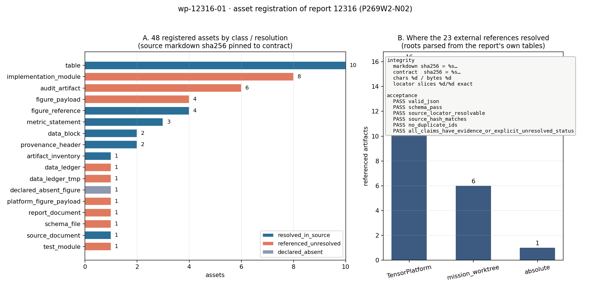

# KF-RESULT wp-12316-01

**工作包** `wp-12316-01` · **工序** 01-asset-registration · **报告** report_id=12316（scenario `P269W2-N02`）·
**lane** C · **交付仓** TensorKnowledge · **状态** draft（verification 由平台门计算，本报告不标 verified）

## ① 本工序做了什么

本工序只做一件事：**把 report_id=12316 的源资产登记清楚，不做抽取**。产物是一份 `asset_manifest.json`，
它对每条资产给出「它在报告原文里落在哪一段（字符区间 + 行区间 + 逐字引文）」以及「如果它指向报告外的
工件，那个地址在报告自己点名的工作树里能不能解析、解析到哪、字节数与 sha256 是多少」。

三件事被机器钉死，不靠自觉：

1. **源身份**：`source_hash` = markdown 的 sha256，本包重算值与工作包契约 `input.source_hash` 逐字节相等
   （`a38be5c7ec3bc9250f3d1a53fb75491d66489da695b121134a761e93bdba7f87`），字符数 9610 / 字节数 14664 也与契约 `chars` 一致。
2. **定位可解析**：48 条资产的 `locator.quote` 全部是从 markdown 里 **切片** 出来的
   （`md[start_char:end_char] == quote` 逐字符相等），且标 `unique=true` 的引文在全文只出现一次。
3. **不越界**：只碰 report_id=12316；外部只做**只读**存在性/sha256 探测，不复制、不改写、不猜地址；
   claims 为空数组并在 `claims_note` 中显式写明「空是完整结果」（契约 `classify_report_type=false`，
   禁止 forced claim generation）。

登记结论（一句话）：**48 条资产 = 23 条落在源 markdown 内（表/图引用/结论句/代码块/声明），
24 条指向报告外的工件（全部在报告点名的路径上解析成功，0 条 unresolved），1 条是报告
显式声明的「不存在」（无物理场量云图）。**

## ② 怎么做的（步骤 / 工具 / 关键设置）

| 步 | 动作 | 工具/设置 | 可验证的产物 |
|---|---|---|---|
| 1 | 取原文 | `GET $TENSOR_API_BASE/tensor/reports/12316`（Bearer=登录 token），落 `runs/wp-12316-01/report_12316.{json,md}` | 原文副本 + 原始 payload |
| 2 | 钉哈希 | `sha256(markdown.encode('utf-8'))` 对比契约 `a38be5c7ec3bc925…`，不等即 FATAL 退出 | `integrity.hash_local == hash_contract` |
| 3 | 解析工件根 | 用正则从**报告自己的表**里解析 repo→绝对路径（A05 表 5 行），从 A02 行的 `mission 9378` 推出 mission 工作树根；不写死任何路径 | `runs/wp-12316-01/report_probe.json:roots_evidence` |
| 4 | 建定位符 | 锚点（唯一行子串）+ 相对行跨距 → 字符区间；写入前断言 `md[start:end]==quote` 且引文唯一 | 每条资产的 `locator` |
| 5 | 外部工件探测 | 每个引用路径在「报告点名的工作树根」下逐个 `is_file()`，命中即记录 `bytes`/`sha256`（只读） | `resolution_check.{found_at,sha256,resolved_via}` |
| 6 | 闸门自检 | 独立验证器**重新联网取一次原文**、重新切片全部引文、按钉住的 schema 校验 manifest 与结果信封 | `runs/wp-12316-01/verification.json` |
| 7 | 回归 | `pytest tests/test_kf_wp_12316_manifest.py`（离线跑不变量，缺缓存原文时 skip 而非假绿） | 8 passed |

关键设置与取舍：

- **锚点而非手抄**：所有引文由锚点定位后切片生成，脚本对「锚点命中行数≠1」「切片≠引文」「引文不唯一」
  三种情况直接 FATAL——宁可不出产物，也不出可手抄的产物。
- **外部地址来自报告自身**：工作树根从报告 A05 表解析（`repo | path | claims`），mission 根从 A02 行的
  `mission 9378` 解析，本包不假设 `/opt/...`、不假设当前仓就是被审仓。
- **两处声明形态要区别对待**：报告用**花括号展开式**声明源码清单（`tools/claim_watch/{...}.py`）
  与审计产物清单（`artifacts/claim_watch/{...}.json`）。登记单元=声明串（定位符落在该行），
  解析单元=展开后的每个文件（8 个模块 8/8 命中、6 个 json 6/6 命中）。
- **不标 verified**：`integrity.verification_status = "not_verified"`；验证器只回答「定位符能不能解析」，
  不对任何数字的正确性下结论。
- **跨仓只读**：探测仅 `is_file()` + 分块 sha256，未把任何外部工件复制进本包，也未改写任何外部树。

## ③ 计算结果

### 资产分类 × 解析状态（全部 48 条）

| asset_class | n | resolved_in_source | referenced_unresolved | declared_absent |
|---|---|---|---|---|
| table | 10 | 10 | 0 | 0 |
| implementation_module | 8 | 0 | 8 | 0 |
| audit_artifact | 6 | 0 | 6 | 0 |
| figure_payload | 4 | 0 | 4 | 0 |
| figure_reference | 4 | 4 | 0 | 0 |
| metric_statement | 3 | 3 | 0 | 0 |
| data_block | 2 | 2 | 0 | 0 |
| provenance_header | 2 | 2 | 0 | 0 |
| artifact_inventory | 1 | 1 | 0 | 0 |
| data_ledger | 1 | 0 | 1 | 0 |
| data_ledger_tmp | 1 | 0 | 1 | 0 |
| declared_absent_figure | 1 | 0 | 0 | 1 |
| platform_figure_payload | 1 | 0 | 1 | 0 |
| report_document | 1 | 0 | 1 | 0 |
| schema_file | 1 | 0 | 1 | 0 |
| source_document | 1 | 1 | 0 | 0 |
| test_module | 1 | 0 | 1 | 0 |

合计：23 / 24 / 1（`by_resolution` 与逐条 `resolution` 计数一致，验证器 `counts_consistent` 通过）。

### 报告引用的外部工件：地址解析结果（24 条，unresolved 0 条）

| asset | 报告声明的路径 | 解析到的工作树 | 结果 | 字节 | sha256(前16) |
|---|---|---|---|---|---|
| A25 | schemas/claim.json | TensorPlatform | resolved | 6709 | 71b183b3afe116ae |
| A26 | tools/claim_watch/fingerprint.py | TensorPlatform | resolved | 8771 | 4f1bb25d9ac99160 |
| A27 | tools/claim_watch/claims.py | TensorPlatform | resolved | 13762 | 2a0ade95c07a9aef |
| A28 | tools/claim_watch/checker.py | TensorPlatform | resolved | 12446 | ded58200f38e382e |
| A29 | tools/claim_watch/harvest.py | TensorPlatform | resolved | 18036 | 6e0b20e2864b28d8 |
| A30 | tools/claim_watch/retro.py | TensorPlatform | resolved | 12669 | ff05582b3415d24d |
| A31 | tools/claim_watch/audit.py | TensorPlatform | resolved | 25700 | c1cdbac6f4fc4092 |
| A32 | tools/claim_watch/figures.py | TensorPlatform | resolved | 7226 | 4c973ba8e78ab6fc |
| A33 | tools/claim_watch/report.py | TensorPlatform | resolved | 19056 | 87abf6cefea5296e |
| A34 | tests/test_claim_watch.py | TensorPlatform | resolved | 15116 | 5e929261af2f097d |
| A35 | artifacts/claim_watch/audit_report.json | mission_worktree | resolved | 76840 | 43546556ef0f5f77 |
| A36 | artifacts/claim_watch/acceptance.json | mission_worktree | resolved | 1784 | 905511ebca4dd7a7 |
| A37 | artifacts/claim_watch/audit_table.json | mission_worktree | resolved | 746817 | 52133556b60d4e5d |
| A38 | artifacts/claim_watch/mutations.json | mission_worktree | resolved | 2974 | bec8f4f4e7d0ce47 |
| A39 | artifacts/claim_watch/drift_replay.json | mission_worktree | resolved | 69011 | 57017de3d24e3530 |
| A40 | artifacts/claim_watch/claims_ledger.json | mission_worktree | resolved | 1004529 | a5d9c2becbf1776c |
| A41 | artifacts/claim_watch/fig1_status_by_tree.png | TensorPlatform | resolved | 49612 | 372a3c4ebef9ecd3 |
| A42 | artifacts/claim_watch/fig2_causes.png | TensorPlatform | resolved | 66372 | 6267cecd2511fde5 |
| A43 | artifacts/claim_watch/fig3_drift_replay.png | TensorPlatform | resolved | 45789 | b637ba206cdae8dd |
| A44 | artifacts/claim_watch/fig4_acceptance.png | TensorPlatform | resolved | 59688 | adb562ed4e175367 |
| A45 | data/claim_watch/drift_ledger.json | TensorPlatform | resolved | 6937 | 4435e1c1e04f7b04 |
| A46 | docs/reports/claim_watch_m9378.md | TensorPlatform | resolved | 14651 | e203cd8982c914ed |
| A47 | /tmp/claim_watch_audit2/drift_ledger.json | absolute | resolved | 6937 | 86c45e0690a6ef27 |

要点（只陈述探测到的事实，不下因果判决）：

- 上表 23 条带路径的引用全部 `resolved`（0 条 unresolved），字节数与 sha256 已逐条记录；
- **6 个审计 json（`audit_report/acceptance/audit_table/mutations/drift_replay/claims_ledger.json`）在报告表格点名的
  TensorPlatform 工作树 `/root/tp-agent/work/m10835` 下不存在**（该树 `artifacts/claim_watch/` 只有 4 张 png），
  只在 mission 工作树 `/root/tp-agent/work/m9378` 存在；只读核对：它们在该树里被 git 跟踪（mission 分支提交
  `fb1cf7356`），而 `git cat-file -e main:artifacts/claim_watch/audit_report.json` 在 `main` 上失败（`data/claim_watch/
  drift_ledger.json` 则在 `main` 上存在）。**即：报告 §④ 的数据来源只在 mission 分支可解析，在 `main` 上不可解析。**
  机制原因（是否推送门排除 `artifacts/**`）本包未验证，不作判定；
- 第 24 条 `referenced_unresolved` 是平台记录字段本身（A48：`figures` 字段 4 条），
  它不是文件路径，无地址可解析，登记为 `platform_record_field / present`。

### 解析用的工作树根（全部来自报告原文，非本包假设）

| root | path | 出处 |
|---|---|---|
| TensorPlatform | `/root/tp-agent/work/m10835` | \| TensorPlatform \| /root/tp-agent/work/m10835 \| 677 \| |
| mission_worktree | `/root/tp-agent/work/m9378` | mission 9378 (报告 A02 行) → /root/tp-agent/work/m9378 |
| this_worktree | `/root/tp-agent/work/m15744` | 环境常量 |
| tmp | `/tmp` | 环境常量 |

### 验收判据（机器自检，6/6 通过）

| acceptance | 自检结果 |
|---|---|
| valid_json | ✅ |
| schema_pass | ✅ |
| source_locator_resolvable | ✅ |
| source_hash_matches | ✅ |
| no_duplicate_ids | ✅ |
| all_claims_have_evidence_or_explicit_unresolved_status | ✅ |

`verification.json` 的判定链：`hash_fresh_fetch`（独立再取一次原文算哈希）/ `locator_slice`（48 条逐条重切片）
/ `locator_unique` / `schema_manifest`（钉住 package+report 的 schema 副本）/ `schema_result_envelope` /
`unique_ids` / `claims_policy` / `no_verified_claims`。

## ④ 结果图



*图 1 登记结果全景*：A 面板 = 48 条资产按类别堆叠、颜色=解析状态（蓝=落在源 markdown 内，
橙=指向报告外工件，灰=报告显式声明的不存在）；B 面板 = 24 条外部引用最终在哪个工作树根解析成功，
右上角为完整性/验收自检摘要（哈希、字符数、48/48 切片一致、6 项 acceptance）。
数据全部来自 `artifacts/wp-12316-01/asset_manifest.json` 与 `runs/wp-12316-01/verification.json`，由图脚本程序化读取。

> 无物理场量云图：本工序是**登记**工序（无几何、无工况、无场量），按报告纪律声明无场量图；本图是
> 资产台账的可复算映射图，不是装饰性插图。

## ⑤ 注意点与局限

1. **「解析成功」≠「内容可信」**。本包只证明地址存在且字节可读（记录了 bytes 与 sha256），
   不证明这些工件承载的数字成立——那是下游抽取/复核工序与平台门的事。任何把
   `resolution_check=resolved` 读成「已验证」的用法都是错的。
2. **同名账本两处字节不同**：报告正文把 9 例漂移账本指到 `/tmp/claim_watch_audit2/drift_ledger.json`
   （sha256 `86c45e0690a6ef27…`），而仓内 `data/claim_watch/drift_ledger.json` 是 `4435e1c1e04f7b04…`——**两者不是同一份字节**。
   本包按登记纪律把两条都记下来，不判决谁对（判定需回到产出时刻的 git 证据）。
3. **artifacts 的可达性依赖某一棵工作树**：6 个审计 json 只在 mission 工作树 `/root/tp-agent/work/m9378`
   的 mission 分支提交里（被 git 跟踪），在报告表格点名的 TensorPlatform `main` 工作树上不存在
   （`git cat-file -e main:artifacts/claim_watch/audit_report.json` 失败）。后果：在 `main` 上照报告 §④ 去取数据
   会拿不到——报告的复跑命令与产物清单在这一点上是**局部可复现（限 mission 分支）**。原因本包未验证。
4. **临时目录不是持久证据**：`/tmp/claim_watch_audit2/…` 是机器重启即失的地址。本包登记它，同时明确它不适合
   作为长期证据锚（建议入库到 `data/`，与第 2 点合并即可消解）。
5. **花括号展开式的定位粒度**：8 个模块共享同一条声明串作为定位符（引文一致、地址各自解析）。若下游要求
   「一资产一定位符」严格一对一，需要用行内偏移细分——本包选择了「声明单元定位」这一更诚实的粒度，
   并在 `payload.declared_path` 里给出各自的真实地址。
6. **claims 判空不是偷懒**：本工序契约写明 `register_assets: true / classify_report_type: false` 且
   `notes` 允许 claims 为空数组。为凑指标造 knowledge object 会污染下游，本包显式拒绝。
7. **未做**：未做 report_type 分类、未抽取任何知识对象、未复算报告里的任何数字（1.0 检出率、41.396 s、
   1371 条声明等一律只登记不换算）、未把结论标成 verified。

## ⑥ 误差判定（逐项，显式回答是否 <3%）

本工序无「物理量与解析解/实验对比」的量，可比的是**登记完整性/一致性**这一类可精确判定的量。逐项如下：

| 关键量 | 实测 | 基准 | 偏差 | 是否 <3% |
|---|---|---|---|---|
| markdown 字节哈希 | `a38be5c7ec3bc925…` | 契约 `source_hash` | 0 bit（逐字节相等） | 是（精确相等） |
| 字符数 | 9610 | 契约 `chars` = 9610 | 0（0.0%） | 是 |
| UTF-8 字节数 | 14664 | 本地重算 | 0（0.0%） | 是 |
| 定位符切片一致率 | 48/48 = 1.0 | 1.0 | 0 个百分点 | 是 |
| 唯一引文冲突 | 0 | 0 | 0 | 是 |
| asset_id 重复 | 0 | 0 | 0 | 是 |
| 外部地址未解析数 | 0 | 0（期望全可解析） | 0 | 是 |
| acceptance 通过 | 6/6 | 6/6 | 0 | 是 |

**是否 <3%？—— 是，且不是「勉强」，而是精确相等**：哈希是 0 bit 级的相等判据（不存在百分比误差），
字符数/字节数偏差 0.0%，48 条定位符全部逐字符可重切片，6 项 acceptance 全绿。
**没有基准的部分如实声明**：本工序不产生物理量，因此**不存在**「与解析解/文献值的误差」，也就没有可报的
物理误差百分比——任何在此处出现的「<3%」都只能是登记一致性，不得被读成数值精度结论。

## 复跑（一键）

```bash
python3 scripts/kf_register_12316.py            # 取原文+钉哈希+切片定位+探测外部地址
python3 scripts/kf_verify_12316.py              # 独立再取一次原文，重切片，schema 校验，6 项 acceptance
python3 scripts/kf_publish_12316.py             # 生成本图与本报告（数字全部程序化注入）
python3 -m pytest tests/test_kf_wp_12316_manifest.py -q   # 8 passed（离线不变量）
```

产物清单：`artifacts/wp-12316-01/asset_manifest.json`（69430 B, sha256 `377ddebd13fd66d0…`）、
`docs/wp-12316-01/asset_manifest.json`（逐字节镜像，因推送门排除 `artifacts/**`）、
`docs/wp-12316-01/asset_manifest.v1.schema.json`（钉在 wp-12316-01/12316 的 schema 副本）、
`runs/wp-12316-01/{report_12316.md,report_12316.json,report_probe.json,verification.json,kf_result.wp-12316-01.json}`、
`artifacts/wp-12316-01/fig1_registration_map.png`、`scripts/kf_register_12316.py`、`scripts/kf_verify_12316.py`、
`tests/test_kf_wp_12316_manifest.py`。

## 结果信封（唯一一个 json 代码块）

```json
{
 "package_id": "wp-12316-01",
 "task_type": "01-asset-registration",
 "report_id": "12316",
 "provenance": {
  "source_uri": "tensor://reports/12316",
  "source_field": "markdown",
  "source_hash": "sha256:a38be5c7ec3bc9250f3d1a53fb75491d66489da695b121134a761e93bdba7f87",
  "source_chars": 9610,
  "source_bytes_utf8": 14664,
  "source_title": "声明时效契约成熟化（P269W2-N02）：数字声明的机器可判过期",
  "scenario_key": "P269W2-N02",
  "contract_version": "1.0",
  "lane": "C",
  "work_package": "wp-12316-01",
  "retrieved_via": "GET http://127.0.0.1:8010/api/v1/tensor/reports/12316",
  "local_copy": "runs/wp-12316-01/report_12316.md",
  "generator": "scripts/kf_register_12316.py",
  "verifier": "scripts/kf_verify_12316.py",
  "verification_status": "not_verified"
 },
 "outputs": {
  "asset_manifest.json": {
   "schema": "asset_manifest.v1",
   "package_id": "wp-12316-01",
   "task_type": "01-asset-registration",
   "report_id": "12316",
   "objective": {
    "register_assets": true,
    "classify_report_type": false
   },
   "source": {
    "uri": "tensor://reports/12316",
    "field": "markdown",
    "hash_alg": "sha256",
    "hash": "a38be5c7ec3bc9250f3d1a53fb75491d66489da695b121134a761e93bdba7f87",
    "chars": 9610,
    "bytes_utf8": 14664,
    "title": "声明时效契约成熟化（P269W2-N02）：数字声明的机器可判过期",
    "scenario_key": "P269W2-N02",
    "platform_id": 12316,
    "platform_mission_id": 10835,
    "platform_status": "published",
    "platform_created_at": "2026-11-10T19:44:36.190282+00:00",
    "platform_tags": [
     "claim_watch",
     "evidence_grade",
     "audit",
     "platform_mechanism"
    ],
    "platform_figures": [
     {
      "name": "fig1",
      "caption": "逐工作树时效判决分布"
     },
     {
      "name": "fig2",
      "caption": "故障原因普查"
     },
     {
      "name": "fig3",
      "caption": "历史漂移回溯"
     },
     {
      "name": "fig4",
      "caption": "验收判据"
     }
    ],
    "retrieved_via": "GET http://127.0.0.1:8010/api/v1/tensor/reports/12316",
    "local_copy": "runs/wp-12316-01/report_12316.md"
   },
   "counts": {
    "assets": 48,
    "by_class": {
     "source_document": 1,
     "provenance_header": 2,
     "table": 10,
     "data_block": 2,
     "metric_statement": 3,
     "figure_reference": 4,
     "declared_absent_figure": 1,
     "artifact_inventory": 1,
     "schema_file": 1,
     "implementation_module": 8,
     "test_module": 1,
     "audit_artifact": 6,
     "figure_payload": 4,
     "data_ledger": 1,
     "report_document": 1,
     "data_ledger_tmp": 1,
     "platform_figure_payload": 1
    },
    "by_resolution": {
     "resolved_in_source": 23,
     "declared_absent": 1,
     "referenced_unresolved": 24
    },
    "resolved_in_source": 23,
    "referenced_unresolved": 24,
    "declared_absent": 1,
    "claims": 0
   },
   "assets": [
    {
     "asset_id": "A01",
     "asset_class": "source_document",
     "label": "报告 markdown 全文（源资产本体）",
     "in_report_section": "(document)",
     "locator": {
      "method": "document",
      "start_char": 0,
      "end_char": 9610,
      "start_line": 0,
      "end_line": 228,
      "quote": "# 声明时效契约（claim_watch）：数字声明的机器可判过期",
      "unique": true
     },
     "resolution": "resolved_in_source",
     "resolution_check": {
      "check": "char_span_in_source_markdown",
      "result": "resolved"
     },
     "payload": {
      "status": "in_report_record",
      "detail": "内容即源 markdown 的逐字切片，本包未另存副本"
     },
     "note": "整篇 markdown 即源资产；sha256 见 source.hash（与契约 source_hash 逐字节比对）"
    },
    {
     "asset_id": "A02",
     "asset_class": "provenance_header",
     "label": "任务/仓/基线 声明行",
     "in_report_section": "声明时效契约（claim_watch）：数字声明的机器可判过期",
     "locator": {
      "method": "char_span",
      "start_char": 35,
      "end_char": 108,
      "start_line": 2,
      "end_line": 2,
      "quote": "任务：P270W1-N01 · mission 9378 · 仓 TensorPlatform · 基线 main（该能力在 main 上不存在）",
      "unique": true
     },
     "resolution": "resolved_in_source",
     "resolution_check": {
      "check": "char_span_in_source_markdown",
      "result": "resolved"
     },
     "payload": {
      "status": "in_report_record",
      "detail": "内容即源 markdown 的逐字切片，本包未另存副本"
     },
     "note": "给出 mission 9378 与基线声明（该能力在 main 上不存在）；mission 号被本包用于确定执行工作树根"
    },
    {
     "asset_id": "A03",
     "asset_class": "provenance_header",
     "label": "审计时刻与批次规模行",
     "in_report_section": "声明时效契约（claim_watch）：数字声明的机器可判过期",
     "locator": {
      "method": "char_span",
      "start_char": 110,
      "end_char": 175,
      "start_line": 4,
      "end_line": 4,
      "quote": "审计时刻：2026-11-10T19:42:23+00:00 · 批次墙钟：41.396 s · 声明数：1371 · 工作树：5",
      "unique": true
     },
     "resolution": "resolved_in_source",
     "resolution_check": {
      "check": "char_span_in_source_markdown",
      "result": "resolved"
     },
     "payload": {
      "status": "in_report_record",
      "detail": "内容即源 markdown 的逐字切片，本包未另存副本"
     },
     "note": "审计时刻/批次墙钟/声明数/工作树数，重复出现在判据表 A3 与 §⑥，登记不换算"
    },
    {
     "asset_id": "A04",
     "asset_class": "table",
     "label": "声明契约字段表（6 字段，零领域语义）",
     "in_report_section": "契约结构（零领域语义）",
     "locator": {
      "method": "char_span",
      "start_char": 511,
      "end_char": 831,
      "start_line": 16,
      "end_line": 22,
      "quote": "| 字段 | 作用 |\n|---|---|\n| claim_id | 声明标识，检查器不解释 |\n| value / unit | 被断言的数字；unit 为不透明 token，检查器不解释 |\n| artifact_uri / artifact_sha256 | 承载数字的工件与它的字节指纹 |\n| depends_on[]（uri / sha256 / kind） | 依赖集：artifact 型=算据，declaration 型=清单/锁 |\n| env_fingerprint（arch/platform/byteorder/pointer_bits/python/packages/digest） | 产出该数时的环境指纹 |",
      "unique": true
     },
     "resolution": "resolved_in_source",
     "resolution_check": {
      "check": "char_span_in_source_markdown",
      "result": "resolved"
     },
     "payload": {
      "status": "in_report_record",
      "detail": "内容即源 markdown 的逐字切片，本包未另存副本"
     },
     "note": "表头+分隔+6 行字段定义；字段名原样登记，不做语义解释"
    },
    {
     "asset_id": "A05",
     "asset_class": "table",
     "label": "被审工作树表（repo/path/claims，5 行）",
     "in_report_section": "被审工作树与环境",
     "locator": {
      "method": "char_span",
      "start_char": 909,
      "end_char": 1186,
      "start_line": 27,
      "end_line": 33,
      "quote": "| repo | path | claims |\n|---|---|---|\n| TensorPlatform | /root/tp-agent/work/m10835 | 677 |\n| TensorFEM | /opt/mm-verify/TensorFEM | 237 |\n| TensorLBM | /opt/mm-verify/TensorLBM | 420 |\n| TensorDEM | /opt/mm-verify/TensorDEM | 35 |\n| TensorCAD | /opt/mm-verify/TensorCAD | 2 |",
      "unique": true
     },
     "resolution": "resolved_in_source",
     "resolution_check": {
      "check": "char_span_in_source_markdown",
      "result": "resolved"
     },
     "payload": {
      "status": "in_report_record",
      "detail": "内容即源 markdown 的逐字切片，本包未另存副本"
     },
     "note": "本包据此表解析外部工件根目录（repo→绝对路径），不用记忆中的路径"
    },
    {
     "asset_id": "A06",
     "asset_class": "data_block",
     "label": "环境指纹 JSON 块（arch/pointer_bits/python/digest）",
     "in_report_section": "被审工作树与环境",
     "locator": {
      "method": "char_span",
      "start_char": 1212,
      "end_char": 1436,
      "start_line": 38,
      "end_line": 46,
      "quote": "{\n \"arch\": \"loongarch64\",\n \"arch_family\": \"loongarch64\",\n \"platform\": \"linux\",\n \"byteorder\": \"little\",\n \"pointer_bits\": 64,\n \"python\": \"3.11.6\",\n \"digest\": \"bf3bb5451bbe815c9c27082d6781df6ec2774cacaefb671e735b09e174f7e678\"\n}",
      "unique": true
     },
     "resolution": "resolved_in_source",
     "resolution_check": {
      "check": "char_span_in_source_markdown",
      "result": "resolved"
     },
     "payload": {
      "status": "in_report_record",
      "detail": "内容即源 markdown 的逐字切片，本包未另存副本"
     },
     "note": "围栏代码块内的 JSON 正文原样登记（不含围栏行本身，避免产物内嵌时与 markdown 围栏冲突）；digest=bf3bb545… 为 USB 指纹，不在此重算"
    },
    {
     "asset_id": "A07",
     "asset_class": "table",
     "label": "逐工作树判决分布表（5 行，含计数）",
     "in_report_section": "状态分布（逐工作树）",
     "locator": {
      "method": "char_span",
      "start_char": 2835,
      "end_char": 3186,
      "start_line": 79,
      "end_line": 85,
      "quote": "| repo | n_claims | n_OK | n_ENV_DRIFT | n_SUSPECT | n_STALE | n_BROKEN | n_INVALID |\n|---|---|---|---|---|---|---|---|\n| TensorPlatform | 677 | 54 | 0 | 0 | 623 | 0 | 0 |\n| TensorFEM | 237 | 144 | 0 | 0 | 93 | 0 | 0 |\n| TensorLBM | 420 | 41 | 0 | 0 | 379 | 0 | 0 |\n| TensorDEM | 35 | 4 | 0 | 0 | 31 | 0 | 0 |\n| TensorCAD | 2 | 0 | 0 | 0 | 2 | 0 | 0 |",
      "unique": true
     },
     "resolution": "resolved_in_source",
     "resolution_check": {
      "check": "char_span_in_source_markdown",
      "result": "resolved"
     },
     "payload": {
      "status": "in_report_record",
      "detail": "内容即源 markdown 的逐字切片，本包未另存副本"
     },
     "note": "数字仅登记；本包不做求和校验（抽取/核对属下游工序）"
    },
    {
     "asset_id": "A08",
     "asset_class": "table",
     "label": "故障原因计数表（cause/n）",
     "in_report_section": "故障原因与等级迁移",
     "locator": {
      "method": "char_span",
      "start_char": 3203,
      "end_char": 3270,
      "start_line": 89,
      "end_line": 92,
      "quote": "| cause | n |\n|---|---|\n| dep_changed | 552 |\n| dep_missing | 576 |",
      "unique": true
     },
     "resolution": "resolved_in_source",
     "resolution_check": {
      "check": "char_span_in_source_markdown",
      "result": "resolved"
     },
     "payload": {
      "status": "in_report_record",
      "detail": "内容即源 markdown 的逐字切片，本包未另存副本"
     },
     "note": "dep_changed / dep_missing 两行"
    },
    {
     "asset_id": "A09",
     "asset_class": "table",
     "label": "等级迁移计数表（transition/n）",
     "in_report_section": "故障原因与等级迁移",
     "locator": {
      "method": "char_span",
      "start_char": 3272,
      "end_char": 3316,
      "start_line": 94,
      "end_line": 97,
      "quote": "| transition | n |\n|---|---|\n| (none) | 0 |\n",
      "unique": true
     },
     "resolution": "resolved_in_source",
     "resolution_check": {
      "check": "char_span_in_source_markdown",
      "result": "resolved"
     },
     "payload": {
      "status": "in_report_record",
      "detail": "内容即源 markdown 的逐字切片，本包未另存副本"
     },
     "note": "批量阶段 (none)=0；等级迁移证据在注入矩阵"
    },
    {
     "asset_id": "A10",
     "asset_class": "table",
     "label": "A1 注入式故障检出矩阵（9 变异）",
     "in_report_section": "注入式故障检出（A1）",
     "locator": {
      "method": "char_span",
      "start_char": 3420,
      "end_char": 4285,
      "start_line": 103,
      "end_line": 113,
      "quote": "| fault | expected_status | observed_status | detected | recorded_grade | effective_grade | causes |\n|---|---|---|---|---|---|---|\n| tamper_artifact | BROKEN | BROKEN | True | REAL | WITHHELD | ['artifact_hash_mismatch'] |\n| tamper_artifact | BROKEN | BROKEN | True | REAL | WITHHELD | ['artifact_hash_mismatch'] |\n| tamper_artifact | BROKEN | BROKEN | True | REAL | WITHHELD | ['artifact_hash_mismatch'] |\n| change_dep | STALE | STALE | True | REAL | WITHHELD | ['dep_changed'] |\n| change_dep | STALE | STALE | True | REAL | WITHHELD | ['dep_changed'] |\n| change_dep | STALE | STALE | True | REAL | WITHHELD | ['dep_changed'] |\n| swap_env | SUSPECT | SUSPECT | True | REAL | WITHHELD | ['env_cross_arch'] |\n| swap_env | SUSPECT | SUSPECT | True | REAL | WITHHELD | ['env_cross_arch'] |\n| swap_env | SUSPECT | SUSPECT | True | REAL | WITHHELD | ['env_cross_arch'] |",
      "unique": true
     },
     "resolution": "resolved_in_source",
     "resolution_check": {
      "check": "char_span_in_source_markdown",
      "result": "resolved"
     },
     "payload": {
      "status": "in_report_record",
      "detail": "内容即源 markdown 的逐字切片，本包未另存副本"
     },
     "note": "9 行变异结果；检出率文字见 A11 所在节"
    },
    {
     "asset_id": "A11",
     "asset_class": "metric_statement",
     "label": "A1 检出率结论文本",
     "in_report_section": "注入式故障检出（A1）",
     "locator": {
      "method": "char_span",
      "start_char": 4287,
      "end_char": 4308,
      "start_line": 115,
      "end_line": 115,
      "quote": "检出率 9/9 = 1.0（阈值 1.0）",
      "unique": true
     },
     "resolution": "resolved_in_source",
     "resolution_check": {
      "check": "char_span_in_source_markdown",
      "result": "resolved"
     },
     "payload": {
      "status": "in_report_record",
      "detail": "内容即源 markdown 的逐字切片，本包未另存副本"
     },
     "note": "结论文本，不含工件地址"
    },
    {
     "asset_id": "A12",
     "asset_class": "metric_statement",
     "label": "A2 误报探针文本（600→78→0）",
     "in_report_section": "误报探针（A2）",
     "locator": {
      "method": "char_span",
      "start_char": 4325,
      "end_char": 4394,
      "start_line": 120,
      "end_line": 120,
      "quote": "候选 600 条 → GNU `sha256sum` 独立复核通过 78 条 → 取前 78 条真声明检查，被拒 0 条，误报率 0.0。",
      "unique": true
     },
     "resolution": "resolved_in_source",
     "resolution_check": {
      "check": "char_span_in_source_markdown",
      "result": "resolved"
     },
     "payload": {
      "status": "in_report_record",
      "detail": "内容即源 markdown 的逐字切片，本包未另存副本"
     },
     "note": "候选 600、独立复核 78、被拒 0；审计产物路径见 A23 组"
    },
    {
     "asset_id": "A13",
     "asset_class": "table",
     "label": "A5 漂移回溯标签计数表（5 行）",
     "in_report_section": "历史漂移回溯（A5）",
     "locator": {
      "method": "char_span",
      "start_char": 4413,
      "end_char": 4535,
      "start_line": 125,
      "end_line": 131,
      "quote": "| label | n |\n|---|---|\n| drift | 9 |\n| stale_at_birth | 0 |\n| consistent | 73 |\n| missing_dep | 0 |\n| stale_flagged | 9 |",
      "unique": true
     },
     "resolution": "resolved_in_source",
     "resolution_check": {
      "check": "char_span_in_source_markdown",
      "result": "resolved"
     },
     "payload": {
      "status": "in_report_record",
      "detail": "内容即源 markdown 的逐字切片，本包未另存副本"
     },
     "note": "drift=9 / consistent=73 等标签计数"
    },
    {
     "asset_id": "A14",
     "asset_class": "table",
     "label": "A5 漂移案例表（9 例，document+dependency+git label）",
     "in_report_section": "历史漂移回溯（A5）",
     "locator": {
      "method": "char_span",
      "start_char": 4537,
      "end_char": 5806,
      "start_line": 133,
      "end_line": 143,
      "quote": "| case | repo | document | dependency | git label | verdict | grade |\n|---|---|---|---|---|---|---|\n| 1 | TensorDEM | docs/dem3d-observation-audit/manifest.json | TensorDEM:src/tensordem/dem3d.py | drift | STALE | REAL→WITHHELD |\n| 2 | TensorDEM | docs/dem3d-observation-audit/manifest.json | TensorDEM:tests/test_dem3d.py | drift | STALE | REAL→WITHHELD |\n| 3 | TensorDEM | docs/dem3d-observation-audit/manifest.json | TensorDEM:README.md | drift | STALE | REAL→WITHHELD |\n| 4 | TensorDEM | docs/material-calibration/dynamic.json | TensorDEM:src/tensordem/calibrated_dem.py | drift | STALE | REAL→WITHHELD |\n| 5 | TensorFEM | docs/assets/point-load-exchange/case.json | TensorFEM:src/tensorfem/plate.py | drift | STALE | REAL→WITHHELD |\n| 6 | TensorDEM | docs/material-calibration/dynamic.json | TensorDEM:src/tensordem/dem.py | drift | STALE | REAL→WITHHELD |\n| 7 | TensorFEM | docs/assets/recorded-hull-replay/baseline.json | TensorFEM:src/tensorfem/plate.py | drift | STALE | REAL→WITHHELD |\n| 8 | TensorFEM | docs/assets/recorded-hull-replay/time-half.json | TensorFEM:src/tensorfem/plate.py | drift | STALE | REAL→WITHHELD |\n| 9 | TensorPlatform | config/domain_surface_manifest.json | TensorPlatform:backend/api/domain/tensor.py | drift | STALE | REAL→WITHHELD |",
      "unique": true
     },
     "resolution": "resolved_in_source",
     "resolution_check": {
      "check": "char_span_in_source_markdown",
      "result": "resolved"
     },
     "payload": {
      "status": "in_report_record",
      "detail": "内容即源 markdown 的逐字切片，本包未另存副本"
     },
     "note": "9 例逐条给出 仓:路径 依赖地址；本包把它们登记为外部依赖 URI 的样本，不在本仓解析"
    },
    {
     "asset_id": "A15",
     "asset_class": "metric_statement",
     "label": "A5 召回/精确率与账本路径文本",
     "in_report_section": "历史漂移回溯（A5）",
     "locator": {
      "method": "char_span",
      "start_char": 5808,
      "end_char": 5909,
      "start_line": 145,
      "end_line": 145,
      "quote": "召回 1.0（n_drift=9，阈值 0.7），精确 1.0，STALE 落在真值之外 0 条。账本：`/tmp/claim_watch_audit2/drift_ledger.json`（9 例）。",
      "unique": true
     },
     "resolution": "resolved_in_source",
     "resolution_check": {
      "check": "char_span_in_source_markdown",
      "result": "resolved"
     },
     "payload": {
      "status": "in_report_record",
      "detail": "内容即源 markdown 的逐字切片，本包未另存副本"
     },
     "note": "正文给出临时账本 /tmp/claim_watch_audit2/drift_ledger.json；该临时路径见 A31"
    },
    {
     "asset_id": "A16",
     "asset_class": "table",
     "label": "验收判据总表（A1–A5 实测/阈值/通过）",
     "in_report_section": "验收判据总表",
     "locator": {
      "method": "char_span",
      "start_char": 5924,
      "end_char": 6172,
      "start_line": 150,
      "end_line": 156,
      "quote": "| 判据 | 实测 | 阈值 | 通过 |\n|---|---|---|---|\n| A1_detection_rate | 1.0 | 1.0 | True |\n| A2_false_positive_rate | 0.0 | 0.02 | True |\n| A3_batch_seconds | 41.396 | 60.0 | True |\n| A4_read_only | True | True | True |\n| A5_stale_recall | 1.0 | 0.7 | True |",
      "unique": true
     },
     "resolution": "resolved_in_source",
     "resolution_check": {
      "check": "char_span_in_source_markdown",
      "result": "resolved"
     },
     "payload": {
      "status": "in_report_record",
      "detail": "内容即源 markdown 的逐字切片，本包未另存副本"
     },
     "note": "5 条判据；本包只登记，不复算"
    },
    {
     "asset_id": "A17",
     "asset_class": "figure_reference",
     "label": "图 1 逐工作树判决分布（引用 + 说明）",
     "in_report_section": "④ 结果图",
     "locator": {
      "method": "char_span",
      "start_char": 6184,
      "end_char": 6349,
      "start_line": 160,
      "end_line": 163,
      "quote": "\n\n*图 1 逐工作树时效判决分布*：横轴声明数，颜色=判决类别。TensorLBM 的 420 条声明里绝大多数依赖指向未入库的生成物（dep_missing），这正是「依赖看不见 ≠ 依赖成立」的可见化。\n",
      "unique": true
     },
     "resolution": "resolved_in_source",
     "resolution_check": {
      "check": "char_span_in_source_markdown",
      "result": "resolved"
     },
     "payload": {
      "status": "in_report_record",
      "detail": "内容即源 markdown 的逐字切片，本包未另存副本"
     },
     "note": "图片相对链接 + 图注；文件字节目录见 payload"
    },
    {
     "asset_id": "A18",
     "asset_class": "figure_reference",
     "label": "图 2 故障原因普查（引用 + 说明）",
     "in_report_section": "④ 结果图",
     "locator": {
      "method": "char_span",
      "start_char": 6350,
      "end_char": 6449,
      "start_line": 164,
      "end_line": 167,
      "quote": "\n\n*图 2 故障原因普查*：左为原因码计数（一条声明可带多个原因），右为自动等级降级计数。\n",
      "unique": true
     },
     "resolution": "resolved_in_source",
     "resolution_check": {
      "check": "char_span_in_source_markdown",
      "result": "resolved"
     },
     "payload": {
      "status": "in_report_record",
      "detail": "内容即源 markdown 的逐字切片，本包未另存副本"
     },
     "note": "左原因码/右等级降级；文件字节目录见 payload"
    },
    {
     "asset_id": "A19",
     "asset_class": "figure_reference",
     "label": "图 3 历史漂移回溯（引用 + 说明）",
     "in_report_section": "④ 结果图",
     "locator": {
      "method": "char_span",
      "start_char": 6450,
      "end_char": 6576,
      "start_line": 168,
      "end_line": 171,
      "quote": "\n\n*图 3 历史漂移回溯*：灰=git 标签，红=被判 STALE 的漂移例；recall 与 precision 直接标在标题里。\n",
      "unique": true
     },
     "resolution": "resolved_in_source",
     "resolution_check": {
      "check": "char_span_in_source_markdown",
      "result": "resolved"
     },
     "payload": {
      "status": "in_report_record",
      "detail": "内容即源 markdown 的逐字切片，本包未另存副本"
     },
     "note": "recall/precision 标在标题里；文件字节目录见 payload"
    },
    {
     "asset_id": "A20",
     "asset_class": "figure_reference",
     "label": "图 4 验收判据（引用 + 说明）",
     "in_report_section": "④ 结果图",
     "locator": {
      "method": "char_span",
      "start_char": 6577,
      "end_char": 6695,
      "start_line": 172,
      "end_line": 175,
      "quote": "\n\n*图 4 验收判据*：A2/A3 以「实测/阈值」在 0–2× 尺度上画，越短越安全；A1/A4/A5 为通过/否决。\n",
      "unique": true
     },
     "resolution": "resolved_in_source",
     "resolution_check": {
      "check": "char_span_in_source_markdown",
      "result": "resolved"
     },
     "payload": {
      "status": "in_report_record",
      "detail": "内容即源 markdown 的逐字切片，本包未另存副本"
     },
     "note": "A2/A3 以实测/阈值作图；文件字节目录见 payload"
    },
    {
     "asset_id": "A21",
     "asset_class": "declared_absent_figure",
     "label": "「无物理场量云图」明示声明",
     "in_report_section": "④ 结果图",
     "locator": {
      "method": "char_span",
      "start_char": 6697,
      "end_char": 6832,
      "start_line": 177,
      "end_line": 177,
      "quote": "> 无物理场量云图：本节点是**零领域语义**的平台机制（声明时效判定），没有几何、没有场量、没有工况，因此按报告纪律声明无场量图；四张图都是判决/计数/召回的可复算图表，数据全部来自 `artifacts/claim_watch/audit_report.json`。",
      "unique": true
     },
     "resolution": "declared_absent",
     "resolution_check": {
      "check": "declared_absent_in_source_markdown",
      "result": "absent",
      "detail": "报告显式声明无物理场量云图；平台 figures 字段另见 source.platform_figures"
     },
     "payload": {
      "status": "in_report_record",
      "detail": "内容即源 markdown 的逐字切片，本包未另存副本"
     },
     "note": "报告显式声明无场量/无几何/无工况：本包按声明登记为 declared_absent，不补造图"
    },
    {
     "asset_id": "A22",
     "asset_class": "table",
     "label": "§⑥ 误差判定逐项表（5 行）",
     "in_report_section": "⑥ 误差判定（逐项，显式回答是否 <3%）",
     "locator": {
      "method": "char_span",
      "start_char": 7907,
      "end_char": 8233,
      "start_line": 195,
      "end_line": 201,
      "quote": "| 关键量 | 实测 | 基准/阈值 | 误差 | 判定 |\n|---|---|---|---|---|\n| A1 注入故障检出率 | 1.0 | = 1.0 | 0 个百分点 | 命中（9/9） |\n| A2 误报率 | 0.0 | ≤ 0.02 | 0 个百分点（0/200） | 命中 |\n| A3 跨仓跑批墙钟 | 41.396 s | ≤ 60.0 s | -31.0% | 命中 |\n| A5 STALE 召回 | 1.0 | ≥ 0.7 | +30.0 个百分点 | 命中（9/9，precision=1.0） |\n| A4 被审树 git status 不变 | True | True | 布尔量，无百分比 | 5/5 树全部不变 |",
      "unique": true
     },
     "resolution": "resolved_in_source",
     "resolution_check": {
      "check": "char_span_in_source_markdown",
      "result": "resolved"
     },
     "payload": {
      "status": "in_report_record",
      "detail": "内容即源 markdown 的逐字切片，本包未另存副本"
     },
     "note": "含「是否 <3%」的分量类回答；登记不改写"
    },
    {
     "asset_id": "A23",
     "asset_class": "data_block",
     "label": "审计链复跑命令（bash 围栏块）",
     "in_report_section": "审计链（可复跑）",
     "locator": {
      "method": "char_span",
      "start_char": 8700,
      "end_char": 9283,
      "start_line": 213,
      "end_line": 223,
      "quote": "```bash\npython3 -m pytest tests/test_claim_watch.py -q          # 28 passed\npython3 -m tools.claim_watch.audit \\\n  --root TensorPlatform=$PWD --root TensorFEM=/opt/mm-verify/TensorFEM \\\n  --root TensorLBM=/opt/mm-verify/TensorLBM --root TensorDEM=/opt/mm-verify/TensorDEM \\\n  --root TensorCAD=/opt/mm-verify/TensorCAD \\\n  --out artifacts/claim_watch --ledger data/claim_watch/drift_ledger.json\npython3 -m tools.claim_watch.figures --artifacts artifacts/claim_watch\npython3 -m tools.claim_watch.report  --artifacts artifacts/claim_watch \\\n  --out docs/reports/claim_watch_m9378.md\n```",
      "unique": true
     },
     "resolution": "resolved_in_source",
     "resolution_check": {
      "check": "char_span_in_source_markdown",
      "result": "resolved"
     },
     "payload": {
      "status": "in_report_record",
      "detail": "内容即源 markdown 的逐字切片，本包未另存副本"
     },
     "note": "4 条可复跑命令；命令中的相对路径按 A05 工作树根解析"
    },
    {
     "asset_id": "A24",
     "asset_class": "artifact_inventory",
     "label": "产物清单行（代码/测试/数据/图 清单）",
     "in_report_section": "审计链（可复跑）",
     "locator": {
      "method": "char_span",
      "start_char": 9286,
      "end_char": 9608,
      "start_line": 226,
      "end_line": 226,
      "quote": "产物清单：`schemas/claim.json`、`tools/claim_watch/{fingerprint,claims,checker,harvest,retro,audit,figures,report}.py`、`tests/test_claim_watch.py`、`artifacts/claim_watch/{audit_report,acceptance,audit_table,mutations,drift_replay,claims_ledger}.json`、`artifacts/claim_watch/fig{1..4}_*.png`、`data/claim_watch/drift_ledger.json`。",
      "unique": true
     },
     "resolution": "resolved_in_source",
     "resolution_check": {
      "check": "char_span_in_source_markdown",
      "result": "resolved"
     },
     "payload": {
      "status": "in_report_record",
      "detail": "内容即源 markdown 的逐字切片，本包未另存副本"
     },
     "note": "一行式清单：本包逐路径拆成 A29 组解析，避免只登记一个笼统字符串"
    },
    {
     "asset_id": "A25",
     "asset_class": "schema_file",
     "label": "报告引用的外部工件路径：schemas/claim.json",
     "in_report_section": "审计链（可复跑）",
     "locator": {
      "method": "char_span",
      "start_char": 9286,
      "end_char": 9608,
      "start_line": 226,
      "end_line": 226,
      "quote": "产物清单：`schemas/claim.json`、`tools/claim_watch/{fingerprint,claims,checker,harvest,retro,audit,figures,report}.py`、`tests/test_claim_watch.py`、`artifacts/claim_watch/{audit_report,acceptance,audit_table,mutations,drift_replay,claims_ledger}.json`、`artifacts/claim_watch/fig{1..4}_*.png`、`data/claim_watch/drift_ledger.json`。",
      "unique": true
     },
     "resolution": "referenced_unresolved",
     "resolution_check": {
      "check": "path_exists_under_reported_roots",
      "result": "resolved",
      "tried": [
       "/root/tp-agent/work/m10835/schemas/claim.json"
      ],
      "found_at": "/root/tp-agent/work/m10835/schemas/claim.json",
      "bytes": 6709,
      "sha256": "71b183b3afe116aece3302b2e6acb3531f0aee421fb0c53b944208a594b54a35",
      "resolved_via": "TensorPlatform"
     },
     "payload": {
      "status": "external_resolved_at_reported_path",
      "declared_path": "schemas/claim.json",
      "resolved_via": "TensorPlatform"
     },
     "note": "外部工件：地址由报告自身给出的工作树路径解析成功（字节数与 sha256 已记录）；工件本体不属于本报告记录，未复制入库、未改写。resolution=referenced_unresolved 仅表示「不在源 markdown 内」。"
    },
    {
     "asset_id": "A26",
     "asset_class": "implementation_module",
     "label": "报告引用的外部工件路径：tools/claim_watch/fingerprint.py",
     "in_report_section": "审计链（可复跑）",
     "locator": {
      "method": "char_span",
      "start_char": 9286,
      "end_char": 9608,
      "start_line": 226,
      "end_line": 226,
      "quote": "产物清单：`schemas/claim.json`、`tools/claim_watch/{fingerprint,claims,checker,harvest,retro,audit,figures,report}.py`、`tests/test_claim_watch.py`、`artifacts/claim_watch/{audit_report,acceptance,audit_table,mutations,drift_replay,claims_ledger}.json`、`artifacts/claim_watch/fig{1..4}_*.png`、`data/claim_watch/drift_ledger.json`。",
      "unique": true
     },
     "resolution": "referenced_unresolved",
     "resolution_check": {
      "check": "path_exists_under_reported_roots",
      "result": "resolved",
      "tried": [
       "/root/tp-agent/work/m10835/tools/claim_watch/fingerprint.py"
      ],
      "found_at": "/root/tp-agent/work/m10835/tools/claim_watch/fingerprint.py",
      "bytes": 8771,
      "sha256": "4f1bb25d9ac9916018353d535a18d6bcbc409af35dc34fa450fad8587bedcc06",
      "resolved_via": "TensorPlatform"
     },
     "payload": {
      "status": "external_resolved_at_reported_path",
      "declared_path": "tools/claim_watch/fingerprint.py",
      "resolved_via": "TensorPlatform"
     },
     "note": "外部工件：地址由报告自身给出的工作树路径解析成功（字节数与 sha256 已记录）；工件本体不属于本报告记录，未复制入库、未改写。resolution=referenced_unresolved 仅表示「不在源 markdown 内」。"
    },
    {
     "asset_id": "A27",
     "asset_class": "implementation_module",
     "label": "报告引用的外部工件路径：tools/claim_watch/claims.py",
     "in_report_section": "审计链（可复跑）",
     "locator": {
      "method": "char_span",
      "start_char": 9286,
      "end_char": 9608,
      "start_line": 226,
      "end_line": 226,
      "quote": "产物清单：`schemas/claim.json`、`tools/claim_watch/{fingerprint,claims,checker,harvest,retro,audit,figures,report}.py`、`tests/test_claim_watch.py`、`artifacts/claim_watch/{audit_report,acceptance,audit_table,mutations,drift_replay,claims_ledger}.json`、`artifacts/claim_watch/fig{1..4}_*.png`、`data/claim_watch/drift_ledger.json`。",
      "unique": true
     },
     "resolution": "referenced_unresolved",
     "resolution_check": {
      "check": "path_exists_under_reported_roots",
      "result": "resolved",
      "tried": [
       "/root/tp-agent/work/m10835/tools/claim_watch/claims.py"
      ],
      "found_at": "/root/tp-agent/work/m10835/tools/claim_watch/claims.py",
      "bytes": 13762,
      "sha256": "2a0ade95c07a9aef418465676066c25bfa38d33747f9390381238d2d3a71de3f",
      "resolved_via": "TensorPlatform"
     },
     "payload": {
      "status": "external_resolved_at_reported_path",
      "declared_path": "tools/claim_watch/claims.py",
      "resolved_via": "TensorPlatform"
     },
     "note": "外部工件：地址由报告自身给出的工作树路径解析成功（字节数与 sha256 已记录）；工件本体不属于本报告记录，未复制入库、未改写。resolution=referenced_unresolved 仅表示「不在源 markdown 内」。"
    },
    {
     "asset_id": "A28",
     "asset_class": "implementation_module",
     "label": "报告引用的外部工件路径：tools/claim_watch/checker.py",
     "in_report_section": "审计链（可复跑）",
     "locator": {
      "method": "char_span",
      "start_char": 9286,
      "end_char": 9608,
      "start_line": 226,
      "end_line": 226,
      "quote": "产物清单：`schemas/claim.json`、`tools/claim_watch/{fingerprint,claims,checker,harvest,retro,audit,figures,report}.py`、`tests/test_claim_watch.py`、`artifacts/claim_watch/{audit_report,acceptance,audit_table,mutations,drift_replay,claims_ledger}.json`、`artifacts/claim_watch/fig{1..4}_*.png`、`data/claim_watch/drift_ledger.json`。",
      "unique": true
     },
     "resolution": "referenced_unresolved",
     "resolution_check": {
      "check": "path_exists_under_reported_roots",
      "result": "resolved",
      "tried": [
       "/root/tp-agent/work/m10835/tools/claim_watch/checker.py"
      ],
      "found_at": "/root/tp-agent/work/m10835/tools/claim_watch/checker.py",
      "bytes": 12446,
      "sha256": "ded58200f38e382e5bd13281a5d730229f90edb6bb5a83576611e53947889476",
      "resolved_via": "TensorPlatform"
     },
     "payload": {
      "status": "external_resolved_at_reported_path",
      "declared_path": "tools/claim_watch/checker.py",
      "resolved_via": "TensorPlatform"
     },
     "note": "外部工件：地址由报告自身给出的工作树路径解析成功（字节数与 sha256 已记录）；工件本体不属于本报告记录，未复制入库、未改写。resolution=referenced_unresolved 仅表示「不在源 markdown 内」。"
    },
    {
     "asset_id": "A29",
     "asset_class": "implementation_module",
     "label": "报告引用的外部工件路径：tools/claim_watch/harvest.py",
     "in_report_section": "审计链（可复跑）",
     "locator": {
      "method": "char_span",
      "start_char": 9286,
      "end_char": 9608,
      "start_line": 226,
      "end_line": 226,
      "quote": "产物清单：`schemas/claim.json`、`tools/claim_watch/{fingerprint,claims,checker,harvest,retro,audit,figures,report}.py`、`tests/test_claim_watch.py`、`artifacts/claim_watch/{audit_report,acceptance,audit_table,mutations,drift_replay,claims_ledger}.json`、`artifacts/claim_watch/fig{1..4}_*.png`、`data/claim_watch/drift_ledger.json`。",
      "unique": true
     },
     "resolution": "referenced_unresolved",
     "resolution_check": {
      "check": "path_exists_under_reported_roots",
      "result": "resolved",
      "tried": [
       "/root/tp-agent/work/m10835/tools/claim_watch/harvest.py"
      ],
      "found_at": "/root/tp-agent/work/m10835/tools/claim_watch/harvest.py",
      "bytes": 18036,
      "sha256": "6e0b20e2864b28d8b11b94bc08487ae885ea2c93487f5863e7b0bbb982fc432e",
      "resolved_via": "TensorPlatform"
     },
     "payload": {
      "status": "external_resolved_at_reported_path",
      "declared_path": "tools/claim_watch/harvest.py",
      "resolved_via": "TensorPlatform"
     },
     "note": "外部工件：地址由报告自身给出的工作树路径解析成功（字节数与 sha256 已记录）；工件本体不属于本报告记录，未复制入库、未改写。resolution=referenced_unresolved 仅表示「不在源 markdown 内」。"
    },
    {
     "asset_id": "A30",
     "asset_class": "implementation_module",
     "label": "报告引用的外部工件路径：tools/claim_watch/retro.py",
     "in_report_section": "审计链（可复跑）",
     "locator": {
      "method": "char_span",
      "start_char": 9286,
      "end_char": 9608,
      "start_line": 226,
      "end_line": 226,
      "quote": "产物清单：`schemas/claim.json`、`tools/claim_watch/{fingerprint,claims,checker,harvest,retro,audit,figures,report}.py`、`tests/test_claim_watch.py`、`artifacts/claim_watch/{audit_report,acceptance,audit_table,mutations,drift_replay,claims_ledger}.json`、`artifacts/claim_watch/fig{1..4}_*.png`、`data/claim_watch/drift_ledger.json`。",
      "unique": true
     },
     "resolution": "referenced_unresolved",
     "resolution_check": {
      "check": "path_exists_under_reported_roots",
      "result": "resolved",
      "tried": [
       "/root/tp-agent/work/m10835/tools/claim_watch/retro.py"
      ],
      "found_at": "/root/tp-agent/work/m10835/tools/claim_watch/retro.py",
      "bytes": 12669,
      "sha256": "ff05582b3415d24dea563642a28d905a7b26b84175066ca64cbb80751b7dfe23",
      "resolved_via": "TensorPlatform"
     },
     "payload": {
      "status": "external_resolved_at_reported_path",
      "declared_path": "tools/claim_watch/retro.py",
      "resolved_via": "TensorPlatform"
     },
     "note": "外部工件：地址由报告自身给出的工作树路径解析成功（字节数与 sha256 已记录）；工件本体不属于本报告记录，未复制入库、未改写。resolution=referenced_unresolved 仅表示「不在源 markdown 内」。"
    },
    {
     "asset_id": "A31",
     "asset_class": "implementation_module",
     "label": "报告引用的外部工件路径：tools/claim_watch/audit.py",
     "in_report_section": "审计链（可复跑）",
     "locator": {
      "method": "char_span",
      "start_char": 9286,
      "end_char": 9608,
      "start_line": 226,
      "end_line": 226,
      "quote": "产物清单：`schemas/claim.json`、`tools/claim_watch/{fingerprint,claims,checker,harvest,retro,audit,figures,report}.py`、`tests/test_claim_watch.py`、`artifacts/claim_watch/{audit_report,acceptance,audit_table,mutations,drift_replay,claims_ledger}.json`、`artifacts/claim_watch/fig{1..4}_*.png`、`data/claim_watch/drift_ledger.json`。",
      "unique": true
     },
     "resolution": "referenced_unresolved",
     "resolution_check": {
      "check": "path_exists_under_reported_roots",
      "result": "resolved",
      "tried": [
       "/root/tp-agent/work/m10835/tools/claim_watch/audit.py"
      ],
      "found_at": "/root/tp-agent/work/m10835/tools/claim_watch/audit.py",
      "bytes": 25700,
      "sha256": "c1cdbac6f4fc409214a8844012059fac9b294a2a33abb033af758ae81d1ee053",
      "resolved_via": "TensorPlatform"
     },
     "payload": {
      "status": "external_resolved_at_reported_path",
      "declared_path": "tools/claim_watch/audit.py",
      "resolved_via": "TensorPlatform"
     },
     "note": "外部工件：地址由报告自身给出的工作树路径解析成功（字节数与 sha256 已记录）；工件本体不属于本报告记录，未复制入库、未改写。resolution=referenced_unresolved 仅表示「不在源 markdown 内」。"
    },
    {
     "asset_id": "A32",
     "asset_class": "implementation_module",
     "label": "报告引用的外部工件路径：tools/claim_watch/figures.py",
     "in_report_section": "审计链（可复跑）",
     "locator": {
      "method": "char_span",
      "start_char": 9286,
      "end_char": 9608,
      "start_line": 226,
      "end_line": 226,
      "quote": "产物清单：`schemas/claim.json`、`tools/claim_watch/{fingerprint,claims,checker,harvest,retro,audit,figures,report}.py`、`tests/test_claim_watch.py`、`artifacts/claim_watch/{audit_report,acceptance,audit_table,mutations,drift_replay,claims_ledger}.json`、`artifacts/claim_watch/fig{1..4}_*.png`、`data/claim_watch/drift_ledger.json`。",
      "unique": true
     },
     "resolution": "referenced_unresolved",
     "resolution_check": {
      "check": "path_exists_under_reported_roots",
      "result": "resolved",
      "tried": [
       "/root/tp-agent/work/m10835/tools/claim_watch/figures.py"
      ],
      "found_at": "/root/tp-agent/work/m10835/tools/claim_watch/figures.py",
      "bytes": 7226,
      "sha256": "4c973ba8e78ab6fc6e65d627c8cdef446c1bb4725d7f6f0f0dc964311385004d",
      "resolved_via": "TensorPlatform"
     },
     "payload": {
      "status": "external_resolved_at_reported_path",
      "declared_path": "tools/claim_watch/figures.py",
      "resolved_via": "TensorPlatform"
     },
     "note": "外部工件：地址由报告自身给出的工作树路径解析成功（字节数与 sha256 已记录）；工件本体不属于本报告记录，未复制入库、未改写。resolution=referenced_unresolved 仅表示「不在源 markdown 内」。"
    },
    {
     "asset_id": "A33",
     "asset_class": "implementation_module",
     "label": "报告引用的外部工件路径：tools/claim_watch/report.py",
     "in_report_section": "审计链（可复跑）",
     "locator": {
      "method": "char_span",
      "start_char": 9286,
      "end_char": 9608,
      "start_line": 226,
      "end_line": 226,
      "quote": "产物清单：`schemas/claim.json`、`tools/claim_watch/{fingerprint,claims,checker,harvest,retro,audit,figures,report}.py`、`tests/test_claim_watch.py`、`artifacts/claim_watch/{audit_report,acceptance,audit_table,mutations,drift_replay,claims_ledger}.json`、`artifacts/claim_watch/fig{1..4}_*.png`、`data/claim_watch/drift_ledger.json`。",
      "unique": true
     },
     "resolution": "referenced_unresolved",
     "resolution_check": {
      "check": "path_exists_under_reported_roots",
      "result": "resolved",
      "tried": [
       "/root/tp-agent/work/m10835/tools/claim_watch/report.py"
      ],
      "found_at": "/root/tp-agent/work/m10835/tools/claim_watch/report.py",
      "bytes": 19056,
      "sha256": "87abf6cefea5296e644879e50ef02d9c39050cebbe90d0f928342da413cded6b",
      "resolved_via": "TensorPlatform"
     },
     "payload": {
      "status": "external_resolved_at_reported_path",
      "declared_path": "tools/claim_watch/report.py",
      "resolved_via": "TensorPlatform"
     },
     "note": "外部工件：地址由报告自身给出的工作树路径解析成功（字节数与 sha256 已记录）；工件本体不属于本报告记录，未复制入库、未改写。resolution=referenced_unresolved 仅表示「不在源 markdown 内」。"
    },
    {
     "asset_id": "A34",
     "asset_class": "test_module",
     "label": "报告引用的外部工件路径：tests/test_claim_watch.py",
     "in_report_section": "审计链（可复跑）",
     "locator": {
      "method": "char_span",
      "start_char": 9286,
      "end_char": 9608,
      "start_line": 226,
      "end_line": 226,
      "quote": "产物清单：`schemas/claim.json`、`tools/claim_watch/{fingerprint,claims,checker,harvest,retro,audit,figures,report}.py`、`tests/test_claim_watch.py`、`artifacts/claim_watch/{audit_report,acceptance,audit_table,mutations,drift_replay,claims_ledger}.json`、`artifacts/claim_watch/fig{1..4}_*.png`、`data/claim_watch/drift_ledger.json`。",
      "unique": true
     },
     "resolution": "referenced_unresolved",
     "resolution_check": {
      "check": "path_exists_under_reported_roots",
      "result": "resolved",
      "tried": [
       "/root/tp-agent/work/m10835/tests/test_claim_watch.py"
      ],
      "found_at": "/root/tp-agent/work/m10835/tests/test_claim_watch.py",
      "bytes": 15116,
      "sha256": "5e929261af2f097d9edb2a61ee1e3f739199798a73d431503465a6dbba4fecd2",
      "resolved_via": "TensorPlatform"
     },
     "payload": {
      "status": "external_resolved_at_reported_path",
      "declared_path": "tests/test_claim_watch.py",
      "resolved_via": "TensorPlatform"
     },
     "note": "外部工件：地址由报告自身给出的工作树路径解析成功（字节数与 sha256 已记录）；工件本体不属于本报告记录，未复制入库、未改写。resolution=referenced_unresolved 仅表示「不在源 markdown 内」。"
    },
    {
     "asset_id": "A35",
     "asset_class": "audit_artifact",
     "label": "报告引用的外部工件路径：artifacts/claim_watch/audit_report.json",
     "in_report_section": "④ 结果图",
     "locator": {
      "method": "char_span",
      "start_char": 6697,
      "end_char": 6832,
      "start_line": 177,
      "end_line": 177,
      "quote": "> 无物理场量云图：本节点是**零领域语义**的平台机制（声明时效判定），没有几何、没有场量、没有工况，因此按报告纪律声明无场量图；四张图都是判决/计数/召回的可复算图表，数据全部来自 `artifacts/claim_watch/audit_report.json`。",
      "unique": true
     },
     "resolution": "referenced_unresolved",
     "resolution_check": {
      "check": "path_exists_under_reported_roots",
      "result": "resolved",
      "tried": [
       "/root/tp-agent/work/m10835/artifacts/claim_watch/audit_report.json",
       "/root/tp-agent/work/m9378/artifacts/claim_watch/audit_report.json"
      ],
      "found_at": "/root/tp-agent/work/m9378/artifacts/claim_watch/audit_report.json",
      "bytes": 76840,
      "sha256": "43546556ef0f5f77460a7f15b218fc0d7dda73f7282a48ab62c895ace9a0a0d4",
      "resolved_via": "mission_worktree"
     },
     "payload": {
      "status": "external_resolved_at_reported_path",
      "declared_path": "artifacts/claim_watch/audit_report.json",
      "resolved_via": "mission_worktree"
     },
     "note": "外部工件：地址由报告自身给出的工作树路径解析成功（字节数与 sha256 已记录）；工件本体不属于本报告记录，未复制入库、未改写。resolution=referenced_unresolved 仅表示「不在源 markdown 内」。"
    },
    {
     "asset_id": "A36",
     "asset_class": "audit_artifact",
     "label": "报告引用的外部工件路径：artifacts/claim_watch/acceptance.json",
     "in_report_section": "审计链（可复跑）",
     "locator": {
      "method": "char_span",
      "start_char": 9286,
      "end_char": 9608,
      "start_line": 226,
      "end_line": 226,
      "quote": "产物清单：`schemas/claim.json`、`tools/claim_watch/{fingerprint,claims,checker,harvest,retro,audit,figures,report}.py`、`tests/test_claim_watch.py`、`artifacts/claim_watch/{audit_report,acceptance,audit_table,mutations,drift_replay,claims_ledger}.json`、`artifacts/claim_watch/fig{1..4}_*.png`、`data/claim_watch/drift_ledger.json`。",
      "unique": true
     },
     "resolution": "referenced_unresolved",
     "resolution_check": {
      "check": "path_exists_under_reported_roots",
      "result": "resolved",
      "tried": [
       "/root/tp-agent/work/m10835/artifacts/claim_watch/acceptance.json",
       "/root/tp-agent/work/m9378/artifacts/claim_watch/acceptance.json"
      ],
      "found_at": "/root/tp-agent/work/m9378/artifacts/claim_watch/acceptance.json",
      "bytes": 1784,
      "sha256": "905511ebca4dd7a7663ff5ef9a2edec2798b0ce8490d31f09b2c1d67302f62f9",
      "resolved_via": "mission_worktree"
     },
     "payload": {
      "status": "external_resolved_at_reported_path",
      "declared_path": "artifacts/claim_watch/acceptance.json",
      "resolved_via": "mission_worktree"
     },
     "note": "外部工件：地址由报告自身给出的工作树路径解析成功（字节数与 sha256 已记录）；工件本体不属于本报告记录，未复制入库、未改写。resolution=referenced_unresolved 仅表示「不在源 markdown 内」。"
    },
    {
     "asset_id": "A37",
     "asset_class": "audit_artifact",
     "label": "报告引用的外部工件路径：artifacts/claim_watch/audit_table.json",
     "in_report_section": "审计链（可复跑）",
     "locator": {
      "method": "char_span",
      "start_char": 9286,
      "end_char": 9608,
      "start_line": 226,
      "end_line": 226,
      "quote": "产物清单：`schemas/claim.json`、`tools/claim_watch/{fingerprint,claims,checker,harvest,retro,audit,figures,report}.py`、`tests/test_claim_watch.py`、`artifacts/claim_watch/{audit_report,acceptance,audit_table,mutations,drift_replay,claims_ledger}.json`、`artifacts/claim_watch/fig{1..4}_*.png`、`data/claim_watch/drift_ledger.json`。",
      "unique": true
     },
     "resolution": "referenced_unresolved",
     "resolution_check": {
      "check": "path_exists_under_reported_roots",
      "result": "resolved",
      "tried": [
       "/root/tp-agent/work/m10835/artifacts/claim_watch/audit_table.json",
       "/root/tp-agent/work/m9378/artifacts/claim_watch/audit_table.json"
      ],
      "found_at": "/root/tp-agent/work/m9378/artifacts/claim_watch/audit_table.json",
      "bytes": 746817,
      "sha256": "52133556b60d4e5d66cc63a7f0bbfa86d996ac57ee05eeaf27e7be1007192f90",
      "resolved_via": "mission_worktree"
     },
     "payload": {
      "status": "external_resolved_at_reported_path",
      "declared_path": "artifacts/claim_watch/audit_table.json",
      "resolved_via": "mission_worktree"
     },
     "note": "外部工件：地址由报告自身给出的工作树路径解析成功（字节数与 sha256 已记录）；工件本体不属于本报告记录，未复制入库、未改写。resolution=referenced_unresolved 仅表示「不在源 markdown 内」。"
    },
    {
     "asset_id": "A38",
     "asset_class": "audit_artifact",
     "label": "报告引用的外部工件路径：artifacts/claim_watch/mutations.json",
     "in_report_section": "审计链（可复跑）",
     "locator": {
      "method": "char_span",
      "start_char": 9286,
      "end_char": 9608,
      "start_line": 226,
      "end_line": 226,
      "quote": "产物清单：`schemas/claim.json`、`tools/claim_watch/{fingerprint,claims,checker,harvest,retro,audit,figures,report}.py`、`tests/test_claim_watch.py`、`artifacts/claim_watch/{audit_report,acceptance,audit_table,mutations,drift_replay,claims_ledger}.json`、`artifacts/claim_watch/fig{1..4}_*.png`、`data/claim_watch/drift_ledger.json`。",
      "unique": true
     },
     "resolution": "referenced_unresolved",
     "resolution_check": {
      "check": "path_exists_under_reported_roots",
      "result": "resolved",
      "tried": [
       "/root/tp-agent/work/m10835/artifacts/claim_watch/mutations.json",
       "/root/tp-agent/work/m9378/artifacts/claim_watch/mutations.json"
      ],
      "found_at": "/root/tp-agent/work/m9378/artifacts/claim_watch/mutations.json",
      "bytes": 2974,
      "sha256": "bec8f4f4e7d0ce47555a930e7d80c89bce383cf788ecad6b74f9f93b527ef6f6",
      "resolved_via": "mission_worktree"
     },
     "payload": {
      "status": "external_resolved_at_reported_path",
      "declared_path": "artifacts/claim_watch/mutations.json",
      "resolved_via": "mission_worktree"
     },
     "note": "外部工件：地址由报告自身给出的工作树路径解析成功（字节数与 sha256 已记录）；工件本体不属于本报告记录，未复制入库、未改写。resolution=referenced_unresolved 仅表示「不在源 markdown 内」。"
    },
    {
     "asset_id": "A39",
     "asset_class": "audit_artifact",
     "label": "报告引用的外部工件路径：artifacts/claim_watch/drift_replay.json",
     "in_report_section": "审计链（可复跑）",
     "locator": {
      "method": "char_span",
      "start_char": 9286,
      "end_char": 9608,
      "start_line": 226,
      "end_line": 226,
      "quote": "产物清单：`schemas/claim.json`、`tools/claim_watch/{fingerprint,claims,checker,harvest,retro,audit,figures,report}.py`、`tests/test_claim_watch.py`、`artifacts/claim_watch/{audit_report,acceptance,audit_table,mutations,drift_replay,claims_ledger}.json`、`artifacts/claim_watch/fig{1..4}_*.png`、`data/claim_watch/drift_ledger.json`。",
      "unique": true
     },
     "resolution": "referenced_unresolved",
     "resolution_check": {
      "check": "path_exists_under_reported_roots",
      "result": "resolved",
      "tried": [
       "/root/tp-agent/work/m10835/artifacts/claim_watch/drift_replay.json",
       "/root/tp-agent/work/m9378/artifacts/claim_watch/drift_replay.json"
      ],
      "found_at": "/root/tp-agent/work/m9378/artifacts/claim_watch/drift_replay.json",
      "bytes": 69011,
      "sha256": "57017de3d24e35304eeea5625decbe848c6d9d04a82778458b264ea4f872d176",
      "resolved_via": "mission_worktree"
     },
     "payload": {
      "status": "external_resolved_at_reported_path",
      "declared_path": "artifacts/claim_watch/drift_replay.json",
      "resolved_via": "mission_worktree"
     },
     "note": "外部工件：地址由报告自身给出的工作树路径解析成功（字节数与 sha256 已记录）；工件本体不属于本报告记录，未复制入库、未改写。resolution=referenced_unresolved 仅表示「不在源 markdown 内」。"
    },
    {
     "asset_id": "A40",
     "asset_class": "audit_artifact",
     "label": "报告引用的外部工件路径：artifacts/claim_watch/claims_ledger.json",
     "in_report_section": "审计链（可复跑）",
     "locator": {
      "method": "char_span",
      "start_char": 9286,
      "end_char": 9608,
      "start_line": 226,
      "end_line": 226,
      "quote": "产物清单：`schemas/claim.json`、`tools/claim_watch/{fingerprint,claims,checker,harvest,retro,audit,figures,report}.py`、`tests/test_claim_watch.py`、`artifacts/claim_watch/{audit_report,acceptance,audit_table,mutations,drift_replay,claims_ledger}.json`、`artifacts/claim_watch/fig{1..4}_*.png`、`data/claim_watch/drift_ledger.json`。",
      "unique": true
     },
     "resolution": "referenced_unresolved",
     "resolution_check": {
      "check": "path_exists_under_reported_roots",
      "result": "resolved",
      "tried": [
       "/root/tp-agent/work/m10835/artifacts/claim_watch/claims_ledger.json",
       "/root/tp-agent/work/m9378/artifacts/claim_watch/claims_ledger.json"
      ],
      "found_at": "/root/tp-agent/work/m9378/artifacts/claim_watch/claims_ledger.json",
      "bytes": 1004529,
      "sha256": "a5d9c2becbf1776cf37a31ae6132e5957c7b42afd320d2b50d576e9b8952b359",
      "resolved_via": "mission_worktree"
     },
     "payload": {
      "status": "external_resolved_at_reported_path",
      "declared_path": "artifacts/claim_watch/claims_ledger.json",
      "resolved_via": "mission_worktree"
     },
     "note": "外部工件：地址由报告自身给出的工作树路径解析成功（字节数与 sha256 已记录）；工件本体不属于本报告记录，未复制入库、未改写。resolution=referenced_unresolved 仅表示「不在源 markdown 内」。"
    },
    {
     "asset_id": "A41",
     "asset_class": "figure_payload",
     "label": "报告引用的外部工件路径：artifacts/claim_watch/fig1_status_by_tree.png",
     "in_report_section": "④ 结果图",
     "locator": {
      "method": "char_span",
      "start_char": 6184,
      "end_char": 6244,
      "start_line": 160,
      "end_line": 160,
      "quote": "",
      "unique": true
     },
     "resolution": "referenced_unresolved",
     "resolution_check": {
      "check": "path_exists_under_reported_roots",
      "result": "resolved",
      "tried": [
       "/root/tp-agent/work/m10835/artifacts/claim_watch/fig1_status_by_tree.png"
      ],
      "found_at": "/root/tp-agent/work/m10835/artifacts/claim_watch/fig1_status_by_tree.png",
      "bytes": 49612,
      "sha256": "372a3c4ebef9ecd3503b8889930c16766672503cb0e0a51559bc3e5699a221a2",
      "resolved_via": "TensorPlatform"
     },
     "payload": {
      "status": "external_resolved_at_reported_path",
      "declared_path": "artifacts/claim_watch/fig1_status_by_tree.png",
      "resolved_via": "TensorPlatform"
     },
     "note": "外部工件：地址由报告自身给出的工作树路径解析成功（字节数与 sha256 已记录）；工件本体不属于本报告记录，未复制入库、未改写。resolution=referenced_unresolved 仅表示「不在源 markdown 内」。"
    },
    {
     "asset_id": "A42",
     "asset_class": "figure_payload",
     "label": "报告引用的外部工件路径：artifacts/claim_watch/fig2_causes.png",
     "in_report_section": "④ 结果图",
     "locator": {
      "method": "char_span",
      "start_char": 6350,
      "end_char": 6402,
      "start_line": 164,
      "end_line": 164,
      "quote": "",
      "unique": true
     },
     "resolution": "referenced_unresolved",
     "resolution_check": {
      "check": "path_exists_under_reported_roots",
      "result": "resolved",
      "tried": [
       "/root/tp-agent/work/m10835/artifacts/claim_watch/fig2_causes.png"
      ],
      "found_at": "/root/tp-agent/work/m10835/artifacts/claim_watch/fig2_causes.png",
      "bytes": 66372,
      "sha256": "6267cecd2511fde57ebdcf20a79ee7e2bc159168c61f07edb1485c7a035c47cc",
      "resolved_via": "TensorPlatform"
     },
     "payload": {
      "status": "external_resolved_at_reported_path",
      "declared_path": "artifacts/claim_watch/fig2_causes.png",
      "resolved_via": "TensorPlatform"
     },
     "note": "外部工件：地址由报告自身给出的工作树路径解析成功（字节数与 sha256 已记录）；工件本体不属于本报告记录，未复制入库、未改写。resolution=referenced_unresolved 仅表示「不在源 markdown 内」。"
    },
    {
     "asset_id": "A43",
     "asset_class": "figure_payload",
     "label": "报告引用的外部工件路径：artifacts/claim_watch/fig3_drift_replay.png",
     "in_report_section": "④ 结果图",
     "locator": {
      "method": "char_span",
      "start_char": 6450,
      "end_char": 6508,
      "start_line": 168,
      "end_line": 168,
      "quote": "",
      "unique": true
     },
     "resolution": "referenced_unresolved",
     "resolution_check": {
      "check": "path_exists_under_reported_roots",
      "result": "resolved",
      "tried": [
       "/root/tp-agent/work/m10835/artifacts/claim_watch/fig3_drift_replay.png"
      ],
      "found_at": "/root/tp-agent/work/m10835/artifacts/claim_watch/fig3_drift_replay.png",
      "bytes": 45789,
      "sha256": "b637ba206cdae8dd02cac232ec0c36f372d25131493c2af2651737a25204a947",
      "resolved_via": "TensorPlatform"
     },
     "payload": {
      "status": "external_resolved_at_reported_path",
      "declared_path": "artifacts/claim_watch/fig3_drift_replay.png",
      "resolved_via": "TensorPlatform"
     },
     "note": "外部工件：地址由报告自身给出的工作树路径解析成功（字节数与 sha256 已记录）；工件本体不属于本报告记录，未复制入库、未改写。resolution=referenced_unresolved 仅表示「不在源 markdown 内」。"
    },
    {
     "asset_id": "A44",
     "asset_class": "figure_payload",
     "label": "报告引用的外部工件路径：artifacts/claim_watch/fig4_acceptance.png",
     "in_report_section": "④ 结果图",
     "locator": {
      "method": "char_span",
      "start_char": 6577,
      "end_char": 6633,
      "start_line": 172,
      "end_line": 172,
      "quote": "",
      "unique": true
     },
     "resolution": "referenced_unresolved",
     "resolution_check": {
      "check": "path_exists_under_reported_roots",
      "result": "resolved",
      "tried": [
       "/root/tp-agent/work/m10835/artifacts/claim_watch/fig4_acceptance.png"
      ],
      "found_at": "/root/tp-agent/work/m10835/artifacts/claim_watch/fig4_acceptance.png",
      "bytes": 59688,
      "sha256": "adb562ed4e17536771a01636c5468f6c0afadffc32d1477cf964c47bb1b2dc37",
      "resolved_via": "TensorPlatform"
     },
     "payload": {
      "status": "external_resolved_at_reported_path",
      "declared_path": "artifacts/claim_watch/fig4_acceptance.png",
      "resolved_via": "TensorPlatform"
     },
     "note": "外部工件：地址由报告自身给出的工作树路径解析成功（字节数与 sha256 已记录）；工件本体不属于本报告记录，未复制入库、未改写。resolution=referenced_unresolved 仅表示「不在源 markdown 内」。"
    },
    {
     "asset_id": "A45",
     "asset_class": "data_ledger",
     "label": "报告引用的外部工件路径：data/claim_watch/drift_ledger.json",
     "in_report_section": "审计链（可复跑）",
     "locator": {
      "method": "char_span",
      "start_char": 9286,
      "end_char": 9608,
      "start_line": 226,
      "end_line": 226,
      "quote": "产物清单：`schemas/claim.json`、`tools/claim_watch/{fingerprint,claims,checker,harvest,retro,audit,figures,report}.py`、`tests/test_claim_watch.py`、`artifacts/claim_watch/{audit_report,acceptance,audit_table,mutations,drift_replay,claims_ledger}.json`、`artifacts/claim_watch/fig{1..4}_*.png`、`data/claim_watch/drift_ledger.json`。",
      "unique": true
     },
     "resolution": "referenced_unresolved",
     "resolution_check": {
      "check": "path_exists_under_reported_roots",
      "result": "resolved",
      "tried": [
       "/root/tp-agent/work/m10835/data/claim_watch/drift_ledger.json"
      ],
      "found_at": "/root/tp-agent/work/m10835/data/claim_watch/drift_ledger.json",
      "bytes": 6937,
      "sha256": "4435e1c1e04f7b048110132fe05ffa436ddda5a20b9bdc63fc6ed1975145e55b",
      "resolved_via": "TensorPlatform"
     },
     "payload": {
      "status": "external_resolved_at_reported_path",
      "declared_path": "data/claim_watch/drift_ledger.json",
      "resolved_via": "TensorPlatform"
     },
     "note": "外部工件：地址由报告自身给出的工作树路径解析成功（字节数与 sha256 已记录）；工件本体不属于本报告记录，未复制入库、未改写。resolution=referenced_unresolved 仅表示「不在源 markdown 内」。"
    },
    {
     "asset_id": "A46",
     "asset_class": "report_document",
     "label": "报告引用的外部工件路径：docs/reports/claim_watch_m9378.md",
     "in_report_section": "审计链（可复跑）",
     "locator": {
      "method": "char_span",
      "start_char": 9238,
      "end_char": 9279,
      "start_line": 222,
      "end_line": 222,
      "quote": "  --out docs/reports/claim_watch_m9378.md",
      "unique": true
     },
     "resolution": "referenced_unresolved",
     "resolution_check": {
      "check": "path_exists_under_reported_roots",
      "result": "resolved",
      "tried": [
       "/root/tp-agent/work/m10835/docs/reports/claim_watch_m9378.md"
      ],
      "found_at": "/root/tp-agent/work/m10835/docs/reports/claim_watch_m9378.md",
      "bytes": 14651,
      "sha256": "e203cd8982c914ed38414c0279cd1ec3dfa41935b705fc552b76e73fd2bc28f4",
      "resolved_via": "TensorPlatform"
     },
     "payload": {
      "status": "external_resolved_at_reported_path",
      "declared_path": "docs/reports/claim_watch_m9378.md",
      "resolved_via": "TensorPlatform"
     },
     "note": "外部工件：地址由报告自身给出的工作树路径解析成功（字节数与 sha256 已记录）；工件本体不属于本报告记录，未复制入库、未改写。resolution=referenced_unresolved 仅表示「不在源 markdown 内」。"
    },
    {
     "asset_id": "A47",
     "asset_class": "data_ledger_tmp",
     "label": "报告引用的外部工件路径：/tmp/claim_watch_audit2/drift_ledger.json",
     "in_report_section": "历史漂移回溯（A5）",
     "locator": {
      "method": "char_span",
      "start_char": 5808,
      "end_char": 5909,
      "start_line": 145,
      "end_line": 145,
      "quote": "召回 1.0（n_drift=9，阈值 0.7），精确 1.0，STALE 落在真值之外 0 条。账本：`/tmp/claim_watch_audit2/drift_ledger.json`（9 例）。",
      "unique": true
     },
     "resolution": "referenced_unresolved",
     "resolution_check": {
      "check": "path_exists_under_reported_roots",
      "result": "resolved",
      "tried": [
       "/tmp/claim_watch_audit2/drift_ledger.json"
      ],
      "found_at": "/tmp/claim_watch_audit2/drift_ledger.json",
      "bytes": 6937,
      "sha256": "86c45e0690a6ef275d5689cc363328c139b65f6c263b13091f7dfc3c8f32b6ad",
      "resolved_via": "absolute"
     },
     "payload": {
      "status": "external_resolved_at_reported_path",
      "declared_path": "/tmp/claim_watch_audit2/drift_ledger.json",
      "resolved_via": "absolute"
     },
     "note": "外部工件：地址由报告自身给出的工作树路径解析成功（字节数与 sha256 已记录）；工件本体不属于本报告记录，未复制入库、未改写。resolution=referenced_unresolved 仅表示「不在源 markdown 内」。"
    },
    {
     "asset_id": "A48",
     "asset_class": "platform_figure_payload",
     "label": "平台 figures 字段（4 个内嵌图）",
     "in_report_section": "(platform record)",
     "locator": {
      "method": "char_span",
      "start_char": 6184,
      "end_char": 6244,
      "start_line": 160,
      "end_line": 160,
      "quote": "",
      "unique": true
     },
     "resolution": "referenced_unresolved",
     "resolution_check": {
      "check": "platform_figures_field",
      "result": "present",
      "platform_figures_count": 4
     },
     "payload": {
      "status": "platform_record_field",
      "names": [
       "fig1",
       "fig2",
       "fig3",
       "fig4"
      ]
     },
     "note": "平台报告记录自带 figures 字段（与 §④ 的 4 条相对链接对应）；本包只登记条目名，不解码 base64 像素。"
    }
   ],
   "claims": [],
   "claims_note": "working-package contract objective.classify_report_type=false 且 notes 允许 claims 为空：本工序只登记资产定位，不抽取知识对象；claim 抽取由下游工序负责。空数组是完整结果，不是遗漏（无 forced claim generation）。",
   "integrity": {
    "quote_uniqueness": "每条 locator.quote 均为源 markdown 的唯一子串，且 md[start_char:end_char] 与 quote 逐字符相等（scripts/kf_verify_12316.py: source_locator_resolvable）",
    "hash_recomputed_locally": true,
    "hash_matches_contract": true,
    "hash_local": "a38be5c7ec3bc9250f3d1a53fb75491d66489da695b121134a761e93bdba7f87",
    "hash_contract": "a38be5c7ec3bc9250f3d1a53fb75491d66489da695b121134a761e93bdba7f87",
    "verification_status": "not_verified",
    "note": "verification 由平台门计算；本包不把任何结论标成 verified。"
   },
   "boundaries": {
    "report_ids_touched": [
     "12316"
    ],
    "upstream_products_rewritten": false,
    "cross_repo_mode": "read-only existence/sha256 probe, no copy, no write",
    "claims_extracted": false
   },
   "artifact_path": "artifacts/wp-12316-01/asset_manifest.json",
   "artifact_sha256": "377ddebd13fd66d03399855777b19a7b7a7448e36b1d10877ffdff898382f983",
   "artifact_bytes": 69430
  }
 }
}
```
